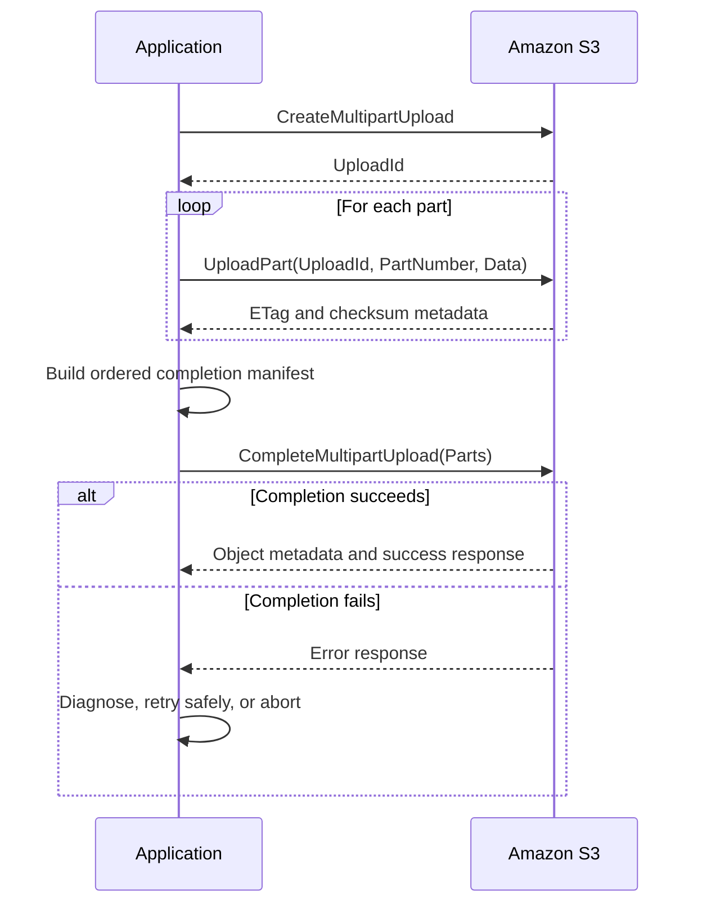

# 01- Multipart Upload Failures

## Overview

Amazon S3 multipart upload allows a large object to be uploaded as independent parts and assembled into a single object when all required parts have been uploaded successfully.

Multipart upload improves throughput, supports parallel transfers, and allows failed parts to be retried without retransmitting the entire object. However, it introduces additional state: an upload ID, numbered parts, part checksums or ETags, and a completion request.

Failures can occur during upload initiation, part transmission, completion, or cleanup. An upload may transfer every part successfully but still fail to produce an object because the completion request contains incorrect part metadata or the caller lacks the required permissions.

Common symptoms include:

- `EntityTooSmall` or `InvalidPart` during completion.
- `InvalidPartOrder` when completing an upload.
- `NoSuchUpload` when uploading, completing, or aborting a multipart upload.
- `AccessDenied` during initiation, part upload, completion, or cleanup.
- Checksum validation failures.
- Uploads that repeatedly retry or remain incomplete.
- Large files failing in Dockerized applications, background workers, or CI/CD pipelines.
- Unexpected storage charges for abandoned multipart uploads.
- Multipart uploads failing only when SSE-KMS encryption is enabled.

The objective of this guide is to identify the failed multipart operation, diagnose the actual cause, recover safely, and prevent repeated failures or orphaned upload parts.

## Understand the Multipart Upload Lifecycle

A multipart upload consists of three main phases:

1. Initiate an upload and obtain an upload ID.
2. Upload numbered parts independently, potentially in parallel.
3. Complete the upload by supplying the part numbers and their corresponding ETags or other required integrity information.

S3 assembles the object only after the completion operation succeeds.



An initiated upload does not automatically become a completed object when all bytes have been transmitted. The completion request is a separate operation that must succeed.

If an upload is abandoned, its uploaded parts remain stored until the upload is completed, explicitly aborted, or removed by an applicable incomplete-multipart-upload lifecycle rule.

## Multipart Upload Limits and Constraints

The following limits apply to general purpose S3 buckets according to the current AWS multipart upload documentation.

| Constraint | Limit |
|---|---|
| Recommended threshold for considering multipart upload | Objects around 100 MB or larger |
| Maximum object size | 48.8 TiB |
| Maximum number of parts per upload | 10,000 |
| Part-number range | 1–10,000 |
| Minimum part size | 5 MiB, except the final part |
| Maximum part size | 5 GiB |
| Minimum size of the final part | No minimum |
| Maximum parts returned by one `ListParts` response | 1,000 |
| Maximum multipart uploads returned by one `ListMultipartUploads` response | 1,000 |

Verify current limits against the official [Amazon S3 multipart upload limits](https://docs.aws.amazon.com/AmazonS3/latest/userguide/qfacts.html) documentation when designing transfer systems.

### Calculate an appropriate part size

The part size must be large enough to keep the number of parts within the 10,000-part limit.

For an object of size \(S\) and a chosen part size \(P\):

\[
N = \left\lceil \frac{S}{P} \right\rceil
\]

The selected configuration must satisfy:

- \(N \leq 10{,}000\).
- Each non-final part is at least 5 MiB.
- No part exceeds 5 GiB.

For example, a 20 GiB object split into 16 MiB parts requires approximately 1,280 parts. Increasing the part size reduces the number of requests but increases the amount of data that may need to be retransmitted when a part fails.

Choose part size based on object size, network reliability, concurrency, memory availability, and retry cost.

## Symptoms and Likely Causes

| Error or symptom | Likely cause | Diagnostic focus |
|---|---|---|
| `EntityTooSmall` | A non-final part is smaller than 5 MiB | Inspect the part sizes and completion manifest |
| `InvalidPart` | A required part is missing, its ETag is incorrect, or part metadata does not match | Compare uploaded parts with the completion request |
| `InvalidPartOrder` | Part numbers in the completion request are not ordered correctly | Sort the completion manifest by ascending part number |
| `NoSuchUpload` | Incorrect upload ID, wrong object key, or upload already completed or aborted | Verify the bucket, key, upload ID, and upload state |
| `AccessDenied` | Missing S3 permissions, applicable explicit deny, or KMS authorization failure | Inspect the failed API operation, principal, and policy configuration |
| Checksum-related error | Uploaded data, checksum algorithm, or checksum metadata does not match expectations | Verify part and object checksum configuration |
| `TooManyParts` or part-number-related failure | The implementation exceeds the maximum part count | Recalculate part size and numbering |
| Timeout or connection reset | Network interruption, proxy timeout, or overloaded client | Retry only the affected part when its state is known |
| Upload succeeds but object is missing | Completion failed or was never submitted successfully | Check completion responses and object metadata |
| Incomplete uploads accumulate | Failed workflows do not abort or complete multipart uploads | Inspect upload IDs and lifecycle cleanup |
| Multipart fails only with SSE-KMS | Missing KMS permissions or incompatible encryption configuration | Validate S3 and KMS permissions separately |

Do not infer the root cause from the exception name alone. Identify the exact multipart API operation that failed and inspect its response.

## Diagnose the Failure Stage

### Capture the original error

Collect the following information from the application or transfer worker:

- AWS error code and message.
- Bucket, object key, and Region.
- Multipart upload ID, stored securely with the associated job.
- Failed operation: initiation, part upload, completion, listing, or abort.
- Part number, part size, and retry attempt, when relevant.
- HTTP status code and request IDs.
- Encryption mode and KMS key ARN, when applicable.
- SDK version, transfer configuration, and execution environment.

Do not log AWS secret access keys, session tokens, authorization headers, or complete presigned URLs.

A multipart upload ID is operational state rather than a reusable credential, but it should still be associated with the intended bucket and object key to prevent accidental operations on the wrong upload.

### Verify the effective identity

Run the following commands in the environment where the upload fails:

```bash
aws sts get-caller-identity
aws configure list
```

For a named profile:

```bash
aws sts get-caller-identity --profile s3-debug
aws configure list --profile s3-debug
```

Confirm that the account and principal match the expected application or workload role.

A local AWS CLI command can use a different credential provider from a Boto3 application running in Docker, Kubernetes, or a CI/CD runner. Test the actual execution identity before modifying policies.

### Verify the bucket Region

Inspect the bucket's Region:

```bash
aws s3api get-bucket-location \
  --bucket example-private-bucket \
  --profile s3-debug
```

A `null` `LocationConstraint` in this legacy API response represents `us-east-1`.

Ensure that the S3 client is configured for the intended bucket Region and that any explicit endpoint override is correct.

An incorrect Region or endpoint can cause redirect, authorization, signing, or request errors that are not fundamentally multipart-specific.

## Diagnose `EntityTooSmall`

`EntityTooSmall` commonly occurs when the completion request contains a non-final part smaller than the required minimum.

The minimum-size constraint applies to every part except the final part.

### Typical failure

An application divides a 100 MiB object into ten 10 MiB parts, but its final chunking logic also produces a small intermediate part because of a buffer boundary or incorrect offset calculation.

The upload may appear to progress normally. S3 then rejects completion because the uploaded parts do not satisfy the part-size requirements.

### Verification

Use `ListParts` to inspect the uploaded parts:

```bash
aws s3api list-parts \
  --bucket example-private-bucket \
  --key "uploads/archive.bin" \
  --upload-id "UPLOAD_ID"
```

Replace the placeholders with the exact bucket, key, and upload ID.

Check the `Size` value for each part. Because a response can contain at most 1,000 parts, use pagination when inspecting large uploads.

### Corrective action

- Correct the chunking algorithm.
- Ensure all non-final parts meet the minimum part size.
- Ensure that each part lies within the permitted size range.
- Recalculate the completion manifest.
- Re-upload invalid parts when required by the recovery strategy.

Do not assume that retrying the completion operation without changing the uploaded part layout will resolve a size violation.

## Diagnose `InvalidPart` and `InvalidPartOrder`

S3 needs a valid completion manifest identifying the parts that should be assembled into the final object.

Each entry must correspond to an uploaded part and contain the required identifying metadata.

### Common causes

- A part failed to upload, but the application recorded it as successful.
- The application stored an incorrect or stale ETag.
- A retry generated a different part result, but the completion manifest retained old metadata.
- Part numbers were reused incorrectly.
- The completion list omitted a required part.
- The completion manifest was constructed from concurrent worker results without validating or sorting the entries.

### Inspect uploaded parts

Use:

```bash
aws s3api list-parts \
  --bucket example-private-bucket \
  --key "uploads/archive.bin" \
  --upload-id "UPLOAD_ID"
```

Compare the returned part numbers, ETags, sizes, and checksum metadata with the manifest used by the completion request.

For `InvalidPartOrder`, sort the completion entries by ascending part number.

For `InvalidPart`, verify that the specified part numbers and their corresponding ETags match the uploaded parts. Re-upload an invalid or missing part when appropriate, then rebuild the manifest from the confirmed results.

### Do not treat the ETag as a universal object checksum

A multipart object's final ETag is not generally the MD5 hash of the complete object. ETags are used as part identifiers in multipart completion, but they should not be treated as a universal integrity guarantee.

When end-to-end integrity matters, use supported S3 checksum mechanisms and validate the checksum type and values required by the selected upload workflow.

## Diagnose `NoSuchUpload`

`NoSuchUpload` indicates that S3 cannot find an active multipart upload matching the supplied identifiers.

Possible causes include:

- The upload ID belongs to another bucket or object key.
- The upload was already completed.
- The upload was aborted.
- The upload ID was not persisted correctly.
- An application retried using stale job state.
- Cleanup removed the upload before the client resumed it.

### Verification

List active multipart uploads for the bucket:

```bash
aws s3api list-multipart-uploads \
  --bucket example-private-bucket
```

Check the key and upload ID in the response.

For large result sets, handle pagination rather than assuming that the first response includes every active upload.

If the intended upload is absent, inspect the job state and determine whether it was completed, aborted, or lost from application tracking. Check object metadata when completion is suspected.

Do not blindly initiate a replacement upload in every retry path. First determine whether the previous upload completed, because a retry could create duplicate application work or overwrite an existing object.

## Diagnose AccessDenied During Multipart Upload

Multipart operations require the appropriate S3 permissions for initiation, part upload, completion, listing, and aborting.

| Operation | Typical S3 permission |
|---|---|
| `CreateMultipartUpload` | `s3:PutObject` |
| `UploadPart` | `s3:PutObject` |
| `CompleteMultipartUpload` | `s3:PutObject` |
| `AbortMultipartUpload` | `s3:AbortMultipartUpload` |
| `ListParts` | `s3:ListMultipartUploadParts` |
| `ListMultipartUploads` | `s3:ListBucketMultipartUploads` |

The complete permission set depends on the workflow, additional APIs used, and applicable policies.

### Verify authorization

Identify the exact failed API operation and the effective role.

Inspect:

- Identity-based IAM policies.
- Bucket policies.
- Explicit deny statements.
- Permissions boundaries and session policies.
- AWS Organizations service control policies.
- VPC endpoint policies, where applicable.

For SSE-KMS encrypted uploads, additional KMS permissions are required. In particular, multipart workflows commonly require `kms:GenerateDataKey` and `kms:Decrypt` on the selected key.

Verify the KMS key policy and key state separately from S3 permissions. See [Access Denied During SSE-KMS Operations](../04-%20Encryption-and-kms/02-%20Access%20Denied%20During%20SSE-KMS%20Operations.md) for the KMS-specific diagnostic workflow.

Do not grant broad bucket or KMS permissions to resolve an error until the denied action and effective principal have been established.

## Diagnose Checksum and Data Integrity Failures

S3 supports checksum mechanisms for validating uploaded data. Multipart workflows can use part-level checksums, composite checksums, or supported full-object checksum configurations.

Checksum-related failures can occur when:

- The client sends a checksum that does not match the bytes transmitted.
- A part is retried with different data but stale checksum metadata.
- The selected checksum algorithm is inconsistent across the workflow.
- Required checksum values are omitted from the completion request.
- The completion manifest contains stale or incompatible part metadata.
- An implementation incorrectly assumes that a multipart ETag is the full-object MD5 hash.

### Verification procedure

1. Identify the checksum algorithm and checksum type selected for the upload.
2. Inspect the checksum values returned or recorded for each uploaded part.
3. Verify that retries preserve the correct part number and update the associated metadata.
4. Ensure the completion request contains the checksum information required by the selected API workflow.
5. Inspect the final object's checksum metadata when available.

Do not disable checksum validation simply to make a failing upload complete. Correct the mismatch and verify the resulting object.

See the official [S3 object integrity documentation](https://docs.aws.amazon.com/AmazonS3/latest/userguide/checking-object-integrity-upload.html) for the checksum behavior supported by multipart uploads.

## Diagnose Network Timeouts and Interrupted Uploads

Multipart upload reduces the impact of network interruptions because a failed part can be retried independently. However, network failures can leave application and S3 state temporarily inconsistent.

A worker may lose the response to an `UploadPart` request even though S3 accepted the part. Retrying that part number is generally compatible with multipart operation semantics, but the application should record the definitive result returned by S3.

### Typical causes

- Unstable client network connectivity.
- Reverse-proxy or gateway timeouts.
- Insufficient socket timeout settings.
- Concurrent uploads exceeding available memory or connections.
- Worker termination during upload.
- Container shutdown or autoscaling during an active transfer.
- Excessive retry concurrency under throttling or service errors.

### Corrective action

- Use SDK-managed retries and transfer utilities where appropriate.
- Retry transient failures with bounded exponential backoff and jitter.
- Avoid indefinitely retrying deterministic errors such as invalid part metadata or permission failures.
- Persist upload ID and confirmed part metadata when resumability is required.
- Ensure the worker does not mark the job complete until the S3 completion operation succeeds.
- Bound transfer concurrency to the available network and memory budget.

High concurrency does not always improve throughput. Large parts multiplied by multiple concurrent transfers can cause excessive memory use, connection pressure, and retry amplification.

For backend services, consider using presigned part URLs when clients should upload large objects directly to S3 instead of sending all file bytes through the API server.

## Diagnose Multipart Uploads in Python and Boto3

For ordinary backend file uploads, prefer Boto3's high-level transfer interface. It manages multipart initiation, part transfer, and completion based on the configured transfer settings.

```python
import boto3
from boto3.s3.transfer import TransferConfig
from botocore.exceptions import BotoCoreError, ClientError

s3_client = boto3.client(
    "s3",
    region_name="ap-south-1",
)

transfer_config = TransferConfig(
    multipart_threshold=64 * 1024 * 1024,
    multipart_chunksize=16 * 1024 * 1024,
    max_concurrency=4,
    use_threads=True,
)

try:
    s3_client.upload_file(
        "./archive.bin",
        "example-private-bucket",
        "uploads/archive.bin",
        Config=transfer_config,
    )
except (ClientError, BotoCoreError):
    raise
```

This example uses multipart transfer for sufficiently large files and limits concurrent transfer threads to four. The threshold and chunk size are illustrative; tune them according to workload and resource limits.

Boto3's high-level transfer interface does not expose every low-level multipart operation directly. When diagnosing an internal transfer failure, capture sanitized SDK error details and use S3 API-level diagnostics as needed.

### Low-level multipart troubleshooting

When using the low-level API, persist:

- Bucket and object key.
- Upload ID.
- Part number.
- Part size.
- Confirmed ETag.
- Checksum metadata, when used.
- Retry count and terminal error.

Use `ListParts` to reconcile application state with S3 before attempting completion after an ambiguous failure.

Do not construct a completion manifest solely from the list of parts that the application intended to upload. Build it from the actual confirmed results.

## Diagnose Resource and Concurrency Issues

The part size and concurrency configuration affect network throughput, memory use, and the number of S3 requests.

A rough planning estimate for buffered data is:

\[
M \approx P \times C
\]

where \(P\) is the part size and \(C\) is the number of concurrently buffered parts. Actual memory use depends on the SDK, streaming behavior, buffer implementation, and the number of concurrent file uploads.

For example, 64 MiB parts and eight concurrently buffered parts can require approximately 512 MiB of part buffers alone. Multiple simultaneous uploads can multiply that requirement.

### Production checks

- Measure upload throughput and retry rates.
- Track worker memory and connection saturation.
- Bound the number of concurrent uploads per worker.
- Use a part size that keeps the part count below 10,000 for the largest expected object.
- Ensure part numbers are unique within an upload.
- Make retry handling idempotent at the application-job level.
- Avoid running multiple independent completion operations against the same upload state.

If the workload contains very large objects, calculate the maximum expected number of parts before choosing a fixed part size.

## Recover and Clean Up Incomplete Uploads

Incomplete multipart uploads can retain billable uploaded parts even though no completed object is available.

### List incomplete uploads

```bash
aws s3api list-multipart-uploads \
  --bucket example-private-bucket \
  --query 'Uploads[].{Key:Key,UploadId:UploadId,Initiated:Initiated}' \
  --output table
```

For large result sets, paginate through the API results. The command's query is useful for inspection but does not guarantee that every upload is displayed in a single response.

### Inspect the parts of an upload

```bash
aws s3api list-parts \
  --bucket example-private-bucket \
  --key "uploads/archive.bin" \
  --upload-id "UPLOAD_ID"
```

Use the returned part metadata to determine whether the upload is resumable or should be abandoned.

### Abort a known failed upload

```bash
aws s3api abort-multipart-upload \
  --bucket example-private-bucket \
  --key "uploads/archive.bin" \
  --upload-id "UPLOAD_ID"
```

Aborting removes the parts associated with the incomplete upload. It does not remove a previously completed object with the same key.

If part uploads are still in progress, they can race with an abort operation. AWS documents that it may be necessary to abort again and use `ListParts` to verify that all uploaded parts have been removed.

Do not indiscriminately abort every incomplete upload in a production bucket. Some may be active, resumable, or owned by another application workflow. Identify the upload owner and apply the cleanup policy deliberately.

### Configure lifecycle cleanup

Use an S3 lifecycle rule with the `AbortIncompleteMultipartUpload` action to remove incomplete uploads older than an appropriate retention interval.

Illustrative lifecycle configuration:

```json
{
  "Rules": [
    {
      "ID": "AbortOldIncompleteMultipartUploads",
      "Status": "Enabled",
      "Filter": {
        "Prefix": "uploads/"
      },
      "AbortIncompleteMultipartUpload": {
        "DaysAfterInitiation": 7
      }
    }
  ]
}
```

This example applies to incomplete uploads under the `uploads/` prefix that have exceeded the configured age threshold. Choose the retention period based on the application's resume window and operational recovery requirements.

Lifecycle cleanup is a safety net for abandoned parts, not a replacement for correct application cleanup. Review the complete existing lifecycle configuration before deploying a replacement because lifecycle settings may already control expiration, storage transitions, and version retention.

See [Configuring a lifecycle rule to delete incomplete multipart uploads](https://docs.aws.amazon.com/AmazonS3/latest/userguide/mpu-abort-incomplete-mpu-lifecycle-config.html).

## Root Cause and Corrective Action

| Confirmed root cause | Corrective action | Prevention |
|---|---|---|
| Non-final part is too small | Correct the chunking algorithm and re-upload invalid parts | Validate part sizes before completion |
| Invalid completion manifest | Reconcile part numbers, ETags, and checksum metadata | Construct the manifest from confirmed upload results |
| Part order is invalid | Sort the completion manifest by ascending part number | Validate the manifest before completion |
| Upload ID is stale or incorrect | Verify the bucket, key, and current upload state | Persist upload state and handle terminal states explicitly |
| Missing S3 permissions | Grant the required operation on the intended resources | Test with the real workload role |
| Missing SSE-KMS permissions | Correct the required KMS authorization | Test encrypted multipart uploads separately |
| Checksum mismatch | Correct payload or checksum metadata and retry affected parts | Validate checksum algorithm and type consistently |
| Network interruption | Retry transient part failures with bounded backoff | Tune timeouts and concurrency |
| Too many parts | Increase part size within supported limits | Calculate the part count for the largest expected object |
| Orphaned upload parts | Resume or abort the identified upload | Configure lifecycle cleanup and application-level cleanup |
| Concurrent completion or inconsistent worker state | Serialize completion and reconcile the upload state | Use job ownership, locking, and idempotent workflow transitions |

After correcting the issue, verify that the completion call succeeded, the object exists at the intended key, its size and metadata are correct, and the intended consumer can access it.

## Production Best Practices

- Use SDK-managed multipart transfer for ordinary large-file uploads unless low-level control is required.
- Select part sizes and concurrency based on file size, network characteristics, retry costs, and available memory.
- Persist upload IDs and confirmed part metadata when resumability is required.
- Validate the completion manifest rather than assuming all attempted part uploads succeeded.
- Use checksums for integrity validation and do not treat multipart ETags as universal content hashes.
- Distinguish transient network errors from deterministic configuration, permission, and manifest errors.
- Test multipart upload behavior separately for SSE-KMS, cross-account, and copy workflows.
- Implement explicit cleanup on terminal failures and configure lifecycle cleanup for abandoned uploads.
- Verify abort operations when requests are in flight and avoid aborting active uploads indiscriminately.
- Monitor incomplete uploads, retry rates, transfer duration, failed completions, and storage costs.
- Test uploads through the same runtime, credentials, proxy, and deployment path used in production.
- Record enough sanitized diagnostic information to reproduce a failure without exposing signing material or credentials.

## Related AWS Documentation

- [Uploading and copying objects using multipart upload](https://docs.aws.amazon.com/AmazonS3/latest/userguide/mpuoverview.html)
- [Amazon S3 multipart upload limits](https://docs.aws.amazon.com/AmazonS3/latest/userguide/qfacts.html)
- [Uploading an object using multipart upload](https://docs.aws.amazon.com/AmazonS3/latest/userguide/mpu-upload-object.html)
- [Aborting a multipart upload](https://docs.aws.amazon.com/AmazonS3/latest/userguide/abort-mpu.html)
- [Deleting incomplete multipart uploads using lifecycle configuration](https://docs.aws.amazon.com/AmazonS3/latest/userguide/mpu-abort-incomplete-mpu-lifecycle-config.html)
- [Checking object integrity during uploads](https://docs.aws.amazon.com/AmazonS3/latest/userguide/checking-object-integrity-upload.html)
- [Troubleshooting SSE-KMS authorization failures](../04-%20Encryption-and-kms/02-%20Access%20Denied%20During%20SSE-KMS%20Operations.md)

## Key Takeaways

- Multipart upload failures must be diagnosed at the specific stage that failed: initiation, part upload, completion, or cleanup.
- `EntityTooSmall`, `InvalidPart`, `InvalidPartOrder`, and `NoSuchUpload` usually indicate different problems with part layout, completion metadata, or upload state.
- Select part size and concurrency carefully, validate checksums, and build the completion manifest from confirmed part metadata.
- Incomplete multipart uploads retain billable parts until completed, aborted, or removed by lifecycle cleanup.
- Apply targeted corrections and verify the completed object's size, metadata, encryption, and intended access before marking the application job successful.