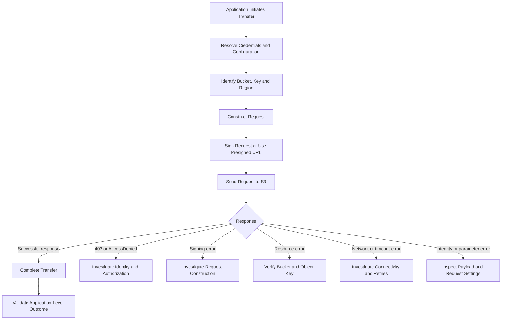

# 02- Upload and Download Failures

## Overview

Amazon S3 upload and download failures can originate from authorization policies, incorrect resource identifiers, AWS Signature Version 4 validation, encryption configuration, network interruptions, transfer limits, or application-level file handling.

A reliable diagnosis begins by identifying the exact operation that failed and the response returned by AWS. An upload that fails during initiation requires a different investigation from one that fails during multipart completion. Similarly, an S3 download returning `403 Forbidden` requires a different approach from a browser reporting a CORS error.

Common failure scenarios include:

- Upload or download operations returning `AccessDenied` or HTTP `403`.
- Incorrect bucket names, object keys, or Regions.
- `SignatureDoesNotMatch` errors when using presigned URLs.
- Uploads failing because of encryption requirements or missing KMS permissions.
- Large-file transfers failing because of timeouts, part configuration, or concurrency.
- Downloads leaving incomplete files after network interruptions.
- Browser uploads failing while AWS CLI operations succeed.
- Objects being uploaded successfully but overwritten by another request.
- Checksum mismatches or unexpected file contents.
- Applications reporting success before the transfer has actually completed.

This document provides a production-oriented workflow for isolating these failures, verifying the underlying cause, applying the smallest appropriate correction, and preventing recurrence.

## Understand the Request Lifecycle

A typical application performs an S3 transfer through an AWS SDK or an HTTP client using a presigned URL.



A successful HTTP response is only one part of the workflow. The application may also need to validate the transfer result, verify the expected object size or checksum, and update application state.

For example, a document-processing API should not mark a file as available merely because it generated a presigned URL. It should distinguish upload authorization, transfer completion, and any subsequent verification required by the business workflow.

## Classify the Failure Before Making Changes

Use the actual AWS error code and response details instead of diagnosing from the HTTP status alone.

| Error or symptom | Likely cause | First investigation |
|---|---|---|
| `AccessDenied` | Missing permissions, explicit deny, bucket-policy conditions, or another access-control restriction | Verify the effective principal and the specific operation |
| `NoSuchBucket` | Incorrect bucket name or bucket configuration | Confirm the bucket identifier and account |
| `NoSuchKey` | Incorrect key or object not present at the expected location | Check the exact key and object metadata |
| `SignatureDoesNotMatch` | Signing Region, method, URL encoding, or signed-header mismatch | Compare the intended request with the transmitted request |
| `ExpiredToken` | Temporary credentials expired | Refresh the credential session |
| `InvalidAccessKeyId` | Wrong or invalid credential source | Inspect credential-provider selection |
| `AuthorizationHeaderMalformed` | Credential scope, Region, or endpoint inconsistency | Verify the actual bucket Region and signing configuration |
| HTTP `400 Bad Request` | Invalid request parameter, incompatible header, or malformed request | Inspect the operation and AWS error message |
| HTTP `416` | Requested byte range is invalid or unsatisfied | Check the requested range and object length |
| HTTP `503 Slow Down` | Temporary request-rate or service condition | Apply supported retry behavior and inspect request concurrency |
| HTTP `500` or another retryable service error | Temporary service-side failure or transient condition | Capture request IDs and retry safely |
| Browser CORS error | Browser preflight or cross-origin request blocked | Inspect browser network diagnostics and S3 CORS configuration |
| Partial file or checksum mismatch | Interrupted transfer or integrity-validation failure | Verify transfer completion, file length, and checksum |
| Small uploads succeed but large uploads fail | Multipart configuration, resource constraints, timeout, or KMS permissions | Identify the failing transfer stage |

A generic `403` does not prove that the credentials are invalid. It can indicate that the principal lacks permission, a bucket policy denies the operation, or a request is affected by another access-control condition.

## Diagnostic Workflow

### Capture the failure evidence

Collect the following details from the failing operation:

- AWS error code and complete error message.
- HTTP status code.
- S3 operation and whether it was an upload or download.
- Bucket, object key, and Region.
- Effective AWS account and principal ARN.
- File size and transfer method.
- SDK or CLI version.
- Number of retries and the operation that failed.
- S3 request ID and extended request ID, when available.

For browser requests, also record whether the failure occurred during the preflight request or the actual transfer.

Avoid recording AWS secret access keys, session tokens, authorization headers, customer-provided encryption keys, or complete presigned URLs. Presigned URLs are bearer credentials and must be handled as sensitive data.

### Verify the effective identity

Run the following commands from the environment where the failure occurs:

```bash
aws sts get-caller-identity
aws configure list
```

For a named profile:

```bash
aws sts get-caller-identity --profile s3-debug
aws configure list --profile s3-debug
```

Confirm that the account and principal match the intended application identity.

A command run from a developer workstation may use a different credential provider from Boto3 inside Docker, a Kubernetes workload, or a CI/CD runner. Verify the identity in the actual failing environment rather than assuming that all processes use the same credentials.

### Verify the bucket Region

Retrieve the bucket's location:

```bash
aws s3api get-bucket-location \
  --bucket example-private-bucket \
  --profile s3-debug
```

A `null` `LocationConstraint` in this legacy API response represents `us-east-1`.

Compare the bucket's Region with the Region configured in the SDK, presigner, or CLI command. Also check any explicit endpoint override or custom hostname.

Incorrect Region and endpoint configuration can result in redirect-related errors, signing failures, or other request errors.

### Verify the bucket and object key

For a known object, inspect its metadata:

```bash
aws s3api head-object \
  --bucket example-private-bucket \
  --key "documents/report.pdf" \
  --region ap-south-1
```

Check the actual key in the application rather than relying only on the filename displayed in the UI.

S3 object keys are case-sensitive. These keys are different:

```text
documents/Report.pdf
documents/report.pdf
documents/Report.pdf 
```

The third key contains a trailing space.

Also verify the exact account, bucket, Region, and any object version ID used by the application.

An authorized `HeadObject` request can help identify an object, but a failure does not always mean the object is missing. For example, S3 can return `403` for a nonexistent key when the caller lacks `s3:ListBucket`. Use the effective permissions and other authorized evidence to distinguish a missing object from an access denial.

S3 provides strong read-after-write consistency for successful object PUTs, overwrites, deletes, and subsequent reads. If a completed upload cannot be read immediately, investigate the actual operation result, object key, account, Region, and versioning behavior rather than assuming that an arbitrary delay will resolve the problem.

## Troubleshoot Upload Failures

### Test a basic upload

Use the AWS CLI to test whether a simple upload succeeds with the intended identity and configuration:

```bash
aws s3 cp \
  "./report.pdf" \
  "s3://example-private-bucket/documents/report.pdf" \
  --region ap-south-1
```

Replace the example values with the actual target.

If the command succeeds but the application fails, compare the effective identity, Region, endpoint, encryption settings, request headers, SDK configuration, and transfer implementation.

If both fail, inspect the actual AWS error before changing application code or permissions.

A write to an existing key can replace the current object. In a versioned bucket, it may create a new version. Confirm that the destination key is safe to overwrite before performing diagnostic uploads.

### Check S3 write permissions

A normal object upload generally requires `s3:PutObject` permission on the target object ARN.

An illustrative policy statement is:

```json
{
  "Version": "2012-10-17",
  "Statement": [
    {
      "Sid": "AllowDocumentUploads",
      "Effect": "Allow",
      "Action": "s3:PutObject",
      "Resource": "arn:aws:s3:::example-private-bucket/documents/*"
    }
  ]
}
```

This is a policy component, not a complete production access policy. Additional restrictions may apply through bucket policies, explicit denies, service control policies, session policies, permissions boundaries, or endpoint policies.

If the bucket uses SSE-KMS, investigate the KMS permissions required by the upload separately. See [Access Denied During SSE-KMS Operations](../04-%20Encryption-and-kms/02-%20Access%20Denied%20During%20SSE-KMS%20Operations.md).

Do not grant broad bucket permissions until the effective principal and denied operation are established.

### Validate the source file and request configuration

Confirm that:

- The file exists and is readable.
- The target bucket and key are correct.
- The client uses the intended Region.
- The selected content type is correct.
- Required signed headers match the transmitted values.
- Request parameters satisfy the bucket's encryption requirements.
- The file size is supported by the selected transfer method.
- The client does not send malformed metadata or incompatible headers.

For presigned uploads, verify the HTTP method and signed-header list. If the signer included a specific `Content-Type`, the client must send the expected value.

### Investigate unexpected overwrites

A successful upload can still produce an incorrect business outcome when multiple requests write to the same key.

Common causes include:

- Reusing a fixed key for every upload.
- Two tenants using the same filename.
- Concurrent workers overwriting each other's objects.
- Retrying a job that already completed.
- Reusing a presigned URL that permits a subsequent write to the same key.

Generate application-controlled, unique object keys and authorize the intended tenant or user before allowing access.

If object identity matters to the business workflow, maintain a stable application file ID separately from the original filename. Use versioning or other explicit write-control mechanisms where the recovery requirements justify them.

## Troubleshoot Download Failures

### Test metadata retrieval and download separately

First inspect the object:

```bash
aws s3api head-object \
  --bucket example-private-bucket \
  --key "documents/report.pdf" \
  --region ap-south-1
```

Then test the actual transfer:

```bash
aws s3 cp \
  "s3://example-private-bucket/documents/report.pdf" \
  "./downloads/report.pdf" \
  --region ap-south-1
```

Confirm that the local destination directory exists and that the process can write to it.

If metadata retrieval succeeds but the download fails, investigate the transfer-specific request, encryption, network behavior, and destination filesystem. If metadata retrieval fails, classify the returned error before proceeding.

### Check read permissions

A typical object download requires `s3:GetObject` on the relevant object ARN.

```json
{
  "Version": "2012-10-17",
  "Statement": [
    {
      "Sid": "AllowDocumentDownloads",
      "Effect": "Allow",
      "Action": "s3:GetObject",
      "Resource": "arn:aws:s3:::example-private-bucket/documents/*"
    }
  ]
}
```

This statement does not override explicit denies or authorize decryption through a customer managed KMS key.

For SSE-KMS objects, investigate `kms:Decrypt` and the applicable key policy as separate requirements.

### Handle interrupted downloads safely

Writing directly to a final destination path can leave a partial file if the transfer fails. Another process may then read the incomplete file as though it were complete.

A safer pattern downloads to a temporary file and replaces the final path only after the SDK transfer succeeds.

```python
import os
from pathlib import Path

import boto3
from botocore.exceptions import BotoCoreError, ClientError

s3_client = boto3.client(
    "s3",
    region_name="ap-south-1",
)


def download_object(
    bucket: str,
    key: str,
    destination: str,
) -> None:
    target = Path(destination)
    target.parent.mkdir(parents=True, exist_ok=True)

    temporary = target.with_name(f".{target.name}.part")

    try:
        s3_client.download_file(
            bucket,
            key,
            str(temporary),
        )
        os.replace(temporary, target)
    except (ClientError, BotoCoreError, OSError):
        temporary.unlink(missing_ok=True)
        raise
```

The temporary and final files should reside on the same filesystem for the intended atomic replacement behavior. This pattern protects consumers from seeing a partially downloaded replacement, although it does not independently validate the file's business content.

Where integrity requirements are strict, validate expected size or supported checksum metadata before publishing the file.

### Investigate versioning and delete markers

In a versioned bucket, a normal delete can create a delete marker rather than permanently removing older object versions. As a result, reading the current object key may fail even though earlier versions still exist.

Check:

- Whether versioning is enabled.
- Whether a delete marker exists.
- Whether the application tracks an object version ID.
- Whether the caller has the required permission for a version-specific operation.

Do not permanently delete object versions merely to test whether an object is accessible. Version deletion can affect recovery and retention requirements.

## Troubleshoot Presigned URL Failures

Presigned URLs allow a client to perform an authorized S3 operation using a URL generated by a trusted backend. They are commonly used for direct browser uploads and downloads.

### Check the actual request

Verify that:

- The HTTP method matches the operation used to generate the URL.
- The original URL is preserved.
- The host and encoded path have not changed.
- Query parameters remain intact.
- Required signed headers contain the expected values.
- The URL has not expired.
- The signing credentials remain valid.
- The intended bucket and object key match the application workflow.

For example, a URL generated for a `PUT` request must not be used as a `POST` upload URL.

The following example sends an upload request with a required content type:

```bash
curl --fail-with-body \
  --request PUT \
  --upload-file "./report.pdf" \
  --header "Content-Type: application/pdf" \
  "$PRESIGNED_URL"
```

Supply the URL through a secure runtime mechanism. Avoid hardcoding real presigned URLs in source code, shell scripts committed to a repository, or diagnostic logs.

A presigned URL can generally be reused until its effective expiration or invalidation. A PUT to an existing key may overwrite the current object, so object-key design and upload authorization must account for repeated requests.

### Distinguish expiration from signature errors

A presigned URL signed with temporary credentials cannot remain usable beyond the validity of those credentials, even when its configured expiration is later.

If expiration is confirmed, generate a fresh URL using valid credentials.

Do not assume every `403` indicates an expired URL. A method mismatch, modified URL, signed-header mismatch, invalid credential, or authorization restriction can cause a similar failure. Use the AWS error message and the actual request configuration to identify the cause.

For signing-specific problems, see the [Authentication and signing troubleshooting guide](../03-%20Authentication-and-signing/README.md).

### Diagnose browser CORS failures

A browser can reject a cross-origin request even when an equivalent command-line request succeeds.

Inspect the browser developer tools to determine whether:

- The preflight `OPTIONS` request failed.
- The actual PUT or GET request reached S3 and returned an AWS error.
- A required request header is not allowed by the bucket's CORS configuration.
- The configured frontend origin does not match the request's origin.

Configure S3 CORS for the intended origins, methods, and request headers. CORS is not a replacement for S3 authorization, and making the bucket public is not an appropriate fix for a CORS failure.

## Troubleshoot Network and Timeout Failures

Large transfers are affected by network reliability, timeouts, concurrency, resource limits, and intermediary behavior.

Common causes include:

- Intermittent client connectivity.
- Reverse-proxy or gateway timeouts.
- Insufficient socket or read timeout settings.
- Worker termination during a transfer.
- Container memory pressure.
- Too many concurrent transfers.
- Excessive retry activity.
- Network instability between the client and the selected S3 Region.

### Isolate the failing layer

Compare the failing operation with a minimal AWS CLI or SDK request from the same runtime environment.

If the isolated request succeeds, inspect application timeout settings, stream handling, retry behavior, and proxy configuration.

If both fail, inspect the effective identity, endpoint, DNS and TLS connectivity, network policies, and the actual AWS response.

Keep TLS certificate verification enabled. Disabling transport security is not a valid workaround for connectivity failures.

### Apply retries only to appropriate failures

AWS SDKs provide retry handling for supported transient failures. Prefer SDK-managed retries instead of adding independent retry loops without understanding how they interact.

| Failure | Recommended response |
|---|---|
| Temporary network interruption | Retry the failed operation when it is safe |
| Retryable service error such as HTTP `503` | Use bounded retries with backoff and jitter |
| `AccessDenied` | Correct authorization rather than repeatedly retrying |
| `NoSuchKey` | Verify the resource identifier and object state |
| `SignatureDoesNotMatch` | Correct signing or request construction |
| Expired presigned URL | Generate a new URL |
| Checksum mismatch | Investigate data and checksum handling before retrying |
| Ambiguous upload result | Reconcile the actual S3 state before retrying the whole application workflow |

Do not blindly retry an application workflow if it could create duplicate records, overwrite an object, or repeat downstream processing.

## Diagnose Large Files and Transfer Performance

For large objects, multipart upload and managed transfer utilities provide better control over transfer size, parallelism, and retries.

When performance degrades or large uploads fail, inspect:

- File size and selected transfer mechanism.
- Part size and total part count.
- Concurrent uploads and active connections.
- Retry counts and timeout settings.
- CPU, memory, and network utilization.
- KMS authorization for encrypted objects.
- Service-side throttling or retryable errors.

Avoid increasing concurrency without measurement. Too many parallel transfers can increase memory consumption, saturate connections, and amplify failures during network instability.

For high-throughput downloads, byte-range GET requests allow supported workloads to fetch independent portions of an object in parallel. The application must track ranges accurately and reconstruct the complete file before declaring success.

For detailed multipart lifecycle, part-size, and completion-manifest failures, see [Multipart Upload Failures](01-%20Multipart%20Upload%20Failures.md).

## Validate Data Integrity

Transfer completion and data integrity are separate concerns. A successful upload or download should be followed by the verification required by the application.

Common integrity checks include:

- Expected object size.
- Supported S3 checksum metadata.
- A checksum calculated over the source and downloaded file.
- Successful parsing or validation by the downstream consumer.

S3 supports multiple checksum algorithms and types. Multipart ETags should not be treated as universal MD5 hashes of the complete object.

When an application requires end-to-end integrity, select a supported checksum approach and ensure that upload, download, and verification use compatible semantics.

See [Checking object integrity in Amazon S3](https://docs.aws.amazon.com/AmazonS3/latest/userguide/checking-object-integrity-upload.html).

## Backend Integration with Boto3

Keep S3 operations in a reusable service layer rather than duplicating transfer logic across Django views, Django REST Framework endpoints, FastAPI routes, Flask handlers, and Celery tasks.

```python
import boto3
from botocore.config import Config
from botocore.exceptions import BotoCoreError, ClientError


class S3StorageService:
    def __init__(
        self,
        bucket_name: str,
        region_name: str,
    ) -> None:
        self.bucket_name = bucket_name
        self.client = boto3.client(
            "s3",
            region_name=region_name,
            config=Config(
                retries={
                    "mode": "standard",
                    "max_attempts": 3,
                }
            ),
        )

    def upload_file(
        self,
        local_path: str,
        key: str,
        content_type: str,
    ) -> None:
        try:
            self.client.upload_file(
                local_path,
                self.bucket_name,
                key,
                ExtraArgs={
                    "ContentType": content_type,
                },
            )
        except (ClientError, BotoCoreError):
            raise

    def download_file(
        self,
        key: str,
        local_path: str,
    ) -> None:
        try:
            self.client.download_file(
                self.bucket_name,
                key,
                local_path,
            )
        except (ClientError, BotoCoreError):
            raise
```

This example uses Boto3's standard credential provider chain and managed transfer methods. The retry configuration is illustrative and should be tuned to the deployed Botocore version and workload.

Production implementations should additionally consider:

- File-size and content-type validation.
- Unique, application-controlled object keys.
- Encryption requirements.
- Structured logging and sanitized error handling.
- Idempotent application-level retries.
- Checksum validation where required.
- Appropriate cleanup of temporary files.
- Authentication and tenant-level authorization.

### Define application-level success clearly

Before reporting an upload as complete:

1. Confirm that the transfer operation returned successfully.
2. Confirm that the intended object key and application file ID are associated.
3. Validate object metadata or checksum when the workflow requires it.
4. Persist or finalize the application record only at the appropriate workflow stage.
5. Handle duplicate requests without unintentionally overwriting another file.

For downloads, publish the final file or return application-level success only after the transfer is complete. If a backend streams the response, account for interrupted streams and downstream consumers that might receive incomplete data.

## Root Cause and Corrective Action

| Confirmed root cause | Corrective action | Prevention |
|---|---|---|
| Incorrect bucket or object key | Correct the resource identifiers | Validate resource configuration and key generation |
| Missing S3 permission | Grant the required action on the intended resources | Test with the production workload identity |
| Incorrect Region or endpoint | Correct the client Region or endpoint configuration | Centralize client setup |
| Presigned request mismatch | Regenerate the URL and align the method and required headers | Test the complete client-to-S3 request |
| Expired credentials or URL | Refresh credentials or issue a new URL | Use supported credential providers and appropriate URL lifetimes |
| Browser CORS failure | Correct the CORS configuration | Test from the actual browser origin |
| Network interruption | Use bounded retries and appropriate timeouts | Monitor transfer latency and retry rates |
| Integrity mismatch | Correct payload or checksum handling | Validate integrity as part of the workflow |
| Unintended overwrite | Generate a distinct object key or use deliberate versioning behavior | Enforce application-level file identity |
| SSE-KMS authorization failure | Correct S3 and KMS authorization independently | Test encrypted transfers using the real application role |
| Large-transfer resource exhaustion | Tune part size, concurrency, and buffering | Load-test realistic file sizes and concurrency |

After applying a correction, repeat the original operation in the same environment with the intended identity. Confirm that the object or local file has the expected size and contents and that application state accurately reflects the result.

## Production Best Practices

- Use AWS SDK-managed transfer methods for routine uploads and downloads.
- Configure the correct Region and credential provider for each workload.
- Generate application-controlled object keys and prevent unintended overwrites.
- Distinguish browser CORS errors from actual S3 authorization failures.
- Treat presigned URLs as bearer credentials and preserve their signed request configuration.
- Use bounded retries for transient failures, not deterministic permission or request errors.
- Validate supported checksums when the application requires data integrity guarantees.
- Use multipart upload for suitable large-file workloads and bound concurrency to available resources.
- Track S3 transfer completion separately from application job creation and downstream processing.
- Monitor throughput, latency, retry counts, timeout rates, and failed transfers.
- Log request IDs and sanitized AWS error details without exposing credentials.
- Test transfer behavior through the same execution environment, network path, and identity used in production.

## Related AWS Documentation

- [Uploading objects to Amazon S3](https://docs.aws.amazon.com/AmazonS3/latest/userguide/upload-objects.html)
- [Downloading objects from Amazon S3](https://docs.aws.amazon.com/AmazonS3/latest/userguide/download-objects.html)
- [Using presigned URLs](https://docs.aws.amazon.com/AmazonS3/latest/userguide/using-presigned-url.html)
- [Checking object integrity](https://docs.aws.amazon.com/AmazonS3/latest/userguide/checking-object-integrity-upload.html)
- [Amazon S3 performance guidelines](https://docs.aws.amazon.com/AmazonS3/latest/userguide/optimizing-performance-guidelines.html)
- [Troubleshooting Amazon S3 access](https://docs.aws.amazon.com/AmazonS3/latest/userguide/security_iam_troubleshoot.html)
- [Multipart Upload Failures](01-%20Multipart%20Upload%20Failures.md)
- [Authentication and signing troubleshooting](../03-%20Authentication-and-signing/README.md)
- [Access Denied During SSE-KMS Operations](../04-%20Encryption-and-kms/02-%20Access%20Denied%20During%20SSE-KMS%20Operations.md)

## Key Takeaways

- Identify the actual AWS error, effective identity, bucket, key, Region, and failing operation before changing configuration.
- Diagnose authorization, signing, resource lookup, CORS, networking, and data-integrity failures as separate categories.
- Use managed transfer utilities, bounded retries, and carefully tuned concurrency to improve transfer reliability.
- Verify transfer completion and required integrity checks before reporting application-level success.
- Protect credentials and presigned URLs, prevent unintended overwrites, and use sanitized request diagnostics to resolve production incidents.