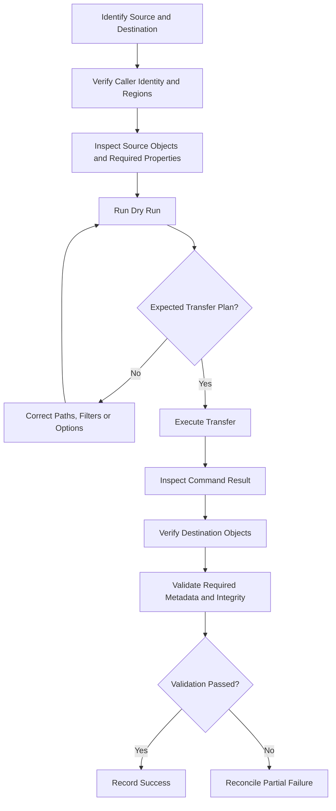

# 03- S3 Sync and Copy Issues

## Overview

Amazon S3 synchronization and copy failures commonly arise from incorrect source or destination paths, insufficient permissions, unexpected synchronization comparisons, metadata handling, encryption requirements, and the destructive behavior of automated synchronization commands.

The AWS CLI provides several high-level commands for transferring and synchronizing data:

| Command | Primary purpose | Typical use case |
|---|---|---|
| `aws s3 cp` | Copy a file or object between supported locations | Upload a release artifact or copy a specific object |
| `aws s3 cp --recursive` | Copy multiple files or objects recursively | Transfer a directory or an entire S3 prefix |
| `aws s3 sync` | Synchronize new and updated files between locations | Deploy website assets or synchronize datasets |
| `aws s3 mv` | Move data by copying and removing the source | Relocate objects after verifying the destination |
| `aws s3 rm` | Remove objects | Delete selected or obsolete objects |

These commands share transfer mechanisms but have different operational semantics. In particular, synchronization is not equivalent to copying every object, and moving an object is not an atomic rename.

This document focuses on diagnosing incorrect synchronization results, failed copy operations, missing destination objects, metadata discrepancies, and unintended deletions.

## Understand the Difference Between Copy and Sync

### Copy operations

The `cp` command copies the specified source to the destination. A recursive copy processes multiple files or objects beneath the selected directory or prefix.

```bash
# Upload a file
aws s3 cp \
  "./report.csv" \
  "s3://example-private-bucket/reports/report.csv" \
  --region ap-south-1

# Download a file
aws s3 cp \
  "s3://example-private-bucket/reports/report.csv" \
  "./downloads/report.csv" \
  --region ap-south-1

# Recursively copy a local directory
aws s3 cp \
  "./reports/" \
  "s3://example-private-bucket/reports/" \
  --recursive \
  --region ap-south-1
```

A copy can replace an existing destination object. In a versioned bucket, replacing the current object can create another version.

Use `cp` when the intended transfer set is explicit or when you need to copy an object without applying synchronization comparison rules.

### Synchronization operations

The `sync` command recursively compares the source and destination and transfers files it determines are missing or outdated.

```bash
# Synchronize a local directory to S3
aws s3 sync \
  "./website/" \
  "s3://example-private-bucket/website/" \
  --region ap-south-1

# Synchronize S3 objects to a local directory
aws s3 sync \
  "s3://example-private-bucket/reports/" \
  "./reports/" \
  --region ap-south-1

# Synchronize between two S3 prefixes
aws s3 sync \
  "s3://source-private-bucket/datasets/" \
  "s3://destination-private-bucket/datasets/" \
  --region ap-south-1
```

Synchronization decisions rely on properties such as object size and modification timestamps, with behavior depending on the transfer direction and command options. The command does not generally download or read every source object to compare its complete content byte by byte.

Consequently, two files containing different data can be treated as equivalent by synchronization when the comparison criteria do not identify a difference.

Use `sync` for repeatable deployments and data synchronization. Use explicit copy operations or a dedicated integrity-validation workflow when correctness requires stronger verification.

## Diagnose the Source and Destination Paths

Incorrect prefixes and local paths are among the most common causes of missing or misplaced objects.

### Inspect the source

List objects under the intended prefix:

```bash
aws s3 ls \
  "s3://example-private-bucket/datasets/" \
  --recursive \
  --region ap-south-1
```

Check the source's exact bucket name, prefix, capitalization, and trailing path components.

S3 uses object keys rather than a real directory hierarchy. For example:

```text
datasets/2026/january.csv
datasets/2026/february.csv
datasets/archive/january.csv
```

The apparent directories are portions of object keys. Synchronizing a different prefix can silently select the wrong set of objects or create an unexpected layout.

### Inspect the destination

Use a destination listing to check which objects actually exist:

```bash
aws s3 ls \
  "s3://destination-private-bucket/datasets/" \
  --recursive \
  --region ap-south-1
```

For a known destination object, inspect its metadata:

```bash
aws s3api head-object \
  --bucket destination-private-bucket \
  --key "datasets/2026/january.csv" \
  --region ap-south-1
```

Compare the actual object key, content length, modification time, encryption information, and checksum metadata when available.

Do not assume that a successful recursive command means the files were placed under the intended prefix. Validate representative objects at the destination.

## Troubleshoot Incorrect Sync Comparisons

### Files with different contents are not synchronized

**Symptoms**

- A local file was modified, but `sync` did not upload it.
- An S3 object changed, but the local copy was not downloaded.
- A destination contains stale content even though the synchronization command completed.

**Likely causes**

- The comparison criteria did not identify a difference.
- The source and destination point to different paths than expected.
- A file was excluded by a filter.
- The expected transfer was a forced replacement, but `sync` was used.

**Verification**

Run a dry run and inspect the planned actions:

```bash
aws s3 sync \
  "./datasets/" \
  "s3://example-private-bucket/datasets/" \
  --dryrun \
  --region ap-south-1
```

If a known file is missing from the planned operations, inspect its size, timestamps, key, filters, and the direction of synchronization.

**Corrective action**

Use `cp` to explicitly copy an object when replacement is intended:

```bash
aws s3 cp \
  "./datasets/january.csv" \
  "s3://example-private-bucket/datasets/january.csv" \
  --region ap-south-1
```

If byte-level correctness matters, validate the expected checksum after the transfer instead of relying only on synchronization comparisons.

### Understand `--size-only` and `--exact-timestamps`

| Option | Behavior | Operational consideration |
|---|---|---|
| Default comparison | Uses size and modification-time rules appropriate to the transfer direction | Efficient for routine synchronization, but not a content-hash comparison |
| `--size-only` | Uses size as the comparison criterion | Can miss changed content when source and destination sizes are equal |
| `--exact-timestamps` | For S3-to-local sync, changes how same-sized objects are compared by requiring exact timestamp matches before they are ignored | Useful for particular timestamp-sensitive workflows, but does not provide content-integrity verification |

Example:

```bash
aws s3 sync \
  "s3://example-private-bucket/datasets/" \
  "./datasets/" \
  --exact-timestamps \
  --region ap-south-1
```

Do not add these options indiscriminately to every deployment. Choose comparison behavior based on the data's modification semantics and integrity requirements.

For release artifacts, backups, and datasets that must match a known revision, consider a manifest containing object keys, expected sizes, checksums, and application-level version identifiers.

## Troubleshoot Access and Permission Failures

Copy and synchronization operations can require several S3 API permissions. The effective requirements depend on the source type, destination type, selected options, encryption, and metadata operations.

### Identify the effective principal

Run the following commands from the same environment as the failing operation:

```bash
aws sts get-caller-identity
aws configure list
```

For a named profile:

```bash
aws sts get-caller-identity --profile s3-transfer
aws configure list --profile s3-transfer
```

Confirm that the account, principal, and credential provider match the intended workload.

### Check the required permissions

| Operation | Typical permissions to investigate |
|---|---|
| List objects for synchronization | `s3:ListBucket` on the source bucket |
| Read source objects | `s3:GetObject` on source objects |
| Write destination objects | `s3:PutObject` on destination objects |
| Read metadata during object inspection or copy | Relevant object-read permissions |
| Copy object tags | `s3:GetObjectTagging` and `s3:PutObjectTagging`, as applicable |
| Delete destination objects during synchronization | `s3:DeleteObject` on the affected destination objects |
| Read or write objects encrypted with a customer managed KMS key | Required KMS permissions and compatible key policies |

These are common permissions to investigate, not a complete policy for every transfer. Additional authorization can be imposed by bucket policies, explicit denies, service control policies, VPC endpoint policies, session policies, or other controls.

For source objects in another account, validate both the caller's identity-based permissions and the relevant resource policies. For SSE-KMS objects, investigate KMS authorization separately from S3 authorization.

### Isolate a failed operation

Test a read and write independently where doing so is safe:

```bash
# Read access to a known source object
aws s3api head-object \
  --bucket source-private-bucket \
  --key "datasets/sample.csv" \
  --region ap-south-1

# Write access using a unique diagnostic key
aws s3 cp \
  "./sample.csv" \
  "s3://destination-private-bucket/diagnostics/run-20261015/sample.csv" \
  --region ap-south-1
```

Do not use a production key for permission tests unless overwriting that object is explicitly intended.

If an inspection request fails, distinguish an authorization error from a missing resource or incorrect identifier before changing policies.

See the related [IAM and bucket policy troubleshooting guide](../01-%20Access-control/02-%20IAM%20and%20Bucket%20Policy%20Permission%20Failures.md) and [SSE-KMS access-denied troubleshooting guide](../04-%20Encryption-and-kms/02-%20Access%20Denied%20During%20SSE-KMS%20Operations.md).

## Diagnose Metadata and Object Property Mismatches

A successful copy does not guarantee that every desired destination property is correct.

Metadata-related problems commonly involve:

- Incorrect `Content-Type`.
- Unexpected `Cache-Control` values.
- Missing user-defined metadata.
- Object tags not preserved as expected.
- A destination object encrypted with an unexpected key.
- ACL or Object Ownership differences.
- Existing objects not receiving updated metadata because synchronization skipped them.

### Inspect object properties

Use `head-object` to retrieve relevant object metadata:

```bash
aws s3api head-object \
  --bucket destination-private-bucket \
  --key "website/assets/app.js" \
  --region ap-south-1
```

Inspect the response's content type, cache control, metadata, encryption details, and other properties relevant to the application.

Tags require a separate request:

```bash
aws s3api get-object-tagging \
  --bucket destination-private-bucket \
  --key "datasets/sample.csv" \
  --region ap-south-1
```

### Understand copy property behavior

For S3-to-S3 copies, AWS CLI v2 provides `--copy-props` to control which properties are copied.

| Value | Purpose |
|---|---|
| `none` | Avoid copying source object properties through this mechanism |
| `metadata-directive` | Preserve the supported metadata properties covered by the metadata directive |
| `default` | Preserve the default set of supported properties, including applicable tags |
| `all` | Include the additional supported annotations as well as the default properties |

The exact behavior and additional API requests depend on the AWS CLI version and transfer operation. Consult the current CLI reference before depending on a particular property set.

For example, to copy selected objects while explicitly setting cache metadata:

```bash
aws s3 cp \
  "s3://source-private-bucket/website/" \
  "s3://destination-private-bucket/website/" \
  --recursive \
  --cache-control "public, max-age=3600" \
  --region ap-south-1
```

For S3-to-S3 copies, explicitly inspect and test the metadata directive and copy-property behavior before relying on this command for production deployment. Setting new metadata and preserving source metadata are different operations.

An important operational detail is that changing the requested metadata alone does not guarantee that `sync` will update objects it already considers synchronized. Existing objects might require a deliberate recopy or a separate metadata-update workflow.

### Diagnose ACL and ownership problems

Modern S3 deployments commonly use bucket-owner-enforced Object Ownership, which disables ACLs for the bucket.

If a copy fails because the request specifies an ACL that the destination bucket does not support, remove the unnecessary ACL option and use bucket policies and IAM for access control.

Do not enable legacy ACL behavior merely to suppress an error without first confirming the intended ownership model.

## Troubleshoot Encryption and Region Differences

Copy operations between buckets can involve different Regions, encryption settings, and KMS keys.

### Verify the source and destination Regions

```bash
aws s3api get-bucket-location \
  --bucket source-private-bucket

aws s3api get-bucket-location \
  --bucket destination-private-bucket
```

Compare the resulting bucket locations with the client Region and any source-region options used by the command.

A destination Region setting does not change the source bucket's actual Region.

### Check encryption requirements

For SSE-KMS objects, verify that:

- The caller can read the source object.
- The caller has the required KMS decryption permission for the source key.
- The caller can write the destination object.
- The caller can use the destination KMS key as required.
- Relevant key policies and cross-account grants permit the operation.
- The destination bucket's encryption policies are satisfied.

A destination bucket may enforce encryption settings that differ from those used by the source object.

Example for a destination requiring a customer managed KMS key:

```bash
aws s3 cp \
  "./report.csv" \
  "s3://example-private-bucket/reports/report.csv" \
  --sse aws:kms \
  --sse-kms-key-id "arn:aws:kms:ap-south-1:111122223333:key/EXAMPLE-KEY-ID" \
  --region ap-south-1
```

Use a real KMS key ARN appropriate to the target account and Region. Confirm that the caller is authorized to use the key before diagnosing the failure as a transfer issue.

Do not assume that successful decryption of the source implies permission to encrypt the destination.

## Handle Filters Correctly

The `--exclude` and `--include` options determine which paths are considered for transfer. Their order matters because later matching filters can override earlier matching decisions.

### Example: synchronize only JSON files

```bash
aws s3 sync \
  "./exports/" \
  "s3://example-private-bucket/exports/" \
  --exclude "*" \
  --include "*.json" \
  --dryrun \
  --region ap-south-1
```

Review the dry-run output before removing `--dryrun`.

For multiple patterns, reason through the filters in their stated order:

```bash
aws s3 sync \
  "./exports/" \
  "s3://example-private-bucket/exports/" \
  --exclude "*" \
  --include "*.json" \
  --include "*.csv" \
  --dryrun
```

This example selects JSON and CSV files.

A frequent mistake is placing `--include` before a final `--exclude "*"`, which can exclude files that were previously selected.

Filters also affect which destination objects are eligible for deletion when `--delete` is used. Nevertheless, always verify the exact planned deletions rather than relying on assumptions about filter scope.

## Prevent Accidental Deletions During Sync

The `--delete` option removes objects present in the destination but absent from the source set considered by the synchronization operation.

This is useful for publishing a directory that should mirror the current source. It can also delete legitimate files when the source path, permissions, filters, or deployment configuration are wrong.

### Simulate before deleting

Start with a non-destructive dry run:

```bash
aws s3 sync \
  "./website/" \
  "s3://example-private-bucket/website/" \
  --delete \
  --dryrun \
  --region ap-south-1
```

Review both planned transfers and deletions.

Then run the operation only after confirming the source and destination scopes:

```bash
aws s3 sync \
  "./website/" \
  "s3://example-private-bucket/website/" \
  --delete \
  --region ap-south-1
```

### Common sources of accidental deletion

- Running synchronization from the wrong local directory.
- Using the bucket root instead of the intended destination prefix.
- Deploying an empty or incomplete build directory.
- Applying broad synchronization rules to a shared bucket.
- Misconfiguring include and exclude filters.
- Running a CI/CD deployment before build artifacts are ready.
- Assuming `sync` is a backup rather than a mirroring operation.

### Protect production datasets

For high-value data, separate immutable source data from disposable deployment artifacts. Use versioning, an explicit retention policy, backups, or other appropriate recovery mechanisms.

Versioning can preserve previous object versions when current objects are overwritten or deleted, but it does not make a deletion harmless. Lifecycle rules and permanent version deletion must still be evaluated separately.

For destructive production operations, require an explicit review step and retain logs of the command, effective identity, affected prefix, and deployment revision.

## Understand Move and Copy Semantics

The AWS CLI `mv` command should not be treated as an atomic rename.

For S3-to-S3 moves, the workflow is effectively a copy followed by deletion of the source. If the copy succeeds but deletion fails, both objects can remain. If the source is deleted after a successful copy, recovery and versioning behavior depends on the buckets' configuration.

A safer operational approach is:

1. Copy the selected objects to the destination.
2. Validate destination object keys, sizes, required metadata, and checksums where applicable.
3. Verify application access to the destination.
4. Remove the source only after the destination has been verified.
5. Record the result and reconcile any partial failures.

For an individual object, an explicit copy-and-verify process is easier to audit than a broad move:

```bash
aws s3 cp \
  "s3://source-private-bucket/archive/report.csv" \
  "s3://destination-private-bucket/archive/report.csv" \
  --region ap-south-1

aws s3api head-object \
  --bucket destination-private-bucket \
  --key "archive/report.csv" \
  --region ap-south-1
```

Only proceed with source deletion after the destination has passed the required validation.

## Handle Large Copies and Transfer Failures

Large-object operations and recursive transfers may fail because of transient network errors, KMS permissions, throttling, insufficient resources, or multipart-transfer problems.

Investigate:

- The exact source and destination object that failed.
- Whether the transfer uses a multipart operation.
- Whether the command completed or partially processed the set.
- AWS error codes and request IDs.
- Retry counts and timeout configuration.
- Destination storage and encryption settings.
- The presence of objects that were copied before the failure.

High-level CLI transfers can handle suitable multipart transfers and retries, but they do not make an entire multi-object synchronization transaction atomic. Some objects may be copied successfully while others fail.

Rerun the operation only after understanding whether it is safe and how the comparison rules will treat completed objects. For applications with strict workflow guarantees, persist per-object results and reconcile failures instead of treating the entire command as one indivisible transaction.

For detailed multipart-specific diagnostics, see [Multipart Upload Failures](01-%20Multipart%20Upload%20Failures.md) and [Upload and Download Failures](02-%20Upload%20and%20Download%20Failures.md).

## Production Verification Workflow

Use a consistent process for important synchronization and copy operations.



For a critical data migration or deployment, record:

- Source and destination bucket names and prefixes.
- Effective AWS account and principal.
- Command options and deployment revision.
- Number of intended objects.
- Failed operations and their error codes.
- Required destination metadata and encryption settings.
- Validation results.
- Any cleanup or rollback action.

A successful command exit status is important evidence, but production acceptance should also include the checks required by the workload.

## Common Mistakes

| Mistake | Why it causes problems | Better approach |
|---|---|---|
| Assuming `sync` compares every object's content | Size and timestamp comparisons can miss content differences | Validate checksums or copy explicitly where required |
| Adding `--delete` without a dry run | Incorrect source paths can remove legitimate destination objects | Review the plan and constrain the destination prefix |
| Assuming a move is atomic | Copy and source deletion can partially succeed | Copy, verify, then delete |
| Changing metadata and expecting `sync` to refresh every object | Unchanged objects might be skipped | Use a deliberate metadata-update or recopy strategy |
| Ignoring the active CLI profile | Transfers may use an unexpected AWS principal | Verify the identity from the actual runtime |
| Treating a KMS error as an ordinary S3 permission error | S3 and KMS authorization are distinct | Diagnose both authorization layers |
| Assuming an entire recursive transfer is all-or-nothing | Some objects may complete before other operations fail | Track results and reconcile per object |
| Using size-only comparison for changing datasets | Same-sized files with different contents can be treated as equivalent | Use stronger integrity verification |
| Copying between buckets without validating ownership and metadata | Destination access or application behavior can change | Verify Object Ownership, metadata, tags, and encryption |

## Key Takeaways

- Use `cp` for explicit transfers and `sync` for comparison-based synchronization; they do not have identical semantics.
- Verify the effective identity, source and destination paths, Regions, and permissions before changing application code or broadening access.
- Review filters, metadata behavior, and encryption requirements when copied objects differ from expectations.
- Treat `--delete` and `mv` as potentially destructive operations, and validate the destination before removing source data.
- Use dry runs, per-object reconciliation, and appropriate checksum validation to make synchronization and copy workflows safer in production.