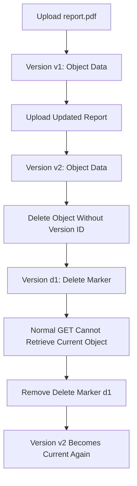

# 02- Versioning and Delete Marker Issues

## Overview

Amazon S3 Versioning preserves multiple versions of an object under the same key. When versioning is enabled, uploading an object with an existing key creates a new version rather than simply replacing the previous version. A normal delete request generally creates a **delete marker** instead of permanently deleting the object's data.

Versioning and delete-marker behavior frequently causes confusion during incident response, data recovery, application development, and lifecycle management.

Common symptoms include:

- An object appears to have been deleted, but its previous versions still exist.
- An object exists in S3 but returns `404 Not Found` when requested by key.
- A deleted file cannot be restored by uploading it again or removing the wrong version.
- A bucket contains many delete markers or noncurrent object versions.
- Storage costs remain high after objects are deleted.
- A delete operation succeeds but the underlying data remains stored.
- Version-specific reads or deletes fail because the version ID is incorrect.
- Versioning suspension causes unexpected overwrites of objects with a `null` version ID.

The correct diagnosis depends on the bucket's versioning state, the current version of the object, the presence of delete markers, and the exact API operation being performed.

## Understand S3 Versioning Behavior

### Versioning states

S3 buckets can have three versioning states.

| State | Behavior | Operational implications |
|---|---|---|
| `Disabled` | Object writes do not maintain normal version history | A delete generally removes the object permanently |
| `Enabled` | New writes create versions; ordinary deletes create delete markers | Previous versions can be recovered unless permanently deleted |
| `Suspended` | New writes use the `null` version ID; existing versioned objects remain | New writes can overwrite an existing null version, and deletion behavior differs from fully enabled versioning |

Suspending versioning does not remove historical versions that already exist. It changes how subsequent object operations are handled.

Inspect the bucket's versioning state before attempting recovery:

```bash
aws s3api get-bucket-versioning \
  --bucket example-private-bucket \
  --region ap-south-1
```

A typical versioning-enabled response is:

```json
{
  "Status": "Enabled"
}
```

If MFA Delete is configured, the response can also contain an `MFADelete` property.

### How delete markers work

A delete marker is a special version that contains no object data. It becomes the current version of the key and causes ordinary GET requests to behave as though the object has been deleted.

For example, consider an object named `documents/report.pdf`.



The important distinction is that deleting a key and permanently deleting an object version are different operations.

| Operation | Result in a versioning-enabled bucket |
|---|---|
| Delete an object without specifying a version ID | Creates a delete marker |
| Delete a specific object version | Permanently deletes that version |
| Delete a specific delete-marker version | Removes that marker; an older object version may become current |
| Upload the same key again | Creates a new current version |
| Suspend versioning | Stops normal version creation for subsequent writes but preserves existing historical versions |

Removing a delete marker does not restore deleted data by copying it somewhere. It changes which existing version is current. If all previous data versions have already been permanently deleted, removing the marker cannot restore the object contents.

## Diagnose Objects That Appear Missing

### Symptoms and likely causes

An object that appears missing may be affected by several different conditions:

- A delete marker is the current version.
- The application is requesting the wrong key or bucket.
- The application uses an incorrect version ID.
- A previous version was permanently deleted.
- The bucket's versioning state changed.
- The application lacks permission to read the object or inspect its versions.
- Lifecycle expiration removed the relevant version.

Do not immediately upload another copy of the file. First inspect the object's version history to determine whether its data is recoverable.

### List object versions and delete markers

Use the following command to inspect a specific key or prefix:

```bash
aws s3api list-object-versions \
  --bucket example-private-bucket \
  --prefix "documents/report.pdf" \
  --region ap-south-1
```

The `--prefix` argument matches keys beginning with the supplied string. Verify the exact `Key` in the response before acting, because other keys may share the same prefix.

A response can contain both `Versions` and `DeleteMarkers`:

```json
{
  "Versions": [
    {
      "Key": "documents/report.pdf",
      "VersionId": "v2-example",
      "IsLatest": false,
      "LastModified": "2026-10-15T10:30:00Z",
      "Size": 24576
    },
    {
      "Key": "documents/report.pdf",
      "VersionId": "v1-example",
      "IsLatest": false,
      "LastModified": "2026-10-14T08:00:00Z",
      "Size": 20480
    }
  ],
  "DeleteMarkers": [
    {
      "Key": "documents/report.pdf",
      "VersionId": "marker-example",
      "IsLatest": true,
      "LastModified": "2026-10-15T11:00:00Z"
    }
  ]
}
```

The values above are illustrative. In this example, `marker-example` is the current version, so a normal GET will not retrieve either historical object version through the ordinary key lookup.

The caller needs the `s3:ListBucketVersions` permission to list versions. If the request fails with `AccessDenied`, investigate authorization before concluding that the object history is empty.

For large buckets, the listing can span multiple pages. The AWS CLI normally handles pagination; avoid using `--no-paginate` when you need a complete inventory.

### Determine whether the original data still exists

Inspect the versions and delete markers together.

| Observation | Interpretation | Next action |
|---|---|---|
| Current entry is a delete marker and older versions exist | The object is hidden by a delete marker | Remove the correct marker if the previous version should become current |
| A historical version exists but is not current | Its data remains stored | Retrieve the specific version or restore it |
| Only a delete marker exists | No older object version is listed for that key | Investigate previous permanent deletion, lifecycle expiration, or versioning history |
| A `null` version exists | The object or marker may have been created when versioning was disabled or suspended | Inspect the exact version ID and bucket state |
| No version entries appear | The key may never have existed, may have been permanently removed, or the request may not be seeing the expected resource | Verify the account, bucket, prefix, permissions, and available recovery records |

S3 strong read-after-write consistency means that a successfully completed write, delete, or versioning-related change does not generally require an arbitrary waiting period before its result becomes observable. Investigate the actual key and operation history instead of assuming that propagation delay explains a missing object.

## Restore an Object Hidden by a Delete Marker

### Verify the marker before removing it

Confirm that the current entry is a delete marker and identify its exact version ID:

```bash
aws s3api list-object-versions \
  --bucket example-private-bucket \
  --prefix "documents/report.pdf" \
  --region ap-south-1
```

Before deleting anything, verify:

- The bucket and object key are correct.
- The marker's version ID matches the current delete marker.
- An older object version exists if the intention is to restore it.
- The action is approved under the application's recovery procedure.
- The operation will not reveal a version that should remain hidden for security or compliance reasons.

### Remove the delete marker

To make the previous object version current again, delete the exact delete-marker version:

```bash
aws s3api delete-object \
  --bucket example-private-bucket \
  --key "documents/report.pdf" \
  --version-id "marker-example" \
  --region ap-south-1
```

Replace `marker-example` with the actual delete-marker version ID.

This is a permanent deletion of that marker version, not a deletion of the historical object data. Once the marker is removed, the next eligible object version becomes current.

**Important:** Do not omit `--version-id` during this operation. A delete request without a version ID creates another delete marker in a versioning-enabled bucket rather than removing the existing marker.

If the bucket has MFA Delete enabled, permanently deleting the protected version requires the appropriate MFA-authenticated request over HTTPS. Use the approved operational procedure for such requests.

### Verify recovery

Confirm the current version and retrieve the object:

```bash
aws s3api list-object-versions \
  --bucket example-private-bucket \
  --prefix "documents/report.pdf" \
  --region ap-south-1
```

Then inspect the object:

```bash
aws s3api head-object \
  --bucket example-private-bucket \
  --key "documents/report.pdf" \
  --region ap-south-1
```

Validate the expected metadata, size, and application behavior. If the object is business-critical, also verify a supported checksum or other integrity evidence.

If the historical versions have been permanently removed, delete-marker removal cannot recover the contents. Use an independent backup, a replicated copy, or another verified recovery source.

## Retrieve a Specific Historical Version

Removing a delete marker is appropriate when the intended behavior is to expose the previously current version. In other cases, the application may need to read or recover a specific historical version without changing the current version.

Retrieve a known version directly:

```bash
aws s3api get-object \
  --bucket example-private-bucket \
  --key "documents/report.pdf" \
  --version-id "v1-example" \
  "./recovered-report.pdf" \
  --region ap-south-1
```

This retrieves the specified version into a local file. It does not change the current version of the S3 key.

To restore a historical version as a new current version, copy that version to the same key:

```bash
aws s3api copy-object \
  --bucket example-private-bucket \
  --key "documents/report.pdf" \
  --copy-source "example-private-bucket/documents/report.pdf?versionId=v1-example" \
  --region ap-south-1
```

For keys or version IDs that require URL encoding, ensure the copy-source value is encoded correctly. This example uses a simple key and an illustrative version ID.

Copying a historical version creates a new object version rather than rewinding the bucket's version history. Confirm the resulting version ID and verify the expected metadata and encryption behavior after the copy.

Use this method when a specific historical revision must become the current content but the delete marker should not simply be removed.

## Troubleshoot Permanent Version Deletion

### Understand permanent deletion

A versioned object can have multiple stored versions. Deleting the current key without a version ID only creates a delete marker; permanently deleting a specific version requires its version ID.

Example:

```bash
aws s3api delete-object \
  --bucket example-private-bucket \
  --key "documents/report.pdf" \
  --version-id "v1-example" \
  --region ap-south-1
```

This operation permanently removes the specified version. It is not reversible through S3 Versioning once the version is permanently deleted.

Before executing it, inspect all versions and delete markers associated with the key and confirm that the selected version is not needed for recovery or retention.

### Common permanent-delete failures

| Failure | Likely cause | Corrective action |
|---|---|---|
| `AccessDenied` | Missing version-deletion permission, explicit deny, or MFA Delete requirement | Inspect the effective identity, `s3:DeleteObjectVersion` authorization, bucket policies, and MFA configuration |
| Version ID is invalid or the result is unexpected | Wrong version ID, incorrect key, or wrong bucket | Re-list versions and verify the exact entry |
| Deletion is rejected for a protected object | S3 Object Lock retention or legal hold | Review retention and legal-hold status through the authorized compliance procedure |
| The object appears after deletion | Another historical version became current, or a different key/version was inspected | Re-list versions and check the current marker and version state |
| Storage costs remain high | Older versions and delete markers remain stored | Review noncurrent-version lifecycle rules and retention requirements |

S3 Object Lock can prevent permanent deletion of protected versions. Do not attempt to bypass retention controls to resolve an ordinary application deletion issue.

## Diagnose Versioning-Suspended Buckets

A bucket with versioning suspended behaves differently from a fully versioning-enabled bucket.

When versioning is suspended, new object writes use the `null` version ID. If a null version already exists for the same key, a new write can overwrite it. Previously created versions with non-null version IDs remain intact.

A delete operation can remove an existing null version and insert a delete marker. If no null version exists, the operation can insert a marker while leaving older non-null versions untouched.

### Inspect the bucket state

```bash
aws s3api get-bucket-versioning \
  --bucket example-private-bucket \
  --region ap-south-1
```

If the response contains:

```json
{
  "Status": "Suspended"
}
```

do not assume that newly written objects are creating independent historical versions.

List the key's versions and markers to establish which version IDs exist. If a `null` version is involved, treat it as a distinct version identifier rather than as a missing field.

When removing a delete marker whose version ID is `null`, explicitly pass the string `"null"` as the version ID. Confirm the exact marker before doing so.

### Corrective action

If version history is required, evaluate whether versioning should be re-enabled. Re-enabling versioning affects subsequent writes; it does not restore versions that have already been permanently removed.

For backend systems, avoid treating suspension as a generic cost optimization. Model the resulting write and delete semantics explicitly before changing the bucket configuration.

## Diagnose Lifecycle-Related Version Deletion

Lifecycle rules can expire current versions, permanently delete noncurrent versions, and remove expired delete markers when the relevant conditions are met.

This behavior can explain why a version that was previously recoverable is no longer present.

### Inspect lifecycle configuration

```bash
aws s3api get-bucket-lifecycle-configuration \
  --bucket example-private-bucket \
  --region ap-south-1
```

Review the following rule types:

- Expiration of current objects.
- Permanent deletion of noncurrent versions.
- Retention of a specified number of newer noncurrent versions, where configured.
- Removal of expired object delete markers.

A delete marker is considered expired when it is the only remaining version for that key and there are no noncurrent object versions. Removing an expired marker does not restore object contents.

### Verify the intended retention policy

Before modifying lifecycle rules, confirm:

- Which object prefixes or tags the rules cover.
- Whether the relevant object became noncurrent before it disappeared.
- Whether the retention period matches recovery and compliance requirements.
- Whether versioned storage costs are expected.
- Whether the object is subject to independent retention or backup requirements.

Do not create broad lifecycle exclusions as an emergency workaround without assessing the cost and retention consequences.

For complex buckets, maintain lifecycle configuration through infrastructure as code and validate proposed changes before deployment.

## Application and Backend Considerations

Versioning-related failures often become application-level bugs when services assume that deleting a key permanently removes all stored data.

### Record version-aware object identity

A backend should distinguish its logical file identifier from the S3 object key and version ID.

For example, a PostgreSQL record may contain:

| Field | Purpose |
|---|---|
| `file_id` | Stable identifier for the logical document |
| `bucket_name` | Bucket containing the object |
| `object_key` | Object key used to address the document |
| `version_id` | Specific stored version, where version-specific reads are required |
| `status` | Application-level availability or deletion state |

This distinction is useful when a document is replaced, restored, or deleted through a workflow that must preserve historical revisions.

### Make deletion workflows explicit

A production application should distinguish operations such as:

- Marking a logical document as deleted in the application database.
- Hiding the current S3 object by creating a delete marker.
- Restoring an object by removing a specific delete marker.
- Restoring a revision by copying a known historical version.
- Permanently deleting a historical version.

Avoid making the normal user-facing delete endpoint permanently remove historical versions unless that is explicitly required by the product and retention policy.

If a Celery task or event-driven workflow performs permanent deletion, make the job idempotent and record the exact object key and version ID being targeted. Reconcile ambiguous failures before retrying destructive operations.

### Test versioning behavior

Automated tests should cover:

- Uploading the same key more than once.
- Deleting an object without a version ID.
- Listing and identifying a delete marker.
- Reading a known historical version.
- Restoring an object by removing the correct marker.
- Verifying that unrelated versions remain unchanged.
- Handling `null` versions in a suspended-versioning scenario, where applicable.
- Handling permission failures and Object Lock restrictions.

Prefer isolated test buckets and test-only prefixes. Permanent version deletion should be tested carefully so that test cleanup does not remove unrelated recovery data.

## Production Safety Checklist

Before modifying an object's version history, verify the following:

- [ ] The bucket name, account, Region, and object key are correct.
- [ ] The current versioning state is known.
- [ ] The latest version and all relevant delete markers have been inspected.
- [ ] The exact version ID to restore or delete has been identified.
- [ ] Historical data and compliance retention requirements have been considered.
- [ ] The caller has the intended object-version permissions.
- [ ] MFA Delete and Object Lock requirements have been checked.
- [ ] Lifecycle rules have been reviewed if versions are missing unexpectedly.
- [ ] The recovery operation has been verified using object metadata and content checks.
- [ ] The incident and corrective action have been documented.

For bulk version cleanup, use a reviewed inventory and a deliberate deletion plan. Do not write an unbounded loop that permanently deletes every version without first proving which objects are eligible for removal.

## Related AWS Documentation

- [S3 Versioning](https://docs.aws.amazon.com/AmazonS3/latest/userguide/Versioning.html)
- [Troubleshooting Versioning](https://docs.aws.amazon.com/AmazonS3/latest/userguide/troubleshooting-versioning.html)
- [Managing Delete Markers](https://docs.aws.amazon.com/AmazonS3/latest/userguide/ManagingDelMarkers.html)
- [Deleting Object Versions](https://docs.aws.amazon.com/AmazonS3/latest/userguide/DeletingObjectVersions.html)
- [Versioning-Suspended Bucket Behavior](https://docs.aws.amazon.com/AmazonS3/latest/userguide/VersionSuspendedBehavior.html)
- [AWS CLI: list-object-versions](https://docs.aws.amazon.com/cli/latest/reference/s3api/list-object-versions.html)
- [AWS CLI: delete-object](https://docs.aws.amazon.com/cli/latest/reference/s3api/delete-object.html)
- [Lifecycle Configuration Elements](https://docs.aws.amazon.com/AmazonS3/latest/userguide/intro-lifecycle-rules.html)

## Key Takeaways

- In a versioning-enabled bucket, a normal delete creates a delete marker; permanently deleting a specific version requires its version ID.
- To restore an object hidden by a delete marker, verify the marker and remove that exact version, or copy a chosen historical version to create a new current version.
- Versioning suspension introduces `null` version behavior and can allow null versions to be overwritten; existing non-null versions are preserved unless separately deleted.
- Lifecycle rules can expire noncurrent versions and expired delete markers, so inspect retention configuration when historical objects disappear.
- Treat permanent version deletion as a destructive operation and verify the exact key, version ID, permissions, and retention requirements before executing it.