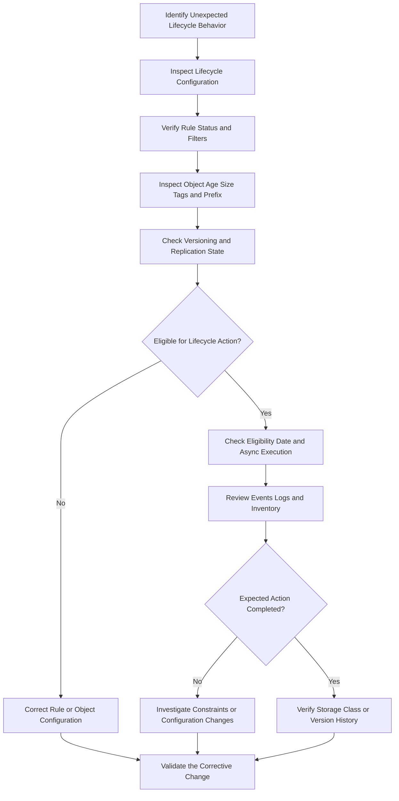

# 03- Lifecycle Transition and Expiration Issues

## Overview

Amazon S3 Lifecycle automates object transitions between storage classes and removes objects or versions according to configured retention rules. It helps control storage costs, enforce data-retention policies, and manage large datasets without custom cleanup jobs.

Lifecycle failures are often misunderstood because eligibility, execution, and the final state of an object are separate concerns. An object can satisfy a rule but remain in its original storage class temporarily, appear to be deleted while its historical versions remain stored, or fail to qualify because its prefix, tags, size, version state, or replication status does not match the rule.

Common symptoms include:

- Objects remain in S3 Standard after the expected transition date.
- Objects expected to expire are still visible.
- Current objects disappear, but storage usage does not decrease.
- Noncurrent versions accumulate even though expiration rules exist.
- Lifecycle changes increase storage or request costs unexpectedly.
- Objects with certain prefixes or tags are not transitioned.
- Objects pending replication are not transitioned or expired.
- A lifecycle change does not appear to affect existing objects.
- Expired objects cannot be recovered through normal application requests.

The diagnostic process should establish the effective lifecycle configuration, determine whether the object qualifies for the rule, identify its versioning and replication state, and verify the resulting transition or expiration behavior.

## Understand Lifecycle Transition and Expiration

### Lifecycle transitions

A transition moves an object to another storage class without changing its object key. The storage class determines the storage cost, retrieval characteristics, and minimum storage-duration requirements.

| Storage class | Typical use case | Important consideration |
|---|---|---|
| S3 Standard | Frequently accessed data | Suitable for active application data |
| S3 Intelligent-Tiering | Data with changing or uncertain access patterns | Monitoring charges and archive-tier retrieval characteristics depend on the selected tier and configuration |
| S3 Standard-IA | Infrequently accessed data requiring millisecond access | Minimum storage duration and retrieval charges apply |
| S3 One Zone-IA | Infrequently accessed, reproducible data | Uses a single Availability Zone; unsuitable as the only copy of irreplaceable data |
| S3 Glacier Instant Retrieval | Archive data requiring millisecond retrieval | Minimum storage duration and retrieval charges apply |
| S3 Glacier Flexible Retrieval | Archive data where retrieval can take longer | Retrieval method, latency, and restoration workflow must match the application |
| S3 Glacier Deep Archive | Long-term archival data accessed rarely | Retrieval is not immediate; longer retrieval times and minimum storage duration apply |

Choose storage classes based on actual access patterns, availability requirements, recovery objectives, and total cost rather than age alone.

### Lifecycle expiration

Expiration instructs S3 to remove objects according to a rule's retention period. The actual result depends on the bucket's versioning state.

| Bucket state | Effect of current-version expiration |
|---|---|
| Versioning disabled | The current object is queued for permanent removal |
| Versioning enabled | S3 creates a delete marker, making the prior current version noncurrent |
| Versioning suspended | S3 creates a null-version delete marker; an existing null version can be replaced |

For versioning-enabled buckets, current-version expiration does not automatically remove historical object versions. Noncurrent versions require separate lifecycle actions or explicit version-specific deletion.

This distinction is essential when a retention rule appears to work but storage costs remain high.

Official references: [S3 Lifecycle expiration behavior](https://docs.aws.amazon.com/AmazonS3/latest/userguide/lifecycle-expire-general-considerations.html) and [Lifecycle configuration elements](https://docs.aws.amazon.com/AmazonS3/latest/userguide/intro-lifecycle-rules.html).

## Diagnostic Workflow



### Capture the evidence

Record the following before modifying a lifecycle rule:

- Bucket name, account, and Region.
- Object key and expected storage class.
- Object creation or last-modified time.
- Current version ID and delete-marker state.
- Lifecycle rule ID and configured action.
- Applicable prefix, tag, and object-size filters.
- Replication status, where applicable.
- Expected eligibility date and observed behavior.
- Relevant lifecycle event or access-log evidence.

For cost-related incidents, also capture the number of current and noncurrent versions, object sizes, transition request counts, and the time range associated with the unexpected charges.

Do not infer that a lifecycle rule failed solely because an object still appears in a listing or because a billing metric has not changed.

## Inspect the Effective Lifecycle Configuration

### Retrieve the lifecycle rules

```bash
aws s3api get-bucket-lifecycle-configuration \
  --bucket example-private-bucket \
  --region ap-south-1
```

Inspect the returned configuration for:

- Rule `ID` and `Status`.
- Prefix, tag, and size filters.
- Current-version transition and expiration actions.
- Noncurrent-version transition and expiration actions.
- Expired delete-marker cleanup.
- Any overlapping rules that apply to the same object.

If S3 returns `NoSuchLifecycleConfiguration`, the bucket has no configured lifecycle rules. If the request returns `AccessDenied`, inspect the effective identity and its lifecycle-configuration permissions before drawing conclusions.

### Verify versioning

```bash
aws s3api get-bucket-versioning \
  --bucket example-private-bucket \
  --region ap-south-1
```

The result determines whether current expiration permanently removes an object, creates a delete marker, or follows suspended-versioning behavior.

Do not assume that a lifecycle rule removes historical versions simply because its `Expiration` action is configured.

### Inspect object metadata

```bash
aws s3api head-object \
  --bucket example-private-bucket \
  --key "logs/application.log" \
  --region ap-south-1
```

Inspect the object's `LastModified`, `ContentLength`, `StorageClass`, and relevant metadata.

For a versioned object, list the version history as well:

```bash
aws s3api list-object-versions \
  --bucket example-private-bucket \
  --prefix "logs/application.log" \
  --region ap-south-1
```

Use these results to distinguish a transition failure from a versioning or expiration issue.

## Troubleshoot Objects That Do Not Transition

### Check eligibility and execution time

S3 Lifecycle evaluates objects and executes transition actions asynchronously. An object may remain in its previous storage class after it becomes eligible.

For day-based rules, S3 calculates eligibility using the object's creation time in UTC and rounds the transition date to midnight UTC on the following day. Consequently, an object configured to transition after a specified number of days may not change storage class at the exact instant that period elapses.

Do not immediately change a rule simply because the transition has not occurred at the expected wall-clock time.

Verify the following:

1. The rule is enabled.
2. The object matches the rule's filter.
3. The configured number of days has elapsed.
4. The transition is supported for the source and destination storage classes.
5. No size, versioning, replication, or other applicable constraint prevents the transition.
6. The expected execution window has been considered.

Official reference: [Troubleshooting Amazon S3 Lifecycle issues](https://docs.aws.amazon.com/AmazonS3/latest/userguide/troubleshoot-lifecycle.html).

### Check the object-size restriction

Since September 2024, the default behavior for newly created or modified general-purpose bucket lifecycle configurations prevents objects smaller than 128 KB from transitioning to any storage class, unless the applicable configuration overrides that default.

Configurations created before the change can retain the previous behavior until the lifecycle configuration is modified.

This is particularly important for log archives and event datasets containing many small objects.

Inspect the lifecycle rule's size filters and the bucket configuration's transition minimum-size behavior before assuming that age is the only eligibility criterion.

Where the workload justifies it, a rule can explicitly allow smaller objects using an appropriate `ObjectSizeGreaterThan` or `ObjectSizeLessThan` filter. Evaluate transition request costs and minimum storage-duration charges before doing so.

For example, this filter selects objects larger than 1 byte:

```json
{
  "Filter": {
    "ObjectSizeGreaterThan": 1
  }
}
```

This snippet illustrates a filter, not a complete lifecycle configuration. Add it only to a fully defined rule whose storage class and retention behavior have been reviewed.

Official reference: [S3 Lifecycle transition considerations](https://docs.aws.amazon.com/AmazonS3/latest/userguide/lifecycle-transition-general-considerations.html).

### Check tags and prefixes

An object must match the applicable lifecycle filter.

For example, a rule targeting `logs/` does not apply to an object stored under `application-logs/`.

Likewise, tag-filtered rules may not apply if the expected tag is missing or its key or value differs.

When a tag-based transition is evaluated, S3 checks the current tags again when executing the action. Changing tags can affect whether a pending transition proceeds, but removing a tag does not guarantee immediate cancellation.

If an object must be excluded from a pending transition, use the documented tag-based workflow and confirm the resulting lifecycle event rather than relying on an arbitrary delay.

Avoid broad wildcard assumptions. S3 keys are not filesystem paths, and lifecycle prefix filters use literal key-prefix matching.

### Check replication status

For versioning-enabled or versioning-suspended buckets, objects with replication status `PENDING` or `FAILED` are not transitioned by S3 Lifecycle while in those states.

Inspect the object's replication status where applicable:

```bash
aws s3api head-object \
  --bucket example-private-bucket \
  --key "datasets/daily.csv" \
  --region ap-south-1
```

Look for the `ReplicationStatus` field in the response.

If an object is pending replication, investigate the replication configuration and destination state. If replication failed, address the root cause and verify successful replication before assuming lifecycle processing will resume.

Do not permanently delete the source object to force progress before confirming the replication and recovery requirements.

## Troubleshoot Expiration Issues

### Current objects remain after the configured expiration age

First inspect the rule's `Expiration` action and the object age. Confirm that the object matches every configured filter and that the expected eligibility date has passed.

Expiration is asynchronous, so a qualified object can remain visible while S3 processes the action.

Next, check the bucket's versioning state. In a versioning-enabled bucket, current-version expiration creates a delete marker rather than permanently deleting all stored data.

If the intention is to remove data from a versioned bucket, review both current-version expiration and noncurrent-version expiration rules. Permanent removal of noncurrent versions is a destructive retention decision and should be configured deliberately.

### Objects disappear but storage usage remains high

This commonly occurs because current expiration in a versioned bucket adds a delete marker while retaining previous object versions.

Inspect the history:

```bash
aws s3api list-object-versions \
  --bucket example-private-bucket \
  --prefix "logs/" \
  --region ap-south-1
```

Check the counts and sizes of noncurrent versions, along with the number of delete markers.

If historical versions should be retained for recovery, leaving them stored is expected behavior. If the retention policy permits permanent deletion, configure a reviewed `NoncurrentVersionExpiration` rule.

Expired delete-marker cleanup removes delete markers that are the only remaining version for a key. It does not recover object contents and does not remove noncurrent versions that still exist.

### Understand the difference between expiration actions

| Configuration action | Effect |
|---|---|
| `Expiration` | Expires eligible current objects according to bucket versioning behavior |
| `NoncurrentVersionExpiration` | Permanently deletes eligible noncurrent versions |
| `ExpiredObjectDeleteMarker` | Removes an expired delete marker when it is the only remaining version for the key |
| `Transition` | Changes the storage class of an eligible current object |
| `NoncurrentVersionTransition` | Changes the storage class of eligible noncurrent versions |

These are separate actions. Configure each only when its behavior matches the intended retention and cost model.

## Example: Configure Lifecycle Transitions and Expiration

The following example manages a `logs/` prefix. It transitions current objects after 30 days, expires the current object after 365 days, transitions noncurrent versions after 30 days, and permanently deletes noncurrent versions after 180 days.

**Caution:** In a versioning-enabled bucket, the current-version expiration creates a delete marker. Noncurrent-version expiration permanently removes data and must align with recovery and compliance requirements.

Save the configuration as `lifecycle.json`:

```json
{
  "Rules": [
    {
      "ID": "Manage-log-retention",
      "Status": "Enabled",
      "Filter": {
        "Prefix": "logs/"
      },
      "Transitions": [
        {
          "Days": 30,
          "StorageClass": "STANDARD_IA"
        }
      ],
      "Expiration": {
        "Days": 365
      },
      "NoncurrentVersionTransitions": [
        {
          "NoncurrentDays": 30,
          "StorageClass": "STANDARD_IA"
        }
      ],
      "NoncurrentVersionExpiration": {
        "NoncurrentDays": 180
      }
    }
  ]
}
```

Apply the configuration:

```bash
aws s3api put-bucket-lifecycle-configuration \
  --bucket example-private-bucket \
  --lifecycle-configuration file://lifecycle.json \
  --region ap-south-1 \
  --expected-bucket-owner 123456789012
```

Verify the stored configuration:

```bash
aws s3api get-bucket-lifecycle-configuration \
  --bucket example-private-bucket \
  --region ap-south-1 \
  --expected-bucket-owner 123456789012
```

This example is a configuration pattern, not a universal production policy. Before applying it, verify the bucket's versioning state, object access pattern, minimum storage-duration implications, and business retention requirements.

For buckets with a large number of small objects, evaluate whether the default transition size restriction affects the intended transitions.

For production infrastructure, manage lifecycle configuration through infrastructure as code and review the planned change before deployment. Note that lifecycle configurations can replace existing rules; preserve useful rules when updating a shared bucket.

## Troubleshoot Unexpected Storage Costs

Lifecycle policies can reduce storage charges while increasing transition, request, retrieval, or early-deletion costs.

### Check minimum storage-duration requirements

Some storage classes have minimum storage-duration charges. Deleting or transitioning an object before the minimum duration is complete can trigger a prorated charge.

| Storage class | Minimum storage duration |
|---|---:|
| S3 Standard-IA | 30 days |
| S3 One Zone-IA | 30 days |
| S3 Glacier Instant Retrieval | 90 days |
| S3 Glacier Flexible Retrieval | 90 days |
| S3 Glacier Deep Archive | 180 days |

For an archive workflow, transition frequency and expected deletion timing matter as much as the nominal storage price.

A workload that writes many small objects and expires them quickly may incur transition request costs or minimum storage-duration charges that offset the expected savings.

### Evaluate the total cost

Review:

- Object counts and size distribution.
- Current and noncurrent version storage.
- Storage class distribution.
- Lifecycle transition request volume.
- Data retrieval frequency and retrieval costs.
- Minimum storage-duration charges.
- Incomplete multipart uploads and other retained data where relevant.

Use S3 Storage Lens, S3 Inventory, CloudWatch metrics where applicable, and AWS billing reports to establish whether a lifecycle rule is achieving its cost objective.

Do not judge lifecycle effectiveness solely by the reduction in visible current objects.

## Monitor Lifecycle Activity

Lifecycle processing is asynchronous, so configuration inspection alone does not prove that an action occurred.

For operational monitoring, consider:

- **S3 Event Notifications:** Capture supported lifecycle expiration and transition events.
- **S3 server access logging:** Investigate supported records of lifecycle actions.
- **S3 Inventory:** Periodically report object-level metadata such as storage class and version-related properties.
- **S3 Metadata journal tables:** Track supported object-level changes near real time.
- **AWS billing data:** Verify the cost impact of transitions, expiration, retained versions, and retrieval behavior.

Use more than one signal for critical workflows. For example, event-driven confirmation can help identify an individual transition while inventory and billing data validate broader behavior.

A lifecycle event or a disappearance from a current-object listing does not establish that historical data was permanently removed. Inspect version history when the distinction matters.

## Recovery and Prevention

### Recover objects expired by Lifecycle

Lifecycle expiration cannot be reversed directly.

Recovery may be possible if versioning was enabled before the relevant expiration and historical versions remain available. Otherwise, use an independent backup or replica if one exists.

For a missing object, follow this sequence:

1. Inspect the lifecycle rule that applied to the key.
2. Confirm the bucket's versioning state at the relevant time.
3. List versions and delete markers.
4. Determine whether a recoverable historical version remains.
5. Restore the verified version using the appropriate recovery operation.
6. Validate the recovered object's contents and application state.

Do not assume that enabling versioning after expiration will recover an object that has already been permanently deleted.

### Prevent recurrence

- Test lifecycle rules on a dedicated prefix or non-production bucket.
- Keep lifecycle configuration in infrastructure as code.
- Review existing rules before applying a new full configuration.
- Validate prefix, tag, size, and version-related filters.
- Include noncurrent-version retention in the design of versioned buckets.
- Monitor lifecycle events and investigate unexpected expiration or transition outcomes.
- Preserve independent backups for data that must be recoverable after lifecycle deletion.
- Review cost reports after changing transition timing or retention periods.

Bucket-policy explicit denies do not prevent S3 Lifecycle from carrying out its configured actions. If a lifecycle rule must stop acting, modify, disable, or remove the rule through the approved configuration-management process.

## Related AWS Documentation

- [Troubleshooting Amazon S3 Lifecycle issues](https://docs.aws.amazon.com/AmazonS3/latest/userguide/troubleshoot-lifecycle.html)
- [Lifecycle transition considerations](https://docs.aws.amazon.com/AmazonS3/latest/userguide/lifecycle-transition-general-considerations.html)
- [Lifecycle expiration behavior](https://docs.aws.amazon.com/AmazonS3/latest/userguide/lifecycle-expire-general-considerations.html)
- [Lifecycle configuration elements](https://docs.aws.amazon.com/AmazonS3/latest/userguide/intro-lifecycle-rules.html)
- [S3 Lifecycle configuration examples](https://docs.aws.amazon.com/AmazonS3/latest/userguide/lifecycle-configuration-examples.html)
- [AWS CLI: get-bucket-lifecycle-configuration](https://docs.aws.amazon.com/cli/latest/reference/s3api/get-bucket-lifecycle-configuration.html)
- [AWS CLI: put-bucket-lifecycle-configuration](https://docs.aws.amazon.com/cli/latest/reference/s3api/put-bucket-lifecycle-configuration.html)
- [Versioning and Delete Marker Issues](02-%20Versioning%20and%20Delete%20Marker%20Issues.md)

## Key Takeaways

- Lifecycle transitions and expiration are asynchronous; evaluate eligibility, filters, object age, and execution behavior before changing rules.
- In versioning-enabled buckets, current expiration typically creates a delete marker; noncurrent-version expiration is a separate, permanent deletion action.
- The default 128 KB transition restriction, replication state, tags, and storage-class constraints can prevent objects from following an expected lifecycle path.
- Evaluate transition requests, minimum storage durations, retrieval costs, and retained versions when investigating unexpected storage charges.
- Treat lifecycle expiration as a retention decision and preserve version history or independent backups when recovery is required.