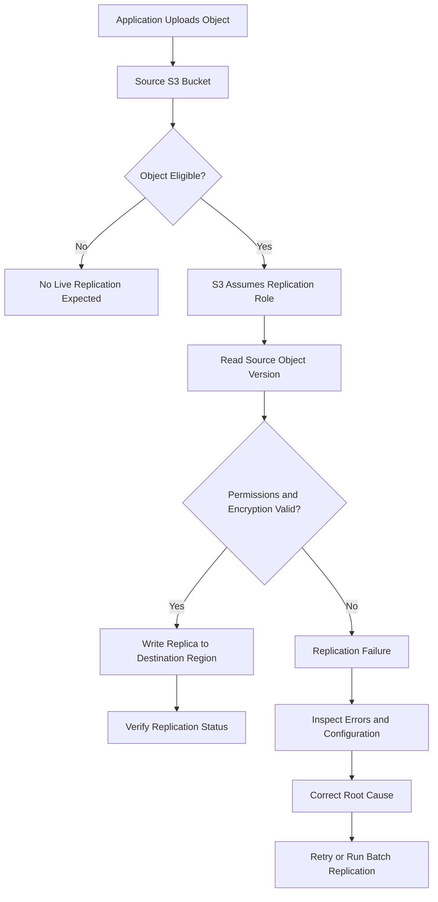

# 01- Cross-Region Replication Issues

## Overview

Amazon S3 Cross-Region Replication (CRR) asynchronously copies eligible objects from a source bucket to a destination bucket in a different AWS Region. It supports disaster recovery, regional data residency requirements, cross-Region analytics, and geographic distribution of stored data.

Replication failures can compromise recovery objectives, leave destination datasets incomplete, and cause downstream services to operate on stale or missing data. A replication rule can be enabled and correctly configured while individual objects remain ineligible or fail because of permissions, encryption, ownership, or replication constraints.

Common symptoms include:

- Newly uploaded objects do not appear in the destination bucket.
- Source objects remain in `PENDING` replication status.
- Objects report `FAILED` replication status.
- New objects replicate successfully, but historical objects remain missing.
- SSE-KMS encrypted objects fail to replicate while SSE-S3 objects succeed.
- Cross-account replication fails despite apparently correct IAM permissions.
- Only some prefixes, tagged objects, or object versions replicate.
- Delete markers behave differently in the source and destination buckets.
- Replication backlog increases or latency exceeds the recovery objective.
- A replica exists in the destination even though the source reports a failure.

The correct investigation starts with the source object's replication status, the effective replication configuration, and the permissions required by the replication role. It then examines encryption, object eligibility, ownership, and the monitoring evidence needed to confirm the root cause.

## Understand the Replication Workflow

CRR uses a replication configuration on the source bucket. The configuration identifies the eligible objects, destination bucket, and IAM role that Amazon S3 assumes to perform replication.



Replication is asynchronous. Most objects replicate within approximately 15 minutes, although large objects and particular source/destination Region pairs can take longer.

S3 Replication Time Control (S3 RTC) is available for eligible workloads that require a 15-minute replication SLA. It provides replication metrics and threshold-related event notifications. Ordinary CRR does not provide the same 15-minute SLA.

Do not treat an object missing immediately after upload as proof of failure. Inspect its replication status and determine whether the observed delay violates the application's actual recovery requirements.

## Classify the Failure

| Symptom | Likely cause | Initial diagnostic action |
|---|---|---|
| No destination object | Rule disabled, incorrect destination, or object excluded by filters | Inspect the source replication configuration |
| `PENDING` status | Replication is still in progress | Check elapsed time, pending operations, and latency |
| `FAILED` status | Permissions, encryption, ownership, or configuration failure | Inspect the replication role, bucket policies, and KMS permissions |
| Historical objects are missing | Live replication does not automatically backfill existing objects | Use S3 Batch Replication |
| Only specific prefixes replicate | Incorrect prefix or tag filters | Compare the actual object key and tags against the rule |
| SSE-KMS objects fail | Missing KMS permissions or KMS replication configuration | Inspect both source and destination keys |
| Cross-account replication fails | Destination policy or ownership configuration is incorrect | Validate permissions in both accounts |
| Delete markers do not replicate | Delete-marker replication is disabled or the rule is incompatible with it | Inspect the applicable rule and how the marker was created |
| Pending replication backlog grows | Persistent failures or incoming replication work exceeds processing capacity | Inspect replication metrics and failure events |
| Destination object exists but source reports `FAILED` | Ownership override or another replication-state issue | Inspect ownership configuration and AWS diagnostic guidance |

## Inspect the Replication Configuration

### Retrieve the source bucket configuration

Run the command against the source bucket:

```bash
aws s3api get-bucket-replication \
  --bucket example-source-bucket \
  --region us-east-1
```

Verify these fields:

| Field | What to check |
|---|---|
| `Role` | Correct IAM replication role ARN |
| `Rules[].Status` | The applicable rule is `Enabled` |
| `Rules[].Destination.Bucket` | Correct destination bucket ARN |
| `Rules[].Filter` | Prefix and tag filters match the intended objects |
| `Rules[].Priority` | Priority is correct when rules overlap |
| `Rules[].DeleteMarkerReplication` | Delete-marker behavior matches the retention design |
| `Rules[].SourceSelectionCriteria` | Required SSE-KMS object selection is enabled |
| `Rules[].Destination.EncryptionConfiguration` | Destination KMS key is correct, where applicable |
| `Rules[].Destination.AccessControlTranslation` | Ownership override is consistent with the design |

A replication configuration can exist while a specific object remains ineligible. Validate the configuration against the affected key, tags, encryption, and creation time.

If the command returns `ReplicationConfigurationNotFoundError`, there is no replication configuration available for that source bucket. If it returns `AccessDenied`, investigate the caller's `s3:GetReplicationConfiguration` permission.

### Verify versioning on both buckets

Both source and destination buckets must have versioning enabled.

```bash
aws s3api get-bucket-versioning \
  --bucket example-source-bucket \
  --region us-east-1

aws s3api get-bucket-versioning \
  --bucket example-destination-bucket \
  --region eu-west-1
```

Expected response:

```json
{
  "Status": "Enabled"
}
```

If versioning is suspended on either bucket, replication may not work as expected. Correct the configuration through the approved change process before continuing the investigation.

Versioning must be enabled on both buckets even when the application does not otherwise depend on historical object versions.

### Verify the destination Region and account

Confirm that the destination bucket ARN identifies the intended bucket and that the target Region is correct. For cross-account replication, verify which account owns the source bucket, destination bucket, replication role, and relevant KMS keys.

Use account-aware resource identifiers and approved administrative credentials when checking configuration in each account.

## Inspect the Replication Status of an Object

### Check the source object

```bash
aws s3api head-object \
  --bucket example-source-bucket \
  --key "documents/report.pdf" \
  --region us-east-1
```

For an eligible object, inspect the returned `ReplicationStatus` field.

| Status | Meaning | Recommended action |
|---|---|---|
| `PENDING` | Replication has not completed | Inspect latency and backlog |
| `COMPLETED` | Replication completed successfully | Verify the destination if the application still reports an issue |
| `FAILED` | Replication failed | Inspect configuration, permissions, encryption, and failure events |
| `REPLICA` | The object is a replica in the destination bucket | Verify destination access and object properties |

An absent `ReplicationStatus` does not prove success. The object may be ineligible, or the operation may not expose replication status for that object. Verify the rule, source object, and relevant version history.

`HeadObject` requires permission to read the requested object. An authorization failure from this command must not be interpreted as a replication failure without further evidence.

### Verify the destination

```bash
aws s3api head-object \
  --bucket example-destination-bucket \
  --key "documents/report.pdf" \
  --region eu-west-1
```

Inspect:

- Object existence and content length.
- Storage class, if relevant.
- Encryption settings.
- Metadata and tags.
- Ownership and permissions.
- Application-level access to the replica.

A destination object can exist even when the source reports `FAILED` in documented ownership-override scenarios. If this condition applies, follow AWS's troubleshooting guidance and contact AWS Support to verify the replication state rather than assuming that repeated retries will resolve it.

## Diagnose IAM and Bucket Policy Failures

Replication relies on multiple authorization layers. The replication role needs permission to read eligible source versions and write destination replicas. The destination bucket owner must also permit the required writes, particularly in cross-account configurations.

### Validate the replication IAM role

Inspect the role referenced in the source bucket's replication configuration:

```bash
aws iam get-role \
  --role-name S3ReplicationRole
```

The trust policy must allow Amazon S3 to assume the role. An illustrative trust relationship is:

```json
{
  "Version": "2012-10-17",
  "Statement": [
    {
      "Effect": "Allow",
      "Principal": {
        "Service": "s3.amazonaws.com"
      },
      "Action": "sts:AssumeRole"
    }
  ]
}
```

This example illustrates the service trust relationship. Confirm that the actual role also has the required permissions and any conditions required by the organization's security architecture.

### Check the required S3 permissions

Common permissions to investigate include:

| Operation | Permission |
|---|---|
| Read source replication configuration | `s3:GetReplicationConfiguration` |
| List source bucket contents where required | `s3:ListBucket` |
| Read eligible source object versions | `s3:GetObjectVersionForReplication` |
| Read relevant source version ACLs | `s3:GetObjectVersionAcl`, where required |
| Read source version tags | `s3:GetObjectVersionTagging`, where required |
| Write replicas | `s3:ReplicateObject` |
| Replicate delete markers | `s3:ReplicateDelete` |
| Replicate tags | `s3:ReplicateTags` |
| Override replica ownership | `s3:ObjectOwnerOverrideToBucketOwner`, when configured |

The exact requirements depend on the replication features, ownership model, and resource policies. Use AWS's documented minimum-permission configuration rather than granting blanket administrator access.

### Inspect both accounts for explicit denies

In cross-account replication, validate the following independently:

- The source replication role's identity policy.
- The destination bucket policy.
- The source and destination KMS key policies.
- Permissions boundaries and session policies.
- AWS Organizations service control policies (SCPs).
- Resource control policies (RCPs), where applicable.
- Relevant VPC endpoint policies and organization-specific restrictions.

An explicit deny can override otherwise valid allow statements. A successful `put-bucket-replication` request only confirms that the configuration was accepted; it does not prove that runtime replication can succeed.

### Check object ownership

The source bucket owner must have the permissions necessary to replicate the objects. Objects uploaded by another account can introduce ownership and access-control problems, particularly in legacy ACL-enabled configurations.

For destination-owner override configurations, confirm that the replication role has `s3:ObjectOwnerOverrideToBucketOwner` and that the destination bucket's ownership settings are appropriate.

Do not enable legacy ACLs or broaden permissions merely to suppress an error. Validate the ownership model first.

References:

- [Setting up permissions for live replication](https://docs.aws.amazon.com/AmazonS3/latest/userguide/setting-repl-config-perm-overview.html)
- [Cross-account replication troubleshooting](https://repost.aws/knowledge-center/s3-troubleshoot-cross-account-replication)

## Troubleshoot SSE-KMS Replication Failures

Server-side encryption with AWS KMS introduces an additional authorization layer. The replication role must be able to use the source key to decrypt eligible objects and the destination key to encrypt replicas.

### Verify source and destination encryption

Inspect the source object:

```bash
aws s3api head-object \
  --bucket example-source-bucket \
  --key "documents/confidential.pdf" \
  --region us-east-1
```

Inspect the destination bucket's default encryption configuration:

```bash
aws s3api get-bucket-encryption \
  --bucket example-destination-bucket \
  --region eu-west-1
```

Confirm:

- The actual encryption type of the source object.
- The source KMS key ARN, if applicable.
- The destination KMS key ARN and Region.
- The rule's SSE-KMS object selection configuration.
- The destination encryption configuration.
- The key policies and role permissions in both accounts.

Do not assume that a bucket's default encryption configuration proves how every existing object was encrypted.

### Check KMS permissions

For SSE-KMS replication, investigate whether the replication role is allowed to use the source key for decryption and the destination key for encryption.

Common permissions include:

- `kms:Decrypt` on the source KMS key.
- `kms:Encrypt` on the destination KMS key.
- `kms:GenerateDataKey` where required by the destination encryption configuration and replication operation.

The exact requirements depend on the encryption type and workflow. The relevant KMS key policies must also authorize the required actions. Cross-account key use requires cooperation from the key-owning account.

For applicable configurations, the replication rule must explicitly select KMS-encrypted objects using `SourceSelectionCriteria.SseKmsEncryptedObjects`. The destination can specify the replica KMS key through `Destination.EncryptionConfiguration`.

KMS keys are Regional resources. Use a destination key that exists in the destination Region and is permitted for the intended replication role.

Reference: [Replicating objects encrypted with AWS KMS](https://docs.aws.amazon.com/AmazonS3/latest/userguide/replication-config-for-kms-objects.html).

## Troubleshoot Prefix and Tag Filters

Replication rules may apply to a complete bucket or a subset of objects selected by prefix and tag filters.

A prefix filter is a literal beginning-of-key match. For example, a rule targeting `finance/` does not match `financial/report.csv`.

### Validate object tags

```bash
aws s3api get-object-tagging \
  --bucket example-source-bucket \
  --key "finance/report.csv" \
  --region us-east-1
```

Check:

- Prefix spelling and capitalization.
- Tag keys and values.
- Rule status and filter conditions.
- Priority where multiple rules overlap.
- Whether the tag was present when the object was created.
- Whether the object existed before the rule was configured.

When a replication rule filters on object tags, the required tag must be present at object creation for the object to qualify for live replication. Adding the tag after creation does not cause that existing object to be replicated automatically.

If the object is eligible but was missed due to its earlier state, use the appropriate Batch Replication workflow after correcting the root cause.

### Inspect overlapping rules

When multiple rules have overlapping filters, inspect the complete configuration and priorities. Do not assume that every matching rule produces an independent replica at every destination.

If the source bucket contains objects under several prefixes, validate a representative object from each intended replication scope.

## Understand Historical Objects and Batch Replication

Live replication does not automatically backfill objects created before the replication configuration was established. It also does not automatically retry every object whose replication status is `FAILED`, nor does a replica created by one replication configuration automatically become a source for another replication chain.

This explains why new uploads may replicate successfully while historical objects remain missing.

### Use S3 Batch Replication

S3 Batch Replication supports on-demand replication of existing objects, including eligible objects that existed before live replication was configured and objects that previously failed replication.

Use this recovery process:

1. Identify the intended object set and source versions.
2. Correct the underlying live replication configuration, permissions, or encryption issue.
3. Confirm that the destination and retention requirements are correct.
4. Create a suitable manifest or use an S3-generated manifest.
5. Configure the Batch Operations role with the required permissions.
6. Run Batch Replication and monitor job status.
7. Inspect the completion report and remediate failed tasks.
8. Verify destination object properties and expected coverage.

For archived objects in S3 Glacier Flexible Retrieval or S3 Glacier Deep Archive, the relevant versions may need to be restored before they can be replicated through Batch Replication.

Batch Replication requires additional permissions for the Batch Operations role, independently of the replication role. It also incurs S3 Batch Operations and associated storage or request costs.

References:

- [Replicating existing objects with Batch Replication](https://docs.aws.amazon.com/AmazonS3/latest/userguide/s3-batch-replication-batch.html)
- [Troubleshooting replication and Batch Replication](https://docs.aws.amazon.com/AmazonS3/latest/userguide/replication-troubleshoot.html)

## Troubleshoot Delete Marker Replication

By default, S3 does not replicate every kind of delete operation to the destination. This helps protect destination data from unintended or malicious deletion.

For replication configurations using the current filtered-rule format, delete-marker replication is not enabled by default. It can be enabled for supported non-tag-based rules.

Important constraints:

- Delete-marker replication must be configured if the workload requires ordinary user deletes to be reflected at the destination.
- Delete-marker replication is not supported for tag-based replication rules.
- Delete markers created by S3 Lifecycle expiration are not replicated.
- Permanently deleting a specific source object version does not replicate that permanent deletion to the destination.

### Diagnose a mismatch

1. List the source object's versions and delete markers.
2. Inspect destination versions and delete markers.
3. Review the applicable replication rule's `DeleteMarkerReplication` setting.
4. Determine whether the rule uses tag filtering.
5. Establish whether the marker was created by a user operation or Lifecycle.
6. Confirm that the resulting source and destination states match the intended retention design.

Do not diagnose every missing destination delete marker as a replication outage. The difference may be expected behavior.

Reference: [Replicating delete markers between buckets](https://docs.aws.amazon.com/AmazonS3/latest/userguide/delete-marker-replication.html).

## Monitor Replication Backlog and Failures

For production workloads, replication should be monitored as an operational dependency, especially when destination data is required for disaster recovery or regional data access.

### Enable replication metrics

S3 Replication metrics provide visibility into:

- Bytes pending replication.
- Operations pending replication.
- Replication latency.
- Failed replication operations.

These metrics are published to CloudWatch when replication metrics or S3 RTC are enabled. The metrics are available for live CRR/SRR and applicable Batch Replication workflows.

Monitor backlog trends instead of relying on a single object inspection. An increasing pending-operation count or sustained replication latency can reveal that the destination is falling behind even while individual objects eventually complete.

Reference: [Monitoring replication with metrics, events, and status](https://docs.aws.amazon.com/AmazonS3/latest/userguide/replication-metrics.html).

### Configure replication failure notifications

S3 Event Notifications can report replication-related events, including:

- `s3:Replication:OperationFailedReplication`
- `s3:Replication:OperationMissedThreshold`
- `s3:Replication:OperationReplicatedAfterThreshold`
- `s3:Replication:OperationNotTracked`

Replication metrics must be enabled on the relevant rule for the standard replication failure event. S3 RTC is required for the threshold-related events.

Route notifications to an appropriate SQS queue, SNS topic, or Lambda handler. Consumers should be idempotent because retries and repeated event processing are possible.

Treat event notifications as investigation signals. After receiving an event, inspect the source object's replication status and the relevant configuration to determine the failure and affected object set.

### Define operational thresholds

For production workloads, monitor:

- Age of the oldest pending replication operation.
- Bytes and operations pending replication.
- Number of failed replication operations.
- Latency relative to the recovery point objective (RPO).
- Growth or reduction of the replication backlog.
- Eligible source objects missing from the destination.

Set alarm thresholds according to the application's recovery requirements. S3 RTC can help meet its defined replication SLA for eligible objects, but neither ordinary CRR nor RTC automatically performs application failover.

## Production Recovery and Prevention

For a confirmed replication failure, use a controlled recovery sequence:

1. Record the source key, version ID, replication status, and relevant error/event details.
2. Inspect the complete replication rule and verify versioning on both buckets.
3. Validate the replication role, source and destination policies, object ownership, and KMS permissions.
4. Correct the underlying cause and test with a newly uploaded eligible object.
5. Use Batch Replication for eligible historical or failed objects requiring recovery.
6. Review the job completion report and investigate individual failed tasks.
7. Verify destination object contents, encryption, metadata, and access.
8. Record the root cause, affected objects, recovery result, and remaining risks.

Avoid re-uploading objects as a generic workaround. A new upload creates another object version in a versioning-enabled bucket and may trigger application or event-processing workflows again. Prefer a deliberate retry or Batch Replication workflow when appropriate.

For disaster recovery, replication is only one part of the architecture. Separately test application failover, destination access, dependent databases and services, operational credentials, recovery procedures, and the application's ability to tolerate incomplete replication.

## Common Mistakes

| Mistake | Why it causes problems | Better approach |
|---|---|---|
| Assuming CRR backfills existing objects | Live replication covers eligible objects after configuration | Use Batch Replication for historical data |
| Checking only the destination listing | Does not identify the failed replication stage | Inspect source object status and configuration |
| Granting broad S3 permissions without checking KMS | S3 and KMS authorization are separate | Validate both permission layers |
| Assuming every delete marker replicates | Delete-marker replication has configuration and feature constraints | Check rule settings and how the marker was created |
| Treating `PENDING` as permanent failure | Replication is asynchronous | Inspect latency and backlog before intervening |
| Replacing the existing rule set with a minimal example | Other required rules may be lost | Review and merge the complete configuration |
| Assuming CRR is a complete disaster-recovery solution | Replication alone does not perform regional failover | Test the whole application recovery procedure |
| Ignoring source object ownership | The replication role may lack required access to objects uploaded by other accounts | Validate ownership and required object permissions |

## Related AWS Documentation

- [Troubleshooting Amazon S3 replication](https://docs.aws.amazon.com/AmazonS3/latest/userguide/replication-troubleshoot.html)
- [Replication requirements and considerations](https://docs.aws.amazon.com/AmazonS3/latest/userguide/replication-requirements.html)
- [Setting up permissions for live replication](https://docs.aws.amazon.com/AmazonS3/latest/userguide/setting-repl-config-perm-overview.html)
- [Replicating KMS-encrypted objects](https://docs.aws.amazon.com/AmazonS3/latest/userguide/replication-config-for-kms-objects.html)
- [Replicating existing objects with Batch Replication](https://docs.aws.amazon.com/AmazonS3/latest/userguide/s3-batch-replication-batch.html)
- [Monitoring replication metrics and events](https://docs.aws.amazon.com/AmazonS3/latest/userguide/replication-metrics.html)
- [Replicating delete markers](https://docs.aws.amazon.com/AmazonS3/latest/userguide/delete-marker-replication.html)
- [AWS CLI: get-bucket-replication](https://docs.aws.amazon.com/cli/latest/reference/s3api/get-bucket-replication.html)
- [AWS CLI: head-object](https://docs.aws.amazon.com/cli/latest/reference/s3api/head-object.html)

## Key Takeaways

- Inspect the source object's replication status and the complete replication configuration before assuming that an absent destination object indicates a service failure.
- Both buckets require versioning, and replication depends on the role, destination bucket policy, ownership configuration, and any relevant KMS permissions.
- Live replication does not automatically backfill historical objects; use S3 Batch Replication for eligible existing or failed objects.
- Delete-marker replication has distinct constraints and does not replicate every delete operation or Lifecycle-generated marker.
- Monitor replication backlog and failures, validate destination data, and test regional recovery independently of successful replication.