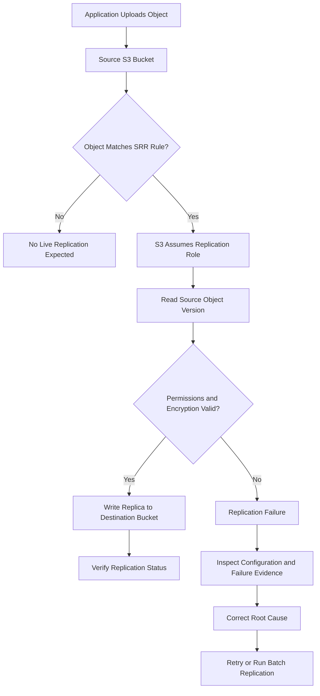

# 02- Same-Region Replication Issues

## Overview

Amazon S3 Same-Region Replication (SRR) asynchronously copies eligible objects from a source bucket to a destination bucket in the same AWS Region. The buckets can belong to the same AWS account or different accounts.

SRR is commonly used for centralized log aggregation, cross-account data sharing, production-to-test data distribution, data governance, and maintaining a separate copy of objects within a Region.

Replication failures can leave destination datasets incomplete, break downstream processing, and weaken account-level data protection. Although SRR uses the same replication framework as Cross-Region Replication (CRR), its operational considerations differ because both buckets reside in the same Region.

Common symptoms include:

- Newly uploaded objects do not appear in the destination bucket.
- Objects remain in `PENDING` replication status.
- Source objects report `FAILED` replication status.
- Only certain prefixes or tagged objects replicate.
- Cross-account SRR fails despite apparently correct IAM permissions.
- Replication works for unencrypted objects but fails for SSE-KMS objects.
- Historical objects remain missing after SRR is enabled.
- Delete markers behave differently between the source and destination.
- The destination contains objects but has unexpected ownership or encryption settings.
- Replication failures accumulate without an obvious application-level error.

The diagnostic process begins with the source object's replication status and the effective replication configuration. It then examines versioning, IAM permissions, bucket policies, KMS authorization, ownership, filtering, and the intended recovery workflow.

## Understand Same-Region Replication

SRR uses a replication configuration on the source bucket. Amazon S3 evaluates the configured rules and asynchronously copies eligible object versions to the specified destination bucket in the same Region.



SRR is asynchronous. Most objects replicate within approximately 15 minutes, although the actual time depends on factors such as object size and workload conditions. Large objects can take several hours.

S3 Replication Time Control (S3 RTC) can provide a 15-minute replication SLA for eligible objects and adds replication metrics and threshold-related event notifications. Ordinary SRR does not provide the same SLA.

### SRR versus CRR

| Concern | Same-Region Replication | Cross-Region Replication |
|---|---|---|
| Destination location | Same AWS Region | Different AWS Region |
| Typical use cases | Log aggregation, cross-account isolation, data sharing, regional data governance | Geographic separation, regional disaster recovery, regional access optimization |
| Versioning requirement | Enabled on both buckets | Enabled on both buckets |
| Cross-account support | Supported | Supported |
| Inter-Region data transfer charges for replication | No inter-Region transfer charges | Inter-Region transfer charges may apply |
| Protection against a Regional outage | Does not provide geographic separation | Can preserve copies in another Region |
| Historical objects | Require an on-demand replication workflow when they predate the rule | Require an on-demand replication workflow when they predate the rule |

SRR can provide a separate administrative or account boundary, but it is not a substitute for cross-Region disaster recovery. A Regional outage can affect both buckets.

Reference: [Replicating objects within and across Regions](https://docs.aws.amazon.com/AmazonS3/latest/userguide/replication.html).

## Classify the Failure

| Symptom | Likely cause | Initial diagnostic action |
|---|---|---|
| Destination object is missing | Disabled rule, incorrect destination, or object excluded by filters | Inspect the source replication configuration |
| Source status is `PENDING` | Replication has not completed | Check elapsed time and replication backlog |
| Source status is `FAILED` | Permission, encryption, ownership, or configuration failure | Inspect the role, destination bucket policy, and KMS permissions |
| New objects replicate but older objects do not | Live replication does not backfill previously existing objects | Use S3 Batch Replication |
| Only certain prefixes replicate | Incorrect prefix or tag filters | Compare actual object keys and tags with rule filters |
| Cross-account SRR fails | Destination bucket policy or ownership configuration is incorrect | Validate permissions in both accounts |
| SSE-KMS objects fail | Required KMS permissions or encryption settings are missing | Inspect the source and destination KMS keys |
| Delete markers do not replicate | Delete-marker replication is disabled or the rule does not support it | Inspect the rule and how the marker was created |
| Destination object exists but source status is `FAILED` | Ownership override or another replication-state issue | Inspect ownership configuration and AWS diagnostic guidance |
| Replication backlog increases | Persistent errors or incoming work exceeds effective processing capacity | Inspect replication metrics and failure events |

## Inspect the Replication Configuration

### Retrieve the source bucket configuration

Run the following command against the source bucket:

```bash
aws s3api get-bucket-replication \
  --bucket example-source-bucket \
  --region ap-south-1
```

Inspect the following fields:

| Field | What to verify |
|---|---|
| `Role` | The replication IAM role ARN is correct |
| `Rules[].Status` | The applicable rule is `Enabled` |
| `Rules[].Destination.Bucket` | The destination bucket ARN identifies the intended bucket |
| `Rules[].Filter` | Prefix and tag filters match the objects that should replicate |
| `Rules[].Priority` | Priority is correct when multiple rules overlap |
| `Rules[].DeleteMarkerReplication` | Delete-marker behavior matches the intended design |
| `Rules[].SourceSelectionCriteria` | SSE-KMS object selection is enabled where required |
| `Rules[].Destination.EncryptionConfiguration` | The destination KMS key is correct when configured |
| `Rules[].Destination.AccessControlTranslation` | Ownership override is consistent with the destination account's requirements |

A valid configuration does not guarantee that every object is eligible. Validate the rule against the actual key, tags, encryption, version, and creation time.

If the request returns `ReplicationConfigurationNotFoundError`, the source bucket does not have an available replication configuration. If it returns `AccessDenied`, inspect the caller's `s3:GetReplicationConfiguration` permission.

### Verify versioning on both buckets

Both source and destination buckets must have versioning enabled.

```bash
aws s3api get-bucket-versioning \
  --bucket example-source-bucket \
  --region ap-south-1

aws s3api get-bucket-versioning \
  --bucket example-destination-bucket \
  --region ap-south-1
```

Expected response:

```json
{
  "Status": "Enabled"
}
```

If versioning is suspended on either bucket, replication may fail. Correct the versioning configuration through the approved change process and verify the resulting state.

If the source bucket uses S3 Object Lock, the destination must also have Object Lock enabled. The replication role requires additional permissions to read the relevant retention and legal-hold information.

Do not attempt to disable versioning on a bucket with a replication configuration. S3 requires the replication configuration to be removed before versioning can be suspended or disabled on the source bucket.

### Verify the destination account and bucket

Check that the destination ARN identifies the correct bucket and account. In cross-account configurations, inspect the destination bucket policy from the destination account as well as the role policy in the source account.

Both buckets being in the same Region does not eliminate cross-account authorization requirements.

## Inspect the Replication Status of an Object

### Check the source object

```bash
aws s3api head-object \
  --bucket example-source-bucket \
  --key "documents/report.pdf" \
  --region ap-south-1
```

For an eligible object, inspect the returned `ReplicationStatus` field.

| Status | Meaning | Recommended action |
|---|---|---|
| `PENDING` | Replication has not completed | Inspect latency and pending operations |
| `COMPLETED` | Replication completed successfully | Verify the destination if the application still reports a problem |
| `FAILED` | Replication failed | Investigate permissions, encryption, ownership, and configuration |
| `REPLICA` | The object is a replica in the destination bucket | Verify destination metadata and access |

An absent `ReplicationStatus` does not prove that replication succeeded. The object might be ineligible, or the operation might not expose a status for that object.

If the bucket is versioned, inspect the specific version when the incident concerns an overwritten or historical object.

### Verify the destination

```bash
aws s3api head-object \
  --bucket example-destination-bucket \
  --key "documents/report.pdf" \
  --region ap-south-1
```

Validate:

- Object existence and content length.
- Expected object key and version history.
- Storage class, if relevant.
- Encryption settings.
- Metadata and tags.
- Ownership and access permissions.
- Application-level access to the replica.

If the destination object exists but the source reports `FAILED`, investigate documented ownership-override scenarios and other replication-state issues. Repeatedly retrying the object may not resolve this condition; contact AWS Support when required to verify the replication state.

## Diagnose IAM and Bucket Policy Failures

SRR depends on permissions across the source bucket, the replication role, and the destination bucket. Cross-account replication introduces an additional boundary because the destination account must explicitly authorize the source replication role.

### Validate the replication role

Inspect the role referenced in the source bucket's replication configuration:

```bash
aws iam get-role \
  --role-name S3ReplicationRole
```

The role's trust policy must allow Amazon S3 to assume it. An illustrative trust relationship is:

```json
{
  "Version": "2012-10-17",
  "Statement": [
    {
      "Effect": "Allow",
      "Principal": {
        "Service": "s3.amazonaws.com"
      },
      "Action": "sts:AssumeRole"
    }
  ]
}
```

This is only the trust relationship. The role must also have the permissions needed for the configured replication features.

### Check required S3 permissions

Common permissions to investigate include:

| Operation | Permission |
|---|---|
| Read source replication configuration | `s3:GetReplicationConfiguration` |
| List source bucket contents where required | `s3:ListBucket` |
| Read eligible source object versions | `s3:GetObjectVersionForReplication` |
| Read source version ACLs where required | `s3:GetObjectVersionAcl` |
| Read source version tags where required | `s3:GetObjectVersionTagging` |
| Write replicated objects | `s3:ReplicateObject` |
| Replicate delete markers | `s3:ReplicateDelete` |
| Replicate tags | `s3:ReplicateTags` |
| Override destination object ownership | `s3:ObjectOwnerOverrideToBucketOwner`, when configured |
| Read object retention and legal holds | `s3:GetObjectRetention` and `s3:GetObjectLegalHold`, when required |

Use the applicable AWS replication policy guidance to establish the exact permissions for your configuration. Avoid granting broad `s3:*` access to resolve an isolated replication error.

### Validate cross-account authorization

For cross-account SRR, inspect these layers independently:

- Source replication role identity policy.
- Destination bucket resource policy.
- Relevant source and destination KMS key policies.
- Permissions boundaries and session policies.
- AWS Organizations service control policies.
- Resource control policies, where applicable.
- Relevant VPC endpoint policies and other organization-specific restrictions.

An explicit deny can override an otherwise valid allow statement. The destination account must authorize the required replica writes, and the source replication role must have the corresponding permissions.

### Check object ownership

The source bucket owner must have the required permissions on the objects that are to be replicated. Objects uploaded by another account can introduce ownership and ACL-related restrictions, especially in legacy configurations.

If the destination bucket owner must own replicas, inspect the `AccessControlTranslation` configuration and confirm that the replication role has `s3:ObjectOwnerOverrideToBucketOwner`.

Do not enable legacy ACLs or broaden permissions merely to suppress an error. First verify the intended Object Ownership model.

References:

- [Setting up permissions for live replication](https://docs.aws.amazon.com/AmazonS3/latest/userguide/setting-repl-config-perm-overview.html)
- [Replication requirements and considerations](https://docs.aws.amazon.com/AmazonS3/latest/userguide/replication-requirements.html)

## Troubleshoot SSE-KMS Replication Failures

SRR can replicate SSE-KMS encrypted objects, but the replication workflow needs authorization to decrypt source data and encrypt destination replicas.

### Verify encryption settings

Inspect the source object:

```bash
aws s3api head-object \
  --bucket example-source-bucket \
  --key "documents/confidential.pdf" \
  --region ap-south-1
```

Inspect the destination bucket's default encryption configuration:

```bash
aws s3api get-bucket-encryption \
  --bucket example-destination-bucket \
  --region ap-south-1
```

Verify the actual source encryption type and KMS key, the intended destination key, and the replication rule's encryption settings.

A bucket's default encryption setting does not prove how every existing object was encrypted. Inspect the object-level response when diagnosing a specific failure.

### Check KMS permissions

Investigate whether the replication role is authorized to use:

- `kms:Decrypt` on the source KMS key.
- `kms:Encrypt` on the destination KMS key.
- `kms:GenerateDataKey` where required by the destination encryption configuration and operation.

The KMS key policies must also permit the applicable operations. Cross-account KMS usage requires authorization from the key-owning account.

For applicable configurations, the replication rule must explicitly select KMS-encrypted objects using `SourceSelectionCriteria.SseKmsEncryptedObjects`. The destination can specify a replica KMS key through `Destination.EncryptionConfiguration`.

Because SRR uses the same Region, a destination KMS key can be a different key in that Region. Confirm that the configured key ARN is valid for the intended destination and that its policy permits the replication role to use it.

Reference: [Replicating objects encrypted with AWS KMS](https://docs.aws.amazon.com/AmazonS3/latest/userguide/replication-config-for-kms-objects.html).

## Troubleshoot Prefix and Tag Filters

Replication rules can target all objects or a subset selected by prefix or object tags.

A prefix filter is a literal beginning-of-key match. A rule targeting `logs/` does not match `application-logs/file.json`.

### Verify tags and filters

```bash
aws s3api get-object-tagging \
  --bucket example-source-bucket \
  --key "logs/application.json" \
  --region ap-south-1
```

Check:

- Exact prefix spelling and capitalization.
- Tag keys and values.
- Whether every required filter condition matches.
- The enabled status of the rule.
- Rule priority when multiple rules overlap.
- Whether the object existed before the rule was configured.

For tag-based live replication, the required tag must be present when the object is created. Adding the tag to an existing object does not cause that object to be replicated automatically.

If an object is missing because it was ineligible when created, correct the configuration and use an appropriate Batch Replication workflow when the existing object must be copied.

### Review overlapping rules

If multiple rules have overlapping filters, inspect their priorities and destinations. Do not assume that each matching rule creates an independent replica in every configured destination.

Validate representative objects from every prefix or tag group that the design expects to replicate.

## Handle Historical Objects and Failed Replication

Live replication does not automatically backfill objects that existed before the replication configuration was established. It also does not automatically retry every previously failed object.

This commonly causes an SRR deployment to appear successful for new uploads while older datasets remain incomplete.

### Use S3 Batch Replication

S3 Batch Replication supports on-demand replication of eligible existing objects, including objects that existed before live replication was configured or objects that previously failed.

Use this controlled workflow:

1. Identify the intended objects and versions.
2. Correct the underlying SRR configuration, permissions, or encryption problem.
3. Verify that the destination and retention requirements are correct.
4. Create a suitable manifest or use an S3-generated manifest.
5. Configure the Batch Operations role with the required permissions.
6. Run Batch Replication and monitor job progress.
7. Review the completion report and investigate failed tasks.
8. Validate destination contents, metadata, encryption, and expected coverage.

Objects in S3 Glacier Flexible Retrieval or S3 Glacier Deep Archive may need to be restored before they can be replicated through Batch Replication.

Batch Replication has additional permissions and operational costs. It is a separate on-demand workflow rather than a replacement for fixing the live replication configuration.

Reference: [Replicating existing objects with Batch Replication](https://docs.aws.amazon.com/AmazonS3/latest/userguide/s3-batch-replication-batch.html).

## Troubleshoot Delete Marker Replication

By default, delete-marker replication is not enabled for newer filtered replication rules. Supported rules can explicitly enable it when deletes need to be reflected at the destination.

Important limitations include:

- Delete-marker replication is not supported for tag-based replication rules.
- Delete markers created by S3 Lifecycle expiration are not replicated.
- Permanently deleting a specific source object version does not replicate that permanent deletion to the destination.
- SRR and CRR have the same fundamental delete-marker replication constraints.

### Investigate inconsistent deletion behavior

1. List versions and delete markers for the source key.
2. Inspect the destination key's versions and markers.
3. Review `DeleteMarkerReplication` in the applicable rule.
4. Check whether the rule uses tag-based filtering.
5. Establish whether the marker was created by an ordinary delete request or by Lifecycle.
6. Compare the result with the application's intended retention and deletion behavior.

Do not interpret every missing destination delete marker as a replication failure. The difference may be the intended result of the rule configuration.

Reference: [Replicating delete markers between buckets](https://docs.aws.amazon.com/AmazonS3/latest/userguide/delete-marker-replication.html).

## Monitor Replication Backlog and Failures

For production use, replication should be monitored as an operational dependency. This is particularly important when SRR aggregates logs, supplies another account with data, or maintains a second copy for recovery.

### Enable replication metrics

S3 Replication metrics provide visibility into:

- Bytes pending replication.
- Operations pending replication.
- Replication latency.
- Failed replication operations.

These metrics are published to CloudWatch when replication metrics or S3 RTC are enabled.

Track backlog trends and latency rather than relying only on the status of a single object. A continuously increasing queue of pending operations can indicate that the workload is falling behind even while some individual objects complete successfully.

Reference: [Monitoring replication with metrics and events](https://docs.aws.amazon.com/AmazonS3/latest/userguide/replication-metrics.html).

### Configure replication failure notifications

S3 Event Notifications can report replication-related events, including:

- `s3:Replication:OperationFailedReplication`
- `s3:Replication:OperationMissedThreshold`
- `s3:Replication:OperationReplicatedAfterThreshold`
- `s3:Replication:OperationNotTracked`

Replication metrics must be enabled on the relevant rule for the standard replication failure event. S3 RTC is required for threshold-related events.

Route supported events to an SQS queue, SNS topic, or Lambda function. Make the consumer idempotent because event delivery and processing may be repeated.

Use the notification as an investigation signal. Inspect the source object, configuration, and relevant failure information before concluding that the replication service itself is unavailable.

### Define operational thresholds

Monitor these indicators:

- Age of the oldest pending replication operation.
- Bytes and operations pending replication.
- Number of failed replication operations.
- Latency against the application's replication objective.
- Backlog growth over time.
- Eligible source objects missing from the destination.

For cross-account log aggregation, also track the number of objects delivered to the destination and any downstream ingestion failures.

SRR may help meet an account-isolation or data-governance objective, but it does not provide geographic separation. If a Regional failure must be tolerated, use an appropriate cross-Region recovery design.

## Example: Configure a Same-Region Replication Rule

The following example replicates objects under `logs/` from a source bucket to a destination bucket in the same Region. It assumes that versioning is enabled on both buckets and that the replication role and destination policy already have the required permissions.

Save the configuration as `replication.json`:

```json
{
  "Role": "arn:aws:iam::111122223333:role/S3ReplicationRole",
  "Rules": [
    {
      "ID": "ReplicateLogsWithinRegion",
      "Status": "Enabled",
      "Priority": 1,
      "Filter": {
        "Prefix": "logs/"
      },
      "DeleteMarkerReplication": {
        "Status": "Disabled"
      },
      "Destination": {
        "Bucket": "arn:aws:s3:::example-destination-bucket"
      }
    }
  ]
}
```

Apply the configuration to the source bucket:

```bash
aws s3api put-bucket-replication \
  --bucket example-source-bucket \
  --replication-configuration file://replication.json \
  --region ap-south-1
```

Verify the stored configuration:

```bash
aws s3api get-bucket-replication \
  --bucket example-source-bucket \
  --region ap-south-1
```

This example does not configure SSE-KMS replication, destination ownership override, S3 RTC, or delete-marker replication. Add those options only when required by the actual workload.

**Important:** `put-bucket-replication` updates the bucket's replication configuration. Do not apply a one-rule example to an existing production bucket without first preserving and reviewing all other required rules.

## Production Recovery and Prevention

For a confirmed SRR failure, use a controlled recovery process:

1. Record the source key, version ID, replication status, and relevant event or request evidence.
2. Inspect the complete replication rule and versioning state of both buckets.
3. Validate the replication role, destination policy, ownership, and KMS permissions.
4. Correct the root cause and test with a newly uploaded eligible object.
5. Use Batch Replication for eligible historical or previously failed objects that need recovery.
6. Review the batch completion report and investigate failed tasks.
7. Verify destination object contents, encryption, metadata, and access.
8. Record the root cause, affected objects, recovery results, and unresolved risks.

Avoid re-uploading source objects as a generic workaround. New uploads can create additional versions and trigger application events or downstream processing. Prefer a documented retry or Batch Replication workflow when appropriate.

For account-level isolation, consider whether the destination account's permissions, retention policy, and administrative controls actually differ from those of the source. Replication into another bucket in the same account may not provide meaningful protection against account-wide destructive actions.

## Common Mistakes

| Mistake | Why it causes problems | Better approach |
|---|---|---|
| Assuming SRR automatically backfills old objects | Live replication only processes eligible objects under the configuration | Use Batch Replication |
| Checking only the destination listing | Does not identify why replication failed | Inspect source status and the complete rule |
| Granting broad permissions without checking KMS | S3 and KMS authorization are separate | Validate both permission layers |
| Assuming every delete marker replicates | Delete-marker replication has configuration constraints | Inspect the rule and origin of the marker |
| Treating `PENDING` as a permanent failure | Replication is asynchronous | Inspect backlog and latency |
| Replacing an existing rule set with a minimal example | Other rules and destinations can be lost | Merge and review the full configuration |
| Assuming same-account SRR provides strong administrative isolation | The same account may control both buckets | Evaluate cross-account controls and independent recovery safeguards |
| Using SRR as the only protection against a Regional outage | Both buckets are in the same Region | Use an appropriate cross-Region recovery architecture |
| Ignoring destination ownership | The replication role may lack required object or bucket permissions | Validate ownership and authorization in both accounts |

## Related AWS Documentation

- [Replicating objects within and across Regions](https://docs.aws.amazon.com/AmazonS3/latest/userguide/replication.html)
- [Replication requirements and considerations](https://docs.aws.amazon.com/AmazonS3/latest/userguide/replication-requirements.html)
- [Troubleshooting replication](https://docs.aws.amazon.com/AmazonS3/latest/userguide/replication-troubleshoot.html)
- [Setting up permissions for live replication](https://docs.aws.amazon.com/AmazonS3/latest/userguide/setting-repl-config-perm-overview.html)
- [Replicating KMS-encrypted objects](https://docs.aws.amazon.com/AmazonS3/latest/userguide/replication-config-for-kms-objects.html)
- [Replicating existing objects with Batch Replication](https://docs.aws.amazon.com/AmazonS3/latest/userguide/s3-batch-replication-batch.html)
- [Monitoring replication metrics and events](https://docs.aws.amazon.com/AmazonS3/latest/userguide/replication-metrics.html)
- [Replicating delete markers](https://docs.aws.amazon.com/AmazonS3/latest/userguide/delete-marker-replication.html)
- [AWS CLI: get-bucket-replication](https://docs.aws.amazon.com/cli/latest/reference/s3api/get-bucket-replication.html)
- [AWS CLI: head-object](https://docs.aws.amazon.com/cli/latest/reference/s3api/head-object.html)

## Key Takeaways

- Verify source-object replication status and the complete replication configuration before concluding that SRR is failing.
- Both buckets require versioning, and replication depends on the role, destination bucket policy, object ownership, and any relevant KMS permissions.
- Live replication does not backfill historical objects; use S3 Batch Replication for eligible existing or failed objects.
- Delete-marker replication has separate constraints and does not replicate every deletion or Lifecycle-generated marker.
- SRR provides same-Region replication, not geographic disaster recovery; monitor replication health and validate the destination independently.