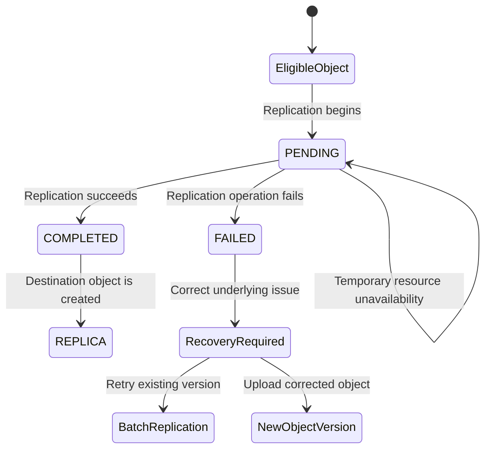

# 03- Replication Permissions and Status

## Overview

Amazon S3 Replication depends on a combination of bucket configuration, IAM permissions, destination resource policies, and optional encryption and ownership controls. Understanding these dependencies is essential when diagnosing replication failures, investigating objects that remain pending, or verifying that replicated data is available for downstream applications.

Replication status identifies the state of an eligible object, while replication failure events can provide a more specific reason for an unsuccessful operation. IAM and bucket policies determine whether Amazon S3 can perform the requested replication operations.

Common symptoms include:

- Objects remain in `PENDING` replication status.
- Objects transition to `FAILED` after upload.
- The replication role exists, but Amazon S3 cannot assume it.
- Replication works for some objects but fails for others.
- A destination bucket policy denies replication writes.
- KMS-encrypted objects fail while other objects replicate.
- Replication status is absent from an object's metadata.
- An object is present in the destination despite a source-side failure status.
- Lifecycle transitions or expiration stop while replication is pending or failed.
- Replication metrics show failures, but the affected object is difficult to identify.

The diagnostic objective is to establish whether the object is eligible for replication, determine its actual replication state, identify the failed authorization or configuration dependency, and recover affected objects without creating unnecessary versions or compromising data retention.

## Understand Replication Status

Amazon S3 exposes replication status through object metadata. The status is returned by supported object metadata and retrieval operations when applicable.

### Status values

| Status | Meaning | Recommended action |
|---|---|---|
| `PENDING` | Replication has not completed | Check elapsed time, backlog, rule configuration, and transient availability conditions |
| `COMPLETED` | The source object has completed replication to the configured destination or destinations | Verify destination contents if the application still reports missing data |
| `FAILED` | Replication failed for the eligible object | Inspect failure events, permissions, encryption, and destination configuration |
| `REPLICA` | The object is a replica created through S3 Replication | Verify destination access and expected object properties |
| Status absent | No status is exposed for the requested object | Check replication eligibility, object version, rule filters, and the operation used to retrieve metadata |

The absence of a status is not proof of successful replication. An object might not match an active replication rule, or the request might not be exposing status for that object.

### How status changes



A temporary resource outage can leave an object in `PENDING`; S3 can resume replication when the affected resource becomes available again. Deterministic failures such as missing permissions can result in `FAILED`.

**Important:** A failed live-replication operation cannot generally be retried simply by repeating the original upload request. Uploading the object again creates a new object version in a versioning-enabled bucket. To replicate an existing failed version, use S3 Batch Replication where supported.

Reference: [Getting replication status information](https://docs.aws.amazon.com/AmazonS3/latest/userguide/replication-status.html).

## Diagnose Replication Status

### Retrieve the source object's status

Run `head-object` against the source bucket:

```bash
aws s3api head-object \
  --bucket example-source-bucket \
  --key "documents/report.pdf" \
  --region ap-south-1
```

Inspect the following fields where returned:

- `ReplicationStatus`
- `VersionId`
- `LastModified`
- `ContentLength`
- `ServerSideEncryption`
- `SSEKMSKeyId`

If the object has multiple versions, inspect the relevant version explicitly:

```bash
aws s3api head-object \
  --bucket example-source-bucket \
  --key "documents/report.pdf" \
  --version-id "example-version-id" \
  --region ap-south-1
```

Using a specific version ID is important when the object has been overwritten, deleted, or recreated since the original failure.

A `HeadObject` request requires permission to access the requested object. An authorization error from this diagnostic command does not, by itself, establish that replication failed.

### Verify the destination independently

```bash
aws s3api head-object \
  --bucket example-destination-bucket \
  --key "documents/report.pdf" \
  --region ap-south-1
```

For Cross-Region Replication, specify the destination bucket's Region instead.

Compare the source and destination for:

- Object existence and content length.
- Expected encryption configuration.
- Metadata and tags.
- Object version history.
- Ownership and access permissions.
- Application-level readability.

For replication to multiple destinations, source status is `COMPLETED` only when replication has completed successfully for all configured destinations. A missing replica at one destination can therefore affect the status reported for the source object.

In configurations that support replica modification synchronization, metadata changes on a replica can also have their own replication status behavior.

## Understand the Three Permission Layers

Replication-related permission failures usually originate from one of three separate authorization stages.

<box>
  <text color="secondary" weight="medium" size="sm">Authorization model</text>
  <box border radius="md" padding={3} gap={1}>
    **Replication configuration**

    The administrative principal configures replication and passes the required IAM role to S3.
  </box>
  <box align="center" padding={1}>
    <icon name="arrow-down" size="lg" color="secondary" />
  </box>
  <box border radius="md" padding={3} gap={1}>
    **Replication role**

    Amazon S3 assumes the role to read eligible source versions and perform replication operations.
  </box>
  <box align="center" padding={1}>
    <icon name="arrow-down" size="lg" color="secondary" />
  </box>
  <box border radius="md" padding={3} gap={1}>
    **Destination authorization**

    The destination bucket policy and any relevant KMS key policies must permit the required writes and encryption operations.
  </box>
</box>

A successful configuration API request does not prove that the runtime replication role has sufficient permissions. Each layer must be checked independently.

## Troubleshoot the Replication Configuration Principal

The IAM identity that creates or updates the replication configuration is different from the IAM role Amazon S3 assumes to replicate objects.

The configuring principal typically requires permissions to manage the source bucket's replication configuration and pass the replication role to S3.

Common permissions to investigate include:

| Permission | Purpose |
|---|---|
| `s3:GetReplicationConfiguration` | Inspect the source bucket's replication configuration |
| `s3:PutReplicationConfiguration` | Create or update the replication configuration |
| `iam:PassRole` | Pass the replication role to the S3 replication configuration |
| `s3:GetBucketVersioning` | Verify bucket versioning when permitted by the workflow |
| `iam:GetRole` | Inspect the IAM role, when needed and authorized |

The actual permissions depend on the administrative workflow. For example, a deployment pipeline may need additional permissions to validate and manage the infrastructure surrounding replication.

### Verify the effective identity

```bash
aws sts get-caller-identity
aws configure list
```

Confirm that the identity belongs to the intended AWS account and has the expected access.

For cross-account replication, verify which account owns the source bucket, replication role, and destination bucket. A permission granted in one account does not automatically authorize operations in another.

### Inspect the replication configuration

```bash
aws s3api get-bucket-replication \
  --bucket example-source-bucket \
  --region ap-south-1
```

Verify the role ARN, rule status, filters, destination ARN, encryption settings, and relevant ownership configuration.

If replication configuration changes recently, verify that the stored configuration contains the expected values before investigating object-level failures.

Reference: [Setting up permissions for live replication](https://docs.aws.amazon.com/AmazonS3/latest/userguide/setting-repl-config-perm-overview.html).

## Troubleshoot the Replication Role

Amazon S3 assumes the IAM role specified in the replication configuration. That role requires a trust policy allowing the S3 service principal to assume it and a permissions policy authorizing the replication operations.

### Check the trust policy

An illustrative trust relationship is:

```json
{
  "Version": "2012-10-17",
  "Statement": [
    {
      "Effect": "Allow",
      "Principal": {
        "Service": "s3.amazonaws.com"
      },
      "Action": "sts:AssumeRole"
    }
  ]
}
```

Inspect the actual role:

```bash
aws iam get-role \
  --role-name S3ReplicationRole
```

Verify that the role referenced by the bucket configuration is the same role being inspected.

### Check source permissions

Common source-side permissions include:

| Permission | Purpose |
|---|---|
| `s3:GetReplicationConfiguration` | Read the bucket's replication configuration |
| `s3:ListBucket` | List bucket contents where required by the configured workflow |
| `s3:GetObjectVersionForReplication` | Read eligible source object versions for replication |
| `s3:GetObjectVersionAcl` | Read version ACLs where required |
| `s3:GetObjectVersionTagging` | Read object-version tags where required |
| `s3:GetObjectRetention` | Read retention information for Object Lock replication |
| `s3:GetObjectLegalHold` | Read legal-hold information for Object Lock replication |

Use the least-privilege policy appropriate for the replication configuration. `s3:GetObjectVersionForReplication` is preferable to broad source-version read permissions when it satisfies the required replication operations.

If the source bucket contains objects owned by another account, verify that the bucket owner has the necessary access to those objects. Legacy ACL configurations can prevent replication when the required access has not been granted.

### Check destination permissions

Common destination-side permissions include:

| Permission | Purpose |
|---|---|
| `s3:ReplicateObject` | Write replicated objects |
| `s3:ReplicateDelete` | Replicate supported delete-marker operations |
| `s3:ReplicateTags` | Replicate object tags where required |
| `s3:ObjectOwnerOverrideToBucketOwner` | Override replica ownership when configured |
| `s3:PutObjectRetention` | Set replicated Object Lock retention where required |
| `s3:PutObjectLegalHold` | Apply replicated legal holds where required |

The destination bucket's resource policy must also authorize the replication role, particularly in cross-account scenarios.

Avoid adding all these permissions indiscriminately. Establish the specific missing action from the event failure reason and the configuration being used.

## Diagnose Replication Failure Reasons

S3 Replication failure events can include a `failureReason` field. This field helps distinguish missing permissions from invalid destination resources, missing object versions, and unsupported object configurations.

Enable replication metrics on the applicable rule to receive `s3:Replication:OperationFailedReplication` notifications.

### Common failure codes

| Failure reason | Likely root cause | Corrective action |
|---|---|---|
| `AssumeRoleNotPermitted` | S3 cannot assume the configured replication role | Correct the role ARN and trust policy |
| `DstBucketNotFound` | Destination bucket is missing, misidentified, or inaccessible as configured | Verify the destination bucket ARN and account |
| `DstBucketUnversioned` | Destination versioning is not enabled | Enable destination versioning |
| `DstBucketObjectLockConfigMissing` | Source uses Object Lock, but destination Object Lock is not enabled | Configure compatible destination Object Lock settings |
| `DstPutObjectNotPermitted` | Destination write permissions, ownership override, or KMS authorization are missing | Inspect `s3:ReplicateObject`, ownership settings, and KMS key policies |
| `DstDelObjNotPermitted` | S3 cannot replicate the supported delete-marker operation | Check `s3:ReplicateDelete` and rule settings |
| `DstKmsKeyNotFound` | The configured destination KMS key does not exist | Correct the destination key ARN |
| `DstKmsKeyInvalidState` | The destination KMS key is not in a usable state | Review key state and restore an eligible state |
| `SrcGetObjectNotPermitted` | S3 cannot read the source object version for replication | Inspect `s3:GetObjectVersionForReplication` and applicable source policies |
| `SrcGetTaggingNotPermitted` | S3 cannot read source version tags | Check `s3:GetObjectVersionTagging` |
| `SrcGetAclNotPermitted` | S3 cannot obtain required source version ACL information | Check version ACL permissions and object ownership |
| `SrcKmsKeyInvalidState` | The source KMS key is unusable | Correct the source key state or encryption configuration |
| `SrcObjectNotEligible` | The object does not qualify under the replication configuration | Inspect filters, tags, and storage class |
| `SrcKeyNotFound` | The source object was removed before replication completed or the requested key is unavailable | Inspect version history and deletion events |
| `SrcVersionNotFound` | The source version required for replication no longer exists | Verify retention and recovery options |
| `DstPutRetentionNotPermitted` | S3 cannot apply the required Object Lock retention | Check destination retention permissions and configuration |
| `DstPutLegalHoldNotPermitted` | S3 cannot apply the required legal hold | Check `s3:PutObjectLegalHold` and Object Lock configuration |

Failure codes evolve as S3 adds support for replication features. Use the event's actual reason and the current AWS reference rather than assuming every failure maps to a general access-denied category.

Reference: [Receiving replication failure events and replication failure reasons](https://docs.aws.amazon.com/AmazonS3/latest/userguide/replication-metrics-events.html).

## Troubleshoot SSE-KMS Authorization

SSE-KMS replication requires both S3 authorization and access to the applicable KMS keys.

The replication role generally needs `kms:Decrypt` on the source key and `kms:Encrypt` on the destination key. Depending on the encryption configuration and operation, additional KMS permissions such as `kms:GenerateDataKey` may be required.

### Verify encryption settings

```bash
aws s3api head-object \
  --bucket example-source-bucket \
  --key "documents/confidential.pdf" \
  --region ap-south-1
```

Inspect the `ServerSideEncryption` and `SSEKMSKeyId` fields where returned.

Inspect the destination encryption configuration:

```bash
aws s3api get-bucket-encryption \
  --bucket example-destination-bucket \
  --region ap-south-1
```

Verify that the replication rule explicitly selects applicable KMS-encrypted objects and specifies the intended destination KMS key where required.

### Validate key policies separately

For each key, confirm:

- The key exists in the relevant account and Region.
- The key is in a state that permits the required operation.
- The replication role's identity policy authorizes the required KMS actions.
- The KMS key policy authorizes the role.
- Cross-account key access is permitted where applicable.
- The destination key ARN is correct.

A valid S3 replication role policy cannot compensate for a KMS key policy that denies encryption or decryption.

Reference: [Replicating KMS-encrypted objects](https://docs.aws.amazon.com/AmazonS3/latest/userguide/replication-config-for-kms-objects.html).

## Understand Replication Status and Lifecycle Interaction

S3 Lifecycle actions are affected by replication status. For eligible objects with replication enabled, Lifecycle pauses transition and expiration actions while replication is `PENDING`. If replication status is `FAILED`, those actions continue to be blocked until the replication problem is resolved.

This behavior prevents Lifecycle from moving or expiring the source object before the configured replication operation has completed successfully.

Consequently, a replication failure can lead to unexpected storage growth even when lifecycle rules are correctly configured.

To investigate:

1. Inspect the object's replication status.
2. Check the lifecycle configuration and its filters.
3. Verify whether the object has `PENDING` or `FAILED` status.
4. Fix the replication failure.
5. Verify the resulting replication status and subsequent lifecycle behavior.

Do not modify lifecycle retention periods merely to compensate for replication problems. Resolve the replication issue first and preserve the intended recovery and retention requirements.

Reference: [Getting replication status information](https://docs.aws.amazon.com/AmazonS3/latest/userguide/replication-status.html).

## Recover Failed Replication Operations

### Understand retry behavior

When an eligible object fails live replication, retrying the same upload is not equivalent to retrying the original version.

For versioned buckets, another upload creates a new object version and may trigger application events or downstream processing. This can obscure the original failure or introduce additional data versions.

For existing object versions that failed replication, use S3 Batch Replication where applicable.

### Use S3 Batch Replication

A controlled recovery procedure should:

1. Correct the underlying role, bucket policy, encryption, or configuration problem.
2. Identify the intended objects or versions.
3. Create a suitable Batch Operations manifest.
4. Configure the Batch Operations role and permissions.
5. Run the Batch Replication job.
6. Review the completion report.
7. Inspect failed tasks and their recorded failure reasons.
8. Verify destination objects, metadata, encryption, and expected coverage.

Batch Replication uses a separate execution role and permissions from ordinary live replication. Ensure that the job can read the manifest, access the relevant source objects, initiate replication, and access the intended destination.

Reference: [Replicating existing objects with Batch Replication](https://docs.aws.amazon.com/AmazonS3/latest/userguide/s3-batch-replication-batch.html).

## Monitor Replication Status at Scale

Checking each object manually is useful for incident isolation but does not scale as a permanent monitoring strategy.

### Replication metrics

S3 Replication metrics can monitor:

- Bytes pending replication.
- Operations pending replication.
- Operations that failed replication.
- Replication latency.

These metrics are published to CloudWatch when replication metrics are enabled for the applicable configuration.

The standard failure event can identify the affected object and its `failureReason`, whereas aggregate metrics indicate the scale and trend of the problem.

### Replication event notifications

S3 provides replication event types including:

- `s3:Replication:OperationFailedReplication`
- `s3:Replication:OperationMissedThreshold`
- `s3:Replication:OperationReplicatedAfterThreshold`
- `s3:Replication:OperationNotTracked`

Replication metrics must be enabled for the standard failure event. S3 Replication Time Control is required for threshold-related notifications.

Send supported notifications to SQS, SNS, or Lambda. Ensure that consumers are idempotent and preserve the event's source object key, version ID, destination information, and failure reason.

### S3 Inventory

For large buckets, S3 Inventory can provide object-level replication status information in scheduled reports. Amazon Athena can query the reports to identify objects that remain pending or have failed replication.

Inventory is appropriate for broad audits and reconciliation; it is not a substitute for timely event notifications in operational alerting.

Reference: [Monitoring replication with metrics, events, and statuses](https://docs.aws.amazon.com/AmazonS3/latest/userguide/replication-metrics.html).

## Common Mistakes

| Mistake | Why it causes problems | Better approach |
|---|---|---|
| Treating `PENDING` as a permanent failure | Temporary outages can leave the object pending until replication resumes | Check elapsed time, backlog, and service availability |
| Assuming the role exists, so trust is correct | S3 may still be unable to assume the role | Inspect the role ARN and trust policy |
| Fixing IAM but ignoring the destination bucket policy | Cross-account writes can still be denied | Validate both identity and resource policies |
| Ignoring KMS authorization | S3 permissions do not grant KMS key usage | Check KMS identity and key policies separately |
| Retrying by uploading the same content without analysis | Creates a new object version and can trigger duplicate workflows | Use Batch Replication for the failed existing version where appropriate |
| Assuming no replication status means success | The object might not be eligible or status may not be exposed | Verify the rule and object eligibility |
| Ignoring lifecycle behavior during replication failures | Lifecycle actions remain blocked for pending and failed objects | Resolve replication and then verify lifecycle processing |
| Granting broad administrator permissions | Expands the blast radius without identifying the denied action | Use failure evidence to grant the minimum required permission |
| Monitoring only aggregate metrics | Cannot reliably identify the affected object or failure reason | Combine CloudWatch metrics, replication events, and object inspection |

## Key Takeaways

- Replication status describes the state of an eligible object; `PENDING`, `COMPLETED`, `FAILED`, and `REPLICA` have distinct meanings.
- Replication authorization has separate layers: configuration permissions, the S3-assumed replication role, destination bucket policies, and KMS permissions.
- Use failure events and their `failureReason` values to identify specific permission and configuration problems rather than relying on aggregate metrics alone.
- Failed live replication generally requires a new object version or S3 Batch Replication to recover the existing version; simply repeating the original upload does not retry that version.
- Monitor replication status and backlog, and account for the fact that Lifecycle transition and expiration actions remain blocked while eligible objects are pending or failed.

## Related AWS Documentation

- [Getting replication status information](https://docs.aws.amazon.com/AmazonS3/latest/userguide/replication-status.html)
- [Troubleshooting replication](https://docs.aws.amazon.com/AmazonS3/latest/userguide/replication-troubleshoot.html)
- [Setting up permissions for live replication](https://docs.aws.amazon.com/AmazonS3/latest/userguide/setting-repl-config-perm-overview.html)
- [Receiving replication failure events and failure reasons](https://docs.aws.amazon.com/AmazonS3/latest/userguide/replication-metrics-events.html)
- [Replicating KMS-encrypted objects](https://docs.aws.amazon.com/AmazonS3/latest/userguide/replication-config-for-kms-objects.html)
- [Replicating existing objects with Batch Replication](https://docs.aws.amazon.com/AmazonS3/latest/userguide/s3-batch-replication-batch.html)
- [Monitoring replication metrics, events, and statuses](https://docs.aws.amazon.com/AmazonS3/latest/userguide/replication-metrics.html)
- [AWS CLI: `head-object`](https://docs.aws.amazon.com/cli/latest/reference/s3api/head-object.html)
- [AWS CLI: `get-bucket-replication`](https://docs.aws.amazon.com/cli/latest/reference/s3api/get-bucket-replication.html)