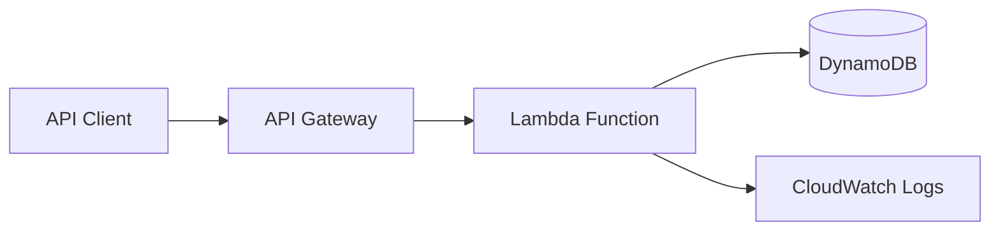
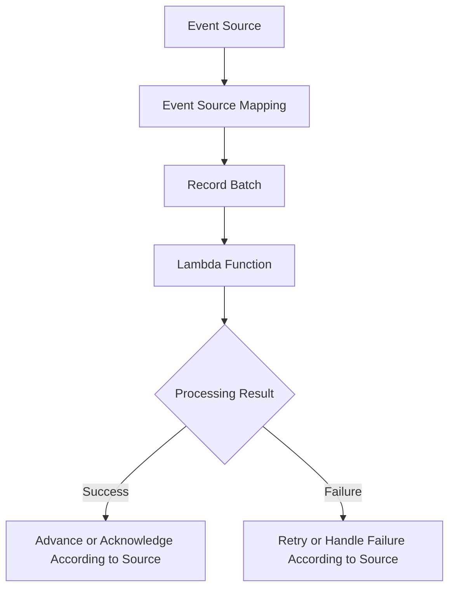

# Lambda Fundamentals Questions

## Overview

This document contains interview questions and model answers covering AWS Lambda fundamentals, execution behavior, invocation models, runtime configuration, concurrency, event processing, and production reliability.

The questions progress from foundational concepts to senior-level engineering scenarios. The emphasis is on understanding Lambda's execution model, explaining architectural trade-offs, diagnosing failures, and designing reliable serverless backends.

## Fundamentals

### What is AWS Lambda?

**Answer:**

AWS Lambda is a serverless compute service that executes application code in response to events without requiring the customer to provision or manage the underlying compute servers.

A Lambda function consists of application code, a handler, a runtime, configuration, and an execution role. AWS manages the execution infrastructure, while the developer remains responsible for application behavior, permissions, dependencies, observability, and reliability.

Common use cases include:

- Implementing REST APIs with Amazon API Gateway.
- Processing files uploaded to Amazon S3.
- Consuming messages from Amazon SQS.
- Reacting to events through Amazon EventBridge.
- Processing database changes from DynamoDB Streams.
- Executing scheduled jobs and background tasks.

**Example architecture:**



**Production considerations:**

- Lambda is not a replacement for every containerized or long-running workload.
- Execution duration, concurrency, memory, deployment packaging, and service quotas influence the design.
- Event-driven workloads must handle retries and duplicate events appropriately.
- Application code should not depend on an execution environment surviving indefinitely.

### Why is Lambda called serverless if servers still exist?

**Answer:**

Serverless means that the cloud provider manages the underlying server provisioning, infrastructure maintenance, and execution capacity abstraction. It does not mean that servers do not exist.

AWS manages the execution infrastructure, while developers configure the function and control its application-level behavior.

The operational responsibility shifts from managing servers to managing:

- Function configuration and deployment.
- IAM permissions and network access.
- Application performance and downstream dependencies.
- Concurrency, retries, and failure handling.
- Monitoring, cost, and service quotas.

**Interview distinction:** Serverless reduces infrastructure management; it does not eliminate operational responsibility.

### What are the main components of a Lambda function?

**Answer:**

| Component | Responsibility |
|---|---|
| Function code | Implements application logic |
| Handler | Entry point invoked by the Lambda runtime |
| Runtime | Executes the code using a supported language environment |
| Execution role | Defines AWS permissions available to the function |
| Configuration | Specifies memory, timeout, environment variables, architecture, and other settings |
| Execution environment | Provides the isolated environment in which an invocation runs |
| Invocation mechanism | Determines how the function receives work |
| Monitoring configuration | Supports logging, metrics, tracing, and alarms |

A Lambda function can also use layers, extensions, container images, or Amazon EFS where appropriate.

### What is a Lambda handler?

**Answer:**

A handler is the function entry point that the runtime invokes when Lambda receives an event.

For Python, the handler is typically specified as `module.function`.

For example, if `app.py` contains a function named `lambda_handler`, the handler setting is `app.lambda_handler`.

```python
import json

def lambda_handler(event, context):
    user_id = event.get("user_id")

    if not user_id:
        return {
            "statusCode": 400,
            "headers": {"content-type": "application/json"},
            "body": json.dumps({"error": "user_id is required"}),
        }

    return {
        "statusCode": 200,
        "headers": {"content-type": "application/json"},
        "body": json.dumps({"user_id": user_id}),
    }
```

The returned structure is suitable for an API Gateway proxy-style integration when the integration expects this response format. Other invocation mechanisms interpret the return value differently.

**Common mistakes:**

- Configuring the wrong handler module or function name.
- Returning a Python object that the integration cannot serialize.
- Assuming all event sources interpret the handler's return value as an HTTP response.
- Mixing transport-specific response formatting with core business logic.

### What are the `event` and `context` parameters?

**Answer:**

The `event` parameter contains the input supplied by the invoking service or caller. Its structure depends on the invocation mechanism.

The `context` parameter provides invocation metadata and runtime-related information.

For Python, commonly used context attributes include:

| Attribute | Purpose |
|---|---|
| `context.aws_request_id` | Identifies the current invocation |
| `context.function_name` | Function name |
| `context.function_version` | Function version associated with the invocation |
| `context.invoked_function_arn` | ARN used to invoke the function |
| `context.get_remaining_time_in_millis()` | Remaining execution time in milliseconds |

Example:

```python
import logging

logger = logging.getLogger()
logger.setLevel(logging.INFO)

def lambda_handler(event, context):
    logger.info(
        "Processing invocation",
        extra={
            "request_id": context.aws_request_id,
            "function_name": context.function_name,
            "remaining_time_ms": context.get_remaining_time_in_millis(),
        },
    )

    return {"status": "accepted"}
```

**Senior-level consideration:** The Lambda request ID is useful for invocation-level diagnostics. For a distributed workflow, also propagate an application correlation ID across services and asynchronous boundaries.

### What is a Lambda execution environment?

**Answer:**

An execution environment provides the runtime and resources used to execute a Lambda function. It includes the environment in which initialization and invocation processing occur.

A typical invocation involves:

1. Preparing an execution environment when necessary.
2. Initializing the runtime and loading application code.
3. Executing the handler for an invocation.
4. Reusing the environment for subsequent invocations when Lambda keeps it available.
5. Eventually reclaiming or replacing the environment.

An execution environment may be reused, but its lifetime is not guaranteed.

**Production implications:**

- Module-level clients can be reused to reduce initialization overhead.
- Mutable global state must not be treated as durable storage.
- Database connections may become stale and need appropriate handling.
- Temporary files and cached data must not be assumed to survive future invocations.
- Initialization code should be safe and efficient.

### Does Lambda execute every invocation in a new process?

**Answer:**

No. Lambda can reuse an execution environment for multiple invocations. A warm invocation may therefore avoid some initialization work.

However, Lambda may create additional environments to handle concurrency or replace existing environments. Engineers must not assume that every invocation shares the same process or that a particular environment will remain available.

For Python, module-level objects can persist across invocations within the same reused environment.

```python
import boto3

# Reuse the SDK client when this execution environment is reused.
s3_client = boto3.client("s3")

def lambda_handler(event, context):
    bucket = event["bucket"]
    response = s3_client.list_objects_v2(
        Bucket=bucket,
        MaxKeys=10,
    )
    return {"count": len(response.get("Contents", []))}
```

The example illustrates client reuse, not a guarantee of persistent state. The execution role must also permit the requested S3 operation.

### What is the difference between cold starts and warm invocations?

**Answer:**

A cold start occurs when Lambda must prepare a new execution environment before the handler can process the invocation. A warm invocation reuses an already initialized environment.

A cold start can include environment preparation, runtime initialization, dependency loading, and application initialization. The exact behavior depends on the runtime, deployment package, configuration, and enabled features.

| Factor | Cold start impact |
|---|---|
| Large dependency packages | Can increase initialization work |
| Expensive module-level initialization | Can increase startup latency |
| Runtime and architecture | Influence initialization behavior |
| VPC configuration | Networking setup and configuration may affect startup behavior, depending on the current implementation |
| Provisioned concurrency | Keeps initialized environments ready for eligible traffic |
| SnapStart | Can reduce startup latency for supported runtimes and configurations |

**How to reduce cold-start impact:**

- Minimize unnecessary dependencies.
- Avoid expensive initialization that can be deferred.
- Keep initialization deterministic and safe.
- Measure actual initialization duration instead of relying on assumptions.
- Evaluate provisioned concurrency or SnapStart when supported and justified by latency objectives.

**Interview trap:** A warm invocation is not guaranteed simply because a function was invoked recently.

## Invocation Models and Event Processing

### What are the main Lambda invocation models?

**Answer:**

Lambda commonly receives work through synchronous invocation, asynchronous invocation, or event source mappings.

| Model | Examples | Who manages polling or delivery? | Typical behavior |
|---|---|---|---|
| Synchronous invocation | API Gateway, direct SDK invocation | Caller or integration | Caller receives the invocation result |
| Asynchronous invocation | Direct asynchronous Lambda invocation, supported service event integrations | Lambda manages the asynchronous invocation queue | Lambda accepts the event for later processing |
| Event source mapping | SQS, Kinesis, DynamoDB Streams, Kafka event sources | Lambda polls or consumes from the configured source integration | Lambda batches records and invokes the function |

The retry and failure semantics differ by model and event source. They should be configured and documented independently.

### What is the difference between synchronous and asynchronous invocation?

**Answer:**

With synchronous invocation, the caller waits for the invocation response. The caller can inspect the function's result or error, subject to the behavior of the invoking integration.

With asynchronous invocation, Lambda accepts the event and processes it later. The original caller does not receive the eventual handler result as a synchronous response.

| Concern | Synchronous | Asynchronous |
|---|---|---|
| Caller waits for handler result | Yes | No |
| Typical use case | Request-response API | Background processing |
| Failure visibility | Returned to caller or integration | Managed through asynchronous invocation behavior and failure handling |
| Latency sensitivity | Directly affects caller experience | Can be decoupled from caller latency |
| Duplicate processing risk | Depends on caller and integration behavior | Exists and must be considered |
| Backpressure | Caller and integration limits matter | Queueing and retry behavior matter |

**Example:** An API that validates a payment request may need a synchronous response. Sending an email receipt can often be handled asynchronously after the payment transaction has been safely recorded.

### What is an event source mapping?

**Answer:**

An event source mapping is a Lambda-managed integration that reads records from a supported event source and invokes a function with those records.

It is commonly used with SQS, Kinesis, DynamoDB Streams, and supported Kafka sources.

The mapping can control settings such as batch size, batching window where supported, filtering, concurrency-related behavior, and failure handling.



The diagram is conceptual. Acknowledgement, checkpointing, retry, and ordering behavior differ by source.

**Interview trap:** An event source mapping is not the same as direct asynchronous invocation. Its processing behavior is influenced by the source and mapping configuration.

### Does Lambda guarantee exactly-once processing?

**Answer:**

No universal exactly-once processing guarantee applies across Lambda invocation mechanisms and event sources.

A message or event may be delivered more than once because of retries, visibility timeouts, partial failures, consumer restarts, or source-specific delivery behavior.

A robust design separates delivery semantics from business outcomes.

**Typical solution:**

- Assign a stable event or operation identifier.
- Record processed identifiers in durable storage.
- Make writes idempotent or use conditional updates.
- Handle duplicate events without repeating irreversible side effects.
- Use transactional mechanisms where available and appropriate.

For example, a payment-processing consumer should not charge a customer twice merely because the same event is delivered again.

### What is idempotency, and why is it important for Lambda?

**Answer:**

An operation is idempotent when repeating it with the same logical input produces the same intended business outcome as executing it once.

Lambda consumers should often be idempotent because duplicate delivery and retries are normal distributed-systems conditions.

A common implementation uses a durable idempotency key and a conditional write to claim an operation. The design must also handle concurrent duplicates, expiration, incomplete processing, and the relationship between recording the key and performing the business side effect.

**Example:** An order event includes `order_id`. Before fulfilling the order, the consumer checks a durable processing record and uses an atomic conditional operation to prevent duplicate fulfillment.

**Common mistake:** Keeping processed IDs only in a global Python set. Such state is not durable and is not shared across execution environments.

### How do retries differ between Lambda invocation mechanisms?

**Answer:**

Retry behavior depends on how the function is invoked.

- **Synchronous invocation:** The caller or integration handles retry decisions. Lambda does not automatically retry every synchronous function error on behalf of the caller.
- **Asynchronous invocation:** Lambda manages asynchronous delivery and retries function errors according to its configured behavior. Events can also expire or be discarded, so failure destinations and monitoring matter.
- **SQS event source mapping:** Failed messages may become visible again after the visibility timeout and be retried. A redrive policy can eventually move messages to a dead-letter queue.
- **Kinesis and DynamoDB Streams:** Failed processing affects shard progress and retry behavior; configuration such as retry limits and record age can influence recovery.
- **Other event sources:** Kafka and other integrations have their own offset, retry, and failure-handling semantics.

**Senior-level answer:** Always identify the invocation mechanism before describing retry guarantees. “Lambda retries twice” is not a universally correct statement.

### What is a dead-letter queue?

**Answer:**

A dead-letter queue (DLQ) stores messages or events that could not be processed successfully under the applicable delivery and retry configuration.

For SQS-triggered Lambda processing, a source queue's redrive policy can move messages to a configured DLQ after the maximum receive count is exceeded.

For Lambda asynchronous invocation, a function can be configured with a supported dead-letter queue destination for failed events. Asynchronous invocation also supports destinations that capture richer invocation records.

A DLQ helps with:

- Isolating repeatedly failing messages.
- Investigating malformed or unexpected input.
- Reprocessing after a corrective change.
- Preventing poison messages from consuming processing capacity indefinitely.

A DLQ does not automatically fix the underlying failure. Monitor its depth and define ownership and replay procedures.

## Runtime and Configuration

### Which programming languages can Lambda run?

**Answer:**

Lambda supports managed runtimes for several languages, including Python, Node.js, Java, .NET, and Ruby, with runtime availability and lifecycle varying over time.

It also supports custom runtimes and container-image deployment for supported Lambda execution environments.

For production systems:

- Check the current AWS runtime support matrix.
- Track runtime deprecation dates.
- Test dependencies against the selected runtime and architecture.
- Automate upgrades and vulnerability remediation.
- Avoid assuming a runtime supported in one Region or account configuration is necessarily available everywhere.

### What is the difference between ZIP deployment and container-image deployment?

**Answer:**

Both approaches deploy code to Lambda, but they package dependencies differently.

| Consideration | ZIP package | Container image |
|---|---|---|
| Packaging | Application code and dependencies in a ZIP archive | Application and dependencies in a container image |
| Tooling | ZIP/build tooling and deployment tools | Container build tools and Amazon ECR |
| Base environment | Lambda-provided runtime or supported custom runtime arrangement | Must conform to Lambda's container-image requirements |
| Image layers | Not applicable as container layers | Supports container image layers |
| Use case | Common for Python handlers and smaller deployment artifacts | Useful for complex native dependencies or image-based build workflows |
| Operational concern | Package and dependency compatibility | Image compatibility, scanning, provenance, and image updates |

Container-image deployment does not turn Lambda into a general-purpose container service. Lambda still controls invocation and execution behavior.

### What is the difference between memory and ephemeral storage?

**Answer:**

Memory determines the memory available to the function and also influences allocated CPU capacity. Ephemeral storage provides temporary file storage in the execution environment, mounted at `/tmp`.

Use memory configuration to balance runtime performance and cost. Increase ephemeral storage when processing requires larger temporary files or intermediate artifacts.

**Common mistake:** Increasing ephemeral storage to address a Python process running out of memory. Disk space and process memory are separate resources.

### How should a Lambda timeout be configured?

**Answer:**

The timeout should reflect the operation's expected duration, the caller's latency budget, and the time needed for dependency calls and cleanup.

For a synchronous API, the Lambda timeout should be coordinated with API Gateway or the relevant integration's timeout limits. For asynchronous consumers, it should be coordinated with the event source's retry and visibility behavior.

A safe configuration process is:

1. Measure normal and tail latency.
2. Set explicit timeouts on downstream network calls.
3. Reserve time for error handling and logging.
4. Configure the Lambda timeout based on the workload's maximum acceptable execution duration.
5. Test slow dependencies and partial failures.

A timeout is not a substitute for cancellation-aware application logic or bounded downstream calls.

### What is the purpose of an execution role?

**Answer:**

A Lambda execution role is an IAM role assumed by the Lambda service to obtain temporary credentials for the function's AWS API calls.

The role's trust policy must allow the Lambda service principal to assume it. Its permission policies determine which AWS actions the function can perform on which resources.

For example, a function that reads a specific S3 bucket should receive only the required read permissions for the intended bucket or objects.

Do not confuse:

- **Execution role:** Permissions used by code running inside the function.
- **Resource-based policy:** Permissions that determine who or what can invoke the function or access the resource, depending on the resource.
- **Deployment identity:** Permissions used by the CI/CD system or operator to create and update resources.

## Concurrency and Performance

### What is Lambda concurrency?

**Answer:**

Concurrency is the number of function invocations executing at the same time.

A simplified estimate is:

\[
\text{Concurrency} \approx \text{Requests per second} \times \text{Average duration in seconds}
\]

For example, 80 requests per second with an average execution duration of 0.25 seconds implies approximately 20 concurrent executions under steady-state assumptions.

The actual concurrency requirement depends on traffic bursts, latency distribution, retries, event-source behavior, and scaling characteristics.

### What is reserved concurrency?

**Answer:**

Reserved concurrency reserves a portion of an account's available concurrency capacity for a function and establishes an upper concurrency limit for it.

It can help isolate critical workloads and protect downstream dependencies by limiting the function's parallel execution.

However, setting the limit too low can cause throttling. Reserved concurrency is not the same as provisioned concurrency: it does not pre-initialize execution environments.

### What is provisioned concurrency?

**Answer:**

Provisioned concurrency prepares a configured number of execution environments so they are initialized and ready to serve eligible invocations.

It is useful for latency-sensitive workloads where initialization latency must be reduced.

Trade-offs include additional cost for configured capacity and the need to align capacity with traffic patterns. Requests that exceed the ready capacity can still experience different latency behavior depending on configuration and available concurrency.

### How can Lambda overwhelm a database?

**Answer:**

Lambda can scale out to handle concurrent invocations. If every invocation opens a new database connection, a sudden traffic spike can create more connections than the database can support.

Mitigations include:

- Reusing connections when safe and appropriate.
- Applying reserved concurrency or event-source concurrency limits.
- Using Amazon RDS Proxy for supported relational database connection-management scenarios.
- Batching database operations where appropriate.
- Designing bounded retries and backpressure.
- Monitoring connection counts, database latency, and Lambda throttles together.

**Senior-level consideration:** Lambda concurrency is not isolated from downstream capacity. Scaling policy must reflect the narrowest dependency in the request path.

### How would you optimize a slow Lambda function?

**Answer:**

First determine whether latency is caused by initialization, application computation, network calls, database access, or contention.

A practical investigation includes:

1. Compare initialization duration with handler duration.
2. Measure downstream request latency.
3. Review memory utilization and timeout metrics.
4. Inspect dependency initialization and package size.
5. Evaluate memory settings because CPU allocation changes with memory.
6. Review concurrency, throttling, and downstream saturation.
7. Use tracing and structured logs to identify the dominant latency contributors.

Do not increase memory or enable provisioned concurrency without measuring the bottleneck. Optimization should target observed latency and the relevant service-level objective.

## Production Scenarios

### A Lambda function processes the same SQS message twice. How would you investigate it?

**Answer:**

Duplicate processing can result from visibility-timeout misconfiguration, handler failures, timeouts, batch-level failures, retries, or a consumer performing a side effect before successfully completing the message.

Investigation steps:

1. Check the SQS message receive count and DLQ configuration.
2. Review Lambda error, duration, and throttling metrics.
3. Inspect logs using the Lambda request ID and application correlation ID.
4. Compare function duration with the queue visibility timeout.
5. Determine whether the side effect completed before the handler failed.
6. Implement or verify durable idempotency.
7. Adjust timeout, batch size, and visibility settings based on the workload.

For SQS-triggered Lambda functions, the visibility timeout should be configured with the Lambda timeout and retry behavior in mind. AWS guidance also recommends accounting for the function's processing and retry characteristics when selecting this value.

### A function returns HTTP 200, but the business operation failed. What could be wrong?

**Answer:**

The function may be returning a success response without validating the outcome of a downstream operation. It may also be catching an exception and incorrectly translating it into a successful HTTP response.

Check:

- Whether the database transaction committed.
- Whether downstream errors are swallowed.
- Whether the HTTP response reflects the actual business outcome.
- Whether asynchronous work is incorrectly assumed to have completed.
- Whether logs and metrics distinguish accepted work from completed work.

For asynchronous APIs, return a response such as `202 Accepted` only when the system has actually accepted the work according to its contract. A successful response must not imply completion unless completion has been established.

### How would you safely deploy a new Lambda version?

**Answer:**

Use an automated deployment process that publishes an immutable version and moves an alias to the intended release.

A safe workflow typically includes:

1. Run unit, integration, and contract tests.
2. Validate configuration and IAM permissions.
3. Deploy the candidate version.
4. Run smoke tests.
5. Shift traffic through an alias, optionally using a canary or linear rollout.
6. Monitor errors, duration, throttles, and business-level indicators.
7. Roll back the alias if predefined failure thresholds are exceeded.

Rollback must also consider database schema changes, event formats, and external side effects. Moving an alias back does not reverse data already written by the new version.

### When should you choose Lambda over a containerized service?

**Answer:**

Lambda is often appropriate for event-driven, bursty, or independently scalable workloads with compatible execution and duration requirements. ECS or AWS Fargate may be more suitable when the workload needs longer-running processes, more direct control over container lifecycle, persistent workers, or a different resource and networking model.

The decision should consider:

- Execution duration and startup latency.
- Traffic patterns and concurrency.
- Runtime and dependency requirements.
- Network and resource control.
- Operational complexity.
- Cost under expected utilization.
- Integration with queues, APIs, and other AWS services.

There is no universally optimal compute model. Choose based on workload characteristics and measurable operational requirements.

## Key Takeaways

- Lambda fundamentals include handlers, execution environments, invocation models, runtime configuration, and execution roles.
- Invocation and event-source semantics determine retry, ordering, checkpointing, and failure-handling behavior.
- Idempotency is essential for reliable processing when duplicate delivery or retries are possible.
- Concurrency, timeouts, initialization, and downstream capacity must be designed together.
- Production Lambda systems require least-privilege permissions, observability, tested deployments, and explicit failure-recovery procedures.