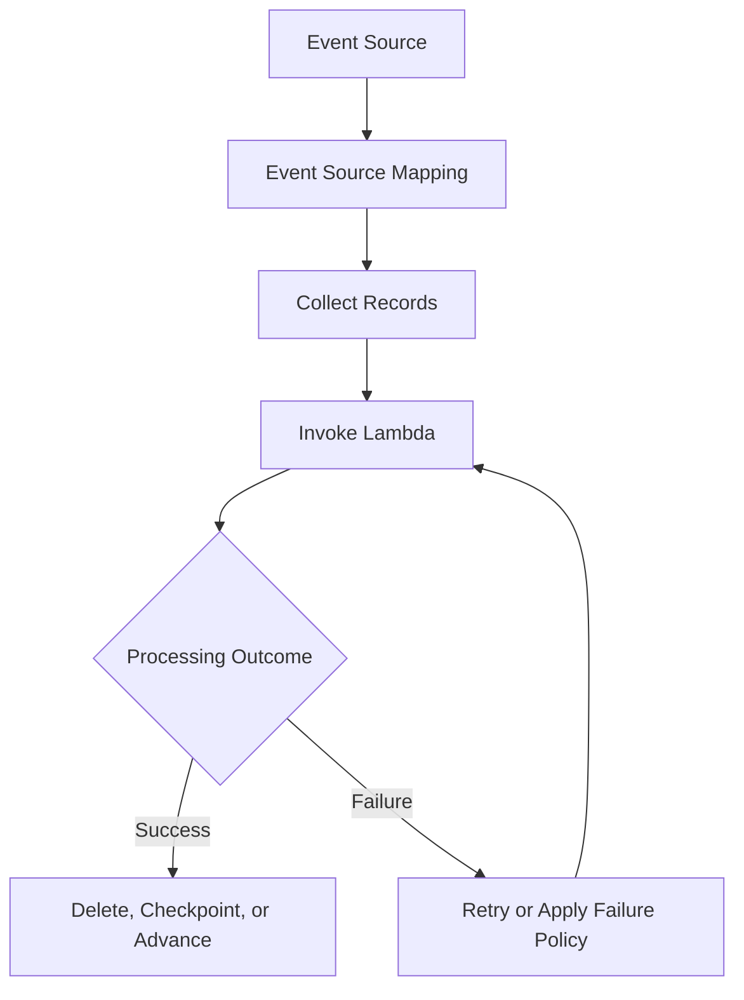

# Invocation and Event Source Questions

## Overview

Lambda invocation and event source behavior determine how work reaches a function, how results are returned, how failures are retried, and how processing scales under load. These behaviors directly affect the reliability, latency, and cost of serverless backend systems.

This document covers synchronous and asynchronous invocation, event source mappings, event delivery guarantees, batching, retries, ordering, idempotency, and failure handling. The questions progress from core concepts to production troubleshooting and senior-level architecture decisions.

## Invocation Models

### What are the main Lambda invocation models?

**Model answer:**

Lambda supports three major invocation patterns:

| Model | Examples | Processing behavior | Primary concern |
|---|---|---|---|
| Synchronous invocation | API Gateway, direct SDK invocation | Caller waits for the invocation result | Latency and response handling |
| Asynchronous invocation | Direct invocation with `InvocationType="Event"` and supported service integrations | Lambda accepts the event for later processing | Retries and failed-event handling |
| Event source mapping | SQS, Kinesis, DynamoDB Streams, supported Kafka sources | Lambda consumes records from a source and invokes the function | Batching, checkpoints, source-specific retries, and scaling |

The critical distinction is that asynchronous invocation uses Lambda's asynchronous invocation mechanism, whereas an event source mapping reads from a separate event source and manages source-specific processing behavior.

**Senior-level consideration:** Never describe retry behavior without identifying the invocation mechanism and event source.

### What happens during a synchronous Lambda invocation?

**Model answer:**

The caller invokes the function and waits for Lambda to return the invocation result or an invocation error.

For example, an application can invoke Lambda synchronously through the AWS SDK:

```python
import json
import boto3

client = boto3.client("lambda")

response = client.invoke(
    FunctionName="order-validator",
    InvocationType="RequestResponse",
    Payload=json.dumps({"order_id": "ORD-1001"}).encode("utf-8"),
)

status_code = response["StatusCode"]
payload = json.loads(response["Payload"].read())

print(status_code, payload)

if "FunctionError" in response:
    raise RuntimeError(f"Lambda execution failed: {payload}")
```

A successful SDK invocation status does not necessarily mean that the function completed successfully. The caller must also inspect `FunctionError` and the returned payload.

**Advantages:**
- The caller can respond immediately based on the result.
- Errors can be propagated to the calling application.
- Suitable for request-response operations.

**Limitations:**
- Execution latency affects the caller.
- Caller and integration timeout limits constrain the request.
- Retries must be designed carefully to avoid duplicate side effects.

### What happens during an asynchronous Lambda invocation?

**Model answer:**

With asynchronous invocation, Lambda accepts an event and queues it for processing. The caller receives an acknowledgement that the event was accepted, rather than the eventual handler result.

```python
import json
import boto3

client = boto3.client("lambda")

response = client.invoke(
    FunctionName="email-worker",
    InvocationType="Event",
    Payload=json.dumps(
        {"event_id": "EVT-1001", "recipient": "user@example.com"}
    ).encode("utf-8"),
)

if response["StatusCode"] != 202:
    raise RuntimeError(
        f"Lambda did not accept the event: {response['StatusCode']}"
    )
```

A `202` response indicates acceptance for asynchronous processing; it does not prove that the handler completed successfully.

**Production considerations:**
- Configure retry and event-expiration behavior appropriately.
- Use supported failure destinations or a dead-letter queue.
- Make handlers idempotent because events may be delivered more than once.
- Monitor asynchronous event age, errors, and discarded events.
- Do not treat an invocation acknowledgement as confirmation of a business transaction.

### What is the difference between asynchronous invocation and an SQS-triggered Lambda?

**Model answer:**

The key difference is who manages the work queue and how processing progress is represented.

With direct asynchronous invocation, Lambda manages the asynchronous invocation queue. With an SQS event source mapping, messages remain in SQS until successfully processed and deleted, or until other queue policies and retention behavior determine their fate.

| Concern | Lambda asynchronous invocation | SQS event source mapping |
|---|---|---|
| Queue ownership | Lambda-managed asynchronous queue | Customer-managed SQS queue |
| Consumer behavior | Lambda processes accepted events asynchronously | Lambda polls the queue through an event source mapping |
| Retry mechanism | Lambda asynchronous retry and event-age behavior | SQS visibility, redelivery, receive count, and redrive policy |
| Batching | Depends on the invocation integration and configuration | Configurable batch processing |
| Backpressure | Managed asynchronous queue behavior and invocation limits | Queue depth and consumer concurrency can provide explicit buffering |
| Replay and retention | Limited by asynchronous event retention and failure handling | SQS retention and explicit message/DLQ handling |
| Best fit | Decoupled invocation where Lambda-managed delivery is sufficient | Workloads needing queue-based buffering, consumer control, or explicit redrive workflows |

Use SQS when explicit queue management, buffering, and controlled redrive are important. Direct asynchronous invocation can be simpler when its delivery and failure-handling behavior meets the application requirements.

### When should you choose synchronous invocation?

**Model answer:**

Choose synchronous invocation when the caller needs an immediate result to continue its own processing.

Common examples include:

- HTTP requests through API Gateway.
- Direct service-to-service calls.
- Validation or calculation operations whose results are required immediately.
- Internal backend workflows with explicit request-response contracts.

Avoid making a synchronous request wait for long-running background work. Persist or accept the request, return an appropriate response, and process the work asynchronously when the API contract permits it.

### When should you choose asynchronous processing?

**Model answer:**

Use asynchronous processing when the caller does not need the completed result before continuing.

Examples include:

- Sending notifications.
- Generating reports.
- Processing uploaded files.
- Performing background enrichment.
- Executing independent post-transaction tasks.

Asynchronous processing reduces coupling between request latency and background work, but introduces eventual completion, retry, duplicate-delivery, and monitoring requirements.

**Interview follow-up:** If the caller needs to know whether the background task eventually succeeded, how would you design the system?

A strong answer includes a durable task record, correlation ID, explicit processing states, failure handling, and a status API or notification mechanism.

## Event Source Mappings

### What is an event source mapping?

**Model answer:**

An event source mapping is a Lambda-managed integration that consumes records from a supported event source and invokes a Lambda function with those records.

It supports configurations such as batch size, batching windows where available, event filtering, retry behavior, and concurrency-related controls.

Typical sources include:

- Amazon SQS.
- Amazon Kinesis Data Streams.
- Amazon DynamoDB Streams.
- Supported Amazon MSK and self-managed Kafka configurations.

The exact behavior depends on the source type and mapping configuration.



This is a conceptual flow. SQS deletion, stream checkpoints, and Kafka offset management are not interchangeable and must be understood separately.

### How does Lambda process SQS messages through an event source mapping?

**Model answer:**

Lambda polls the configured SQS queue and receives messages in batches. It invokes the function with an event containing those records.

If processing succeeds, Lambda deletes the successfully processed messages. If processing fails, messages can become visible again after the visibility timeout and be received for another attempt.

For a standard SQS queue, delivery is at least once, so duplicate processing is possible. FIFO queues provide ordering within message groups, subject to their documented semantics and the consumer's processing behavior.

Important configuration choices include:

- Batch size.
- Maximum batching window where supported.
- Visibility timeout.
- Maximum concurrency and other applicable concurrency controls.
- Redrive policy and dead-letter queue.
- Partial batch response configuration.

**Production concern:** A large batch improves throughput but can increase processing latency, memory usage, and the number of records affected by a failure.

### What is the difference between batch size and batching window?

**Model answer:**

- **Batch size** controls the maximum number of records delivered in one invocation, subject to source-specific limits.
- **Batching window** controls how long Lambda waits to collect records before invoking the function, where the source supports it.

A larger batch can improve throughput by amortizing per-invocation overhead. A longer batching window can improve batch utilization but increases processing latency.

Choose values based on:

- Event arrival rate.
- Maximum acceptable processing latency.
- Handler memory and execution duration.
- Downstream API and database capacity.
- Source-specific payload and batch limits.

### What is partial batch failure handling?

**Model answer:**

Partial batch failure handling allows a function to report individual failed records rather than treating the entire batch as unsuccessful, where the event source and integration support this behavior.

For SQS, the function can return a `batchItemFailures` list containing the message identifiers that should be retried.

Example:

```python
import logging

logger = logging.getLogger()
logger.setLevel(logging.INFO)


def process_message(message):
    # Replace with idempotent business processing.
    raise NotImplementedError


def lambda_handler(event, context):
    failures = []

    for record in event.get("Records", []):
        message_id = record["messageId"]

        try:
            process_message(record)
        except Exception:
            logger.exception(
                "Message processing failed",
                extra={"message_id": message_id},
            )
            failures.append({"itemIdentifier": message_id})

    return {"batchItemFailures": failures}
```

The event source mapping must be configured to enable the appropriate partial batch response behavior. Otherwise, returning this structure does not automatically provide the intended semantics.

**Advantages:**
- Successfully processed records need not be retried merely because another record failed.
- Reduces repeated work and duplicate side effects.
- Improves efficiency for batches containing independent records.

**Limitations:**
- Failed records still require retry and poison-message handling.
- The implementation must identify failed records correctly.
- For FIFO workloads, stopping or controlling subsequent processing after a failure may be necessary to preserve ordering requirements.

### What happens when a Lambda batch contains one invalid record?

**Model answer:**

The outcome depends on the event source and failure-reporting configuration.

If the function raises an exception and the integration treats the batch as failed, previously successful records may be processed again. If partial batch failure is enabled and supported, the function can report only the failed records for retry.

The handler should therefore distinguish record-level failures from batch-level failures and avoid acknowledging records whose business processing did not complete.

For poison messages, configure bounded retries or appropriate retention and redrive behavior rather than allowing an unrecoverable record to disrupt processing indefinitely.

### How do event source mappings scale?

**Model answer:**

Scaling depends on the event source, partitioning model, queue backlog, mapping configuration, and available Lambda concurrency.

For SQS, Lambda can increase concurrent processing as queue demand grows, subject to service and mapping limits. Stream-based sources have additional constraints associated with shards or partitions and source-specific concurrency settings.

A function can be technically capable of scaling while its database or downstream API is not.

**Senior-level considerations:**
- Determine the maximum safe downstream concurrency.
- Apply concurrency limits when downstream capacity is constrained.
- Monitor queue age and backlog, not only invocation count.
- Understand shard-level or partition-level limits for stream consumers.
- Account for retry traffic when estimating effective throughput.

## Delivery Guarantees, Ordering, and Idempotency

### What does at-least-once delivery mean?

**Model answer:**

At-least-once delivery means the system attempts to deliver an event one or more times until it is successfully handled or the applicable retry, retention, or failure policy ends delivery.

Duplicates are possible because the system may not be able to determine whether the consumer completed its side effect before a failure occurred.

For example:

1. Lambda receives an order event.
2. The handler writes the order to a database.
3. The function fails before successful completion is recorded by the source.
4. The same event is delivered again.

Without idempotency, the second delivery may create a duplicate order or repeat an external side effect.

### Does Lambda guarantee exactly-once business processing?

**Model answer:**

No general exactly-once business-processing guarantee applies to all Lambda invocation models and event sources.

Exactly-once business outcomes must be designed using application-level controls, such as:

- Stable idempotency keys.
- Conditional database writes.
- Unique constraints.
- Transactional state transitions.
- Durable deduplication records.
- Idempotent external APIs or explicit reconciliation workflows.

A deduplication record alone is not always sufficient. If recording the key and performing the side effect are separate non-atomic operations, a crash between them can leave the system in an inconsistent state.

**Senior-level answer:** Explain how the idempotency mechanism handles concurrent duplicate requests and failures between state changes and external side effects.

### How would you implement idempotency for an SQS consumer?

**Model answer:**

Use a stable business or event identifier and a durable mechanism that atomically prevents the same operation from being applied twice.

For example, a DynamoDB conditional write can claim an event identifier only if the record does not already exist. The system must define how an operation transitions from processing to completed, and how abandoned or failed processing is recovered.

A robust implementation should account for:

- Concurrent delivery of the same event.
- A handler crashing after claiming the event.
- A downstream operation succeeding while the response is lost.
- Idempotency-record retention and cleanup.
- Reprocessing after a bug fix.
- Whether the business side effect can participate in the same transaction.

Do not rely on process-local memory because Lambda may execute duplicate events in different environments.

### How should ordering requirements influence event-source selection?

**Model answer:**

Ordering requirements must be evaluated at the scope actually guaranteed by the selected source.

| Source | Ordering consideration |
|---|---|
| SQS Standard | No strict global ordering guarantee |
| SQS FIFO | Ordering is maintained within a message group, subject to FIFO processing semantics |
| Kinesis Data Streams | Records are ordered within a shard |
| DynamoDB Streams | Ordering is provided for modifications to the same item, with stream-specific processing considerations |
| EventBridge | Do not assume strict global ordering of delivered events |

If orders for the same customer must be processed sequentially, partitioning by customer or aggregate identifier may be appropriate. A FIFO message group can help for SQS-based workflows, while a partitioned stream may fit other event-processing designs.

Ordering can reduce parallelism. The design must balance correctness requirements against throughput and failure isolation.

### What is a poison message?

**Model answer:**

A poison message is a record that repeatedly fails processing because of malformed data, an unsupported schema, a permanent business-rule violation, or a persistent dependency problem.

Repeatedly retrying an unrecoverable message wastes capacity and can delay healthy records.

Mitigations include:

- Validate message schemas.
- Separate permanent failures from transient failures.
- Apply bounded retries where supported.
- Route exhausted messages to a DLQ or other failure destination.
- Preserve enough context for diagnosis and safe replay.
- Alert on DLQ growth and increasing message age.

Do not automatically discard every failed message. Some failures require investigation, repair, or controlled replay.

## Failure Handling and Retry Semantics

### How are retries handled for direct asynchronous Lambda invocation?

**Model answer:**

For function errors during asynchronous invocation, Lambda normally retries twice by default, with delays between attempts. The exact retry schedule and behavior depend on the asynchronous invocation configuration and current service documentation.

The asynchronous invocation queue also has a maximum event age. Events that cannot be processed within the configured retention period can be discarded unless captured by the configured failure-handling mechanism.

The function can be configured with supported destinations or a dead-letter queue for failed events.

**Important distinction:** These retry defaults do not apply universally to synchronous invocation or all event source mappings.

### How are retries handled for synchronous Lambda invocation?

**Model answer:**

Lambda does not automatically apply the same asynchronous function-error retry policy to every synchronous invocation.

The caller or integration generally determines whether to retry a failed request. A retry can be appropriate for transient failures, but it can also repeat a side effect if the original operation completed before the response was lost.

A robust caller should use:

- Bounded retries.
- Exponential backoff with jitter where appropriate.
- A clear retryable-error classification.
- Idempotency keys for operations with side effects.
- A deadline that fits the end-to-end request budget.

Avoid retrying validation errors, authorization failures, or other permanent errors without a corrective action.

### How does SQS visibility timeout affect Lambda processing?

**Model answer:**

The visibility timeout temporarily hides a received message from other consumers while processing is underway. If the message is not deleted before the timeout expires, it can become visible and be delivered again.

If the visibility timeout is too short relative to actual processing and retry behavior, concurrent duplicate processing can occur.

If it is excessively long, failed messages may take longer to reappear for retry.

For SQS-triggered Lambda, configure visibility timeout with the function timeout, batch behavior, and AWS-recommended retry considerations in mind. Monitor message age, receive counts, and processing duration.

### What is the difference between a DLQ and an on-failure destination?

**Model answer:**

Both support failure recovery, but they serve different delivery and inspection needs.

| Concern | Dead-letter queue | On-failure destination |
|---|---|---|
| Typical role | Stores failed messages or events | Routes failed asynchronous invocation records to a configured destination |
| Supported destination types | Depends on the integration and configuration | Supports destination types defined for asynchronous Lambda invocation |
| Diagnostic context | Depends on the source payload and integration | Can include invocation metadata and request/response context |
| Recovery workflow | Inspect and selectively replay messages | Inspect invocation records and implement an appropriate recovery workflow |

The exact choices available depend on the invocation mechanism. An SQS event source mapping's source-queue redrive policy is different from a Lambda asynchronous invocation destination.

### How would you prevent a failing event from blocking healthy messages?

**Model answer:**

First identify whether the source is ordered and whether failed records block progress.

For independent SQS messages, partial batch responses and a redrive policy can isolate failed messages. For ordered stream processing, skipping a record may violate business correctness, so the recovery policy must account for ordering and checkpoint behavior.

The design should include:

- Record-level error classification.
- Appropriate partial failure support.
- Bounded retries or record-age policies where available.
- A DLQ or failure destination where supported.
- Monitoring for backlog and failed-record growth.
- Controlled replay after the root cause is corrected.

## Senior-Level Scenario Questions

### Scenario: A function processes 1,000 SQS messages per minute, but queue age keeps increasing. How would you diagnose it?

**Model answer:**

Increasing queue age indicates that messages are arriving faster than the system is completing them, or that processing is blocked or repeatedly failing.

Investigate in this order:

1. Compare incoming message rate with successful processing throughput.
2. Inspect queue depth, oldest-message age, and message receive counts.
3. Review Lambda duration, errors, throttles, and concurrent executions.
4. Inspect event source mapping configuration and concurrency limits.
5. Check database connection counts, query latency, and downstream API throttling.
6. Review batch size and partial batch failure behavior.
7. Estimate the required processing concurrency and verify that downstream services can sustain it.
8. Increase capacity only after identifying the bottleneck and validating downstream limits.

A useful first-order estimate is:

\[
\text{Required concurrency} \approx
\frac{\text{Incoming records per second} \times \text{Average processing time per record}}
{\text{Records processed per invocation}}
\]

This approximation assumes reasonably uniform work and does not account for retries, batching overhead, or source-specific scaling constraints.

### Scenario: The function succeeds locally but fails when invoked by S3. What would you check?

**Model answer:**

Compare the local test payload with the actual S3 event structure and verify the complete invocation path.

Check:

- Whether the function receives the expected event schema.
- Whether the S3 bucket notification is configured correctly.
- Whether the function's resource-based policy permits S3 invocation.
- Whether the execution role permits required S3 operations.
- Whether the object key is URL-encoded and decoded correctly.
- Whether the correct Region and bucket are being used.
- Whether logs contain the Lambda request ID and relevant object metadata.
- Whether the function handles duplicate notifications and missing or deleted objects safely.

A local test often uses a simplified event and does not validate the real IAM, notification, or retry configuration.

### Scenario: A batch contains ten records, and processing fails on record seven. What should happen?

**Model answer:**

The correct outcome depends on the source and the configured failure-reporting mechanism.

If the integration treats the whole batch as failed, the batch may be retried and the first six records may be processed again. If partial batch failure is supported and enabled, the function can report the failed record or records for retry.

The handler should ensure that successful records have completed their business side effects before acknowledging them, and that retrying any record is safe.

For FIFO sources, preserve ordering requirements. Processing subsequent records after an earlier failure may be inappropriate when their correctness depends on earlier records.

### Scenario: An asynchronous invocation returns HTTP 202, but the task never completes. What would you investigate?

**Model answer:**

The acceptance response confirms that Lambda accepted the event for asynchronous processing, not that the handler completed.

Investigate:

1. Lambda asynchronous invocation error metrics.
2. Event age and dropped-event metrics.
3. Function logs and execution errors.
4. Timeout and concurrency configuration.
5. Configured retry behavior and event maximum age.
6. Dead-letter queue or failure-destination configuration.
7. Permissions required to publish to the configured destination.
8. Whether the function completed but failed to update the application's task status.

For business-critical work, use durable task state and explicit completion tracking rather than relying on the invocation response alone.

### Scenario: A downstream API is throttling Lambda consumers. How would you protect it?

**Model answer:**

Treat downstream capacity as a constraint on consumer concurrency.

Possible mitigations include:

- Limit Lambda concurrency or event-source mapping concurrency where supported.
- Reduce batch sizes if they create excessive downstream bursts.
- Implement bounded retries with exponential backoff and jitter.
- Use SQS as a buffer when asynchronous processing is acceptable.
- Apply rate limiting or token-bucket controls when strict request rates are required.
- Monitor downstream throttles alongside Lambda errors and queue age.
- Avoid multiplying retries across multiple service layers.

The correct solution depends on whether the downstream limit is a concurrency limit, requests-per-second limit, or a transient capacity issue.

## Key Takeaways

- Identify whether a function uses synchronous invocation, asynchronous invocation, or an event source mapping before describing delivery and retry behavior.
- Event source mappings introduce source-specific concerns such as batching, checkpoints, visibility timeouts, ordering, and partial batch failures.
- Duplicate delivery is a normal distributed-systems condition; durable idempotency protects business outcomes.
- Use bounded retries, failure destinations, DLQs, and actionable monitoring to recover from poison messages and persistent failures.
- Scale consumers according to queue demand and downstream capacity, not Lambda's theoretical maximum concurrency.