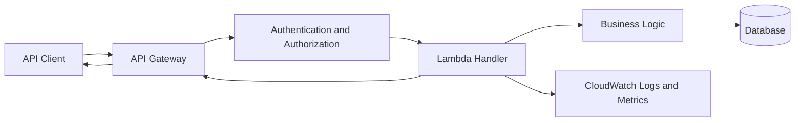
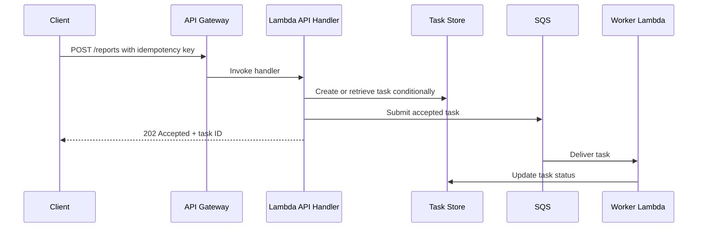
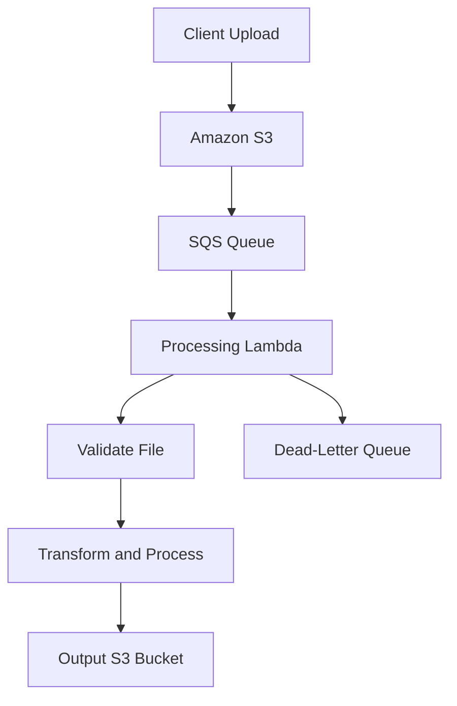
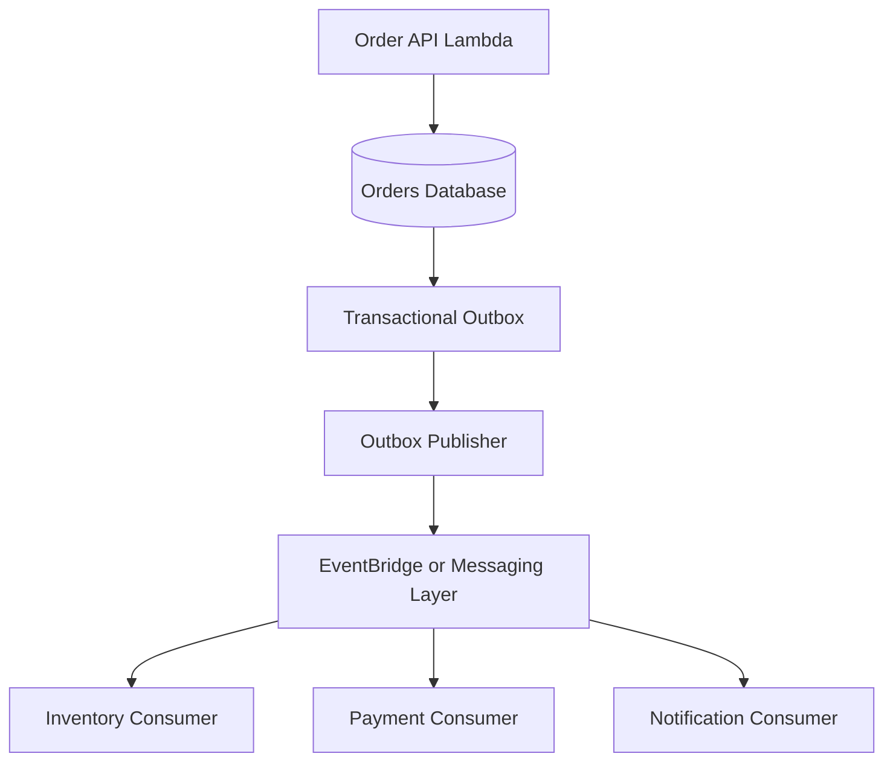
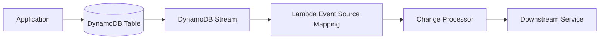
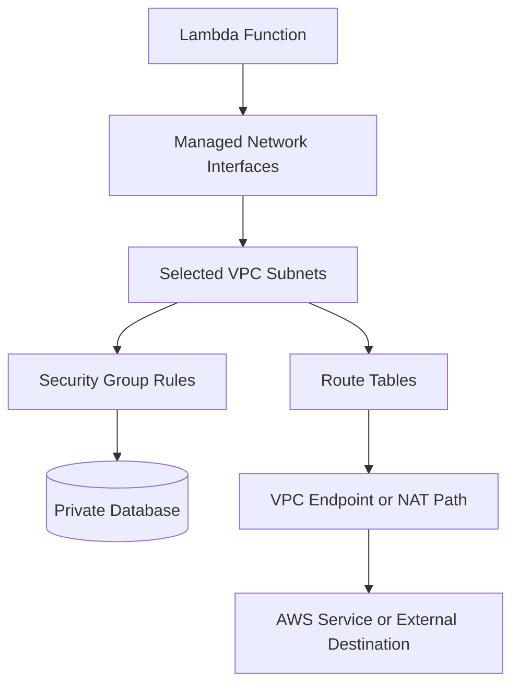
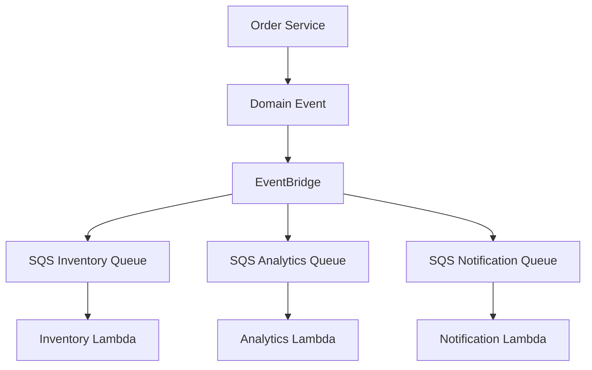

# Architecture and Integration Questions

## Overview

AWS Lambda architecture interviews evaluate how well an engineer can design reliable, scalable, secure, and cost-effective backend systems using managed compute and event-driven services.

The key is to explain the complete request or event lifecycle, justify service choices, identify failure boundaries, and account for operational constraints. A strong answer considers not only the successful path but also retries, duplicate events, downstream failures, observability, and recovery.

## API and Synchronous Integration

### How would you design a REST API using API Gateway and Lambda?

**Model answer:**

Use Amazon API Gateway as the managed HTTP entry point and Lambda to execute request-handling logic. Store persistent data in an appropriate database, such as DynamoDB or Amazon RDS, and use IAM, a supported authorizer, or another appropriate authentication mechanism to protect the API.

**Request lifecycle:**

1. The client sends an HTTP request to API Gateway.
2. API Gateway applies configured authorization, validation, throttling, and integration behavior.
3. API Gateway invokes Lambda.
4. Lambda validates the request and executes business logic.
5. The function accesses permitted downstream services.
6. Lambda returns a response in the integration's expected format.
7. API Gateway returns the HTTP response to the client.

**Production considerations:**

- Validate input and define consistent error responses.
- Configure timeouts across the request path.
- Use structured logs and correlation IDs.
- Apply throttling and protect downstream capacity.
- Avoid exposing internal exception details to clients.
- Separate business logic from transport-specific handler code.
- Test authentication, authorization, throttling, and failure paths.

**When this architecture is inappropriate:** A workload requiring long-running requests, persistent connections with unsupported integration behavior, or specialized compute may need a different integration or compute model.

### When would you choose a Lambda function URL instead of API Gateway?

**Model answer:**

A Lambda function URL provides an HTTPS endpoint directly associated with a Lambda function. It can be suitable for simple webhooks, internal integrations with appropriate access controls, or lightweight HTTP endpoints that do not require API Gateway's broader API-management capabilities.

| Requirement | Function URL | API Gateway |
|---|---|---|
| Simple HTTPS endpoint | Suitable | Suitable |
| Advanced API routing and management | More limited | Stronger fit |
| API keys and usage plans | Not equivalent to API Gateway features | Supported through appropriate API Gateway configuration |
| Authentication | `AWS_IAM` or `NONE`, depending on configuration | Supports multiple authorization and integration patterns |
| Request transformation and API-specific controls | More limited | Broader capabilities |
| Operational complexity | Usually simpler | More configuration options |

A function URL configured with `NONE` does not provide application authentication automatically. Public endpoints still require appropriate application-level authorization and abuse protection.

**Senior-level consideration:** Choose based on the API contract, security requirements, operational controls, and cost—not simply the number of configuration steps.

### How would you design an idempotent REST endpoint that starts background processing?

**Model answer:**

Separate request acceptance from task execution.

A typical design validates the request, records a durable task with an idempotency key, and submits work to SQS or another appropriate asynchronous mechanism. The API returns an accepted response only after the system has safely accepted the operation according to its contract.

The diagram represents the logical flow; the implementation must address the consistency boundary between task persistence and queue submission.

For stronger reliability, consider a transactional outbox or another durable dispatch mechanism. If the task is saved successfully but queue submission fails, the system needs a recovery process to dispatch the outstanding task.

**Follow-up:** Why is returning `202 Accepted` immediately after writing to a database potentially unsafe?

Because the work may never reach the queue if dispatch fails. The API must either guarantee durable dispatch or clearly define how pending work is recovered.

## Event-Driven Architecture

### How would you design an S3-triggered file-processing system?

**Model answer:**

Use S3 notifications to trigger processing when objects are created. For workloads requiring buffering, independent retries, or controlled concurrency, route events through SQS before invoking Lambda.

The DLQ path depends on the queue's redrive configuration and should not be interpreted as a direct Lambda-to-DLQ connection.

**Engineering decisions:**

- Validate file type, size, schema, and expected object metadata.
- Handle duplicate notifications through idempotency.
- Avoid processing partially uploaded content; use appropriate object creation events and upload workflows.
- Use object versioning or immutable identifiers when the exact source version matters.
- Apply least-privilege S3 permissions.
- Protect the processing function from malformed files and resource exhaustion.
- Monitor queue age, failures, and processing duration.

**Common mistake:** Assuming each S3 notification is delivered exactly once. Event consumers should be designed to tolerate duplicates.

### When would you use SQS instead of direct asynchronous Lambda invocation?

**Model answer:**

Use SQS when the architecture benefits from an explicit queue boundary, buffering, consumer control, retention, or a redrive workflow.

| Requirement | Direct asynchronous invocation | SQS with Lambda |
|---|---|---|
| Decouple producer and consumer | Yes | Yes |
| Explicit queue retention and backlog inspection | More limited | Strong fit |
| Consumer-controlled polling and batch processing | Limited compared with queue-based consumption | Strong fit |
| Buffer traffic spikes | Lambda-managed asynchronous queue | Explicit customer-managed queue |
| Queue depth and oldest-message age | Not represented as an SQS queue | Directly observable |
| Redrive workflow | Supported failure mechanisms | SQS redrive policy and DLQ |
| Per-message operational control | Depends on the invocation mechanism | Queue-oriented control and inspection |

Direct asynchronous invocation can be simpler for straightforward event processing. SQS is generally preferable when explicit buffering and operational control are important.

### How would you design an event-driven order-processing system?

**Model answer:**

Separate synchronous order acceptance from independent downstream processing. Persist the order first, then publish a durable event through an outbox or another reliable dispatch mechanism. Consumers process events independently and use idempotency to tolerate redelivery.

**Important trade-offs:**

- EventBridge is useful for event routing and integration across services.
- SQS provides explicit queueing and consumer buffering.
- SNS supports pub/sub fan-out patterns.
- A transactional outbox addresses the gap between database commit and event publication.
- Independent consumers improve fault isolation but introduce eventual consistency.
- Workflow orchestration may be more appropriate when steps require explicit sequencing and recovery.

The architecture must define how payment, inventory, and order status remain consistent when one step fails.

### When would you use EventBridge, SNS, or SQS?

**Model answer:**

Choose based on the messaging semantics and processing requirements.

| Service | Primary role | Suitable scenarios | Key consideration |
|---|---|---|---|
| Amazon EventBridge | Event routing and rule-based integration | Domain events, AWS service events, SaaS integrations | Routing and target-delivery behavior must be configured and monitored |
| Amazon SNS | Pub/sub fan-out | Broadcasting notifications to multiple subscribers | Subscriber delivery and retry behavior vary by protocol |
| Amazon SQS | Durable queueing and buffering | Background jobs, work distribution, controlled consumer processing | Visibility timeout, retention, receive count, and redrive policy |
| Lambda asynchronous invocation | Lambda-managed asynchronous processing | Simple decoupled function execution | Less explicit queue control than SQS |

These services are complementary. For example, EventBridge can route events to SQS, which buffers work for a Lambda consumer.

### How would you process DynamoDB changes using Lambda?

**Model answer:**

Enable DynamoDB Streams on the table and configure a Lambda event source mapping to consume stream records.

**Important considerations:**

- Stream records represent item changes and can contain old and/or new images depending on stream configuration.
- Ordering guarantees must be understood at the appropriate item and stream scope.
- Failed processing can affect checkpoint progress.
- Consumers must tolerate retries and duplicate processing.
- Stream retention is finite, so prolonged consumer failures require timely recovery.
- Downstream operations should be idempotent.

**Interview trap:** DynamoDB Streams is not a general-purpose durable event archive. Its retention and replay capabilities differ from those of an event store.

## Orchestration and Workflow Design

### When should you use Step Functions instead of application-managed orchestration?

**Model answer:**

Use AWS Step Functions when a workflow contains multiple steps that need explicit state transitions, retries, branching, timeouts, parallel execution, or operational visibility.

Application-managed orchestration can be appropriate for simple flows where adding a workflow service would introduce unnecessary complexity.

| Requirement | Step Functions | Application-managed orchestration |
|---|---|---|
| Multi-step workflow state | Managed workflow state | Must be implemented and persisted as needed |
| Branching and parallel execution | Built-in workflow constructs | Application code and infrastructure |
| Retry and catch behavior | Defined in workflow configuration | Must be implemented consistently |
| Operational visibility | Workflow execution history | Depends on application observability |
| Simple single-step operation | May be unnecessary overhead | Often simpler |
| Long-running business process | Suitable with an appropriate workflow type | Requires durable state and recovery logic |

**Production considerations:**

- Choose Standard or Express workflows based on duration, execution model, workload pattern, and cost.
- Use idempotent tasks where retries may repeat side effects.
- Avoid putting large application payloads into workflow state.
- Protect sensitive data in execution inputs and logs.
- Design compensation or reconciliation steps for operations that cannot be rolled back transactionally.

### How would you process a payment workflow reliably?

**Model answer:**

Represent the workflow as explicit business states rather than a sequence of untracked function calls.

A possible flow is:

1. Validate the order and payment request.
2. Persist the operation and idempotency key.
3. Authorize payment through the payment provider.
4. Reserve inventory.
5. Confirm the order.
6. Send notifications asynchronously.
7. On failure, apply the appropriate retry, compensation, or reconciliation process.

Step Functions can coordinate the steps, but it does not make external side effects transactional.

For example, a successful payment authorization followed by an inventory failure may require releasing the authorization or initiating a refund, depending on the payment model.

**Senior-level consideration:** Distinguish a technical retry from a business compensation. Retrying a failed request is not always equivalent to reversing a completed operation.

## Networking and Database Integration

### What changes when a Lambda function is attached to a VPC?

**Model answer:**

VPC configuration allows Lambda to access resources reachable through the selected VPC networking configuration, such as private relational databases or internal services.

The function uses configured subnets and security groups. Those choices determine the network paths available to the function.

This is a conceptual diagram. Actual networking behavior depends on the VPC configuration, route tables, endpoints, DNS, security groups, and destination.

**Common mistakes:**

- Assuming a private subnet automatically provides internet access.
- Omitting the required VPC endpoint or NAT path for outbound service calls.
- Misconfiguring security groups or network ACLs.
- Selecting subnets without sufficient available IP addresses.
- Assuming that VPC attachment itself grants access to private resources.

VPC attachment is a network configuration, not an authorization grant. IAM and network controls must both permit the operation.

### How would you connect Lambda to Amazon RDS without exhausting database connections?

**Model answer:**

Lambda concurrency can grow independently of the database's connection capacity. If every invocation opens a new database connection, bursts can exhaust available connections.

Mitigations include:

- Reuse connections when appropriate within an execution environment.
- Use Amazon RDS Proxy when suitable for the database and workload.
- Set concurrency limits based on database capacity.
- Keep transactions short.
- Avoid opening multiple unnecessary connections per invocation.
- Configure bounded connection and query timeouts.
- Monitor database connections, latency, and Lambda concurrency together.

Connection reuse reduces overhead but does not guarantee that a connection remains valid indefinitely. Application code must handle stale connections and transient database failures.

### How should Lambda access secrets and credentials?

**Model answer:**

Use AWS Secrets Manager or Systems Manager Parameter Store when appropriate for application secrets and configuration. Grant the execution role access only to the required secret or parameter.

For production workloads:

- Do not hardcode credentials in source code.
- Avoid logging secrets or full sensitive request payloads.
- Define caching and rotation behavior.
- Consider KMS and resource policies where applicable.
- Separate deployment credentials from runtime credentials.
- Verify that secret retrieval and rotation failures are handled safely.

Environment variables are appropriate for many non-secret configuration values. Sensitive values require deliberate protection, access controls, and lifecycle management.

## Reliability and Resilience

### How would you prevent Lambda scaling from overwhelming downstream services?

**Model answer:**

Treat concurrency as a capacity-control mechanism rather than only a performance setting.

A practical approach is to:

1. Estimate the maximum safe request rate and concurrency for each dependency.
2. Configure reserved concurrency or event-source concurrency limits where appropriate.
3. Buffer asynchronous work with SQS when delayed processing is acceptable.
4. Apply bounded retries with exponential backoff and jitter.
5. Use timeouts and circuit-breaking or load-shedding patterns where appropriate.
6. Monitor downstream saturation, Lambda throttles, queue age, and error rates.
7. Validate capacity assumptions with load tests.

A retry storm can make an overloaded dependency less available. Retries should be bounded and coordinated across layers.

### How would you design a fan-out architecture?

**Model answer:**

Use an event-routing or pub/sub service to distribute a domain event to independent consumers. Choose the fan-out mechanism based on delivery, filtering, buffering, and consumer-isolation requirements.

For example, an order-created event may trigger inventory updates, analytics, and notifications.

Using a queue per consumer can isolate backlog and retry behavior. It also introduces additional resources, configuration, and cost.

Each consumer should handle duplicates independently. A failure in the notification consumer should not prevent inventory processing from progressing.

### How would you handle partial failure in a multi-service workflow?

**Model answer:**

First distinguish between a step that failed before applying its side effect and a step that completed but returned an ambiguous response.

For recoverable transient failures, use bounded retries. For permanent failures, route to a defined failure path. For completed steps that must be reversed, use compensating actions or reconciliation.

Examples include:

- Releasing an inventory reservation after a payment failure.
- Refunding an authorized or captured payment when the business process requires it.
- Marking an order as requiring manual review when compensation cannot complete automatically.

Do not assume that a distributed workflow can provide a single ACID transaction across all participating services.

### How would you make a Lambda architecture highly available?

**Model answer:**

Lambda is a managed service, but application-level availability still depends on the architecture and its dependencies.

Key practices include:

- Use appropriate regional service configurations and avoid unnecessary single points of failure.
- Choose durable messaging where buffering and retry are required.
- Configure bounded retries and explicit failure destinations.
- Use multi-AZ database deployments when supported and appropriate.
- Design idempotent consumers and recovery workflows.
- Monitor service quotas, downstream health, and event age.
- Document recovery objectives and test restoration procedures.

For regional disaster recovery, determine which state, artifacts, secrets, queues, event rules, and database data must be replicated or recreated. Lambda code alone is not the complete recovery plan.

## Senior-Level Architecture Scenarios

### Scenario: Design a serverless file-processing platform that supports large traffic bursts.

**Model answer:**

Use S3 for durable file storage and SQS to buffer processing work. Lambda consumers validate and process files, write results to S3 or a database, and send unrecoverable messages to a configured DLQ.

The design should include:

- Object identifiers and, where necessary, object version IDs.
- Idempotent processing records.
- File validation and size limits.
- Queue retention and redrive configuration.
- Concurrency limits based on downstream capacity.
- Metrics for queue depth, message age, processing duration, and failure rates.
- Cleanup and lifecycle policies for temporary or obsolete objects.

If processing is CPU-intensive, long-running, or incompatible with Lambda's execution constraints, evaluate a container or batch-processing service instead.

### Scenario: An API must return within 200 ms, but downstream processing takes several seconds. What architecture would you propose?

**Model answer:**

If the business contract allows asynchronous completion, accept and persist the request, durably dispatch the work, and return a task identifier quickly.

A common pattern is:

1. Validate and authorize the request.
2. Create an idempotent task record.
3. Ensure the work is durably dispatched.
4. Return `202 Accepted` with a task ID.
5. Process the task asynchronously.
6. Update task state and expose a status endpoint or notification.

The design must address the gap between task creation and dispatch. A transactional outbox or a recoverable dispatch mechanism can prevent tasks from becoming permanently stranded.

If the client requires the final result within the same request, asynchronous processing alone does not satisfy the contract.

### Scenario: Your EventBridge-triggered Lambda occasionally processes an event twice. Is this necessarily a defect?

**Model answer:**

Not necessarily. Event-driven systems can redeliver events, and consumers should generally be designed for duplicate delivery.

Verify the event source's delivery and retry semantics, inspect logs and event identifiers, and determine whether the business side effect occurred more than once.

If duplicates are possible, use a stable event identifier and durable idempotency. Also ensure the idempotency mechanism handles concurrent processing and failures between recording the event and applying the side effect.

The architecture is defective if a normal duplicate delivery can corrupt business state or repeat a non-idempotent operation without protection.

### Scenario: You need to process events in order for each customer, but different customers can be processed in parallel. What would you choose?

**Model answer:**

Choose a source and partitioning strategy that matches the required ordering scope.

For SQS, a FIFO queue with a message group ID derived from the customer identifier can serialize processing within each customer group while allowing independent groups to progress concurrently, subject to available capacity and FIFO semantics.

For Kinesis, partition records using the customer identifier so related records are routed to the same shard. This preserves shard ordering, but shard throughput and consumer scaling constraints must be considered.

The consumer must still handle failures, duplicate delivery, and replay without violating business invariants.

### Scenario: How would you choose between Lambda and ECS/Fargate for an event-processing service?

**Model answer:**

Evaluate the workload rather than treating serverless functions as the default for all compute.

| Consideration | Lambda | ECS/Fargate |
|---|---|---|
| Execution model | Managed function invocations | Managed container tasks and services |
| Scaling unit | Concurrent function executions | Tasks and service capacity |
| Long-running workers | Subject to Lambda execution constraints | Often a better fit |
| Event-driven bursts | Strong fit for compatible workloads | Possible, with task-scaling design |
| Runtime and process control | More constrained | Greater control over container processes |
| Operational responsibilities | Less infrastructure management | More task, service, and deployment configuration |
| Cost profile | Depends on invocations, duration, memory, and features | Depends on task resources, runtime, and utilization |

For short-lived, bursty, event-driven processing, Lambda may simplify operations. For persistent workers, long-running processing, or specialized runtime control, ECS/Fargate may be more appropriate.

## Key Takeaways

- Select Lambda integrations based on request-response needs, buffering, ordering, delivery semantics, and operational controls.
- Reliable event-driven architectures require idempotency, explicit failure handling, durable dispatch, and clear business-state transitions.
- VPC connectivity, IAM permissions, and downstream capacity are separate concerns that must be designed together.
- Use queues and concurrency controls to absorb bursts and protect dependencies; retries must be bounded to avoid amplifying failures.
- Choose Lambda, Step Functions, EventBridge, SNS, SQS, and container services according to workload requirements rather than treating them as interchangeable components.