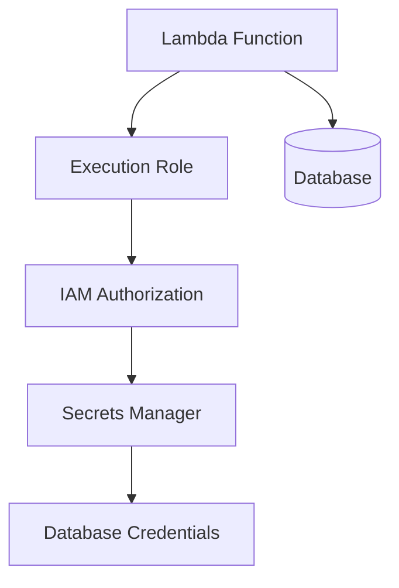

# 04- Security and IAM Questions

## Overview

AWS Lambda security depends on multiple independent controls: IAM identity policies, resource-based policies, execution-role trust policies, network boundaries, secret management, deployment permissions, and application-level authorization.

For backend engineers, the challenge is not simply granting a function access to an AWS service. It is ensuring that the function can perform only its intended operations, that unauthorized principals cannot invoke it, and that failures remain observable without exposing sensitive information.

These interview questions progress from IAM fundamentals to cross-account access, VPC security, secret management, deployment isolation, and production security scenarios.

## IAM Fundamentals

### What is the difference between a Lambda execution role and a resource-based policy?

**Model answer:**

An execution role determines which AWS actions the function's code can perform. A resource-based policy determines which principals are allowed to access a resource, including invoking a Lambda function where applicable.

| Concern | Execution role | Resource-based policy |
|---|---|---|
| Primary purpose | Authorizes AWS API calls made by the function | Grants principals permission to access the resource |
| Attached to | IAM role assumed by Lambda | Lambda function, alias, version, or another supported resource |
| Typical use | Read from S3, write to DynamoDB, retrieve a secret | Allow API Gateway, S3, EventBridge, or another principal to invoke the function |
| Trust relationship | Trust policy allows the Lambda service to assume the role | Policy identifies permitted principals and actions |
| Example permission | `s3:GetObject` on specific objects | `lambda:InvokeFunction` for a specific function qualifier |

A function can have a correct execution role but still reject an invocation because the caller lacks permission. Conversely, allowing a service to invoke the function does not automatically authorize the function to access its downstream resources.

**Interview trap:** Invocation authorization and execution authorization are separate security decisions.

### What is an IAM trust policy, and why does Lambda need one?

**Model answer:**

A trust policy defines which principals can assume an IAM role. For a standard Lambda execution role, the trust policy permits the Lambda service principal to assume the role.

Example:

```json
{
  "Version": "2012-10-17",
  "Statement": [
    {
      "Effect": "Allow",
      "Principal": {
        "Service": "lambda.amazonaws.com"
      },
      "Action": "sts:AssumeRole"
    }
  ]
}
```

The trust policy does not grant S3, DynamoDB, or other application permissions. Those permissions are defined by policies attached to the role or otherwise applicable to the role session.

**Production considerations:**

- Keep the trusted principal as narrow as the use case permits.
- Do not confuse role assumption with permission to perform AWS operations.
- Review trust policies during security audits and deployment changes.
- For cross-account role assumption, explicitly model the trusted account or principal and the required permissions.

### What does least privilege mean for Lambda?

**Model answer:**

Least privilege means granting a function only the permissions required to perform its defined responsibilities.

For example, a function that reads objects from one input bucket should not receive unrestricted S3 access or administrative permissions.

An overly broad policy might contain:

```json
{
  "Effect": "Allow",
  "Action": "s3:*",
  "Resource": "*"
}
```

A narrower policy for reading objects from a known bucket might be:

```json
{
  "Version": "2012-10-17",
  "Statement": [
    {
      "Effect": "Allow",
      "Action": "s3:GetObject",
      "Resource": "arn:aws:s3:::company-input-bucket/*"
    }
  ]
}
```

The second policy is narrower, but it is only an illustrative example. Add other permissions only when the application requires them, and account for bucket-level operations, KMS permissions, and applicable resource policies.

**Senior-level practices:**

- Use separate execution roles for functions with different responsibilities.
- Restrict actions and resource ARNs.
- Use conditions where they meaningfully constrain access.
- Review permissions against observed application behavior.
- Prevent deployment pipelines from silently expanding runtime permissions.
- Use IAM Access Analyzer and policy validation tools where appropriate.

### Why should every Lambda function have a separate execution role?

**Model answer:**

Separate roles reduce the impact of a compromised function and make permissions easier to reason about.

Suppose an order-processing function needs access to an orders table, while a notification function needs permission to publish messages to an SNS topic. Sharing a role that grants both permissions means a compromise of either function could expose both capabilities.

Separate roles establish clearer security boundaries and simplify auditing.

However, role-per-function design should remain manageable. Functions with genuinely identical responsibilities may share a role where the resulting permissions and operational trade-offs are acceptable.

### What is the difference between identity-based and resource-based policies?

**Model answer:**

Identity-based policies attach permissions to identities such as IAM users, groups, and roles. Resource-based policies attach permissions to supported resources and specify which principals can access them.

For Lambda, identity-based policies commonly authorize a deployment role or caller to invoke a function. A Lambda resource-based policy can grant a service principal or another account permission to invoke the function.

The effective authorization decision depends on the principal, action, resource, applicable policies, and any explicit denies or organizational controls.

**Important distinction:** A resource-based policy is not a replacement for an execution role. They address different parts of the authorization model.

## Invocation Permissions and Cross-Account Access

### How do you allow API Gateway to invoke a Lambda function securely?

**Model answer:**

Grant the API Gateway service permission to invoke the intended function, normally scoped to the relevant API, stage, method, or route through the source ARN where supported by the integration.

Example:

```bash
aws lambda add-permission \
  --function-name orders-api \
  --statement-id AllowOrdersApiInvoke \
  --action lambda:InvokeFunction \
  --principal apigateway.amazonaws.com \
  --source-arn "arn:aws:execute-api:ap-south-1:123456789012:api-id/prod/POST/orders"
```

Replace the Region, account ID, API ID, stage, HTTP method, and resource path with the actual values.

**Verification:**

```bash
aws lambda get-policy \
  --function-name orders-api
```

The command inspects the function's resource-based policy. Verify that the principal, action, resource qualifier, and source restriction match the intended integration.

**Common mistake:** Granting a service principal unrestricted invocation permission when a narrower source ARN can be used.

### How does cross-account Lambda invocation work?

**Model answer:**

Cross-account invocation requires an authorization path that permits the calling principal in one account to invoke a function in another account.

A common pattern is:

1. The caller has an identity policy allowing `lambda:InvokeFunction` on the target function ARN.
2. The target function has a resource-based policy allowing the caller's account, role, or another appropriate principal.
3. Any applicable organization policies, permission boundaries, session policies, and explicit denies permit the operation.
4. The invocation targets the correct function, version, or alias.

Example target function ARN:

```text
arn:aws:lambda:ap-south-1:210987654321:function:orders-worker
```

The source account and target account should be treated as separate trust boundaries. Grant only the required invocation permission and avoid using broad account-wide principals when a specific role can be trusted.

**Senior-level consideration:** Cross-account invocation permission does not automatically grant the caller access to the target function's execution role or downstream resources.

### How would you troubleshoot `AccessDeniedException` when invoking Lambda?

**Model answer:**

Start by identifying which principal is making the invocation and which authorization decision is failing.

Diagnostic flow:

1. Confirm the caller identity and account.
2. Verify the function ARN, Region, and qualifier.
3. Inspect the caller's identity policies.
4. Inspect the Lambda resource-based policy when applicable.
5. Check explicit denies, permission boundaries, session policies, and organization policies.
6. Verify service invocation permissions and source ARN restrictions.
7. Inspect CloudTrail events and relevant service logs.
8. Re-test using the intended principal after making the smallest necessary policy change.

Useful commands:

```bash
aws sts get-caller-identity

aws lambda get-policy \
  --function-name orders-api

aws lambda get-function-configuration \
  --function-name orders-api
```

The `get-policy` command inspects the resource-based policy. The configuration command does not reveal every effective authorization decision, so continue with IAM policy analysis and the relevant audit events.

**Common mistake:** Adding broad permissions to the execution role when the actual problem is that the caller cannot invoke the function.

### What is the difference between `lambda:InvokeFunction` and `lambda:InvokeFunctionUrl`?

**Model answer:**

`lambda:InvokeFunction` authorizes invocation through Lambda's invocation API and supported integrations. `lambda:InvokeFunctionUrl` is the IAM action associated with invoking a Lambda function URL when IAM authorization is used.

Function URL authorization also depends on the URL's configured authentication mode and applicable resource policies.

For a function URL configured with `AWS_IAM`, ensure the caller has the required permissions and that the resource policy and other applicable authorization controls permit the request.

**Interview trap:** A permission that allows SDK invocation should not automatically be assumed to satisfy every function URL authorization requirement.

## Secrets and Sensitive Configuration

### How should Lambda retrieve database credentials securely?

**Model answer:**

Store credentials in a suitable secret-management service, such as AWS Secrets Manager, and grant the function access only to the required secret.

A typical flow is:



The function should retrieve credentials using the AWS SDK and avoid logging the secret value.

Example:

```python
import json
import os

import boto3

secrets_client = boto3.client("secretsmanager")


def get_database_credentials() -> dict:
    secret_arn = os.environ["DATABASE_SECRET_ARN"]

    response = secrets_client.get_secret_value(
        SecretId=secret_arn
    )

    return json.loads(response["SecretString"])
```

This example assumes the secret contains JSON credentials in `SecretString`. Production code should also define caching, rotation, timeout, and failure-handling behavior.

**Production considerations:**

- Grant `secretsmanager:GetSecretValue` only for the required secret.
- Grant relevant KMS permissions when a customer-managed key requires them.
- Avoid fetching the secret unnecessarily on every invocation if a safe cache is appropriate.
- Account for secret rotation and cached credential expiry.
- Avoid logging credentials or including them in exception messages.
- Use a connection-management strategy appropriate to the database.

### Is it safe to store secrets in Lambda environment variables?

**Model answer:**

Lambda environment variables are encrypted at rest, and additional controls can be applied to protect sensitive configuration. However, environment variables should not be treated as a complete secret-management strategy.

Users and roles permitted to read function configuration may be able to access environment-variable values, subject to applicable permissions and controls.

For sensitive credentials:

- Prefer Secrets Manager or another appropriate secret-management mechanism.
- Restrict who can read function configuration and modify the function.
- Apply encryption and KMS controls where required.
- Avoid printing environment variables in logs or debugging output.
- Establish a rotation and revocation process.

Environment variables remain useful for non-secret configuration, such as feature flags, service endpoints, and secret identifiers.

### What is the difference between Secrets Manager and Systems Manager Parameter Store?

**Model answer:**

Both services can store configuration and sensitive values, but they offer different capabilities and operational trade-offs.

| Concern | Secrets Manager | Systems Manager Parameter Store |
|---|---|---|
| Primary use | Secret lifecycle and credential management | Configuration and parameter storage |
| Rotation | Supports managed rotation workflows for supported integrations and custom workflows | Rotation generally requires separate implementation or integration |
| Secret versions | Supported | Supported parameter versions |
| Encryption | Supports encrypted secrets using AWS KMS | SecureString parameters use AWS KMS |
| Integration choice | Strong fit for credentials requiring rotation workflows | Strong fit for configuration and suitable secure parameters |
| Cost | Separate service pricing applies | Pricing depends on parameter tier and API usage |

Choose based on lifecycle requirements, rotation needs, operational integration, and cost. Verify current pricing and service limits before making a production decision.

## VPC and Network Security

### Does placing Lambda in a private subnet make it secure?

**Model answer:**

No. A private subnet is only one part of the network security model.

Security depends on routing, security groups, network ACLs, IAM, DNS, endpoint policies, resource policies, and application authorization.

For example, a function in private subnets may reach a database through permitted security-group rules but may not have internet access unless an appropriate outbound path exists. Access to AWS services may use VPC endpoints or another supported network path.

**Security checklist:**

- Place functions in appropriate subnets.
- Restrict security-group ingress and egress.
- Verify route tables and network ACLs.
- Use VPC endpoints where appropriate.
- Restrict endpoint policies where supported and useful.
- Apply least-privilege IAM permissions.
- Validate DNS resolution and network paths.
- Monitor network and application failures.

### How would you securely connect Lambda to a private RDS database?

**Model answer:**

Attach Lambda to suitable VPC subnets and configure security groups so the function can reach the database on its required port. The database should accept connections only from approved sources.

A common arrangement is to allow database ingress from the Lambda security group rather than from a broad CIDR range.

The design must also account for:

- Database credentials and secret rotation.
- TLS where supported and required.
- Connection pooling or RDS Proxy where appropriate.
- Concurrency limits based on database capacity.
- DNS resolution and routing.
- Database authentication and authorization.
- Query and connection timeouts.

Network reachability does not grant database-level access. The database must still authenticate the connection and authorize the requested operations.

### What is the role of VPC endpoints in Lambda security?

**Model answer:**

VPC endpoints can provide private connectivity from a VPC to supported AWS services without requiring traffic to traverse the public internet.

Depending on the service and endpoint type, they can reduce exposure and help constrain network paths. Endpoint policies can further restrict which actions and resources are accessible through supported endpoints.

However, a VPC endpoint does not automatically grant access. IAM permissions, resource policies, endpoint policies, routing, DNS, and service-specific authorization still apply.

Use endpoints when the workload's network and security requirements justify them, and verify the endpoint type and service support before deployment.

## Encryption and Data Protection

### How does encryption work for Lambda environment variables?

**Model answer:**

Lambda encrypts environment variables at rest. AWS manages the default encryption mechanism, and customers can configure a customer-managed KMS key when the use case requires additional key-management control.

Encryption at rest does not eliminate the need to restrict access to function configuration, deployment permissions, logs, and runtime behavior.

**Important considerations:**

- Restrict access to configuration APIs.
- Apply KMS key policies and permissions appropriately.
- Avoid embedding secrets in source code or deployment artifacts.
- Do not expose decrypted values through logs or error responses.
- Rotate credentials independently of configuration encryption.

### How should sensitive information be handled in CloudWatch Logs?

**Model answer:**

Log operational context without logging credentials, access tokens, private keys, or unnecessary personal data.

Prefer structured logs containing fields such as:

- Lambda request ID.
- Application correlation ID.
- Operation name.
- Sanitized error category.
- Processing duration.
- Relevant non-sensitive entity identifiers.

For example:

```python
import json
import logging

logger = logging.getLogger()
logger.setLevel(logging.INFO)


def log_operation(operation: str, request_id: str, status: str) -> None:
    logger.info(
        json.dumps(
            {
                "operation": operation,
                "request_id": request_id,
                "status": status,
            }
        )
    )
```

Also apply appropriate log retention, access permissions, encryption, and alerting. Avoid placing raw request bodies or secret values in logs by default.

## Deployment and Supply-Chain Security

### Why should deployment permissions be separate from execution permissions?

**Model answer:**

Deployment permissions determine who can create or modify functions, execution roles, resource policies, and associated infrastructure. Execution permissions determine what deployed code can do at runtime.

Combining these responsibilities increases the impact of compromised credentials or malicious changes.

A secure pipeline should:

- Use a dedicated deployment identity.
- Grant only the required deployment actions.
- Restrict which execution roles the pipeline can pass to Lambda.
- Avoid granting unrestricted IAM policy-management permissions.
- Use short-lived credentials through an appropriate federation mechanism where possible.
- Protect production environments with approvals and controlled release workflows.
- Audit deployment changes.

**Senior-level consideration:** A deployment identity that can attach an administrator role to a function may effectively gain administrative capabilities, even if the identity itself lacks direct administrative API permissions.

### How do you secure Lambda deployment packages and container images?

**Model answer:**

Treat deployment artifacts as executable supply-chain inputs.

For ZIP packages:

- Pin and review dependencies.
- Scan dependencies for known vulnerabilities.
- Build reproducibly where practical.
- Restrict access to artifact storage.
- Validate artifact provenance and integrity.

For container images:

- Use trusted base images.
- Scan images for vulnerabilities.
- Minimize unnecessary packages and tools.
- Restrict access to Amazon ECR repositories.
- Track image digests and deployed versions.
- Rebuild and redeploy when dependencies or base images require security updates.

For both approaches, ensure that the deployment pipeline cannot silently substitute an unreviewed artifact for the intended release.

### What security controls should be applied to GitHub Actions deployments?

**Model answer:**

Use a controlled pipeline that authenticates to AWS with short-lived credentials where possible, such as through GitHub Actions OIDC federation.

Key controls include:

- Restrict the IAM trust policy to the intended GitHub organization, repository, branch, tag, or environment claims.
- Grant only the required deployment permissions.
- Restrict role passing to approved execution roles.
- Protect production environments and require approval where appropriate.
- Pin third-party actions to reviewed immutable references where feasible.
- Avoid storing long-lived AWS access keys in repository secrets.
- Scan dependencies and artifacts.
- Audit deployments and verify the resulting function version or alias.

The OIDC trust policy must constrain token claims appropriately. Trusting a broad repository or organization identity without sufficient conditions can allow unintended workflows to assume the deployment role.

## Security Monitoring and Auditing

### How do CloudTrail and CloudWatch differ in Lambda security monitoring?

**Model answer:**

CloudTrail records supported AWS API activity, helping identify who performed management or API operations and when. CloudWatch provides logs, metrics, alarms, and related operational visibility.

| Concern | CloudTrail | CloudWatch |
|---|---|---|
| Primary purpose | Audit supported AWS API activity | Monitor application behavior and operational health |
| Example | Function configuration changed | Function error rate increased |
| Security investigation | Identify API callers and configuration changes | Diagnose execution behavior and detect abnormal runtime patterns |
| Application log content | Not a replacement for application logs | Stores application and runtime logs when configured |
| Alerting | Can feed events into monitoring workflows | Metrics and alarms support operational alerts |

Use both where appropriate. Neither service replaces application-level authorization, secure configuration, or incident-response procedures.

### How would you detect suspicious Lambda activity?

**Model answer:**

Correlate management-plane activity, invocation metrics, application logs, and changes in resource configuration.

Investigate:

- Unexpected function configuration changes.
- New or broadened IAM permissions.
- Unusual invocation spikes.
- Abnormal error or throttling rates.
- Access to unexpected secrets or resources.
- Unexpected outbound network activity where observable.
- Changes to function URLs or resource-based policies.
- Unusual deployment identities or release patterns.

Use CloudTrail, CloudWatch, and applicable AWS security services to build alerts around meaningful signals. Establish baselines to reduce false positives and define an incident-response path for confirmed suspicious activity.

## Senior-Level Security Scenarios

### Scenario: A Lambda function receives `AccessDenied` when reading an S3 object. How would you diagnose it?

**Model answer:**

Identify the exact principal, action, resource, and request context.

1. Confirm the function's execution role.
2. Verify the requested bucket and object ARN.
3. Inspect identity-based policies for `s3:GetObject`.
4. Check the bucket policy and any explicit denies.
5. Verify KMS permissions if the object uses a customer-managed KMS key.
6. Check VPC endpoint policies if requests traverse an endpoint.
7. Review organization policies and permissions boundaries where applicable.
8. Inspect CloudTrail events and reproduce the operation using the intended role or an equivalent controlled test.

Do not solve the issue by granting `s3:*` on every resource. Correct the specific missing permission or conflicting policy.

### Scenario: A function's execution role has administrator permissions. What is the risk?

**Model answer:**

A compromised function or vulnerable dependency could use the role's temporary credentials to perform far more operations than the function requires.

Potential consequences include data exfiltration, unauthorized resource creation, permission changes, and lateral movement.

Mitigation involves:

- Replacing broad permissions with a least-privilege policy.
- Separating function responsibilities and execution roles.
- Reviewing trust and role-passing permissions.
- Auditing access through CloudTrail.
- Testing the function against its required AWS operations.
- Monitoring for unexpected API calls.

A function may execute correctly with broad permissions, but that does not make the role production-safe.

### Scenario: A secret is accidentally printed in Lambda logs. What should you do?

**Model answer:**

Treat the event as a potential credential exposure.

1. Determine which secret was exposed and which log groups and destinations contain it.
2. Rotate or revoke the credential promptly, based on the potential impact.
3. Review access to the logs and any exported copies.
4. Remove or restrict exposed data where feasible and consistent with retention and audit requirements.
5. Fix the logging path and add regression tests to prevent future disclosure.
6. Investigate whether the credential was used unexpectedly.
7. Document the incident and verify that the replacement credential is working.

Deleting a log entry alone does not invalidate a credential or prove that the data was not copied elsewhere.

### Scenario: A Lambda function is publicly invokable. Is it necessarily insecure?

**Model answer:**

No. Public invocation can be intentional for public APIs and webhooks. The important question is whether public access is explicitly intended and adequately controlled.

Evaluate:

- The function URL or API Gateway authentication configuration.
- Application-level authorization and input validation.
- Rate limits and abuse protection.
- Least-privilege execution permissions.
- Sensitive data exposure.
- Logging and alerting.
- Resource-based policies and unintended invocation paths.

A public endpoint should expose only the intended functionality and should not rely on the obscurity of its URL for protection.

### Scenario: A developer can deploy code but cannot create the required Lambda execution role. Is that a problem?

**Model answer:**

Not necessarily. Separating deployment and IAM administration can be an intentional security boundary.

The deployment pipeline can be restricted to using approved execution roles through narrowly scoped `iam:PassRole` permissions, while a separate administrative process manages role creation and policy changes.

This prevents routine deployments from creating arbitrary roles or attaching broad permissions. The deployment workflow should fail clearly when the required approved role is unavailable rather than bypassing the control.

### Scenario: How would you securely allow one AWS service to invoke Lambda?

**Model answer:**

Use the integration's supported authorization mechanism and grant the minimum required permission.

For service principals, a Lambda resource-based policy commonly grants `lambda:InvokeFunction` and constrains the source resource using an appropriate `SourceArn` and, where applicable, `SourceAccount`.

Verify that:

- The correct service principal is used.
- The source ARN matches the intended resource.
- The policy applies to the correct function qualifier.
- The function's execution role has the downstream permissions it needs.
- The integration is configured correctly.
- CloudTrail and service logs provide sufficient diagnostic evidence.

The source restriction reduces the risk of unintended invocation by other resources that use the same service principal.

## Key Takeaways

- Lambda security requires separate reasoning about invocation authorization, execution-role permissions, trust policies, and network access.
- Least-privilege execution roles and narrowly scoped resource policies reduce the impact of compromised code and misconfiguration.
- Store sensitive credentials in an appropriate secret-management service, and never expose them through logs or deployment artifacts.
- Secure deployment pipelines with short-lived credentials, restricted role passing, reviewed artifacts, and audited changes.
- Diagnose authorization failures by identifying the principal, action, resource, and applicable policy controls rather than adding broad permissions.