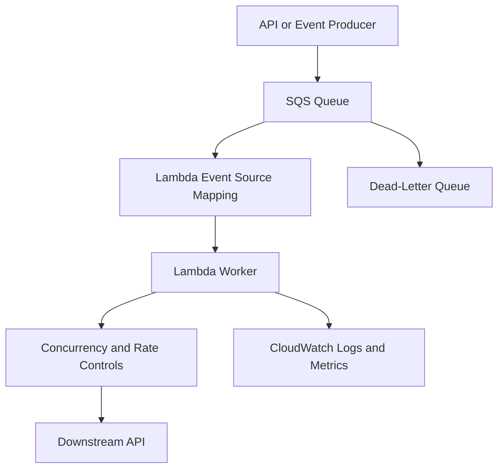

# 05- Performance and Concurrency Questions

## Overview

AWS Lambda performance and concurrency determine how efficiently a serverless application handles traffic, controls latency, protects downstream services, and manages costs. Senior backend engineers must understand how Lambda scales and how that scaling interacts with databases, queues, external APIs, account quotas, and application-level bottlenecks.

These questions cover execution environments, cold starts, memory allocation, concurrency models, throttling, event source scaling, database connection management, performance tuning, and production troubleshooting.

## Performance Fundamentals

### How does Lambda memory allocation affect performance?

**Model answer:**

Lambda memory allocation determines the memory available to the execution environment and influences the CPU capacity allocated to the function. Increasing memory can improve CPU-bound workloads, JSON serialization, decompression, cryptographic operations, and dependency initialization.

The optimal configuration depends on the workload.

| Workload | Primary optimization |
|---|---|
| CPU-intensive processing | Benchmark higher memory allocations |
| Network-bound API calls | Reduce external latency and unnecessary requests |
| Database-heavy operations | Optimize queries and connection management |
| Large dependency initialization | Reduce package size and initialization work |
| File transformation | Benchmark memory, CPU, and ephemeral storage |
| Short, frequently invoked functions | Evaluate initialization overhead and total billed duration |

**Senior-level considerations:**

- Measure execution duration, maximum memory usage, error rates, and cost.
- Benchmark representative payload sizes.
- Consider p95 and p99 latency, not only average duration.
- Verify that the bottleneck is not a database or external service.
- Re-evaluate configuration after significant workload changes.

Higher memory may cost more per unit of execution time but still reduce total cost if execution becomes sufficiently faster.

### How would you determine the optimal Lambda memory configuration?

**Model answer:**

Use controlled benchmarking rather than selecting a configuration based on intuition.

1. Establish a baseline with realistic input data.
2. Measure duration, memory utilization, errors, and cost.
3. Test several memory configurations.
4. Repeat tests under representative concurrency.
5. Compare latency percentiles and throughput.
6. Check whether downstream services are becoming saturated.
7. Select the configuration that meets the service-level objective at an acceptable cost.

For production workloads, optimize for the cost of successfully completed work rather than execution duration alone. A configuration that is faster but triggers more downstream failures may be worse overall.

### What is the difference between execution duration and end-to-end latency?

**Model answer:**

Lambda execution duration measures the time spent executing an invocation, while end-to-end latency measures the total time observed by the caller.

An API request may include:

- Network and DNS latency.
- API Gateway or Application Load Balancer processing.
- Lambda initialization and execution.
- Database queries.
- External API calls.
- Response serialization and transfer.

A Lambda function can have a low execution duration while the overall API remains slow.

Use distributed tracing and application-level timing to identify the component responsible for latency rather than treating the Lambda `Duration` metric as the complete request latency.

### How would you optimize Python Lambda initialization?

**Model answer:**

Python module-level code executes during initialization. Large dependencies, expensive imports, and network calls performed during import can increase cold-start latency.

Recommended practices include:

- Remove unused dependencies.
- Minimize unnecessary initialization work.
- Avoid network calls during module import.
- Initialize reusable SDK clients outside the handler when appropriate.
- Use lazy initialization for expensive components that are not always needed.
- Profile initialization before introducing architectural complexity.
- Evaluate provisioned concurrency when predictable startup latency is required.

Example:

```python
import json
import logging
import os

import boto3

logger = logging.getLogger()
logger.setLevel(logging.INFO)

dynamodb = boto3.resource("dynamodb")
table = dynamodb.Table(os.environ["ORDERS_TABLE"])


def handler(event, context):
    order_id = event["pathParameters"]["order_id"]

    response = table.get_item(
        Key={"order_id": order_id}
    )

    order = response.get("Item")

    if order is None:
        return {
            "statusCode": 404,
            "body": json.dumps({"message": "Order not found"}),
        }

    return {
        "statusCode": 200,
        "body": json.dumps(order, default=str),
    }
```

The SDK resource and table reference can be reused by subsequent invocations handled by the same execution environment. The example assumes an API event containing `pathParameters` and a table whose key schema matches the query.

Do not place request-specific state, authorization decisions, or user data in mutable global variables.

## Cold Starts and Execution Environments

### What is a cold start?

**Model answer:**

A cold start occurs when Lambda needs to prepare a new execution environment before running the handler. Depending on the runtime and configuration, this includes environment setup, runtime initialization, loading application code, and executing initialization logic.

Cold-start latency can be affected by:

- Runtime and application initialization.
- Deployment package size.
- Dependency imports.
- VPC networking configuration.
- Extensions.
- Runtime-specific initialization behavior.

Cold starts are particularly important for latency-sensitive APIs and workloads with strict tail-latency requirements.

### What is the difference between a cold start and a warm invocation?

| Characteristic | Cold start | Reused environment |
|---|---|---|
| Environment preparation | Required for the new environment | Already completed |
| Module initialization | Executed for the new environment | Usually not repeated |
| SDK clients | Initialized as application code requires | May be reused |
| Latency | May include additional initialization time | Often lower, but not guaranteed |
| Reuse guarantee | Not applicable | No guarantee of continued reuse |

A warm invocation can still be slow because of database queries, external API calls, CPU-intensive processing, or downstream throttling.

### Does Lambda guarantee execution-environment reuse?

**Model answer:**

No. Lambda may reuse an execution environment for subsequent invocations, but applications must not depend on reuse for correctness or durability.

Appropriate reusable state includes:

- SDK clients.
- Immutable configuration.
- Compiled regular expressions.
- Database connection-management components.
- Reference data with an explicit refresh strategy.

Unsafe assumptions include:

- In-memory state is durable.
- A specific user will always reach the same environment.
- Cached credentials remain valid indefinitely.
- A connection can never become stale.
- Global variables always contain the latest configuration.

Treat execution-environment reuse as an optimization, not a persistence mechanism.

### What is provisioned concurrency?

**Model answer:**

Provisioned concurrency initializes a configured number of execution environments in advance so that covered invocations can use environments that are already initialized.

It is useful for latency-sensitive APIs, predictable traffic patterns, and workloads with strict response-time requirements.

**Advantages:**

- Reduces initialization-related latency for requests using the prepared capacity.
- Makes startup behavior more predictable when configured appropriately.
- Supports scheduled preparation for expected traffic.

**Limitations:**

- Introduces additional charges.
- Requires capacity planning.
- Does not eliminate application or downstream latency.
- Requests exceeding prepared capacity may require additional environments or encounter other scaling constraints.

Provisioned concurrency is configured for a published function version or an alias pointing to a version. Verify that production traffic actually invokes the configured version or alias.

### What is the difference between provisioned concurrency and reserved concurrency?

**Model answer:**

Provisioned concurrency prepares execution environments to reduce initialization latency. Reserved concurrency reserves account concurrency capacity for a function and establishes a maximum number of concurrent executions for that function.

| Concern | Provisioned concurrency | Reserved concurrency |
|---|---|---|
| Primary purpose | Prepare initialized environments | Reserve capacity and limit maximum concurrency |
| Pre-initialized environments | Yes | No |
| Maximum concurrency cap | Does not independently replace function concurrency limits | Yes |
| Account capacity allocation | Uses account concurrency capacity | Reserves capacity for the function |
| Separate capacity charge | Yes, applicable provisioned-concurrency charges | No separate reserved-concurrency capacity charge |
| Typical use | Latency-sensitive workloads | Protecting downstream services and isolating workloads |

They solve different problems and can be used together when both predictable startup latency and concurrency isolation are required.

## Concurrency and Scaling

### What is Lambda concurrency?

**Model answer:**

Concurrency is the number of function invocations executing simultaneously.

A useful approximation is:

\[
\text{Concurrency} \approx
\text{Requests per second} \times
\text{Average duration in seconds}
\]

For example, if a function receives 200 requests per second and each invocation takes an average of 250 milliseconds:

\[
200 \times 0.25 = 50
\]

The estimated concurrency requirement is approximately 50.

This estimate assumes a relatively stable workload. Bursts, tail latency, retries, and variable processing time can increase actual concurrency requirements.

### What is the difference between concurrency and throughput?

**Model answer:**

Concurrency measures simultaneous in-flight invocations. Throughput measures the number of completed operations per unit of time.

For example, reducing average execution duration from one second to 250 milliseconds can increase the throughput supported by a given concurrency level.

However, Lambda throughput is not determined by concurrency alone. Database capacity, external API quotas, CPU requirements, network latency, and event source scaling can become limiting factors.

### How does Lambda scale under increasing traffic?

**Model answer:**

Lambda creates execution environments as required, subject to concurrency configuration, account quotas, invocation model, event source behavior, and service-specific scaling constraints.

Scaling behavior differs across direct synchronous invocations, asynchronous invocations, and event source mappings.

A production capacity plan should account for:

- Sustained request rate.
- Traffic bursts.
- Average and tail execution duration.
- Account-level concurrency availability.
- Function-level reserved concurrency.
- Provisioned concurrency configuration.
- Event source mapping limits.
- Downstream service capacity.
- Retries and duplicate processing.

Do not assume every function can immediately scale to any required concurrency.

### What happens when a function reaches its concurrency limit?

**Model answer:**

When Lambda cannot allocate execution capacity for an invocation, the invocation may be throttled. The resulting behavior depends on the invocation model.

| Invocation path | Typical behavior under capacity pressure |
|---|---|
| Synchronous invocation | Caller may receive a throttling response or invocation error |
| Asynchronous invocation | Lambda may retry eligible failed invocations according to its asynchronous invocation behavior |
| SQS event source mapping | Messages remain queued or become visible again after unsuccessful processing |
| Stream event source mapping | Processing may fall behind, with retry and checkpoint behavior depending on the source |

The correct response is to identify the constrained resource and invocation path. Increasing concurrency without checking downstream capacity may simply transfer the failure to a database or external API.

### What is reserved concurrency, and when should you use it?

**Model answer:**

Reserved concurrency reserves capacity for a function and caps the number of concurrent executions it can run.

Use it to:

- Protect a database from excessive concurrent connections.
- Isolate critical workloads.
- Prevent a background worker from consuming all available account concurrency.
- Establish an explicit upper bound for processing.

Example:

```bash
aws lambda put-function-concurrency \
  --function-name orders-worker \
  --reserved-concurrent-executions 50
```

This modifies the function's concurrency configuration.

Verify the result:

```bash
aws lambda get-function-concurrency \
  --function-name orders-worker
```

Setting reserved concurrency to zero disables execution capacity for that function. This can be useful for emergency containment, but it can also interrupt processing and increase backlogs.

### How would you calculate concurrency for a high-volume API?

**Model answer:**

Start with expected traffic and measured execution duration.

Assume:

- Sustained traffic: 800 requests per second.
- Average execution duration: 150 milliseconds, or 0.15 seconds.

Estimated concurrency:

\[
800 \times 0.15 = 120
\]

This estimate is a starting point, not a final configuration. Validate it against:

- Traffic bursts and tail latency.
- Retry traffic.
- Account-level concurrency limits.
- Downstream capacity.
- Other functions sharing the account.
- Expected growth and operational headroom.

Load testing and production telemetry should determine the final capacity plan.

### How can reserved concurrency protect a database?

**Model answer:**

If each active invocation holds one database connection, limiting function concurrency can constrain the number of simultaneous connections originating from that function.

For example, a reserved concurrency limit of 40 caps simultaneous executions at 40. It does not guarantee exactly 40 connections because an invocation may open zero, one, or multiple connections.

The database capacity model must also include other applications, connection pools, administrative sessions, and background workloads.

Use reserved concurrency alongside connection reuse, sensible timeouts, query optimization, and RDS Proxy where appropriate.

## Database Connections and Downstream Capacity

### Why can Lambda overwhelm a relational database?

**Model answer:**

Lambda can scale execution environments independently of the database's connection and query-processing capacity.

If every invocation opens a new database connection, a traffic spike can produce a large number of simultaneous connection attempts.

For example:

```text
500 concurrent Lambda executions
    × 1 database connection per execution
    = up to 500 simultaneous connections
```

This is an illustrative upper-bound scenario, not a guarantee of actual connection counts.

Possible consequences include:

- Database connection-limit exhaustion.
- Increased authentication overhead.
- CPU and memory pressure.
- Increased query latency.
- Connection timeouts.
- Cascading retries that amplify the load.

### How do you prevent database connection exhaustion?

**Model answer:**

Use several complementary controls:

1. Reuse connections within an execution environment when safe.
2. Configure connection, query, and transaction timeouts.
3. Limit Lambda concurrency based on database capacity.
4. Consider RDS Proxy when appropriate for the database engine and workload.
5. Optimize expensive queries and transactions.
6. Avoid opening unnecessary connections within one invocation.
7. Monitor active connections, database utilization, and connection errors.
8. Buffer work through queues when processing does not need to be synchronous.

RDS Proxy can help manage and reuse connections, but it does not eliminate the need for concurrency planning or efficient queries.

### What is the difference between connection reuse and connection pooling?

**Model answer:**

Connection reuse means retaining a connection or client in an execution environment for subsequent operations. Connection pooling manages multiple connections and controls their allocation to concurrent operations.

A connection pool inside a Lambda execution environment is not shared across all execution environments. If each environment creates a pool, total connection pressure can grow with the number of active environments.

A useful approximation is:

\[
\text{Potential connections} \approx
\text{Active environments} \times
\text{Pool size per environment}
\]

Choose a pool size and concurrency limit based on database capacity, and ensure that stale connections are handled correctly.

## Event Source Scaling and Backpressure

### How does Lambda concurrency interact with SQS event source mappings?

**Model answer:**

An SQS event source mapping polls the queue, retrieves batches of messages, and invokes Lambda to process them.

Concurrency depends on available messages, batch size, processing duration, event source scaling behavior, configured concurrency limits, and function capacity.

A large queue backlog does not guarantee immediate processing if the event source mapping or function is constrained.

Production considerations include:

- Configure visibility timeout appropriately.
- Choose a batch size that balances throughput and failure isolation.
- Implement partial batch responses where supported.
- Limit concurrency to protect downstream dependencies.
- Configure a dead-letter queue or another suitable failure-handling path.
- Monitor queue age and backlog, not only invocation count.

### What is backpressure, and how do you implement it in Lambda architectures?

**Model answer:**

Backpressure prevents a producer or processing system from overwhelming a slower downstream dependency.

Useful mechanisms include:

- SQS queues to buffer work.
- Reserved concurrency to cap processing.
- Event source mapping configuration to control consumption.
- Bounded retries and suitable backoff.
- Application-level rate limits for downstream APIs.
- Circuit breakers and graceful degradation.
- Separate queues for workloads with different priorities.

A queue absorbs temporary traffic spikes but cannot solve a permanent throughput mismatch. If incoming work consistently exceeds processing capacity, the backlog continues to grow.

### How do retries affect concurrency and system stability?

**Model answer:**

Retries increase the number of processing attempts and can amplify load during an incident.

If a downstream service is failing and every invocation retries aggressively, retry traffic may increase pressure on the already unhealthy dependency.

Define:

- Which component owns retries.
- Maximum attempts or event age where supported.
- Backoff behavior.
- Idempotency requirements.
- Dead-letter handling.
- Concurrency limits.
- Alerts for repeated failures.

Avoid layering aggressive retries in the API client, Lambda invocation, queue consumer, and downstream service without a coordinated policy.

## Performance Monitoring and Troubleshooting

### Which metrics are most useful for Lambda performance analysis?

**Model answer:**

Combine Lambda metrics with application-level telemetry and downstream service metrics.

| Metric or signal | Diagnostic value |
|---|---|
| `Duration` | Execution time and latency trends |
| `Invocations` | Workload volume |
| `Errors` | Function execution failures |
| `Throttles` | Invocation capacity or quota pressure |
| `ConcurrentExecutions` | Active execution capacity |
| Duration percentiles | Tail-latency analysis where supported or configured |
| `IteratorAge` | Processing lag for applicable stream event sources |
| SQS `ApproximateAgeOfOldestMessage` | Queue processing delay |
| Database CPU and connections | Downstream saturation |
| Application-specific metrics | Business throughput and failure modes |

The applicable metrics depend on the event source and integration. Not every metric applies to every Lambda workload.

### How would you troubleshoot a sudden increase in Lambda latency?

**Model answer:**

Follow a structured diagnostic process:

1. Establish when latency increased and identify affected functions or routes.
2. Compare invocation volume, duration, throttles, and errors.
3. Determine whether the increase is associated with initialization or steady-state execution.
4. Inspect structured logs and distributed traces.
5. Check database latency, connection counts, and external API response times.
6. Review recent code, dependency, memory, and configuration changes.
7. Check VPC routing and DNS if the request path depends on them.
8. Apply a targeted mitigation and verify recovery.

Possible causes include cold starts, dependency initialization, slow queries, downstream throttling, CPU pressure, excessive logging, and retry amplification.

Do not assume that every latency spike is caused by cold starts.

### What is Lambda's `REPORT` log line useful for?

**Model answer:**

Lambda's `REPORT` log line contains invocation-level runtime information such as request ID, duration, billed duration, configured memory size, and maximum memory used. Additional fields can vary by runtime and platform behavior.

Typical fields include:

```text
Duration: ...
Billed Duration: ...
Memory Size: ...
Max Memory Used: ...
```

These fields help investigate execution time, memory pressure, and billing. They do not independently explain all end-to-end latency, so correlate them with application logs, traces, and downstream metrics.

### How would you troubleshoot Lambda throttling?

**Model answer:**

First identify which concurrency or quota boundary is being reached.

Check:

- Reserved concurrency for the function.
- Provisioned concurrency configuration and utilization.
- Account-level concurrency availability.
- Invocation rate and duration.
- Event source mapping configuration.
- Downstream errors that may trigger retries.
- Recent traffic and deployment changes.

Inspect function-level configuration:

```bash
aws lambda get-function-concurrency \
  --function-name orders-worker
```

Use AWS service quota information and CloudWatch metrics to investigate account-level capacity. The function-level command alone cannot establish the account's available concurrency.

Correct the underlying constraint and verify that downstream systems can support the resulting throughput.

## Cost Optimization

### How does Lambda pricing relate to performance tuning?

**Model answer:**

Lambda cost depends on the applicable pricing model, including requests, execution duration, memory configuration, architecture, and features such as provisioned concurrency. Other services in the request path may incur separate charges.

Increasing memory may increase the cost per unit of execution time while reducing total duration. The relevant comparison is the cost of equivalent useful work under comparable conditions.

Evaluate:

- Cost per successful request or processed message.
- Execution duration distribution.
- Error and retry rates.
- Provisioned capacity utilization.
- Data transfer and downstream service costs.
- Logging and observability costs.
- Queue backlog and processing efficiency.

Verify current regional pricing before making production cost estimates.

### When can increasing memory reduce Lambda cost?

**Model answer:**

Increasing memory can reduce cost if the additional CPU or memory capacity shortens execution enough to offset the higher price per unit of duration.

For example, a workload that takes one second at one configuration may take 400 milliseconds at another. Whether the second configuration is cheaper depends on the applicable memory pricing and billing details.

Benchmark both configurations with equivalent workloads and compare actual billed duration and cost. Neither the smallest nor the largest memory configuration is automatically optimal.

### How can excessive logging affect Lambda performance and cost?

**Model answer:**

Excessive logging can increase execution time, produce large log volumes, raise CloudWatch costs, and make incident investigation harder.

Prefer structured logs containing identifiers, operation names, durations, and sanitized error details. Avoid logging full request bodies or sensitive data by default.

Use appropriate log levels and retention policies while preserving the signals required for troubleshooting, security, and auditing.

## Senior-Level Performance Scenarios

### Scenario: Lambda scales rapidly, but database latency increases sharply. What would you do?

**Model answer:**

Treat the incident as potential downstream saturation.

1. Check database CPU, active connections, query latency, and connection errors.
2. Inspect Lambda concurrency and invocation duration.
3. Determine whether connection creation or expensive queries are contributing to the problem.
4. Apply a safe concurrency cap if the database is at risk.
5. Introduce or tune queue-based processing if delayed processing is acceptable.
6. Optimize queries and connection management.
7. Evaluate RDS Proxy where appropriate.
8. Verify that the workload recovers at a sustainable processing rate.

Increasing Lambda concurrency alone is likely to worsen the problem if the database is already saturated.

### Scenario: An API has acceptable average latency but poor p99 latency. How would you investigate?

**Model answer:**

Average latency can hide rare but severe delays. Break down tail latency by:

- Initialization versus steady-state execution.
- Database and external API calls.
- Request payload size.
- Specific routes and operations.
- Concurrency and throttling.
- Runtime and dependency initialization.
- Network behavior.
- Retries and timeout handling.

Use distributed tracing and request-level correlation to identify the slowest segments. Consider provisioned concurrency only if initialization is a confirmed contributor; it will not fix slow queries or unhealthy dependencies.

### Scenario: A background worker processes messages too slowly. Should you increase batch size or concurrency?

**Model answer:**

Not without identifying the bottleneck.

Increasing batch size may reduce invocation overhead but can increase memory consumption, execution duration, and the impact of a failed batch.

Increasing concurrency may improve throughput when the workload is parallelizable, but can overwhelm downstream services or increase contention.

Measure:

- Processing time per message.
- Batch duration and failure rate.
- Queue age and backlog.
- Downstream throughput and capacity.
- Lambda concurrency and throttling.
- Retry volume.

Tune batch size and concurrency independently, then test them together under realistic failure conditions.

### Scenario: A function has high concurrency and unexpectedly high cost. What would you inspect?

**Model answer:**

Correlate request volume, duration, retries, memory allocation, and downstream behavior.

Investigate:

- Traffic spikes or accidental recursive invocation.
- Slow requests holding execution environments longer.
- Retry amplification.
- Inefficient loops or repeated external calls.
- Excessive initialization work.
- Logging volume.
- Unnecessary polling or high-frequency scheduling.
- Provisioned concurrency exceeding actual demand.
- Downstream latency increasing billed execution duration.

Use CloudWatch metrics, application traces, billing data, and deployment history. Optimize cost per successful operation rather than minimizing one metric in isolation.

### Scenario: How would you design a Lambda workload that handles traffic bursts without overwhelming a downstream API?

**Model answer:**

Place a queue between ingestion and processing so the system can absorb bursts independently of downstream throughput.



Set concurrency and application-level rate limits based on the downstream API's capacity. Configure timeouts, retries, idempotency, and dead-letter handling. Monitor queue age and backlog to detect a sustained throughput mismatch.

This architecture is appropriate when delayed processing is acceptable. If the caller requires an immediate result, use a synchronous path with explicit latency budgets and overload behavior, potentially moving non-critical work to an asynchronous workflow.

## Key Takeaways

- Estimate concurrency using request rate multiplied by execution duration, then validate the estimate with realistic traffic and downstream capacity.
- Optimize memory, initialization, and dependencies through measurement rather than assumptions about the smallest or fastest configuration.
- Use reserved concurrency to cap workload pressure and provisioned concurrency to prepare environments for latency-sensitive traffic.
- Protect databases and external services through connection management, bounded concurrency, queues, timeouts, and coordinated retry policies.
- Diagnose performance using Lambda metrics, application traces, downstream telemetry, and cost per successful operation rather than average duration alone.