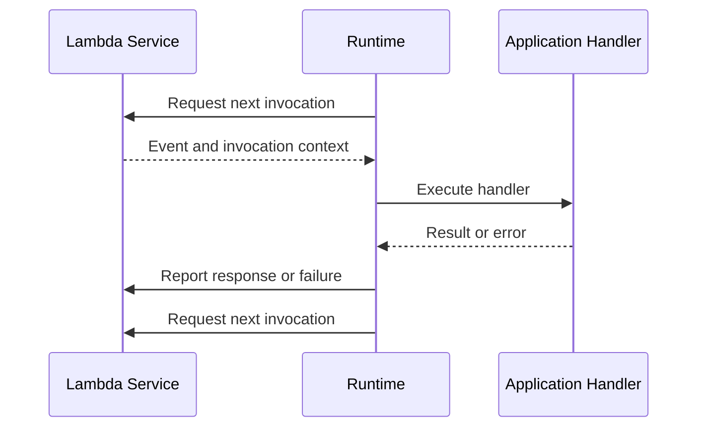

# 06- Advanced Features Questions

## Overview

AWS Lambda provides advanced capabilities for controlling initialization latency, extending runtime behavior, packaging applications, streaming responses, processing events, and executing workloads closer to users. Senior backend engineers must understand not only how these features work, but also their compatibility constraints, operational implications, cost models, and alternatives.

This document covers advanced Lambda features through interview questions focused on production engineering, architecture decisions, troubleshooting, and trade-off analysis.

## Lambda SnapStart

### What is Lambda SnapStart, and what problem does it solve?

**Model answer:**

Lambda SnapStart reduces initialization latency by creating a snapshot of an initialized execution environment during function version publication and using that snapshot to accelerate startup when the version is invoked.

Without SnapStart, a new execution environment may need to load the runtime, import dependencies, and execute initialization code before handling a request. SnapStart can reduce the repeated initialization work for supported runtimes and configurations.

It is especially useful for latency-sensitive functions that experience cold starts and perform substantial initialization.

**Important considerations:**

- SnapStart support depends on the runtime, Region, and function configuration.
- It is configured for published function versions, not `$LATEST`.
- Initialization code must be safe to snapshot and restore.
- Snapshot restoration does not eliminate application execution time or downstream latency.
- It is not interchangeable with provisioned concurrency.

Check current runtime and Region support before adopting it.

### How does SnapStart differ from provisioned concurrency?

**Model answer:**

Both features target initialization latency, but they use different mechanisms.

| Concern | SnapStart | Provisioned concurrency |
|---|---|---|
| Mechanism | Restores execution environments from a snapshot | Keeps a configured number of environments initialized |
| Main benefit | Reduces initialization work when environments start | Prepares execution capacity in advance |
| Configuration | Published function versions, subject to support | Published versions or aliases |
| Capacity preparation | Does not reserve a fixed pool of initialized environments in the same way | Allocates configured initialized capacity |
| Compatibility | Runtime and initialization constraints apply | Runtime and feature constraints apply |
| Cost considerations | Feature-specific pricing and execution costs must be evaluated | Provisioned capacity incurs additional charges |
| Typical use | Reducing initialization overhead | Predictable low-latency capacity for expected traffic |

Choose based on runtime compatibility, latency objectives, traffic predictability, and measured cost. Neither feature removes the need to optimize initialization and downstream calls.

### What risks arise when using SnapStart with initialization code?

**Model answer:**

Snapshotting initialized state can preserve values that should have been unique or freshly established for each execution environment.

Potential problems include:

- Reusing identifiers that should be unique.
- Preserving stale credentials or tokens.
- Restoring invalid network connections.
- Capturing assumptions about time or external state.
- Retaining random-number-generator state inappropriately.
- Restoring cached data that requires validation.

Review initialization code for resources and state that must be refreshed after restoration. Use supported runtime hooks where applicable, and validate behavior with realistic tests.

### When would you choose SnapStart over reducing package size?

**Model answer:**

These approaches address related but different causes of initialization latency.

Reducing package size and unnecessary imports can improve initialization efficiency and reduce deployment complexity. SnapStart can reduce repeated initialization work when supported.

Start by profiling initialization. Remove unnecessary dependencies and network calls first. Then evaluate SnapStart if initialization remains a meaningful contributor to latency and the runtime supports it.

## Lambda Extensions and Observability

### What is a Lambda extension?

**Model answer:**

A Lambda extension integrates additional functionality with the Lambda execution environment. Extensions can support observability, telemetry collection, security controls, and other operational capabilities.

Extensions can run alongside the function runtime and interact with the Lambda Extensions API. External extensions commonly run as separate processes within the execution environment.

**Advantages:**

- Centralized telemetry collection.
- Integration with monitoring and security tooling.
- Separation of some operational logic from application code.

**Trade-offs:**

- Additional initialization and resource overhead.
- Potentially higher memory usage and latency.
- More complex failure diagnosis.
- Possible impact on execution lifecycle and shutdown behavior.

Use extensions when their operational value justifies their overhead.

### What is the Lambda Telemetry API?

**Model answer:**

The Lambda Telemetry API allows extensions to subscribe to platform telemetry, including logs, metrics, and lifecycle-related telemetry where supported.

It enables observability systems to collect platform-level information and integrate it with application telemetry.

Production considerations include:

- Telemetry delivery and buffering behavior.
- Extension resource consumption.
- Network availability and delivery failures.
- Duplicate or delayed telemetry.
- Data retention and sensitive-data handling.
- The distinction between telemetry delivery and successful business processing.

Do not make application correctness depend on an external telemetry destination being available.

### How would you decide whether to use an extension or an in-process observability library?

**Model answer:**

An in-process library has direct access to application-level context and can instrument business operations. An extension can provide a more centralized integration with platform telemetry or an external observability system.

| Requirement | Potential fit |
|---|---|
| Business-operation timing | In-process instrumentation |
| Application-specific correlation IDs | In-process instrumentation |
| Platform log and lifecycle collection | Extension or Telemetry API integration |
| Shared monitoring integration across many functions | Extension, where appropriate |
| Minimal startup and memory overhead | Benchmark both approaches |

Many production systems use both. Ensure that correlation identifiers are propagated correctly and that telemetry overhead remains within the latency and cost budget.

## Lambda Layers

### What is a Lambda layer?

**Model answer:**

A Lambda layer packages reusable code, libraries, or other supported artifacts separately from the function deployment package.

Layers are useful when multiple functions share dependencies or common runtime components. A function can reference configured layer versions, allowing teams to manage shared artifacts independently.

**Advantages:**

- Reuse across multiple functions.
- Separation of shared dependencies from application code.
- Independent versioning of common components.

**Limitations:**

- Runtime and architecture compatibility must be maintained.
- Layer versions are immutable once published.
- Multiple layers introduce dependency-ordering and compatibility considerations.
- Shared dependencies can become difficult to upgrade consistently.
- Layers do not remove deployment package and uncompressed-size constraints.

### When should you use a layer instead of bundling dependencies?

**Model answer:**

Use a layer when multiple functions genuinely share dependencies that should be versioned independently. Bundle dependencies directly when the function has a small, isolated dependency set or needs independent release control.

For Python, layer directory structure and runtime compatibility matter. A layer containing Python packages generally places them under a compatible `python/` directory structure.

For example:

```text
python/
    lib/
        python3.x/
            site-packages/
                shared_library/
```

Build dependencies for the target Lambda runtime and architecture. Do not assume that a package installed on a Windows development machine will work in a Linux Lambda environment.

### How would you manage breaking changes in a shared layer?

**Model answer:**

Publish a new layer version and migrate functions deliberately.

1. Define the compatibility contract.
2. Publish a new immutable layer version.
3. Run unit and integration tests against the new version.
4. Update a limited set of functions.
5. Verify runtime behavior and telemetry.
6. Roll out to remaining functions.
7. Retain the previous version during the rollback window.

Avoid silently introducing breaking changes into shared dependencies. Independent function deployments can otherwise create inconsistent behavior across services.

## Custom Runtimes and Runtime API

### What is a Lambda custom runtime?

**Model answer:**

A custom runtime allows a Lambda function to execute using a runtime implementation supplied by the developer or a third party, rather than relying solely on an AWS-provided language runtime.

A custom runtime typically implements the Lambda Runtime API lifecycle:

1. Retrieve the next invocation.
2. Extract the invocation event and context.
3. Execute the handler logic.
4. Report the response or error.
5. Continue processing invocations as appropriate.

Custom runtimes are useful when a required language, runtime version, or specialized execution model is not available as an appropriate managed runtime.

**Trade-offs:**

- Greater control over runtime behavior.
- Increased responsibility for compatibility and maintenance.
- More complex packaging and debugging.
- Greater responsibility for security updates and runtime lifecycle management.

### What is the difference between a custom runtime and a container-image Lambda function?

**Model answer:**

A custom runtime defines how the function runtime processes invocations. A container-image deployment defines how the application and its runtime dependencies are packaged.

A Lambda container image can use a supported AWS base image or a compatible alternative, including a custom runtime implementation when the required Lambda interfaces are implemented correctly.

These concepts are not mutually exclusive: a container image can contain a custom runtime.

| Concern | Custom runtime | Container-image deployment |
|---|---|---|
| Main concern | Runtime implementation | Application packaging |
| Packaging options | ZIP or container image, depending on configuration | Container image |
| Runtime lifecycle ownership | Depends on whether runtime is custom or managed | Depends on the runtime inside the image |
| Operational burden | Runtime implementation and maintenance | Image build, scanning, publishing, and deployment |
| Appropriate use | Specialized language or runtime behavior | Complex dependencies or container-based build workflows |

### What is the Lambda Runtime API?

**Model answer:**

The Runtime API defines the interaction between a Lambda runtime and the Lambda execution environment. A runtime uses it to receive invocation events and communicate successful responses or failures.

A simplified lifecycle is:



A custom runtime must correctly implement the required protocol and error handling. Incorrect handling can result in failed invocations, stalled processing, or runtime errors.

## Container-Image-Based Lambda Functions

### When should you package a Lambda function as a container image?

**Model answer:**

Container images are useful when an application has complex native dependencies, requires a specialized filesystem layout, or already has a container-oriented build process.

Lambda supports container-image deployment, but it does not become a general-purpose container orchestrator. The function must still comply with Lambda's runtime, invocation, resource, and execution model.

Use container images when the packaging benefits outweigh image build, scanning, publishing, and deployment complexity.

### What operational concerns apply to Lambda container images?

**Model answer:**

Important concerns include:

- Base-image maintenance and security updates.
- Multi-architecture compatibility.
- Dependency reproducibility.
- Image scanning and artifact integrity.
- ECR permissions and image availability.
- Deployment immutability and version management.
- Image size and initialization performance.
- Rebuilding images when base layers or dependencies require security fixes.

Example build workflow:

```bash
docker build -t orders-lambda:latest .
docker tag orders-lambda:latest \
  123456789012.dkr.ecr.ap-south-1.amazonaws.com/orders-lambda:latest
```

The commands above build and tag an image locally. They do not publish or deploy it. Before pushing, create or verify the ECR repository, authenticate Docker to ECR, and use the correct account, Region, and repository URI.

For production, prefer a controlled build pipeline and immutable release identification over relying only on a mutable `latest` tag.

## Lambda Response Streaming

### What is Lambda response streaming?

**Model answer:**

Response streaming allows a supported Lambda integration to send response data incrementally rather than waiting for the complete response body.

This can improve time to first byte and user-perceived latency for suitable workloads, such as generated content, large responses, or streaming application protocols.

The client can begin consuming data while the function continues producing the response.

**Limitations and considerations:**

- Supported invocation and integration paths are constrained.
- Streaming does not eliminate total execution time.
- Client disconnects and partial responses require careful handling.
- Error handling after response data has been sent differs from errors before the response begins.
- Buffering by intermediaries can reduce the benefit.
- Pricing and response limits depend on the applicable configuration and service behavior.

Verify current support for the chosen integration before designing around streaming.

### When would you choose response streaming over a normal Lambda response?

**Model answer:**

Choose streaming when the client benefits from receiving partial results early or when incremental output is part of the API contract.

A normal response is often simpler for ordinary REST endpoints returning small JSON documents.

Streaming introduces additional complexity in client behavior, error semantics, observability, and integration compatibility. Use it only when it materially improves the workload.

## Event Source Mapping Advanced Features

### What is an event source mapping?

**Model answer:**

An event source mapping is a Lambda-managed integration that polls or reads from supported event sources and invokes a function with retrieved records.

Examples include Amazon SQS, Amazon Kinesis Data Streams, and DynamoDB Streams.

The mapping controls aspects of consumption, such as batching and selected scaling behavior. The exact configuration and delivery semantics depend on the event source.

An event source mapping is different from a service directly invoking Lambda through an event notification or API call.

### How do batch size and batching windows affect performance?

**Model answer:**

Batch size controls how many records may be included in a batch. A batching window allows the mapping to wait for additional records before invoking the function, subject to event-source-specific behavior and limits.

Larger batches can reduce per-invocation overhead but may increase:

- Memory consumption.
- Invocation duration.
- Processing latency for individual records.
- The number of records affected by a failed batch.
- Retry work when failures are not isolated.

Smaller batches may improve failure isolation and latency but increase invocation overhead.

Benchmark with realistic event sizes and failure rates. Check the limits and behavior of the specific event source.

### What is partial batch failure handling?

**Model answer:**

Partial batch failure handling allows a function to identify individual records that failed processing so that supported event source mappings can retry those records rather than treating the entire batch as successful or retrying every record indiscriminately.

The feature must be explicitly configured where required, and the response schema depends on the event source.

A robust handler should:

- Validate each record independently.
- Catch expected record-level errors.
- Report only the records that genuinely failed.
- Avoid marking failed records as successful.
- Make processing idempotent.
- Log failures with safe identifiers.

Partial batch responses do not automatically provide exactly-once processing. Duplicate delivery remains possible, and event-source-specific retry behavior still applies.

### How do filtering criteria improve event source processing?

**Model answer:**

Filtering criteria allow an event source mapping to discard records that do not match configured patterns before invoking the function.

This can reduce unnecessary invocations and simplify function logic.

However, filtering is not a substitute for authorization or application-level validation. Verify filter semantics for the specific event source and test boundary cases to avoid silently discarding important events.

## Durable Execution and Lambda Managed Instances

### What are durable execution capabilities, and when should you consider them?

**Model answer:**

Durable execution capabilities are intended for workflows that must preserve progress across waits, retries, or interruptions rather than relying entirely on one uninterrupted function invocation.

The appropriate implementation depends on the specific AWS feature, its availability, and its execution model. AWS Step Functions remains a common choice for explicit workflow orchestration across multiple tasks, retries, branching, and waiting periods.

Before adopting a durable execution capability, verify:

- Runtime and Region availability.
- Supported programming model and APIs.
- Execution-duration and state limitations.
- Retry and recovery semantics.
- Pricing and operational visibility.
- Integration compatibility.

Do not assume all Lambda execution patterns are automatically durable.

### What are Lambda Managed Instances?

**Model answer:**

Lambda Managed Instances are a distinct Lambda execution option designed for supported workloads that need a managed execution model with more explicit control over instance-based compute characteristics.

They should not be treated as identical to conventional Lambda's default execution model or to customer-managed EC2 instances.

Before considering this option, validate current availability, supported runtimes and configurations, concurrency behavior, operational responsibilities, and pricing using current AWS documentation.

The architectural decision should be based on workload characteristics and service guarantees rather than the feature name alone.

## Lambda@Edge and CloudFront Functions

### What is the difference between Lambda@Edge and CloudFront Functions?

**Model answer:**

Both support code execution in the CloudFront request path, but they target different levels of complexity and execution requirements.

| Concern | CloudFront Functions | Lambda@Edge |
|---|---|---|
| Primary focus | Lightweight, latency-sensitive request manipulation | More complex request and response processing |
| Execution environment | Specialized lightweight runtime | Lambda-based execution model |
| Common uses | Header manipulation, redirects, URL rewrites, simple access checks | More complex request processing and supported integrations |
| Resource and runtime capabilities | Deliberately constrained | Broader capabilities, subject to Lambda@Edge restrictions |
| Operational complexity | Typically lower for simple logic | Greater deployment and compatibility considerations |
| Best fit | Simple logic at the edge | Edge logic requiring capabilities unavailable in CloudFront Functions |

Verify current runtime, event-stage, deployment, and feature restrictions before choosing either service.

### When would you use CloudFront Functions instead of a regional Lambda function?

**Model answer:**

Use CloudFront Functions when lightweight logic should execute at CloudFront edge locations, such as URL rewrites, redirects, or header transformations.

A regional Lambda function is generally more appropriate when the operation requires database access, substantial computation, or regional service integrations.

Edge execution can reduce request-path latency for suitable operations, but it also introduces deployment and debugging considerations. Do not move complex business logic to the edge without a clear latency or architectural benefit.

## Recursive Invocation and Failure Destinations

### What is recursive Lambda invocation, and why is it dangerous?

**Model answer:**

Recursive invocation occurs when a function indirectly or directly triggers itself repeatedly. For example, a Lambda function processes an S3 object and writes its output to the same bucket and prefix that triggers the function.

Potential consequences include:

- Invocation storms.
- Unexpected charges.
- Repeated processing.
- Downstream service overload.
- Large numbers of duplicate or failed operations.

Mitigations include:

- Separate input and output prefixes or buckets.
- Add event filters.
- Validate event origin and processing state.
- Implement idempotency.
- Monitor invocation volume and error rates.
- Configure applicable recursive-loop detection protections.

AWS provides recursive-loop detection for supported invocation patterns, but it is not a substitute for sound event architecture and does not cover every possible cycle.

### What are Lambda failure destinations?

**Model answer:**

For supported asynchronous invocation configurations, Lambda can route information about failed invocations to a configured destination after its retry or event-age policy is exhausted.

Supported destination types include services such as Amazon SQS, Amazon SNS, Lambda, and Amazon EventBridge, subject to configuration and current service constraints.

A dead-letter queue and an on-failure destination are related but distinct mechanisms.

| Concern | Dead-letter queue | On-failure destination |
|---|---|---|
| Typical purpose | Retain failed asynchronous invocation events | Route invocation failure information and context |
| Payload | Original event payload, subject to configuration | Failure record with request and invocation context |
| Supported configuration | Depends on invocation mode and service | Depends on supported asynchronous invocation settings |
| Operational use | Reprocessing and failure investigation | Failure routing, audit, and recovery workflows |

Choose based on what the recovery system needs. Verify delivery permissions, retention, monitoring, and replay procedures.

### How would you design a safe recovery process for failed asynchronous invocations?

**Model answer:**

Use a controlled recovery pipeline rather than blindly replaying every failed event.

1. Capture failures in a suitable destination.
2. Record failure reason, event identifier, and relevant request context.
3. Classify transient failures separately from permanent business errors.
4. Correct the underlying issue before replay.
5. Replay through a controlled worker or recovery workflow.
6. Apply idempotency checks to prevent duplicate business effects.
7. Monitor recovery progress and repeated failures.

Replaying an event can reproduce its side effects. Recovery must therefore be designed with the same reliability and security requirements as the original processing path.

## Advanced Feature Selection Scenarios

### Scenario: A Python API has high cold-start latency. Would you choose SnapStart, provisioned concurrency, or dependency optimization?

**Model answer:**

First measure the initialization phase and determine which work contributes to the delay.

- Remove unnecessary imports and dependencies.
- Avoid external calls during module initialization.
- Reuse SDK clients safely.
- Evaluate SnapStart if the runtime and configuration support it.
- Evaluate provisioned concurrency if predictable initialized capacity is required.

SnapStart and provisioned concurrency have different compatibility and capacity characteristics. Compare measured latency and total cost under representative traffic before selecting a solution.

### Scenario: Multiple functions share the same dependency layer. How would you prevent incompatible upgrades?

**Model answer:**

Treat layer versions as release artifacts with an explicit compatibility contract.

Publish new versions instead of changing dependencies in place, test representative consuming functions, and migrate consumers incrementally. Track which function versions use each layer version.

For tightly coupled application dependencies, bundling libraries with each function may be safer than maintaining a shared layer.

### Scenario: A function must generate a large response while clients begin consuming data immediately. What would you consider?

**Model answer:**

Evaluate response streaming if the invocation path and integration support it.

Measure time to first byte, total response duration, client disconnects, and intermediary buffering. Define what happens if generation fails after some response data has already been sent.

If streaming is unsupported or does not materially improve the experience, consider an asynchronous job that stores the result and exposes status and retrieval endpoints.

### Scenario: A Lambda workload requires a specialized native library. Would you use a layer or container image?

**Model answer:**

Both may be suitable. A layer can be effective when the dependency can be packaged compatibly and shared across functions. A container image can be preferable when the application needs a more complex filesystem layout or controlled native dependency environment.

Validate architecture compatibility, system libraries, build reproducibility, security scanning, package constraints, and deployment complexity before choosing.

### Scenario: A queue consumer is failing entire batches because one record is invalid. What should you change?

**Model answer:**

Determine whether the event source supports partial batch failure responses and configure them appropriately.

Process records independently, return only failed record identifiers, and make side effects idempotent. If a record is permanently invalid, route it to a controlled quarantine or dead-letter workflow rather than retrying indefinitely.

Validate the response contract and retry behavior against the specific event source mapping.

## Key Takeaways

- SnapStart, provisioned concurrency, and initialization optimization address different aspects of startup latency; choose based on compatibility, traffic, and measured performance.
- Lambda layers, custom runtimes, and container images are packaging and runtime choices with different maintenance, compatibility, and deployment trade-offs.
- Extensions and the Telemetry API improve observability but introduce resource overhead and must not become dependencies for business correctness.
- Event source mapping features such as batching, filtering, and partial batch responses must be configured and tested according to the specific event source's semantics.
- Advanced Lambda architectures still require idempotency, safe failure recovery, security controls, monitoring, and explicit cost management.