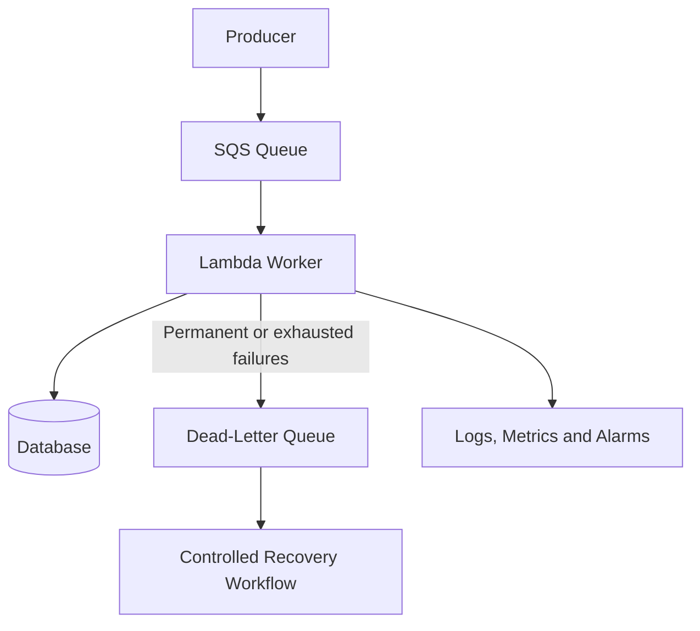

# 07- Deployment and Operations Questions

## Overview

AWS Lambda deployment and operations involve more than publishing code. Production systems require repeatable builds, controlled releases, least-privilege deployment permissions, configuration management, observability, rollback procedures, incident response, and cost controls.

Senior backend engineers must understand how deployment artifacts become running function versions, how traffic is routed between releases, how infrastructure changes affect availability, and how operational failures are diagnosed and recovered.

## Deployment Fundamentals

### What deployment options are available for AWS Lambda?

**Model answer:**

Lambda supports ZIP deployment packages and container images. The appropriate choice depends on application dependencies, runtime requirements, packaging complexity, and the team's release process.

| Concern | ZIP package | Container image |
|---|---|---|
| Packaging | Application code and dependencies in a ZIP archive | Application and runtime dependencies in an OCI-compatible image |
| Typical artifact storage | Local upload or Amazon S3 | Amazon ECR |
| Dependency management | Bundled dependencies and optional layers | Image build and dependency layers |
| Native dependencies | Must be compatible with the target runtime and architecture | Can be packaged with compatible native dependencies |
| Deployment complexity | Often simpler for conventional functions | Requires image build, publishing, and image lifecycle management |
| Best fit | Most conventional Python and lightweight backend functions | Complex dependencies or container-oriented build workflows |

Both deployment types remain subject to Lambda's execution model, runtime requirements, quotas, and supported configuration.

### How would you deploy a Python Lambda function using a ZIP package?

**Model answer:**

A ZIP deployment contains the handler module and required dependencies in the correct archive structure.

Example project:

```text
orders_lambda/
    handler.py
    requirements.txt
```

Example handler:

```python
import json


def handler(event, context):
    return {
        "statusCode": 200,
        "body": json.dumps({"status": "healthy"}),
    }
```

For a function with no external dependencies, create the package:

```bash
zip function.zip handler.py
```

For a function with dependencies, install compatible packages into the package directory before creating the ZIP. Build for the target Lambda runtime and architecture, particularly when dependencies contain native extensions.

For production, include automated tests, dependency pinning, artifact validation, and security scanning before deployment.

### What is the difference between updating function code and updating function configuration?

**Model answer:**

Code updates replace the function's executable artifact. Configuration updates change settings such as memory, timeout, environment variables, runtime configuration, or execution-role association.

These operations have different failure modes. A code release can introduce application defects, while a configuration change can break permissions, networking, or resource access without changing the code.

A safe deployment pipeline should validate both and record the configuration associated with each release.

### What is the purpose of publishing a Lambda version?

**Model answer:**

A published version is an immutable snapshot of the function code and most versioned configuration. It provides a stable release target for testing, aliases, and rollback.

The mutable `$LATEST` version is useful during development and deployment but is not a stable production release identifier.

Published versions support reproducible releases and controlled traffic routing. Some operational properties and external resources remain independently mutable, so a published version does not freeze the entire system.

### What is a Lambda alias, and why is it useful?

**Model answer:**

An alias is a named pointer to a published function version. It can also support weighted routing between two published versions where supported.

Typical aliases include:

- `dev`
- `staging`
- `prod`

Aliases allow callers and integrations to target a stable name while the deployment process changes the underlying version.

For example, an API integration can invoke the `prod` alias instead of referring directly to a version number. The deployment pipeline then updates the alias after validating the new release.

### What is the difference between a Lambda version and an alias?

| Concern | Version | Alias |
|---|---|---|
| Purpose | Immutable release snapshot | Named reference to a version |
| Mutability | Published version is immutable | Alias target can be updated |
| Rollback | Invoke an earlier version or repoint an alias | Repoint the alias to an earlier version |
| Traffic shifting | Not by itself | Supports weighted routing between eligible versions |
| Common use | Reproducible releases | Stable integration target |

Aliases simplify release management, but rollback must also consider database migrations, external resources, environment configuration, and side effects produced by the new version.

## Safe Deployment Strategies

### How would you implement a safe production deployment?

**Model answer:**

A production deployment should separate artifact creation, validation, release publication, traffic changes, and post-deployment verification.

A typical workflow is:

1. Run linting and unit tests.
2. Build the deployment artifact.
3. Scan dependencies and validate the artifact.
4. Deploy to a non-production environment.
5. Run integration and smoke tests.
6. Publish a production candidate version.
7. Update the production alias or use a controlled traffic-shifting strategy.
8. Monitor errors, duration, throttles, and business metrics.
9. Complete the rollout or roll back if the release violates the deployment criteria.

Use explicit health criteria rather than assuming that a successful deployment command means the application is healthy.

### What is a canary deployment?

**Model answer:**

A canary deployment exposes a small portion of traffic to a new version before increasing its traffic share.

For Lambda, weighted aliases can route traffic between published versions. AWS CodeDeploy can coordinate supported Lambda deployment strategies, including canary and linear traffic shifting.

A canary release is useful when a defect could affect a subset of production traffic and metrics can detect the problem before full rollout.

Monitor both technical and business signals. A release may return HTTP 200 responses while producing incorrect business outcomes.

### What is the difference between canary and linear deployments?

**Model answer:**

A canary deployment shifts a small initial percentage of traffic to the new version, waits for an observation period, and then shifts the remaining traffic if validation succeeds.

A linear deployment increases the new version's traffic in regular increments until the rollout completes.

| Concern | Canary | Linear |
|---|---|---|
| Initial exposure | Small initial traffic percentage | Initial configured traffic increment |
| Observation | Usually includes a defined interval after the initial shift | Repeated intervals between increments |
| Risk exposure | Limits early exposure | Gradually increases exposure |
| Release duration | Depends on initial canary and final shift | Depends on number of increments and interval |
| Best fit | High-risk changes requiring early validation | Controlled gradual rollout |

Both approaches require appropriate alarms, rollback behavior, and a way to identify regressions.

### How do you roll back a failed Lambda deployment?

**Model answer:**

If production traffic is routed through an alias, rollback can often be performed by pointing the alias back to the previously validated version.

Inspect the current alias:

```bash
aws lambda get-alias \
  --function-name orders-api \
  --name prod
```

Update the alias to a previously published version:

```bash
aws lambda update-alias \
  --function-name orders-api \
  --name prod \
  --function-version 12
```

The version number is illustrative. Replace it with the actual known-good version.

Verify the alias afterward and run a production smoke test. Also check whether the failed release changed database schemas, external resources, queue formats, or business state. Reverting code does not automatically reverse these side effects.

### Why are database migrations a deployment risk?

**Model answer:**

Application versions may overlap during a rollout, and queued events may be processed by older or newer code after deployment. A schema change that immediately removes or renames a field can break one of those versions.

Use backward-compatible migrations where possible:

1. Add the new schema element.
2. Deploy code that can work with both old and new representations.
3. Migrate existing data if required.
4. Switch all consumers to the new representation.
5. Remove obsolete schema elements in a later release.

This expand-and-contract approach reduces coupling between application deployment and database migration timing.

## Infrastructure as Code

### Why should Lambda infrastructure be managed using Infrastructure as Code?

**Model answer:**

Infrastructure as Code makes infrastructure changes reviewable, repeatable, and testable. It reduces configuration drift and provides a record of how application resources are created.

AWS SAM, AWS CloudFormation, AWS CDK, and Terraform are common choices for managing Lambda-based systems.

Infrastructure definitions can include:

- Lambda functions and versions.
- IAM roles and policies.
- API Gateway integrations.
- SQS queues and event source mappings.
- CloudWatch log groups and alarms.
- Environment-specific parameters.
- Networking and database integrations.

Choose one primary management approach for each resource boundary. Uncoordinated manual changes and overlapping IaC ownership can create drift or failed deployments.

### How would you choose between AWS SAM, CDK, and CloudFormation?

**Model answer:**

The choice depends on the team's abstraction needs and infrastructure workflow.

| Tool | Typical fit | Trade-off |
|---|---|---|
| AWS SAM | Serverless applications with Lambda-centric templates and deployment workflows | More specialized abstraction |
| AWS CDK | Infrastructure defined using supported programming languages | Requires understanding generated CloudFormation and synthesis behavior |
| AWS CloudFormation | Direct declarative AWS resource management | Templates can become verbose for complex systems |
| Terraform | Multi-provider infrastructure management and teams standardized on Terraform | Requires Terraform state management and provider lifecycle awareness |

All approaches require code review, environment separation, change validation, and deployment controls.

### How do you detect infrastructure drift?

**Model answer:**

Infrastructure drift occurs when deployed resources differ from the configuration managed by the infrastructure deployment process.

Possible causes include:

- Manual console changes.
- Emergency CLI updates.
- Changes made by another pipeline.
- Resource modifications outside the IaC ownership boundary.

Use the drift-detection capabilities of the chosen IaC system, review deployment plans or change sets, and reconcile changes before the next release.

Not every runtime property or resource type is necessarily covered by drift detection. Verify the limitations of the selected tool.

## CI/CD and GitHub Actions

### How would you design a GitHub Actions pipeline for Lambda?

**Model answer:**

A production pipeline should build, test, package, deploy, and verify the application using controlled permissions.

A simplified workflow might look like this:

```yaml
name: Deploy Orders Lambda

on:
  push:
    branches:
      - main

permissions:
  contents: read
  id-token: write

jobs:
  test:
    runs-on: ubuntu-latest
    steps:
      - name: Checkout repository
        uses: actions/checkout@v4

      - name: Set up Python
        uses: actions/setup-python@v5
        with:
          python-version: "3.12"

      - name: Install dependencies
        run: |
          python -m pip install --upgrade pip
          pip install -r requirements.txt
          pip install pytest

      - name: Run tests
        run: pytest -q

  deploy:
    needs: test
    runs-on: ubuntu-latest
    environment: production
    steps:
      - name: Checkout repository
        uses: actions/checkout@v4

      - name: Configure AWS credentials
        uses: aws-actions/configure-aws-credentials@v4
        with:
          role-to-assume: ${{ vars.AWS_DEPLOY_ROLE_ARN }}
          aws-region: ap-south-1

      - name: Deploy
        run: |
          sam build
          sam deploy --config-env production
```

This is an illustrative baseline, not a complete production release system. It assumes SAM configuration, an appropriate AWS role, an OIDC trust relationship, and a valid deployment template already exist.

A production workflow should also pin third-party actions to reviewed immutable commit SHAs, validate deployment configuration, control concurrent releases, verify the deployed version, and perform smoke tests. The shown deployment job does not itself implement canary traffic shifting or automated rollback.

### Why is OpenID Connect preferable to long-lived AWS access keys in CI/CD?

**Model answer:**

GitHub Actions can use OpenID Connect (OIDC) to obtain temporary AWS credentials by assuming an IAM role. This avoids storing long-lived AWS access keys as repository secrets.

The AWS role trust policy should restrict which repository, branch, tag, or GitHub environment can assume the role.

Use separate roles and permissions for different environments. A deployment role should have only the permissions needed to deploy the intended resources.

OIDC does not eliminate the need to protect workflow files, review third-party actions, and restrict access to production environments.

### How should deployment permissions differ from Lambda execution permissions?

**Model answer:**

Deployment permissions allow a pipeline or operator to create and update infrastructure. Execution permissions allow the function to access resources while handling requests.

These permissions should be separate.

| Permission category | Examples |
|---|---|
| Deployment role | Update function code, publish versions, update aliases, manage permitted infrastructure |
| Execution role | Read required secrets, access a specific DynamoDB table, write application logs |
| Invocation permission | Allow an authorized service or principal to invoke the function |

Avoid granting the runtime role broad deployment permissions or giving the deployment role unrestricted access to application data.

## Environment and Configuration Management

### How should you manage development, staging, and production environments?

**Model answer:**

Separate environments by account or another appropriately strong isolation boundary, with distinct resource names, configuration, credentials, and deployment controls.

A practical environment configuration includes:

- Function names or aliases.
- Database and queue identifiers.
- Secret references.
- Resource policies.
- Logging and monitoring settings.
- Concurrency limits.
- Deployment approval rules.

Do not assume that a Lambda alias creates a fully isolated environment. Aliases route invocations to versions; they do not automatically isolate databases, secrets, queues, or other dependencies.

### How should secrets be managed for Lambda?

**Model answer:**

Avoid embedding credentials in source code, deployment archives, container images, or ordinary configuration values.

Use AWS Secrets Manager or Systems Manager Parameter Store for secrets and configuration where appropriate. Grant the execution role access only to the required secret or parameter.

Consider:

- Secret rotation.
- Cache lifetime and refresh behavior.
- Failure handling when a secret cannot be retrieved.
- Encryption and access auditing.
- Network access when the function runs in a VPC.
- Avoiding sensitive values in logs.

Environment variables can contain configuration and secret references, but placing a plaintext credential directly in an environment variable requires careful risk assessment and access control.

### How would you handle a configuration change that requires a new function release?

**Model answer:**

Identify whether the setting belongs to versioned function configuration, a mutable external resource, or a separate deployment parameter.

For changes associated with a release, publish a new version and move traffic only after validation. For external settings, define a controlled update and rollback procedure.

Be aware that aliases point to versions, while external dependencies and some operational settings can change independently. Record enough release metadata to reproduce and diagnose the effective production configuration.

## Monitoring and Production Operations

### What should you monitor for a production Lambda function?

**Model answer:**

Monitor service health, workload behavior, dependencies, and business outcomes.

| Signal | Purpose |
|---|---|
| Invocations | Detect traffic changes |
| Errors | Detect failed execution |
| Duration | Detect latency regression |
| Throttles | Identify concurrency or quota pressure |
| Concurrent executions | Understand active capacity |
| Queue age and backlog | Detect asynchronous processing lag |
| Stream iterator age | Detect processing delay for applicable stream sources |
| Database connections and latency | Detect downstream saturation |
| Business success metrics | Verify useful work is completed |
| Estimated cost and invocation volume | Detect unexpected spend |

Choose metrics and alarms according to the integration and workload. A function can have a low error rate while still producing incorrect business results, so technical metrics alone are insufficient.

### How would you configure actionable alarms?

**Model answer:**

Define alarms around service-level objectives and meaningful operational conditions rather than alerting on every metric fluctuation.

Examples include:

- Sustained elevated error rate.
- Duration approaching the timeout.
- Unexpected throttling.
- Queue age exceeding the processing objective.
- Repeated failure-destination deliveries.
- Downstream database saturation.
- A sudden invocation or cost increase.

Use appropriate evaluation periods and thresholds to avoid excessive false alarms. Each alarm should have an owner, a runbook, and a clear action.

### How do you investigate a sudden increase in Lambda errors?

**Model answer:**

Use a structured diagnostic sequence:

1. Identify the affected function, version, alias, and time window.
2. Compare error rate, duration, invocation count, and throttles.
3. Inspect structured logs and exception traces.
4. Check recent deployments and configuration changes.
5. Inspect downstream services, permissions, and network connectivity.
6. Determine whether retries are increasing the load.
7. Apply a targeted mitigation.
8. Verify recovery and document the root cause.

If the issue started immediately after a deployment, consider routing traffic back to the last known-good version while investigating. Avoid rollback if the previous version is incompatible with irreversible schema or data changes without first assessing the consequences.

### How would you use CloudWatch Logs Insights during an incident?

**Model answer:**

CloudWatch Logs Insights can query structured or unstructured logs to identify error patterns, slow requests, and affected request identifiers.

For example, the following query counts log events containing an error marker:

```sql
fields @timestamp, @message
| filter @message like /ERROR/
| stats count(*) as error_count by bin(5m)
| sort @timestamp desc
```

For structured application logs, query explicit fields such as `level`, `request_id`, `operation`, and `duration_ms` where available.

Verify that the selected log group contains the expected data and that timestamps align with the incident window. A query cannot find information that the application never logged.

### What is the role of distributed tracing in Lambda operations?

**Model answer:**

Distributed tracing helps identify latency and failures across multiple services participating in a request.

For a request flowing through API Gateway, Lambda, and a database or external API, tracing can reveal which segment dominates latency and where errors occur.

AWS X-Ray and OpenTelemetry-based instrumentation are common options, depending on the architecture and observability platform.

Tracing must be configured and instrumented appropriately. Correlation identifiers, structured logs, and service metrics remain useful even when a trace is missing or incomplete.

## Reliability and Incident Response

### How would you respond to a Lambda invocation storm?

**Model answer:**

An invocation storm can result from recursive triggers, retry amplification, an unexpected producer, or a downstream failure.

Containment should prioritize preventing further damage:

1. Identify the triggering function and event source.
2. Check invocation rates, errors, recursion indicators, and downstream utilization.
3. Disable or restrict the offending trigger when operationally safe.
4. Reduce concurrency if downstream services are at risk.
5. Stop recursive event generation.
6. Preserve failed events where possible.
7. Correct the cause before restoring traffic.
8. Monitor recovery and backlog draining.

Setting reserved concurrency to zero can be an emergency containment mechanism, but it also stops the function from processing new work and can increase backlogs or cause caller-visible failures.

### How do you design a reliable Lambda-based asynchronous workflow?

**Model answer:**

Use explicit failure handling, idempotency, bounded retries, and monitoring of both processing errors and queue age.

A common architecture is:



The worker should process messages idempotently, apply appropriate timeouts, and distinguish transient errors from permanent business failures.

The recovery workflow should support investigation and controlled replay rather than automatically replaying every failed message without validation.

### What does idempotency mean in production operations?

**Model answer:**

Idempotency means that repeating an operation produces the same intended business outcome as performing it once.

It is essential because asynchronous invocation and event-source processing can produce duplicate attempts.

For example, an order-payment handler should not charge a customer again simply because the same event was delivered twice. A durable idempotency record, unique business constraint, or downstream idempotency key can prevent duplicate side effects.

An in-memory set or global variable is insufficient because execution environments are not durable and may be replaced at any time.

### How should failed events be recovered without causing duplicate side effects?

**Model answer:**

A recovery workflow should preserve event identity, classify the failure, and use the same idempotency controls as normal processing.

Recommended steps:

1. Capture the original event and failure context.
2. Determine whether the business operation partially completed.
3. Correct the underlying issue.
4. Verify that replay is safe.
5. Replay through a controlled process.
6. Confirm the expected business result.
7. Record recovery status and repeated failures.

A successful Lambda invocation does not necessarily mean that the business operation completed correctly. Recovery must verify business state, not just function status.

## Backup, Recovery, and Disaster Recovery

### What does disaster recovery mean for a Lambda-based application?

**Model answer:**

Lambda is a managed regional service, but an application can still depend on regional databases, queues, secrets, event rules, container images, and networking resources.

Disaster recovery must consider the complete application dependency graph, not just the function code.

Important components include:

- Deployment artifacts and infrastructure definitions.
- Database backups and replication.
- Queue and event configuration.
- Secrets and encryption keys.
- IAM roles and resource policies.
- DNS and traffic routing.
- Monitoring and operational procedures.
- Regional quotas and service availability.

The appropriate strategy depends on recovery time objective (RTO), recovery point objective (RPO), data consistency requirements, and cost.

### How would you prepare a Lambda application for regional recovery?

**Model answer:**

A regional recovery plan should make the target environment reproducible and verify that critical dependencies are available.

A typical process is:

1. Store source code and infrastructure definitions in version control.
2. Replicate or recreate deployment artifacts in the target Region.
3. Establish database replication or a tested backup-restoration process.
4. Provision required queues, secrets, permissions, and networking.
5. Validate service quotas and dependency availability.
6. Test deployment and application health in the recovery Region.
7. Document traffic cutover and data-consistency decisions.
8. Run periodic recovery exercises.

A deployed Lambda function in a second Region is not sufficient if its database, secrets, permissions, or event sources are unavailable there.

### What is the difference between high availability and disaster recovery?

**Model answer:**

High availability reduces the impact of failures during normal operation, often within a Region. Disaster recovery addresses larger disruptions, including regional failures and loss of critical dependencies.

Lambda's managed execution infrastructure does not automatically make the complete application multi-Region or guarantee that application data can be recovered.

| Concern | High availability | Disaster recovery |
|---|---|---|
| Primary goal | Maintain service during common failures | Restore service after major disruption |
| Typical scope | Service configuration and regional dependencies | Cross-region or backup-based recovery |
| Data strategy | Replication and resilient access | Replication, backup, and restoration |
| Operational requirement | Continuous monitoring and failover behavior | Tested recovery plan and documented objectives |
| Cost | Depends on redundancy and capacity | Depends on standby resources, replication, and recovery requirements |

Both require explicit ownership, testing, and recovery procedures.

## Cost and Capacity Operations

### How would you investigate an unexpected increase in Lambda costs?

**Model answer:**

Correlate billing data with workload and deployment telemetry.

Investigate:

- Invocation spikes.
- Longer execution duration.
- Increased memory allocation.
- Retry amplification.
- Recursive invocation.
- Provisioned concurrency utilization.
- Increased log volume.
- Unexpected event source polling or processing.
- Downstream services and data-transfer charges.

Identify whether the increase reflects legitimate growth or inefficient behavior. Apply targeted limits or containment where necessary, then verify that the workload remains healthy.

### How do you prevent one Lambda workload from starving other functions?

**Model answer:**

Use reserved concurrency for workload isolation and plan account-level capacity around critical functions.

Background processing can be constrained to leave capacity for latency-sensitive APIs. Queue-based architectures can absorb traffic while processing capacity remains limited.

Also monitor account-level concurrency usage and ensure that reserved allocations do not unintentionally leave insufficient unreserved capacity for other workloads.

### How do you prepare for service quota limits?

**Model answer:**

Identify relevant account and Region quotas before launch, then compare them with projected peak demand and recovery requirements.

Relevant limits can include concurrency, deployment package constraints, event source configuration, and integration-specific quotas.

Use AWS Service Quotas and the current service documentation to verify applicable limits. Request increases where available, load-test realistic scenarios, and define an operational response for throttling or capacity exhaustion.

Do not rely on a quota increase being approved during an incident.

## Senior-Level Deployment and Operations Scenarios

### Scenario: A deployment succeeds, but production requests return errors. What do you do?

**Model answer:**

Treat deployment success and application health as separate signals.

- Confirm which version the production alias invokes.
- Inspect error logs and request traces.
- Compare configuration and permissions with the previous release.
- Check dependency compatibility and recent schema changes.
- Verify networking and external service access.
- Roll back if the previous version is safe to run.
- Run smoke tests and verify business-level behavior.

After recovery, identify why the release pipeline failed to detect the problem and add an appropriate automated test or deployment alarm.

### Scenario: A Lambda function works in development but fails in production with `AccessDeniedException`. How would you troubleshoot it?

**Model answer:**

Compare the execution role, resource policies, account, Region, and resource identifiers between environments.

Check:

- Whether the function uses the expected execution role.
- Whether the required action is allowed.
- Whether the resource ARN matches the actual resource.
- Whether a resource-based policy is required.
- Whether a permissions boundary, service control policy, or explicit deny applies.
- Whether encryption or network-related permissions are missing.

Use CloudTrail and applicable IAM policy-analysis tools to investigate. Avoid resolving the issue by granting unrestricted permissions; add the narrowest permission that supports the required operation.

### Scenario: The previous Lambda version is healthy, but rollback does not restore the service. Why?

**Model answer:**

The failure may involve changes outside the versioned function artifact.

Possible causes include:

- An incompatible database migration.
- Changed environment variables or external configuration.
- A modified resource policy.
- Messages written in a new format.
- Side effects from the failed release.
- A downstream service that remains unhealthy.

Investigate the complete dependency graph and the changes made during the deployment. Design releases to tolerate overlapping versions and make rollback procedures account for data and infrastructure changes.

### Scenario: How would you deploy a high-risk change with minimal production impact?

**Model answer:**

Use a staged rollout with explicit health gates.

1. Validate the artifact and infrastructure changes.
2. Test in a representative non-production environment.
3. Publish an immutable version.
4. Route a small percentage of production traffic to the candidate.
5. Monitor error rate, latency, throttles, and business metrics.
6. Automatically or manually halt the rollout when thresholds are violated.
7. Increase traffic gradually after successful observation.
8. Verify full production health and retain the previous version for rollback.

For event-driven consumers, also consider messages produced during the transition, idempotency, schema compatibility, and the possibility of both versions processing events.

## Key Takeaways

- Use immutable Lambda versions, aliases, controlled traffic shifting, and verified rollback procedures to make releases safer.
- Treat deployment, execution, and invocation permissions as separate security boundaries, and prefer short-lived CI/CD credentials through OIDC.
- Manage infrastructure as code and validate application health after every release rather than relying on successful deployment commands.
- Operate Lambda through actionable metrics, structured logs, tracing, idempotent recovery workflows, and tested incident procedures.
- Plan disaster recovery, concurrency, quotas, and costs around the entire application dependency graph, including databases, queues, secrets, and regional resources.