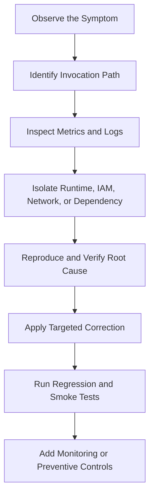

# 08- Troubleshooting Scenarios

## Overview

AWS Lambda troubleshooting requires tracing failures across the function runtime, invocation mechanism, event source, IAM permissions, networking, downstream dependencies, and deployment configuration. A Lambda error is not necessarily caused by the function code itself; it may originate from API Gateway, an event source mapping, a database, a resource policy, or an account-level quota.

A reliable troubleshooting process moves from observable symptoms to verified root causes. Avoid changing multiple settings simultaneously, increasing timeouts without evidence, or granting broad permissions simply to make an error disappear.

Use the following diagnostic sequence:



## Initial Diagnostic Workflow

### What should you inspect first when a Lambda function fails?

**Model answer:**

Establish the affected function, time window, invocation path, deployed version, and impact before changing configuration.

Start with these checks:

1. Identify the function, alias, Region, and AWS account.
2. Determine whether the invocation is synchronous, asynchronous, or event-source-based.
3. Inspect invocation count, errors, duration, throttles, and relevant event-source metrics.
4. Retrieve logs for the failing invocation.
5. Check recent code, configuration, IAM, and infrastructure changes.
6. Inspect dependencies such as databases, queues, APIs, and networking resources.
7. Verify the root cause before applying a correction.

Useful read-only commands:

```bash
aws sts get-caller-identity

aws lambda get-function \
  --function-name orders-api \
  --region ap-south-1

aws lambda get-function-configuration \
  --function-name orders-api \
  --region ap-south-1

aws lambda get-function-concurrency \
  --function-name orders-api \
  --region ap-south-1
```

Replace the example function name and Region with the actual values. The commands help verify the execution context, function metadata, configuration, and function-level concurrency settings. They do not establish the health of downstream services.

### How do you retrieve Lambda logs during an incident?

**Model answer:**

Lambda sends standard application logs to CloudWatch Logs when the execution role has the necessary permissions and logging is configured appropriately.

The conventional log group name is:

```text
/aws/lambda/<function-name>
```

Inspect recent log streams:

```bash
aws logs describe-log-streams \
  --log-group-name /aws/lambda/orders-api \
  --order-by LastEventTime \
  --descending \
  --max-items 10 \
  --region ap-south-1
```

Retrieve events from a known stream:

```bash
aws logs get-log-events \
  --log-group-name /aws/lambda/orders-api \
  --log-stream-name '<log-stream-name>' \
  --limit 100 \
  --region ap-south-1
```

For production incidents, CloudWatch Logs Insights is often more efficient because it can filter events by time, error signature, request ID, and application-specific fields.

If logs are missing, check the execution role, log-group configuration, log retention, Region, and whether the function was invoked at all.

### How do you distinguish a Lambda execution error from an invocation error?

**Model answer:**

An invocation error can occur before the handler executes, while an execution error occurs during initialization or handler processing. Integration services can also report errors caused by their own configuration or downstream response handling.

| Symptom | Potential failure domain |
|---|---|
| `AccessDeniedException` during invocation | Caller permissions or Lambda resource policy |
| `Runtime.ImportModuleError` | Handler configuration or missing dependency |
| `Task timed out` | Slow processing, blocked I/O, or inadequate timeout |
| HTTP 502 or 500 from an integration | Function failure or integration-specific behavior |
| `TooManyRequestsException` | Concurrency or service quota pressure |
| SQS messages repeatedly reappear | Processing failures, visibility timeout, or retry behavior |
| No Lambda logs for a request | Request may not have reached the function, or logging may be unavailable |

Use service-specific logs and metrics to determine which component generated the error. An HTTP status code alone is not sufficient to identify the root cause.

## Handler, Runtime, and Dependency Errors

### Scenario: Lambda returns `Runtime.ImportModuleError`. How would you troubleshoot it?

**Possible causes:**

- The configured handler points to the wrong module.
- The module or dependency is absent from the deployment artifact.
- A dependency was installed into the wrong directory.
- The dependency is incompatible with the Lambda runtime or architecture.
- A required native library is unavailable.

**Diagnostic commands:**

Inspect the configured handler and runtime:

```bash
aws lambda get-function-configuration \
  --function-name orders-api \
  --query '{Runtime:Runtime,Handler:Handler,PackageType:PackageType,Architectures:Architectures}' \
  --output json
```

Inspect the deployment archive locally:

```bash
unzip -l function.zip
```

For a Python handler configured as `handler.lambda_handler`, the archive should contain `handler.py` at the expected import location, with a callable named `lambda_handler`.

**Root cause verification:**

Compare the deployed artifact with the expected package structure and reproduce the import using a compatible runtime environment.

**Corrective action:**

- Correct the handler configuration.
- Rebuild the package with the required dependencies.
- Ensure dependencies are located in an importable directory.
- Build native dependencies for a compatible Linux environment and target architecture.
- Run a smoke test against the newly deployed artifact.

**Prevention:**

Build and test the exact deployment artifact in CI/CD instead of testing only the source tree.

### Scenario: The function works locally but fails in Lambda with `No module named ...`.

**Possible causes:**

Local Python may have access to packages installed globally or in a virtual environment that were not included in the deployment artifact.

**Isolation strategy:**

Check the local environment:

```bash
python -m pip show requests
```

Inspect the package:

```bash
unzip -l function.zip
```

Rebuild dependencies into a clean staging directory:

```bash
rm -rf package
mkdir package

python -m pip install \
  -r requirements.txt \
  --target package

cp handler.py package/

cd package
zip -r ../function.zip .
```

This example assumes dependencies are compatible with the target Lambda runtime and architecture. Native dependencies should be built in a compatible environment rather than copied blindly from a Windows installation.

**Prevention:**

- Pin dependency versions.
- Use a clean build environment.
- Test imports from the packaged artifact.
- Track runtime and architecture changes as deployment changes.

### Scenario: Lambda reports `Runtime.HandlerNotFound`.

**Possible causes:**

- The handler string identifies the wrong module or function.
- The function name differs from the configured handler name.
- The module is nested at an unexpected archive path.
- The deployment artifact contains an older handler implementation.

For example, if the configured handler is `app.handler`, Lambda expects an importable module named `app` with a callable named `handler`.

```python
def handler(event, context):
    return {"status": "ok"}
```

**Corrective action:**

Inspect the handler configuration, examine the archive contents, and verify that the function is defined at the expected module path.

Avoid assuming that the filename and callable must always have the same name; the configured handler determines the mapping.

### Scenario: A native Python dependency fails to load in Lambda.

**Possible causes:**

- An incompatible operating system binary.
- Incorrect CPU architecture.
- An incompatible Python version or ABI.
- Missing shared libraries.

**Corrective action:**

Build the dependency for the target Lambda runtime and architecture. A Lambda-compatible container image or build environment can help reproduce the runtime's operating-system constraints.

Verify the function's configured architecture:

```bash
aws lambda get-function-configuration \
  --function-name orders-api \
  --query 'Architectures' \
  --output json
```

**Prevention:**

Test native dependencies in the same runtime family and architecture used by the deployed function.

## Timeout and Memory Exhaustion

### Scenario: Lambda frequently reports `Task timed out`.

**Possible causes:**

- Slow database queries.
- External API latency.
- Network connection failures.
- Blocking operations with no explicit timeout.
- Inefficient processing.
- Insufficient configured timeout.
- Downstream saturation.

**Isolation strategy:**

Inspect the function timeout:

```bash
aws lambda get-function-configuration \
  --function-name orders-api \
  --query '{Timeout:Timeout,MemorySize:MemorySize}' \
  --output json
```

Correlate the failure timestamp with the Lambda `Duration` metric, application logs, traces, database metrics, and external service latency.

Instrument expensive operations separately:

```python
import json
import logging
import time

logger = logging.getLogger()
logger.setLevel(logging.INFO)


def handler(event, context):
    started = time.perf_counter()

    try:
        result = process_order(event)
    except Exception:
        logger.exception("Order processing failed")
        raise

    logger.info(
        json.dumps(
            {
                "operation": "process_order",
                "duration_ms": round(
                    (time.perf_counter() - started) * 1000,
                    2,
                ),
                "request_id": context.aws_request_id,
            }
        )
    )

    return result


def process_order(event):
    # Replace with the application's actual implementation.
    return {"status": "processed"}
```

The example demonstrates timing and exception logging. Production implementations should instrument actual database and network operations individually.

**Corrective action:**

- Add explicit connection and read timeouts to external calls.
- Optimize expensive queries.
- Reduce unnecessary work.
- Increase the Lambda timeout only when the workload legitimately needs more time and downstream limits permit it.
- Use asynchronous processing for work that does not need to complete within the caller's latency budget.

### Scenario: Lambda runs out of memory.

**Symptoms:**

- Runtime termination.
- Memory-related errors.
- Failed processing of large payloads.
- Abrupt failures during serialization or data transformation.

**Isolation strategy:**

Inspect the `Max Memory Used` field in the Lambda `REPORT` log line and compare it with the configured memory size.

```bash
aws lambda get-function-configuration \
  --function-name file-processor \
  --query '{MemorySize:MemorySize,Timeout:Timeout,EphemeralStorage:EphemeralStorage}' \
  --output json
```

**Corrective action:**

- Increase memory if measurements indicate a legitimate resource requirement.
- Process large files incrementally.
- Avoid loading entire datasets into memory.
- Release unnecessary references to large objects.
- Use streaming transformations where supported.
- Use `/tmp` for temporary files when appropriate, accounting for configured ephemeral storage limits.

Do not confuse Lambda memory exhaustion with ephemeral-storage exhaustion. They are separate resource constraints.

### Scenario: The function has high duration even though CPU usage appears low.

**Possible causes:**

- Blocking network calls.
- Slow database queries.
- Waiting on locks.
- Retry delays.
- Connection establishment overhead.
- Excessive serialization or logging.

**Corrective action:**

Instrument each major operation and use distributed tracing to identify waiting time. Increasing memory may not help a workload that is predominantly blocked on a slow external service.

## Cold Starts and Unexpected Latency

### Scenario: API latency increases after a period of low traffic.

**Possible causes:**

- Initialization of new execution environments.
- Expensive imports.
- Network or database initialization.
- DNS or connection establishment delays.
- Cold starts coinciding with downstream slowness.

**Isolation strategy:**

Compare end-to-end latency with Lambda `Duration`, initialization telemetry where available, and downstream operation timings. Check whether the latency is concentrated in the first invocation of new environments or persists across subsequent invocations.

**Corrective action:**

- Remove unnecessary imports.
- Avoid network calls during module initialization.
- Reuse SDK clients safely.
- Optimize startup work.
- Evaluate provisioned concurrency or SnapStart when supported and appropriate.

These features address different startup mechanisms. Verify runtime support and measure the impact before adopting them.

### Scenario: Provisioned concurrency is configured, but some requests still have high latency.

**Possible causes:**

- Traffic is not invoking the configured alias or published version.
- Incoming concurrency exceeds provisioned capacity.
- Database or external API latency dominates.
- The function is performing expensive work after initialization.
- Provisioned concurrency is not fully ready.

**Diagnostic checks:**

```bash
aws lambda get-alias \
  --function-name orders-api \
  --name prod

aws lambda get-provisioned-concurrency-config \
  --function-name orders-api \
  --qualifier prod
```

The second command assumes the alias is named `prod` and that provisioned concurrency is configured for it.

**Corrective action:**

Verify the invoked qualifier, provisioned concurrency status, utilization, and downstream latency. Increasing provisioned concurrency will not fix slow application code or database queries.

## Concurrency Exhaustion and Downstream Overload

### Scenario: Lambda invocations are throttled during a traffic spike.

**Possible causes:**

- Reserved concurrency caps the function below the required level.
- Account-level concurrency is exhausted.
- Other workloads consume shared concurrency.
- Provisioned concurrency or event-source configuration limits processing.
- A long execution duration increases the number of simultaneous invocations required.

**Isolation strategy:**

Inspect function-level concurrency:

```bash
aws lambda get-function-concurrency \
  --function-name orders-api
```

Inspect account-level concurrency metrics and applicable quotas in CloudWatch and Service Quotas.

**Corrective action:**

- Validate whether the limit is intentional.
- Adjust reserved concurrency only after checking downstream capacity.
- Request a quota increase where appropriate.
- Optimize execution duration.
- Buffer non-interactive work through a queue.
- Apply backpressure to protect downstream services.

A concurrency increase is not automatically the correct fix; it can overload a database or external API.

### Scenario: Lambda scales up, and the database starts rejecting connections.

**Possible causes:**

- Each execution environment opens a new connection.
- Connection pools are too large.
- Connections remain open longer than expected.
- Database capacity is insufficient for peak concurrency.
- Retries amplify connection pressure.

**Isolation strategy:**

Compare Lambda concurrency and duration with database active connections, connection errors, CPU, and query latency.

A rough upper-bound estimate is:

\[
\text{Potential connections}
\approx
\text{Active environments}
\times
\text{Connections per environment}
\]

The actual count depends on connection lifecycle, pooling, and application behavior.

**Corrective action:**

- Cap concurrency at a sustainable level.
- Reuse connections where safe.
- Reduce per-environment pool sizes.
- Set explicit connection and query timeouts.
- Optimize queries and transaction duration.
- Consider RDS Proxy for supported database workloads.

### Scenario: A queue backlog grows even though Lambda is processing messages.

**Possible causes:**

- Incoming message rate exceeds processing throughput.
- Concurrency is limited.
- Batch processing is inefficient.
- Downstream dependencies are slow.
- Failed messages are repeatedly retried.
- Visibility timeout or event-source configuration is unsuitable.

**Diagnostic signals:**

- SQS `ApproximateAgeOfOldestMessage`.
- Queue depth and incoming message rate.
- Lambda `Duration`, `Errors`, `Throttles`, and concurrency.
- Database or external API latency.
- Dead-letter queue volume.

**Corrective action:**

Determine whether the workload is limited by Lambda capacity or downstream throughput. Tune batch size and concurrency, improve processing efficiency, and use partial batch responses where supported.

If incoming throughput consistently exceeds processing throughput, scaling alone will not prevent backlog growth indefinitely.

## IAM and Invocation Permission Failures

### Scenario: Lambda returns `AccessDeniedException` when accessing an AWS service.

**Possible causes:**

- Missing permission in the execution role.
- Incorrect resource ARN.
- An explicit deny in an applicable policy.
- A permissions boundary or organizational policy restriction.
- A resource-based policy requirement.
- KMS permissions missing for an encrypted resource.

**Isolation strategy:**

Inspect the configured execution role:

```bash
aws lambda get-function-configuration \
  --function-name orders-api \
  --query 'Role' \
  --output text
```

Inspect attached role policies and inline policies using the relevant IAM CLI commands. Use CloudTrail and IAM policy-analysis tools to investigate the denied operation.

**Corrective action:**

Grant only the missing action against the required resource. For encrypted resources, verify the relevant KMS key policy and permissions as well.

Do not grant `AdministratorAccess` as a troubleshooting shortcut.

### Scenario: An AWS service cannot invoke the Lambda function.

**Possible causes:**

- Missing Lambda resource-based permission.
- Incorrect service principal.
- Incorrect source ARN or source account.
- Event source configuration is disabled or invalid.
- The invoking identity lacks permission for direct invocation.

**Isolation strategy:**

Inspect the function resource policy:

```bash
aws lambda get-policy \
  --function-name orders-api
```

Inspect configured event source mappings where applicable:

```bash
aws lambda list-event-source-mappings \
  --function-name orders-api
```

These commands inspect different mechanisms. Event source mappings generally poll their configured sources, while services such as S3 and EventBridge use service invocation permissions and their own event configuration.

**Corrective action:**

Repair the specific invocation path. For service-triggered invocation, validate the resource policy and source configuration. For event source mappings, validate the mapping, event source permissions, and source health.

### Scenario: A function can access an S3 bucket in development but not in production.

**Possible causes:**

- Different execution roles.
- Different bucket names or Regions.
- Missing bucket policy permission.
- An explicit deny or organization-level restriction.
- Encryption-key permissions.
- VPC endpoint policies or networking restrictions.

**Corrective action:**

Compare the effective permissions and resource configuration across environments. Test the exact action and resource required by the application.

Avoid copying an entire development policy into production without reviewing its scope.

## API Gateway and Function URL Errors

### Scenario: API Gateway returns HTTP 502 when invoking Lambda.

**Possible causes:**

- The Lambda handler raises an unhandled exception.
- The function times out.
- The function returns an invalid proxy integration response.
- The integration configuration is incorrect.
- The function is throttled or otherwise unavailable.

For a common API Gateway Lambda proxy integration, the function should return a response in the expected structure.

```python
import json


def handler(event, context):
    return {
        "statusCode": 200,
        "headers": {
            "content-type": "application/json",
        },
        "body": json.dumps({"status": "ok"}),
    }
```

**Isolation strategy:**

- Inspect API Gateway execution or access logs, as configured.
- Inspect Lambda logs and metrics.
- Invoke the function directly with a representative event.
- Check the integration configuration and permission to invoke Lambda.
- Compare the returned structure with the integration's expected format.

Direct invocation does not reproduce every API Gateway behavior. Test through the actual endpoint after correcting the issue.

### Scenario: The API returns HTTP 200, but the business operation fails.

**Possible causes:**

- Application errors are converted into successful HTTP responses.
- A downstream failure is swallowed.
- The function reports success before an asynchronous operation completes.
- Validation or persistence errors are not propagated correctly.

**Corrective action:**

Define explicit response semantics for success, validation failure, dependency failure, and asynchronous acceptance. Use structured logs and business metrics to track successful operations.

An HTTP 200 response should represent the contract promised by the API, not merely the fact that Lambda executed.

### Scenario: A Lambda function URL returns HTTP 403.

**Possible causes:**

- Authentication mode requires authorization that the caller did not provide.
- The caller lacks required IAM permissions.
- The function URL's resource-based policy is missing or restrictive.
- The request is signed incorrectly when IAM authentication is required.

**Isolation strategy:**

Inspect function URL configuration:

```bash
aws lambda get-function-url-config \
  --function-name orders-api
```

Inspect the resource-based policy:

```bash
aws lambda get-policy \
  --function-name orders-api
```

**Corrective action:**

Verify the function URL authentication mode and grant only the intended caller permissions. Do not switch a protected endpoint to unauthenticated access simply to eliminate a 403 response.

## VPC, DNS, Routing, and Database Connectivity

### Scenario: Lambda cannot connect to a database in a VPC.

**Possible causes:**

- Lambda is attached to the wrong subnets.
- Security groups block the connection.
- Database security groups do not allow the Lambda security group.
- Routing or network ACLs block traffic.
- DNS resolution fails.
- Database credentials or TLS settings are incorrect.

**Isolation strategy:**

Inspect the VPC configuration:

```bash
aws lambda get-function-configuration \
  --function-name orders-api \
  --query 'VpcConfig'
```

Then verify:

- Lambda and database VPC and subnet configuration.
- Security group ingress and egress rules.
- Database port and endpoint.
- Route tables and network ACLs.
- DNS resolution.
- Credentials, database grants, and TLS requirements.

**Corrective action:**

Allow the required traffic between the correct security groups and ensure routing and DNS are configured correctly. Prefer security-group references over broad CIDR ranges when appropriate.

### Scenario: A Lambda function in private subnets cannot call a public API.

**Possible causes:**

- No suitable outbound network path.
- Missing NAT gateway or equivalent egress design.
- Incorrect route-table association.
- DNS or security-group restrictions.
- The external service is unavailable.

Attaching Lambda to a public subnet does not automatically give the function a public IP address or direct Internet access.

**Corrective action:**

Choose an egress design appropriate for the workload. Private-subnet functions commonly use a NAT gateway for general outbound Internet access. AWS service endpoints can provide private connectivity to supported AWS services without using public Internet egress.

Verify route tables, security groups, DNS, and the destination's availability rather than changing subnet placement blindly.

### Scenario: Lambda cannot retrieve a secret after being moved into a VPC.

**Possible causes:**

- No network route to the Secrets Manager endpoint.
- Missing interface VPC endpoint or suitable NAT egress.
- Endpoint policy restrictions.
- Missing IAM permission.
- KMS key policy or permission issues.

**Corrective action:**

Validate both the authorization path and network path. A correct IAM policy does not guarantee connectivity, and network reachability does not grant authorization.

## Event Source Mapping and Retry Failures

### Scenario: SQS messages are processed repeatedly.

**Possible causes:**

- The handler fails before completing processing.
- Processing exceeds the queue visibility timeout.
- The function times out.
- The handler reports the wrong batch response.
- The business operation succeeds, but the message acknowledgement path fails.
- The event is delivered more than once.

**Isolation strategy:**

Inspect Lambda errors and duration, SQS receive counts, visibility timeout, dead-letter queue metrics, and application logs.

**Corrective action:**

- Make processing idempotent.
- Set visibility timeout based on the processing model and AWS guidance for the integration.
- Configure retries and redrive behavior.
- Enable partial batch responses when appropriate.
- Investigate why the handler fails to acknowledge successful processing.

SQS and Lambda event source mappings do not guarantee that each message is delivered to the handler exactly once.

### Scenario: One invalid SQS message causes an entire batch to be retried.

**Possible causes:**

- Partial batch response handling is not enabled.
- The handler raises an exception for the whole batch.
- The response contains incorrect failed message identifiers.

**Corrective action:**

Configure `ReportBatchItemFailures` on the event source mapping where supported, and return only the message identifiers that failed.

Example handler:

```python
def handler(event, context):
    failures = []

    for record in event.get("Records", []):
        message_id = record["messageId"]

        try:
            process_message(record)
        except Exception:
            failures.append({"itemIdentifier": message_id})

    return {"batchItemFailures": failures}


def process_message(record):
    # Replace with the application's idempotent processing logic.
    pass
```

This example demonstrates the partial batch response shape for SQS. The actual business processing must distinguish transient failures from permanent invalid messages and log failures with sufficient context.

Verify that the event source mapping has the required response type configured. Returning the response alone does not enable partial batch handling.

### Scenario: DynamoDB Streams processing falls behind.

**Possible causes:**

- Lambda processing is slower than the stream's incoming change rate.
- A repeatedly failing record blocks progress for a shard.
- Downstream dependencies are slow.
- The function is throttled.
- Batch processing is inefficient.

**Isolation strategy:**

Inspect `IteratorAge`, function errors, duration, concurrency, and downstream latency.

**Corrective action:**

Optimize processing, correct poison-record handling, and review the event source mapping's retry and failure-handling configuration. Consider parallelization settings only after evaluating ordering requirements and downstream capacity.

For ordered stream processing, increasing parallelism without understanding partition and shard semantics can produce incorrect assumptions about ordering.

### Scenario: An asynchronous Lambda invocation fails without returning an error to the original caller.

**Explanation:**

For asynchronous invocation, the service accepts the event for processing independently of the eventual handler outcome. A successful acceptance response does not guarantee successful business processing.

**Corrective action:**

- Monitor asynchronous invocation errors and dropped events.
- Configure retry behavior and an appropriate failure destination.
- Preserve enough failure context for investigation.
- Make the handler idempotent.
- Define a controlled replay procedure.

Do not treat successful event submission as proof that the event was processed successfully.

## Duplicate Events and Idempotency Failures

### Scenario: An S3 event triggers duplicate business operations.

**Possible causes:**

- Duplicate event notifications.
- Repeated delivery after a timeout.
- Multiple notifications for related object operations.
- Recursive triggers caused by output written to the watched prefix.

**Corrective action:**

Use a durable idempotency mechanism keyed to the business operation or event identity. Validate object keys and event types, and separate input and output locations where needed.

An S3 event notification should not be assumed to provide exactly-once business processing.

### Scenario: Lambda successfully calls a payment API but times out before recording success.

**Failure mode:**

The payment may have completed even though Lambda reports a failure. A retry can therefore produce a duplicate charge if the payment request is not idempotent.

**Corrective action:**

Use the payment provider's idempotency key where supported, persist an operation identifier, and reconcile uncertain outcomes before retrying.

A distributed operation can fail between two systems even when each system works correctly. Design around ambiguous outcomes rather than assuming a timeout means the external operation did not happen.

## Deployment Package and Container Image Errors

### Scenario: Lambda rejects a deployment package.

**Possible causes:**

- Package exceeds an applicable size limit.
- Incorrect archive layout.
- Missing handler file.
- Unsupported runtime configuration.
- Incompatible dependency binaries.
- Incorrect permissions or deployment role.

**Isolation strategy:**

Inspect the package and function configuration:

```bash
unzip -l function.zip

aws lambda get-function-configuration \
  --function-name orders-api \
  --query '{Runtime:Runtime,Handler:Handler,PackageType:PackageType,Architectures:Architectures}'
```

**Corrective action:**

Rebuild the artifact, verify the package structure and dependencies, and compare package size with the current service limits for the deployment method.

### Scenario: Lambda container-image deployment fails.

**Possible causes:**

- The ECR image is unavailable or in the wrong Region.
- The image architecture is incompatible.
- The image does not implement the required Lambda runtime behavior.
- The image or repository permissions are incorrect.
- The image does not contain the expected handler or runtime dependencies.

**Corrective action:**

Verify the image URI, account, Region, architecture, repository permissions, and image entry point or runtime configuration.

Use a reproducible image build and test the exact image intended for deployment. Do not assume that a generic web-server container is automatically compatible with Lambda's invocation model.

## Missing Logs, Metrics, and Tracing Gaps

### Scenario: Lambda is invoked, but no application logs appear.

**Possible causes:**

- The execution role lacks required CloudWatch Logs permissions.
- The wrong log group or Region is being inspected.
- The handler fails before expected logging occurs.
- Logging configuration or filtering excludes the events.
- The invocation never reaches the function.

**Corrective action:**

Verify the invocation metrics, execution role, log group, Region, and time window. Check whether initialization failures occur before application logging is initialized.

Use a controlled test invocation to establish whether the function produces logs under the expected conditions.

### Scenario: CloudWatch shows errors, but the application logs do not explain them.

**Possible causes:**

- Errors occur before the handler begins.
- Logs lack exception details.
- Request identifiers are not recorded.
- The application catches exceptions without logging or re-raising them.
- An external integration reports an error that is not visible in the handler logs.

**Corrective action:**

Add structured logging around critical operations and preserve request correlation identifiers. Log exception details without exposing credentials, tokens, or sensitive payloads.

For failures outside the function runtime, inspect the relevant service's logs and metrics.

### Scenario: Distributed traces are incomplete.

**Possible causes:**

- Instrumentation is missing.
- Trace propagation is broken.
- Sampling excludes relevant requests.
- A dependency does not propagate trace context.
- Telemetry export fails.

**Corrective action:**

Verify instrumentation, trace context propagation, sampling configuration, and the telemetry pipeline. Correlate traces with logs and metrics rather than treating an incomplete trace as proof that an operation did not occur.

## Unexpected Costs and Invocation Spikes

### Scenario: Lambda costs suddenly increase.

**Possible causes:**

- Unexpected invocation volume.
- Recursive event processing.
- Longer execution durations.
- Retry amplification.
- Excessive logging.
- Increased memory allocation.
- Provisioned concurrency beyond actual demand.
- Downstream or related service charges.

**Isolation strategy:**

Compare cost trends with invocation count, duration, concurrency, errors, and deployment history. Review billing data and cost allocation information for the relevant account and Region.

**Corrective action:**

Contain accidental invocation sources, limit concurrency where safe, correct recursive triggers, and reduce unnecessary processing. Check queue backlogs before disabling consumers so that mitigation does not cause unbounded message accumulation.

### Scenario: Invocation count increases sharply after an S3 integration change.

**Possible causes:**

- The output path also matches the trigger.
- Event filters are broader than intended.
- Multiple notifications invoke the same function.
- A deployment changed object-processing behavior.

**Corrective action:**

Inspect the bucket notification configuration, event filters, and object paths. Separate input and output prefixes or buckets, and verify that the function processes only intended event types.

Use invocation metrics and event identifiers to confirm whether recursive or duplicate processing is occurring.

## Production Diagnostic Command Reference

The following commands provide a focused starting point. Replace placeholders with the actual resource names, account, and Region.

| Purpose | Command | Operation |
|---|---|---|
| Verify AWS identity | `aws sts get-caller-identity` | Read-only |
| Inspect function configuration | `aws lambda get-function-configuration --function-name <name>` | Read-only |
| Inspect concurrency | `aws lambda get-function-concurrency --function-name <name>` | Read-only |
| Inspect an alias | `aws lambda get-alias --function-name <name> --name <alias>` | Read-only |
| Inspect event source mappings | `aws lambda list-event-source-mappings --function-name <name>` | Read-only |
| Inspect resource policy | `aws lambda get-policy --function-name <name>` | Read-only |
| Inspect function URL configuration | `aws lambda get-function-url-config --function-name <name>` | Read-only |
| Inspect log groups | `aws logs describe-log-groups` | Read-only |
| Inspect recent log streams | `aws logs describe-log-streams --log-group-name <group>` | Read-only |
| Inspect queue attributes | `aws sqs get-queue-attributes --queue-url <url> --attribute-names All` | Read-only |

Commands that change concurrency, permissions, event source mappings, function configuration, aliases, or triggers should be executed only after the impact is understood and the required approvals are obtained.

## Troubleshooting Best Practices

### How should you avoid making an incident worse?

**Model answer:**

Use a controlled diagnostic process:

- Preserve relevant logs and metrics before changing configuration.
- Make one targeted change at a time when practical.
- Avoid broad IAM permissions as a quick fix.
- Avoid increasing concurrency without checking downstream capacity.
- Avoid increasing timeouts without identifying the bottleneck.
- Avoid disabling event sources without considering backlogs and data retention.
- Verify the correction with a reproducible test.
- Document the root cause and add a preventive control.

During a severe incident, containment may take priority over complete diagnosis, but record the change and define how it will be reversed.

### What should a production Lambda runbook contain?

**Model answer:**

A useful runbook should include:

- Function names, aliases, account, and Region.
- Invocation mechanism and event source dependencies.
- Dashboards and alarm links.
- Relevant log groups and diagnostic queries.
- IAM roles and ownership boundaries.
- Database and external service dependencies.
- Safe containment actions and their side effects.
- Rollback and recovery procedures.
- Retry, dead-letter, and replay instructions.
- Escalation contacts and incident ownership.

Test the runbook during controlled exercises. An untested recovery procedure is an assumption, not a proven operational capability.

## Key Takeaways

- Identify the invocation path and failure domain before changing code or configuration; Lambda errors can originate from runtime, IAM, networking, event sources, or downstream services.
- Correlate logs, metrics, traces, and deployment history to verify root causes rather than relying on a single error message.
- Protect databases and APIs with explicit timeouts, sustainable concurrency, connection management, backpressure, and coordinated retry policies.
- Design for duplicate delivery and ambiguous outcomes using durable idempotency controls, partial batch handling where supported, and controlled failure recovery.
- Turn recurring incidents into preventive controls through automated tests, actionable alarms, least-privilege permissions, reproducible deployments, and tested runbooks.