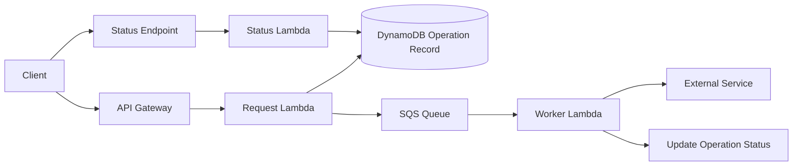
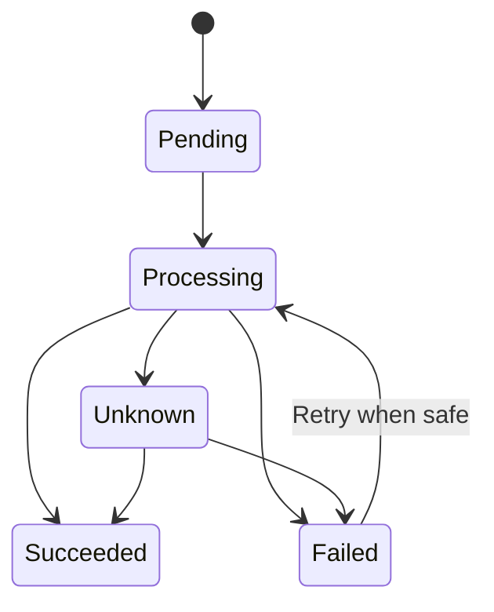
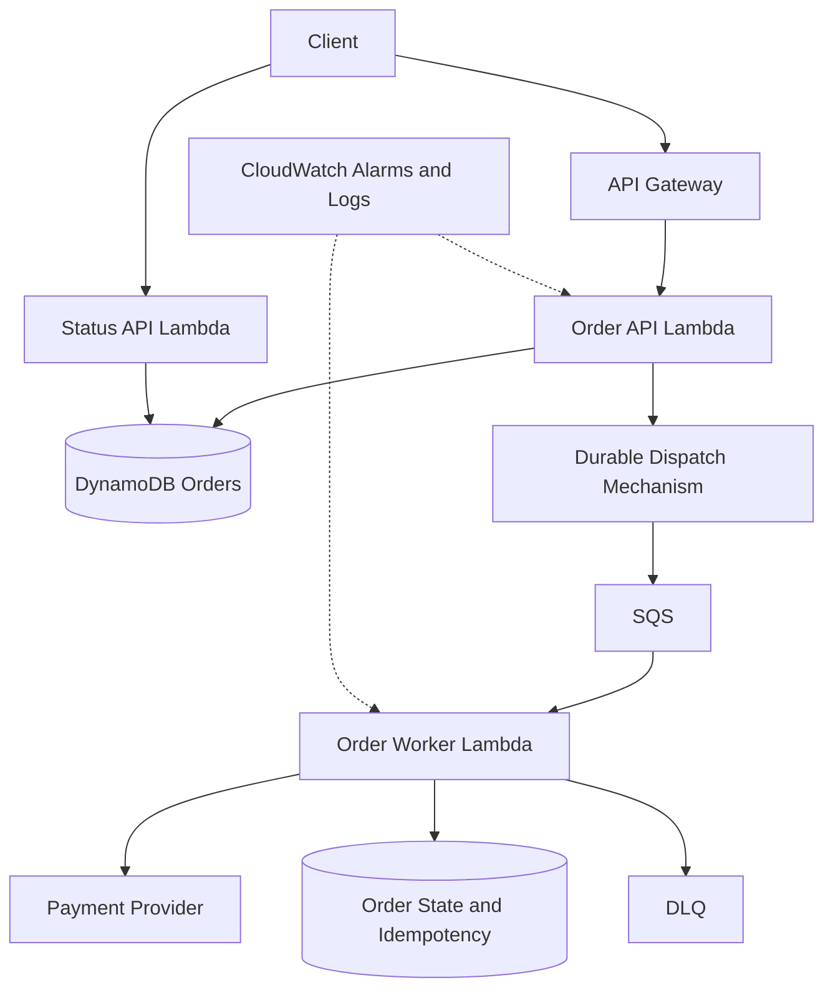

# 09- Scenario-Based Questions

## Overview

AWS Lambda scenario-based interviews assess whether an engineer can apply serverless concepts to real production constraints. Strong answers explain the failure mode, identify the relevant AWS service behavior, evaluate trade-offs, and propose a solution that is observable, secure, and operationally sustainable.

A senior engineer should reason across the complete request or event lifecycle rather than treating Lambda as an isolated function. The solution may depend on API Gateway, SQS, EventBridge, DynamoDB, PostgreSQL, IAM, VPC networking, deployment configuration, and downstream capacity.

Use this problem-solving framework during interviews:

1. **Clarify the requirement:** Determine latency objectives, throughput, ordering, durability, consistency, and failure tolerance.
2. **Identify the execution model:** Establish whether the invocation is synchronous, asynchronous, or driven by an event source mapping.
3. **Locate the bottleneck or failure:** Inspect logs, metrics, traces, permissions, networking, and downstream dependencies.
4. **Choose the smallest effective correction:** Avoid changing unrelated components or applying arbitrary configuration increases.
5. **Validate the solution:** Test success, failure, retries, duplicate events, concurrency, and recovery.
6. **Explain trade-offs:** Cover reliability, cost, security, scalability, and operational complexity.

## Invocation and Request Processing Scenarios

### Scenario: An API must return quickly, but its business workflow takes 30 seconds.

**Question:** How would you design the API if the client should receive a response within approximately one second?

**Model answer:**

Separate request acceptance from background processing. The API validates the request, persists an operation record, submits work to a durable queue, and returns an operation identifier.

A typical architecture is:



The API might return HTTP `202 Accepted` with a stable operation identifier and a status URL.

```json
{
  "operation_id": "op-7f3a91",
  "status": "accepted",
  "status_url": "/operations/op-7f3a91"
}
```

The client can poll the status endpoint or receive a notification when processing finishes.

**Engineering considerations:**

- Persist the operation before acknowledging acceptance so the system can recover from worker failures.
- Define what happens if persistence succeeds but queue submission fails. A transactional outbox or another durable dispatch strategy can prevent inconsistent state.
- Make workers idempotent because queue delivery can be repeated.
- Configure retries and a dead-letter queue.
- Set queue visibility timeout and worker concurrency according to processing duration and downstream capacity.
- Define operation expiration and cleanup policies.

**Trade-off:** This architecture adds persistence, queue management, and eventual consistency. It is appropriate when work exceeds the interactive latency budget or must survive transient failures. It is unnecessary for a small, reliably fast operation.

### Scenario: Lambda is behind API Gateway, and users experience intermittent HTTP 502 responses.

**Question:** How would you investigate the issue?

**Model answer:**

An HTTP 502 does not automatically mean that the handler returned an HTTP 502. The error may originate from a Lambda invocation failure, malformed integration response, timeout, or integration configuration.

Investigate in this order:

1. Correlate API Gateway access logs with Lambda request IDs and timestamps.
2. Check Lambda `Errors`, `Duration`, `Throttles`, and timeout-related log entries.
3. Invoke the function directly with a representative event.
4. Validate the integration response format and API Gateway integration configuration.
5. Inspect recent deployments, permissions, and dependency latency.
6. Reproduce the failure through the actual API endpoint after making a targeted correction.

For a common Lambda proxy integration, a Python handler might return:

```python
import json


def handler(event, context):
    return {
        "statusCode": 200,
        "headers": {
            "content-type": "application/json",
        },
        "body": json.dumps({"status": "ok"}),
    }
```

Direct invocation verifies handler behavior but does not reproduce the entire API Gateway integration path. Both tests are necessary.

### Scenario: A Lambda function URL is exposed for an internal service.

**Question:** What would you verify before approving the design?

**Model answer:**

Verify the function URL authentication mode, resource-based policy, intended callers, network exposure assumptions, and data sensitivity.

For an IAM-authenticated function URL, callers must sign requests using AWS Signature Version 4 and have the required permissions. An unauthenticated function URL must be treated as publicly accessible unless other controls in the architecture establish the necessary protection.

Consider:

- Whether API Gateway is required for authentication, throttling, request validation, or API management.
- Whether the URL needs to be directly accessible from external clients.
- How access is audited.
- Whether function concurrency is constrained to protect downstream services.
- Whether CORS is configured appropriately for browser clients.

A function URL is not automatically private merely because the application is described as internal.

## Event-Driven Processing Scenarios

### Scenario: An S3 upload triggers Lambda, but some files are processed twice.

**Question:** How would you prevent duplicate business operations?

**Model answer:**

Design the consumer for duplicate delivery instead of relying on every notification arriving exactly once.

A robust approach is:

1. Derive a stable identity for the processing operation.
2. Persist an idempotency record using a conditional write or equivalent atomic operation.
3. Process the object using a version-aware or otherwise stable object reference.
4. Record the outcome and make retries safe.
5. Separate input and output prefixes to prevent recursive notifications.

For example, an idempotency key may combine the bucket, object key, object version identifier when available, and processing operation version.

A simplified DynamoDB conditional write might use `attribute_not_exists` to claim an operation. However, claiming the record alone does not solve every failure: the design must handle a worker crashing after claiming the key but before completing the business operation. A state machine, lease, transactional update, or reconciliation process may be required.

**Trade-off:** Idempotency requires durable state and careful recovery logic. It is essential when duplicate processing can cause financial, data-integrity, or externally visible side effects.

### Scenario: An SQS-triggered Lambda fails on one record in a batch of ten.

**Question:** How can the other nine records avoid unnecessary retries?

**Model answer:**

Enable partial batch response handling on the event source mapping where supported. The handler should report only the message identifiers that failed.

```python
import logging

logger = logging.getLogger()
logger.setLevel(logging.INFO)


def handler(event, context):
    failures = []

    for record in event.get("Records", []):
        message_id = record["messageId"]

        try:
            process_message(record)
        except Exception:
            logger.exception(
                "Message processing failed",
                extra={"message_id": message_id},
            )
            failures.append({"itemIdentifier": message_id})

    return {"batchItemFailures": failures}


def process_message(record):
    # Implement idempotent business processing.
    raise NotImplementedError
```

The `NotImplementedError` is an explicit placeholder; replace it with the real business logic before deployment.

The event source mapping must have `ReportBatchItemFailures` configured. Without that configuration, returning the partial failure response does not provide the intended behavior.

Also distinguish transient failures from permanently invalid messages. Repeatedly retrying a malformed message wastes capacity; route unrecoverable failures to an appropriate failure-handling path.

### Scenario: A poison message repeatedly fails and delays queue processing.

**Question:** How would you isolate the problem without losing valid messages?

**Model answer:**

A poison message is a record that repeatedly fails because of invalid data, a deterministic code defect, or an unrecoverable dependency condition.

Use the following controls:

- Configure an appropriate SQS redrive policy and dead-letter queue.
- Enable partial batch responses where applicable.
- Log message identifiers and failure categories.
- Preserve enough information to replay messages safely.
- Alert on dead-letter queue depth and message age.
- Fix the root cause before redriving the messages.

Do not delete a message simply to make the queue appear healthy unless the business has explicitly approved data loss or an alternative recovery path.

### Scenario: An EventBridge rule invokes Lambda, but some events never produce the expected business outcome.

**Question:** How would you distinguish delivery problems from handler failures?

**Model answer:**

Investigate both the event delivery path and the Lambda execution path.

Check:

- Whether the rule is enabled and matches the expected event pattern.
- Whether the target configuration is correct.
- Whether the target permission allows EventBridge to invoke the function.
- Target delivery failures and configured retry or dead-letter behavior.
- Lambda invocation and error metrics.
- Application logs and the downstream persistence result.

For EventBridge, distinguish target delivery failures from errors that occur after Lambda accepts and processes an event. Configure appropriate failure handling and use durable business-state tracking when event completion matters.

Do not assume that an event appearing in EventBridge proves that its downstream business operation completed.

### Scenario: A DynamoDB Streams consumer falls behind during a traffic spike.

**Question:** What would you inspect before increasing concurrency?

**Model answer:**

Inspect stream iterator age, Lambda duration and errors, throttles, downstream latency, batch configuration, and the number of records arriving.

Potential corrections include:

- Reduce per-record processing cost.
- Use efficient batch processing.
- Correct poison-record handling.
- Review retry and failure destination configuration.
- Check downstream service capacity.
- Evaluate event source mapping parallelization settings where appropriate.

Ordering requirements matter. DynamoDB Streams preserves ordering for records from the same item, and parallelization decisions must respect the event source mapping's documented ordering guarantees.

Increasing concurrency without understanding stream semantics may create downstream overload without resolving the real bottleneck.

## Reliability, Retries, and Idempotency

### Scenario: A payment provider successfully charges a customer, but Lambda times out before recording the result.

**Question:** How would you avoid charging the customer twice?

**Model answer:**

Treat the outcome as uncertain. A timeout does not prove that the external operation failed.

Use a durable payment operation record and a stable idempotency key supported by the payment provider. On retry, query or reconcile the operation before attempting another charge.

A possible state model is:



The `Unknown` state represents an ambiguous outcome that requires reconciliation rather than a blind retry.

**Senior-level considerations:**

- Keep the idempotency key stable across retries of the same business operation.
- Persist state transitions durably.
- Distinguish a retry of an existing operation from a new customer request.
- Reconcile operations when the provider's response is lost.
- Ensure downstream side effects are also idempotent where possible.

Exactly-once business outcomes generally require application-level coordination, durable state, and idempotent external operations. Lambda invocation semantics alone do not guarantee them.

### Scenario: A Lambda function calls a slow external API and retries immediately after failure.

**Question:** Why can this create a cascading failure, and how would you improve it?

**Model answer:**

Immediate retries increase load on a dependency that may already be unhealthy. As requests accumulate, latency and concurrency increase, causing further timeouts and retries.

Improve the design by:

- Setting explicit connection and read timeouts.
- Applying bounded exponential backoff with jitter where retries are appropriate.
- Limiting total attempts and total elapsed time.
- Using a queue to decouple non-interactive work.
- Applying concurrency controls and circuit-breaking behavior in application logic where appropriate.
- Recording failed operations for controlled recovery.

Retries should be coordinated across layers. An API client, Lambda handler, SDK, and queue may each retry independently; poorly coordinated retry policies can multiply traffic unexpectedly.

### Scenario: An asynchronous Lambda function returns success to its caller, but later fails.

**Question:** Why does the caller not see the handler error?

**Model answer:**

With asynchronous invocation, the caller can receive successful acceptance of the event before the handler executes. The eventual execution result is handled separately.

Configure and monitor:

- Asynchronous invocation retry behavior.
- On-failure destinations or dead-letter queues as appropriate.
- Lambda asynchronous error and dropped-event metrics.
- Structured application logs.
- Idempotent processing and controlled replay.

Do not interpret successful event acceptance as successful business processing.

### Scenario: An application requires ordered processing of customer events.

**Question:** Would you use Lambda asynchronous invocation, SQS, or a stream?

**Model answer:**

Choose the mechanism according to the ordering boundary, throughput, and durability requirements.

| Requirement | Candidate approach | Important limitation |
|---|---|---|
| Independent background tasks | SQS with Lambda | Global ordering is not generally guaranteed by a standard queue |
| Ordered messages within a group | SQS FIFO with message groups | Throughput and ordering depend on FIFO configuration and message-group design |
| React to database changes | DynamoDB Streams with Lambda | Ordering and parallelization behavior depend on stream and mapping semantics |
| Durable multi-step workflow | Step Functions | Introduces workflow configuration and orchestration cost |
| Simple event notification | EventBridge with Lambda | Do not assume global ordering or exactly-once delivery |

For customer-specific ordering, partition or group events by customer identity when the selected service supports that model. Ensure that retries and concurrent processing do not violate business invariants.

## Concurrency, Scaling, and Performance Scenarios

### Scenario: Lambda scales rapidly and exhausts PostgreSQL connections.

**Question:** How would you redesign the system?

**Model answer:**

Lambda concurrency can grow independently of the database's connection capacity. Each execution environment may create one or more connections, so uncontrolled scaling can exhaust PostgreSQL connections.

A rough planning estimate is:

\[
\text{Potential connections}
\approx
\text{Concurrent environments}
\times
\text{Connections per environment}
\]

Use measured behavior rather than treating this as an exact prediction.

Recommended actions:

- Set reserved concurrency to a value compatible with database capacity.
- Reuse connections safely within execution environments.
- Keep connection pools small.
- Use explicit connection and query timeouts.
- Optimize queries and transaction duration.
- Consider RDS Proxy for supported RDS workloads.
- Monitor database connections and Lambda concurrency together.

**Trade-off:** Limiting concurrency can reduce peak throughput. Buffering requests through SQS may be preferable when the application can tolerate asynchronous completion.

### Scenario: A function experiences cold starts that violate the latency objective.

**Question:** Would you choose provisioned concurrency or SnapStart?

**Model answer:**

First identify whether initialization is responsible for the latency. Then choose an optimization supported by the deployed runtime and architecture.

| Consideration | Provisioned concurrency | SnapStart |
|---|---|---|
| Primary mechanism | Keeps initialized execution environments ready | Uses a published-version snapshot to reduce initialization work where supported |
| Typical use | Latency-sensitive workloads with predictable or planned traffic | Supported runtimes and workloads that benefit from snapshot-based startup |
| Capacity behavior | Configured capacity must be managed against demand | Does not mean unlimited pre-initialized capacity |
| Cost consideration | Additional provisioned-capacity charges | Feature-specific pricing and execution costs must be evaluated |
| Key concern | Capacity utilization, readiness, and alias/version targeting | Runtime compatibility, snapshot lifecycle, and initialization assumptions |

Check current AWS runtime support and feature constraints before selecting either option. Neither technique fixes slow database queries, excessive work inside the handler, or an overloaded downstream API.

### Scenario: Lambda duration rises as traffic increases, but throttles remain low.

**Question:** What does this suggest?

**Model answer:**

The function may be experiencing downstream contention, longer queueing times, database saturation, connection pool exhaustion, or inefficient application behavior.

Inspect:

- Lambda duration percentiles and concurrency.
- Database connection count, query latency, and CPU.
- External API latency and error rates.
- Connection establishment time.
- Application-level operation timings.

Increasing concurrency can make the problem worse if the bottleneck is downstream. Optimize the bottleneck first, then validate whether additional concurrency improves throughput.

### Scenario: A Lambda function performs large CSV transformations and frequently runs out of memory.

**Question:** How would you improve the implementation?

**Model answer:**

Avoid loading the complete file and all intermediate results into memory when the workload can be processed incrementally.

Consider:

- Streaming or chunked parsing.
- Processing input in bounded batches.
- Writing intermediate results to S3.
- Using SQS to distribute independent file-processing tasks.
- Increasing Lambda memory when measurement supports it.
- Moving long-running or resource-intensive workloads to a suitable container or batch service if Lambda's limits or cost model are unsuitable.

The correct design depends on file size, processing duration, required ordering, retry boundaries, and whether partial results can be safely committed.

## Security and Networking Scenarios

### Scenario: Lambda needs access to one S3 bucket but has `s3:*` on all resources.

**Question:** How would you improve the permissions?

**Model answer:**

Replace broad permissions with the minimum actions and resource ARNs needed for the workload.

For example, a read-only object-processing function might require access to a specific bucket's objects:

```json
{
  "Version": "2012-10-17",
  "Statement": [
    {
      "Effect": "Allow",
      "Action": [
        "s3:GetObject"
      ],
      "Resource": "arn:aws:s3:::example-input-bucket/incoming/*"
    }
  ]
}
```

If the function must list objects, it may also require `s3:ListBucket` on the bucket ARN, with appropriate prefix restrictions. If the objects use a customer-managed KMS key, the relevant KMS permissions and key policy must also be considered.

Verify the actual access pattern before finalizing the policy. Do not add unrelated permissions preemptively.

### Scenario: Lambda can read a secret in development but receives `AccessDeniedException` in production.

**Question:** What would you inspect?

**Model answer:**

Check:

1. The execution role associated with the production function.
2. The secret ARN and Region.
3. The `secretsmanager:GetSecretValue` permission.
4. Applicable permissions boundaries and organizational policies.
5. The secret's resource policy, if configured.
6. KMS permissions and key policy for customer-managed encryption keys.
7. Whether the application is requesting the expected secret identifier.

Separate authorization from connectivity. A function in a VPC may also require an appropriate network path to Secrets Manager.

Do not place secret values in logs while diagnosing the problem.

### Scenario: A Lambda function in private subnets cannot reach a public API.

**Question:** What is the likely issue?

**Model answer:**

Private-subnet placement does not provide Internet access automatically. Check the route tables, NAT gateway or equivalent egress path, security groups, network ACLs, and DNS configuration.

For AWS services that support interface or gateway VPC endpoints, private connectivity may avoid general Internet egress.

Do not move the function into a public subnet and assume that this gives it a public IP address. Verify the actual network path.

### Scenario: An unauthenticated function URL begins receiving unexpected traffic.

**Question:** How would you contain the issue and prevent recurrence?

**Model answer:**

First establish the scope from invocation metrics, logs, request patterns, and downstream impact. If the endpoint is not intended to be public, restrict access through the function URL's authentication mode and resource-based permissions or move it behind an appropriate authenticated integration.

Also consider:

- Reserved concurrency to limit potential damage.
- Request validation and application-level rate controls where applicable.
- Cost and error alarms.
- Credential rotation if a credential exposure is suspected.
- CloudTrail and configuration history for auditing.

A concurrency limit can protect resources, but it is not a substitute for authentication and authorization.

## Deployment and Release Scenarios

### Scenario: A new Lambda deployment causes a spike in errors.

**Question:** How would you roll back safely?

**Model answer:**

If production traffic is routed through a Lambda alias, move the alias back to a known-good published version after verifying that the previous version is compatible with the current configuration and infrastructure.

Inspect:

- The alias target and any weighted routing configuration.
- Error rates, latency, and business-level metrics.
- Recent environment variable, IAM, and networking changes.
- Database schema or message-contract changes.
- Whether the failure affects only the new version or all traffic.

A code rollback does not necessarily reverse infrastructure changes, database migrations, or external side effects. Forward-fix or compensating operations may be safer when the old version is incompatible with a changed data model.

### Scenario: A canary deployment sends 10% of traffic to a new version, but the error rate does not increase.

**Question:** Is the deployment safe to promote?

**Model answer:**

Not necessarily. A low-traffic canary may not exercise rare paths, high-volume behavior, or all customer segments.

Evaluate:

- Statistical adequacy of the sample.
- Latency percentiles and throttling.
- Business success rates.
- Downstream error rates.
- Critical customer journeys.
- Logs and alarms for version-specific failures.

Use automated deployment alarms where supported and define promotion criteria before rollout. Keep a rollback path available until the deployment has passed the agreed verification window.

### Scenario: GitHub Actions must deploy Lambda without storing long-lived AWS access keys.

**Question:** What would you recommend?

**Model answer:**

Use GitHub Actions OIDC federation with an AWS IAM role.

The trust policy should restrict the GitHub OIDC provider, audience, and permitted repository or environment subject. The deployment role should have only the permissions needed to publish and configure the intended functions.

Separate deployment permissions from the Lambda execution role. The deployment pipeline should not automatically receive the runtime permissions that the application needs.

Add automated tests, artifact integrity checks, deployment verification, smoke tests, and an explicit rollback procedure.

## Observability and Cost Scenarios

### Scenario: Lambda reports successful invocations, but customers report failed transactions.

**Question:** Why are Lambda success metrics insufficient?

**Model answer:**

Lambda's `Errors` metric indicates function execution errors, not every business failure. A handler can catch an exception, return a successful response, or accept an asynchronous operation while the actual business workflow fails later.

Instrument business outcomes explicitly:

- Orders accepted and completed.
- Payments confirmed and reconciled.
- Queue messages successfully processed.
- External API failures.
- Failed workflow transitions.
- Idempotency conflicts.

Correlate these metrics with logs, traces, and request or operation identifiers. Define alarms around customer-impacting outcomes rather than relying exclusively on runtime metrics.

### Scenario: Lambda costs increase sharply after a deployment.

**Question:** What would you investigate?

**Model answer:**

Compare the cost increase with invocation volume, duration, memory allocation, concurrency, retry activity, and any new provisioned concurrency.

Investigate:

- Unexpected event sources or recursive triggers.
- Longer processing time.
- Retry amplification.
- Excessive logging.
- Unnecessary provisioned capacity.
- Increased usage of connected services.

Use billing data and CloudWatch metrics together. Lambda compute charges are only one component of a serverless application's total cost; queues, logs, databases, network traffic, and orchestration can also contribute.

### Scenario: CloudWatch logs are too noisy and expensive.

**Question:** How would you reduce cost without losing operational visibility?

**Model answer:**

Use structured logs with meaningful fields, avoid logging complete payloads by default, reduce repetitive debug messages in production, and set retention policies appropriate to operational and compliance requirements.

Keep high-value information such as request IDs, operation IDs, failure categories, and duration measurements. Redact secrets and sensitive data before logging.

Do not reduce log volume by suppressing all errors or eliminating the evidence required for incident investigation.

## Architecture and Service Selection Scenarios

### Scenario: A backend team is deciding between Lambda and ECS/Fargate.

**Question:** How would you choose?

**Model answer:**

Compare the workload's execution pattern, runtime requirements, latency objectives, scaling behavior, and operational model.

| Dimension | Lambda | ECS/Fargate |
|---|---|---|
| Execution model | Event-driven function invocations | Containerized tasks and services |
| Scaling | Managed invocation-based scaling, subject to quotas and configuration | Task and service scaling configured for the workload |
| Execution duration | Bounded by Lambda's configured maximum timeout | Suitable for longer-running tasks and continuously running services |
| Runtime control | Managed runtime or supported Lambda container model | Greater control over the container process and operating environment |
| Operational responsibility | Less infrastructure management for function execution | More responsibility for task definitions, service configuration, and deployment operations |
| Typical fit | Event processing, APIs, scheduled jobs, bursty workloads | Persistent services, specialized runtime needs, and long-running processes |

Choose based on measured workload characteristics rather than treating either option as universally cheaper or more scalable.

### Scenario: A team uses Lambda to coordinate a workflow with six dependent steps.

**Question:** When should Step Functions replace application-managed orchestration?

**Model answer:**

Step Functions is attractive when the workflow requires durable state, branching, retries, timeouts, parallel execution, or operational visibility across multiple steps.

It makes state transitions and recovery behavior explicit and reduces the need to implement orchestration logic inside a single function.

Application-managed orchestration may be appropriate for a small, short-lived sequence with simple failure handling. Step Functions adds workflow definitions, service integration configuration, and state-transition or execution costs that must be considered.

Regardless of the orchestrator, external side effects still require idempotency and a recovery strategy.

### Scenario: A serverless API needs both immediate responses and background processing.

**Question:** Would you use direct asynchronous Lambda invocation or SQS?

**Model answer:**

Use direct asynchronous invocation when the producer needs to submit work to Lambda with relatively simple asynchronous delivery and retry behavior.

Prefer SQS when the system benefits from explicit queue buffering, backlog visibility, consumer decoupling, configurable redrive handling, or controlled worker throughput.

| Requirement | Direct asynchronous invocation | SQS with Lambda |
|---|---|---|
| Producer submits work without waiting for completion | Supported | Supported |
| Explicit queue depth and backlog management | Less direct | Strong fit |
| Consumer-side buffering and concurrency control | Limited compared with queue-based control | Strong fit |
| Dead-letter handling | Lambda asynchronous failure destinations or DLQ mechanisms, as configured | SQS redrive policy and DLQ |
| Message visibility and redelivery controls | Managed by Lambda's asynchronous invocation behavior | Queue visibility timeout and redrive configuration |

Neither option guarantees exactly-once business execution. Select based on delivery semantics, operational visibility, and the need to control processing throughput.

## Senior-Level Architecture Exercise

### Scenario: Design a production order-processing backend using Lambda.

**Requirements:**

- Accept orders through a REST API.
- Persist order state.
- Process orders asynchronously.
- Prevent duplicate order creation.
- Integrate with an external payment provider.
- Expose processing status.
- Support retries and operational recovery.
- Protect downstream dependencies and minimize unnecessary cost.

**Recommended architecture:**



The durable dispatch mechanism represents an implementation that prevents an order from being persisted without a recoverable work-submission path. Depending on the consistency requirements, this may use a transactional outbox and dispatcher or another appropriately designed coordination mechanism.

**Design decisions:**

- **API handling:** Validate the request and require an idempotency key for retryable order submission.
- **Persistence:** Store order state and enforce uniqueness using conditional writes or equivalent atomic constraints.
- **Dispatch:** Ensure that accepted orders cannot become permanently stranded between persistence and queue submission.
- **Worker processing:** Use SQS and Lambda for decoupled processing, with controlled concurrency.
- **Payments:** Use the provider's idempotency mechanism and reconcile uncertain outcomes.
- **Failures:** Configure retries, partial batch responses where appropriate, and a DLQ with an operational replay procedure.
- **Security:** Use least-privilege execution roles and store credentials in an appropriate secrets service.
- **Observability:** Track order acceptance, processing completion, payment outcomes, queue age, errors, and duplicate requests.
- **Recovery:** Define how stuck orders are identified, reconciled, and safely reprocessed.
- **Cost:** Measure invocation duration, queue usage, database capacity, log ingestion, and any provisioned concurrency.

**Follow-up questions an interviewer may ask:**

- What happens if the order is stored but queue submission fails?
- What happens if the payment succeeds but the worker times out?
- How do you handle a duplicate API request?
- How would you limit database connections during a traffic spike?
- How would you deploy a new worker version without breaking queued messages?
- How would you replay DLQ messages safely?
- What metrics determine whether the system is healthy?
- When would you choose Step Functions instead of a queue-driven workflow?

A strong answer addresses failure recovery and business consistency, not just the AWS service diagram.

## Interview Answer Evaluation Checklist

Before presenting a final design, verify that the answer addresses the relevant items:

- [ ] Invocation model and event-delivery semantics.
- [ ] Expected throughput, latency, and concurrency.
- [ ] Downstream capacity and backpressure.
- [ ] Idempotency and duplicate-event handling.
- [ ] Retry limits, dead-letter handling, and recovery.
- [ ] IAM permissions, secret management, and network access.
- [ ] Logs, metrics, traces, and business-level alarms.
- [ ] Deployment verification and rollback limitations.
- [ ] Cost implications and relevant service limits.
- [ ] Trade-offs, alternatives, and reasons for rejecting them.

Not every scenario requires every item. Prioritize the controls that directly address the stated requirements, then explain the remaining operational considerations.

## Key Takeaways

- Senior-level Lambda interviews focus on failure semantics, distributed-system behavior, and engineering trade-offs rather than service definitions alone.
- Use durable queues, explicit state, idempotency, and reconciliation to handle retries, duplicate events, and ambiguous external outcomes.
- Diagnose performance and reliability issues across Lambda, event sources, networking, IAM, and downstream dependencies before increasing resource limits.
- Design production systems with observable business outcomes, least-privilege access, controlled deployments, and tested recovery procedures.
- Choose Lambda integrations and orchestration services according to delivery guarantees, ordering requirements, workload duration, operational needs, and total cost.