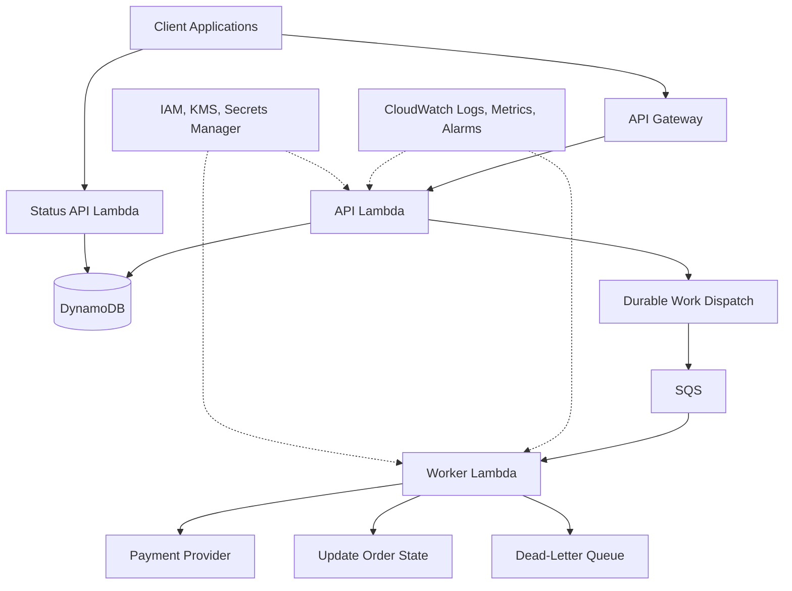
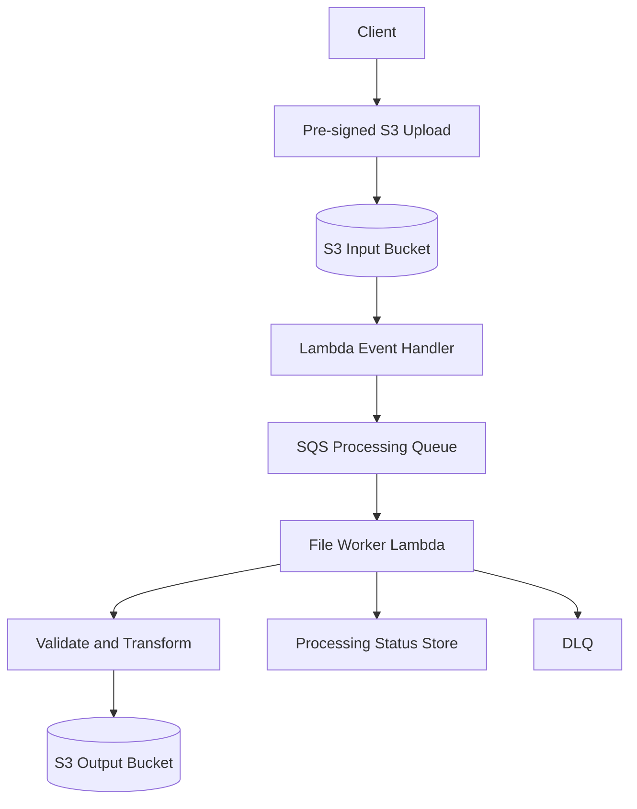
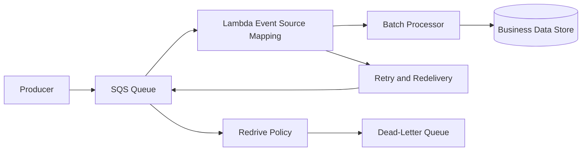
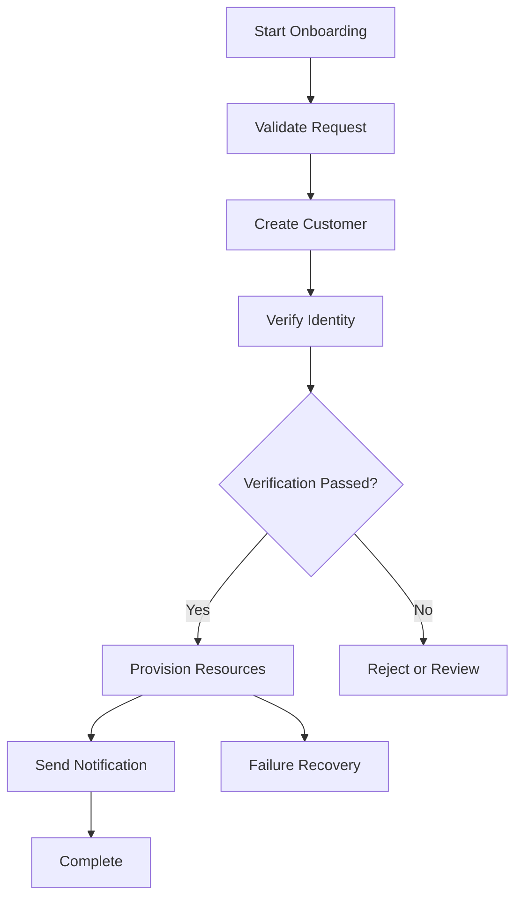
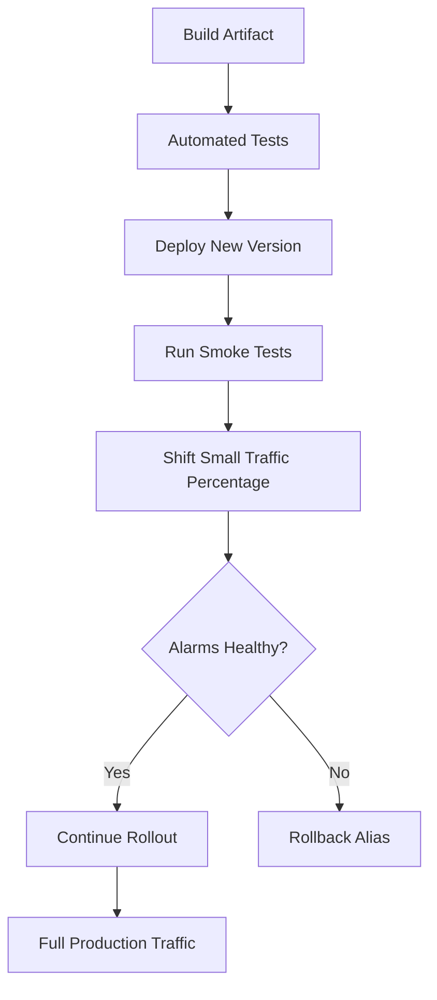

# 10- Production Architecture Scenarios

## Overview

Production AWS Lambda architectures must balance scalability, reliability, latency, security, operational complexity, and cost. Choosing Lambda is only one part of the design; the critical engineering decisions concern how requests enter the system, how work is persisted, how failures are recovered, and how downstream dependencies are protected.

A production design should explicitly define:

- **Availability:** What happens when a function, Availability Zone, database, or external dependency becomes unavailable?
- **Latency:** Which operations must complete synchronously, and which can run asynchronously?
- **Durability:** When is a request considered accepted, and where is it stored?
- **Delivery semantics:** Can events be duplicated, delayed, or processed out of order?
- **Capacity:** How much concurrency can downstream systems safely support?
- **Security:** Which identities can invoke functions, access data, and deploy code?
- **Observability:** How can operators identify failed business operations, not just failed Lambda invocations?
- **Recovery:** How are failed events replayed, uncertain outcomes reconciled, and deployments rolled back?

The following scenarios focus on architecture decisions expected from an intermediate-to-senior backend engineer.

## Reference Architecture: Serverless Backend

Consider an order-management backend that accepts HTTP requests, persists order state, performs asynchronous processing, and exposes processing status.

The durable dispatch component represents a mechanism that ensures accepted work can be recovered if queue submission fails after order persistence. Depending on the consistency requirements, this may use a transactional outbox and dispatcher or another durable coordination pattern.

The architecture separates interactive request handling from background processing. SQS provides buffering, while Lambda provides event-driven execution. DynamoDB stores durable business state, and the dead-letter queue provides an explicit path for messages that exhaust their configured processing attempts.

This architecture is not universally optimal. A simple API with a short, predictable database operation may not need a queue or separate worker. Introduce components when they solve a real reliability, scaling, or isolation requirement.

## Scenario: Design a Highly Available REST API

### Requirements

- Serve HTTP requests with low latency.
- Scale with changing traffic.
- Authenticate and authorize clients.
- Persist application data.
- Protect the database from overload.
- Support deployment rollback and production monitoring.

### Recommended architecture

Use API Gateway with Lambda and a suitable persistence layer. For a relational workload, Lambda can connect to RDS through an appropriate VPC configuration, potentially using RDS Proxy. For key-value or document-oriented access patterns, DynamoDB may simplify scaling and connection management.

### Request flow

1. The client sends an authenticated request to API Gateway.
2. API Gateway applies the configured authorization and request controls.
3. Lambda validates the request and executes the application logic.
4. The function accesses the persistence layer using least-privilege permissions and bounded connection behavior.
5. The function returns a response that matches the API contract.
6. Logs, metrics, traces, and business metrics provide operational visibility.

### Important decisions

| Decision | Considerations |
|---|---|
| API Gateway integration | REST API versus HTTP API capabilities, cost, and requirements |
| Authentication | IAM, a suitable JWT authorizer, or another supported identity integration |
| Persistence | Access patterns, consistency, transaction requirements, and operational ownership |
| Database connectivity | Connection limits, VPC configuration, query timeouts, and pooling |
| Latency optimization | Initialization overhead, dependency latency, payload size, and database query performance |
| Availability | Regional architecture, dependency redundancy, backups, and recovery objectives |

### Production considerations

- Configure explicit timeouts for database and external API calls.
- Validate inputs before performing expensive operations.
- Keep function concurrency within downstream capacity.
- Use structured logs and correlation identifiers.
- Define latency and error-rate alarms.
- Use published Lambda versions and aliases for controlled releases.
- Test API behavior through the actual gateway, not only by invoking the function directly.

### When this architecture is inappropriate

A continuously running service with specialized networking, long-lived connections, or sustained workloads may fit ECS/Fargate better. Lambda is also not a substitute for database query optimization or sound capacity planning.

## Scenario: Process Large Files Uploaded to S3

### Requirements

- Accept large file uploads.
- Validate and transform files asynchronously.
- Handle failures without losing work.
- Avoid duplicate output records.
- Support operational replay.

### Recommended architecture

For large or expensive transformations, an S3 event can initiate a workflow or queue-based processing pipeline instead of performing all work in the initial notification handler.

### Design decisions

- Use pre-signed upload URLs when clients should upload directly to S3 without receiving broad bucket permissions.
- Validate file type, size, object key, and expected metadata.
- Store processing status separately from object storage.
- Use bounded-memory parsing or chunked processing for large files.
- Use idempotency controls so repeated notifications do not duplicate business results.
- Keep input and output prefixes separate to avoid recursive event triggers.
- Configure retries and a dead-letter queue for recoverable failures.

### Important limitation

S3 event notifications can be delivered more than once and are not a global ordering guarantee. The consumer must handle duplicate and potentially out-of-order events.

If processing exceeds Lambda's execution limits or requires sustained high resource usage, evaluate AWS Batch, ECS/Fargate, or an appropriate workflow service.

## Scenario: Build an Asynchronous Order-Processing System

### Requirements

- Return quickly from the order API.
- Process orders independently of the request.
- Handle temporary downstream failures.
- Avoid duplicate side effects.
- Provide order status to clients.

### Recommended architecture

Use API Gateway, an API Lambda, durable order state, SQS, and a worker Lambda.

The API should acknowledge an order only after the application has durably recorded the accepted request and established a recoverable path for dispatching the work.

### Handling the persistence-and-dispatch gap

A common failure occurs when an order is written to a database but publishing the corresponding SQS message fails.

A transactional outbox is one solution:

1. Write the order and an outbox record in the same database transaction.
2. Use a dispatcher to publish pending outbox records.
3. Mark records as dispatched after successful publication.
4. Retry publication when necessary.
5. Make the consumer idempotent because publication can occur more than once.

The exact implementation depends on the persistence technology and its transaction capabilities. DynamoDB-based designs may use transactions and an appropriate dispatch mechanism; relational designs may use a conventional transactional outbox.

### Queue and worker configuration

Consider:

- Batch size and maximum batching window.
- Visibility timeout relative to processing duration and retry behavior.
- Redrive policy and dead-letter queue.
- Partial batch response support.
- Reserved concurrency and downstream service limits.
- Message retention and replay requirements.

Do not choose a visibility timeout or concurrency limit without considering actual processing duration, queue behavior, and downstream capacity.

## Scenario: Protect a Relational Database from Lambda Concurrency

### Problem

A Lambda function scales rapidly during a traffic spike. Each execution environment creates database connections, exhausting PostgreSQL's connection limit.

### Why this happens

Lambda concurrency and database capacity scale differently. The function can create new execution environments faster than the database can accept connections or execute queries.

A rough estimate is:

\[
\text{Potential connections}
\approx
\text{Concurrent environments}
\times
\text{Connections per environment}
\]

This estimate is useful for capacity planning, but actual connections depend on connection lifecycle, pool configuration, and workload behavior.

### Recommended controls

- Use RDS Proxy where appropriate and supported.
- Reuse connections safely within execution environments.
- Keep per-environment connection pools small.
- Configure connection, statement, and transaction timeouts.
- Optimize queries and minimize transaction duration.
- Apply reserved concurrency when necessary to protect database capacity.
- Monitor database connections, CPU, query latency, and Lambda concurrency together.

### Architecture trade-off

Reserved concurrency limits the number of simultaneous function executions but may also limit throughput. SQS can buffer work when delayed completion is acceptable.

A connection proxy can improve connection management, but it does not make inefficient queries or excessive database workload harmless.

## Scenario: Design Reliable Event Processing with SQS

### Requirements

- Process a high volume of events.
- Tolerate transient failures.
- Avoid retrying successful records unnecessarily.
- Prevent downstream overload.
- Recover permanently failing messages.

### Recommended architecture

### Design considerations

**Idempotency:** Assume that processing may be attempted more than once. Use a stable business operation identifier and durable deduplication or conditional writes.

**Partial batch responses:** Enable `ReportBatchItemFailures` when appropriate. Return only failed message identifiers so successful messages do not need to be retried unnecessarily.

**Backpressure:** Tune concurrency and batch processing according to downstream capacity rather than maximizing Lambda throughput without constraints.

**Dead-letter handling:** Define ownership, alarms, inspection procedures, and safe replay behavior for the dead-letter queue.

**Visibility timeout:** Configure it in relation to function timeout, batch processing, and retry behavior, following current AWS guidance for the integration.

**Ordering:** Use SQS FIFO and message groups when the business requires ordering within a defined group. Standard queues do not provide general strict ordering.

### Exactly-once business outcomes

SQS and Lambda do not automatically guarantee exactly-once business processing. A consumer may complete a side effect and fail before the message is acknowledged. Idempotency and durable business state are required to handle this case safely.

## Scenario: Orchestrate a Multi-Step Business Workflow

### Requirements

An onboarding workflow includes:

1. Validate customer data.
2. Create a customer record.
3. Verify identity through an external provider.
4. Provision resources.
5. Send a notification.
6. Compensate or recover when a step fails.

### Recommended architecture

Use AWS Step Functions when the workflow requires durable state, branching, retries, timeouts, parallel steps, or operational visibility across a multi-step process.

### Standard versus Express workflows

Choose the workflow type according to execution duration, invocation volume, execution semantics, and operational requirements. Standard and Express workflows have different execution models and pricing; they should not be treated as interchangeable.

Verify current service limits and integration behavior before selecting the workflow type.

### Failure recovery

- Configure retries only for errors that may succeed on another attempt.
- Use catch paths for known failure categories.
- Make individual steps idempotent.
- Define compensation for side effects that cannot be rolled back automatically.
- Store business state independently when it must remain available outside workflow execution history.
- Monitor failed executions and define an operational redrive procedure.

Step Functions does not automatically undo an external payment, email, or resource creation when a later step fails. Compensation must be designed explicitly.

## Scenario: Run Scheduled Jobs Reliably

### Requirements

- Execute a recurring business task.
- Avoid overlapping work where prohibited.
- Recover from temporary failures.
- Track missed or incomplete business runs.

### Recommended architecture

Use EventBridge Scheduler to trigger Lambda for scheduled work, with an appropriate retry policy and failure destination.

For a job that processes a daily reconciliation, persist the business run identifier and status. A scheduled trigger should start or resume the logical run rather than blindly repeating all side effects.

### Operational controls

- Use an idempotent job identifier, such as the scheduled business date.
- Define the time zone and daylight-saving behavior where relevant.
- Configure retry and failure handling.
- Record start, completion, and failure states.
- Alarm on missing or incomplete expected runs.
- Prevent concurrent runs if the workload requires exclusive execution.
- Define backfill procedures for missed periods.

EventBridge Scheduler triggering a function successfully does not prove that the scheduled business operation completed successfully.

## Scenario: Deploy Lambda Without Downtime

### Requirements

- Release code safely.
- Detect regressions quickly.
- Route traffic to a known-good version.
- Roll back without losing business consistency.

### Recommended deployment strategy

Publish immutable Lambda versions and route production traffic through an alias. Use a controlled rollout, such as a canary or linear deployment, where supported by the deployment tooling.

### Deployment controls

- Build a reproducible ZIP artifact or container image.
- Test the exact artifact intended for deployment.
- Keep deployment permissions separate from execution-role permissions.
- Use GitHub Actions OIDC federation instead of long-lived AWS access keys where practical.
- Verify runtime, architecture, environment variables, and IAM permissions.
- Run post-deployment smoke tests.
- Monitor latency, error rate, throttles, and business-level outcomes.
- Keep a rollback procedure documented and tested.

### Rollback limitations

Moving an alias back to a previous version does not reverse database migrations, external side effects, or incompatible data changes. Prefer backward-compatible changes and expand-and-contract database migration strategies when appropriate.

A successful deployment command is not evidence that production behavior is healthy.

## Scenario: Design a Multi-Account Serverless Platform

### Requirements

- Separate development, staging, and production.
- Prevent developers from accidentally modifying production resources.
- Standardize deployment and observability.
- Enforce security controls centrally.

### Recommended design

Use separate AWS accounts for meaningful environment or organizational boundaries, managed through an appropriate multi-account strategy.

Key controls include:

- Distinct deployment roles and execution roles.
- IAM trust policies restricted to intended identities and repositories.
- Environment-specific configuration and secret references.
- Centralized audit logging and security monitoring.
- Infrastructure as Code with reviewed changes.
- Account-level service quotas and cost budgets.
- Consistent naming, tagging, and resource ownership.

### Trade-offs

Multi-account separation improves isolation and governance but introduces additional IAM, deployment, and operational complexity. The account structure should follow security and ownership boundaries rather than creating accounts without a clear purpose.

## Scenario: A Regional AWS Failure Affects a Critical Serverless API

### Requirements

- Restore critical service functionality during a regional disruption.
- Protect business data.
- Define acceptable recovery time and data loss.
- Avoid unnecessary multi-Region complexity.

### Architecture options

| Strategy | Description | Trade-off |
|---|---|---|
| Backup and restore | Recreate resources and restore data after a failure | Lower ongoing complexity, but generally longer recovery |
| Pilot light | Keep critical data and minimal infrastructure ready | Faster recovery than a full rebuild, but requires coordinated activation |
| Warm standby | Maintain a reduced-capacity environment in another Region | Faster recovery with additional ongoing cost |
| Active-active | Serve traffic from multiple Regions | Potentially low recovery time, but adds data consistency, routing, and operational complexity |

### Design decisions

Define recovery time objective (RTO) and recovery point objective (RPO) before choosing a strategy.

- Use infrastructure as code to recreate the required resources.
- Define cross-Region data replication or backup procedures.
- Validate dependencies, secrets, permissions, and networking in the recovery Region.
- Plan DNS or traffic-routing changes.
- Document how in-flight asynchronous events and queued messages are recovered.
- Test failover and failback, not just resource creation.

Lambda is a regional service, and deploying functions in two Regions does not automatically create a complete multi-Region recovery solution. Databases, queues, secrets, event sources, and external integrations must also be considered.

## Scenario: Reduce Serverless Costs Without Degrading Reliability

### Problem

The application has rising Lambda costs, excessive log ingestion, and underutilized provisioned concurrency.

### Investigation

Correlate billing data with:

- Invocation count and duration.
- Memory configuration.
- Provisioned concurrency utilization.
- Retry and failure volume.
- CloudWatch Logs ingestion and retention.
- API Gateway, SQS, Step Functions, and database usage.
- Network and data-transfer costs.

### Optimization strategy

1. Remove unnecessary work and optimize expensive operations.
2. Right-size memory and timeout using measured performance.
3. Reduce duplicate processing and excessive retries.
4. Adjust provisioned concurrency to observed demand and latency objectives.
5. Apply suitable log retention and structured logging.
6. Remove unused versions, layers, triggers, and infrastructure when safe.
7. Use queue-based buffering where it improves throughput and protects downstream systems.

Avoid optimizing Lambda compute cost in isolation. A faster function may reduce duration charges but increase downstream load; fewer logs may reduce cost but impair incident response.

## Scenario: Implement Observability for a Serverless Platform

### Requirements

- Detect technical failures and business failures.
- Trace requests across services.
- Identify queue backlogs and downstream bottlenecks.
- Alert on actionable incidents.

### Observability model

| Layer | Signals | Example alarm or investigation |
|---|---|---|
| API Gateway | Request count, latency, 4xx and 5xx responses | Elevated 5xx rate |
| Lambda | Errors, duration, throttles, concurrency | Error-rate or duration regression |
| SQS | Queue depth, oldest-message age, DLQ depth | Backlog exceeds recovery objective |
| DynamoDB | Throttling, latency, consumed capacity | Capacity or access-pattern problem |
| RDS | Connections, CPU, query latency | Connection exhaustion |
| Step Functions | Failed, timed-out, and aborted executions | Workflow failure increase |
| Business layer | Orders completed, payments reconciled, jobs missed | Customer-impacting business failure |

### Logging and correlation

Use structured logs containing request IDs, operation IDs, event identifiers, and relevant business context. Do not log secrets or sensitive payloads.

For asynchronous workflows, propagate correlation identifiers explicitly. A single API request may initiate multiple queue messages and function invocations, so Lambda's individual request ID alone may not be enough to correlate the entire business operation.

Use CloudWatch metrics and alarms, distributed tracing where appropriate, and service-specific monitoring. Confirm that alarms have thresholds, owners, and response procedures.

## Scenario: Choose Between Lambda, ECS/Fargate, and Step Functions

| Requirement | Lambda | ECS/Fargate | Step Functions |
|---|---|---|---|
| Short event-driven execution | Strong fit | Possible, but may add unnecessary task-management overhead | Useful when orchestration is required |
| Continuously running service | Not generally the primary fit | Strong fit | Not a substitute for a service runtime |
| Long-running processing | Bounded by Lambda's execution limits | Suitable for many long-running container workloads | Suitable for orchestrating supported long-running workflows |
| Multi-step durable workflow | Possible with application-managed state | Possible with custom orchestration | Strong fit |
| Specialized operating-system or process control | Limited to supported Lambda execution models | Greater container-level control | Depends on integrated tasks |
| Built-in workflow state and transitions | Requires additional services or application logic | Requires additional orchestration | Core capability |

The services are not mutually exclusive. A common design uses API Gateway and Lambda for request handling, SQS for buffering, Lambda for workers, and Step Functions for a multi-step workflow.

Select the simplest architecture that satisfies the workload's correctness, reliability, latency, security, and operational requirements.

## Production Readiness Checklist

Before launching a serverless workload, verify the following:

### Reliability

- [ ] Invocation and delivery semantics are documented.
- [ ] Idempotency is implemented for retryable business operations.
- [ ] Retry policies and failure destinations are configured.
- [ ] Queue backlogs and dead-letter queues are monitored.
- [ ] Recovery and replay procedures are tested.
- [ ] Database and external dependency failures are handled safely.

### Security

- [ ] Execution roles follow least privilege.
- [ ] Invocation permissions are restricted to intended callers.
- [ ] Secrets are stored and accessed securely.
- [ ] Network paths and security groups are reviewed.
- [ ] Deployment permissions are separate from runtime permissions.
- [ ] Logs do not expose credentials or sensitive data.

### Performance and capacity

- [ ] Timeout and memory settings are measured.
- [ ] Concurrency is compatible with downstream capacity.
- [ ] Connection reuse and pooling are reviewed.
- [ ] Cold-start requirements are measured against latency objectives.
- [ ] Applicable quotas and scaling limits are understood.

### Operations and deployment

- [ ] Structured logs, metrics, traces, and business signals are available.
- [ ] Alarms have clear thresholds and owners.
- [ ] CI/CD validates and deploys reproducible artifacts.
- [ ] Smoke tests run after deployment.
- [ ] Rollback limitations are documented.
- [ ] Cost allocation, retention, backup, and recovery are defined.

## Key Takeaways

- Design Lambda architectures around explicit reliability, latency, durability, security, and recovery requirements rather than selecting services based on convenience alone.
- Use queues, idempotency, durable state, and controlled retries to protect business correctness under duplicate delivery and transient failures.
- Treat concurrency, database connections, network access, and downstream capacity as a coordinated system-design problem.
- Use published versions, aliases, automated verification, least-privilege deployment roles, and tested recovery procedures for production releases.
- Make observability and disaster recovery part of the architecture from the beginning, including business-level metrics, queue recovery, data protection, and tested failover strategies.