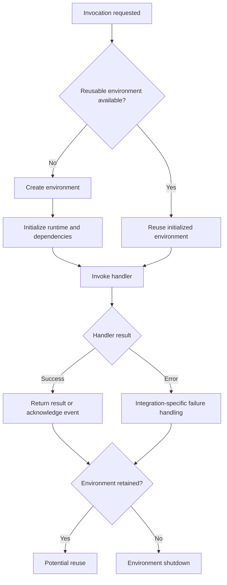
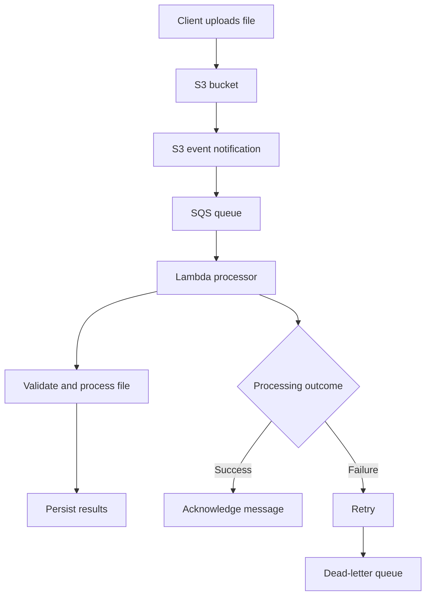
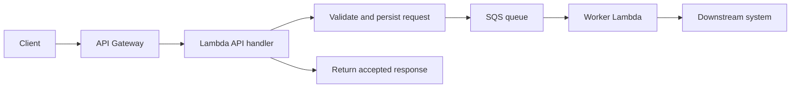

# 12- Senior-Level Questions

## Overview

Senior-level AWS Lambda interviews evaluate whether an engineer can design, deploy, secure, troubleshoot, and operate serverless systems under real production constraints. Candidates are expected to understand Lambda's execution model, distributed-system failure semantics, concurrency, networking, event processing, security boundaries, deployment strategies, and cost-performance trade-offs.

A strong answer should connect four dimensions:

- **Mechanics:** How Lambda and its integrations behave.
- **Architecture:** Why a particular design fits the workload.
- **Failure handling:** How the system behaves during retries, throttling, partial failures, and downstream outages.
- **Operations:** How the system is monitored, secured, deployed, and recovered.

This document focuses on senior-level questions with model answers, practical reasoning, follow-up questions, and architectural trade-offs. It assumes familiarity with Python, REST APIs, databases, asynchronous processing, IAM, and core AWS services.

## Lambda Execution Model and Runtime Behavior

### How would you explain the Lambda execution lifecycle?

**Model answer**

Lambda executes a handler inside a managed execution environment. The environment is initialized, invokes the handler for one or more requests over its lifetime, and may eventually be shut down.

The lifecycle can be understood in three phases:

1. **Initialization:** Lambda prepares the runtime, loads the function code and dependencies, and executes initialization code outside the handler.
2. **Invocation:** The runtime invokes the handler with the event and context. The handler processes the request and returns a result or raises an exception.
3. **Shutdown:** The environment may be retired. Cleanup behavior is not guaranteed to run as part of every shutdown, so critical business operations must not depend on shutdown hooks.



**Senior-level considerations**

- Initialization code should contain reusable setup, not request-specific business logic.
- Module-level database clients and SDK clients can reduce repeated connection and client initialization overhead.
- Global variables may persist across invocations in the same environment, but they are not shared state across all Lambda environments.
- The same environment should not be assumed to handle every invocation.
- Shutdown and cleanup are best-effort lifecycle events, not reliable transaction boundaries.

**Follow-up:** What would you place at module scope in a Python Lambda?

**Strong response:** Immutable configuration, compiled regular expressions, reusable SDK clients, connection-management components, and initialized libraries when safe. I would not store request-specific data, user identity, or correctness-critical state in mutable globals.

### Why does a Lambda cold start occur, and how would you reduce it?

**Model answer**

A cold start occurs when Lambda must prepare an execution environment before invoking the handler. The startup path can include environment allocation, runtime startup, dependency loading, framework initialization, and application initialization.

Cold-start latency depends on runtime, package size, initialization work, networking configuration, and the integration path. It is not a single fixed delay.

For a Python API using FastAPI, startup costs may include importing the application framework, loading modules, initializing SDK clients, and constructing dependency containers.

**Optimization strategy**

1. Measure initialization duration separately from handler duration.
2. Remove unnecessary dependencies and expensive imports.
3. Avoid network calls and database queries during module initialization unless they are essential.
4. Reuse clients and immutable resources safely.
5. Tune memory, because additional memory also provides additional CPU allocation.
6. Evaluate provisioned concurrency for predictable latency requirements.
7. Evaluate SnapStart only when the runtime and function configuration support it.

**Trade-offs**

| Approach | Benefit | Cost or limitation |
|---|---|---|
| Smaller deployment artifact | Less code and dependency-loading work | May require dependency restructuring |
| Lazy initialization | Avoids unnecessary startup work | Can shift latency into the first relevant request |
| Memory tuning | More CPU and potentially shorter execution | Higher configured memory cost |
| Provisioned concurrency | Keeps environments initialized and ready | Additional cost while provisioned |
| SnapStart | Reduces initialization latency for supported configurations | Runtime and feature compatibility constraints |

**Follow-up:** Would you initialize a PostgreSQL connection during cold start?

**Strong response:** It depends on the connection strategy and traffic pattern. Eager initialization can reduce first-request latency but may create unnecessary connections in environments that never reach the database. I would assess connection limits, reuse behavior, failure recovery, and whether Amazon RDS Proxy or another pooling strategy is appropriate.

### Can you guarantee that a Lambda execution environment will be reused?

No. Lambda may reuse an environment, but reuse is an optimization rather than a correctness guarantee.

A correct function must behave properly whether it receives a warm environment or a newly initialized one. Persistent globals and `/tmp` files may be useful for caches and reusable artifacts, but they must not be treated as durable, shared storage.

For example, caching a static configuration document can be reasonable. Storing the only copy of a payment-processing status in a global variable is not.

**Follow-up:** Can two invocations safely use the same mutable global object?

Only if the implementation accounts for the runtime's concurrency model and shared-state behavior. In a typical Python Lambda execution environment, invocations are not normally processed concurrently by the same execution environment, but threads, asynchronous tasks, and background work within the process can introduce races. Avoid designs that depend on undocumented or fragile lifecycle assumptions.

## Invocation Models and Delivery Semantics

### Explain synchronous invocation, asynchronous invocation, and event source mappings.

**Model answer**

These are distinct invocation mechanisms with different responsibilities for delivery, retries, acknowledgements, and failure recovery.

| Mechanism | Examples | Typical failure responsibility |
|---|---|---|
| Synchronous invocation | API Gateway, direct SDK invocation with `RequestResponse` | The caller observes the invocation result and decides how to handle it |
| Asynchronous invocation | S3 notifications, SNS, EventBridge invoking Lambda asynchronously | Lambda's asynchronous invocation system manages retries and configured destinations |
| Event source mapping | SQS, Kinesis, DynamoDB Streams | Lambda polls or reads the source and applies source-specific checkpointing, retry, and batch behavior |

An event source mapping is not the same thing as direct asynchronous invocation. It is a Lambda-managed integration that reads records from a supported source and invokes the function with batches.

**Senior-level implication:** Never choose a retry or idempotency strategy based only on the fact that the target is Lambda. Determine which component owns delivery and what constitutes successful processing.

### Does Lambda provide exactly-once execution?

Not as a universal guarantee.

Many event-driven integrations provide at-least-once delivery under their documented conditions. Duplicate events or records can occur. A successful Lambda invocation does not automatically imply that an external side effect happened exactly once.

For example, a payment event may be processed successfully, but the acknowledgement can fail or the event can be delivered again. Without idempotency, the second processing attempt may create a duplicate charge.

**Recommended pattern**

- Assign a stable business or event identifier.
- Persist an idempotency record in a durable store.
- Use a conditional write or transaction to prevent duplicate business operations.
- Define how in-progress operations and failed operations are recovered.
- Keep the idempotency record for an appropriate retention period.

```python
def process_payment(event, idempotency_store, payment_service):
    payment_id = event["payment_id"]

    if idempotency_store.is_completed(payment_id):
        return {"status": "already_processed"}

    # The real implementation must use an atomic claim or transaction.
    result = payment_service.charge(
        payment_id=payment_id,
        amount=event["amount"],
    )

    idempotency_store.mark_completed(
        payment_id=payment_id,
        result=result,
    )

    return {"status": "processed"}
```

This simplified example is not concurrency-safe by itself. Production implementations need atomic idempotency claims and a recovery strategy for failures between the external side effect and the completion record.

**Follow-up:** How can you achieve exactly-once business outcomes when an external service does not support idempotency?

You generally cannot guarantee exactly-once side effects solely through Lambda. Use reconciliation, durable operation records, compensating actions, and a protocol that handles ambiguous outcomes. If the external system supports idempotency keys, use them.

### What happens when a Lambda invocation fails?

The answer depends on the invocation mechanism.

| Invocation path | Typical behavior after failure |
|---|---|
| Synchronous request | The caller receives an error or integration-specific failure response |
| Asynchronous invocation | Lambda may retry according to its asynchronous invocation configuration |
| SQS event source mapping | Messages generally remain available for retry or become visible again until successfully processed or moved to a configured dead-letter queue |
| Kinesis or DynamoDB Streams | Checkpointing and retry behavior can cause records to be processed again and may block progress depending on configuration |
| Step Functions | Retry and catch behavior can be defined in the state machine |

A senior engineer should distinguish invocation errors, function errors, integration errors, and downstream business failures. They are not interchangeable.

**Follow-up:** Why is a dead-letter queue not a substitute for idempotency?

A dead-letter queue preserves messages that could not be processed successfully. It does not prevent duplicate successful side effects, guarantee ordering, or automatically resolve partially completed transactions.

## Concurrency, Scaling, and Performance

### How does Lambda concurrency work?

Concurrency is the number of function invocations executing at the same time.

A useful approximation for steady workloads is:

\[
\text{Concurrency} \approx \text{Request rate} \times \text{Average duration}
\]

For example, a workload receiving 120 requests per second with an average execution duration of 0.25 seconds requires approximately 30 concurrent executions under steady conditions.

This estimate is useful for capacity planning, but real workloads also depend on burstiness, duration distributions, retries, and downstream bottlenecks.

**Important distinctions**

- **Account concurrency quota:** The regional account-level capacity available to functions.
- **Reserved concurrency:** Reserves capacity for a function and caps its concurrency.
- **Provisioned concurrency:** Keeps a configured number of execution environments initialized and ready.
- **Throttling:** Occurs when an invocation cannot obtain the required concurrency or otherwise exceeds applicable limits.

Reserved concurrency can protect a database by limiting the number of simultaneous invocations. It can also throttle traffic if configured too low.

**Follow-up:** How would you protect PostgreSQL from a sudden traffic spike?

I would combine Lambda concurrency controls with database-aware connection management, query optimization, bounded retries, and load shedding where appropriate. For Amazon RDS, I would evaluate RDS Proxy and establish an explicit database connection budget. Increasing Lambda concurrency without considering the database can worsen the incident.

### How would you investigate unexpected Lambda latency?

Use a layered diagnostic approach.

1. Compare end-to-end client latency with Lambda execution duration.
2. Inspect initialization duration to identify cold-start contribution.
3. Review duration percentiles rather than only averages.
4. Inspect throttles, concurrent executions, errors, and invocation volume.
5. Examine downstream latency for databases, HTTP APIs, and other AWS services.
6. Check memory utilization and timeout configuration.
7. Use tracing to identify time spent in individual dependencies.

Useful CloudWatch metrics include `Duration`, `Errors`, `Invocations`, `Throttles`, and `ConcurrentExecutions`. `Init Duration` is commonly visible in Lambda execution logs for invocations that initialize an environment; it is not simply interchangeable with the `Duration` metric.

**Follow-up:** Why can increasing memory reduce cost?

Lambda's configured memory also influences CPU allocation. If higher memory substantially reduces execution duration, the total billed compute may remain similar or decrease. The result depends on workload behavior, memory selection, duration, and the applicable pricing model. Benchmark realistic payloads before deciding.

## Architecture and Integration Design

### When would you choose SQS over direct asynchronous Lambda invocation?

Use SQS when the workload benefits from an explicit durable queue, consumer-controlled throughput, buffering, queue-depth monitoring, or independent producer and consumer lifecycles.

Direct asynchronous invocation is useful for simpler event-driven handoffs where Lambda's asynchronous invocation model and its retry and destination settings meet the requirements.

| Requirement | SQS with Lambda | Direct asynchronous invocation |
|---|---|---|
| Explicit backlog | Yes | No application-visible SQS backlog |
| Consumer-controlled polling | Yes, through event source mapping configuration | Managed by Lambda's asynchronous invocation system |
| Backpressure | Queue absorbs bursts; consumer concurrency can be controlled | Requires careful handling of asynchronous invocation capacity and downstream load |
| Message visibility and redrive | SQS visibility timeout and redrive policy | Lambda asynchronous retry and destination configuration |
| Batch processing | Supported through event source mappings | Depends on the invocation path and event structure |

Neither option eliminates duplicate processing. Choose based on durability, backpressure, retry requirements, operational visibility, and ordering needs.

### How would you design an S3-triggered file-processing pipeline?

A production-oriented design could use S3 for durable object storage, SQS for buffering, and Lambda for bounded processing.



**Design decisions**

- Validate file size, type, ownership, and expected object key.
- Treat notifications as triggers to inspect durable S3 objects rather than as the only copy of business data.
- Use bucket versioning or immutable object identifiers when reproducibility matters.
- Make processing idempotent using bucket, key, version, and business-operation identifiers as appropriate.
- Set queue visibility timeout and Lambda timeout consistently.
- Use a dead-letter queue with a defined replay and investigation procedure.
- Bound concurrency to protect downstream databases and APIs.
- Configure S3 notification filters carefully to avoid recursive processing loops.

**Follow-up:** Why is an SQS buffer useful even when S3 can invoke Lambda directly?

It provides explicit buffering, consumer-controlled throughput, queue-depth visibility, and a separate redrive mechanism. Direct S3 notifications can be sufficient for simpler workloads, but buffering improves control over bursts and downstream capacity.

### When should you use Step Functions instead of orchestrating a workflow inside Lambda?

Use Step Functions when a workflow needs explicit state transitions, multiple service integrations, branching, parallel execution, durable waiting, retries, catches, or workflow-level observability.

Use a single Lambda for a bounded operation whose control flow is straightforward.

Avoid putting an entire long-running business workflow inside one Lambda handler. Lambda's maximum execution duration is finite, and application-managed orchestration becomes harder to inspect, resume, and recover.

| Consideration | Lambda-managed application flow | Step Functions |
|---|---|---|
| Simple bounded operation | Good fit | May add unnecessary complexity |
| Multi-step durable workflow | Requires custom state management | Explicit workflow state |
| Retry and error branches | Application code | State-machine configuration |
| Long waits or human approval | Awkward inside Lambda | Suitable for supported workflow patterns |
| Operational visibility | Depends on custom instrumentation | Workflow execution history and state-level visibility |

Step Functions introduces state-machine design, execution history, service quotas, and pricing considerations. The appropriate workflow type and integration pattern depend on duration, payload, and orchestration requirements.

## Security and IAM

### Explain the difference between a Lambda execution role and a resource-based policy.

An **execution role** defines what the function's code can do after it runs. Lambda assumes the role to obtain temporary credentials for permitted AWS API calls.

A **resource-based policy** defines who or what may invoke the function or access a supported resource.

For example:

- The execution role may allow the function to read objects from one S3 bucket.
- The Lambda resource-based policy may allow a particular S3 bucket to invoke the function.
- The role's trust policy allows the Lambda service to assume the role.

These are separate authorization decisions.

**Common failure:** Granting the execution role permission to invoke the function does not automatically grant an external AWS service permission to invoke it.

**Follow-up:** How would you troubleshoot an `AccessDeniedException`?

Identify the principal, action, resource, and request context. Then inspect the execution role, trust policy where relevant, resource-based policies, permissions boundaries, session policies, and applicable organization-level controls. Use CloudTrail and service-specific logs where available to verify the denied operation.

### How should a Lambda function access secrets?

Prefer AWS Secrets Manager or Systems Manager Parameter Store for centrally managed configuration and secrets. Grant only the required read permissions to the execution role, and consider caching secrets when rotation and freshness requirements permit it.

Environment variables are useful for non-secret configuration. Sensitive values in environment variables require careful protection, access control, and encryption configuration; they should not be treated as inherently safe merely because they are stored in Lambda configuration.

**Production considerations**

- Do not hardcode credentials in source code or deployment artifacts.
- Restrict access to function configuration and deployment APIs.
- Avoid logging secret values or complete credential-bearing request objects.
- Define rotation and cache invalidation behavior.
- Use VPC endpoints or other private connectivity where required by the security architecture.
- Separate deployment permissions from runtime permissions.

## VPC and Database Connectivity

### What changes when Lambda is attached to a VPC?

A VPC-connected Lambda function uses configured subnets and security groups for network connectivity to VPC resources. Its network configuration determines which private resources it can reach and whether it has an outbound path to external services.

Attaching a Lambda function to a public subnet does not automatically give the function a public IP address or internet access.

For outbound internet access from private subnets, a typical design uses a NAT gateway or another appropriate network path. AWS service access may instead use supported VPC endpoints.

**Troubleshooting sequence**

1. Verify the configured subnet IDs and security groups.
2. Check the route tables for the destination.
3. Check network ACLs and security group rules.
4. Verify DNS resolution and endpoint configuration.
5. Check NAT or VPC endpoint availability where applicable.
6. Confirm the database is listening on the expected port and accepts connections from the Lambda security group.
7. Check connection counts and database resource pressure.

**Follow-up:** Why can database connections become a scaling problem?

Lambda can scale the number of execution environments faster than a conventional application server usually scales its connection pool. Each environment may maintain one or more connections. A traffic spike can therefore exhaust the database's connection limit even when Lambda itself is scaling successfully.

Mitigations include RDS Proxy where appropriate, bounded concurrency, efficient connection reuse, short transactions, and database-aware capacity planning.

## Advanced Features and Trade-Offs

### When would you choose provisioned concurrency over SnapStart?

Provisioned concurrency prepares a configured number of execution environments to reduce initialization latency for incoming requests. It is useful for latency-sensitive workloads with predictable traffic or known traffic windows.

SnapStart reduces initialization latency for supported runtimes and configurations by using a snapshot-based initialization approach. Its availability and compatibility must be checked against the current AWS runtime and feature documentation.

These capabilities are not interchangeable.

| Consideration | Provisioned concurrency | SnapStart |
|---|---|---|
| Primary purpose | Keep initialized environments ready | Reduce initialization overhead using snapshots |
| Capacity behavior | Configured ready capacity | Does not itself reserve a fixed pool of ready environments |
| Cost consideration | Additional charge for provisioned capacity and normal execution | Pricing and applicability depend on the supported configuration |
| Main constraint | Capacity planning and provisioned capacity management | Runtime, initialization, and compatibility requirements |

For either approach, test startup-sensitive code, credentials, random values, connection establishment, and external-resource initialization according to the feature's documented lifecycle.

### What are Lambda layers, and when should you avoid them?

Layers package reusable dependencies or supporting files separately from the function deployment package.

They can help standardize shared libraries and reduce duplication across functions. However, layers introduce independent versioning and compatibility concerns, and they can make dependency ownership less explicit.

Avoid a layer strategy that makes production deployments depend on a large, frequently changing shared dependency bundle without clear compatibility controls.

For Python functions, ensure that compiled dependencies match the Lambda operating system and runtime environment. Build and test artifacts in a compatible environment.

### What are Lambda extensions, and what trade-offs do they introduce?

Extensions integrate monitoring, security, telemetry, or other supporting functionality into the Lambda execution environment.

They can simplify integrations, but they consume resources and may affect initialization time, execution duration, and shutdown behavior. Extensions also introduce another component to secure, configure, upgrade, and troubleshoot.

Evaluate:

- Additional latency and memory use.
- Telemetry delivery reliability and buffering.
- Network and credential requirements.
- Compatibility with runtime and deployment configuration.
- Failure behavior when the extension or external telemetry endpoint is unavailable.

Do not let nonessential telemetry delivery block business-critical processing indefinitely.

### How would you prevent recursive Lambda invocation?

A recursive invocation loop can occur when a function writes to a resource that triggers the same function again. For example, a function processing objects in an S3 bucket may write output into a key prefix that also matches its trigger.

Prevention strategies include:

- Separate input and output buckets or prefixes.
- Configure event notification filters carefully.
- Use explicit event-type and resource validation.
- Avoid triggering new events for irrelevant updates.
- Add operational alarms for unexpected invocation spikes.
- Use applicable AWS recursion detection safeguards as an additional protection, not as the primary design mechanism.

A recursion guard should be supported by architecture and monitoring rather than relied on as the sole safety mechanism.

## Troubleshooting and Production Operations

### A Lambda function is timing out intermittently. How do you diagnose it?

Use a structured diagnostic process rather than increasing the timeout immediately.

| Stage | Investigation |
|---|---|
| Symptom | Identify affected requests, event types, and time window |
| Possible causes | Slow dependencies, connection exhaustion, large payloads, inefficient code, cold starts, or network failures |
| Isolation | Compare successful and failed invocations; inspect duration percentiles |
| Diagnostics | Review logs, metrics, traces, downstream telemetry, and relevant service quotas |
| Verification | Reproduce the slow dependency or workload pattern |
| Correction | Optimize the actual bottleneck, add bounded retries, or adjust timeout and memory where justified |
| Prevention | Add alarms, load tests, capacity limits, and failure-path tests |

Increasing timeout can be appropriate if the workload legitimately needs more time, but it can also keep failing executions alive longer and worsen resource pressure.

### How would you handle partial batch failures from SQS?

For SQS event source mappings, configure partial batch responses when appropriate so the function can report individual message failures instead of forcing the entire batch to be retried.

The function must return the expected response structure, and the event source mapping must be configured to use the partial batch response feature. A malformed response or unhandled exception can cause the batch to be treated as failed.

```python
def lambda_handler(event, context):
    batch_item_failures = []

    for record in event["Records"]:
        message_id = record["messageId"]

        try:
            process_message(record)
        except Exception:
            # Log the failure without exposing sensitive message content.
            batch_item_failures.append(
                {"itemIdentifier": message_id}
            )

    return {"batchItemFailures": batch_item_failures}
```

This example illustrates the response contract. A production implementation should also emit structured failure logs and metrics, classify retryable versus permanent errors, and ensure `process_message` is idempotent.

**Follow-up:** Should every failed message be retried?

No. Retry transient failures such as temporary network errors or throttling. For permanent validation failures, consider recording the failure durably and routing the message for investigation or redrive according to the business requirements. Avoid retrying permanent failures indefinitely.

### Which metrics and alarms would you establish for a production Lambda API?

At minimum, monitor:

- Invocation volume and request patterns.
- Error rate and error count.
- Duration percentiles and timeout-related failures.
- Throttles and concurrent executions.
- Downstream service latency and failure rates.
- Queue depth and age of the oldest message for queue-based workloads.
- Asynchronous invocation failures and configured destination activity.
- Business-level indicators such as completed orders or processed files.

Use structured logs with correlation identifiers and distributed tracing where appropriate. Alarms should reflect service-level objectives and business impact rather than arbitrary thresholds alone.

## Deployment and Release Management

### How would you deploy a Lambda function safely in production?

Use immutable deployment artifacts, automated tests, least-privilege deployment permissions, published versions, and aliases to control traffic.

A typical release sequence is:

1. Build the package or container image in CI.
2. Run unit tests, static checks, dependency checks, and relevant integration tests.
3. Deploy the artifact to the target environment.
4. Validate configuration, IAM permissions, and integration connectivity.
5. Publish a version.
6. Move an alias to the new version using an appropriate release strategy.
7. Run smoke tests and monitor errors, duration, and business outcomes.
8. Roll back the alias if the new version causes unacceptable regressions.

A Lambda version is an immutable snapshot of supported function configuration and code, while an alias provides a stable reference that can point to a version. Configuration and dependency changes still require careful rollout planning.

**Follow-up:** Is alias rollback always sufficient?

No. Rollback cannot automatically reverse database migrations, external side effects, or incompatible data changes. Use backward-compatible schema evolution, idempotent operations, and explicit recovery plans.

### How would you secure GitHub Actions deployments to AWS?

Prefer GitHub Actions OpenID Connect (OIDC) federation to obtain short-lived AWS credentials instead of storing long-lived IAM access keys in repository secrets.

Configure a dedicated deployment role with a trust policy restricted to the intended repository, branch, environment, or other appropriate token claims. Limit its permissions to the deployment tasks required.

Separate deployment and runtime roles:

- The deployment role creates or updates resources.
- The Lambda execution role grants the deployed function its runtime permissions.

Protect production environments with appropriate approvals and branch protections. Do not expose credentials in logs, artifacts, or workflow output.

## Senior-Level Architecture Scenarios

### Scenario: Traffic increases tenfold and the database begins rejecting connections. What do you do?

**Model answer**

First, contain the incident. Inspect Lambda concurrency, database connection counts, query latency, and error rates. If necessary, reduce function concurrency to protect the database and prevent a cascading failure.

Then establish the connection budget:

1. Determine the database's safe connection capacity.
2. Account for non-Lambda clients and administrative connections.
3. Estimate connection demand across active Lambda environments.
4. Introduce or tune RDS Proxy where appropriate.
5. Reduce connection churn and transaction duration.
6. Apply backpressure through reserved concurrency or queue-based processing.
7. Review query performance and downstream service limits.
8. Load-test the revised design and establish alarms.

**Trade-off:** Limiting concurrency protects the database but can increase latency or backlog. Queue-based buffering can absorb bursts, but it requires explicit queue-age objectives, retry handling, and capacity planning.

### Scenario: An SQS-triggered function processes an order but fails before acknowledging the message. How do you avoid a duplicate order?

Use a durable idempotency key derived from the order or business operation. Persist the processing state atomically where possible, and use conditional writes or transactions to prevent concurrent duplicate operations.

If the side effect occurs in an external system, use its idempotency support when available. Otherwise, maintain a durable operation record and reconcile ambiguous outcomes.

The solution must handle the case where the external side effect succeeds but the local completion record is not written. A simple in-memory flag is insufficient.

### Scenario: A synchronous API must respond quickly, but downstream processing is slow.

Separate request acceptance from background processing.



The API should return a response that accurately describes the business state, such as accepted or pending, rather than claiming completion before processing finishes.

The worker should be idempotent, and the system should expose status through a durable record or status endpoint. This architecture is appropriate when clients can tolerate eventual completion; it is unsuitable when the API contract requires the downstream operation to finish before returning.

### Scenario: Your Lambda API has strict p99 latency requirements.

Start by defining the end-to-end latency objective and measuring the actual request path. Identify the contributions from initialization, network overhead, framework startup, database queries, external services, and response serialization.

Then evaluate:

- Provisioned concurrency for latency-sensitive traffic.
- SnapStart if supported by the chosen runtime and configuration.
- Memory and CPU tuning.
- Dependency and framework initialization costs.
- Connection management and database query optimization.
- Payload size and response streaming where supported by the integration.
- Load testing under realistic concurrency and burst patterns.

Do not select an optimization solely because it reduces cold starts. If database queries account for most of p99 latency, reducing initialization time may have little effect on the service-level objective.

## Interview Answering Framework

For open-ended senior-level questions, structure answers around the following sequence:

1. **Clarify requirements:** Latency, throughput, durability, ordering, consistency, security, and cost.
2. **Explain the mechanism:** Describe Lambda behavior and the relevant integration semantics.
3. **Present the design:** Identify services, data flow, permissions, and failure boundaries.
4. **Discuss failure modes:** Retries, duplicates, partial completion, throttling, and downstream outages.
5. **Explain operations:** Metrics, logs, alarms, deployment, rollback, and recovery.
6. **State trade-offs:** Explain why the design is appropriate and when an alternative is preferable.

A senior answer should make assumptions explicit, distinguish AWS guarantees from application-level guarantees, and avoid promising exactly-once processing or unlimited scaling without qualification.

## Key Takeaways

- Lambda architecture decisions must account for the invocation mechanism, delivery semantics, retries, idempotency, and downstream capacity.
- Concurrency and execution-environment reuse are capacity and performance concerns, not substitutes for durable state or correctness controls.
- Production reliability depends on least-privilege IAM, explicit network design, structured observability, bounded retries, and tested failure recovery.
- Safe deployments use immutable artifacts, versions, aliases, automated verification, and rollback plans that account for external side effects and data changes.
- Strong senior-level answers explain mechanisms, trade-offs, failure modes, and operational ownership rather than relying on feature definitions alone.