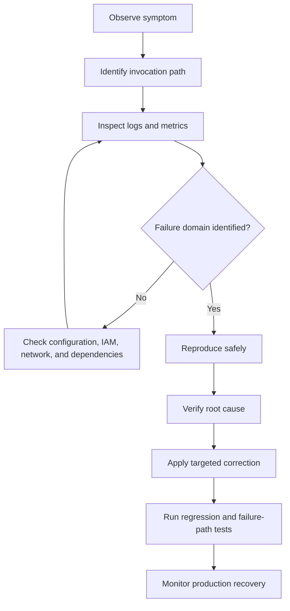

# 13- Hands-On Coding and Debugging Questions

## Overview

Hands-on AWS Lambda interviews test whether a candidate can implement handlers correctly, interpret event payloads, handle failures, write testable Python code, and diagnose production issues. Senior-level exercises also evaluate idempotency, concurrency safety, security, integration behavior, and operational readiness.

The examples in this document use Python and focus on common backend engineering scenarios:

- Implementing handlers for synchronous and asynchronous invocation.
- Validating API Gateway requests and producing correct HTTP responses.
- Processing SQS batches without unnecessarily retrying successful records.
- Building idempotent event-driven workflows.
- Integrating with DynamoDB and external services.
- Diagnosing timeouts, permissions, dependency errors, and cold starts.
- Testing handlers locally without requiring an AWS account for every test.

Examples use AWS Lambda's Python handler conventions and `pytest`. AWS SDK calls are isolated where practical so the business logic can be tested independently.

## Handler Implementation Questions

### Implement a Lambda handler that validates an incoming event

**Question**

Write a Python Lambda handler that accepts an event containing an `order_id`, validates it, and returns a structured response. Invalid requests must not cause an unhandled exception.

**Model answer**

```python
import json
import logging
from typing import Any

logger = logging.getLogger()
logger.setLevel(logging.INFO)


def lambda_handler(event: dict[str, Any], context: Any) -> dict[str, Any]:
    order_id = event.get("order_id")

    if not isinstance(order_id, str) or not order_id.strip():
        logger.warning("Invalid order request")
        return {
            "statusCode": 400,
            "body": json.dumps({
                "error": "order_id is required"
            }),
        }

    order_id = order_id.strip()

    logger.info(
        "Order request accepted",
        extra={
            "order_id": order_id,
            "aws_request_id": context.aws_request_id,
        },
    )

    return {
        "statusCode": 200,
        "body": json.dumps({
            "order_id": order_id,
            "status": "accepted",
        }),
    }
```

**Important reasoning**

- The handler validates the input before performing business operations.
- Logging includes a correlation identifier without logging the entire event.
- The response is JSON-serializable.
- The example uses an HTTP-style response for demonstration. A direct Lambda invocation does not automatically require `statusCode` or `body`; those fields depend on the caller's contract.
- A production implementation should validate the complete schema and enforce authorization where required.

**Follow-up:** What if `event` is `None` or a list?

The handler's type annotation does not validate runtime input. If callers can supply arbitrary payloads, explicitly validate the top-level event type before calling `.get()`.

### Write a handler that returns an API Gateway proxy response

**Question**

Implement a handler for an API Gateway proxy integration. It should parse a JSON request body, validate the payload, and return an appropriate HTTP response.

**Model answer**

```python
import json
import logging
from typing import Any

logger = logging.getLogger()
logger.setLevel(logging.INFO)


def response(status_code: int, body: dict[str, Any]) -> dict[str, Any]:
    return {
        "statusCode": status_code,
        "headers": {
            "Content-Type": "application/json",
        },
        "body": json.dumps(body),
    }


def lambda_handler(event: dict[str, Any], context: Any) -> dict[str, Any]:
    raw_body = event.get("body")

    if not isinstance(raw_body, str):
        return response(400, {"error": "Request body is required"})

    try:
        payload = json.loads(raw_body)
    except json.JSONDecodeError:
        return response(400, {"error": "Invalid JSON"})

    if not isinstance(payload, dict):
        return response(400, {"error": "JSON object expected"})

    name = payload.get("name")

    if not isinstance(name, str) or not name.strip():
        return response(400, {"error": "name is required"})

    return response(
        200,
        {
            "message": "Request accepted",
            "name": name.strip(),
        },
    )
```

**What interviewers expect**

- Correct parsing of the API Gateway event body.
- Handling of malformed JSON.
- Explicit response serialization.
- Appropriate HTTP status codes.
- No leakage of internal exceptions to clients.

API Gateway event formats differ between integration types and payload versions. A production handler must follow the event schema configured for its integration. If the request body can be base64-encoded, account for `isBase64Encoded` and decode it before parsing.

**Common mistake:** Returning a Python dictionary directly as `body`. For a conventional API Gateway proxy response, `body` is expected to be a string.

### Explain why code works locally but fails in Lambda

**Question**

Consider this handler:

```python
def lambda_handler(event, context):
    return process_order(event["order_id"])
```

It works with a local test event but fails in production. What would you investigate?

**Model answer**

I would investigate the differences between the local test and the real invocation contract:

1. **Event schema:** The production event may wrap the business payload inside `body`, `Records`, or another structure.
2. **Missing fields:** A required field may be absent or have a different type.
3. **Serialization:** The returned value may contain objects that cannot be serialized by the runtime or integration.
4. **Permissions:** The local environment may use developer credentials that are more privileged than the Lambda execution role.
5. **Dependencies:** A package may exist locally but be missing from the deployment artifact.
6. **Networking:** Lambda may lack connectivity to a database or external endpoint.
7. **Runtime differences:** The local Python version, operating system, or architecture may differ from the deployed runtime.
8. **Timeouts:** A local operation may complete within seconds while production traffic or dependency latency causes timeouts.

The first step is to inspect the exception, CloudWatch logs, invocation payload shape, and deployed configuration. Avoid logging sensitive event fields merely to discover the schema.

## Testing Lambda Handlers with pytest

### Write unit tests for a handler

**Question**

Test a handler that validates an order ID and returns a result without requiring AWS infrastructure.

**Model answer**

Assume the implementation is in `app.py`.

```python
# test_app.py

from types import SimpleNamespace

from app import lambda_handler


def test_valid_order():
    event = {"order_id": "order-123"}
    context = SimpleNamespace(aws_request_id="request-123")

    result = lambda_handler(event, context)

    assert result["statusCode"] == 200


def test_missing_order_id():
    event = {}
    context = SimpleNamespace(aws_request_id="request-123")

    result = lambda_handler(event, context)

    assert result["statusCode"] == 400
```

Run the tests with:

```bash
python -m pip install pytest
python -m pytest -q
```

These tests verify basic handler behavior. Additional tests should cover incorrect types, empty strings, malformed payloads, unexpected dependency failures, and serialization.

### How would you test a Lambda function that uses DynamoDB?

**Model answer**

Separate business logic from AWS SDK initialization and database operations. Inject a repository or mock the dependency so unit tests do not require a live table.

Example structure:

```python
# orders.py

def get_order(order_id: str, repository) -> dict:
    if not order_id:
        raise ValueError("order_id is required")

    order = repository.get_order(order_id)

    if order is None:
        raise LookupError("Order not found")

    return order
```

Unit tests can use a fake repository:

```python
# test_orders.py

import pytest

from orders import get_order


class FakeOrderRepository:
    def __init__(self, order=None):
        self.order = order

    def get_order(self, order_id):
        return self.order


def test_get_order_success():
    repository = FakeOrderRepository(
        {"order_id": "order-123", "status": "created"}
    )

    result = get_order("order-123", repository)

    assert result["status"] == "created"


def test_get_order_missing():
    repository = FakeOrderRepository()

    with pytest.raises(LookupError):
        get_order("order-123", repository)
```

**Testing layers**

| Test type | What it verifies |
|---|---|
| Unit test | Validation, business logic, and error classification |
| Mock-based integration test | Expected AWS SDK calls and request parameters |
| Local integration test | Application behavior against compatible local services where practical |
| AWS integration test | Real IAM permissions, service integration, and deployment configuration |
| End-to-end test | The complete request or event path across deployed components |

Mocks alone cannot verify that IAM policies, event source mappings, VPC routes, or deployed configuration are correct.

## SQS Batch Processing and Failure Handling

### Implement an SQS handler with partial batch failure reporting

**Question**

An SQS event contains multiple messages. If one message fails, do not force successful messages to be retried unnecessarily.

**Model answer**

```python
import logging

logger = logging.getLogger()
logger.setLevel(logging.INFO)


def process_message(record: dict) -> None:
    message = record["body"]

    # Perform validated, idempotent business processing here.
    if not message:
        raise ValueError("Empty message body")


def lambda_handler(event, context):
    failures = []

    for record in event.get("Records", []):
        message_id = record["messageId"]

        try:
            process_message(record)
        except Exception:
            logger.exception(
                "Message processing failed",
                extra={"message_id": message_id},
            )
            failures.append({"itemIdentifier": message_id})

    return {"batchItemFailures": failures}
```

For this response to be interpreted as partial batch failure information, the SQS event source mapping must have `ReportBatchItemFailures` enabled.

Example configuration command:

```bash
aws lambda update-event-source-mapping \
  --uuid "$EVENT_SOURCE_MAPPING_UUID" \
  --function-response-types ReportBatchItemFailures
```

The command modifies an existing event source mapping. Verify the resulting configuration:

```bash
aws lambda get-event-source-mapping \
  --uuid "$EVENT_SOURCE_MAPPING_UUID" \
  --query '{State:State,FunctionResponseTypes:FunctionResponseTypes}'
```

**Production considerations**

- Validate that the record has the expected structure before accessing its fields.
- Classify permanent failures separately from transient failures.
- Do not acknowledge a message until its business operation has completed successfully.
- Ensure the queue's visibility timeout and Lambda timeout are configured consistently.
- Configure a redrive policy and define how dead-letter messages are investigated and replayed.
- Make message processing idempotent because successful work may be repeated.

Partial batch responses do not make processing exactly once. They reduce unnecessary retries for records that have already succeeded.

### Debug this SQS implementation

**Question**

```python
def lambda_handler(event, context):
    for record in event["Records"]:
        process_message(record)

    return {"statusCode": 200}
```

Why is this unsafe for a production SQS consumer?

**Model answer**

The code has several issues:

- It does not report individual record failures.
- If an exception escapes the handler, the batch may be treated as failed and retried.
- If some messages were processed successfully before a later message failed, those successful side effects may occur again.
- The return value does not acknowledge SQS messages by itself; acknowledgement behavior is controlled by the event source mapping and the handler's successful completion.
- There is no explicit idempotency strategy.
- The example does not define a policy for permanent validation failures.

The correct implementation depends on whether the function uses whole-batch failure handling or partial batch responses. Either way, the business operation must tolerate retries.

## Idempotency and Duplicate Events

### Implement an idempotent operation with DynamoDB

**Question**

A Lambda function receives duplicate order-processing events. How can DynamoDB help prevent duplicate processing?

**Model answer**

Use a stable operation identifier and a conditional write to claim it. For a simple operation, a conditional `PutItem` can ensure only one caller creates the idempotency record.

```python
import boto3
from botocore.exceptions import ClientError

dynamodb = boto3.resource("dynamodb")
idempotency_table = dynamodb.Table("OrderIdempotency")


def claim_operation(operation_id: str) -> bool:
    try:
        idempotency_table.put_item(
            Item={
                "operation_id": operation_id,
                "status": "IN_PROGRESS",
            },
            ConditionExpression="attribute_not_exists(operation_id)",
        )
        return True
    except ClientError as exc:
        if exc.response["Error"]["Code"] == "ConditionalCheckFailedException":
            return False
        raise
```

This is only the claim step, not a complete idempotency implementation. A production design must also define:

- How the operation transitions to `COMPLETED`.
- How stale `IN_PROGRESS` records are recovered.
- How failures after the claim are retried safely.
- How duplicate callers learn the final result.
- How records expire or are cleaned up.
- How an external side effect is made idempotent.

If the business update and idempotency record can be committed together in DynamoDB, a transaction may help. An external payment or HTTP API call cannot automatically be made atomic with a DynamoDB write.

**Follow-up:** Why is a simple check-then-write sequence unsafe?

Two concurrent invocations can both observe that no record exists before either writes it. An atomic conditional operation avoids this race.

## DynamoDB Coding and Debugging

### Write a Lambda function that reads an item from DynamoDB

**Question**

Retrieve an order by its partition key and handle the case where the item does not exist.

**Model answer**

```python
import json
import os

import boto3

dynamodb = boto3.resource("dynamodb")
table = dynamodb.Table(os.environ["ORDERS_TABLE"])


def lambda_handler(event, context):
    order_id = event.get("order_id")

    if not isinstance(order_id, str) or not order_id:
        return {
            "statusCode": 400,
            "body": json.dumps({"error": "order_id is required"}),
        }

    result = table.get_item(
        Key={"order_id": order_id},
        ConsistentRead=True,
    )

    item = result.get("Item")

    if item is None:
        return {
            "statusCode": 404,
            "body": json.dumps({"error": "Order not found"}),
        }

    return {
        "statusCode": 200,
        "body": json.dumps(item),
    }
```

This example assumes `order_id` is the table's complete primary key. If the table also has a sort key, the request must provide it.

**Debugging questions**

- Does the execution role allow `dynamodb:GetItem` on the correct table?
- Is `ORDERS_TABLE` configured for the deployed environment?
- Does the key schema match the table definition?
- Is the code running in the expected AWS Region?
- Can the Lambda function reach DynamoDB under its network configuration?
- Does the item contain values that the JSON encoder cannot serialize, such as `Decimal` values returned by the DynamoDB resource interface?

For production APIs, use an explicit serialization policy for DynamoDB numeric values instead of relying on a generic JSON encoder.

### Debug an incorrect DynamoDB permission

**Question**

A function raises `AccessDeniedException` when calling `GetItem`. The same operation works from a developer laptop.

**Model answer**

The local machine and Lambda may be using different IAM principals. The function normally uses its execution role, not the developer's local credentials.

I would verify:

1. The Lambda function's configured execution role.
2. The role's trust policy and whether Lambda can assume it.
3. The identity policy granting `dynamodb:GetItem`.
4. The table ARN, account, and Region.
5. Permissions boundaries and applicable organization policies.
6. CloudTrail records for the denied request where available.

A narrowly scoped policy should target the required table:

```json
{
  "Version": "2012-10-17",
  "Statement": [
    {
      "Effect": "Allow",
      "Action": "dynamodb:GetItem",
      "Resource": "arn:aws:dynamodb:REGION:ACCOUNT_ID:table/Orders"
    }
  ]
}
```

Replace the placeholders with the actual Region and account ID. Do not solve the problem by granting `dynamodb:*` on every resource.

## HTTP API and External Service Integration

### Write a handler that calls an external HTTP API safely

**Question**

A Lambda function must call a downstream service. How should it handle timeouts and non-success responses?

**Model answer**

```python
import json
import logging
import os

import requests

logger = logging.getLogger()
logger.setLevel(logging.INFO)

SESSION = requests.Session()
DOWNSTREAM_URL = os.environ["DOWNSTREAM_URL"]
HTTP_TIMEOUT_SECONDS = 3


def lambda_handler(event, context):
    try:
        result = SESSION.post(
            DOWNSTREAM_URL,
            json={"order_id": event["order_id"]},
            timeout=HTTP_TIMEOUT_SECONDS,
        )
        result.raise_for_status()
    except requests.Timeout:
        logger.warning("Downstream request timed out")
        return {
            "statusCode": 504,
            "body": json.dumps({"error": "Downstream timeout"}),
        }
    except requests.HTTPError:
        logger.exception("Downstream returned an HTTP error")
        return {
            "statusCode": 502,
            "body": json.dumps({"error": "Downstream request failed"}),
        }
    except requests.RequestException:
        logger.exception("Downstream connection failed")
        return {
            "statusCode": 502,
            "body": json.dumps({"error": "Downstream unavailable"}),
        }

    return {
        "statusCode": 200,
        "body": json.dumps({"status": "success"}),
    }
```

This example assumes `requests` is included in the deployment package or a compatible layer.

**Production improvements**

- Set connect and read timeouts separately when needed.
- Ensure the total timeout budget fits within the Lambda timeout.
- Retry only when the operation is safe to repeat.
- Use an idempotency key for operations that may have side effects.
- Validate the downstream response schema.
- Avoid logging authorization headers or sensitive response bodies.
- Add metrics for dependency latency and failures.
- Consider circuit-breaking or queue-based decoupling when the downstream service is unreliable.

A timed-out request may have reached the downstream service and completed even if Lambda did not receive the response. Retrying without idempotency can duplicate the operation.

### Why should retries be bounded?

Retries can recover from transient failures, but excessive retries amplify load during outages. A downstream service already operating near capacity can become less available when every caller retries aggressively.

Use a bounded retry policy with exponential backoff and jitter where appropriate. Define which errors are retryable and ensure the total retry budget respects the caller's deadline.

Do not independently configure aggressive retries at every layer without considering their combined effect. Retries in an SDK, application code, event source mapping, and workflow orchestrator can multiply the number of attempts.

## Runtime, Packaging, and Initialization Debugging

### Debug `Runtime.ImportModuleError`

**Question**

Lambda reports:

```text
Runtime.ImportModuleError: Unable to import module 'app':
No module named 'requests'
```

How would you resolve it?

**Model answer**

The deployed artifact does not contain the required dependency in a location available to the runtime, or the dependency was packaged incorrectly.

For a ZIP-based deployment, a typical package layout is:

```text
deployment.zip
    app.py
    requests/
    urllib3/
    certifi/
    ...
```

Install dependencies into the package directory:

```bash
python -m pip install \
  --target package \
  -r requirements.txt

cp app.py package/
cd package
zip -r ../deployment.zip .
```

Then deploy the ZIP through the configured release process.

**Important details**

- Build using a Python version compatible with the Lambda runtime.
- Native dependencies must be compatible with the Lambda operating system and CPU architecture.
- Verify the handler setting, such as `app.lambda_handler`.
- Inspect the generated ZIP rather than assuming the build succeeded.
- Include transitive dependencies where required.
- Prefer a reproducible build process in CI.

A dependency that exists on the developer's machine is not automatically available in Lambda.

### Debug an incorrect handler configuration

**Question**

The function's code is stored in `src/handler.py`, and the function fails to locate its handler.

**Model answer**

Lambda's handler configuration identifies the module and callable, not an arbitrary source-tree path. If the deployment package contains `src/handler.py` and `src` is importable as a package, the handler might be configured as `src.handler.lambda_handler`. If the ZIP places `handler.py` at the root, the handler might instead be `handler.lambda_handler`.

Verify the actual archive layout and the configured handler. Do not change the handler string based only on the local directory structure.

### Why can a native Python dependency work locally but fail in Lambda?

Packages containing compiled extensions may depend on operating-system libraries, ABI compatibility, Python version, or CPU architecture.

For example, a binary wheel built for a Windows laptop will not generally work in a Linux-based Lambda runtime.

**Corrective actions**

- Build in a Lambda-compatible environment.
- Match the target architecture, such as `x86_64` or `arm64`.
- Verify native library dependencies.
- Test the deployed artifact in a compatible container or integration environment.
- Rebuild rather than copying local virtual-environment files into the ZIP.

## Timeout, Memory, and Performance Debugging

### Debug a function that times out after 30 seconds

**Question**

The function processes small events locally but times out in production. What should you inspect?

**Model answer**

Start with the CloudWatch log entry and determine where execution stops. A timeout may be caused by an external call, a database connection attempt, a lock, inefficient processing, or an operation that exceeds the configured timeout.

Check:

- The configured Lambda timeout.
- Log timestamps before and after expensive operations.
- Downstream request timeouts and retry counts.
- VPC routes, DNS, and security group rules.
- Database connection limits and query duration.
- Memory utilization and execution duration.
- Payload size and processing complexity.

Do not merely increase the timeout. First determine whether the workload legitimately needs more time or is blocked by a configuration error.

### How would you investigate high memory usage?

Lambda allocates memory according to the function's configured memory setting. A function can fail when memory usage exceeds the available allocation, and memory configuration also affects CPU allocation.

Inspect the logs for memory-related runtime errors and the reported maximum memory used. Then reproduce the workload with realistic payload sizes.

Common causes include:

- Loading entire files into memory.
- Keeping large objects alive unnecessarily.
- Excessive JSON serialization or deserialization.
- Memory-heavy dependencies.
- Accumulating records in a batch.
- Creating too many concurrent tasks within one invocation.

For large file-processing workloads, stream data or process it in bounded chunks rather than loading everything into a single in-memory object.

### Write a simple latency measurement around a dependency call

```python
import logging
import time

logger = logging.getLogger()
logger.setLevel(logging.INFO)


def call_dependency(client, request):
    started = time.perf_counter()

    try:
        return client.execute(request)
    finally:
        elapsed_ms = (time.perf_counter() - started) * 1000

        logger.info(
            "Dependency call completed",
            extra={"dependency_duration_ms": round(elapsed_ms, 2)},
        )
```

The `finally` block records elapsed time even when the dependency raises an exception. In a production implementation, add a bounded-cardinality dependency name and outcome field, and avoid including sensitive request data.

For distributed tracing, use an appropriate tracing integration rather than relying solely on log timestamps.

## Concurrency and Shared State

### Debug a function that occasionally returns another request's data

**Question**

A developer stores request-specific data in a global variable:

```python
current_user = None


def lambda_handler(event, context):
    global current_user
    current_user = event["user_id"]

    return process_user(current_user)
```

Is this safe?

**Model answer**

It is unsafe design because the global variable represents request-specific state and can persist across invocations. Even if ordinary Lambda execution in a given environment is sequential, mutable globals can interact with threads, asynchronous tasks, callbacks, or future implementation changes. The variable may also retain data from a previous request if it is not overwritten correctly on every path.

Prefer local variables:

```python
def lambda_handler(event, context):
    user_id = event["user_id"]
    return process_user(user_id)
```

Use module-level state only for resources that are safe to reuse, such as initialized SDK clients or immutable configuration.

### How would you prevent a Lambda concurrency spike from overwhelming a downstream service?

**Model answer**

Establish the downstream system's safe capacity first, then bound the rate at which Lambda can submit work.

Possible controls include:

- Reserved concurrency to cap function-level concurrency.
- SQS buffering for asynchronous work.
- Controlled event source mapping concurrency where supported.
- Connection pooling or RDS Proxy for database access.
- Bounded retries with backoff.
- Rate limiting and graceful degradation.
- Alarms on throttles, queue age, dependency errors, and connection counts.

A concurrency cap can protect a dependency, but it may increase latency or queue backlog. Capacity controls must therefore be paired with service-level objectives and backlog monitoring.

## AWS CLI Debugging Questions

### Find the deployed function configuration

**Question**

A function behaves differently from local code. Which commands would you use to inspect its configuration?

**Model answer**

Set the correct profile and Region before querying resources:

```bash
aws sts get-caller-identity \
  --profile dev

aws lambda get-function-configuration \
  --function-name orders-api \
  --profile dev \
  --region ap-south-1
```

Inspect relevant configuration fields:

```bash
aws lambda get-function-configuration \
  --function-name orders-api \
  --profile dev \
  --region ap-south-1 \
  --query '{
    Runtime:Runtime,
    Handler:Handler,
    Role:Role,
    Timeout:Timeout,
    MemorySize:MemorySize,
    Architectures:Architectures,
    State:State,
    LastUpdateStatus:LastUpdateStatus
  }'
```

These are read-only inspection commands. Confirm the caller identity, account, and Region before executing later modification commands.

### Retrieve recent CloudWatch logs

```bash
aws logs tail /aws/lambda/orders-api \
  --since 30m \
  --profile dev \
  --region ap-south-1
```

To follow logs as new entries arrive:

```bash
aws logs tail /aws/lambda/orders-api \
  --follow \
  --profile dev \
  --region ap-south-1
```

The execution role must have the permissions needed to create and write logs. The caller retrieving logs needs the corresponding CloudWatch Logs read permissions.

If logs are missing, verify the function's log group, execution role, Region, invocation timestamp, and whether the handler was actually invoked.

### Inspect concurrency and throttling symptoms

```bash
aws lambda get-function-concurrency \
  --function-name orders-api \
  --profile dev \
  --region ap-south-1
```

This command shows reserved concurrency when configured. An error indicating that no reserved concurrency configuration exists does not mean the function has zero available concurrency.

Use CloudWatch metrics to investigate actual concurrency and throttling over time. A configuration query alone cannot establish the cause of an incident.

## Debugging Workflow for Production Incidents

### Use a consistent diagnostic sequence



A practical incident investigation should answer:

| Question | Evidence |
|---|---|
| Was the function invoked? | Invocation metrics, API logs, source service logs |
| Did initialization fail? | Runtime initialization errors and execution logs |
| Did the handler start? | Handler-entry logs and request identifiers |
| Did a dependency fail? | Dependency latency, exceptions, traces, and service metrics |
| Was the function throttled? | Throttle metrics and concurrency configuration |
| Was the event retried? | Source-specific logs, queue metrics, and event source mapping configuration |
| Was the deployment correct? | Published version, alias target, handler setting, and artifact contents |
| Did permissions block the operation? | Execution role, resource policy, CloudTrail, and service error details |

Do not log complete request payloads indiscriminately. Production events may contain access tokens, personal data, payment details, or other sensitive fields.

## Practical Debugging Checklist

Before changing production configuration, verify the following:

- [ ] Correct AWS account, Region, function, and alias.
- [ ] Correct handler and deployment artifact layout.
- [ ] Runtime and native dependency compatibility.
- [ ] Event schema and integration payload format.
- [ ] Execution role and invocation permissions.
- [ ] Timeout, memory, ephemeral storage, and concurrency configuration.
- [ ] VPC subnets, security groups, routes, DNS, and endpoint access.
- [ ] Downstream service availability and connection limits.
- [ ] Retry semantics, idempotency, batch failure handling, and dead-letter configuration.
- [ ] CloudWatch logs, metrics, alarms, and tracing.
- [ ] Regression tests and a rollback plan before deploying a correction.

## Key Takeaways

- Lambda debugging starts by identifying the invocation mechanism and inspecting the real event, deployed configuration, logs, and dependency behavior.
- Unit tests should isolate business logic, while AWS integration tests verify IAM, networking, event source mappings, and deployment configuration.
- SQS partial batch responses reduce unnecessary retries, but idempotency is still required to protect against duplicate business side effects.
- Timeouts, concurrency spikes, and memory failures require root-cause analysis; simply increasing limits can hide the problem or increase downstream pressure.
- Production-ready Lambda code needs explicit validation, bounded dependency timeouts, least-privilege permissions, structured observability, and tested recovery paths.