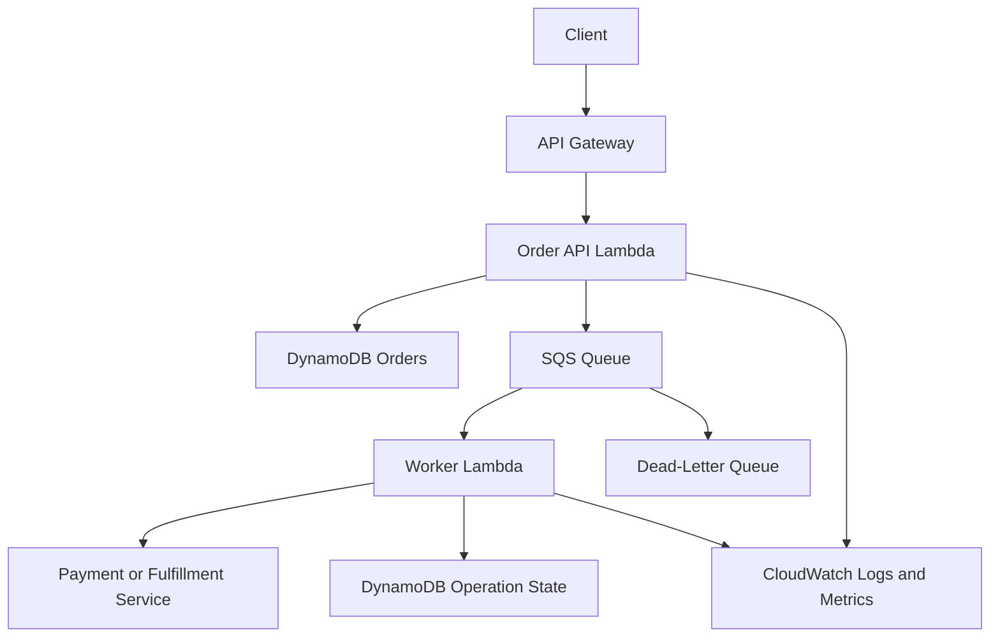
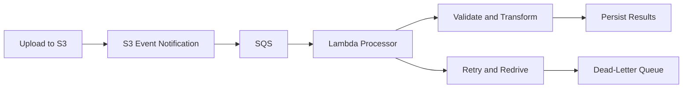

# 14- Mock Interview

## Overview

This mock interview simulates an intermediate-to-senior backend engineering interview focused on AWS Lambda. It combines conceptual questions, Python implementation exercises, production troubleshooting, system design, and architecture trade-offs.

The goal is to evaluate whether a candidate can move beyond writing a Lambda handler and design a reliable serverless backend.

The interview is divided into five rounds:

| Round | Focus | What it evaluates |
|---|---|---|
| Round A | Lambda fundamentals | Execution lifecycle, invocation models, configuration |
| Round B | Python coding | Handler implementation, testing, error handling |
| Round C | Distributed systems | Idempotency, retries, concurrency, event processing |
| Round D | Production troubleshooting | IAM, networking, performance, observability |
| Round E | System design | Architecture decisions, scalability, reliability, cost |

For each question, attempt an answer before reading the model response. Strong senior-level answers explain the mechanism, trade-offs, failure scenarios, and operational implications.

## Round A: Lambda Fundamentals

### Question A1: Explain the Lambda execution lifecycle.

**Model answer**

Lambda prepares an execution environment, initializes the runtime and function dependencies, invokes the handler, and may reuse the environment for subsequent invocations.

Initialization commonly includes importing Python modules, constructing SDK clients, and executing module-level code. The handler receives the event and context for each invocation.

Execution-environment reuse can reduce initialization overhead, but reuse is not guaranteed. Lambda functions should not depend on global variables for durable state or cross-environment coordination.

**Follow-up questions**

- What should be initialized at module scope?
- What causes a cold start?
- Can you rely on cleanup code executing during shutdown?
- How would you measure initialization latency?

**Expected senior-level points**

- Separate initialization work from request-specific processing.
- Reuse SDK clients when appropriate.
- Keep request-specific state local to the invocation.
- Measure initialization and handler duration separately.
- Never use environment shutdown as a required business transaction boundary.

### Question A2: Compare synchronous invocation, asynchronous invocation, and event source mappings.

**Model answer**

Synchronous invocation returns the function's result to the caller. API Gateway commonly uses synchronous Lambda invocation, allowing the caller to receive a response.

Asynchronous invocation accepts an event for processing without waiting for the handler's result. Lambda manages its asynchronous invocation queue and applies the configured retry and failure-handling behavior.

Event source mappings are Lambda-managed integrations that read records from sources such as SQS, Kinesis, and DynamoDB Streams. Their batching, checkpointing, acknowledgement, and retry behavior depends on the source.

| Characteristic | Synchronous | Asynchronous | Event source mapping |
|---|---|---|---|
| Caller waits for handler result | Yes | No | The source producer generally does not wait for the handler |
| Typical examples | API Gateway, SDK invocation | S3 notifications, asynchronous SDK invocation | SQS, Kinesis, DynamoDB Streams |
| Failure handling | Caller and integration contract | Lambda asynchronous invocation configuration | Source-specific retry and checkpoint behavior |
| Duplicate processing possible | Yes, if the caller retries | Yes | Yes |
| Backpressure mechanism | Caller and concurrency controls | Asynchronous invocation capacity and throttling behavior | Source backlog, batching, and concurrency controls |

**Follow-up:** Does a successful Lambda invocation guarantee that a business operation happened exactly once?

No. Invocation success, event delivery, and business-level exactly-once outcomes are different concepts. Idempotency and durable operation tracking are necessary when duplicate side effects are unacceptable.

### Question A3: Explain reserved concurrency and provisioned concurrency.

**Model answer**

Reserved concurrency reserves a portion of an account's concurrency capacity for a function and establishes a concurrency limit for that function. It can protect downstream services by limiting the number of simultaneous executions.

Provisioned concurrency prepares a configured number of execution environments so that requests can use initialized environments with reduced initialization latency.

| Requirement | Appropriate control |
|---|---|
| Prevent a function from overwhelming a database | Reserved concurrency, combined with database-aware connection management |
| Keep execution environments initialized for predictable latency | Provisioned concurrency |
| Protect a shared account concurrency pool from one workload | Appropriate reserved concurrency allocation |
| Reduce startup latency for supported configurations | Provisioned concurrency or an applicable alternative such as SnapStart |

Neither setting replaces load testing. Reserved concurrency can cause throttling if configured too low, while provisioned concurrency incurs additional charges and must be planned for expected traffic.

### Question A4: What is the difference between a Lambda execution role and a resource-based policy?

**Model answer**

The execution role determines which AWS operations the function's code can perform. Its trust policy permits the Lambda service to assume the role.

A resource-based policy on the function determines which principals can invoke it, subject to applicable authorization rules.

For example, an execution role might permit reading objects from a particular S3 bucket. A Lambda resource policy might permit that bucket to invoke the function.

Granting permission to read an S3 object does not automatically grant S3 permission to invoke Lambda.

**Follow-up:** What would you inspect after receiving `AccessDeniedException`?

- The actual principal making the request.
- The action and resource ARN.
- The execution role and its trust policy, where relevant.
- The function's resource-based policy.
- Permissions boundaries and applicable organization policies.
- CloudTrail and service-specific error details.

## Round B: Python Coding Exercises

### Question B1: Implement a robust API Gateway handler.

**Problem**

Implement a handler that:

- Accepts a JSON request body containing `order_id`.
- Returns HTTP 400 for malformed or invalid requests.
- Returns HTTP 200 for a valid request.
- Does not expose internal exceptions to the caller.

**Model answer**

```python
import json
import logging
from typing import Any

logger = logging.getLogger()
logger.setLevel(logging.INFO)


def make_response(
    status_code: int,
    body: dict[str, Any],
) -> dict[str, Any]:
    return {
        "statusCode": status_code,
        "headers": {"Content-Type": "application/json"},
        "body": json.dumps(body),
    }


def lambda_handler(event: dict[str, Any], context: Any):
    raw_body = event.get("body")

    if not isinstance(raw_body, str):
        return make_response(400, {"error": "Request body is required"})

    try:
        payload = json.loads(raw_body)
    except json.JSONDecodeError:
        return make_response(400, {"error": "Invalid JSON"})

    if not isinstance(payload, dict):
        return make_response(400, {"error": "JSON object expected"})

    order_id = payload.get("order_id")

    if not isinstance(order_id, str) or not order_id.strip():
        return make_response(400, {"error": "order_id is required"})

    logger.info(
        "Order request validated",
        extra={"aws_request_id": context.aws_request_id},
    )

    return make_response(
        200,
        {
            "order_id": order_id.strip(),
            "status": "accepted",
        },
    )
```

**Discussion**

The handler validates the payload before processing it and returns a serialized response suitable for a conventional API Gateway proxy integration.

A production API should also enforce authentication and authorization, validate the complete request schema, and define its error contract. API Gateway event formats differ by integration type and payload version, so body parsing must match the configured integration.

**Follow-up:** Would you put database queries directly inside this handler?

For a small function, that may be acceptable. For a larger service, I would separate request handling, business logic, and persistence to improve testability and maintainability.

### Question B2: Write unit tests for the handler.

**Model answer**

Assume the handler is stored in `app.py`.

```python
import json
from types import SimpleNamespace

from app import lambda_handler


def test_valid_request():
    event = {
        "body": json.dumps({"order_id": "order-123"})
    }
    context = SimpleNamespace(aws_request_id="request-123")

    result = lambda_handler(event, context)

    assert result["statusCode"] == 200
    assert json.loads(result["body"])["order_id"] == "order-123"


def test_invalid_json():
    event = {"body": "{invalid"}
    context = SimpleNamespace(aws_request_id="request-123")

    result = lambda_handler(event, context)

    assert result["statusCode"] == 400


def test_missing_order_id():
    event = {"body": json.dumps({})}
    context = SimpleNamespace(aws_request_id="request-123")

    result = lambda_handler(event, context)

    assert result["statusCode"] == 400
```

Run the tests:

```bash
python -m pip install pytest
python -m pytest -q
```

A senior engineer should also test incorrect body types, unexpected dependency errors, serialization edge cases, and authorization failures where those behaviors belong to the handler's responsibilities.

### Question B3: Implement an SQS handler that supports partial batch failures.

**Problem**

A batch contains several messages. Successfully processed messages should not be unnecessarily retried because another message failed.

**Model answer**

```python
import logging

logger = logging.getLogger()
logger.setLevel(logging.INFO)


def process_message(record: dict) -> None:
    message_body = record["body"]

    if not message_body:
        raise ValueError("Empty message body")

    # Replace with validated, idempotent business processing.
    perform_business_operation(message_body)


def lambda_handler(event, context):
    failures = []

    for record in event.get("Records", []):
        message_id = record["messageId"]

        try:
            process_message(record)
        except Exception:
            logger.exception(
                "SQS message processing failed",
                extra={"message_id": message_id},
            )
            failures.append({"itemIdentifier": message_id})

    return {"batchItemFailures": failures}
```

This example assumes `perform_business_operation` is implemented separately.

For the response to work as intended, configure the SQS event source mapping with `ReportBatchItemFailures`.

**Follow-up questions**

- What happens if the handler raises an exception outside the loop?
- Why is idempotency still required?
- How should permanent validation failures be handled?
- What happens if a successful business side effect occurs but the function fails before returning the batch response?

The central principle is that SQS processing can be repeated. Business operations must tolerate duplicates, and failure handling should distinguish retryable from permanent errors.

### Question B4: Debug this handler.

```python
def lambda_handler(event, context):
    user_id = event["user_id"]
    result = database.get_user(user_id)
    return result
```

**Expected observations**

- `event["user_id"]` raises `KeyError` if the field is missing.
- The returned database object may not be JSON-serializable.
- Database connection failures are not classified or handled.
- The handler may exceed its timeout if the query blocks.
- The execution role and network configuration may prevent database access.
- Returning a raw result may violate the caller's expected response contract.
- Request-specific state should not be stored in global variables.

A stronger implementation validates input, separates the repository from the handler, applies explicit dependency timeouts, and translates expected business errors into appropriate responses.

## Round C: Distributed Systems and Reliability

### Question C1: How do you make a Lambda operation idempotent?

**Model answer**

An idempotent operation can be repeated without producing additional unintended business effects.

For order processing, use a stable operation identifier and a durable idempotency record. Conditional writes or transactions can prevent concurrent duplicate claims.

A robust design should distinguish at least these states:

- `IN_PROGRESS`
- `COMPLETED`
- A recoverable or failed state, where applicable

It must also handle the case where an external side effect succeeds but recording completion fails.

A conditional DynamoDB write can prevent two workers from claiming the same identifier simultaneously, but the claim alone does not solve every failure scenario. Production designs need lease expiration or recovery rules for abandoned work, duplicate-result behavior, and retention policies.

**Follow-up:** Can you guarantee exactly-once payment processing using only Lambda retries?

No. Use the payment provider's idempotency mechanism if available, persist operation state, and reconcile ambiguous outcomes. Lambda retry behavior alone cannot guarantee exactly-once external side effects.

### Question C2: An SQS-triggered function processes messages slowly. The queue backlog is increasing. What do you do?

**Model answer**

I would first determine whether the backlog is caused by insufficient consumer capacity, slow downstream dependencies, repeated failures, or a traffic increase.

Investigate:

1. Approximate queue depth and age of the oldest message.
2. Lambda duration, errors, throttles, and concurrency.
3. Event source mapping batch size and concurrency configuration.
4. Downstream API or database latency and capacity.
5. Visibility timeout and redrive policy.
6. Whether messages are repeatedly failing and being received again.

If the downstream system has spare capacity, increasing consumer concurrency may help. If the database is already saturated, increasing concurrency can make the incident worse.

Possible mitigations include optimizing processing, reducing batch overhead, bounding retries, protecting downstream dependencies, and scaling consumers according to measured capacity.

**Senior-level point:** Queue depth alone is not enough. Queue age and processing throughput help determine whether the workload can meet its completion objectives.

### Question C3: A Lambda function times out while calling a payment service. Should you retry?

**Model answer**

Not blindly. A timeout means the function did not receive a response within its time budget; it does not prove that the payment service failed to process the request.

The payment might already have succeeded. Retrying without an idempotency key can create a duplicate charge.

I would use a stable operation identifier, the payment provider's idempotency support, durable operation state, and reconciliation for ambiguous outcomes. Retry only according to the provider's documented behavior and the application's deadline.

### Question C4: How would you protect a database from Lambda scaling rapidly?

**Model answer**

I would establish the database's safe connection and query capacity, then bound Lambda's demand.

Controls include:

- Reserved concurrency to cap function-level executions.
- RDS Proxy where appropriate.
- Reuse of database clients or connections when safe.
- Short transactions and efficient queries.
- Queue-based buffering for asynchronous workloads.
- Bounded retries with backoff.
- Monitoring of connection counts, query latency, errors, and Lambda concurrency.

The important distinction is that Lambda's ability to scale does not mean the database can accept an unlimited number of connections.

## Round D: Production Troubleshooting

### Question D1: The function works locally but returns `AccessDeniedException` in AWS.

**Model answer**

The function probably uses a different IAM principal in AWS than the one used locally, or the deployed role lacks the required permission.

I would:

1. Verify the function's execution role.
2. Identify the denied action and resource.
3. Inspect the relevant identity-based and resource-based policies.
4. Check permissions boundaries and organization-level restrictions.
5. Confirm account, Region, and resource ARN.
6. Inspect CloudTrail records where available.
7. Reproduce the operation using the function's intended permissions.

I would not resolve the problem by granting unrestricted administrator permissions.

### Question D2: API Gateway returns an internal server error, but Lambda logs show no handler execution.

**Model answer**

First, distinguish an API Gateway error from a Lambda handler exception.

Possible causes include:

- Incorrect Lambda integration configuration.
- Invocation permission failure.
- A mismatch between the configured integration and expected response format.
- Runtime initialization failure before the handler starts.
- A missing or incorrect deployment or alias target.
- Logs being inspected in the wrong Region, function, or time window.

Inspect API Gateway execution or access logs, Lambda invocation metrics, the function's resource policy, and the deployed integration configuration. The absence of a handler-entry log does not by itself prove that Lambda was never invoked.

### Question D3: Lambda reports a timeout when connecting to PostgreSQL.

**Model answer**

I would inspect the complete connection path:

- Lambda subnet and security group configuration.
- Database security group ingress rules.
- Route tables and network ACLs.
- DNS resolution and endpoint hostname.
- Database port and availability.
- Database connection limits.
- Credentials and TLS requirements.
- Whether the function can reach other required endpoints.

A Lambda function attached to a public subnet does not automatically receive a public IP or internet access. Private subnet routing, NAT, and VPC endpoints must be considered according to the destination.

If connection counts are the issue, evaluate connection reuse, concurrency limits, query behavior, and RDS Proxy where appropriate.

### Question D4: Cold starts cause unacceptable p99 latency.

**Model answer**

I would measure end-to-end latency and identify how much comes from initialization, framework imports, networking, and downstream calls.

Then I would:

- Remove unnecessary dependencies and expensive initialization.
- Tune memory and benchmark execution time.
- Avoid unnecessary network calls during initialization.
- Evaluate provisioned concurrency for latency-sensitive workloads.
- Evaluate SnapStart only if the runtime and configuration support it.
- Load-test with realistic traffic patterns.

I would not assume cold starts are the main cause without measurements. Slow database queries or external APIs can dominate p99 latency even when initialization is optimized.

### Question D5: Lambda invocation cost suddenly increases.

**Model answer**

I would compare invocation count, duration, configured memory, concurrency, retry volume, and downstream behavior with the previous baseline.

Investigate:

- Traffic spikes or accidental recursive invocation.
- Increased event source backlog or repeated failures.
- Longer execution duration caused by dependency latency.
- Excessive retries or duplicate event delivery.
- Unexpected deployments or configuration changes.
- Provisioned concurrency configuration and utilization.
- Additional logs, extensions, or other integration costs.

Use CloudWatch metrics and logs to isolate the time window, and use AWS cost reporting tools to identify the affected service and usage dimensions. Cost increases should be tied to actual workload and configuration changes rather than addressed only by lowering memory or timeouts.

## Round E: System Design

### Question E1: Design an order-processing backend using Lambda.

**Requirements**

- Expose an HTTP API for order submission.
- Persist order state.
- Process orders asynchronously.
- Retry transient failures.
- Prevent duplicate business operations.
- Support monitoring and failure recovery.

**Model answer**



The API validates the request and persists a durable order record. The asynchronous workflow allows the API to respond without waiting for downstream processing.

The worker uses an idempotency key and durable operation state to handle duplicate deliveries. Transient failures can be retried, while messages that repeatedly fail can be moved to a dead-letter queue according to the configured redrive policy.

**Important design details**

- Define whether the API response means accepted, created, or fully processed.
- Use conditional writes or transactions for relevant state transitions.
- Make downstream operations idempotent where possible.
- Set timeouts and concurrency limits based on downstream capacity.
- Monitor queue age, errors, duration, throttles, and business completion rate.
- Define a replay procedure for dead-letter messages.
- Protect credentials using managed secret storage and least-privilege IAM.
- Test failure scenarios, including ambiguous payment outcomes.

**Trade-offs**

SQS introduces durable buffering and operational complexity. For very simple event handoffs, direct asynchronous invocation may be sufficient. For multi-step workflows with branching, durable waiting, and explicit recovery paths, Step Functions may be a better orchestration mechanism.

### Question E2: Design an S3 file-processing pipeline.

**Model answer**



I would use S3 for durable file storage, SQS for buffering, and Lambda for bounded processing. The function should identify the object using the bucket and key, and include the object version when reproducibility requires it.

The design must address duplicate notifications, large files, partial processing, downstream capacity, poison messages, and replay. If files are too large or processing exceeds Lambda's execution limits, use a different processing architecture or split the work into bounded tasks.

**Follow-up:** How would you prevent the function from triggering itself repeatedly?

Use separate input and output buckets or carefully separated key prefixes, configure notification filters, and ensure output writes cannot recursively match the triggering rule.

### Question E3: When would you choose Lambda over ECS/Fargate?

**Model answer**

Lambda is a strong fit for event-driven, bursty, bounded workloads that benefit from managed execution and fine-grained scaling.

ECS/Fargate is often more suitable for long-running workers, persistent processes, specialized runtime requirements, or workloads requiring more control over process lifecycle and resource behavior.

| Consideration | Lambda | ECS/Fargate |
|---|---|---|
| Execution duration | Bounded by Lambda's maximum duration | Suitable for long-running tasks and services |
| Scaling | Managed invocation-based scaling | Task and service scaling |
| Operational control | Less infrastructure control | More control over containers and process lifecycle |
| Event-driven processing | Native integration with several AWS services | Requires application or service integration |
| Persistent processes | Not the normal execution model | Supported |
| Cost behavior | Depends on requests, duration, memory, and applicable features | Depends on task resources, duration, and associated infrastructure |

The decision should be based on workload characteristics, operational needs, performance objectives, and total cost rather than assuming serverless is always cheaper.

## Interview Evaluation Rubric

Use this rubric to evaluate each answer.

| Score | Performance |
|---|---|
| 1 | Recognizes basic terminology but cannot explain behavior |
| 2 | Gives a mostly correct explanation but misses important failure cases |
| 3 | Provides a working implementation or reasonable architecture |
| 4 | Explains trade-offs, security, testing, and operational concerns |
| 5 | Anticipates failure modes, defines recovery strategies, and justifies design choices using requirements |

A candidate should aim for level 4 or 5 on senior-level questions. Memorized definitions are insufficient when the interviewer asks how a design behaves during retries, partial failures, or downstream outages.

## Final Self-Assessment

Before considering preparation complete, verify that you can answer these questions without relying on memorized text:

- [ ] Explain the Lambda lifecycle and execution-environment reuse.
- [ ] Distinguish direct invocation from event source mappings.
- [ ] Implement and test an API Gateway handler.
- [ ] Process SQS batches with partial failure reporting.
- [ ] Explain idempotency and ambiguous external side effects.
- [ ] Diagnose IAM, runtime, networking, timeout, and dependency failures.
- [ ] Explain reserved concurrency, provisioned concurrency, and cold-start mitigation.
- [ ] Design a serverless backend with durable state and asynchronous processing.
- [ ] Define monitoring, alerting, rollback, and recovery procedures.
- [ ] Justify Lambda versus containers using workload requirements and trade-offs.

## Key Takeaways

- Senior Lambda interviews evaluate implementation skills alongside distributed-system correctness, security, and operational judgment.
- Reliable event processing requires explicit retry policies, idempotency, durable state, and a recovery strategy for ambiguous failures.
- Debugging should begin with the actual invocation path, deployed configuration, logs, metrics, IAM, networking, and dependency behavior.
- Architecture decisions should account for downstream capacity, workload duration, latency objectives, observability, and total operating cost.
- Strong answers explain why a design works, where it can fail, how to verify it, and how to recover safely.