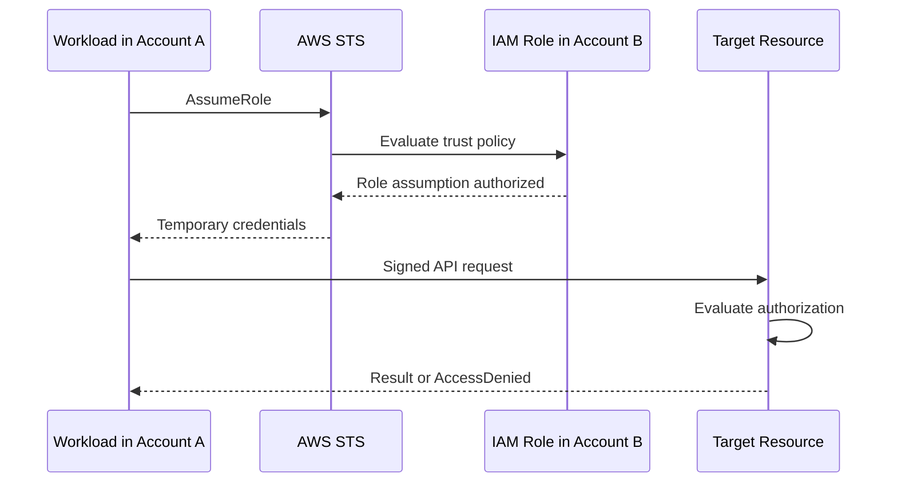
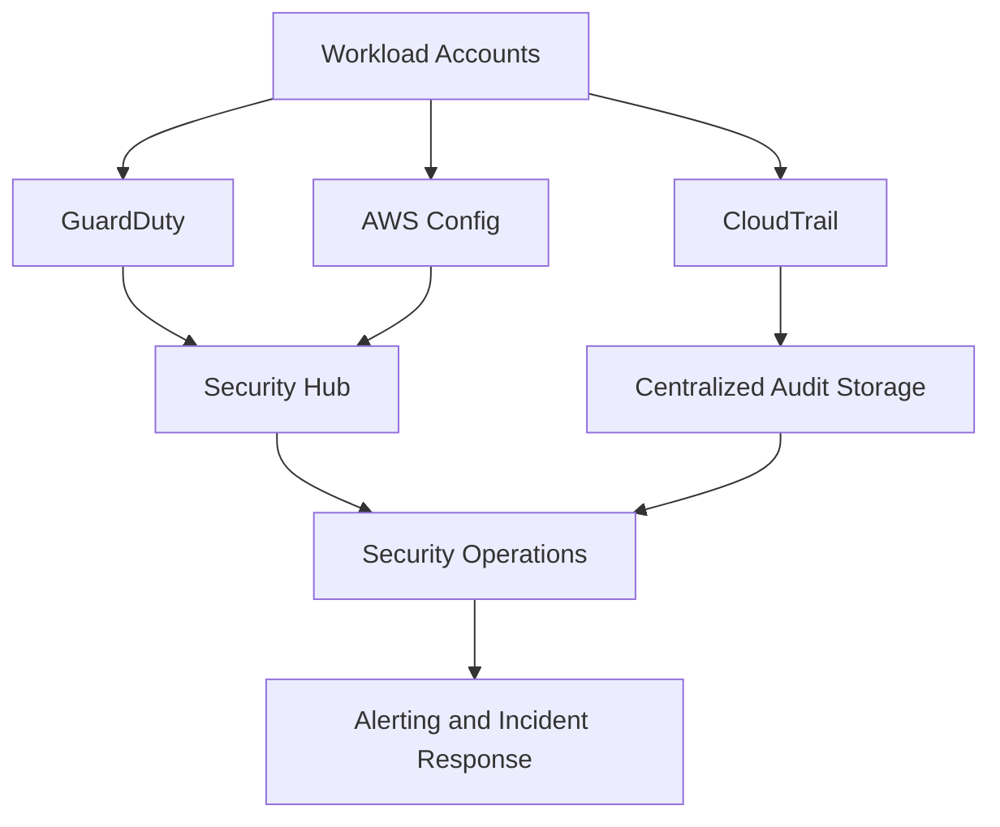
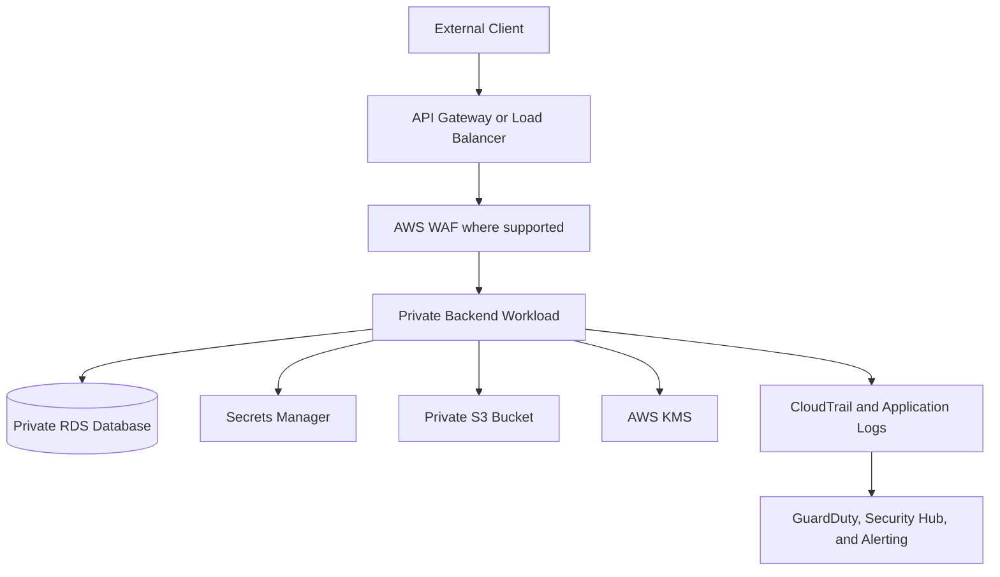

# 01- Core AWS Security Interview Questions

## Overview

AWS security interviews assess more than familiarity with individual services. Intermediate and senior backend engineers are expected to explain how identity, authorization, encryption, networking, application design, monitoring, and incident response work together to protect production workloads.

This document organizes core AWS Security interview questions into practical categories, with answers that emphasize implementation, troubleshooting, architecture decisions, and operational trade-offs.

The examples focus on backend workloads built with Python, Django, FastAPI, REST APIs, microservices, databases, containers, and CI/CD pipelines.

## Core Security Concepts

### What is the AWS Shared Responsibility Model?

The AWS Shared Responsibility Model divides security responsibilities between AWS and the customer.

- **Security of the cloud:** AWS protects the physical infrastructure, facilities, hardware, foundational networking, and managed infrastructure components.
- **Security in the cloud:** Customers configure identities, permissions, data protection, network access, application security, and workload-specific controls according to the AWS service they use.

The responsibility boundary varies by service.

| Area | AWS responsibility | Customer responsibility |
|---|---|---|
| Physical data centers | Physical access and facility security | Not directly managed by the customer |
| EC2 | Underlying infrastructure and virtualization | Guest OS, application, IAM permissions, security groups, data |
| Lambda | Managed execution infrastructure | Function code, execution role, dependencies, data access |
| RDS | Managed database infrastructure and service operations | Database access configuration, data classification, IAM integration where supported, encryption choices, network access |
| S3 | Storage infrastructure | Bucket policies, access controls, data classification, encryption configuration, retention settings |
| IAM | IAM service infrastructure | Identity lifecycle, policies, trust relationships, access reviews |

**Interview scenario:** A Django application runs on EC2 and stores customer records in PostgreSQL on RDS. Who patches the operating system?

The customer is responsible for patching the EC2 guest operating system. AWS manages the underlying infrastructure. For RDS, AWS manages the underlying host and managed database infrastructure, while the customer remains responsible for database access, application security, data protection, and applicable database configuration.

### What is defense in depth?

Defense in depth uses multiple independent or complementary controls so that failure of one control does not automatically compromise the system.

For a public FastAPI service, controls might include:

- IAM roles and least-privilege permissions.
- Private subnets for application workloads and databases where appropriate.
- Security groups restricting network paths.
- TLS for data in transit.
- AWS WAF rules for supported application-layer filtering.
- Application-level authentication and authorization.
- KMS-backed encryption at rest.
- CloudTrail, GuardDuty, and Security Hub for auditing and detection.
- Tested incident response procedures.

No single control replaces the others. A security group does not validate a user's application permissions, and a valid IAM identity does not make an HTTP request safe.

### What is the principle of least privilege?

Least privilege means granting an identity only the permissions required for its intended tasks, for the necessary resources, under the necessary conditions.

For example, a Lambda function that reads customer documents from one S3 bucket should not receive unrestricted access to all S3 buckets.

A narrowly scoped policy could be:

```json
{
  "Version": "2012-10-17",
  "Statement": [
    {
      "Sid": "ReadCustomerDocuments",
      "Effect": "Allow",
      "Action": [
        "s3:GetObject"
      ],
      "Resource": "arn:aws:s3:::example-customer-documents-prod/*"
    }
  ]
}
```

This policy grants object-read permission for the specified bucket's objects. It does not grant `s3:ListBucket`, write access, or access to other buckets. Add only the additional permissions the workload demonstrably needs.

Production considerations include:

- Separate roles for workloads with different responsibilities.
- Restrict access by resource ARN and supported conditions.
- Review permissions using observed access patterns and policy analysis.
- Avoid wildcard actions and resources unless justified.
- Validate both IAM permissions and resource policies.

### What is zero-trust security in AWS?

Zero trust means that network location alone is not sufficient to establish trust. Access should be authenticated, authorized, scoped, and evaluated according to applicable context and policy.

A service running inside a private subnet is not automatically trusted to access every internal API or database.

A practical design uses:

- Short-lived workload credentials.
- Explicit IAM permissions.
- Application-level authorization.
- Network restrictions.
- TLS where supported and appropriate.
- Auditing and continuous verification.

Zero trust is an architectural approach, not a single AWS service or configuration switch.

### What is threat modeling, and how would you apply it to a backend API?

Threat modeling systematically identifies assets, trust boundaries, threats, and mitigations before or during system design.

For a payment API:

1. Identify assets such as payment data, API credentials, and signing keys.
2. Identify entry points such as API Gateway, public endpoints, webhooks, and administrative interfaces.
3. Map trust boundaries between clients, API Gateway, application workloads, databases, and third-party services.
4. Consider threats such as credential theft, privilege escalation, replay, injection, unauthorized data access, and denial of service.
5. Select mitigations and verify them through tests, monitoring, and security reviews.

Useful approaches include STRIDE and attack-tree analysis. The objective is to turn potential threats into explicit engineering requirements rather than merely produce a diagram.

## IAM and Authorization

### What is AWS IAM?

AWS Identity and Access Management (IAM) controls authentication-related identity management and authorization decisions for AWS resources.

Core IAM components include:

| Component | Purpose |
|---|---|
| User | Long-term identity, often associated with human or legacy access |
| Group | Organizes IAM users and attaches identity-based policies |
| Role | Defines permissions that an authorized principal can assume |
| Policy | Specifies permissions through statements |
| Principal | Identity making a request |
| Resource | AWS object or service being accessed |
| Trust policy | Controls which principals may assume a role |
| Permission boundary | Limits the maximum permissions an IAM identity-based policy can grant |
| Service control policy (SCP) | Defines maximum available permissions for affected principals in an AWS Organizations account or organizational unit |
| Session policy | Restricts permissions for a role session when supplied and supported by the relevant role-assumption workflow |

IAM is not a replacement for application-level authorization. An API still needs to determine whether an authenticated user may access a particular customer record.

### What is the difference between an IAM user and an IAM role?

| IAM user | IAM role |
|---|---|
| Represents an IAM identity with long-term credentials when configured | Defines permissions for temporary sessions |
| May have console credentials or access keys | Is assumed by an authorized principal |
| Credentials require lifecycle management and rotation | Session credentials expire |
| Often unsuitable for new workload authentication patterns | Preferred for AWS workloads and cross-account access |

For an EC2-hosted Django application, use an instance profile associated with an IAM role rather than embedding access keys in environment variables or source code.

For a Lambda function, configure an execution role containing only the permissions required by the function.

### What is an IAM policy?

An IAM policy is a JSON document that describes permissions.

A policy statement commonly contains:

- `Effect`: `Allow` or `Deny`.
- `Action`: The API operations affected.
- `Resource`: The resource ARNs affected.
- `Condition`: Additional conditions on the request.
- `Principal`: The identity to which a resource-based policy grants or denies access, where applicable.

Example:

```json
{
  "Version": "2012-10-17",
  "Statement": [
    {
      "Sid": "ReadOneConfigurationParameter",
      "Effect": "Allow",
      "Action": "ssm:GetParameter",
      "Resource": "arn:aws:ssm:ap-south-1:123456789012:parameter/prod/payments/config"
    }
  ]
}
```

This grants permission to retrieve the specified Systems Manager parameter, subject to other applicable authorization requirements. Retrieving a `SecureString` encrypted with a customer-managed KMS key can also require appropriate KMS permissions.

### What is the difference between identity-based and resource-based policies?

| Identity-based policy | Resource-based policy |
|---|---|
| Attached to an IAM user, group, or role | Attached to a supported resource |
| Describes what the identity may do | Describes which principals may access the resource and under what conditions |
| Does not contain a `Principal` element | Commonly contains a `Principal` element |
| Examples include role policies | Examples include S3 bucket policies and supported KMS key policies |

Cross-account access often requires careful coordination between the caller's permissions and the target resource's policy or role trust relationship. The precise authorization requirements depend on the service and access path.

### What is the difference between a role trust policy and a permissions policy?

A role has two distinct policy concerns:

- **Trust policy:** Who is allowed to assume the role?
- **Permissions policy:** What can the role do after it is assumed?

Example trust policy for an EC2 service role:

```json
{
  "Version": "2012-10-17",
  "Statement": [
    {
      "Effect": "Allow",
      "Principal": {
        "Service": "ec2.amazonaws.com"
      },
      "Action": "sts:AssumeRole"
    }
  ]
}
```

This allows the EC2 service principal to assume the role under the role's trust configuration. The role still needs appropriate permissions for S3, SSM, or other resources.

A trust policy granting assumption does not automatically grant application access to those resources.

### How does IAM policy evaluation work?

IAM authorization depends on the request context and the applicable policy types.

Important principles include:

- Requests are denied by default when no applicable policy grants permission.
- An applicable explicit deny overrides an allow.
- Identity-based and resource-based policies can interact, depending on the principal, resource, and access path.
- Permissions boundaries and session policies restrict permissions that would otherwise be available through applicable identity policies.
- SCPs restrict the maximum permissions available to affected principals in member accounts; they do not grant permissions.
- Resource policies and service-specific authorization rules can affect the final result.

A useful troubleshooting sequence is:

1. Confirm the caller identity and account.
2. Identify the exact API action and resource ARN.
3. Check identity-based policies.
4. Check resource policies and role trust policies where applicable.
5. Check permissions boundaries, session policies, SCPs, and explicit denies.
6. Check conditions, resource ownership, service-specific requirements, and KMS permissions.
7. Verify the correction using the original operation.

Do not assume every access denial can be resolved by attaching an allow policy to the caller.

### What is the difference between an SCP and a permissions boundary?

An SCP applies organizational permission guardrails to affected accounts and organizational units. A permissions boundary limits the maximum permissions that an IAM user or role can receive through identity-based policies.

| Feature | SCP | Permissions boundary |
|---|---|---|
| Scope | AWS Organizations accounts and organizational units | Individual IAM identities |
| Grants permissions | No | No |
| Primary purpose | Organization-wide guardrails | Limit permissions available to a specific identity |
| Typical use | Prevent member accounts from using prohibited services or actions | Prevent delegated administrators from granting excessive permissions |

An SCP does not replace IAM permissions. A role still needs an applicable allow for the operation it performs.

### How does cross-account role assumption work?

A common cross-account pattern is for a principal in Account A to assume a role in Account B.



The source identity must be permitted to call `sts:AssumeRole` on the target role, and the target role's trust policy must permit the source principal or an appropriately constrained principal. Additional controls, such as external IDs for certain third-party access patterns, may be relevant.

The assumed role's permissions determine what the resulting session can do, subject to applicable authorization controls.

### What is AWS STS, and why are temporary credentials preferred?

AWS Security Token Service (STS) provides temporary security credentials for supported access patterns, including role assumption and workload identity integrations.

Temporary credentials typically contain:

- Access key ID.
- Secret access key.
- Session token.
- Expiration time.

Advantages include limited lifetime, reduced reliance on persistent credentials, and clearer identity boundaries between workloads.

For example, an EC2 application can retrieve temporary role credentials through its instance profile without storing a long-term access key in the repository.

Temporary credentials still require protection. A stolen session remains usable until it expires or is otherwise invalidated through applicable controls.

### How do you investigate an unexplained `AccessDenied` error?

Start by capturing the exact operation, caller identity, target resource, region, and error message.

Inspect the caller:

```bash
aws sts get-caller-identity
```

Inspect a role's attached policies:

```bash
aws iam list-attached-role-policies \
  --role-name example-api-role
```

Inspect inline policy names:

```bash
aws iam list-role-policies \
  --role-name example-api-role
```

Retrieve a trust policy:

```bash
aws iam get-role \
  --role-name example-api-role \
  --query 'Role.AssumeRolePolicyDocument'
```

For a specific policy, retrieve its versioned document using the relevant policy ARN and version ID. Also inspect resource policies, SCPs, boundaries, session policies, and service-specific authorization requirements.

**Interview trap:** An IAM policy simulator is useful, but simulation does not always reproduce the complete live authorization environment. Confirm the diagnosis with actual policy inspection and a controlled test.

## Authentication, Authorization, and Request Signing

### What is the difference between authentication, authorization, SigV4, and TLS?

These mechanisms solve different problems.

| Mechanism | Purpose |
|---|---|
| Authentication | Establishes the identity associated with a request |
| Authorization | Determines whether that identity can perform the requested action |
| AWS Signature Version 4 | Signs AWS API requests using credentials and request data |
| TLS | Protects transport confidentiality and integrity and authenticates the server certificate in normal HTTPS usage |

A request can have a valid SigV4 signature but still be rejected because the principal lacks permission. Similarly, TLS does not grant AWS permissions.

### What is AWS Signature Version 4?

SigV4 is an AWS request-signing process used by many AWS APIs. The signature authenticates the signed request using AWS credentials and binds the signature to relevant request details.

The process includes:

1. Constructing a canonical request from the HTTP method, canonical URI, canonical query string, selected headers, and payload hash.
2. Creating a string to sign using the signing algorithm, timestamp, credential scope, and canonical-request hash.
3. Deriving a signing key from the secret access key and credential scope.
4. Computing the signature.
5. Sending the authorization information and required signed headers.

The credential scope includes the date, AWS Region, service, and terminal signing identifier.

Temporary credentials require the session token to be included in the request as required by the signing protocol and SDK implementation.

### Why can a SigV4 request fail even when the credentials are correct?

Common causes include:

- Incorrect AWS Region or service name in the credential scope.
- Expired temporary credentials.
- Missing or invalid session token.
- Clock skew between the client and AWS.
- Incorrect canonical URI or query-string encoding.
- Incorrect signed-header construction.
- A payload hash that does not match the transmitted body.
- Modifying signed headers after calculating the signature.

Use an AWS SDK whenever possible. SDKs handle signing, credential-provider chains, retries, and many edge cases more reliably than custom signing code.

For Python:

```python
import boto3

s3 = boto3.client("s3", region_name="ap-south-1")

response = s3.get_object(
    Bucket="example-private-documents-prod",
    Key="reports/report-001.json",
)

body = response["Body"].read()
```

The SDK resolves credentials through its configured provider chain and signs the request. The application should avoid printing credentials, signed authorization headers, or sensitive object contents in logs.

### How would you debug a failed role assumption?

Check:

- The source identity from `aws sts get-caller-identity`.
- The target role ARN and AWS account.
- Whether the source principal has permission to call `sts:AssumeRole`.
- Whether the target role trust policy allows the source principal.
- Whether required external IDs, MFA conditions, organization conditions, or session tags are supplied correctly.
- Whether the requested session duration is allowed.
- Whether the role ARN and partition are correct.

Example:

```bash
aws sts assume-role \
  --role-arn arn:aws:iam::123456789012:role/ExampleReadOnlyRole \
  --role-session-name security-investigation
```

The command returns temporary credentials if the operation succeeds. Do not paste the returned credentials into tickets, logs, chat, or source code.

## Encryption and AWS KMS

### What is the difference between encryption at rest and encryption in transit?

- **Encryption at rest** protects stored data, such as S3 objects, EBS volumes, RDS storage, and supported CloudWatch Logs data.
- **Encryption in transit** protects data moving between clients, services, and endpoints, commonly through TLS.

Both are needed in many production architectures. Encrypted storage does not protect an API request sent over an insecure connection, and TLS does not protect a stolen database snapshot.

### What is AWS KMS?

AWS Key Management Service (KMS) manages cryptographic keys and cryptographic operations for supported AWS services and applications.

KMS is commonly used for:

- Encrypting S3 objects with SSE-KMS.
- Encrypting EBS volumes.
- Encrypting supported RDS resources.
- Encrypting CloudWatch Logs data.
- Generating data keys for envelope encryption.
- Controlling key usage through key policies, IAM policies, and grants.

KMS centralizes key governance and access auditing, but incorrect key policies or grants can make encrypted data inaccessible.

### What is envelope encryption?

Envelope encryption encrypts the data with a data key and then protects that data key using a key-encryption key, such as a KMS key.

A typical flow is:

1. The application requests a data key from KMS.
2. KMS returns a plaintext data key and an encrypted copy.
3. The application uses the plaintext key to encrypt the data locally.
4. The application stores the ciphertext and encrypted data key.
5. The application discards the plaintext key as soon as practical.
6. During decryption, the application asks KMS to decrypt the encrypted data key, then uses the recovered data key to decrypt the ciphertext.

This reduces the number of times a master key must directly process application data.

The application must carefully manage plaintext data-key lifetime, memory exposure, authenticated encryption, and key metadata. Prefer established cryptographic libraries and AWS-supported encryption integrations rather than designing a custom cryptographic protocol.

### What is the difference between AWS-managed and customer-managed KMS keys?

| AWS-managed KMS key | Customer-managed KMS key |
|---|---|
| Created and managed by AWS for a supported service integration | Created and governed by the customer |
| Limited customization of key policy and lifecycle controls | Greater control over policies, grants, rotation settings, and lifecycle |
| Often simpler operationally | More governance and operational responsibility |
| Suitable for many standard service-encryption use cases | Useful when granular access control, audit requirements, or key-management flexibility is needed |

The exact capabilities depend on the key type and service integration.

Customer-managed keys introduce operational responsibilities. Disabling or scheduling deletion of a key can make dependent data unavailable or unrecoverable, depending on the lifecycle state and available recovery options.

### What are KMS key policies, IAM policies, and grants?

- **Key policy:** A resource policy governing access to a KMS key. It is central to authorization for KMS keys.
- **IAM policy:** Can authorize KMS operations when the key policy and authorization model permit the IAM-based access path.
- **Grant:** Delegates specified KMS operations to a grantee under a defined grant configuration.

KMS authorization can involve multiple layers. An IAM allow alone does not guarantee that a KMS operation will succeed.

A troubleshooting workflow should inspect the key policy, the caller's identity policies, applicable grants, encryption context, key state, and the service integration involved.

### What is an encryption context in KMS?

An encryption context is a set of non-secret key-value pairs used as authenticated additional context in supported KMS cryptographic operations.

It can help bind ciphertext to a particular application record, tenant, or purpose. When encryption context is supplied for an operation that requires a matching context during decryption, a mismatch causes the operation to fail.

Example:

```python
import boto3

kms = boto3.client("kms", region_name="ap-south-1")

response = kms.encrypt(
    KeyId="arn:aws:kms:ap-south-1:123456789012:key/EXAMPLE-KEY-ID",
    Plaintext=b"example-payload",
    EncryptionContext={
        "Application": "payments-api",
        "Environment": "production",
    },
)

ciphertext = response["CiphertextBlob"]
```

Do not place passwords, access tokens, personal data, or other secrets in encryption-context values. Encryption context can appear in audit records and should be treated as non-secret metadata.

### How do you diagnose a KMS `AccessDeniedException`?

Investigate in this order:

1. Confirm the caller identity.
2. Confirm the key ARN, Region, and key state.
3. Inspect the key policy and applicable grants.
4. Inspect identity-based KMS permissions.
5. Check cross-account permissions where applicable.
6. Check the exact operation, such as `kms:Decrypt` or `kms:GenerateDataKey`.
7. Verify the encryption context and any service-specific requirements.
8. Review CloudTrail for the failed KMS operation.

Useful commands:

```bash
aws kms describe-key \
  --key-id arn:aws:kms:ap-south-1:123456789012:key/EXAMPLE-KEY-ID

aws kms get-key-policy \
  --key-id arn:aws:kms:ap-south-1:123456789012:key/EXAMPLE-KEY-ID \
  --policy-name default

aws kms list-grants \
  --key-id arn:aws:kms:ap-south-1:123456789012:key/EXAMPLE-KEY-ID
```

These are inspection commands. Correct the narrowest authorization or configuration problem and verify that the original operation succeeds.

## Secrets and Application Credentials

### What is the difference between Secrets Manager and Systems Manager Parameter Store?

| Capability | AWS Secrets Manager | Systems Manager Parameter Store |
|---|---|---|
| Main purpose | Secret lifecycle and credential management | Hierarchical configuration and parameter storage |
| Secret rotation | Supports managed rotation integrations and custom rotation workflows | Does not provide the same native secret-rotation workflow as Secrets Manager |
| Encryption | Supports KMS-backed encryption | `SecureString` supports KMS-backed encryption |
| Typical usage | Database credentials, API tokens, rotating secrets | Application settings, environment-specific configuration, encrypted parameters |
| Cost considerations | Generally higher per-secret and API-use cost | Standard parameters can be cost-effective; advanced features and throughput can affect cost |

Choose based on lifecycle requirements, rotation, access patterns, quotas, and cost. Neither service removes the need for IAM least privilege or safe handling after retrieval.

### How should a Python backend retrieve a secret securely?

Use the AWS SDK and a workload role. Do not embed credentials in code or commit them to Git.

```python
import json

import boto3
from botocore.exceptions import BotoCoreError, ClientError


def load_database_credentials(secret_arn: str) -> dict[str, str]:
    client = boto3.client("secretsmanager", region_name="ap-south-1")

    try:
        response = client.get_secret_value(SecretId=secret_arn)
    except (ClientError, BotoCoreError):
        # Log a sanitized error at the application boundary if needed.
        # Do not log the secret value, access tokens, or request credentials.
        raise RuntimeError("Unable to retrieve database credentials") from None

    secret_string = response.get("SecretString")
    if not secret_string:
        raise RuntimeError("Expected a string-form database secret")

    try:
        secret = json.loads(secret_string)
    except json.JSONDecodeError:
        raise RuntimeError("Database secret has an invalid format") from None

    required_fields = {"username", "password", "host", "dbname"}
    if not required_fields.issubset(secret):
        raise RuntimeError("Database secret is missing required fields")

    return {
        "username": secret["username"],
        "password": secret["password"],
        "host": secret["host"],
        "dbname": secret["dbname"],
    }
```

The execution role needs narrowly scoped `secretsmanager:GetSecretValue` permission for the intended secret. If a customer-managed KMS key is used, the caller or service integration must also satisfy the applicable KMS authorization requirements.

Production considerations:

- Validate the secret schema before using it.
- Avoid logging returned dictionaries or connection strings.
- Cache secrets when appropriate to reduce latency and API calls.
- Bound cache lifetime to balance rotation responsiveness and API cost.
- Ensure applications can refresh credentials after rotation.
- Avoid unnecessarily retaining plaintext secrets in memory.
- Define safe behavior for retrieval failures and expired database credentials.

### What are the risks of using environment variables for secrets?

Environment variables can be convenient for non-sensitive configuration, but they can expose secrets through process inspection, crash diagnostics, deployment configuration, debugging output, or overly broad access to runtime metadata.

For production workloads, prefer a secret manager or an appropriate workload credential mechanism. If a platform injects a secret into an environment variable, restrict access to the runtime and deployment configuration, prevent accidental logging, and understand how the value is rotated.

Environment variables should never contain long-lived AWS access keys when an IAM role or federated credential provider is available.

### How does secret rotation affect a running backend service?

Secret rotation changes the credential stored by the secret manager and may also change the credential accepted by the target system.

The application must account for:

- Rotation timing and any overlap between old and new credentials.
- Connection pools holding existing authenticated connections.
- Cached secrets that outlive the rotation window.
- Failed refresh attempts.
- Retry storms when many instances refresh simultaneously.
- Rollback behavior if the new credential cannot be used.

Use a bounded cache TTL, controlled refresh, and observability for refresh failures. Rotation is not complete from an application perspective until workloads can authenticate with the current credential.

## Network Security

### What is the difference between security groups and network ACLs?

| Security group | Network ACL |
|---|---|
| Operates at the network interface level for supported VPC resources | Operates at the subnet boundary |
| Stateful | Stateless |
| Return traffic is automatically allowed for established flows | Return traffic must be explicitly allowed by applicable rules |
| Supports allow rules | Supports allow and deny rules |
| Commonly used for workload-to-workload traffic restrictions | Useful for subnet-level traffic filtering and explicit deny rules |

Security groups are generally the primary control for restricting workload communication. Network ACLs provide an additional subnet-level layer but can be harder to operate because of stateless return-path rules and rule ordering.

### How would you secure an EC2-hosted backend and an RDS database?

A typical design includes:

- Public ingress only through a required edge component, such as an Application Load Balancer or API Gateway where appropriate.
- Application instances or containers in private subnets when direct public exposure is unnecessary.
- A database in private subnets with public accessibility disabled where appropriate.
- An application security group allowing only required inbound traffic from the load balancer or approved callers.
- A database security group allowing the database port only from the application security group.
- IAM roles for workload access to AWS services.
- TLS for application and database connections where supported and configured.
- Encryption at rest and centralized audit logging.

Do not rely solely on private subnet placement. Security groups, application authorization, credentials, encryption, and monitoring remain important.

### What are VPC endpoints, and when should you use them?

VPC endpoints provide private connectivity from a VPC to supported AWS services without requiring the traffic to traverse the public internet.

Common types include:

- **Gateway endpoints:** Available for supported services such as S3 and DynamoDB.
- **Interface endpoints:** Use AWS PrivateLink and elastic network interfaces to connect to supported services privately.

Benefits include reduced dependence on internet egress paths, improved network isolation, and the ability to apply endpoint policies or security-group controls where supported.

Consider endpoint charges, DNS behavior, service availability, endpoint policies, and the routes or security groups required for connectivity. An endpoint does not automatically grant IAM permission to access the target resource.

### How do AWS WAF and AWS Shield differ?

AWS WAF provides configurable filtering of HTTP(S) requests for supported integrations. Rules can inspect request attributes, block or allow traffic, apply rate-based controls, and use managed rule groups.

AWS Shield provides DDoS protection. AWS Shield Standard is included automatically for AWS customers, while AWS Shield Advanced provides additional capabilities subject to its service terms and charges.

| Requirement | Relevant control |
|---|---|
| Block common web exploits | AWS WAF managed or custom rules |
| Limit excessive request rates | WAF rate-based rules, configured for the application |
| Protect supported resources from DDoS attacks | AWS Shield and AWS architecture controls |
| Enforce user-level permissions | Application authentication and authorization |
| Restrict service-to-service AWS API actions | IAM and applicable resource policies |

WAF rules can generate false positives. Deploy changes in a monitored mode where supported, inspect sampled requests and logs, and tune rules before relying on aggressive blocking.

## Monitoring, Detection, and Audit

### What is the difference between CloudTrail, GuardDuty, Security Hub, CloudWatch, and AWS Config?

| Service | Primary responsibility |
|---|---|
| AWS CloudTrail | Records AWS API activity and related events |
| Amazon GuardDuty | Detects threats using supported telemetry and threat-detection capabilities |
| AWS Security Hub | Aggregates and prioritizes security findings and supports security posture visibility |
| Amazon CloudWatch | Collects metrics, logs, and alarms for operational monitoring |
| AWS Config | Records supported resource configuration changes and evaluates configuration against rules |

These services complement each other rather than replace one another.

For example, CloudTrail can provide evidence of an unusual API call, GuardDuty may detect suspicious behavior, Security Hub can centralize the resulting finding, and CloudWatch can alert on relevant operational signals.

Coverage depends on service configuration, Region, supported resource types, retention, and enabled integrations.

### How would you design centralized AWS security monitoring?

Use a dedicated security or logging account in a multi-account environment where appropriate. Configure organization-level audit collection and centralized findings aggregation, apply restricted access to logs, and protect the evidence from unauthorized modification or deletion.

A high-level flow is:



Key considerations include:

- Centralized collection and retention requirements.
- Cross-account permissions and service integrations.
- Log encryption and access restrictions.
- Integrity protection and evidence preservation.
- Alert routing and ownership.
- Detection coverage and false-positive management.
- Recovery plans for the logging and security-management infrastructure itself.

Centralization improves visibility but creates a high-value security boundary. Restrict administrative access and monitor changes to logging configuration.

### How would you investigate suspicious AWS API activity?

A practical investigation sequence is:

1. Identify the affected account, Region, time range, principal, and suspected API action.
2. Search CloudTrail event history where available.
3. Examine the event source, event name, identity, source IP, user agent, request parameters, and error information.
4. Correlate related events across services and accounts.
5. Review GuardDuty and Security Hub findings.
6. Determine whether the activity was authorized and whether credentials or resources were compromised.
7. Preserve evidence and initiate containment if necessary.

Example:

```bash
aws cloudtrail lookup-events \
  --region ap-south-1 \
  --lookup-attributes AttributeKey=EventName,AttributeValue=AssumeRole
```

This searches recent event history for `AssumeRole` events in the selected Region. CloudTrail event history has a limited retention window and is not a substitute for appropriately configured trails or event data stores when longer retention or broader query capabilities are required.

### What is the difference between preventive, detective, and responsive controls?

| Control type | Goal | Examples |
|---|---|---|
| Preventive | Reduce the chance that an unwanted action succeeds | Least-privilege IAM, SCPs, security groups, WAF rules |
| Detective | Identify suspicious activity or insecure configuration | CloudTrail monitoring, GuardDuty, AWS Config, Security Hub |
| Responsive | Contain and recover from an incident | Credential revocation, role-policy changes, workload isolation, incident runbooks |

Mature security architectures use all three. Detection without a response process creates alerts without reliable containment, while prevention alone cannot eliminate all risk.

## Secure Backend and CI/CD Architecture

### How should a backend application access AWS services securely?

Use workload identity and the AWS SDK's credential-provider chain rather than distributing long-lived access keys.

Examples include:

- EC2 instance profiles for EC2 workloads.
- Lambda execution roles for Lambda functions.
- Task roles for supported ECS workloads.
- IAM roles for service accounts or EKS Pod Identity for appropriate EKS workloads.
- Federated deployment roles for CI/CD systems.

Separate identities by application, environment, and responsibility. A background Celery worker that processes documents should not automatically inherit all permissions of a web API that handles customer administration.

### How would you secure a CI/CD pipeline deploying to AWS?

A secure pipeline should use short-lived credentials through a supported federation mechanism, such as GitHub Actions OIDC, instead of storing long-lived AWS access keys as repository secrets.

The deployment role should have:

- A trust policy restricted to the intended OIDC provider, audience, and repository or workflow context.
- Only the permissions required to deploy the target application.
- Resource and environment restrictions where supported.
- Auditable session identity and deployment events.

Separate build, deployment, and runtime identities where practical. A pipeline that can deploy application code should not automatically have unrestricted access to production data or KMS administration.

Protect build artifacts, dependency sources, workflow files, and approval controls. A compromised deployment pipeline can be as dangerous as a compromised production role.

### How would you design secure service-to-service communication?

Combine network controls, identity controls, transport protection, and application authorization.

For AWS API calls, use IAM roles and signed requests where supported. For internal HTTP APIs, use TLS and appropriate service authentication, such as a supported identity-aware proxy or mutually authenticated TLS architecture when justified.

Do not assume that being in the same VPC means one service should trust another. Restrict reachable network paths and validate the identity and authorization of each caller.

## Incident Response Scenarios

### What would you do if AWS access keys were leaked publicly?

Treat the credentials as compromised immediately.

1. Identify the affected IAM identity and the permissions available to it.
2. Disable or deactivate the exposed access key as appropriate, or otherwise revoke the affected access path.
3. Investigate CloudTrail activity for suspicious usage.
4. Identify affected resources, data, and dependent systems.
5. Rotate related application secrets if exposure may extend beyond the AWS key.
6. Remove the original secret from repositories, artifacts, logs, or other exposed locations.
7. Replace the credential with a role or federation-based mechanism where possible.
8. Verify that legitimate workloads still operate using the replacement access path.
9. Document the incident and implement preventive controls.

Deleting a leaked key from the latest Git commit does not remove it from repository history, forks, caches, or copied artifacts. Containment and investigation must not wait for repository cleanup.

### What would you do if an IAM role appeared to have been used for privilege escalation?

Determine which principal assumed the role, which permissions were exercised, and whether role policies or trust relationships changed unexpectedly.

Investigate CloudTrail for relevant events such as role assumption, policy changes, access-key creation, and modifications to trust policies. Correlate the events with deployment records and expected operational activity.

Containment may involve restricting the affected principal, changing trust relationships, disabling compromised credentials, or applying temporary policy restrictions. Preserve evidence before making changes that could destroy useful investigative context.

Review indirect privilege paths, including permissions to pass roles, modify Lambda functions, change resource policies, or alter deployment pipelines.

### What would you do if a KMS key were disabled unexpectedly?

First establish whether the change was authorized and identify the principal responsible. Inspect CloudTrail for key-state changes and review the key's current state and dependencies.

If the change is unauthorized, contain the responsible identity and follow the incident process. Restore key availability only when doing so is appropriate and authorized. Verify the effects on applications, encrypted data, and dependent AWS services.

Do not schedule key deletion or modify key policies during an incident without understanding the consequences. Key lifecycle changes can cause service outages or make data inaccessible.

### How would you respond to a GuardDuty finding indicating suspicious activity?

Assess the finding's severity, affected resource, principal, Region, time, and evidence. Correlate it with CloudTrail, workload logs, network telemetry, and deployment activity.

Decide whether containment is needed based on the likely impact and confidence of compromise. Actions may include restricting a role, isolating a workload, blocking network traffic, or rotating credentials.

Record the timeline, evidence, decisions, and verification results. After containment, investigate the root cause and improve preventive and detective controls.

## Troubleshooting Scenarios

### Why does `AssumeRole` return `AccessDenied`?

Likely causes include a source identity without `sts:AssumeRole` permission, a target role trust policy that does not permit the caller, an unmet trust-policy condition, or an incorrect role ARN.

Inspect the source identity, source policy, target trust policy, account IDs, external ID or MFA conditions where applicable, and relevant CloudTrail events.

Correct the specific trust or permission issue. Do not grant administrator access as a troubleshooting shortcut.

### Why does a service receive `AccessDenied` when accessing S3?

Potential causes include:

- Missing `s3:GetObject` or another required action.
- An incorrect bucket or object ARN.
- An explicit deny in a bucket policy or identity policy.
- An SCP or permissions boundary restriction.
- A VPC endpoint policy restriction.
- Cross-account access configuration errors.
- KMS authorization failures for SSE-KMS encrypted objects.

Check the exact operation, caller identity, resource ARN, bucket policy, identity policy, endpoint policy, and encryption configuration. An S3 access denial does not always indicate that the identity-based policy is missing a permission.

### Why does an AWS SDK request fail with an expired-token error?

The application may be using expired temporary credentials, failing to refresh credentials, caching credentials incorrectly, or relying on a provider chain that is not configured as expected.

Use the SDK's standard credential providers, avoid manually persisting temporary credentials, and verify that the runtime can reach the appropriate credential provider. For role-based workloads, inspect the role attachment and relevant runtime configuration.

Do not log the secret access key or session token while debugging.

### Why does a secret retrieval operation fail?

Inspect the caller identity, secret ARN, Region, IAM permissions, secret resource policy where applicable, and KMS permissions for a customer-managed key.

Also check whether the secret is scheduled for deletion, whether the requested version exists, and whether the application expects `SecretString` or `SecretBinary`.

Useful command:

```bash
aws secretsmanager describe-secret \
  --secret-id arn:aws:secretsmanager:ap-south-1:123456789012:secret:prod/payments/database-EXAMPLE
```

This command retrieves secret metadata, not the secret value. Restrict access to the metadata as well when names or tags could reveal sensitive operational details.

### Why are expected CloudTrail events missing?

Potential causes include searching the wrong account or Region, looking outside the event-history retention window, filtering on the wrong event name, or expecting an event type that is not covered by the selected collection configuration.

Verify the event source, Region, time range, trail or event data store configuration, and relevant service integration. Confirm whether the expected event is available through the chosen query mechanism.

For critical audit requirements, configure appropriate centralized collection and retention instead of relying solely on recent event history.

### Why does AWS WAF block legitimate API requests?

Possible causes include managed rule groups matching a valid payload, request-size constraints, encoding differences, custom rule conditions, or rate-based rules detecting legitimate traffic bursts.

Inspect WAF logs and sampled requests, identify the exact rule that matched, and reproduce the request in a controlled environment. Tune the narrowest applicable rule or exception and verify that the change does not reopen a real attack path.

Avoid disabling an entire rule group simply because one endpoint produces false positives.

## Senior-Level Architecture Questions

### How would you design a secure multi-account AWS environment?

Use AWS Organizations to establish account boundaries for production, development, security, logging, and other distinct responsibilities as appropriate.

A mature design commonly includes:

- Centralized identity federation and controlled privileged access.
- SCPs for organization-wide guardrails.
- Separate workload roles with least-privilege permissions.
- Centralized audit logging with restricted access.
- Aggregated security findings.
- Governed KMS key usage.
- Network boundaries and controlled cross-account connectivity.
- Automated account baselines and configuration validation.
- Incident-response procedures covering all accounts.

Account separation reduces the blast radius of a single workload compromise, but only when cross-account roles, deployment identities, and central administrative access are carefully governed.

### How would you design a secure public API on AWS?

A possible architecture is:



The exact placement of WAF and the public entry point depends on the selected service integration. The architecture should use TLS, appropriate client authentication, application authorization, narrow IAM roles, private data stores, encryption, and centralized monitoring.

For multi-tenant APIs, authorization must verify tenant ownership and object-level access. A valid user token or AWS identity is not sufficient to establish access to every record.

### How do you balance security, reliability, and operational simplicity?

Security controls should reduce meaningful risk without creating unnecessary operational fragility.

For example:

- Customer-managed KMS keys improve governance but require careful policy and lifecycle management.
- Aggressive secret-cache expiration improves rotation responsiveness but increases API calls and dependency on secret retrieval.
- Highly restrictive network policies reduce exposure but can break service discovery or required AWS service access if dependencies are undocumented.
- Strong preventive controls reduce risk but need safe deployment, rollback, and exception processes.

Prefer controls that are enforceable, observable, testable, and maintainable. Validate security changes in non-production environments, monitor their effects, and maintain documented recovery procedures.

## Common Interview Misconceptions

| Misconception | Correct interpretation |
|---|---|
| A private subnet makes a workload secure | Private addressing reduces direct exposure but does not replace IAM, application authorization, patching, encryption, or monitoring |
| An IAM allow always grants access | Explicit denies, boundaries, SCPs, resource policies, session restrictions, and service-specific rules can still block access |
| A trust policy grants permissions to AWS resources | It controls who can assume a role; the role's permissions govern subsequent actions |
| SigV4 encrypts request contents | SigV4 signs request data; TLS provides transport encryption |
| KMS automatically makes all stored data recoverable | Key state, policies, lifecycle actions, and service configuration affect data accessibility |
| Secrets Manager removes the need for secret handling controls | Retrieved secrets still need protection in memory, logs, caches, and application configuration |
| CloudTrail is a real-time threat detection engine | CloudTrail records activity; threat detection and alerting require appropriate integrations and monitoring |
| Security groups and IAM solve the same problem | Security groups control network traffic; IAM controls access to AWS actions and resources |
| Administrator access is an acceptable way to fix access denials | Diagnose the missing or conflicting authorization condition and apply the narrowest correction |
| A successful security scan proves a system is secure | Scans provide partial evidence; security also depends on architecture, configuration, runtime behavior, and response readiness |

## Practical AWS CLI Reference

Use these commands for initial inspection. They are read-only unless explicitly noted otherwise.

| Command | Purpose | Interpretation |
|---|---|---|
| `aws sts get-caller-identity` | Identify the active principal and account | Confirms which credentials the CLI is using |
| `aws iam get-role --role-name example-role` | Inspect role metadata and trust policy | Helps diagnose role-assumption failures |
| `aws iam list-attached-role-policies --role-name example-role` | List managed policies attached to a role | Identifies candidate permission sources |
| `aws iam list-role-policies --role-name example-role` | List inline role policies | Reveals additional identity-based policies |
| `aws kms describe-key --key-id KEY_ARN` | Inspect KMS key metadata and state | Helps identify key-state or Region issues |
| `aws kms get-key-policy --key-id KEY_ARN --policy-name default` | Inspect a KMS key policy | Helps diagnose KMS authorization |
| `aws secretsmanager describe-secret --secret-id SECRET_ARN` | Inspect secret metadata | Checks existence, lifecycle, and version metadata |
| `aws ec2 describe-security-groups --group-ids sg-EXAMPLE` | Inspect security-group rules | Identifies unintended network exposure |
| `aws cloudtrail lookup-events --lookup-attributes AttributeKey=EventName,AttributeValue=AssumeRole` | Search recent event history for role assumptions | Helps correlate identity activity |
| `aws guardduty list-findings --detector-id DETECTOR_ID --region ap-south-1` | Retrieve GuardDuty finding IDs | Use `get-findings` to inspect selected findings |

Use placeholders for resource identifiers and verify the Region and account before interpreting results. Commands that change trust policies, permissions, key states, security groups, or credentials should follow change-management and incident-response procedures.

## Key Takeaways

- AWS security depends on layered controls across identity, network, application, data protection, monitoring, and incident response.
- IAM authorization requires evaluating the complete request context, including trust policies, explicit denies, resource policies, boundaries, SCPs, and service-specific rules.
- Prefer temporary workload credentials, least-privilege roles, secure secret storage, and managed SDK signing over long-lived credentials embedded in applications.
- Encryption is only as reliable as its key policies, lifecycle controls, and operational recovery procedures.
- Production-ready security requires centralized audit evidence, actionable threat detection, tested containment procedures, and continuous access and configuration reviews.