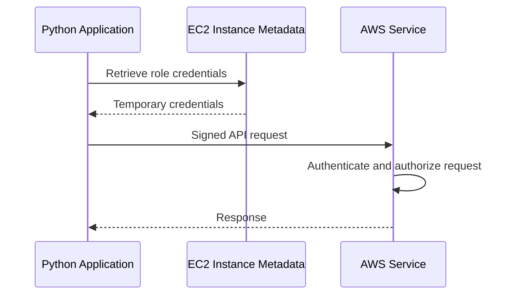

# 02- IAM and Access Control Questions

## Overview

AWS Identity and Access Management (IAM) is the foundation of authorization across AWS workloads. For backend engineers, understanding IAM means more than writing JSON policies. It requires reasoning about identity, trust relationships, temporary credentials, policy evaluation, cross-account access, workload identities, and the security boundaries surrounding production applications.

This document focuses on interview questions that assess practical IAM knowledge, troubleshooting ability, and senior-level access-control design.

## IAM Fundamentals

### What is AWS IAM, and why is it important?

IAM controls which principals can perform which actions on AWS resources under specified conditions.

It provides a centralized authorization mechanism for AWS services, allowing organizations to enforce least privilege, separate operational responsibilities, and audit access.

For example, a FastAPI service that reads documents from S3 should use a dedicated IAM role with permission to read only the required objects.

IAM does not replace application-level authorization. An API must still validate whether an authenticated customer is permitted to access a specific document or database record.

### What are the main components of IAM?

| Component | Purpose | Example |
|---|---|---|
| Principal | Identity making a request | IAM role, IAM user, federated identity |
| Action | Operation being requested | `s3:GetObject` |
| Resource | Target of the operation | An S3 object ARN |
| Policy | Defines permissions | Allow reading specific S3 objects |
| Role | Identity with assumable permissions | Lambda execution role |
| Trust policy | Controls who can assume a role | Permit the Lambda service to assume its execution role |
| Condition | Restricts access based on request context | Require a specific organization or source identity |
| Permission boundary | Limits permissions an identity-based policy can grant | Restrict delegated developer roles |
| SCP | Sets permission guardrails for affected AWS Organizations accounts and organizational units | Deny use of prohibited services |

These components work together. A policy granting `s3:GetObject` does not guarantee success if another applicable control denies the request.

### What is the difference between authentication and authorization?

**Authentication** establishes the identity associated with a request. **Authorization** determines whether that identity may perform the requested operation.

For AWS API requests, credentials and signing mechanisms establish the authenticated request context. IAM and service-specific authorization rules determine whether the operation is permitted.

For a Django application, AWS IAM authorization and application-user authorization are separate concerns:

- IAM determines whether the application's workload identity can retrieve a secret from Secrets Manager.
- Application authorization determines whether the logged-in user can view a particular customer record.

Confusing these layers can create serious data-isolation vulnerabilities.

### What is an ARN, and why is it important?

An Amazon Resource Name (ARN) identifies an AWS resource in a standardized format.

A typical ARN is:

```text
arn:partition:service:region:account-id:resource
```

Example:

```text
arn:aws:s3:::example-private-documents-prod/*
```

The ARN identifies objects in the specified S3 bucket.

Not every ARN field is populated for every service. S3 bucket ARNs, for example, omit the Region and account ID fields.

Incorrect ARNs are a common source of access-denied errors. Always distinguish between a bucket ARN and an object ARN because they authorize different categories of S3 operations.

### What is the difference between an IAM user, group, and role?

| Identity | Characteristics | Typical use |
|---|---|---|
| IAM user | Long-term identity that can have console credentials or access keys | Legacy integrations or specific IAM-user access requirements |
| IAM group | Organizes IAM users and receives identity-based policies | Managing permissions for groups of IAM users |
| IAM role | Defines permissions for temporary sessions and has a trust policy | AWS workloads, cross-account access, and federated access |

Modern AWS workloads should generally use roles and temporary credentials rather than long-lived access keys.

IAM groups do not contain roles, and attaching a policy to a group does not directly grant permissions to an unrelated role.

## IAM Policy Types and Evaluation

### What is an IAM policy?

An IAM policy is a JSON document describing permissions.

A statement commonly contains:

- `Effect`: `Allow` or `Deny`.
- `Action`: The API operations covered.
- `Resource`: The resources covered.
- `Condition`: Additional restrictions on the request.
- `Principal`: The identity involved in a resource-based policy, where applicable.

Example identity-based policy:

```json
{
  "Version": "2012-10-17",
  "Statement": [
    {
      "Sid": "ReadInvoiceObjects",
      "Effect": "Allow",
      "Action": "s3:GetObject",
      "Resource": "arn:aws:s3:::example-invoices-prod/*"
    }
  ]
}
```

This grants object-read permission for the specified bucket's objects. It does not grant bucket-listing, object-write, or access to unrelated buckets.

### What is the difference between identity-based and resource-based policies?

| Identity-based policy | Resource-based policy |
|---|---|
| Attached to an IAM user, group, or role | Attached to a supported resource |
| Describes actions the identity can perform | Defines access granted or denied to principals for the resource |
| Does not use a `Principal` element | Commonly uses a `Principal` element |
| Example: role policy allowing `s3:GetObject` | Example: S3 bucket policy granting cross-account access |

The authorization outcome depends on the principal type, resource type, applicable policy layers, and service-specific behavior.

For cross-account access, the caller's permissions and the target account's resource policy or role trust relationship must be configured appropriately for the chosen access pattern.

### What is the difference between implicit deny and explicit deny?

An **implicit deny** occurs when no applicable policy grants the requested permission.

An **explicit deny** occurs when an applicable policy explicitly denies the operation.

An applicable explicit deny overrides an allow.

For example, a role might have an identity-based policy allowing S3 access, but a bucket policy could explicitly deny access under a particular condition. The request remains denied when that deny applies.

When investigating access failures, search for both missing allows and explicit denies rather than assuming the problem is always an insufficient role policy.

### How does IAM policy evaluation work?

The effective authorization decision depends on the request context and the policies applicable to the principal and resource.

A practical investigation should consider:

1. The authenticated principal and AWS account.
2. The requested action and resource ARN.
3. Applicable identity-based policies.
4. Resource-based policies.
5. Role trust policies when role assumption is involved.
6. Permissions boundaries and session policies.
7. SCPs and other applicable organizational controls.
8. Explicit denies and condition mismatches.
9. Service-specific authorization requirements, including KMS permissions when relevant.

SCPs and permissions boundaries restrict permissions; they do not independently grant permissions.

Do not reduce IAM evaluation to a simplistic rule that every policy must contain an allow. Resource-based policies and different principal types can affect the evaluation differently. For difficult cases, inspect the applicable AWS authorization rules for the specific service and principal.

### What is a permissions boundary?

A permissions boundary defines the maximum permissions that an IAM user or role can receive through applicable identity-based policies.

Suppose a platform team allows application developers to create roles but wants to prevent those roles from receiving permissions outside an approved set. A permissions boundary can constrain the permissions available to the created roles.

A boundary does not grant permissions by itself. The role also needs an applicable identity-based allow.

**Interview trap:** A permissions boundary is not the same as an SCP. A boundary applies to an IAM identity, whereas an SCP establishes organizational guardrails for affected accounts and organizational units.

### What is an SCP, and how does it differ from an IAM policy?

A service control policy (SCP) is an AWS Organizations policy that defines the maximum permissions available to affected principals in member accounts.

Typical uses include:

- Preventing use of prohibited AWS services.
- Restricting selected security-sensitive operations.
- Establishing organizational guardrails.
- Reducing the risk of destructive administrative actions.

An SCP does not grant access. IAM permissions and other applicable authorization controls are still required.

A useful distinction is:

| Policy type | Primary purpose |
|---|---|
| Identity-based policy | Grant or deny permissions to an identity |
| Resource-based policy | Control access to a resource |
| Permissions boundary | Limit permissions available to an IAM identity |
| SCP | Establish organizational permission guardrails |
| Session policy | Restrict permissions available to a supported temporary session |

### What is a session policy?

A session policy is an additional policy supplied during supported role-assumption workflows to restrict permissions available to the resulting session.

For example, a role might normally read several S3 prefixes, but a particular session could be restricted to one prefix.

A session policy does not grant permissions that the role itself lacks. Its practical effect is to narrow the session's available permissions, subject to the applicable AWS authorization model.

Session policies are useful for delegated access and temporary, task-specific permissions, but they add policy-management complexity and should be tested carefully.

## IAM Roles and Trust Relationships

### What is an IAM role trust policy?

A trust policy defines which principals are permitted to assume an IAM role and under what conditions.

Example trust policy for an EC2 instance role:

```json
{
  "Version": "2012-10-17",
  "Statement": [
    {
      "Effect": "Allow",
      "Principal": {
        "Service": "ec2.amazonaws.com"
      },
      "Action": "sts:AssumeRole"
    }
  ]
}
```

The EC2 service principal is trusted to assume the role according to the configured trust relationship. The role's permissions policy separately determines which AWS actions the resulting credentials can perform.

A trust policy that is too broad can allow unintended principals to obtain access to the role's permissions.

### What is the difference between a trust policy and a permissions policy?

| Trust policy | Permissions policy |
|---|---|
| Controls who can assume a role | Controls what the role can do |
| Evaluated during role assumption | Evaluated during subsequent resource operations |
| Common action: `sts:AssumeRole` | Examples: `s3:GetObject`, `secretsmanager:GetSecretValue` |
| Contains the trusted principal | Usually defines allowed actions and resources |

A role can have a correct permissions policy but still be unusable because its trust policy rejects the caller. Conversely, a successful role assumption does not guarantee permission to access the target resource.

### How does EC2 obtain AWS credentials securely?

EC2 workloads commonly use an instance profile associated with an IAM role.

The application obtains temporary role credentials through the instance metadata service. AWS SDKs can use the configured credential-provider chain to retrieve and refresh credentials.



Production considerations include:

- Require IMDSv2 where appropriate and configure instance metadata access securely.
- Restrict access to instance metadata from untrusted processes and containers.
- Avoid static access keys in source code or machine images.
- Use narrowly scoped role permissions.
- Keep SDKs updated so credential refresh and provider behavior remain reliable.

A process with sufficient access to the instance metadata service may be able to obtain the instance role's credentials. IMDS hardening does not replace isolation between mutually untrusted workloads.

### What is the difference between a service role and a service-linked role?

A service role is an IAM role that an AWS service or workload assumes to perform authorized operations.

A service-linked role is a specialized role linked to an AWS service and governed by the service's documented permissions and lifecycle behavior.

Service-linked roles simplify service integration, while customer-managed service roles provide control over workload permissions and trust relationships.

Do not modify or delete service-linked roles without checking the service's documentation and operational requirements.

### What is the confused deputy problem?

The confused deputy problem occurs when a trusted service or intermediary is tricked into using its authority on behalf of an unintended caller.

For cross-account role assumption by a third party, an external ID can help distinguish the intended customer or tenant context when the trust relationship is designed to require it.

External IDs are not passwords and do not replace a correct trust policy. The trust policy must still restrict the trusted principal, and the external ID must be validated in the role-assumption flow.

This is especially relevant when a SaaS provider assumes roles in multiple customer accounts.

### How would you securely configure cross-account role assumption?

A typical configuration requires:

1. A target role in Account B with a trust policy that permits the intended principal from Account A.
2. Permission for the source principal in Account A to call `sts:AssumeRole` on the target role.
3. Appropriate permissions attached to the target role.
4. Additional conditions where necessary, such as an external ID for a third-party integration.
5. Monitoring and auditing of role assumptions.

Example source-side policy:

```json
{
  "Version": "2012-10-17",
  "Statement": [
    {
      "Effect": "Allow",
      "Action": "sts:AssumeRole",
      "Resource": "arn:aws:iam::123456789012:role/ExampleReadOnlyRole"
    }
  ]
}
```

The target role's trust policy must also authorize the source principal. This source-side policy alone is not sufficient to establish the cross-account trust relationship.

## Temporary Credentials and AWS STS

### What is AWS STS?

AWS Security Token Service (STS) issues temporary security credentials for supported access patterns.

A temporary credential set typically includes an access key ID, secret access key, session token, and expiration.

STS is commonly used for:

- Cross-account role assumption.
- Federated access.
- Workload identity integrations.
- Temporary delegated permissions.

Temporary credentials reduce dependence on persistent credentials, but they must still be protected until expiration.

### How do you assume an IAM role using the AWS CLI?

Use `aws sts assume-role` with the target role ARN and a session name.

```bash
aws sts assume-role \
  --role-arn arn:aws:iam::123456789012:role/ExampleReadOnlyRole \
  --role-session-name investigation-session
```

The command returns temporary credentials if role assumption succeeds.

The caller must be authorized to assume the role, and the target role's trust policy must permit the caller. Additional trust conditions may also apply.

Avoid copying the returned credentials into source files or logs. Prefer configured SDK role-assumption providers when application code needs to use the role.

### How can you verify which AWS identity an application is using?

Use:

```bash
aws sts get-caller-identity
```

The response includes the AWS account ID, caller ARN, and user ID associated with the active credentials.

This is a useful first diagnostic step when an application behaves differently across development, staging, and production.

However, a successful identity check does not prove that the identity has permission to perform a particular operation. The target action and resource still need to be evaluated.

### Why are temporary credentials preferred over long-lived access keys?

Temporary credentials:

- Expire automatically.
- Reduce the lifetime of exposed credentials.
- Support workload roles and federation.
- Simplify access separation across applications and environments.
- Improve attribution when role sessions are identified appropriately.

They still need secure handling. A compromised session can be abused while valid, and the effect of revocation depends on the credential type and applicable service behavior.

Prefer roles and supported federation mechanisms over creating permanent IAM access keys for applications.

## Least Privilege and Workload Identity

### How would you design least-privilege access for a Lambda function?

Start with the function's actual responsibilities and identify the AWS API operations and resources it must access.

For example, a Lambda function that processes invoices might require:

- Reading invoice objects from a specific S3 bucket.
- Writing processed results to a designated prefix.
- Reading a specific secret from Secrets Manager.
- Writing logs through its execution role's logging permissions.

Separate unrelated responsibilities into different functions or roles where practical.

Avoid broad policies such as `s3:*` on `*` merely to make the initial deployment work. Use observed access patterns, policy analysis, tests, and periodic reviews to refine permissions.

### How should IAM permissions be separated between microservices?

Each service should have an identity reflecting its own responsibilities.

For example:

| Workload | Appropriate permission boundary |
|---|---|
| API service | Read required configuration and invoke approved dependencies |
| Celery worker | Consume assigned jobs and access required data |
| Reporting job | Read reporting datasets and write approved outputs |
| Deployment pipeline | Deploy approved artifacts and update required infrastructure |
| Security automation | Read findings and perform explicitly approved remediation actions |

Sharing one broad role among all services increases blast radius and makes audit attribution less useful.

A service should not inherit permissions merely because it runs in the same VPC, container cluster, or account as another service.

### How should Kubernetes workloads access AWS securely?

Use an AWS-supported workload identity mechanism rather than distributing static AWS credentials to pods.

For Amazon EKS, options include IAM Roles for Service Accounts (IRSA) and EKS Pod Identity, depending on the cluster configuration and workload requirements.

The design should ensure that:

- Each workload receives only its intended identity.
- The role trust or association is scoped appropriately.
- Pod-to-pod and node-level isolation are configured.
- Applications cannot access credentials belonging to unrelated workloads.
- Permissions are tested and audited.

The exact implementation depends on the chosen identity mechanism and EKS configuration. Do not assume that assigning a role to a node provides sufficient per-workload isolation.

### What is the purpose of `iam:PassRole`?

`iam:PassRole` allows a principal to pass an IAM role to an AWS service when creating or configuring a resource that uses that role.

For example, a deployment principal might need to create a Lambda function and associate a specific execution role with it.

An overly broad `iam:PassRole` permission can be dangerous. If a principal can pass a highly privileged role to a service and control the service's code or configuration, it may indirectly gain access to that role's permissions.

Restrict `iam:PassRole` to approved role ARNs and combine it with restrictions on the service actions the principal can perform.

## Access Control Troubleshooting

### How do you troubleshoot an unexplained `AccessDenied` error?

Follow a systematic investigation rather than attaching administrator permissions.

**Step one: identify the caller.**

```bash
aws sts get-caller-identity
```

**Step two: inspect the role and attached policies.**

```bash
aws iam get-role \
  --role-name example-api-role

aws iam list-attached-role-policies \
  --role-name example-api-role

aws iam list-role-policies \
  --role-name example-api-role
```

**Step three: identify the exact failed operation.**

Record the action, resource ARN, Region, AWS account, timestamp, and full error message, excluding sensitive values.

**Step four: inspect all applicable controls.**

Check identity-based policies, resource policies, trust policies, permissions boundaries, session policies, SCPs, explicit denies, and condition keys. For encrypted resources, inspect the relevant KMS authorization path as well.

**Step five: verify the correction.**

Apply the narrowest required change and retry the original operation using the same intended identity.

Common causes include:

- Missing action permissions.
- Incorrect resource ARNs.
- Trust-policy condition failures.
- Explicit denies.
- Cross-account policy mismatches.
- Expired credentials.
- KMS key-policy restrictions.
- Endpoint policies or service-specific authorization rules.

### How do you diagnose a role trust-policy failure?

First determine whether the failure occurs during role assumption or during a later AWS API call.

Inspect the target role:

```bash
aws iam get-role \
  --role-name example-api-role \
  --query 'Role.AssumeRolePolicyDocument'
```

Then confirm the source identity and its permission to call `sts:AssumeRole` on the target role.

Check the trusted principal, account ID, service principal, external ID, MFA condition, organization condition, and other conditions required by the trust policy.

If role assumption succeeds but a subsequent API call fails, investigate the role's permissions rather than repeatedly modifying its trust policy.

### How do you inspect IAM policies for unintended permissions?

Review managed and inline policies, attached policies, resource policies, and applicable organizational restrictions.

Useful commands include:

```bash
aws iam list-attached-role-policies \
  --role-name example-api-role

aws iam list-role-policies \
  --role-name example-api-role

aws iam list-policies \
  --scope Local \
  --only-attached
```

The last command lists locally defined customer-managed policies that are attached to identities or resources. It does not replace inspection of individual policy documents or resource policies.

Use IAM Access Analyzer and policy simulation where appropriate, and compare permissions against the workload's documented responsibilities.

Policy simulation is a diagnostic aid, not a guarantee that every live service authorization path will behave identically.

### How do you investigate suspicious role assumptions?

Start with the affected account, Region, time range, and role ARN. Search CloudTrail for `AssumeRole` events and inspect the caller identity, source account, session name, source IP where available, and relevant request context.

Example:

```bash
aws cloudtrail lookup-events \
  --region ap-south-1 \
  --lookup-attributes AttributeKey=EventName,AttributeValue=AssumeRole
```

Correlate the events with deployment records and expected operational activity.

If the activity is unauthorized, contain the source identity and affected access path, preserve evidence, and follow the incident-response process. A session name alone is not proof of a caller's identity because it is not necessarily a trustworthy identifier supplied by the system.

### What should you do when a role has excessive permissions?

First establish which permissions are actually needed and whether the role is used by multiple workloads.

Then:

1. Identify the role's consumers and critical dependencies.
2. Review attached managed policies and inline policies.
3. Examine resource and trust policies.
4. Use CloudTrail and access-analysis tools to understand observed usage, recognizing that historical activity may not capture rare operational tasks.
5. Create a narrower policy.
6. Test in a controlled environment.
7. Roll out the change with monitoring and a rollback plan.
8. Reassess the role periodically.

Do not remove permissions solely because they have not appeared in a short observation window. Rare recovery or maintenance operations may still be necessary, and they may be better handled by a separate, tightly controlled role.

## Security Operations and Access Governance

### How should an organization conduct IAM access reviews?

An access review should evaluate both permissions and the continued business need for the identity.

Review:

- Unused and long-lived access keys.
- Roles with wildcard actions or resources.
- Privileged administrative roles.
- Cross-account trust relationships.
- Broad `iam:PassRole` permissions.
- Stale users, roles, and policies.
- External principals and third-party integrations.
- Changes to role trust policies.
- Permissions granted to deployment automation.

Use IAM Access Analyzer, CloudTrail, AWS Organizations controls, and internal ownership records where appropriate.

Access reviews should produce actionable outcomes: retain, reduce, remove, rotate, or investigate access. They should not be limited to exporting policy JSON without assigning responsibility for remediation.

### How should MFA be applied to privileged access?

Use centralized identity federation and MFA for human access where supported by the identity architecture. Restrict privileged actions to appropriately controlled identities and consider short-lived sessions, approval workflows, and break-glass procedures.

Do not assume that MFA on a human login automatically protects every workload credential or every subsequent API call. Workload identities require their own access controls, and MFA conditions apply only where the relevant authentication and policy context supports them.

Break-glass access should be tightly controlled, monitored, tested, and documented rather than left as an undocumented administrator account.

### How should IAM changes be deployed safely?

Treat IAM policy and trust-policy changes as security-sensitive infrastructure changes.

A safe process includes:

- Version-controlled policy documents.
- Peer review and automated validation.
- Policy simulation or access-analysis checks where appropriate.
- Testing in a non-production account.
- Controlled deployment and rollback procedures.
- CloudTrail monitoring for changes.
- Post-deployment verification using the intended workload identity.

A policy change can break production even when it is syntactically valid. Test both the expected allowed operations and the operations that must remain denied.

### How do you reduce privilege-escalation risk?

Review permissions that allow a principal to modify its own access or influence a more privileged identity.

Examples include:

- Attaching or editing IAM policies.
- Modifying role trust policies.
- Creating access keys for privileged users.
- Passing privileged roles to services.
- Updating Lambda code or configurations associated with powerful execution roles.
- Modifying deployment pipelines or infrastructure templates.
- Changing resource policies to grant additional access.

The correct mitigation depends on the privilege path. Restrict dangerous actions, separate duties, enforce organizational guardrails, and monitor sensitive IAM changes.

## Senior-Level Scenario Questions

### A developer can assume a role but cannot read an S3 object. What would you investigate?

Successful role assumption proves only that the trust relationship and role-assumption request succeeded.

I would verify the active role session, exact S3 operation, bucket and object ARNs, identity-based permissions, bucket policy, cross-account access configuration, SCPs, permissions boundaries, session policies, endpoint policies, and any explicit deny.

If the object uses SSE-KMS, I would also inspect the KMS key policy, grants, and required decryption permissions.

I would correct the narrowest failing control and verify the original request rather than broadening the role's permissions indiscriminately.

### A deployment pipeline needs to create a Lambda function with an execution role. How would you secure it?

Use a dedicated deployment role obtained through a supported federation mechanism, such as GitHub Actions OIDC.

Grant only the required deployment actions and restrict `iam:PassRole` to the approved Lambda execution role. Restrict the OIDC trust relationship to the intended repository and workflow context, using supported conditions.

Keep deployment permissions separate from runtime permissions. The pipeline should not receive the Lambda function's full data-access permissions merely because it deploys the function.

Audit deployment and IAM changes through CloudTrail and protect workflow definitions and approval controls.

### A production service receives intermittent access-denied errors after a credential rotation. How would you investigate?

I would determine whether the errors concern AWS API credentials, application credentials, or database authentication.

For AWS credentials, inspect the active identity and credential-provider configuration. For application secrets, verify secret versions, cache expiration, refresh logic, and whether the target service has completed its rotation process.

I would inspect sanitized application errors and relevant AWS audit evidence without logging secret values or tokens.

The fix may involve credential refresh, cache changes, connection-pool recycling, or correcting a role policy. I would verify that both newly created and existing application instances can authenticate correctly after rotation.

### How would you design access control for a multi-tenant SaaS platform?

Separate infrastructure access from tenant-level authorization.

At the AWS layer, use workload roles with narrowly scoped service permissions, controlled cross-account access, and protected secrets and encryption keys.

At the application layer, derive tenant identity from a validated authentication context and enforce tenant ownership checks for every relevant operation. Do not rely on client-supplied tenant IDs without authorization validation.

Where stronger isolation is required, consider separate accounts, resources, or encryption-key boundaries according to the threat model and compliance requirements.

Test for cross-tenant access through API integration tests and security tests, including object identifiers that belong to another tenant.

### How would you investigate a suspected IAM privilege escalation?

Establish the timeline, identify the affected principal, and inspect CloudTrail for sensitive IAM operations and role assumptions.

Look for policy attachments, trust-policy modifications, access-key creation, `iam:PassRole` use, and changes to workloads that run with privileged roles.

Contain the compromised identity and relevant access paths, preserve evidence, and assess which resources may have been accessed or modified. Then remove the privilege path, validate the remaining access configuration, and introduce monitoring or preventive controls for the root cause.

## Key Takeaways

- IAM security depends on understanding principals, policies, trust relationships, and the complete authorization context rather than individual allow statements.
- Prefer workload roles and temporary credentials over long-lived access keys, and scope trust relationships as carefully as permissions.
- Diagnose `AccessDenied` errors by identifying the caller, action, resource, and applicable policy layers; never use unrestricted administrator access as a shortcut.
- Separate deployment identities, runtime identities, and application-level user authorization to reduce privilege escalation and data-isolation risks.
- Treat IAM governance as a continuous operational process involving access reviews, policy testing, audit monitoring, and controlled changes.