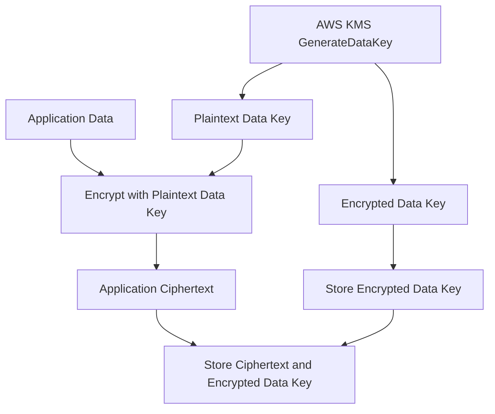

# 03- Encryption and KMS Questions

## Overview

Encryption is a core component of AWS security, but production-grade data protection requires more than enabling encryption at rest. Backend engineers must understand key ownership, authorization, envelope encryption, key rotation, encryption context, secret handling, and recovery implications.

AWS Key Management Service (KMS) provides centralized key management and cryptographic operations for supported AWS services and applications. Its integration with S3, EBS, RDS, CloudWatch Logs, and application workloads allows organizations to enforce encryption policies and govern access to protected data.

This document covers encryption and KMS interview questions from foundational concepts through senior-level architecture, troubleshooting, and operational decision-making.

## Encryption Fundamentals

### What is encryption at rest?

Encryption at rest protects stored data by transforming plaintext into ciphertext using cryptographic keys.

AWS services support encryption at rest for many storage and data-management resources, including:

- S3 objects.
- EBS volumes and supported snapshots.
- RDS database storage and supported snapshots.
- CloudWatch Logs log groups.
- Other services with documented encryption capabilities.

Encryption at rest reduces the risk associated with unauthorized access to underlying storage or copied data. However, it does not automatically protect data from an application or principal that is already authorized to decrypt it.

**Production consideration:** Verify encryption settings for the resource, understand which key protects the data, and control who can use that key. Encryption without effective access controls is not sufficient.

### What is encryption in transit?

Encryption in transit protects data while it moves between clients, services, and endpoints, commonly using TLS.

For a FastAPI application communicating with RDS, use TLS for the database connection where supported and configured. For AWS API requests, use HTTPS endpoints and the appropriate AWS SDK.

Encryption in transit helps protect confidentiality and integrity against network interception. It does not determine whether the caller is authorized to access the destination resource.

### What is the difference between encryption at rest and encryption in transit?

| Property | Encryption at rest | Encryption in transit |
|---|---|---|
| Protects | Stored data | Data moving across a connection |
| Common mechanisms | S3 server-side encryption, EBS encryption, RDS encryption | TLS and HTTPS |
| Key concern | Storage encryption key and access policies | TLS certificates, endpoint identity, protocol configuration |
| Main limitation | Authorized applications may still decrypt data | Does not replace application authorization |
| Typical verification | Resource encryption configuration and KMS settings | TLS configuration and certificate validation |

Both controls are important for production workloads. Neither replaces application-level authorization, secure credential management, or audit logging.

### What is the difference between hashing and encryption?

Encryption is designed to be reversible by a party with the appropriate key. Hashing produces a fixed-length digest and is not intended to be reversed.

| Property | Encryption | Hashing |
|---|---|---|
| Reversible | Yes, with the required key and algorithm | Not designed to be reversible |
| Typical use | Protect stored data and communications | Integrity checks and password verification |
| Secret key required | Usually, for symmetric encryption | Not necessarily |
| Example | AES-GCM encryption | SHA-256 digest |

For password storage, use a dedicated password-hashing algorithm such as Argon2id, scrypt, or an appropriately configured bcrypt implementation. Do not store plaintext passwords or use general-purpose encryption as a substitute for password hashing.

### What is the difference between symmetric and asymmetric encryption?

**Symmetric encryption** uses the same secret key for encryption and decryption. It is efficient for protecting large amounts of data.

**Asymmetric cryptography** uses a public/private key pair and supports operations such as digital signatures and certain key-establishment workflows.

AWS KMS supports different key types and cryptographic operations. The available algorithms and operations depend on the key specification.

For application data encryption, symmetric encryption is generally suitable for bulk data protection. Asymmetric keys are useful when a workflow requires public-key encryption or signing, subject to the capabilities of the selected KMS key type.

### What is authenticated encryption?

Authenticated encryption provides confidentiality and integrity protection, allowing the recipient to detect unauthorized modifications to ciphertext or authenticated metadata.

AES-GCM is a common authenticated-encryption algorithm.

When implementing application-level encryption, use a vetted cryptographic library and follow its requirements for nonces, tags, and key handling. Never reuse a nonce with the same AES-GCM key in a way prohibited by the algorithm's requirements.

AWS-managed encryption integrations often reduce the need for application code to implement cryptographic primitives directly.

## AWS Key Management Service

### What is AWS KMS?

AWS Key Management Service is a managed service for creating and controlling cryptographic keys and performing supported cryptographic operations.

KMS is commonly used to:

- Manage keys for AWS service encryption.
- Encrypt and decrypt small data payloads within service limits.
- Generate data keys for envelope encryption.
- Define key-access policies and grants.
- Audit key usage through CloudTrail.
- Enforce centralized key-management controls.

KMS reduces the burden of operating key-management infrastructure, but customers must still govern permissions, key lifecycle, resource configuration, and recovery requirements.

### What is a KMS key?

A KMS key is a logical resource representing cryptographic key material and its associated metadata, permissions, and lifecycle controls.

A KMS key has an ARN, a key policy, a key state, and a key specification that determines its supported cryptographic operations.

KMS keys can be used directly for supported cryptographic operations or to protect data keys used for bulk encryption.

For large application payloads, envelope encryption is generally preferable to attempting to encrypt the entire payload directly through KMS.

### What is the difference between AWS-managed and customer-managed KMS keys?

| Feature | AWS-managed KMS key | Customer-managed KMS key |
|---|---|---|
| Ownership and administration | Managed by AWS for an AWS service integration | Managed by the customer |
| Creation | Typically created automatically when the relevant service integration first requires it | Created and configured by the customer |
| Policy customization | Limited customer control | Greater policy and governance control |
| Key lifecycle control | Limited customer control | Customer controls supported lifecycle operations |
| Typical use | Standard service encryption with fewer management requirements | Granular access governance, cross-account requirements, and specific compliance needs |
| Operational responsibility | Lower | Higher |

AWS-managed keys are not the same as keys owned by another AWS account. Customer-managed keys provide greater control but introduce additional configuration, cost, monitoring, and lifecycle responsibilities.

Choose based on actual security and compliance requirements rather than assuming every resource requires a customer-managed key.

### What is the difference between a KMS key and a data key?

A KMS key protects cryptographic operations or other keys. A data key is used to encrypt application data.

In envelope encryption, KMS generates a plaintext data key and an encrypted copy of that data key. The application uses the plaintext data key locally and stores the encrypted copy alongside the ciphertext.

The plaintext data key should be removed from application memory as soon as practical after use.

The KMS key protects the data key; the data key protects the application payload.

### What is envelope encryption?

Envelope encryption encrypts data using a data key and then encrypts or protects that data key using a higher-level key.

The typical process is:

1. The application calls KMS to generate a data key.
2. KMS returns a plaintext data key and an encrypted data key.
3. The application encrypts the payload locally using the plaintext data key.
4. The application stores the payload ciphertext and encrypted data key.
5. The application discards the plaintext data key as soon as practical.
6. During decryption, the application asks KMS to decrypt the encrypted data key.
7. The application uses the recovered data key to decrypt the payload.



Advantages include efficient local encryption for large payloads and reduced direct use of the KMS key for every byte of data.

However, the application becomes responsible for correct cryptographic implementation, encrypted-key storage, data-key lifecycle, and authenticated encryption. Prefer established cryptographic libraries and tested designs.

### Why should you avoid using KMS directly to encrypt large payloads?

Direct KMS encryption operations have service-specific plaintext size limits. They are not intended to encrypt arbitrarily large files or database records in a single operation.

For larger payloads, use envelope encryption or an AWS service's native encryption integration.

A typical pattern is to use `GenerateDataKey` to obtain a data key, encrypt the payload locally using a vetted library, and store the encrypted data key alongside the ciphertext.

For S3, prefer native server-side encryption unless application-level encryption is required by the threat model or data-handling requirements.

## KMS Authorization and Key Policies

### What is a KMS key policy?

A key policy is a resource policy that governs access to a KMS key. It is a central part of KMS authorization.

Unlike a generic assumption that IAM permissions alone control every resource, KMS access must be evaluated with the key policy and the applicable authorization model.

A key policy can:

- Permit account-level administration.
- Allow selected principals to use the key.
- Restrict cryptographic operations.
- Enable IAM-based authorization where appropriately configured.
- Control key administration separately from key usage.

A key policy that is too restrictive can make the key difficult to administer or prevent applications from decrypting data. A key policy that is too broad can undermine least privilege.

### What is the difference between a KMS key policy and an IAM policy?

| KMS key policy | IAM policy |
|---|---|
| Attached to the KMS key | Attached to an IAM identity |
| Defines resource-side access rules | Defines identity-side permissions |
| Can directly authorize specified principals | Can authorize KMS actions when the key policy and applicable authorization model permit it |
| Important for cross-account access | Important for defining what the calling identity may do |

For a KMS operation to succeed, the complete authorization path must permit the operation. Cross-account use of a customer-managed key generally requires appropriate authorization on both sides, including the key policy and the caller's permissions.

### What is a KMS grant?

A KMS grant delegates specified permissions on a KMS key to a grantee, subject to the grant's configuration.

Grants are useful for supported service integrations and controlled delegation without requiring every permission change to be implemented as a key-policy edit.

A grant can specify operations and constraints, including an encryption context where supported.

Inspect grants when a KMS operation is unexpectedly permitted or denied. Avoid deleting grants without understanding which service or workload depends on them.

### Why might a user have `kms:Decrypt` permission but still receive `AccessDenied`?

Possible causes include:

- The key policy does not authorize the relevant access path.
- An applicable identity policy, SCP, or permissions boundary restricts the operation.
- A grant does not cover the requested operation or principal.
- The application is using the wrong key or Region.
- The key is disabled or otherwise unavailable for the requested operation.
- A required encryption context does not match.
- A service integration requires additional permissions or configuration.

Start with the exact key ARN, caller identity, operation, and error. Inspect the key policy, grants, identity policies, key state, and CloudTrail evidence.

Do not resolve the issue by granting unrestricted KMS access.

### What is the difference between KMS key administration and key usage?

Key administration includes operations that manage the key's configuration or lifecycle. Key usage includes cryptographic operations such as encryption, decryption, or data-key generation.

Separating these responsibilities reduces the risk that an application operator can change key policy, disable a key, or schedule deletion simply because the application needs to decrypt data.

A production design should generally give runtime workloads only the cryptographic permissions they need and reserve lifecycle administration for a restricted operational role.

## Encryption Context and Data-Key Handling

### What is encryption context in AWS KMS?

Encryption context is a set of non-secret key-value pairs used as authenticated additional context in supported KMS cryptographic operations.

For example:

```python
import boto3

kms = boto3.client("kms", region_name="ap-south-1")

response = kms.encrypt(
    KeyId="arn:aws:kms:ap-south-1:123456789012:key/EXAMPLE-KEY-ID",
    Plaintext=b"example-payload",
    EncryptionContext={
        "Application": "payments-api",
        "Environment": "production",
    },
)

ciphertext = response["CiphertextBlob"]
```

For a compatible decryption operation, supply the matching encryption context. A mismatch causes the operation to fail.

Encryption context can also support access-control designs and audit analysis when the surrounding system uses it consistently.

Do not include passwords, tokens, personal data, or other secrets in the context because it is not intended to be confidential and may appear in audit records.

### What happens if the encryption context changes?

If ciphertext was created using an encryption context, the corresponding decrypt operation must supply a matching context where the operation requires it.

A mismatch can result in a cryptographic or authorization-related failure.

For example, if an application encrypts a tenant record with `TenantId=tenant-123`, a decryption request using `TenantId=tenant-456` will not succeed for that ciphertext.

Treat encryption-context values as part of the data format and document them. Changes to naming, normalization, or tenant identifiers can break decryption if the application does not preserve the original context.

### How should an application handle plaintext data keys?

The plaintext data key is sensitive cryptographic material.

Recommended practices include:

- Use vetted cryptographic libraries.
- Keep plaintext data keys in memory only as long as required.
- Avoid logging keys or including them in exceptions.
- Avoid writing plaintext keys to disk or persistent caches.
- Protect process memory and runtime access.
- Store the encrypted data key with the corresponding ciphertext.
- Validate the format and version of encrypted records.
- Design rotation and recovery procedures before deployment.

Python does not guarantee that immutable byte strings can be reliably zeroized from memory. Do not claim that assigning `None` securely erases all copies of a key. Instead, minimize the lifetime and exposure of plaintext key material and use appropriate runtime and library protections.

### How would you implement envelope encryption in a Python backend?

The following example demonstrates the core pattern using KMS and AES-GCM from the `cryptography` library. It assumes the application has an IAM role permitting the required KMS operation and that the record format is protected by application-level validation.

```python
import json
import os

import boto3
from cryptography.hazmat.primitives.ciphers.aead import AESGCM


kms = boto3.client("kms", region_name="ap-south-1")

KMS_KEY_ARN = (
    "arn:aws:kms:ap-south-1:123456789012:key/EXAMPLE-KEY-ID"
)


def encrypt_record(plaintext: bytes, record_id: str) -> dict[str, str]:
    context = {
        "Application": "payments-api",
        "RecordId": record_id,
    }

    result = kms.generate_data_key(
        KeyId=KMS_KEY_ARN,
        KeySpec="AES_256",
        EncryptionContext=context,
    )

    data_key = result["Plaintext"]
    encrypted_data_key = result["CiphertextBlob"]
    nonce = os.urandom(12)

    try:
        ciphertext = AESGCM(data_key).encrypt(
            nonce,
            plaintext,
            json.dumps(context, sort_keys=True).encode("utf-8"),
        )
    finally:
        # Reduce references to the plaintext key when practical.
        data_key = None

    return {
        "encrypted_data_key": encrypted_data_key.hex(),
        "nonce": nonce.hex(),
        "ciphertext": ciphertext.hex(),
        "record_id": record_id,
    }
```

This is an illustrative encryption primitive, not a complete production storage format. A production implementation must define a stable, versioned record format; use canonical and consistent additional authenticated data; preserve the exact encryption context; validate inputs; handle exceptions safely; and implement decryption and migration tests.

Python cannot guarantee secure zeroization by assigning `None`, and the example should not be interpreted as proving that all copies of plaintext key material have been erased.

The workload needs `kms:GenerateDataKey` on the selected key. Decryption generally requires `kms:Decrypt` and the matching encryption context. Consider the impact of KMS quotas, request costs, retries, and availability on throughput.

## Key Rotation and Lifecycle Management

### What is KMS key rotation?

Key rotation replaces the backing key material used for new cryptographic operations according to the rotation capabilities and configuration of the key.

For supported symmetric customer-managed KMS keys, automatic rotation can be enabled. Rotation behavior depends on key type and configuration, so verify the capabilities for the selected key.

Rotation does not mean that every existing ciphertext must immediately be re-encrypted. KMS can retain historical backing key material needed to decrypt data encrypted before rotation, provided the key remains available and supported by the service.

### What is the difference between key rotation and re-encryption?

**Key rotation** changes the backing key material used for new cryptographic operations under a supported KMS key.

**Re-encryption** changes the encryption of existing data, often to use a different key or encryption configuration.

These operations solve different problems.

| Requirement | Rotation | Re-encryption |
|---|---|---|
| Periodically replace supported backing key material | Yes | Not inherently required |
| Migrate data to a different KMS key | Not by itself | Yes |
| Update ciphertext already stored by an application | Not necessarily | Usually required |
| Reduce reliance on a compromised key | Depends on the threat and key lifecycle | May be part of remediation |
| Change application encryption format | No | May be required |

If a key is compromised, simply enabling rotation may not be sufficient. Investigate the compromise, restrict access, evaluate whether data must be re-encrypted, and follow the applicable incident-response process.

### What happens when a KMS key is disabled?

A disabled KMS key cannot perform cryptographic operations that require the key while it remains disabled. Applications and AWS services that depend on it may fail to decrypt data or perform encryption operations.

Potential effects include:

- Failed application reads or writes.
- Failed background jobs.
- Unavailable encrypted logs or objects.
- Errors in services using the key.

Investigate the key state and CloudTrail history before re-enabling it. If the disablement was part of an incident response, confirm that restoration is authorized and safe.

### What happens when a KMS key is scheduled for deletion?

A customer-managed KMS key scheduled for deletion enters a pending-deletion state. During this period, cryptographic operations using the key are unavailable.

If deletion completes, the key material is permanently deleted and data protected by that key may become unrecoverable unless another valid recovery path exists.

Before scheduling deletion:

- Identify dependent resources and encrypted data.
- Check backup and retention requirements.
- Confirm that the key is no longer required.
- Obtain the appropriate approval.
- Verify recovery procedures and dependencies.
- Monitor the key's lifecycle state.

Do not schedule deletion as a routine cleanup step without dependency analysis.

### How should KMS keys be governed in a production organization?

A key-governance model should define:

- Key ownership and responsible teams.
- Approved key types and encryption use cases.
- Key policy templates and access boundaries.
- Separation of administration and usage.
- Rotation requirements.
- Key-state monitoring and alerting.
- Deletion approval and recovery procedures.
- Cross-account access rules.
- Audit retention and compliance evidence.
- Cost and quota management.

Use customer-managed keys when the required governance justifies their additional operational complexity. Standard AWS-managed encryption can be appropriate when service defaults satisfy the security requirements.

## AWS Service Encryption Integrations

### How does encryption work with Amazon S3?

S3 supports server-side encryption options, including SSE-S3 and SSE-KMS.

With server-side encryption, S3 encrypts objects at rest. SSE-KMS integrates with KMS and provides additional key-usage controls and auditing capabilities.

A production design should consider:

- Bucket-level default encryption.
- Whether customer-managed KMS keys are required.
- Bucket policies and IAM access.
- Cross-account access.
- KMS permissions and key policies.
- Replication and destination encryption requirements.
- Object retention and recovery.
- Access logging and CloudTrail evidence.

An encrypted object can still be exposed through an overly permissive bucket policy or an authorized application with excessive permissions.

### What is the difference between SSE-S3 and SSE-KMS?

| Feature | SSE-S3 | SSE-KMS |
|---|---|---|
| Key management | S3-managed encryption keys | KMS-backed key management |
| Customer-managed key policies | No customer-managed KMS key policy | Available with customer-managed KMS keys |
| Key usage auditing through KMS | No customer-managed KMS key usage for this encryption mode | KMS operations and integrations can provide relevant audit evidence |
| Operational complexity | Lower | Higher |
| Typical use | Standard object encryption requirements | Granular key governance and KMS-integrated access control |

The choice depends on security requirements, compliance controls, access patterns, and cost. SSE-KMS can introduce KMS request costs and quota considerations depending on the operation and integration.

### How does EBS encryption work?

EBS encryption protects supported EBS volumes and snapshots at rest using AWS-managed or customer-managed KMS keys.

Encrypted volumes can protect data stored on the volume and support encryption of relevant data paths between the EC2 instance and EBS under the service's encryption model.

Consider the encryption configuration of:

- Root and data volumes.
- Snapshots and copied snapshots.
- Volumes created from snapshots.
- AMIs and derived resources.
- Cross-account snapshot-sharing workflows.

For regulated workloads, verify the encryption configuration throughout the provisioning and backup lifecycle, not only on the initial volume.

### How does RDS encryption work?

RDS encryption protects supported database storage and associated resources such as automated backups, snapshots, and read replicas according to the service's documented behavior and configuration.

The encryption key must remain available for the database and dependent recovery workflows.

Important considerations include:

- Encryption at creation time and supported migration approaches.
- Snapshot copying and cross-account sharing.
- Key access for recovery and replication operations.
- Database TLS configuration.
- Application credential management.
- Backup retention and restore testing.

For an existing unencrypted database, do not assume that changing a configuration flag will encrypt the existing storage in place. Follow the supported migration or snapshot-copy workflow for the selected database engine and deployment configuration.

### How does CloudWatch Logs encryption work?

CloudWatch Logs encrypts log data at rest by default using AWS-managed encryption. A customer-managed KMS key can be configured for supported log groups when additional key governance is required.

Consider:

- Log-group encryption configuration.
- KMS key permissions and state.
- Retention and deletion requirements.
- Access restrictions for sensitive logs.
- Whether application logs contain tokens, passwords, personal information, or cryptographic material.
- Centralized audit and evidence requirements.

Encryption does not make sensitive logging acceptable. Prevent secret leakage at the application layer and apply appropriate log access controls.

## Secrets Management and Encryption

### What is the difference between Secrets Manager and Systems Manager Parameter Store?

| Feature | Secrets Manager | Systems Manager Parameter Store |
|---|---|---|
| Main purpose | Secret lifecycle and credential management | Configuration and parameter storage |
| Rotation | Supports managed integrations and custom rotation workflows | Does not provide the same native secret-rotation workflow |
| Encryption | Supports KMS-backed encryption | `SecureString` supports KMS-backed encryption |
| Common use | Database credentials and external API tokens | Application configuration and encrypted parameters |
| Cost considerations | Secret storage and API usage can incur charges | Cost depends on parameter tier, throughput, and selected features |

Both services require appropriate IAM permissions and careful handling of retrieved values. Secret storage does not eliminate the risk of leakage through application logs, memory, or caches.

### How should a Python backend retrieve a secret securely?

Use the AWS SDK and a workload role instead of hardcoding credentials.

```python
import json

import boto3
from botocore.exceptions import BotoCoreError, ClientError


def load_database_secret(secret_arn: str) -> dict[str, str]:
    client = boto3.client(
        "secretsmanager",
        region_name="ap-south-1",
    )

    try:
        response = client.get_secret_value(SecretId=secret_arn)
    except (ClientError, BotoCoreError):
        raise RuntimeError(
            "Unable to retrieve database credentials"
        ) from None

    secret_string = response.get("SecretString")
    if not secret_string:
        raise RuntimeError("Expected a string-form database secret")

    try:
        secret = json.loads(secret_string)
    except json.JSONDecodeError:
        raise RuntimeError("Database secret has an invalid format") from None

    required_fields = {"username", "password", "host", "dbname"}
    if not required_fields.issubset(secret):
        raise RuntimeError("Database secret is missing required fields")

    return {
        "username": secret["username"],
        "password": secret["password"],
        "host": secret["host"],
        "dbname": secret["dbname"],
    }
```

The role requires narrowly scoped `secretsmanager:GetSecretValue` permission. A customer-managed KMS key may require additional KMS authorization, depending on the integration and access path.

Production applications should avoid logging secret values, use bounded caching where appropriate, and define safe behavior for secret retrieval and rotation failures.

### How does KMS integrate with Secrets Manager?

Secrets Manager can use KMS to encrypt secret values at rest. Accessing a secret protected by a customer-managed key requires the appropriate authorization for the secret and the key.

An access-denied error may arise from missing `secretsmanager:GetSecretValue`, KMS authorization, a resource policy, an incorrect Region, or secret lifecycle state.

Inspect the caller identity, secret metadata, key policy, and relevant CloudTrail events. Do not broaden access to every secret or every KMS key to resolve a single retrieval failure.

## Troubleshooting KMS Failures

### How do you troubleshoot `AccessDeniedException` from KMS?

Use a structured process.

**Identify the caller and target key.**

```bash
aws sts get-caller-identity

aws kms describe-key \
  --key-id arn:aws:kms:ap-south-1:123456789012:key/EXAMPLE-KEY-ID
```

**Inspect the key policy.**

```bash
aws kms get-key-policy \
  --key-id arn:aws:kms:ap-south-1:123456789012:key/EXAMPLE-KEY-ID \
  --policy-name default
```

**Inspect grants.**

```bash
aws kms list-grants \
  --key-id arn:aws:kms:ap-south-1:123456789012:key/EXAMPLE-KEY-ID
```

These are read-only inspection operations.

Next, verify the required action, identity policy, key policy, grants, key state, Region, encryption context, and any relevant cross-account or service integration requirements.

Correct the narrowest failing authorization condition, then retry the original operation and confirm that unrelated permissions remain restricted.

### How would you diagnose an incorrect encryption context?

Confirm which context was used during encryption and compare it with the one supplied during decryption.

Check:

- Exact key names and values.
- Case sensitivity and string formatting.
- Tenant or record identifiers.
- Serialization and normalization behavior.
- Whether the context was persisted alongside the ciphertext.
- Whether the request targets the expected key and Region.

Because the context is authenticated, changing it can make existing ciphertext undecryptable through the normal operation.

Preserve the original context as part of the encrypted record's metadata. Do not work around a mismatch by removing authentication or switching to a less secure encryption design.

### How do you investigate a sudden increase in KMS throttling?

Investigate request volume, retry behavior, concurrency, key usage, and service quotas.

Potential causes include:

- A workload issuing one KMS request per record at high throughput.
- Excessive secret refreshes or cache misses.
- A retry loop amplifying a transient failure.
- A new deployment increasing concurrency.
- Shared keys receiving traffic from multiple workloads.

Mitigations may include bounded exponential backoff with jitter, reducing unnecessary KMS calls, using supported data-key caching where appropriate, and reviewing quotas.

Caching plaintext data keys reduces KMS request volume but increases the time sensitive key material remains available in application memory. Make the security and performance trade-off explicit.

### How do you investigate an unexpected KMS key-state change?

Inspect the key's current state and search CloudTrail for the relevant administrative operation.

Review the caller identity, timestamp, request context, and any related policy or lifecycle changes. Correlate the event with approved change records.

If the change is unauthorized, contain the responsible identity and follow incident-response procedures. Restore key availability only after confirming that doing so is authorized and safe.

Monitor future key-state changes and require appropriate approval for disabling or scheduling deletion of production keys.

## Senior-Level Architecture Questions

### How would you design centralized KMS governance for a multi-account environment?

Use a documented account and key ownership model. Separate security administration from application runtime access, and define approved cross-account key-use patterns.

A centralized key-management model can simplify governance, but cross-account access introduces dependencies on key policies, IAM policies, and the availability of the account or role that owns the key.

For each workload, define:

- Which account owns the data and key.
- Which principals can administer the key.
- Which principals can perform cryptographic operations.
- Which services use the key.
- How rotation and deletion are governed.
- How recovery is tested.
- How key usage is audited.
- What happens if the key-owning account or administrative path is unavailable.

Do not centralize every key by default. Evaluate isolation, operational complexity, service integration requirements, and blast radius.

### How would you choose between service-managed encryption and application-level encryption?

| Requirement | Service-managed encryption | Application-level encryption |
|---|---|---|
| Standard encryption at rest | Usually appropriate | May add unnecessary complexity |
| Fine-grained control over which application data is encrypted | Depends on service capabilities | Can provide field- or record-level control |
| Protect data from some storage-layer access paths | Often suitable | Can add another protection layer |
| Keep plaintext unavailable to selected storage administrators | Depends on the threat model and access path | Can help if keys and decryption authority are separately controlled |
| Operational simplicity | Generally higher | Generally lower |
| Application responsibility | Lower | Higher, including format, key handling, and recovery |

Application-level encryption can improve isolation, but it does not automatically protect plaintext from a compromised application that legitimately decrypts the data.

Choose the simplest design that satisfies the threat model and compliance requirements.

### How would you respond to a suspected KMS key compromise?

First determine what was compromised: the KMS key's administrative permissions, the permissions of a principal allowed to use the key, an application data key, or another cryptographic component.

Then:

1. Identify the affected key, principals, resources, and time range.
2. Preserve relevant CloudTrail and application evidence.
3. Restrict the compromised access path.
4. Review recent cryptographic operations and administrative changes.
5. Assess the data and workloads potentially affected.
6. Determine whether data re-encryption or credential rotation is necessary.
7. Validate application recovery and key availability.
8. Document the incident and improve preventive controls.

Disabling or deleting a key without dependency analysis can cause a production outage or permanently remove access to encrypted data. Select containment actions according to the actual compromise and business impact.

### How would you design encryption for a multi-tenant SaaS application?

Start by classifying the data and identifying the isolation requirements.

For many systems, service-managed encryption combined with strong tenant-level application authorization is sufficient. For stronger cryptographic isolation, consider separate customer-managed keys or application-level envelope encryption, depending on the requirements.

Evaluate:

- Tenant isolation requirements.
- Key ownership and administrative boundaries.
- Encryption context and tenant metadata.
- Key rotation and re-encryption workflows.
- Cross-account or cross-Region recovery.
- Request volume and KMS quotas.
- Cost per tenant.
- Incident containment and deletion requirements.

Separate keys per tenant can improve isolation but increase policy, lifecycle, monitoring, and operational complexity. The design should be driven by a defined threat model rather than assuming that one key per tenant is always necessary.

## Common Encryption and KMS Interview Traps

| Incorrect assumption | Correct interpretation |
|---|---|
| Encryption at rest prevents all unauthorized data access | Authorized applications or compromised principals may still decrypt data |
| KMS directly encrypts arbitrarily large payloads | Direct KMS encryption has size limits; use envelope encryption or service-native encryption |
| Enabling key rotation re-encrypts every stored object | Rotation and re-encryption are different operations |
| An IAM allow always grants KMS access | Key policies, grants, and other applicable authorization controls can still block access |
| Disabling a key is harmless | Dependent applications and services may lose access to protected data |
| Deleting a key is equivalent to removing an unused configuration | Key deletion can permanently make dependent ciphertext unrecoverable |
| Encryption context is secret metadata | Encryption context is not confidential and may appear in audit records |
| Assigning `None` to a Python variable securely erases a key | Python does not guarantee zeroization of all memory copies |
| Secret rotation automatically updates all application connections | Caches, connection pools, and refresh logic may continue using old credentials |
| A customer-managed key is always more secure | It offers more control but also creates additional policy and lifecycle responsibilities |

## Key Takeaways

- Use service-native encryption for standard storage protection and envelope encryption for application payloads that require direct cryptographic control.
- KMS security depends on key policies, IAM permissions, grants, key state, and the complete authorization path.
- Key rotation, data re-encryption, key disablement, and key deletion are distinct operations with different availability and recovery implications.
- Protect plaintext data keys and retrieved secrets through short lifetimes, restricted access, safe logging, and carefully designed caching.
- Treat encryption architecture as an operational responsibility that includes monitoring, cost and quota management, tested recovery, and controlled key lifecycle changes.