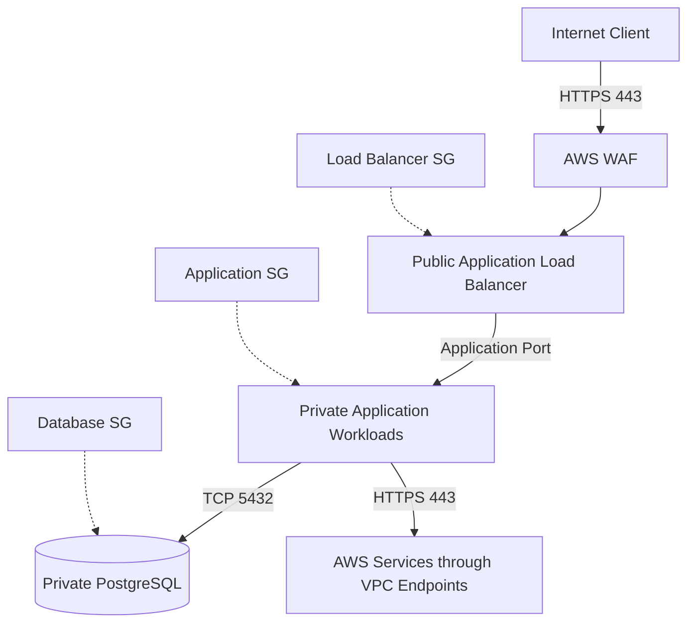

# 04- Network Security Questions

## Overview

AWS network security controls which workloads can communicate, which traffic is permitted, and how public-facing applications are protected. For backend engineers, network security directly affects API availability, service-to-service communication, database access, workload isolation, and incident containment.

A secure network design does not rely on a single firewall or private subnet. It combines network boundaries, stateful and stateless traffic filtering, private connectivity, application-layer protection, identity-based authorization, and continuous monitoring.

This document focuses on network security interview questions with practical answers, diagnostic workflows, AWS CLI commands, and production architecture scenarios.

## Core Network Security Concepts

### What is a VPC, and how does it contribute to security?

A Virtual Private Cloud (VPC) is a logically isolated virtual network in AWS. It provides control over IP addressing, subnets, route tables, gateways, and network traffic filtering.

A VPC creates a network boundary, but it does not automatically make every resource private or secure. Security depends on routing, subnet placement, resource configuration, security groups, network ACLs, and application-level controls.

Important components include:

| Component | Security responsibility |
|---|---|
| VPC | Defines an isolated network and address space |
| Subnet | Places resources within an Availability Zone and associates them with routing |
| Route table | Determines where network traffic is sent |
| Security group | Applies stateful traffic filtering to supported network interfaces |
| Network ACL | Applies stateless filtering at the subnet boundary |
| Internet gateway | Enables internet routing for eligible resources |
| NAT gateway | Allows private-subnet resources to initiate IPv4 connections to external destinations |
| VPC endpoint | Provides private connectivity to supported AWS services |
| AWS PrivateLink | Enables private service connectivity through endpoint services and interface endpoints |
| AWS WAF | Filters supported HTTP and HTTPS requests at the application layer |

**Interview point:** A VPC is a network isolation mechanism, not a substitute for IAM authorization, application authentication, or resource-level permissions.

### What is the difference between public and private subnets?

The distinction is primarily based on routing, not the subnet's name or the resource's public IP address.

- A **public subnet** has a route to an internet gateway.
- A **private subnet** does not have a direct route to an internet gateway. It may use a NAT gateway for outbound IPv4 internet access.
- An **isolated subnet** has no route to an internet gateway or NAT gateway, although it may have routes to internal networks or VPC endpoints.

A resource in a public subnet generally needs a public IPv4 address or another applicable internet-reachable addressing mechanism and appropriate security rules to communicate directly with the internet.

A private subnet is not inherently unable to reach the internet. Its routing configuration determines whether outbound access exists.

**Production recommendation:** Place databases and internal application services in private subnets. Expose only the components that require inbound public connectivity, such as a public load balancer or API entry point.

### What is defense in depth for AWS networking?

Defense in depth uses independent security controls so that a failure in one control does not automatically expose the entire system.

A typical backend architecture may use:

- A public Application Load Balancer protected by AWS WAF.
- Security groups that permit application traffic only from the load balancer.
- Private application subnets.
- Separate database security groups that permit traffic only from application security groups.
- IAM roles that restrict AWS API operations.
- TLS for data in transit.
- CloudTrail, VPC Flow Logs, GuardDuty, and centralized alerting for investigation and detection.

No single control should be treated as the complete security boundary.

### What is zero-trust networking in AWS?

Zero trust assumes that network location alone does not establish trust. A workload inside a VPC is not automatically trusted merely because it has a private IP address.

A zero-trust-oriented design combines:

- Explicit identity and authorization for application requests.
- Narrow network connectivity.
- Short-lived workload credentials.
- TLS where appropriate.
- Authentication and authorization at service boundaries.
- Continuous logging and detection.
- Controlled administrative access.

For example, a private FastAPI service should still authenticate and authorize callers even when its security group accepts connections only from another private service.

### What is the difference between a network boundary and an identity boundary?

| Boundary | Controls | Example |
|---|---|---|
| Network | Which connections can reach a resource | A database security group allows TCP port 5432 only from the application security group |
| Identity | Which principal can perform an operation | An IAM role permits a Lambda function to read a specific S3 prefix |
| Application | Which authenticated caller can perform a business operation | A Django API checks tenant ownership before returning a record |
| Data | Which information can be accessed or decrypted | A KMS key policy and IAM permissions control cryptographic operations |

These boundaries complement one another. Allowing a TCP connection does not authorize a database query, and an IAM permission does not automatically make an inaccessible network endpoint reachable.

## Security Groups and Network ACLs

### What is a security group?

A security group is a stateful virtual firewall associated with supported resources through their network interfaces. It controls inbound and outbound traffic using protocol, port, and source or destination rules.

Security groups are allow-list based: traffic must match an applicable allow rule. They do not support explicit deny rules.

Typical backend examples include:

- An internet-facing load balancer accepts HTTPS from approved internet sources.
- An application security group accepts traffic from the load balancer security group.
- A PostgreSQL security group accepts TCP port 5432 from the application security group.
- A Redis security group accepts TCP port 6379 only from authorized application workloads.

Security group references are generally preferable to hardcoded private IP ranges when workloads communicate within supported VPC networking arrangements.

**Production considerations:**

- Review both ingress and egress rules.
- Avoid unrestricted inbound access to SSH, RDP, database ports, and administrative interfaces.
- Use dedicated security groups for distinct workload roles.
- Account for ephemeral ports and connection direction when troubleshooting.
- Validate cross-VPC and cross-account security group reference support and limitations before relying on it.
- Treat security group changes as production changes requiring review and audit.

### What is a network ACL?

A network access control list (network ACL or NACL) is a stateless traffic filter associated with a subnet. It evaluates inbound and outbound rules independently, in ascending rule-number order, and stops at the first matching rule.

Network ACLs support both allow and deny rules.

Because NACLs are stateless, return traffic must be permitted separately. This is especially important for TCP connections using ephemeral ports.

### Security group vs. network ACL

| Feature | Security group | Network ACL |
|---|---|---|
| Scope | Network interface/resource association | Subnet |
| Stateful | Yes | No |
| Rules | Allow rules | Allow and deny rules |
| Rule evaluation | Applicable rules determine allowed traffic | Lowest-numbered matching rule wins |
| Return traffic | Automatically tracked for permitted connections | Must be permitted by the opposite-direction rules |
| Typical use | Workload-level access control | Additional subnet-level traffic filtering |
| Operational complexity | Usually lower | Higher because rules are stateless and ordered |

**Interview trap:** A NACL allow rule does not override a security group restriction. Both applicable controls must permit the required traffic.

### How does return traffic work with security groups and NACLs?

Suppose a FastAPI service at `10.0.2.10` initiates a connection to a database at `10.0.3.20` on TCP port 5432.

With security groups:

- The database security group permits inbound TCP 5432 from the application security group.
- The application security group's outbound rules must permit the connection.
- Return traffic for the established permitted connection is automatically tracked by the stateful security groups.

With NACLs:

- The application subnet's outbound rules must permit the request.
- The database subnet's inbound rules must permit TCP 5432.
- The database subnet's outbound rules must permit the response traffic to the application's ephemeral port.
- The application subnet's inbound rules must permit the response traffic.

Exact source and destination ports depend on which endpoint initiated the connection.

### How should security groups be designed for a three-tier backend?

A common design separates public ingress, application processing, and data storage.



Recommended rules:

| Security group | Inbound rule | Source |
|---|---|---|
| Load balancer SG | TCP 443 | Approved client CIDRs, or internet sources when public access is required |
| Application SG | Application port, such as TCP 8000 | Load balancer SG |
| Database SG | TCP 5432 | Application SG |
| Redis SG | TCP 6379 | Only authorized application SGs |

Outbound rules should be limited according to actual application dependencies and operational requirements. If workloads need access to AWS APIs, consider VPC endpoints rather than unrestricted internet egress where appropriate.

## Network Routing and Internet Exposure

### Does a public IP make an EC2 instance publicly accessible?

Not by itself.

Public reachability depends on several conditions:

- The instance has a suitable public IP address or other internet-reachable addressing mechanism.
- Its subnet route table provides the required route through an internet gateway.
- Security groups permit the traffic.
- NACLs permit both request and response traffic.
- The operating system firewall and application listener permit the connection.
- No other relevant network or service controls block it.

A public IP is therefore one part of a broader reachability configuration.

### What is the difference between an internet gateway and a NAT gateway?

| Component | Purpose | Typical use |
|---|---|---|
| Internet gateway (IGW) | Enables internet routing for eligible VPC resources with appropriate addressing and controls | Public load balancers and public-facing resources |
| NAT gateway | Enables outbound IPv4 connectivity from private subnets without allowing unsolicited internet-initiated connections through the NAT gateway | Package downloads and external API calls from private workloads |

A NAT gateway is not an inbound firewall and does not replace security groups. It also does not provide general private connectivity to AWS services in the way a VPC endpoint can.

For highly available designs, NAT gateway placement and routing should account for Availability Zones, failure domains, and cost. A single NAT gateway can become a dependency for private-subnet outbound connectivity.

### How would you investigate an unexpectedly public EC2 instance?

Use a read-only investigation before changing network controls.

Inspect the instance:

```bash
aws ec2 describe-instances \
  --region <region> \
  --instance-ids <instance-id> \
  --query 'Reservations[].Instances[].{InstanceId:InstanceId,SubnetId:SubnetId,VpcId:VpcId,PublicIp:PublicIpAddress,PrivateIp:PrivateIpAddress,SecurityGroups:SecurityGroups[*].GroupId}' \
  --output table
```

Inspect the subnet and route table:

```bash
aws ec2 describe-subnets \
  --region <region> \
  --subnet-ids <subnet-id>

aws ec2 describe-route-tables \
  --region <region> \
  --filters Name=association.subnet-id,Values=<subnet-id>
```

Inspect the security groups:

```bash
aws ec2 describe-security-groups \
  --region <region> \
  --group-ids <security-group-id>
```

Interpretation:

- A public IP indicates potential internet reachability, not proof that a particular port is reachable.
- A default route to an internet gateway indicates internet routing is available to eligible resources in that subnet.
- An unrestricted security group rule may expose the resource if the remaining connectivity conditions are satisfied.
- The operating system and application may still block the connection.

**Remediation:** Remove unnecessary public addressing, adjust routing and security group rules, and move the workload to a private subnet if it does not require direct internet ingress. Verify that legitimate application dependencies continue to work.

## VPC Endpoints and Private Connectivity

### What is a VPC endpoint?

A VPC endpoint enables private connectivity to supported AWS services or endpoint services without requiring the traffic to traverse the public internet.

The endpoint type determines the connectivity model and the controls available.

| Endpoint type | Typical use | Important controls |
|---|---|---|
| Gateway endpoint | Private access to Amazon S3 or DynamoDB | Route tables and endpoint policy |
| Interface endpoint | Private access to many AWS APIs and services through endpoint network interfaces | Endpoint security group, endpoint policy where supported, DNS, IAM and service policies |
| Gateway Load Balancer endpoint | Traffic inspection through supported virtual appliances | Routing and inspection architecture |
| Resource endpoint | Private connectivity to supported resources through AWS PrivateLink capabilities | Resource-specific configuration and supported service features |

Check current AWS service and Region support before designing around a particular endpoint type.

### Why use an S3 gateway endpoint?

An S3 gateway endpoint allows supported S3 traffic from associated route tables to reach S3 without using an internet gateway or NAT gateway.

Advantages include:

- Reduced dependence on NAT for S3 access.
- Private routing to S3 through the AWS network.
- The ability to apply an endpoint policy to constrain access through the endpoint.

An endpoint policy is an additional authorization filter. It does not independently grant access to an S3 bucket and does not replace IAM or bucket policies.

Example: an endpoint policy can restrict requests traversing the endpoint to approved buckets. IAM policies and bucket policies must still permit the intended operations.

### What is AWS PrivateLink?

AWS PrivateLink provides private connectivity to supported services through endpoint network interfaces or other supported endpoint arrangements. It is commonly used to consume services without exposing them through public IP addresses.

For example, a company may expose an internal payment service to another VPC using an endpoint service backed by a Network Load Balancer. Consumers connect through interface endpoints.

PrivateLink reduces the need for direct VPC-to-VPC network connectivity, but it does not automatically authenticate application users or authorize business operations. Service authentication, TLS, IAM controls where applicable, and application-level authorization remain necessary.

### VPC peering vs. Transit Gateway vs. PrivateLink

| Feature | VPC peering | Transit Gateway | PrivateLink |
|---|---|---|---|
| Primary purpose | Direct private connectivity between VPCs | Centralized routing between multiple networks | Private consumption of a specific service |
| Transitive routing | No | Yes, subject to route configuration | Not a general-purpose routed network connection |
| Network exposure | Routes can expose reachable CIDR ranges | Central routing can connect many networks | Consumers connect to the published service endpoint |
| Common use | Small number of VPC-to-VPC connections | Multi-account network hubs | Private service-to-service connectivity |
| Main operational concern | Overlapping CIDRs and non-transitive routing | Central routing, segmentation, and route governance | Endpoint management, service exposure, DNS, and authorization |

Choose based on required connectivity, segmentation, scale, and operational ownership rather than assuming one option is universally more secure.

### How do you secure access to AWS APIs from private workloads?

A typical approach is:

1. Assign the workload a narrowly scoped IAM role.
2. Use a suitable VPC endpoint for supported AWS services.
3. Configure endpoint security groups and endpoint policies where applicable.
4. Keep the workload in private subnets if it does not require public ingress.
5. Verify DNS resolution and routing.
6. Use CloudTrail and application telemetry to investigate access failures.

For a private Lambda function, access to an AWS service depends on the function's execution role and the service's authorization policies. If the function is attached to a VPC, its networking must also support connectivity to the service endpoint.

**Interview trap:** A VPC endpoint does not bypass IAM authorization, and a valid IAM permission does not guarantee that a network path exists.

## DNS and Network Security

### Why is DNS security important in AWS?

DNS determines how applications resolve service names to network destinations. Incorrect or malicious resolution can redirect traffic, break service discovery, or cause applications to reach unintended endpoints.

Security considerations include:

- Correctly scoped Route 53 private hosted zones.
- Avoiding unintended public exposure of internal service names.
- Reviewing DNS forwarding and resolver rules.
- Controlling who can modify hosted zones and records through IAM.
- Validating TLS certificates and hostnames when connecting to services.
- Monitoring unexpected DNS behavior where relevant telemetry is available.

Private DNS for interface endpoints can simplify application connectivity, but it depends on VPC DNS settings, endpoint configuration, and name-resolution behavior.

### Does a private DNS name guarantee a secure connection?

No. DNS resolution determines the destination; it does not establish authorization or confidentiality.

A secure service connection may require:

- Correct DNS resolution.
- A valid route to the destination.
- Network controls permitting the connection.
- TLS certificate validation.
- Application authentication and authorization.
- Appropriate AWS IAM permissions for AWS API calls.

Avoid disabling TLS certificate verification as a workaround for DNS or certificate errors.

## AWS WAF and DDoS Protection

### What is AWS WAF?

AWS WAF is an application-layer protection service that evaluates HTTP and HTTPS requests against configured rules. It can be associated with supported resources such as Amazon CloudFront distributions, Application Load Balancers, API Gateway APIs, and other supported integrations.

Common controls include:

- IP-based filtering.
- Rate-based rules.
- Managed rule groups.
- Request inspection and filtering.
- Rules for selected headers, query strings, paths, and request bodies within supported inspection limits.
- Logging and metrics for rule evaluation.

AWS WAF complements, rather than replaces, network firewalls, IAM, API authentication, and application authorization.

### How does a WAF rate-based rule work?

A rate-based rule tracks request rates according to its configured aggregation criteria and applies the configured action when the applicable rate threshold is exceeded.

It can help reduce abusive request patterns, but it should not be treated as a precise per-user quota system.

Important limitations:

- Threshold enforcement is not an instantaneous, exact request counter.
- NAT gateways and corporate proxies may cause many users to share an IP address.
- Attackers may distribute traffic across many source addresses.
- Incorrect aggregation can block legitimate traffic or fail to identify abusive clients.
- WAF rate limits do not replace application-level quotas and authentication.

For a public REST API, combine WAF rate controls with application-level rate limiting, per-account quotas, authentication, and abuse monitoring.

### AWS WAF vs. AWS Shield

| Capability | AWS WAF | AWS Shield |
|---|---|---|
| Main purpose | Filter and inspect HTTP/HTTPS requests | Protect against distributed denial-of-service attacks |
| Common controls | Rule groups, request filters, rate-based rules | DDoS detection and mitigation capabilities |
| Primary concern | Malicious or unwanted application-layer requests | Network and transport attacks, plus supported application-layer protections |
| Operational use | Tune rules, monitor matches, manage false positives | Design resilient exposure and use available DDoS protections |
| Relationship | Can be used with Shield Advanced for supported protections | Complements WAF and broader architecture controls |

AWS Shield Standard provides baseline DDoS protection for AWS customers. Shield Advanced offers additional capabilities for eligible resources and workloads, subject to its service scope and terms.

### How would you protect a public API Gateway endpoint?

A production-oriented design should include:

- HTTPS and appropriate TLS configuration.
- Authentication and authorization through a supported mechanism.
- AWS WAF where the API type and integration support it.
- Throttling and quotas configured at the appropriate API layer.
- Narrow IAM permissions for the backend integration.
- Request validation and safe error handling.
- Monitoring for elevated error rates, throttling, and unusual traffic.
- CloudTrail for relevant API management and control-plane activity, plus application and access logs for request-level investigation.

API Gateway throttling and WAF rate-based rules serve different purposes. Neither replaces business-level authorization or reliable abuse controls.

### How should you investigate unexpected AWS WAF blocks?

**Symptoms**

- Legitimate requests receive HTTP 403 responses.
- API traffic falls after a rule change.
- A managed rule group blocks requests containing certain headers or payload patterns.

**Investigation**

1. Identify the affected resource, stage, Region, and time window.
2. Inspect WAF logs and sampled requests where enabled.
3. Identify the terminating rule and rule group.
4. Compare blocked requests with legitimate requests and recent application changes.
5. Check whether rate-based rules, IP sets, managed rules, or custom rules caused the block.

Inspect a web ACL:

```bash
aws wafv2 get-web-acl \
  --region <region> \
  --scope REGIONAL \
  --id <web-acl-id> \
  --name <web-acl-name> \
  --query 'WebACL.{Name:Name,Rules:Rules[*].{Name:Name,Priority:Priority,Action:Action,Statement:Statement}}'
```

For CloudFront-scoped web ACLs, use `--scope CLOUDFRONT` and the required AWS Region for that scope, as documented by AWS.

**Corrective action:** Adjust the specific rule, add a narrowly scoped exception if justified, or correct the client request. Avoid disabling the entire WAF policy to resolve one false positive.

**Verification:** Reproduce the affected request, verify that the intended rule permits it, and confirm that unrelated attack patterns remain blocked.

## Network Security for Backend Services

### How should a FastAPI service communicate with PostgreSQL securely?

A recommended design places the application and database in private subnets and uses security groups to constrain traffic.

- The application runs under an appropriate workload identity.
- The database is not publicly accessible unless a specific, justified requirement exists.
- The database security group permits TCP 5432 only from approved application security groups.
- Database credentials are stored in a managed secret store.
- TLS is enabled and certificate validation is configured according to the database service's supported options.
- Application-level database privileges are scoped to the operations the service requires.
- Database connections, errors, and access patterns are monitored.

Network reachability does not replace database authentication or authorization.

### How should microservices communicate inside a VPC?

Private IP connectivity reduces public exposure, but a secure microservice architecture still needs explicit service identity and request authorization.

Recommended controls:

- Use narrow security group rules between service tiers.
- Apply authentication to service APIs.
- Use TLS for sensitive traffic and where required by the threat model.
- Restrict workload IAM roles independently from network connectivity.
- Avoid shared, long-lived credentials across services.
- Record request identity, authorization outcomes, and correlation IDs without logging secrets.
- Use service discovery and endpoint management that preserve clear trust boundaries.

A service should not assume that every caller within the VPC is trusted.

### How do you secure containerized workloads on ECS or EKS?

Network controls differ by compute platform and network mode, but the design principles are consistent:

- Isolate public ingress from application workloads.
- Restrict workload-to-workload traffic to required paths.
- Use task roles or Kubernetes workload identity mechanisms rather than static AWS credentials.
- Keep control-plane and administrative access restricted.
- Separate application permissions from deployment permissions.
- Restrict egress based on actual dependencies where feasible.
- Monitor network flows and identity activity.
- Review service-specific networking behavior before applying security group rules.

For EKS, security groups for pods and Kubernetes NetworkPolicies are distinct controls with different prerequisites and enforcement models. A NetworkPolicy is effective only when the cluster's networking implementation supports and enforces it.

## Network Troubleshooting Questions

### An application cannot connect to PostgreSQL. How do you troubleshoot it?

Do not immediately open the database port to all sources. Isolate the failure by layer.

| Layer | Checks | Typical finding |
|---|---|---|
| Application | Connection hostname, port, timeout, TLS configuration | Incorrect endpoint or configuration |
| DNS | Resolve the database hostname from the application environment | Incorrect or unavailable resolution |
| Routing | Verify VPC, subnet routes, peering, Transit Gateway, or endpoint architecture as applicable | Missing or incorrect route |
| Security group | Check application egress and database ingress | Required traffic is not permitted |
| NACL | Check both directions, including return traffic | Stateless rule blocks request or response |
| Database | Listener, availability, connection limits, authentication | Network works but database rejects the connection |
| Observability | VPC Flow Logs, database logs, application telemetry | Evidence of rejects, timeouts, or authentication failures |

For an RDS instance, inspect the endpoint, subnet group, security groups, and public accessibility setting:

```bash
aws rds describe-db-instances \
  --region <region> \
  --db-instance-identifier <db-instance-id> \
  --query 'DBInstances[0].{Endpoint:Endpoint.Address,Port:Endpoint.Port,PubliclyAccessible:PubliclyAccessible,VpcSecurityGroups:VpcSecurityGroups[*].VpcSecurityGroupId,SubnetGroup:DBSubnetGroup.DBSubnetGroupName}'
```

The command is read-only. Its output helps identify the endpoint and attached controls, but it does not prove end-to-end connectivity.

Inspect the database security group:

```bash
aws ec2 describe-security-groups \
  --region <region> \
  --group-ids <database-security-group-id>
```

**Corrective action:** Change only the control responsible for the failure. For example, permit the application security group on TCP 5432 rather than allowing `0.0.0.0/0`.

**Verification:** Test DNS resolution and TCP connectivity from the actual application environment, then verify database authentication and a real application query.

### What does a connection timeout usually indicate?

A timeout often suggests a network path or filtering issue, but it is not conclusive.

Possible causes include:

- Missing or incorrect routes.
- Security group or NACL filtering.
- Firewall restrictions.
- Unavailable destination.
- Incorrect address or port.
- A service that is not listening.
- Network congestion or overloaded infrastructure.

Compare timeouts with immediate connection refusals:

- **Timeout:** The connection attempt receives no timely response; routing and filtering are important suspects.
- **Connection refused:** A response indicates that the destination or an intermediate endpoint rejected the connection, commonly because no service is listening or a firewall actively rejected it.

Use application logs, flow logs, DNS checks, and targeted connectivity tests to establish the cause rather than treating these symptoms as definitive.

### How do you inspect security group rules with AWS CLI?

Inspect a known security group:

```bash
aws ec2 describe-security-groups \
  --region <region> \
  --group-ids <security-group-id> \
  --query 'SecurityGroups[0].{GroupId:GroupId,Name:GroupName,VpcId:VpcId,Ingress:IpPermissions,Egress:IpPermissionsEgress}'
```

Interpret the output by checking:

- Protocol and port ranges.
- IPv4 and IPv6 CIDR ranges.
- Referenced security groups.
- Unexpected unrestricted rules.
- Required egress destinations.

The command is read-only. For production audits, compare actual rules against approved configuration and application dependency requirements.

### How do you inspect NACL rules?

```bash
aws ec2 describe-network-acls \
  --region <region> \
  --filters Name=association.subnet-id,Values=<subnet-id> \
  --query 'NetworkAcls[].{NetworkAclId:NetworkAclId,Entries:Entries,Associations:Associations}'
```

Check the first matching rule for the traffic direction, the rule's action, the protocol, port range, CIDR, and whether the corresponding return path is permitted.

### How do you use VPC Flow Logs during an investigation?

VPC Flow Logs capture metadata about IP traffic for supported network interfaces, subnets, or VPCs. They are useful for investigating connectivity and traffic patterns.

Important fields can include source and destination addresses, ports, protocol, action, and packet or byte counts, depending on the configured format.

A simplified interpretation:

| Observation | Possible interpretation |
|---|---|
| `REJECT` | Traffic was rejected by a relevant network control or other supported enforcement point |
| `ACCEPT` | Traffic was accepted at the flow-log observation point; the application may still reject it |
| No matching record | Wrong scope or time range, missing logging, unsupported observation, or traffic that did not reach the monitored point |
| Repeated connections to an unexpected destination | Potential misconfiguration or suspicious activity requiring investigation |

Flow Logs are not a complete packet capture and do not reveal application payloads. Use application logs, load balancer logs, DNS telemetry, and service-specific evidence where needed.

## AWS CLI Security Inspection Workflows

### How do you inspect security group exposure across a VPC?

List security groups in a VPC:

```bash
aws ec2 describe-security-groups \
  --region <region> \
  --filters Name=vpc-id,Values=<vpc-id> \
  --query 'SecurityGroups[].{GroupId:GroupId,Name:GroupName,Ingress:IpPermissions,Egress:IpPermissionsEgress}' \
  --output json
```

Review the results for:

- Administrative ports open to broad CIDRs.
- Database ports exposed to unintended sources.
- Unnecessary all-protocol rules.
- Unrestricted egress that conflicts with security requirements.
- Rules that no longer correspond to active workloads.

This command inspects current configuration; it does not determine every effective network path. Combine it with route-table, subnet, resource, and flow-log analysis.

### How do you inspect VPC route tables?

```bash
aws ec2 describe-route-tables \
  --region <region> \
  --filters Name=vpc-id,Values=<vpc-id> \
  --query 'RouteTables[].{RouteTableId:RouteTableId,Associations:Associations,Routes:Routes}'
```

Review routes to internet gateways, NAT gateways, Transit Gateways, peering connections, virtual private gateways, and VPC endpoints. Check both explicit subnet associations and the VPC's main route table.

A route to an internet gateway is an important exposure indicator, but it does not prove that every resource in the associated subnet is publicly reachable.

### How do you inspect VPC Flow Log configuration?

```bash
aws ec2 describe-flow-logs \
  --region <region> \
  --filter Name=resource-id,Values=<vpc-id> \
  --query 'FlowLogs[].{FlowLogId:FlowLogId,ResourceId:ResourceId,TrafficType:TrafficType,LogDestinationType:LogDestinationType,LogGroupName:LogGroupName,DeliverLogsStatus:DeliverLogsStatus}'
```

Verify that logging is enabled at the intended scope, delivery is healthy, and the configured destination has suitable access controls and retention.

### Which commands should be considered security-sensitive changes?

The preceding inspection commands are read-only. Commands that authorize new traffic, remove restrictions, change routes, modify endpoint policies, or alter public accessibility are security-sensitive.

Examples include:

- `authorize-security-group-ingress`
- `authorize-security-group-egress`
- `revoke-security-group-ingress`
- `revoke-security-group-egress`
- `create-route`
- `replace-route`
- `modify-network-acl-entry`
- `modify-vpc-endpoint`

Before applying a change, confirm the target account and Region, inspect the existing configuration, review the intended source and destination, and use an approved change process. Afterward, verify both the intended connectivity and the continued blocking of unauthorized traffic.

## Senior-Level Network Security Scenarios

### Scenario: A database security group allows traffic from the application security group, but connections still time out. What do you investigate?

**Answer:**

Start by confirming the source workload, destination endpoint, port, and exact error. Then verify:

1. DNS resolution from the application environment.
2. Source and destination VPCs, subnets, and routes.
3. Security group ingress and egress.
4. NACL rules in both directions, including ephemeral return ports.
5. Database availability, listener state, and connection limits.
6. VPC Flow Logs and database logs for evidence.

If the database is reached through peering, Transit Gateway, or another private connectivity mechanism, inspect the relevant routes and CIDR compatibility.

Do not broaden the database ingress rule to the entire VPC or internet simply to test connectivity. A narrow, temporary diagnostic change should be approved, time-limited, and removed after verification.

### Scenario: A backend service in a private subnet must call S3 without internet egress. What design would you choose?

**Answer:**

Use an S3 gateway endpoint associated with the relevant route tables where supported by the architecture.

Then:

- Give the workload an IAM role with narrowly scoped S3 permissions.
- Apply an endpoint policy where useful.
- Review bucket policies and any organization-level controls.
- Verify the route-table association and effective S3 authorization.
- Test both permitted and prohibited bucket operations.

This removes the need for NAT or an internet gateway for the relevant S3 path. It does not remove the need for IAM and bucket-policy authorization.

### Scenario: A public API experiences a sudden traffic spike and many requests return HTTP 429 or 403. How do you investigate?

**Answer:**

First distinguish rate limiting from WAF blocks and application authorization failures.

- HTTP 429 commonly indicates throttling or rate limiting.
- HTTP 403 may indicate WAF filtering, authorization failure, or another policy-based rejection.

Correlate API Gateway metrics, WAF logs, application logs, request identifiers, and deployment history. Determine whether the traffic is abusive, a legitimate workload surge, or a misconfigured client.

Adjust thresholds or rules only after identifying the responsible control. Preserve the protection needed against abusive traffic and use application-level quotas where per-user or per-tenant fairness is required.

### Scenario: Two AWS accounts need private access to an internal service. How do you choose between peering and PrivateLink?

**Answer:**

Use VPC peering when the requirement is direct network connectivity between VPCs and the address spaces, route management, and trust model support it.

Prefer PrivateLink when consumers need access to a specific service without general network connectivity to the provider VPC. It reduces the exposed network surface and can simplify service-provider/consumer separation.

Evaluate:

- Whether consumers need access to one service or multiple network destinations.
- CIDR overlap and routing constraints.
- Provider and consumer ownership.
- High availability and endpoint scaling.
- DNS requirements.
- Security group and service authentication design.
- Cost and operational overhead.

Neither design removes the need for application authentication or authorization.

### Scenario: A security review discovers SSH open to `0.0.0.0/0` on a production instance. What is your response?

**Answer:**

Confirm the instance's purpose, active access requirements, and whether the rule is actually associated with the instance. Determine whether the port is reachable and investigate recent access if exposure may have been exploited.

Then:

- Restrict or remove public SSH ingress.
- Prefer AWS Systems Manager Session Manager or another approved administrative access path where supported.
- Review CloudTrail for relevant control-plane changes and available operating-system logs for access attempts.
- Rotate or revoke exposed credentials if evidence indicates compromise.
- Verify that administrative access remains functional through the approved mechanism.
- Add configuration monitoring or preventive controls to detect recurrence.

If exploitation is suspected, preserve evidence and follow the incident-response process rather than making unrecorded changes that destroy useful forensic context.

## Common Network Security Misconceptions

- **“Private subnet means secure.”** Private routing reduces direct exposure but does not prevent compromised workloads from abusing allowed connectivity.
- **“Security groups replace NACLs in every design.”** Security groups are often the primary workload control, but subnet-level filtering can provide an additional boundary where justified.
- **“A security group allow rule guarantees connectivity.”** Routes, NACLs, DNS, operating-system firewalls, listeners, and service health also matter.
- **“VPC endpoints bypass IAM.”** Endpoint routing and endpoint policies do not grant application permissions by themselves.
- **“Internal traffic does not need authentication.”** Network location does not establish caller identity or business authorization.
- **“A WAF blocks all attacks.”** A WAF reduces selected application-layer risks but does not replace secure code, authentication, authorization, patching, or DDoS resilience.
- **“No Flow Logs means no suspicious traffic.”** Missing telemetry is an observability gap, not proof that traffic did not occur.
- **“Opening all ports temporarily is a harmless diagnostic.”** Broad changes can expose production systems and become permanent if cleanup is missed.

## Key Takeaways

- Security groups provide stateful workload-level filtering, while NACLs provide stateless subnet-level filtering with ordered rules.
- Secure network design combines routing, private connectivity, narrow traffic rules, workload identity, application authorization, and TLS.
- VPC endpoints and PrivateLink reduce public network exposure but do not replace IAM or application-level security.
- AWS WAF and Shield address different aspects of application-layer filtering and DDoS protection; monitor and tune them using real traffic evidence.
- Troubleshoot network failures systematically across DNS, routing, security groups, NACLs, service health, and telemetry instead of applying broad permission changes.