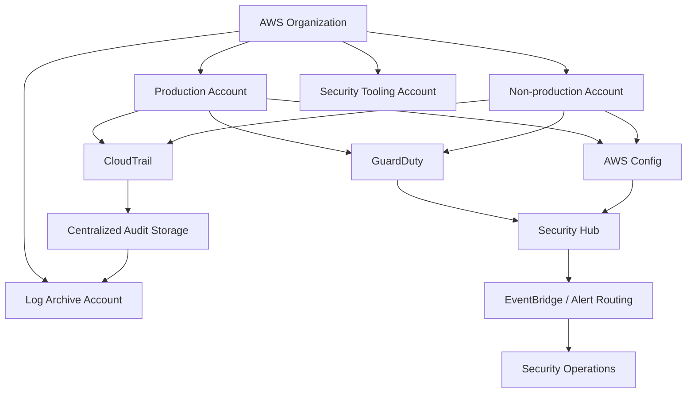
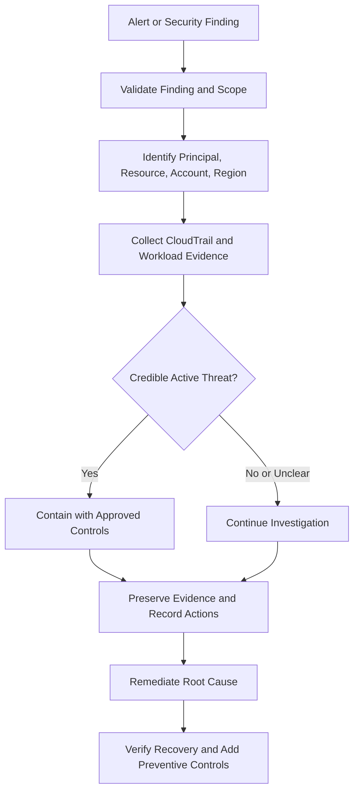
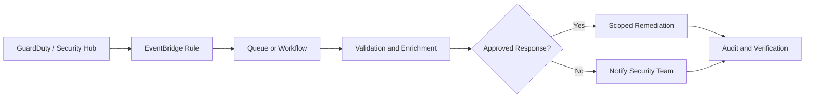

# 05- Threat Detection and Monitoring Questions

## Overview

Threat detection and monitoring are essential components of AWS security. Preventive controls reduce the likelihood of unauthorized activity, detective controls identify suspicious behavior and configuration drift, and responsive controls contain threats and support recovery.

For backend engineers, effective security monitoring means more than enabling AWS services. It requires understanding which events are generated, where evidence is stored, how findings are correlated, how alerts reach responders, and how security incidents are investigated across accounts and workloads.

This document covers AWS threat detection services, centralized monitoring architecture, operational investigation workflows, troubleshooting, and senior-level interview questions.

## Core Threat Detection Concepts

### Preventive, Detective, and Responsive Controls

| Control category | Purpose | AWS examples |
|---|---|---|
| Preventive | Block unauthorized actions before they succeed | IAM policies, SCPs, security groups, AWS WAF |
| Detective | Identify suspicious activity or configuration violations | CloudTrail, GuardDuty, AWS Config, Security Hub |
| Responsive | Contain threats and restore secure operation | IAM credential revocation, automated remediation, incident response workflows |

These controls complement one another. A security group can prevent unwanted network access, but it cannot establish whether a valid IAM principal is abusing an API. CloudTrail can record the API activity, while GuardDuty may identify suspicious patterns and Security Hub can aggregate relevant findings.

A production security architecture should combine all three categories rather than relying on any single service.

### Defense in Depth

Defense in depth uses multiple independent security layers so that failure or bypass of one control does not automatically compromise the entire system.

For a Python backend deployed on AWS, layers might include:

- IAM roles with narrowly scoped permissions.
- Private subnets for internal application workloads.
- Security groups restricting traffic between components.
- TLS for communication between clients and services.
- KMS encryption for sensitive data.
- CloudTrail for API auditing.
- GuardDuty for threat detection.
- Security Hub for centralized findings.
- Incident response procedures for containment and recovery.

**Interview point:** Encryption, access control, network isolation, and monitoring solve different problems. Encryption does not prevent an authorized but compromised application from reading data, and network isolation does not prevent an overly privileged IAM role from modifying resources through AWS APIs.

## AWS CloudTrail

### What CloudTrail Does

AWS CloudTrail records activity performed through AWS management interfaces, including the AWS Management Console, AWS CLI, and SDK/API calls. It provides evidence of which principal performed an action, what operation was requested, which resource was involved when recorded, and whether the request succeeded or failed.

CloudTrail is primarily an audit and investigation service. It does not independently determine that every recorded action is malicious.

### Event Categories

| Event category | What it records | Typical use |
|---|---|---|
| Management events | Control-plane operations such as creating IAM policies or modifying security groups | Investigating configuration changes and privilege escalation |
| Data events | Operations on supported resources, such as S3 object-level activity or Lambda function invocation | Investigating access to sensitive objects or workload execution |
| Network activity events | Selected network-related API activity for supported services and configurations | Investigating relevant network access patterns |

Data events are not automatically equivalent to management events in coverage or cost. Configure the required event selectors explicitly and verify which resource types and operations are supported.

CloudTrail event history provides a recent, regional view of management events. For longer retention, organization-wide collection, or advanced event selection, configure a trail or the appropriate CloudTrail event data store. Event history alone should not be treated as a complete centralized audit archive.

### CloudTrail Event Structure

A typical event contains fields such as:

| Field | Purpose |
|---|---|
| `eventTime` | Time of the recorded event |
| `eventSource` | AWS service that received the request |
| `eventName` | API operation |
| `awsRegion` | Region associated with the event |
| `userIdentity` | Identity information for the caller |
| `sourceIPAddress` | Recorded source address |
| `userAgent` | Client or SDK information when available |
| `requestParameters` | Request parameters when recorded |
| `responseElements` | Response details when recorded |
| `errorCode` | Error identifier for a failed request |
| `errorMessage` | Additional failure information when recorded |
| `requestID` | Request identifier useful for investigation |

Not every field is populated for every event. Some request and response fields may be omitted or redacted because of service behavior or sensitivity.

### Inspecting CloudTrail Events with the AWS CLI

The following commands are read-only.

List recent management events for an identity-related operation:

```bash
aws cloudtrail lookup-events \
  --lookup-attributes AttributeKey=EventName,AttributeValue=AssumeRole \
  --region ap-south-1 \
  --max-results 20
```

This is useful when investigating role-assumption activity. The result includes event records and metadata, but the event JSON is encoded as a string inside `CloudTrailEvent`. Inspect the event details to identify the principal, target role, timestamp, source address, and any recorded error.

Investigate a failed API operation:

```bash
aws cloudtrail lookup-events \
  --lookup-attributes AttributeKey=EventName,AttributeValue=PutBucketPolicy \
  --region ap-south-1 \
  --max-results 20
```

This returns matching events within the event-history search window. It does not automatically isolate failures; inspect the recorded error fields.

Filter events by a specific time range:

```bash
aws cloudtrail lookup-events \
  --start-time "2026-10-12T00:00:00Z" \
  --end-time "2026-10-12T23:59:59Z" \
  --region ap-south-1 \
  --max-results 50
```

Replace the timestamps with the incident window. Confirm the time zone and investigate adjacent periods when clock differences, delayed observations, or an uncertain incident start are possible.

For repeatable investigations, use a controlled parser to extract relevant fields from returned events. Do not assume every event contains the same identity or request structure.

### Production CloudTrail Architecture

A production environment should generally use an organization-level trail or another explicitly designed centralized collection mechanism, with appropriate coverage for management events, required data events, and relevant Regions.

A typical design includes:

- Collection across the AWS Organization where supported and configured.
- A dedicated log archive account.
- An S3 bucket with restrictive access policies.
- CloudTrail log file validation where integrity verification is required.
- Encryption using an appropriately governed KMS key.
- Retention and lifecycle policies aligned with investigation and compliance requirements.
- Alerts for trail changes, logging disruptions, and suspicious API activity.

CloudTrail configuration, S3 bucket policies, KMS key policies, and organization permissions must be designed together. A centralized bucket is not useful if workloads can delete the evidence or if investigators cannot decrypt the stored logs.

### CloudTrail Security Considerations

- Protect the ability to stop logging, modify trails, and change event selectors.
- Monitor changes to CloudTrail configuration.
- Restrict deletion of archived logs.
- Use separate administrative boundaries for workload operation and security evidence.
- Avoid collecting unnecessary sensitive payloads in application-level logs.
- Verify coverage for the services and event types that matter to the threat model.
- Test actual retrieval and investigation workflows rather than assuming that enabled logging guarantees useful evidence.

## Amazon GuardDuty

### What GuardDuty Does

Amazon GuardDuty analyzes supported AWS telemetry to identify potentially malicious or unauthorized behavior. Depending on the enabled protection plans and supported resources, its detection sources can include CloudTrail management events, VPC Flow Logs, DNS activity, and other service-specific signals.

GuardDuty is a threat-detection service, not a general-purpose log archive and not a guarantee that every attack will be detected.

### Common Detection Scenarios

Examples of threats GuardDuty may identify include:

- Suspicious use of AWS credentials.
- Activity associated with known malicious infrastructure.
- Unusual or potentially unauthorized API behavior.
- Certain forms of reconnaissance or network communication.
- Suspicious access patterns involving supported workloads and services.
- Findings involving supported data-access or malware-detection capabilities when the corresponding protection plans are enabled.

Exact findings depend on the enabled protections, available telemetry, service coverage, and detection logic.

### GuardDuty Findings

A finding generally includes information such as:

- Finding type and severity.
- Affected account and Region.
- Resource details.
- Finding creation and update timestamps.
- Evidence or context associated with the suspected threat.
- Affected identity or workload details when applicable.

A finding is an investigation signal, not definitive proof that an account or workload has been compromised.

### Inspect GuardDuty Findings

First identify the detector:

```bash
aws guardduty list-detectors \
  --region ap-south-1
```

Retrieve findings for a detector:

```bash
aws guardduty list-findings \
  --detector-id "<DETECTOR_ID>" \
  --region ap-south-1 \
  --max-results 50
```

Retrieve details for selected finding IDs:

```bash
aws guardduty get-findings \
  --detector-id "<DETECTOR_ID>" \
  --finding-ids "<FINDING_ID_1>" "<FINDING_ID_2>" \
  --region ap-south-1
```

These are read-only operations. The caller needs the corresponding GuardDuty permissions. Interpret the finding type, affected resource, account, Region, timestamps, and evidence before taking action.

### GuardDuty Operational Practices

- Enable GuardDuty in the accounts and Regions that require coverage.
- Use AWS Organizations integration for centralized administration where appropriate.
- Review supported protection plans and their additional costs.
- Route findings to a central response workflow.
- Prioritize findings using severity, asset criticality, identity privileges, and corroborating evidence.
- Track investigation status and document false-positive decisions.
- Avoid automatically disabling or suppressing findings simply because they are inconvenient.

## AWS Security Hub

### What Security Hub Provides

AWS Security Hub centralizes security findings from integrated AWS services and supported third-party products. It can also evaluate security posture against supported security standards and controls.

Security Hub helps teams establish a common view of security issues across accounts and Regions. It does not replace the underlying detection services, audit logs, or incident response process.

### Security Hub and Related Services

| Service | Primary responsibility |
|---|---|
| CloudTrail | Records AWS API activity |
| GuardDuty | Detects potential threats |
| AWS Config | Records supported resource configuration history and evaluates configuration rules |
| Security Hub | Aggregates findings and evaluates security posture |
| CloudWatch | Collects metrics, logs, and alarms for operational monitoring |
| EventBridge | Routes supported events to downstream targets and automation |
| Amazon Detective | Supports investigation by correlating security-related data and relationships |

Service availability, supported Regions, integration behavior, and feature names can change. Verify the required coverage and integrations for the deployment.

### Query Security Hub Findings

List findings using a basic filter:

```bash
aws securityhub get-findings \
  --region ap-south-1 \
  --filters '{
    "SeverityLabel": [
      {
        "Value": "HIGH",
        "Comparison": "EQUALS"
      },
      {
        "Value": "CRITICAL",
        "Comparison": "EQUALS"
      }
    ]
  }' \
  --max-results 20
```

This read-only command retrieves matching findings available to the caller in the specified Region. The response can include the finding title, severity, affected resource, product source, timestamps, and remediation guidance when provided.

Security Hub uses pagination for result sets. For automated reporting, follow the API's pagination behavior and avoid assuming that the first page represents all open findings.

### Security Hub Operating Model

A practical operating model separates responsibilities:

- **Platform team:** account integration, service enablement, and organization-wide coverage.
- **Security team:** severity policy, triage standards, escalation, and risk acceptance.
- **Application team:** remediation of workload-specific findings.
- **Incident response team:** containment, investigation, evidence preservation, and recovery.

Finding aggregation alone does not establish ownership. Each high-priority finding should have an accountable team, an expected response time, and a documented disposition.

## AWS Config

### Purpose

AWS Config records supported resource configuration states and changes. It can evaluate resources against managed or custom rules and help identify configuration drift.

For example, a rule may evaluate whether an S3 bucket meets a public-access requirement or whether an EC2 security group has an undesired inbound rule, depending on the supported rule and resource configuration.

AWS Config answers questions about resource configuration and compliance. It is not a substitute for CloudTrail's API activity records or GuardDuty's threat detection.

### Example Investigation

Suppose an application security group unexpectedly allows inbound SSH from a broad IP range.

A useful investigation sequence is:

1. Identify the current security group configuration.
2. Inspect AWS Config history when recording is enabled for the resource.
3. Query CloudTrail for relevant security group modification events.
4. Identify the principal, API operation, request time, and request parameters.
5. Determine whether the change was authorized.
6. Restore the approved configuration through the normal change-management process.
7. Add preventive controls or detection rules to reduce recurrence.

### Inspect Configuration Rules

List rules:

```bash
aws configservice describe-config-rules \
  --region ap-south-1
```

Inspect compliance for a specific rule:

```bash
aws configservice describe-compliance-by-config-rule \
  --config-rule-names "<CONFIG_RULE_NAME>" \
  --region ap-south-1
```

These are read-only commands. They require the relevant AWS Config permissions and return information about configured rules and their evaluation status.

A missing rule does not mean the resource is secure. Confirm that resource recording is enabled, the relevant resource type is supported, and the rule actually evaluates the desired security property.

## Amazon CloudWatch for Security Monitoring

### CloudWatch's Role

Amazon CloudWatch supports operational monitoring through metrics, logs, alarms, and dashboards. Security monitoring can use these capabilities to detect application-level indicators and operational symptoms that complement AWS security findings.

Examples include:

- Authentication failures in application logs.
- Unusual increases in HTTP 401 or 403 responses.
- Sudden spikes in API error rates.
- Failed secret retrievals.
- KMS authorization errors.
- Changes in request volume or latency.
- Security-related application events emitted by backend services.

CloudWatch does not automatically identify every event as a security incident. Detection depends on instrumentation, log ingestion, metric filters, alarm thresholds, and alert routing.

### Structured Python Logging

A FastAPI or Django service should emit structured security-relevant events without logging passwords, access tokens, secret values, or complete authorization headers.

```python
import json
import logging
from datetime import UTC, datetime

logger = logging.getLogger("security")
logger.setLevel(logging.INFO)


def log_authentication_failure(
    *,
    request_id: str,
    subject_id: str | None,
    source_ip: str,
    reason_code: str,
) -> None:
    event = {
        "event_type": "authentication_failure",
        "timestamp": datetime.now(UTC).isoformat(),
        "request_id": request_id,
        "subject_id": subject_id,
        "source_ip": source_ip,
        "reason_code": reason_code,
    }

    logger.warning(json.dumps(event))
```

In production, configure a logging handler and formatter appropriate to the deployment environment. Use a trusted request ID, validate or normalize externally supplied fields, and avoid including raw user input that could create log injection or expose personal data.

For applications behind a reverse proxy or load balancer, do not trust arbitrary client-supplied forwarding headers for source-IP attribution. Configure trusted proxy handling explicitly.

### Operational Monitoring vs. Threat Detection

| Signal | Suitable mechanism |
|---|---|
| AWS API call that modifies an IAM policy | CloudTrail |
| Potentially malicious credential activity | GuardDuty and CloudTrail investigation |
| Resource violates a configuration rule | AWS Config and Security Hub |
| Application authentication failures increase sharply | CloudWatch Logs, metric filters, and alarms |
| A security finding requires automated routing | Security Hub and EventBridge |
| A service's latency increases after security remediation | CloudWatch metrics and alarms |

Use the service that provides the required evidence. A generic error-rate alarm cannot establish that a credential was stolen, and an AWS API audit record cannot explain every application-level authorization decision.

## Centralized Security Monitoring Architecture

### Multi-Account Design

A production AWS environment commonly separates production workloads, non-production workloads, security tooling, and log archival into distinct accounts. This limits blast radius and allows security evidence to be managed independently of application administration.

A centralized design may include:

- AWS Organizations for account governance.
- IAM Identity Center or a federated identity provider for human access.
- IAM roles for controlled cross-account access.
- CloudTrail for API auditing.
- GuardDuty for threat detection.
- Security Hub for findings aggregation and posture evaluation.
- AWS Config for configuration history and compliance checks.
- A dedicated log archive account.
- EventBridge and a notification or incident management system for routing findings.



This is a logical architecture. Exact integration paths depend on whether the deployment uses organization trails, delegated administrators, cross-Region aggregation, centralized event routing, and the selected service configuration.

### Architecture Decisions

| Decision | Recommended direction | Trade-off |
|---|---|---|
| Audit log ownership | Separate log archive account | More governance and cross-account configuration |
| Threat detection | Organization-wide GuardDuty coverage where appropriate | Additional cost and delegated-administrator management |
| Finding aggregation | Security Hub with deliberate account and Region coverage | Integration and finding lifecycle complexity |
| Configuration compliance | AWS Config rules aligned with security requirements | Recording and evaluation costs |
| Alert delivery | Event-driven routing with retry and failure handling | Automation introduces operational dependencies |
| Log retention | Explicit retention and lifecycle policies | Longer retention increases storage cost |
| Incident automation | Narrowly scoped, auditable response roles | Poorly designed automation can disrupt production |

### Centralization Is Not Automatically Complete

Validate each account and Region independently. Check whether services are enabled, whether delegated administrators are configured, whether required event types are captured, and whether findings reach the intended destination.

An organization-level design can still have gaps due to unsupported Regions, opt-in Region configuration, excluded resource types, incorrect policies, or integration failures.

## Threat Investigation Workflow

A reliable investigation follows a repeatable process rather than starting with a broad permission change or an immediate resource deletion.



### Initial Triage

For every finding, establish:

- What happened, and when?
- Which account and Region are affected?
- Which principal, role session, resource, or workload is involved?
- Is the behavior expected, authorized, and associated with a known change?
- What evidence supports the finding?
- Is the activity ongoing?
- What data or systems could be affected?
- Which containment actions are authorized and least disruptive?

Correlate timestamps carefully. AWS service event times, application logs, and third-party telemetry may use different formats or ingestion delays.

### Evidence Collection

Collect relevant evidence before changing or deleting affected resources when doing so is safe and does not delay necessary containment.

Useful evidence may include:

- CloudTrail events and event IDs.
- GuardDuty finding JSON.
- Security Hub finding details.
- AWS Config resource history.
- Relevant application logs and CloudWatch metrics.
- IAM role trust and permission policies.
- Network configuration and flow evidence when available.
- Deployment records, change tickets, and CI/CD activity.

Preserve evidence in an access-controlled location with appropriate retention. Record the investigator, collection time, source, and actions taken. Avoid modifying original evidence unnecessarily.

## Incident Response: Compromised Credentials

### Scenario

A GuardDuty finding indicates suspicious API activity associated with a workload role or IAM user.

### Response Procedure

1. **Validate the identity.** Determine whether the activity came from a human user, an assumed role session, an AWS service, or a workload.
2. **Establish scope.** Identify API operations, affected resources, accounts, Regions, and the approximate activity window.
3. **Preserve evidence.** Collect relevant CloudTrail events and associated findings.
4. **Contain the threat.** Use the narrowest effective action consistent with the incident response plan.
5. **Rotate or revoke access.** Invalidate compromised long-lived credentials, restrict future role assumption, or take appropriate action against active sessions.
6. **Investigate impact.** Review data access, resource changes, new credentials, persistence mechanisms, and privilege modifications.
7. **Recover.** Restore trusted configurations and rotate dependent credentials where necessary.
8. **Prevent recurrence.** Remove excessive permissions, fix credential exposure, and improve detection coverage.

### Containment Options and Trade-offs

| Action | Appropriate use | Considerations |
|---|---|---|
| Deactivate a compromised IAM access key | Long-lived access key compromise | Verify dependent workloads and rotate safely |
| Change a role's permissions | Excessive permissions or suspicious role use | Policy changes may affect active workloads |
| Restrict a role's trust policy | Preventing new unauthorized role assumptions | Existing sessions may remain valid |
| Apply a targeted explicit deny or containment policy | Urgent restriction of specific actions | Scope carefully and verify policy interactions |
| Isolate a workload through network controls | Suspected host or application compromise | May interrupt production traffic or evidence collection |
| Disable or quarantine an affected resource | Active compromise with significant risk | Preserve evidence and follow the approved incident process |

**Important:** Removing a role's permission policy or editing its trust policy does not necessarily invalidate credentials already issued for an active role session. For active-session containment, understand the relevant AWS service semantics and consider supported mechanisms such as an appropriate explicit deny or a carefully scoped policy that denies requests based on the role session's issue time. Verify the exact policy condition behavior before deployment.

For long-lived IAM access keys, deactivation prevents new use of that key. For federated users and temporary credentials, containment depends on the credential source, session lifetime, applicable policies, and service behavior.

### Post-Incident Review

After containment and recovery:

- Establish the root cause and attack path.
- Identify every affected identity, resource, and account.
- Verify that malicious changes have been removed.
- Confirm credentials and secrets are rotated where required.
- Review access logs for evidence of data exposure.
- Validate monitoring and alert delivery.
- Document residual risks and accepted exceptions.
- Add automated preventive checks for the underlying failure.

## Troubleshooting AWS Security Monitoring

### CloudTrail Events Are Missing

**Symptoms**

- An expected API call cannot be found.
- A security investigation has incomplete activity history.
- Events appear in one account or Region but not another.

**Likely causes**

- Searching the wrong Region or time window.
- Looking outside the available event-history period.
- Expecting data events that were not configured.
- Missing trail coverage or incorrect event selectors.
- Organization integration or delivery configuration problems.
- Searching with an incorrect event name or attribute.

**Isolation steps**

Inspect the trail configuration:

```bash
aws cloudtrail describe-trails \
  --include-shadow-trails \
  --region ap-south-1
```

Check trail status:

```bash
aws cloudtrail get-trail-status \
  --name "<TRAIL_NAME_OR_ARN>" \
  --region ap-south-1
```

Inspect configured event selectors:

```bash
aws cloudtrail get-event-selectors \
  --trail-name "<TRAIL_NAME_OR_ARN>" \
  --region ap-south-1
```

Interpret the results by checking trail configuration, delivery status, event selectors, account scope, and Region. These are read-only inspection commands.

**Corrective actions**

- Correct the Region and time range.
- Configure the required event selectors.
- Restore appropriate trail delivery permissions.
- Verify organization-wide coverage and delegated administration.
- Confirm logs are delivered to the expected destination.
- Add monitoring for logging disruptions and trail configuration changes.

**Verification**

Generate a controlled, authorized test API event and verify that it appears in the expected evidence source. For data events, verify the resource type and event selector specifically.

### GuardDuty Finding Is Not Visible

**Symptoms**

- A security alert refers to a finding that cannot be retrieved.
- One account reports findings while another appears empty.
- Expected threat coverage is absent.

**Likely causes**

- GuardDuty is not enabled in the target account or Region.
- The wrong detector ID is used.
- Organization delegation or account enrollment is incomplete.
- A relevant protection plan is not enabled.
- The detection scenario is outside the service's coverage.

**Isolation steps**

```bash
aws guardduty list-detectors \
  --region ap-south-1
```

After obtaining the correct detector ID:

```bash
aws guardduty get-detector \
  --detector-id "<DETECTOR_ID>" \
  --region ap-south-1
```

Inspect organization configuration and relevant protection settings using the appropriate GuardDuty APIs or console.

**Corrective actions**

Enable the required service coverage through the approved security deployment process, fix delegated administration or Region coverage, and validate permissions for finding retrieval.

**Verification**

Confirm that the intended accounts and Regions are enrolled and that findings can be retrieved by the authorized security role. Use a supported test procedure where available rather than generating suspicious activity against production resources.

### Security Hub Findings Are Missing

**Symptoms**

- GuardDuty reports a finding, but Security Hub does not display it.
- Findings appear in one Region but not the aggregation Region.
- Compliance status differs between environments.

**Likely causes**

- Security Hub or the relevant integration is disabled.
- Account or Region coverage is incomplete.
- Aggregation configuration is missing or incorrect.
- Findings have not yet propagated.
- Filters exclude the finding.
- The caller lacks permissions to retrieve the finding.

**Isolation steps**

Inspect Security Hub status and configuration using the appropriate Security Hub APIs or console. Query the originating service directly to determine whether the finding exists independently of the aggregation layer.

**Corrective actions**

Enable the required integration, correct account and Region configuration, review aggregation settings, and adjust filters without weakening access controls.

**Verification**

Confirm that a known finding from the source service becomes visible in the intended Security Hub view and can be retrieved by the security operations role.

### AWS Config Reports Unexpected Compliance Results

**Symptoms**

- A resource is reported noncompliant despite an apparent fix.
- A resource is not evaluated.
- Configuration history does not contain the expected change.

**Likely causes**

- Resource recording is incomplete.
- The rule does not evaluate the property being checked.
- Evaluation is delayed or has not been triggered.
- The rule has incorrect parameters.
- The resource type or Region is unsupported or not covered.

**Isolation steps**

Inspect the Config rule, resource recording configuration, compliance evaluation, and configuration history.

**Corrective actions**

Correct recording and rule configuration, request an appropriate reevaluation where supported, and validate the resource against the intended security requirement independently.

**Verification**

Confirm that the expected resource configuration is recorded and that the rule returns a compliance result consistent with the actual configuration.

### CloudWatch Security Alarm Does Not Trigger

**Symptoms**

- Security-related log entries exist, but the alarm remains in `OK`.
- A metric filter does not increment.
- Notifications are not delivered.

**Likely causes**

- The filter pattern does not match the emitted log structure.
- The application writes to a different log group.
- The metric namespace or dimensions are incorrect.
- The alarm threshold or evaluation period is unsuitable.
- The notification target or permissions are misconfigured.

**Isolation steps**

Inspect the log group, query matching events, review the metric filter, inspect metric datapoints, and check alarm history.

**Corrective actions**

Align the filter with actual structured logs, correct metric configuration, and verify the notification path independently.

**Verification**

Emit a controlled test event in a non-production environment and confirm the log match, metric increment, alarm state transition, and notification delivery.

## Security Automation and Alert Routing

### Event-Driven Response

Security findings can be routed through Amazon EventBridge to notification systems, ticketing integrations, or carefully scoped remediation functions.

A robust automation pipeline should:

- Match only the intended event types and sources.
- Validate account, Region, finding type, and affected resource.
- Be idempotent where possible.
- Use a dedicated execution role with minimal permissions.
- Record actions and failures.
- Handle retries and duplicate events.
- Include a manual approval step for destructive or high-impact operations.
- Avoid placing secret values or unnecessary sensitive data in event payloads.



For higher-risk actions, a queue or workflow can provide buffering, retry control, approval, and failure handling. The added components increase operational complexity and cost, so the design should match the incident response requirements.

### Automation Failure Modes

| Failure | Mitigation |
|---|---|
| Duplicate finding events | Idempotency keys and safe repeatable actions |
| Incorrect event matching | Test event patterns against representative events |
| Remediation affects the wrong resource | Validate account, Region, resource identity, and current state |
| Automation role is overprivileged | Scope permissions to the required actions and resources |
| Remediation silently fails | Emit execution metrics, logs, and failure notifications |
| Automated containment disrupts production | Add risk-based approval and rollback procedures |

Do not use a single unrestricted Lambda execution role to remediate every type of security finding. Separate remediation permissions by function and resource scope.

## Security Monitoring Best Practices

### Identity and Access

- Use short-lived credentials and IAM roles instead of embedded access keys.
- Require MFA and stronger controls for privileged human access.
- Restrict who can modify IAM policies, trust relationships, CloudTrail, GuardDuty, and Security Hub.
- Review unused credentials and excessive permissions.
- Monitor changes to role trust policies, access keys, and high-impact permissions.
- Use separate roles for routine operations, security administration, and incident response.

### Logging and Evidence

- Enable appropriate audit coverage across accounts and Regions.
- Protect audit logs from unauthorized modification and deletion.
- Define retention periods according to legal, operational, and incident response requirements.
- Include resource and identity context in application security events.
- Avoid logging passwords, bearer tokens, secret values, and sensitive request bodies.
- Test log retrieval, access permissions, and investigation procedures regularly.

### Alerting and Triage

- Define severity using both finding severity and business impact.
- Assign owners and escalation paths.
- Distinguish actionable alerts from informational findings.
- Measure detection-to-triage and triage-to-containment times.
- Test notification and escalation channels.
- Review false positives and missed detections without suppressing meaningful signals.

### Cost and Reliability

- Understand charges associated with CloudTrail event types, CloudTrail data stores, S3 storage, GuardDuty protection plans, AWS Config recording and evaluations, Security Hub checks, and CloudWatch ingestion and retention.
- Avoid collecting unnecessary high-volume data without a defined investigation purpose.
- Use S3 lifecycle policies for long-term log storage where appropriate.
- Monitor delivery failures and service integration health.
- Test the recovery process for centralized logging and security automation.
- Validate service quotas and regional coverage before scaling organization-wide.

## Common Security Monitoring Mistakes

### Treating Enabled Services as Complete Coverage

Enabling CloudTrail, GuardDuty, or Security Hub does not prove that every account, Region, resource type, and event category is covered.

**Better approach:** Maintain a coverage inventory and validate service configuration through automated checks and periodic reviews.

### Relying Only on Findings

Detection findings provide useful signals but may not include the complete sequence of API activity or application behavior.

**Better approach:** Correlate findings with CloudTrail, application logs, configuration history, deployment records, and relevant network evidence.

### Treating Every Finding as a Confirmed Attack

Some findings represent suspicious or anomalous behavior that requires investigation. Automatically deleting resources or disabling roles based solely on an unverified signal can cause outages.

**Better approach:** Define response policies by finding type, severity, resource criticality, and confidence. Use immediate automated containment only where the action is well understood and appropriately scoped.

### Ignoring Logging Permissions

An overly restrictive S3 bucket or KMS key policy can prevent evidence delivery or investigation even when the source service is enabled.

**Better approach:** Validate both write-path permissions and investigator read/decrypt permissions. Monitor delivery failures.

### Logging Sensitive Data During Investigation

Developers may enable verbose logging to troubleshoot authentication or authorization errors and accidentally expose credentials.

**Better approach:** Log event metadata, stable identifiers, and sanitized reason codes. Redact authorization headers, cookies, tokens, and secret values.

### Making Broad Permission Changes During an Incident

Granting administrator access to resolve a monitoring or investigation failure increases the blast radius and may conceal the actual problem.

**Better approach:** Identify the precise missing action, resource, condition, trust relationship, or service integration permission. Apply the smallest justified correction and verify it.

## Senior-Level Interview Questions and Answers

### Core Threat Detection Concepts

**Q: What is the difference between CloudTrail, GuardDuty, and Security Hub?**

**Answer:**

- CloudTrail records AWS API activity and supports auditing.
- GuardDuty analyzes supported telemetry to detect potentially malicious behavior.
- Security Hub aggregates findings and evaluates security posture against supported controls and standards.

They are complementary. CloudTrail provides evidence, GuardDuty provides threat signals, and Security Hub helps centralize security findings and posture information.

**Q: Is CloudTrail a real-time intrusion detection system?**

**Answer:**

CloudTrail is primarily an audit event service. It records API activity, while detection and alerting depend on other services and configured workflows. Event delivery and downstream processing may have latency. For threat detection, combine audit records with GuardDuty, Security Hub, application monitoring, and suitable alerting.

**Q: Why is AWS Config not a replacement for CloudTrail?**

**Answer:**

AWS Config focuses on resource configuration history and compliance evaluation. CloudTrail records API activity. Config may show that a security group changed, while CloudTrail can help identify the API operation and caller associated with the change. Neither service should be assumed to replace the other.

**Q: What does defense in depth mean for AWS monitoring?**

**Answer:**

It means combining preventive controls, independent evidence sources, threat detection, centralized alerting, and response procedures. For example, IAM restricts who can change a bucket policy, CloudTrail records the change, GuardDuty may identify suspicious associated activity, Security Hub aggregates findings, and a response workflow investigates or contains the incident.

### CloudTrail and Audit Investigation

**Q: An IAM policy was modified unexpectedly. How would you investigate it?**

**Answer:**

1. Identify the affected account, Region, policy, and approximate change time.
2. Search CloudTrail for relevant policy-management events, such as `CreatePolicyVersion`, `SetDefaultPolicyVersion`, `AttachRolePolicy`, or `PutRolePolicy`.
3. Inspect the principal, role session, source address, request parameters, and event time.
4. Correlate the event with deployment records and approved change requests.
5. Determine whether the change introduced additional privileges or altered a trust boundary.
6. Preserve the evidence and contain unauthorized access if necessary.
7. Restore the intended policy through a controlled remediation process.
8. Add monitoring and preventive controls for similar policy changes.

Do not assume the last policy modification event explains the entire incident. Review related role assumptions, credential creation, and subsequent API activity.

**Q: Why might an S3 object access not appear in CloudTrail event history?**

**Answer:**

S3 object-level operations are data events, and they are not automatically included in the same way as management events in event history. Verify the relevant trail or event data store configuration, resource selectors, Region, and retention window. Also confirm that the operation and resource are covered by the configured event selectors.

**Q: How do you protect CloudTrail evidence from an attacker who has compromised a workload account?**

**Answer:**

Use a separate log archive account, tightly controlled write and administrative permissions, appropriate organization-level governance, and retention policies. Monitor changes to trails and archive policies. Consider log file validation where integrity verification is required. Separate workload administration from evidence administration and test that investigators can retrieve and decrypt the evidence.

### GuardDuty and Security Hub

**Q: GuardDuty reports suspicious credential activity. What do you do first?**

**Answer:**

Validate the finding and identify the account, principal, role session, resource, Region, and time window. Correlate the finding with CloudTrail and workload evidence. Determine whether the activity is ongoing and assess the identity's permissions and potential impact. Contain the threat using the narrowest effective action, preserve evidence, rotate or revoke compromised credentials where appropriate, and investigate subsequent activity.

**Q: Why might a GuardDuty finding not appear in Security Hub?**

**Answer:**

Potential causes include missing integration, incomplete account or Region coverage, aggregation configuration, permissions, filtering, or propagation delay. Query GuardDuty directly first. Then inspect Security Hub configuration and integration status. Do not conclude that a missing aggregated finding means the underlying detection did not occur.

**Q: Would you automatically isolate every resource associated with a critical finding?**

**Answer:**

Not without understanding the finding type, resource role, and containment impact. Some findings justify immediate automated action, while others require enrichment or human approval. A mature system defines scoped response policies, uses least-privilege automation roles, records every action, and verifies containment.

### Application and Backend Monitoring

**Q: How would you monitor authentication abuse in a FastAPI service?**

**Answer:**

Emit structured authentication events with request IDs, sanitized reason codes, timestamps, and appropriate client context. Use CloudWatch Logs and metrics to identify spikes, repeated failures, or anomalous patterns. Protect sensitive fields from logging, handle trusted proxy headers correctly, and connect alerts to an incident workflow. Rate limiting and application authorization controls remain necessary; logging alone does not prevent abuse.

**Q: Why is logging every failed request at high severity a problem?**

**Answer:**

It can create alert fatigue, increase ingestion cost, and allow attackers to generate excessive log volume. Use structured event types, aggregation, rate-based metrics, appropriate sampling for high-volume events, and thresholds based on expected traffic. Preserve enough evidence for investigation without treating every routine authentication failure as a critical incident.

### Architecture and Senior-Level Reasoning

**Q: Design centralized security monitoring for a multi-account AWS environment.**

**Answer:**

Use AWS Organizations to establish account governance. Configure CloudTrail audit coverage and centralized log archival, enable GuardDuty across required accounts and Regions, and aggregate findings with Security Hub where appropriate. Use AWS Config for resource configuration and compliance checks. Route findings through EventBridge to a controlled triage and response system. Separate security administration from workload administration, protect evidence, define ownership, and regularly test detection and incident response.

Key trade-offs include service cost, account and Region coverage, evidence retention, alert volume, and the operational complexity of automated remediation.

**Q: How do you distinguish a legitimate deployment from malicious API activity?**

**Answer:**

Correlate CloudTrail identity and request details with approved deployment identities, CI/CD execution records, change tickets, timestamps, and expected resource changes. A known role name alone is insufficient because a compromised pipeline or role can be abused. Evaluate the actual principal session, permissions, operation sequence, resource scope, and resulting configuration.

**Q: What metrics would you use to evaluate security monitoring effectiveness?**

**Answer:**

Useful measures include detection-to-triage time, triage-to-containment time, high-severity finding backlog, alert acknowledgement time, logging coverage, unresolved compliance findings, false-positive rate, and successful completion of incident response exercises. Metrics should measure operational effectiveness rather than merely counting enabled services or generated alerts.

**Q: How would you investigate a finding that appears to be a false positive?**

**Answer:**

Validate the underlying evidence, compare the activity with known workload behavior, inspect relevant audit records, and confirm whether the activity was authorized. Document the conclusion and supporting evidence. If suppression is appropriate, scope it narrowly and monitor for changes in the threat pattern. Avoid broad suppression that hides similar genuine incidents.

## Practical Exercises

### Exercise: Investigate an Unexpected IAM Change

**Prerequisites**

- An AWS account with CloudTrail management event history.
- Read-only permissions for the relevant CloudTrail events and IAM resources.
- An approved test environment.

**Steps**

1. Identify a controlled IAM policy modification in the test environment.
2. Search CloudTrail for the corresponding policy-management event.
3. Inspect the event identity, request parameters, Region, timestamp, and request ID.
4. Compare the resulting policy with the expected configuration.
5. Document the event and the investigation steps.

**Verification**

Confirm that the recorded event identifies the relevant operation and provides sufficient context to investigate the change. Some event fields may be absent or redacted.

**Cleanup**

Restore the test environment to its approved configuration using the normal change process. Do not delete audit evidence required for the exercise.

**Cost considerations**

CloudTrail event history supports basic investigation without requiring a separate log-processing pipeline. Additional trails, data events, event data stores, and long-term log storage can incur charges.

### Exercise: Inspect Security Findings

**Prerequisites**

- GuardDuty and Security Hub enabled in a test account or another approved environment.
- Read-only permissions for finding inspection.
- A finding generated by a supported, approved test procedure or already present in the environment.

**Steps**

1. List GuardDuty detectors in the target Region.
2. Retrieve the relevant GuardDuty finding.
3. Query Security Hub for the corresponding finding where integrated.
4. Compare the source finding with the aggregated representation.
5. Document differences in fields, timestamps, resource context, and status.

**Verification**

Confirm that the relevant source finding can be retrieved and that expected aggregation and Region coverage are configured.

**Cleanup**

No destructive cleanup is normally required for read-only inspection. If the exercise creates resources or enables additional protections, remove only the test resources and restore the approved service configuration.

**Cost considerations**

GuardDuty, Security Hub checks, and related protection plans may incur charges. Confirm current pricing and account-level configuration before enabling additional features.

## Operational Security Review Checklist

Use this checklist during periodic posture reviews and before production launch.

- [ ] CloudTrail coverage is verified across required accounts and Regions.
- [ ] Required management and data events are configured.
- [ ] Audit logs are protected by appropriate S3 and KMS policies.
- [ ] Logging delivery failures and configuration changes are monitored.
- [ ] GuardDuty is enabled for required accounts and Regions.
- [ ] Security Hub integrations and aggregation settings are verified.
- [ ] AWS Config recording and required compliance rules are active.
- [ ] Security findings have owners, severity definitions, and escalation paths.
- [ ] EventBridge rules and remediation roles are scoped and tested.
- [ ] Application logs contain useful security context without secrets.
- [ ] Incident response procedures cover compromised credentials and suspicious API activity.
- [ ] Evidence preservation and investigator access have been tested.
- [ ] Detection and response exercises are performed periodically.
- [ ] Security monitoring costs and service quotas are reviewed.
- [ ] Findings are tracked through remediation and verified closure.

## Key Takeaways

- CloudTrail provides AWS API audit evidence, GuardDuty detects potential threats, Security Hub centralizes findings, and AWS Config evaluates resource configuration and compliance.
- Effective monitoring requires deliberate account, Region, event-type, and resource coverage; enabling a service alone does not guarantee complete visibility.
- Incident response should correlate findings with audit and workload evidence, preserve relevant records, and contain threats using narrowly scoped, verified actions.
- Centralized logging, least-privilege response roles, reliable alert routing, and tested escalation procedures reduce the risk of evidence loss and unsafe remediation.
- Measure monitoring effectiveness through coverage, triage and containment times, actionable findings, and verified remediation rather than the number of enabled services.