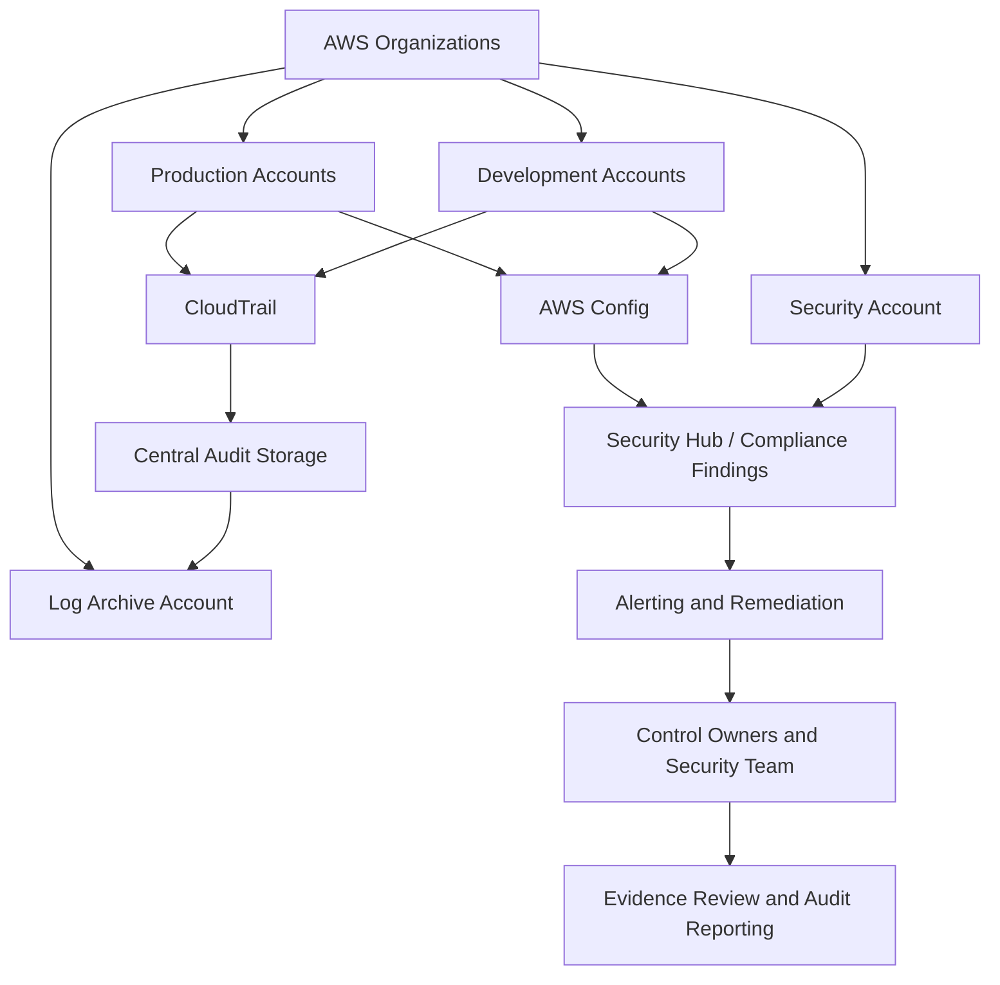
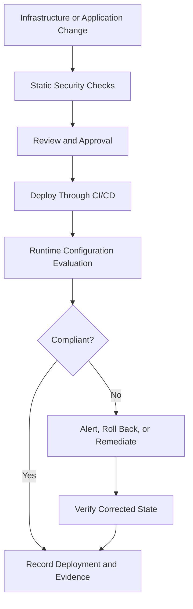

# 06- Compliance and Auditing Questions

## Overview

AWS compliance and auditing establish the controls, evidence, and operational processes required to demonstrate that cloud workloads meet security, regulatory, and organizational requirements.

For backend engineers, compliance involves more than enabling AWS security services. It requires enforceable controls, reliable audit evidence, continuous configuration validation, controlled access to sensitive information, and repeatable remediation procedures.

This document covers AWS compliance services, audit evidence, governance, continuous compliance, practical AWS CLI workflows, troubleshooting, and senior-level interview questions.

## Core Compliance and Auditing Concepts

### Compliance, Security, and Auditing

These concepts are related but serve different purposes.

| Concept | Purpose | Example |
|---|---|---|
| Security | Protect identities, workloads, and data | Restrict S3 access through IAM and bucket policies |
| Compliance | Demonstrate adherence to defined requirements | Enforce encryption and retention controls |
| Auditing | Examine evidence to determine whether controls operated as intended | Investigate an IAM policy change through CloudTrail |
| Governance | Define acceptable configurations, ownership, and boundaries | Apply organization-wide guardrails through AWS Organizations |
| Continuous compliance | Detect deviations from approved configurations over time | Evaluate resources using AWS Config rules |

A workload can have strong security controls but insufficient evidence to demonstrate their effectiveness. Conversely, a resource can pass a configuration assessment while the application running on it contains authorization vulnerabilities.

### Preventive, Detective, and Corrective Controls

| Control type | Purpose | AWS examples |
|---|---|---|
| Preventive | Prevent a violation before it occurs | IAM policies, service control policies, restrictive resource policies |
| Detective | Identify violations or suspicious activity | CloudTrail, AWS Config, GuardDuty, Security Hub |
| Corrective | Restore the approved state | Controlled remediation workflows, credential revocation, infrastructure redeployment |

A mature compliance program combines these controls. Prevention reduces the likelihood of violations, detection identifies failures that bypass prevention, and correction restores the expected state.

### Audit Evidence

Audit evidence should demonstrate both the configuration of a control and its operation over time.

Common evidence sources include:

- CloudTrail events documenting AWS API activity.
- AWS Config configuration history and rule evaluations.
- Security Hub findings and control assessments.
- IAM policies, role trust policies, and access-review records.
- CI/CD execution records and approved change requests.
- Application logs for security-sensitive operations.
- Evidence of credential rotation and periodic access reviews.
- Incident reports documenting investigation and remediation.

Evidence must be protected from unauthorized modification or deletion. Retention, integrity, and access should align with investigation needs and applicable organizational requirements.

## AWS Shared Responsibility and Compliance

### Responsibility Boundaries

AWS is responsible for security of the cloud, including physical facilities and the underlying infrastructure that supports its services. Customers remain responsible for security controls within their configured workloads, although the exact boundary depends on the service and deployment model.

Customer responsibilities commonly include:

- Identity and access management.
- Application and dependency security.
- Data classification and protection.
- Network and resource configuration.
- Secret management.
- Logging and monitoring configuration.
- Retention and evidence management.
- Access reviews and compliance reporting.

For example, AWS operates the underlying infrastructure for Amazon RDS, but the customer must still configure appropriate database access, manage application authorization, protect credentials, and satisfy relevant data-protection requirements.

### Responsibility Matrix

| Area | AWS responsibility | Customer responsibility |
|---|---|---|
| Physical infrastructure | Facilities and physical security | Understand applicable service boundaries |
| Managed service infrastructure | Operate the underlying service | Configure and use the service securely |
| IAM | Provide identity and authorization mechanisms | Define identities, permissions, trust relationships, and reviews |
| Data protection | Provide supported encryption and protection capabilities | Classify data, configure controls, and manage access |
| Logging | Provide logging services | Enable coverage, protect evidence, and investigate events |
| Workload security | Secure underlying cloud infrastructure | Secure applications, dependencies, containers, and configurations |
| Compliance | Provide relevant AWS assurance information | Demonstrate that the overall workload meets applicable requirements |

Using a managed service reduces some operational responsibilities but does not eliminate customer security obligations.

## AWS Artifact

### Purpose

AWS Artifact provides access to AWS compliance-related reports and certain agreements. It helps organizations obtain evidence about AWS's own compliance posture and service assurance.

Typical use cases include:

- Retrieving AWS compliance reports for internal assessments.
- Supporting vendor-risk reviews.
- Providing relevant assurance documents to auditors.
- Reviewing available agreements where applicable.

AWS Artifact does not certify that a customer's application or AWS account is compliant. AWS service-level assurance is only one input into the customer's broader compliance assessment.

### Production Considerations

- Identify which reports and services are relevant to the assessment.
- Review report periods and scope rather than assuming every service or Region is covered.
- Restrict access to compliance reports and agreements.
- Map assurance documents to the applicable requirements.
- Coordinate with legal, security, and compliance teams when interpreting regulatory obligations.

**Interview question: Does AWS Artifact make an application compliant?**

No. Artifact provides AWS compliance-related reports and certain agreements. Customers must configure workloads, implement required controls, manage data, maintain evidence, and demonstrate that the overall environment meets applicable requirements.

## AWS Config for Continuous Compliance

### What AWS Config Does

AWS Config records supported AWS resource configurations and tracks configuration changes. It can evaluate resources against managed rules, custom rules, and supported conformance packs.

It helps answer questions such as:

- Which security groups violate the approved inbound-access policy?
- Which supported resources fail encryption requirements?
- When did a resource's configuration change?
- Which resources are noncompliant with a defined rule?
- Did a remediation restore the expected configuration?

AWS Config evaluates the resource properties and rules configured for it. A compliant result does not prove that an application is secure or that every regulatory requirement has been satisfied.

### AWS Config Components

| Component | Responsibility |
|---|---|
| Configuration recorder | Records supported resource configuration changes |
| Configuration item | Represents a recorded resource configuration state |
| Configuration history | Provides historical configuration information |
| Config rule | Evaluates a defined configuration requirement |
| Conformance pack | Groups rules and related compliance configuration |
| Remediation configuration | Defines supported remediation behavior for applicable rules |

Resource coverage, evaluation behavior, and remediation capabilities vary by resource type and rule. Verify the relevant support before using Config as audit evidence.

### Example: Detecting an Insecure Security Group

Suppose an organization prohibits unrestricted SSH access from the public internet.

A compliance workflow might:

1. Define the expected network-access policy.
2. Configure a suitable managed or custom Config rule.
3. Enable recording for the relevant resource types.
4. Evaluate security groups against the rule.
5. Report noncompliant resources to their owners.
6. Investigate the source of changes using CloudTrail.
7. Remediate violations through an approved workflow.
8. Reevaluate the resource and preserve evidence of the result.

A configuration rule identifies a defined condition. It does not necessarily determine whether the change was malicious or whether an exception was approved.

### Inspect Config Rules

The following commands are read-only and require appropriate AWS Config permissions.

List configured rules:

```bash
aws configservice describe-config-rules \
  --region ap-south-1
```

Inspect compliance by rule:

```bash
aws configservice describe-compliance-by-config-rule \
  --config-rule-names "<CONFIG_RULE_NAME>" \
  --region ap-south-1
```

Retrieve noncompliant resources for a rule:

```bash
aws configservice get-compliance-details-by-config-rule \
  --config-rule-name "<CONFIG_RULE_NAME>" \
  --compliance-types NON_COMPLIANT \
  --region ap-south-1
```

Interpret the results carefully:

- An absent rule does not establish compliance.
- A missing evaluation can indicate incomplete recording, unsupported coverage, or delayed evaluation.
- A noncompliant resource may represent a real violation or an approved exception requiring separate governance.
- A successful remediation should be followed by an evaluation confirming the expected state.

### Limitations and Cost Considerations

AWS Config can incur charges for recorded configuration items and rule evaluations. Large environments with high resource churn can generate substantial configuration history.

Production practices include:

- Recording resource types and Regions required by the compliance strategy.
- Reviewing managed and custom rule coverage.
- Using conformance packs where they simplify policy distribution.
- Avoiding unnecessary duplicate evaluations.
- Defining ownership for noncompliant resources.
- Establishing retention and access policies for configuration evidence.
- Reviewing current pricing and quotas before expanding coverage.

## AWS CloudTrail for Auditing

### Audit Purpose

CloudTrail records AWS API activity and supports investigations into changes made through the console, CLI, SDKs, and service integrations.

It helps establish:

- Which principal performed an API operation.
- Which operation was requested.
- When the event occurred.
- Which account and Region were involved.
- Whether an operation failed or succeeded, when recorded.
- Which request parameters and resources were involved, when available.

CloudTrail does not automatically prove that an action was approved by organizational policy. That conclusion may require correlation with IAM configuration, deployment evidence, and change-management records.

### Management Events and Data Events

| Event type | Examples | Audit purpose |
|---|---|---|
| Management events | IAM policy changes, security group modifications, trail configuration changes | Investigate administrative changes |
| Data events | Supported S3 object operations and Lambda invocations | Investigate activity against selected resources |
| Network activity events | Supported network-related API activity | Investigate relevant network-access operations |

Data events require deliberate configuration for relevant resources and operations. Verify event selectors and current service coverage.

### Investigating a Security-Sensitive Change

Search recent events for a particular operation:

```bash
aws cloudtrail lookup-events \
  --lookup-attributes AttributeKey=EventName,AttributeValue=PutBucketPolicy \
  --region ap-south-1 \
  --max-results 20
```

Search events within a specific time range:

```bash
aws cloudtrail lookup-events \
  --start-time "2026-10-12T00:00:00Z" \
  --end-time "2026-10-12T23:59:59Z" \
  --region ap-south-1 \
  --max-results 50
```

Inspect the returned event data for the principal, request parameters, event time, resource context, and recorded errors.

CloudTrail event history is useful for recent management-event investigation, but it should not be treated as a complete long-term audit archive.

### Protecting Audit Evidence

A production audit architecture should consider:

- Centralized log storage in a dedicated account.
- Restrictive S3 bucket policies.
- Appropriate encryption and KMS key governance.
- CloudTrail log file validation when integrity verification is required.
- Retention and lifecycle policies.
- Monitoring of trail changes and delivery failures.
- Restricted access to delete or modify audit evidence.
- Documented evidence retrieval and investigation procedures.

Log file validation helps verify the integrity of delivered CloudTrail log files and their digest files. It does not prove that every relevant event was collected or that the original logging configuration provided complete coverage.

## AWS Security Hub and Compliance Posture

### Purpose

AWS Security Hub centralizes supported security findings and evaluates security posture against supported standards and controls.

It helps teams prioritize security issues across accounts and Regions. A passing control does not prove that every aspect of a regulatory requirement has been satisfied.

### Security Hub vs. AWS Config

| Dimension | AWS Config | AWS Security Hub |
|---|---|---|
| Primary focus | Resource configuration history and rule evaluation | Centralized findings and security posture |
| Evidence | Configuration items, history, and evaluations | Security findings and control assessment results |
| Typical use | Detect configuration drift | Prioritize issues across integrated sources |
| Remediation | Supports configured remediation for applicable rules | Can route findings into remediation workflows |
| Limitation | Only evaluates recorded resources and configured rules | Does not replace source services or prove complete compliance |

### Inspect Security Findings

Retrieve high-severity findings:

```bash
aws securityhub get-findings \
  --region ap-south-1 \
  --filters '{
    "SeverityLabel": [
      {
        "Value": "HIGH",
        "Comparison": "EQUALS"
      },
      {
        "Value": "CRITICAL",
        "Comparison": "EQUALS"
      }
    ]
  }' \
  --max-results 20
```

This read-only command retrieves findings visible to the caller in the specified Region, subject to permissions, integrations, and filters. Results can include the finding title, source, severity, affected resource, timestamps, and remediation guidance where available.

For automated compliance reporting, follow pagination and retain the relevant finding identifiers and state transitions. Do not assume the first page represents every finding.

### Production Practices

- Define required account and Region coverage.
- Verify service integrations and aggregation settings.
- Assign findings to responsible teams.
- Define severity-based response expectations.
- Track accepted risks separately from unresolved violations.
- Preserve evidence of remediation and verification.
- Avoid treating a reduced finding count as proof of improved security without checking whether findings were suppressed or excluded.

## AWS Organizations and Service Control Policies

### Purpose

AWS Organizations provides account-level governance capabilities. Service control policies (SCPs) define the maximum permissions available to principals in affected member accounts, subject to policy inheritance and AWS authorization behavior.

SCPs are guardrails, not permission grants. An SCP allowing an action does not grant it to a principal; the principal must still have the necessary permissions.

### Compliance Use Cases

SCPs can help enforce organizational restrictions such as:

- Preventing member accounts from disabling designated security services.
- Restricting access to selected Regions where appropriate.
- Protecting logging resources from unauthorized changes.
- Blocking specified high-risk administrative operations.
- Restricting the use of services where organizational policy requires it.

Policy design must account for service-linked roles, organizational inheritance, management-account behavior, and the semantics of the affected actions.

### Example SCP

The following illustrative SCP denies stopping or deleting CloudTrail trails in member accounts where the policy applies. Validate the action scope and operational impact before deploying it.

```json
{
  "Version": "2012-10-17",
  "Statement": [
    {
      "Sid": "DenyDisablingCloudTrail",
      "Effect": "Deny",
      "Action": [
        "cloudtrail:StopLogging",
        "cloudtrail:DeleteTrail"
      ],
      "Resource": "*"
    }
  ]
}
```

An applicable explicit deny blocks the specified actions even when an identity-based policy otherwise allows them. SCP behavior differs for the AWS Organizations management account, which requires separate protection and governance.

### Operational Risks

- An SCP can block legitimate platform operations.
- Broad denies can affect deployment pipelines and incident response.
- Policy inheritance can make the effective restriction difficult to diagnose.
- SCPs do not replace IAM or resource-based policies.
- SCPs do not directly grant access.

Deploy organization-wide policy changes through controlled testing, change management, and staged rollout. Maintain a recovery procedure for administrative mistakes.

## AWS Audit Manager

### Purpose

AWS Audit Manager helps organize assessments and collect evidence against selected frameworks. It can reduce manual effort when preparing audit materials.

It is an evidence-management service, not a guarantee that an organization complies with every requirement in a selected framework.

### Typical Workflow

1. Select an applicable framework or define an assessment structure.
2. Identify relevant controls and evidence sources.
3. Configure the assessment and required integrations.
4. Collect available automated evidence.
5. Add manual evidence where required.
6. Review evidence quality, relevance, and coverage period.
7. Resolve evidence gaps with control owners.
8. Prepare the evidence required by the approved audit process.

### Limitations

- Not every control can be fully automated.
- Some evidence requires human review or external documentation.
- Service support and framework mappings can vary.
- Evidence collection does not prove that an application-level control works as intended.
- Assessments require maintenance as systems and requirements evolve.

Use Audit Manager to organize evidence collection while retaining clear ownership of control design, effectiveness testing, and regulatory interpretation.

## Compliance Architecture for a Multi-Account Environment

### Recommended Design

A multi-account compliance architecture separates workload execution, governance, security monitoring, and evidence storage.



This is a logical architecture rather than a fixed deployment. The actual implementation should account for organization trails, delegated administrators, supported Regions, event selectors, cross-account permissions, and evidence-management workflows.

### Architecture Responsibilities

| Account or layer | Responsibility |
|---|---|
| Workload accounts | Run applications and enforce workload-specific controls |
| Security account | Centralize selected findings, security tooling, and response workflows |
| Log archive account | Store audit evidence with restricted access and retention controls |
| Governance layer | Define account boundaries and organization-wide guardrails |
| Application teams | Remediate application and workload configuration issues |
| Security and compliance teams | Define control expectations, evaluate evidence, and coordinate audits |

### Why Separate the Log Archive Account?

A separate archive account reduces the risk that an attacker with workload-account privileges can modify or delete centralized evidence.

The separation is effective only when cross-account permissions, bucket policies, KMS key policies, administrative roles, and retention settings are designed correctly. Excessive archive-account permissions can undermine the intended isolation.

## Continuous Compliance and Infrastructure as Code

### Policy as Code

Infrastructure as Code makes security configuration reviewable, repeatable, and testable. CloudFormation, AWS CDK, Terraform, and CI/CD validation workflows can help prevent insecure configurations from reaching production.

Examples of checks include:

- Rejecting public access to sensitive S3 buckets.
- Requiring encryption for supported storage resources.
- Preventing overly broad security group rules.
- Requiring approved IAM role patterns.
- Checking that audit logging and monitoring are configured.
- Detecting changes that weaken protected security controls.

Static checks cannot detect every runtime or contextual security issue. Combine IaC validation with AWS Config, CloudTrail, runtime monitoring, and periodic reviews.

### CI/CD Compliance Workflow



### Production Recommendations

- Use short-lived deployment credentials and workload identities.
- Separate build, deployment, and production administration permissions.
- Require reviews for high-impact IAM, logging, encryption, and network changes.
- Scan infrastructure definitions before deployment.
- Validate deployed state independently.
- Preserve deployment metadata and approval evidence.
- Prevent pipeline logs and artifacts from exposing secrets.
- Use controlled exception processes for justified deviations.

## Audit Evidence for Backend Applications

### Application-Level Evidence

AWS infrastructure logs do not provide a complete record of every business operation inside an application.

For a Django or FastAPI service, useful application-level evidence may include:

- Authentication successes and failures where appropriate.
- Privileged administrative actions.
- Authorization denials for sensitive operations.
- Changes to application roles and permissions.
- Security-relevant configuration changes.
- Data export and deletion operations.
- Correlation IDs that link application requests to operational evidence.

Application logs should not unnecessarily duplicate sensitive data from request bodies, database records, cookies, or authorization headers.

### Structured Security Logging in Python

```python
import json
import logging
from datetime import UTC, datetime

logger = logging.getLogger("security")


def record_privileged_action(
    *,
    request_id: str,
    actor_id: str,
    action: str,
    resource_type: str,
    resource_id: str,
    outcome: str,
) -> None:
    event = {
        "event_type": "privileged_action",
        "timestamp": datetime.now(UTC).isoformat(),
        "request_id": request_id,
        "actor_id": actor_id,
        "action": action,
        "resource_type": resource_type,
        "resource_id": resource_id,
        "outcome": outcome,
    }

    logger.info(json.dumps(event))
```

Configure a production logging handler and structured formatter so that records reach the intended destination. Validate externally supplied fields and avoid logging credentials, secret values, sensitive payloads, or unnecessary personal information.

### Audit Logging Considerations

- Use stable identifiers that support investigations.
- Use consistent timestamps and document the time convention.
- Restrict log access according to operational responsibilities.
- Define retention and deletion policies.
- Protect against log injection and tampering.
- Avoid treating client-supplied values as authoritative identity information.
- Document event types and the conditions under which they are emitted.

Application logs are supporting evidence. Correlate them with identity, deployment, infrastructure, and database evidence where appropriate.

## Compliance Troubleshooting

### AWS Config Reports Noncompliant Resources

**Symptoms**

- A resource is marked `NON_COMPLIANT`.
- A corrected resource remains noncompliant.
- Expected resources have no evaluation results.

**Likely causes**

- The resource genuinely violates the rule.
- Resource recording is incomplete.
- Rule parameters do not match the intended requirement.
- Evaluation has not completed.
- The resource type or Region is not covered.
- An approved exception is not represented in the compliance process.

**Isolation**

Inspect the rule:

```bash
aws configservice describe-config-rules \
  --region ap-south-1
```

Retrieve noncompliant resources:

```bash
aws configservice get-compliance-details-by-config-rule \
  --config-rule-name "<CONFIG_RULE_NAME>" \
  --compliance-types NON_COMPLIANT \
  --region ap-south-1
```

**Corrective actions**

- Verify the actual resource configuration.
- Confirm resource recording and rule coverage.
- Correct rule parameters if they do not express the intended control.
- Apply the approved remediation.
- Request reevaluation where supported.

**Verification**

Confirm that the configuration is recorded and the rule evaluates the corrected resource as expected. Preserve evidence of the original finding, remediation, and subsequent evaluation.

**Prevention**

Review rule coverage, ownership, evaluation behavior, and exception handling periodically.

### CloudTrail Audit Evidence Is Missing

**Symptoms**

- An API operation cannot be found.
- Audit records appear incomplete.
- Events are missing from the centralized archive.

**Likely causes**

- Incorrect Region or time window.
- Event-history retention limitations.
- Required data events are not configured.
- Trail delivery configuration or destination permissions are incorrect.
- The wrong account or trail is being inspected.
- Organization-wide collection is incomplete.

**Isolation**

Inspect configured trails:

```bash
aws cloudtrail describe-trails \
  --include-shadow-trails \
  --region ap-south-1
```

Check trail status:

```bash
aws cloudtrail get-trail-status \
  --name "<TRAIL_NAME_OR_ARN>" \
  --region ap-south-1
```

Inspect event selectors:

```bash
aws cloudtrail get-event-selectors \
  --trail-name "<TRAIL_NAME_OR_ARN>" \
  --region ap-south-1
```

**Corrective actions**

- Verify the account, Region, and search window.
- Configure required management and data event coverage.
- Correct destination and encryption permissions.
- Restore missing organization or Region coverage.
- Review delivery failures and archive policies.

**Verification**

Generate a controlled, authorized test event and confirm that it reaches the intended evidence destination. Verify data-event coverage separately from management-event coverage.

**Prevention**

Monitor trail configuration changes and delivery status. Include logging coverage in periodic compliance checks.

### Security Hub Compliance Results Are Unexpected

**Symptoms**

- A control appears failed after remediation.
- Findings are missing from the expected view.
- Different accounts report inconsistent posture.

**Likely causes**

- Incomplete account or Region coverage.
- Missing service integration.
- Evaluation or finding propagation delay.
- Incorrect filters.
- A control does not evaluate the exact property assumed by the team.

**Isolation**

Query the source service and Security Hub independently. Inspect the relevant finding, control configuration, affected resource, account, Region, and evaluation timestamp.

**Corrective actions**

Restore required integrations and coverage, verify the actual resource configuration, and resolve the underlying finding rather than merely changing its presentation.

**Verification**

Confirm that the source evidence and expected Security Hub result are available and consistent with the corrected configuration.

**Prevention**

Maintain a coverage inventory, review control mappings, and test aggregation across required accounts and Regions.

### An SCP Blocks a Required Operation

**Symptoms**

- A deployment fails with `AccessDenied`.
- An action appears allowed by IAM but remains denied.
- An administrative operation fails only in selected member accounts.

**Likely causes**

- An applicable SCP contains an explicit deny.
- The effective organization policy does not permit the required action.
- A permissions boundary, session policy, identity policy, or resource policy also restricts the request.
- The action is not covered by the intended exception.

**Isolation**

1. Identify the caller and verify the current identity.
2. Inspect the relevant IAM identity and resource policies.
3. Review applicable SCPs and the organizational hierarchy.
4. Check permissions boundaries and session restrictions.
5. Inspect CloudTrail for the failed API request.
6. Determine the narrowest missing permission or applicable deny.

**Corrective actions**

Change the governing policy only after confirming the intended security requirement and obtaining the appropriate approval. Do not grant administrator access as a workaround.

**Verification**

Repeat the operation with the intended identity in a controlled environment and confirm that unrelated prohibited operations remain denied.

**Prevention**

Use staged policy rollout, policy checks, and documented recovery procedures.

## Compliance Operations and Governance

### Access Reviews

Periodic access reviews should examine:

- Human users and privileged roles.
- Workload roles and cross-account trust relationships.
- Unused or excessive permissions.
- Long-lived access keys.
- Roles with access to audit logs and encryption keys.
- Permissions to modify security controls.
- Break-glass identities and their recorded usage.

Reviews should produce tracked actions, not just reports. Record the reviewer, decision, changes made, exceptions, and verification evidence.

### Exceptions and Risk Acceptance

Not every deviation can be remediated immediately. A governed exception process should document:

- The requirement that cannot currently be met.
- The affected resources and accounts.
- Business justification.
- Risk and impact assessment.
- Compensating controls.
- Approver and owner.
- Expiration or review date.
- Remediation plan where applicable.

An exception should not silently convert a failed control into evidence of compliance. Keep the deviation visible and distinguish accepted risk from a compliant state.

### Retention and Evidence Lifecycle

Retention should reflect applicable requirements, investigation needs, and operational constraints.

Consider:

- Required retention periods.
- S3 lifecycle and archival policies.
- Encryption and key availability throughout retention.
- Access controls for archived evidence.
- Legal holds and deletion restrictions where applicable.
- Retrieval costs and recovery time.
- Evidence integrity and chain-of-custody procedures.

Do not delete a KMS key merely because its associated workload has been retired. Archived evidence may still depend on that key for decryption.

## Senior-Level Interview Questions and Answers

### Compliance Fundamentals

**Q: What is the difference between AWS security and AWS compliance?**

**Answer:** Security protects identities, systems, and data. Compliance demonstrates that defined requirements are met and supported by appropriate evidence. Security controls contribute to compliance, but an enabled control does not automatically prove that the overall workload meets a regulatory requirement.

**Q: Does using a managed AWS service remove the customer's security responsibilities?**

**Answer:** No. AWS manages the underlying service infrastructure, but customers remain responsible for applicable identity, data, application, access, and configuration controls. The precise boundary depends on the service and deployment model.

**Q: What is the difference between AWS Artifact and AWS Audit Manager?**

**Answer:** AWS Artifact provides access to AWS compliance-related reports and certain agreements. AWS Audit Manager helps organize assessments and collect supporting evidence against selected frameworks. Neither automatically proves that a customer's application is compliant.

**Q: Why is evidence integrity important?**

**Answer:** Audit conclusions depend on trustworthy evidence. If an attacker or administrator can modify or delete records without detection, investigators may not be able to establish what happened. Centralized storage, restrictive access, retention controls, and integrity verification help reduce this risk.

### AWS Config and Continuous Compliance

**Q: A resource is compliant in AWS Config. Does that prove it is secure?**

**Answer:** No. It proves only that the resource passed the configured evaluation at the relevant time. The rule may not cover application vulnerabilities, business authorization, runtime behavior, or other security requirements.

**Q: How would you enforce a requirement that sensitive S3 buckets must not be publicly accessible?**

**Answer:** Combine preventive controls, such as appropriate S3 Block Public Access settings and restrictive bucket policies, with detective evaluation through AWS Config or another supported posture control. Investigate changes through CloudTrail, define remediation ownership, and verify coverage across the intended accounts, Regions, and buckets.

**Q: Why might a Config rule fail to detect a violation?**

**Answer:** The resource may not be recorded, the rule may not cover the relevant resource type or property, evaluation may not have completed, or the rule may be incorrectly configured. Verify the actual resource state and rule coverage before assuming that no finding means compliance.

### CloudTrail and Audit Evidence

**Q: How would you investigate an unauthorized IAM policy change?**

**Answer:** Search CloudTrail for relevant policy-management events, identify the principal and role session, inspect request parameters and timestamps, and correlate the change with deployment records and approved changes. Assess whether the change expanded privileges, preserve evidence, contain unauthorized access where necessary, and restore the approved policy through a controlled process.

**Q: Why might S3 object operations be absent from CloudTrail event history?**

**Answer:** Object-level operations are data events and require appropriate configuration in the relevant trail or event data store. Verify event selectors, resource coverage, Region, account, and retention before concluding that the activity did not occur.

**Q: How would you protect audit logs from a compromised workload account?**

**Answer:** Store evidence in a separate log archive account, restrict cross-account write and administrative permissions, protect the destination and KMS key, and monitor changes to logging configuration. Use appropriate retention controls and test that investigators can retrieve and decrypt the records.

### Organizations and Governance

**Q: What is the difference between an SCP and an IAM policy?**

**Answer:** IAM policies grant or restrict permissions according to their policy type. SCPs define the maximum permissions available to principals in affected member accounts; they do not grant permissions themselves. An SCP can block an action that an IAM policy otherwise allows.

**Q: How would you prevent workload teams from disabling required audit logging?**

**Answer:** Apply appropriately scoped organization guardrails, restrict administrative access to logging resources, monitor changes through CloudTrail, and store evidence centrally. Test the policy against deployment and incident-response requirements, and protect the management account separately.

**Q: What is the purpose of a compliance exception?**

**Answer:** It records a justified deviation, its risk, compensating controls, approval, owner, and review or expiration date. It provides governance over unresolved issues; it should not hide the deviation or imply that the underlying control is passing.

### Architecture and Senior-Level Reasoning

**Q: Design a compliance architecture for a multi-account AWS environment.**

**Answer:** Use AWS Organizations for governance, CloudTrail for audit activity, AWS Config for supported resource configuration history and rule evaluation, GuardDuty for threat detection, and Security Hub for centralized findings and posture. Store audit evidence in a dedicated archive account, route findings to accountable teams, and use CI/CD and infrastructure policy checks to prevent known violations. Validate account and Region coverage, permissions, retention, and evidence retrieval.

**Q: How would you demonstrate that encryption is consistently applied?**

**Answer:** Define the exact encryption requirement and covered resources, enforce supported settings through IaC and service configuration, evaluate resource state through suitable rules or controls, and preserve deployment and ongoing evaluation evidence. Review key policies, key availability, and access controls as well as the encryption setting itself.

**Q: How do you handle a critical compliance finding that cannot be fixed immediately?**

**Answer:** Validate the finding, assess exposure and business impact, apply compensating controls where appropriate, assign an owner, obtain formal risk acceptance, and document a time-bound remediation plan. Keep the issue visible and verify that the temporary controls remain effective.

**Q: What metrics indicate whether a compliance program is effective?**

**Answer:** Useful measures include control coverage, age of unresolved findings, time to remediation, recurring violations, exception age, audit evidence completeness, access-review completion, and successful verification of corrective actions. Metrics should reflect control effectiveness rather than simply the number of rules enabled.

## Practical Exercises

### Exercise: Audit a Security Group Change

**Prerequisites**

- A test AWS account with CloudTrail enabled.
- Read-only access to relevant CloudTrail events and security group configuration.
- An approved test security group.

**Implementation**

1. Make an approved, controlled security group modification in the test environment.
2. Search CloudTrail for the corresponding API operation.
3. Inspect the caller, request parameters, Region, event time, and request ID.
4. Compare the resulting configuration with the approved state.
5. Document the event and verification evidence.

**Verification**

Confirm that the audit record identifies the relevant operation and provides enough context to investigate the change. Event fields vary by operation and may be omitted or redacted.

**Cleanup**

Restore the approved security group configuration using the normal change process. Preserve evidence required for the exercise.

**Cost considerations**

Basic CloudTrail event-history inspection does not require a separate log-processing architecture. Additional data events, trails, long-term storage, and event data stores can incur charges.

### Exercise: Evaluate a Compliance Rule

**Prerequisites**

- AWS Config enabled in a test account and Region.
- A managed or custom rule applicable to a test resource.
- Permissions to inspect the rule and compliance results.

**Implementation**

1. Identify a rule that evaluates a defined resource property.
2. Inspect the rule configuration and covered resource types.
3. Retrieve compliance results for the rule.
4. Verify the actual configuration of any reported noncompliant resource.
5. Apply an approved correction in the test environment.
6. Trigger reevaluation where supported.
7. Record the original finding, remediation, and final evaluation.

**Verification**

Confirm that the rule evaluates the intended property and that the final result corresponds to the actual resource state.

**Cleanup**

Remove temporary test resources and restore the approved test configuration. Avoid deleting evidence needed to document the exercise.

**Cost considerations**

AWS Config recording and evaluations may incur charges. Review current pricing and resource coverage before enabling broad recording or creating large numbers of custom rules.

## Operational Compliance Checklist

- [ ] Responsibilities are documented for AWS-managed infrastructure and customer-managed workloads.
- [ ] Applicable requirements are mapped to specific controls and owners.
- [ ] AWS Artifact reports and relevant assurance documents are reviewed where needed.
- [ ] AWS Config recording and required rules cover intended resources and Regions.
- [ ] CloudTrail captures required management and data events.
- [ ] Audit evidence is centrally stored and protected from unauthorized modification.
- [ ] GuardDuty and Security Hub coverage is verified where required.
- [ ] SCPs and IAM policies enforce intended boundaries without blocking essential operations.
- [ ] Access reviews cover privileged roles, cross-account trust, and long-lived credentials.
- [ ] CI/CD workflows validate infrastructure security and preserve deployment evidence.
- [ ] Exceptions have documented owners, approvals, compensating controls, and review dates.
- [ ] Findings are tracked through remediation and verified closure.
- [ ] Retention policies account for investigation and compliance requirements.
- [ ] Evidence retrieval and incident investigation procedures are tested periodically.
- [ ] Compliance service costs, quotas, and coverage gaps are reviewed.

## Key Takeaways

- AWS compliance requires effective controls, clear ownership, and reliable evidence; using AWS services alone does not establish that an application is compliant.
- AWS Config evaluates supported resource configurations, CloudTrail records API activity, Security Hub centralizes findings, and Audit Manager helps organize assessment evidence.
- SCPs establish organizational permission guardrails but do not grant permissions; deploy them through controlled testing and maintain recovery procedures.
- Centralized, protected audit evidence and time-bound exception management improve investigation, accountability, and audit readiness.
- Continuous compliance requires preventive controls, detective evaluation, verified remediation, and periodic reviews of coverage and control effectiveness.