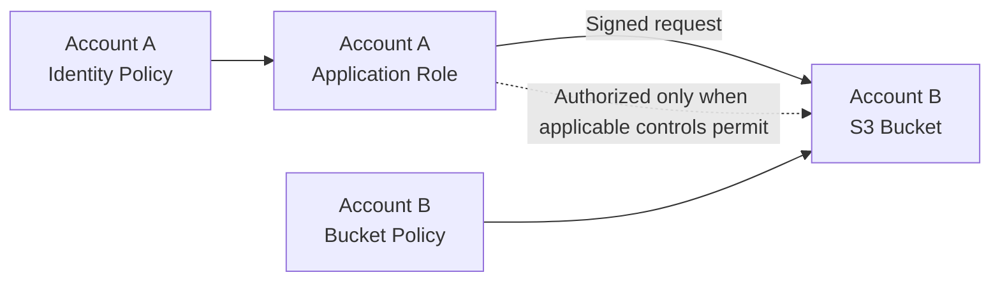
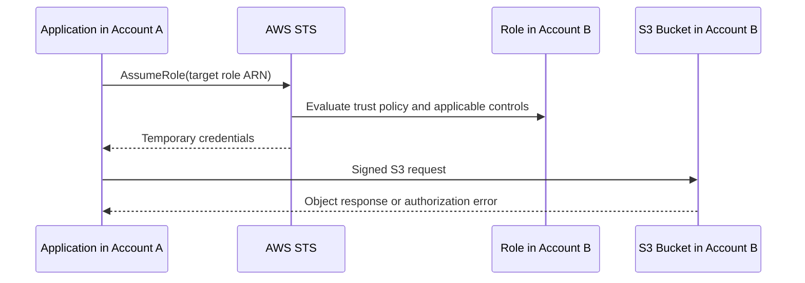
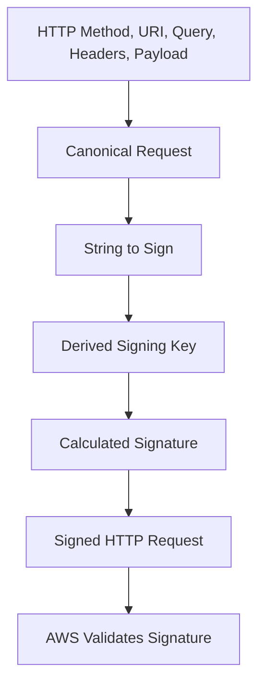
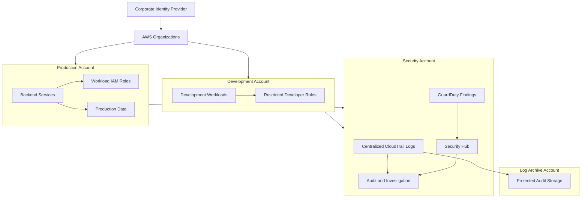
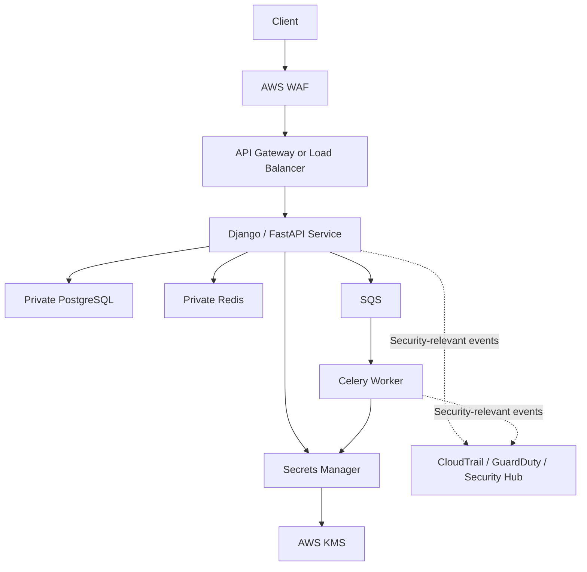
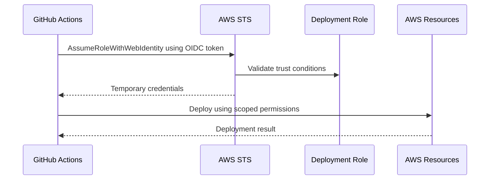
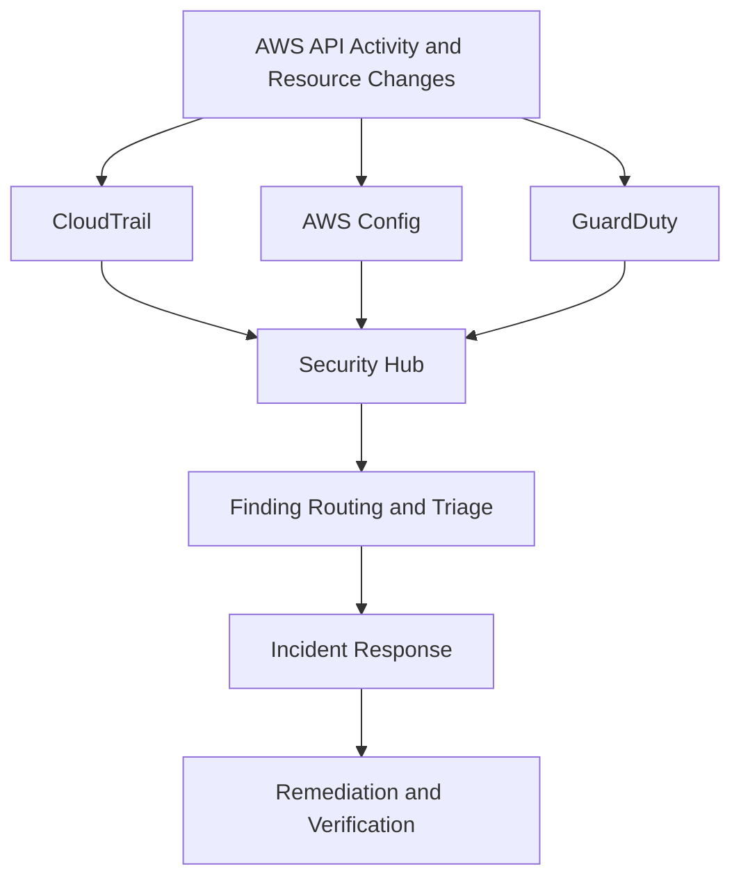

# 07- Scenario Based Security Questions

## Overview

AWS Security scenario-based interviews assess whether an engineer can diagnose security failures, reason about identity and trust boundaries, design secure architectures, and respond to incidents without introducing additional risk.

Senior backend engineers must understand how IAM, AWS STS, KMS, VPC networking, application authentication, secret management, and centralized monitoring interact in production systems. The objective is not merely to identify an AWS service but to explain the investigation strategy, determine the root cause, select the least-privilege remediation, and verify the result.

This document organizes realistic AWS security scenarios around:

- IAM authorization and cross-account access.
- Authentication, temporary credentials, and AWS Signature Version 4.
- Encryption, KMS, and secret management.
- Network security and public API protection.
- Security monitoring, incident response, and compliance.
- Secure backend architecture, CI/CD, and workload identities.
- Production troubleshooting and senior-level design decisions.

Commands use placeholders such as `<ACCOUNT_ID>`, `<REGION>`, `<ROLE_NAME>`, and `<RESOURCE_ARN>`. Examples assume the AWS CLI is configured with an appropriate diagnostic identity. Read-only inspection commands are distinguished from commands that modify security controls.

## IAM and Authorization Scenarios

### Scenario: An Application Suddenly Receives AccessDenied

**Question:** A Django application running on EC2 has successfully accessed an S3 bucket for months. After a deployment, requests begin failing with `AccessDenied`. How would you investigate?

**Expected answer:**

Do not immediately attach `AdministratorAccess` or broaden the bucket policy. First establish which identity is making the request, which operation is failing, and whether the deployment changed the execution environment or request path.

#### Investigation procedure

**Step 1: Verify the effective identity.**

Run the following command using the same credential environment as the application, if possible.

```bash
aws sts get-caller-identity
```

The response identifies the AWS account, principal ARN, and user identifier associated with the active credentials.

If the command returns an unexpected IAM user or role, investigate credential-provider precedence, environment variables, shared credential files, container configuration, and instance-profile attachment.

**Step 2: Identify the exact failing operation.**

Determine whether the application is attempting to:

- List bucket contents.
- Retrieve an object.
- Upload an object.
- Delete an object.
- Read object tags or metadata.
- Decrypt an object encrypted with a customer-managed KMS key.

These operations require different permissions. For example, `s3:GetObject` does not grant `s3:ListBucket`.

**Step 3: Inspect the identity policy.**

```bash
aws iam list-attached-role-policies \
  --role-name <ROLE_NAME>

aws iam list-role-policies \
  --role-name <ROLE_NAME>

aws iam get-role \
  --role-name <ROLE_NAME>
```

Use the returned policy ARNs and inline policy names to inspect the policy documents.

```bash
aws iam get-policy \
  --policy-arn <POLICY_ARN>

aws iam get-policy-version \
  --policy-arn <POLICY_ARN> \
  --version-id <VERSION_ID>
```

Check whether the latest deployment changed the role, attached policies, permissions boundary, or trust policy.

**Step 4: Inspect resource-level controls.**

For S3, examine the bucket policy, bucket ownership configuration, public access block, and relevant encryption settings.

```bash
aws s3api get-bucket-policy \
  --bucket <BUCKET_NAME>

aws s3api get-public-access-block \
  --bucket <BUCKET_NAME>

aws s3api get-bucket-encryption \
  --bucket <BUCKET_NAME>
```

A bucket policy can explicitly deny requests even when the role has an identity policy allowing them. Conditions involving VPC endpoints, TLS, organization membership, source IP addresses, or principal ARNs may also cause failures.

**Step 5: Check KMS permissions when encryption is involved.**

```bash
aws kms describe-key \
  --key-id <KEY_ID> \
  --region <REGION>

aws kms get-key-policy \
  --key-id <KEY_ID> \
  --policy-name default \
  --region <REGION>
```

The role may have S3 permissions but lack the necessary KMS authorization to decrypt an object encrypted with a customer-managed key.

**Step 6: Correlate the failure with audit evidence.**

Search CloudTrail for the relevant S3 or KMS API event. Examine the event timestamp, principal, operation, resource, source IP, and error details. CloudTrail Event History primarily covers management events; S3 object-level data events require appropriate data-event logging.

#### Likely root causes

| Root cause | Diagnostic evidence | Corrective action |
|---|---|---|
| Wrong execution role | Unexpected caller identity | Restore the intended workload identity |
| Missing action | Specific operation fails | Grant only the required action and resource |
| Explicit deny | Policy or organization control contains a matching deny | Correct the underlying condition or policy |
| SCP restriction | Organization-level permission ceiling blocks the action | Have the organization administrator review the SCP |
| KMS authorization failure | S3 access works for unencrypted objects but fails for encrypted objects | Correct IAM and KMS key-policy authorization |
| Network endpoint condition | Access succeeds through one route but fails through another | Correct the endpoint policy or network path |
| Deployment regression | Failure begins after a role or policy change | Review the deployment diff and roll back the unsafe change if necessary |

**Verification:** Re-run the exact failing operation using the intended role and resource. Verify both the successful result and the absence of unintended additional permissions.

**Senior-level consideration:** An `AccessDenied` response is not proof that an identity policy is missing a permission. Authorization can be affected by multiple policy layers, explicit denies, resource policies, endpoint policies, permissions boundaries, session policies, and organization-level controls.

### Scenario: A Lambda Function Cannot Assume Its Execution Role

**Question:** A Lambda function fails during initialization or invocation with an error indicating that its execution role cannot be assumed. What should you check?

**Expected answer:**

Separate the trust relationship from the permissions granted after the role has been assumed.

The execution role's trust policy determines whether Lambda can assume the role. Its permission policies determine what the function can do after assuming it.

**Inspect the role.**

```bash
aws iam get-role \
  --role-name <LAMBDA_ROLE_NAME>
```

Review the returned `AssumeRolePolicyDocument`. A typical trust relationship includes the Lambda service principal:

```json
{
  "Version": "2012-10-17",
  "Statement": [
    {
      "Effect": "Allow",
      "Principal": {
        "Service": "lambda.amazonaws.com"
      },
      "Action": "sts:AssumeRole"
    }
  ]
}
```

This is an illustrative trust policy. Production policies should be scoped to the actual service integration and requirements.

Check the following:

- The Lambda function references the intended execution role.
- The role's trust policy permits the Lambda service to assume it.
- The role ARN belongs to the expected account.
- The role has not been deleted or replaced incorrectly.
- The execution role includes the required permissions for logs, databases, queues, or other dependencies.
- Required permissions boundaries and organization policies do not prevent the necessary operations.

**Common interview trap:** Adding `s3:GetObject` to the trust policy does not grant S3 access. The trust policy grants permission to assume a role; an identity or resource policy must authorize the subsequent S3 operation.

**Verification:** Invoke the function, inspect its logs, confirm the expected execution role is configured, and test the specific downstream operation.

### Scenario: Cross-Account Access Fails Despite an Allow Policy

**Question:** Account A hosts an application that must read objects from an S3 bucket in Account B. The application role has `s3:GetObject`, but requests fail with `AccessDenied`.

**Expected answer:**

Cross-account access normally requires authorization from both the calling identity's side and the target resource's side, subject to applicable explicit denies and other policy controls.

#### Architecture



#### Direct cross-account access

1. Account A grants its application role permission to access the target bucket and object ARN.
2. Account B's bucket policy authorizes the specific role from Account A.
3. Applicable SCPs, permissions boundaries, session policies, endpoint policies, and explicit denies are checked.
4. If the object uses a customer-managed KMS key, the request must also satisfy KMS authorization.

An identity policy in Account A does not, by itself, grant access to a bucket owned by Account B.

#### Alternative: Assume a role in Account B

Account B can expose a dedicated role with a trust policy that permits the intended Account A role to assume it.



The caller needs permission to invoke `sts:AssumeRole` on the target role. The target role must trust the caller. The resulting session also needs permission to perform the requested operation.

#### Diagnostic commands

```bash
aws sts get-caller-identity

aws iam get-role \
  --role-name <TARGET_ROLE_NAME> \
  --region <REGION>

aws iam simulate-principal-policy \
  --policy-source-arn <CALLER_ROLE_ARN> \
  --action-names sts:AssumeRole \
  --resource-arns <TARGET_ROLE_ARN>
```

The policy simulator is useful but does not replace a complete live authorization investigation. It does not necessarily reproduce every resource-policy, service-specific, organization, endpoint, or runtime condition.

**Production recommendation:** Prefer a dedicated cross-account role with narrowly scoped trust and permissions when centralized access control, auditability, or separation of duties is important.

### Scenario: A Developer Can Access Production After Leaving the Team

**Question:** A developer's access should have been removed, but the developer can still access production resources. How do you investigate?

**Expected answer:**

Investigate the full identity lifecycle rather than checking only whether the IAM user exists.

Potential access paths include:

- Direct IAM user credentials.
- IAM Identity Center permission sets and assignments.
- Federated identities from an external identity provider.
- Assumed-role sessions.
- Long-lived access keys.
- Programmatic credentials stored on developer machines or CI systems.
- Cross-account roles trusted by the developer's principal or identity provider.

#### Response procedure

1. Disable or remove the relevant identity-provider assignment and direct access paths.
2. Deactivate compromised or unauthorized access keys as appropriate.
3. Identify active sessions and role-assumption paths.
4. Apply supported containment controls, including role-session restrictions where available and appropriate.
5. Review CloudTrail for recent activity by the principal and related assumed-role sessions.
6. Rotate credentials or revoke sessions where applicable.
7. Verify that the former developer cannot obtain new credentials or access production.
8. Review identity lifecycle automation and offboarding controls.

For an IAM user, inspect access keys with:

```bash
aws iam list-access-keys \
  --user-name <USER_NAME>
```

For an IAM role, inspect its trust policy and attached permissions:

```bash
aws iam get-role \
  --role-name <ROLE_NAME>

aws iam list-attached-role-policies \
  --role-name <ROLE_NAME>
```

IAM role credentials are temporary, but they remain usable until expiration unless an applicable revocation or authorization control prevents their use. Removing a role's trust relationship can prevent future assumption without necessarily invalidating all existing sessions.

**Senior-level consideration:** Disabling the original user may not be sufficient if the user already assumed another role, created credentials elsewhere, or has an independent federated access path.

### Scenario: A Policy Change Accidentally Grants Excessive Permissions

**Question:** A deployment introduces a policy that allows a backend role to perform `s3:*` on every bucket. What should happen next?

**Expected answer:**

Treat this as a potential privilege escalation or excessive-permission incident.

1. Determine whether the change has reached production and whether the role has used the new permissions.
2. Inspect the policy diff and identify the exact affected role, resources, and actions.
3. Review CloudTrail for suspicious or newly possible operations.
4. Replace the broad policy with a narrowly scoped policy.
5. Verify that normal application operations still work.
6. Add automated policy checks to CI/CD.
7. Review who approved the change and why the validation process failed.

For example, a backend that only downloads invoice files might require:

```json
{
  "Version": "2012-10-17",
  "Statement": [
    {
      "Effect": "Allow",
      "Action": "s3:GetObject",
      "Resource": "arn:aws:s3:::<BUCKET_NAME>/invoices/*"
    }
  ]
}
```

This policy intentionally does not grant bucket listing, object deletion, uploads, or access to unrelated prefixes.

**Important:** A narrow identity policy is not sufficient if another policy grants broader access or a resource policy creates an additional authorization path. Validate the effective permissions of the role.

## Temporary Credentials and Workload Identity Scenarios

### Scenario: A Dockerized Backend Uses Expired AWS Credentials

**Question:** A FastAPI application running in a container intermittently fails with `ExpiredToken`. Restarting the container temporarily resolves the problem. What is wrong?

**Expected answer:**

The application may be using temporary credentials without correctly refreshing them, or it may be receiving static credentials that expire.

First identify the credential source:

- ECS task role.
- EKS workload identity integration.
- EC2 instance profile.
- Lambda execution role.
- Explicit environment variables.
- Shared AWS credentials file.
- An application-managed STS credential cache.

The preferred design is to use the workload's supported credential provider rather than embedding or manually copying temporary credentials.

For example, a Python application using Boto3 can rely on the default credential provider chain:

```python
import boto3

s3_client = boto3.client("s3", region_name="<REGION>")

response = s3_client.get_object(
    Bucket="<BUCKET_NAME>",
    Key="invoices/example.pdf",
)

try:
    body = response["Body"].read()
finally:
    response["Body"].close()
```

When running with a properly configured workload role, Boto3 can obtain and refresh credentials through the appropriate provider.

#### Investigation

```bash
aws sts get-caller-identity
```

Run this in the same environment as the application, if the AWS CLI is installed and uses the same provider configuration.

Inspect container configuration for manually supplied `AWS_ACCESS_KEY_ID`, `AWS_SECRET_ACCESS_KEY`, and `AWS_SESSION_TOKEN` variables. Never print their values.

Also check:

- Whether the credential provider supports refresh.
- Whether the application caches credentials indefinitely.
- Whether the container has access to its workload credential endpoint.
- Whether network restrictions prevent reaching STS or the workload credential service.
- Whether the role session duration and application lifecycle are compatible.

**Corrective action:** Use the standard SDK credential provider, correct the workload role configuration, and remove hardcoded credentials. Do not solve credential expiry by increasing session duration without understanding the underlying refresh failure.

### Scenario: A Backend Needs to Access Another AWS Account

**Question:** A Python service runs in Account A and must publish messages to an SQS queue in Account B. How should the access be designed?

**Expected answer:**

Use a dedicated workload role and grant the minimum required cross-account permissions.

Two common approaches are:

| Approach | How it works | Best fit |
|---|---|---|
| Cross-account resource policy | Account B's queue policy authorizes the role from Account A | Simple resource-specific access |
| Cross-account role assumption | Account A's role assumes a dedicated role in Account B | Centralized access governance and multiple target operations |

For a queue policy approach:

- Account A's workload role needs the appropriate `sqs:SendMessage` permission for the target queue.
- Account B's queue policy must authorize the caller when cross-account resource authorization requires it.
- Any applicable SCP, permissions boundary, session policy, or explicit deny must permit the operation.

For role assumption:

- The caller needs `sts:AssumeRole` permission on the target role.
- The target role must trust the caller.
- The assumed role needs the target queue permissions.

Use the AWS SDK rather than manually constructing credentials or embedding access keys in the service.

**Senior-level consideration:** Avoid giving a general-purpose application role permission to assume arbitrary roles. Restrict target role ARNs and consider external IDs where appropriate for third-party cross-account access patterns.

### Scenario: A Workload Can Assume a Role It Should Not Be Able to Assume

**Question:** A role in one AWS account can unexpectedly assume a privileged role in another account. How do you investigate?

**Expected answer:**

Treat the issue as a trust-boundary failure.

Inspect:

1. The target role's trust policy.
2. The caller's identity policies.
3. The target role's permissions.
4. Any organization-level restrictions.
5. CloudTrail `AssumeRole` events in the relevant accounts.
6. Whether a wildcard principal, overly broad account trust, or permissive condition exists.

```bash
aws iam get-role \
  --role-name <TARGET_ROLE_NAME>

aws iam list-role-policies \
  --role-name <CALLER_ROLE_NAME>

aws iam list-attached-role-policies \
  --role-name <CALLER_ROLE_NAME>
```

Do not assume that trusting an entire AWS account is equivalent to trusting one particular application role. Account-level trust may allow principals within that account to obtain access if their own permissions and other applicable controls allow it.

**Corrective action:** Narrow the trust policy to the intended principal or tightly controlled identity pattern. Validate both who can assume the role and what the role can do after assumption.

## AWS Signature Version 4 Scenarios

### Scenario: An API Request Fails With SignatureDoesNotMatch

**Question:** A backend sends a signed S3 or API request and receives `SignatureDoesNotMatch`. What is your debugging strategy?

**Expected answer:**

AWS Signature Version 4 authenticates a request by calculating a signature from a canonical representation of the request and a derived signing key. The service calculates the expected signature and compares it with the supplied signature.

A typical SigV4 signing flow is:



The canonical request includes the HTTP method, canonical URI, canonical query string, canonical headers, signed-header list, and payload hash or the applicable supported payload-signing mode.

The string to sign includes the algorithm, timestamp, credential scope, and hash of the canonical request. The signing key is derived using the secret access key and the date, region, service, and terminal request scope.

#### Common causes

- Incorrect canonical URI encoding.
- Query parameters encoded or ordered incorrectly.
- Missing or incorrectly normalized signed headers.
- Host header mismatch.
- Incorrect payload hash.
- Incorrect region or service in the credential scope.
- Timestamp or clock skew problems.
- Incorrect signing-key derivation.
- A modified request body or header after signing.
- Incorrect handling of the session token for temporary credentials.

#### Isolation steps

1. Capture the HTTP method, URL, relevant headers, and payload hash without logging credentials or sensitive payload content.
2. Verify the target service and AWS region.
3. Confirm the timestamp and system clock.
4. Confirm that the request is not modified after signing.
5. Check how the SDK or signing library canonicalizes the request.
6. Confirm that temporary credentials include the session token.
7. Compare the request against the service's documented SigV4 requirements.

For Python services, prefer the AWS SDK or an established AWS signing library rather than implementing SigV4 manually.

**Important distinction:** `SignatureDoesNotMatch` indicates a signing or request-integrity problem; it is not interchangeable with `AccessDenied`, which indicates that the request was not authorized for the requested operation.

### Scenario: A Signed Request Works Locally but Fails in Production

**Question:** A developer's signed request works on a laptop but fails from an ECS task.

**Expected answer:**

Compare the runtime environments instead of assuming the signing implementation is incorrect.

Investigate:

- Different AWS credentials or assumed roles.
- A missing session token.
- Different service endpoints or regions.
- Different system clocks.
- Proxy behavior that modifies the host or request.
- URL encoding differences.
- Payload transformations or middleware that modifies headers.
- Different SDK versions.
- An endpoint that expects a different signing service name.

Verify the effective identity from the production workload using `aws sts get-caller-identity` where possible.

If a proxy or API gateway is involved, determine which component signs the request and which component modifies it. Any change to a signed component after signing can invalidate the signature.

**Prevention:** Use SDK-managed signing, pin and test supported SDK versions, and avoid custom HTTP transformations between signing and transmission.

### Scenario: A Request Fails With RequestExpired

**Question:** An API request is rejected because its timestamp is outside the permitted window.

**Expected answer:**

Check system time synchronization and the signing timestamp.

Likely causes include:

- Incorrect host time.
- A container or host with a clock synchronization issue.
- A signed request held in a queue for too long before transmission.
- Reuse of a previously signed request.
- Timestamp generation in an incorrect format.

Use the operating system's time synchronization facilities and verify that the request is signed close to transmission time.

Do not attempt to fix clock skew by widening application-side timestamp tolerances without understanding the service's signing rules.

**Verification:** Generate a fresh signed request and confirm that it succeeds. Monitor host time synchronization and signing failures.

## Encryption and KMS Scenarios

### Scenario: S3 Objects Cannot Be Decrypted After a Deployment

**Question:** A backend can retrieve an encrypted object from S3 but cannot read its contents after a role-policy change.

**Expected answer:**

Separate S3 object access from KMS decryption authorization.

For an object encrypted with a customer-managed KMS key, the application typically needs:

- `s3:GetObject` permission for the object.
- Appropriate KMS decryption authorization, commonly `kms:Decrypt`, for the relevant key.
- A KMS key policy or grant that permits the required use.
- Compliance with any applicable conditions and organization-level restrictions.

Inspect the key:

```bash
aws kms describe-key \
  --key-id <KEY_ID> \
  --region <REGION>

aws kms get-key-policy \
  --key-id <KEY_ID> \
  --policy-name default \
  --region <REGION>
```

Review the relevant CloudTrail KMS events and identify the actual principal and denial reason.

**Common causes:**

- The role lost `kms:Decrypt`.
- The key policy no longer authorizes the principal or account.
- The application uses a different key or region.
- The key is disabled or pending deletion.
- An applicable grant or policy condition changed.
- The request violates an encryption-context or other policy condition.

**Corrective action:** Restore the narrowly scoped authorization required for the intended workload. Do not replace the customer-managed key with a less controlled key merely to bypass the authorization failure.

**Verification:** Read the specific object using the intended application role, confirm the expected plaintext is returned to the application, and verify that unrelated roles remain unauthorized.

### Scenario: A KMS Key Is Disabled During an Incident

**Question:** A production database export or application object becomes unavailable because the relevant KMS key is disabled. What should the team do?

**Expected answer:**

First identify the key, affected resources, business impact, and the reason the key was disabled.

```bash
aws kms describe-key \
  --key-id <KEY_ID> \
  --region <REGION>
```

Review CloudTrail for `DisableKey`, `ScheduleKeyDeletion`, and other key-management events. Confirm whether the change was intentional and who initiated it.

If the key was disabled accidentally and policy permits recovery, an authorized administrator can re-enable it:

```bash
aws kms enable-key \
  --key-id <KEY_ID> \
  --region <REGION>
```

This is a **modifying command** and must be executed only after confirming the key identity and authorization.

Do not automatically enable a key that was disabled for a security incident. Doing so may restore access to data that was intentionally isolated.

After an approved recovery:

1. Confirm the key is enabled.
2. Retry the affected operation.
3. Validate application behavior.
4. Confirm that the expected data remains accessible.
5. Review key-management permissions and change approvals.
6. Add alerting for unexpected key-state changes.

**Senior-level consideration:** KMS key deletion is not equivalent to disabling a key. Scheduled deletion has a waiting period, but once a key is deleted, the key material cannot simply be restored through an ordinary re-enable operation. Key lifecycle controls must account for recovery requirements.

### Scenario: A Team Wants to Use One KMS Key for Everything

**Question:** A platform team proposes using one customer-managed KMS key for all S3 buckets, databases, logs, and application secrets. Is this a good design?

**Expected answer:**

Not automatically. A shared key can simplify administration but creates a broad authorization and operational boundary.

| Consideration | Shared key | Separate keys by workload or boundary |
|---|---|---|
| Administration | Simpler | More policies and lifecycle management |
| Blast radius | Potentially larger | Easier to isolate workloads |
| Access control | Harder to separate unrelated consumers | More granular authorization |
| Audit attribution | Depends on principals and encryption context | Clearer separation of key-use boundaries |
| Rotation and migration | Fewer keys to manage | More coordination |
| Cost and quotas | Fewer key resources | More key resources and management overhead |

Choose boundaries based on data sensitivity, account structure, regulatory requirements, workload isolation, recovery needs, and operational ownership.

**Recommended approach:** Use centralized governance with separate keys where the security boundary, workload ownership, or recovery requirements justify separation. Avoid creating unnecessary keys without a clear operational or security purpose.

### Scenario: An Application Loses Access to a Secret After KMS Policy Changes

**Question:** A Python service retrieves a secret from AWS Secrets Manager but starts failing after a key-policy change.

**Expected answer:**

Determine whether the secret uses the AWS-managed Secrets Manager key or a customer-managed KMS key.

For a customer-managed key, verify:

- The secret's configured encryption key.
- The caller's `secretsmanager:GetSecretValue` permission.
- Required KMS permissions, including `kms:Decrypt` when applicable.
- The key policy and grants.
- Any encryption-context or policy conditions.
- Whether the secret and key are in the expected account and region.

Inspect secret metadata without retrieving its secret value:

```bash
aws secretsmanager describe-secret \
  --secret-id <SECRET_ARN> \
  --region <REGION>
```

Inspect KMS configuration separately:

```bash
aws kms describe-key \
  --key-id <KEY_ID> \
  --region <REGION>
```

**Corrective action:** Repair the specific permission or policy condition. Do not print the secret to debug an authorization error.

**Verification:** Retrieve the secret through the application role, confirm successful authentication to the downstream service, and verify that logs and tracing systems do not capture the secret value.

## Secrets Management Scenarios

### Scenario: A Database Password Is Committed to GitHub

**Question:** A developer accidentally commits a production database password to a public repository. The commit is removed shortly afterward. Is the incident resolved?

**Expected answer:**

No. Removing the visible value does not prove that the credential was not copied, indexed, cached, or accessed before removal.

Treat the credential as compromised.

#### Immediate response

1. Revoke or rotate the exposed credential.
2. Identify the affected database, application, and environments.
3. Review database authentication logs and relevant CloudTrail events.
4. Search for the credential in CI logs, container images, build artifacts, tickets, and other repositories.
5. Restrict unauthorized access to the affected systems.
6. Preserve relevant audit evidence.
7. Verify that applications use the replacement credential.
8. Remove the exposed value from repository history where appropriate, without treating history rewriting as a substitute for rotation.

If the secret is stored in AWS Secrets Manager, inspect its metadata and rotation configuration.

```bash
aws secretsmanager describe-secret \
  --secret-id <SECRET_ARN> \
  --region <REGION>
```

For manual rotation, use an approved rotation procedure that updates the source system and secret consistently. Automated rotation is preferable where the service and credential type support it.

**Why rotation comes first:** Git history cleanup reduces future exposure, but it does not invalidate copies that already exist.

### Scenario: A FastAPI Application Needs a Secret at Runtime

**Question:** How should a production FastAPI service retrieve database credentials without hardcoding them?

**Expected answer:**

Use a workload identity with narrowly scoped access to AWS Secrets Manager or Systems Manager Parameter Store. Retrieve the secret at runtime, cache it appropriately, and avoid logging its value.

A simplified Secrets Manager retrieval example:

```python
import json
import os

import boto3
from botocore.exceptions import BotoCoreError, ClientError


def load_database_secret() -> dict[str, str]:
    secret_arn = os.environ["DATABASE_SECRET_ARN"]
    region = os.environ["AWS_REGION"]

    client = boto3.client("secretsmanager", region_name=region)

    try:
        response = client.get_secret_value(SecretId=secret_arn)
        secret_string = response.get("SecretString")

        if not secret_string:
            raise RuntimeError("Expected a string-form database secret")

        secret = json.loads(secret_string)
        required_fields = {"username", "password", "host", "dbname"}

        if not required_fields.issubset(secret):
            raise RuntimeError("Database secret is missing required fields")

        return secret

    except (BotoCoreError, ClientError):
        # Do not log exception payloads or secret values indiscriminately.
        raise RuntimeError("Unable to retrieve database configuration") from None
```

This example deliberately does not log the returned secret or expose the AWS SDK exception details to the caller. Production code should emit sanitized diagnostic metadata to its logging system and preserve detailed evidence through appropriately protected monitoring.

The workload role should have `secretsmanager:GetSecretValue` permission for the exact secret ARN and the required KMS authorization if a customer-managed key is used.

#### Caching trade-offs

| Strategy | Benefit | Risk or limitation |
|---|---|---|
| Retrieve on every request | Fresh value | Higher latency, API calls, and throttling risk |
| Cache in application memory | Lower latency and API usage | Rotation may not become effective immediately |
| Use a supported caching component | Simplifies refresh and caching behavior | Requires correct TTL, error handling, and rotation integration |

Do not retrieve the secret independently for every HTTP request. Prefer controlled initialization or a bounded cache with a rotation-aware refresh strategy.

**Production consideration:** Database connection pools may continue using existing authenticated connections after the password changes. Credential rotation must account for connection recycling, application restarts or refresh behavior, and the database's authentication model.

### Scenario: Secret Rotation Breaks Production

**Question:** Secrets Manager rotates a database password successfully, but the application starts returning authentication errors.

**Expected answer:**

Determine whether the database credential changed, whether the secret version was updated, and whether the application refreshed its cached value.

Investigate:

- Rotation function logs and status.
- The current and previous secret versions.
- Whether the rotation workflow completed every required step.
- Whether the application is still using a cached secret.
- Whether database connection pools retain stale connections.
- Whether the application has permission to retrieve the current secret.
- Whether the database accepts the newly rotated credential.

Inspect rotation metadata:

```bash
aws secretsmanager describe-secret \
  --secret-id <SECRET_ARN> \
  --region <REGION>
```

Review the secret's version stages using:

```bash
aws secretsmanager list-secret-version-ids \
  --secret-id <SECRET_ARN> \
  --region <REGION>
```

Avoid printing secret values during diagnosis.

**Recovery approach:**

1. Establish which credential is currently valid.
2. Correct the rotation or application refresh failure.
3. Restore service using an approved recovery procedure.
4. Refresh stale connection pools.
5. Verify new connections succeed.
6. Confirm that the old credential is no longer unnecessarily active.
7. Improve rotation testing and failure alerting.

**Senior-level consideration:** Rotation is a distributed state transition involving the secret store, credential source, application caches, and existing connections. Updating one component does not guarantee that all consumers are using the new credential.

## Network Security and API Protection Scenarios

### Scenario: A Database Is Accidentally Exposed to the Internet

**Question:** A production RDS instance is discovered to be publicly accessible. What actions should the team take?

**Expected answer:**

Treat the exposure as a security incident until the investigation establishes the actual risk.

1. Confirm whether the database is publicly accessible and whether its security group permits inbound access from external networks.
2. Identify the database port and the source CIDRs allowed by its security group.
3. Restrict network access to approved application security groups or private network ranges.
4. Verify subnet routing and network ACL behavior.
5. Review database authentication and connection logs for suspicious activity.
6. Rotate potentially exposed credentials if evidence or risk assessment warrants it.
7. Review data access and preserve evidence.
8. Confirm the database is no longer reachable from unauthorized networks.

Inspect the DB instance:

```bash
aws rds describe-db-instances \
  --db-instance-identifier <DB_INSTANCE_ID> \
  --region <REGION>
```

Inspect its security group:

```bash
aws ec2 describe-security-groups \
  --group-ids <SECURITY_GROUP_ID> \
  --region <REGION>
```

Review `PubliclyAccessible`, the VPC and subnet configuration, route tables, and security-group rules together. Public accessibility is not determined by one setting alone.

**Corrective action:** Prefer private database connectivity and tightly scoped security-group references. Do not replace a broad public CIDR with a slightly narrower but still unnecessarily broad CIDR.

### Scenario: An Application Works Inside the VPC but Fails to Reach AWS APIs

**Question:** An application in a private subnet cannot reach S3 or Secrets Manager. The application role has the required IAM permissions.

**Expected answer:**

Separate network reachability from authorization.

Possible causes include:

- Missing NAT gateway or route for public AWS service endpoints.
- Missing or incorrectly configured VPC endpoint.
- Endpoint policy restrictions.
- DNS resolution issues.
- Security-group egress restrictions.
- Network ACL restrictions.
- Incorrect endpoint or region configuration.
- Private DNS configuration conflicts.

Inspect VPC endpoints:

```bash
aws ec2 describe-vpc-endpoints \
  --filters Name=vpc-id,Values=<VPC_ID> \
  --region <REGION>
```

Inspect route tables:

```bash
aws ec2 describe-route-tables \
  --filters Name=vpc-id,Values=<VPC_ID> \
  --region <REGION>
```

Inspect security groups:

```bash
aws ec2 describe-security-groups \
  --filters Name=vpc-id,Values=<VPC_ID> \
  --region <REGION>
```

**Corrective action:** Establish the intended network path. For supported services, use gateway or interface VPC endpoints where appropriate, with endpoint policies and DNS configured correctly.

**Production consideration:** VPC endpoints reduce dependence on public egress and can improve control over traffic paths, but they do not replace IAM authorization, TLS, resource policies, or application-level authorization.

### Scenario: A Security Group Allows More Traffic Than Intended

**Question:** A backend security group allows inbound traffic from `0.0.0.0/0` on a database port. How should this be addressed?

**Expected answer:**

First determine the intended traffic flow and the affected workload. Then replace the broad rule with a rule that allows only the required source, typically a trusted application security group for service-to-service communication within the VPC.

Inspect the rules:

```bash
aws ec2 describe-security-groups \
  --group-ids <SECURITY_GROUP_ID> \
  --region <REGION>
```

Check:

- Inbound rules.
- Outbound rules.
- Referenced security groups.
- Subnet routing.
- Network ACLs.
- Whether the service is internet-facing.
- Whether the same security group is attached to unrelated workloads.

Security groups are stateful, while network ACLs are stateless. A stateful security group permits return traffic for allowed connections; network ACL rules may require explicit handling of both directions.

**Corrective action:** Apply a controlled security-group change through the approved deployment or infrastructure-as-code workflow, then verify connectivity from the intended source and failure from an unauthorized source.

### Scenario: AWS WAF Blocks Legitimate API Requests

**Question:** A public API protected by AWS WAF begins returning HTTP 403 responses for legitimate clients after a rule update.

**Expected answer:**

Do not immediately disable the entire web ACL. Identify which rule is terminating the request and determine whether the rule is incorrectly matching legitimate traffic.

Investigate:

- The web ACL's associated resources.
- The relevant managed or custom rule.
- WAF logs and sampled requests, where configured.
- The request path, headers, body size, and source characteristics.
- Recent rule deployments.
- Rate-based rules and aggregation behavior.
- Whether an upstream proxy changes client IP information.

Inspect the web ACL:

```bash
aws wafv2 get-web-acl \
  --name <WEB_ACL_NAME> \
  --scope REGIONAL \
  --id <WEB_ACL_ID> \
  --region <REGION>
```

For CloudFront-scoped WAF configurations, use the appropriate scope and required region configuration.

**Corrective action:** Adjust the specific rule, add a narrowly scoped exception where justified, or test a revised rule in count mode before enforcement when appropriate.

**Security trade-off:** Overly permissive exceptions can reopen attack paths. Validate the exception against representative legitimate traffic and malicious test cases.

### Scenario: An API Is Protected by WAF but Still Suffers Unauthorized Data Access

**Question:** A public API has AWS WAF, TLS, and strict security groups. An authenticated user can still retrieve another user's invoice by changing the invoice ID in the request.

**Expected answer:**

This is an application-level authorization failure, commonly described as broken object-level authorization.

Network controls and WAF do not determine whether a user is authorized to access a particular business object.

The backend must validate the authenticated principal against the requested resource.

For example, a Django or FastAPI endpoint should enforce ownership or an explicitly authorized access relationship when loading the invoice. Authorization should be applied consistently across list, detail, download, and mutation endpoints.

**Response procedure:**

1. Identify affected endpoints and object types.
2. Reproduce the issue using separate test accounts.
3. Correct authorization checks at the service or data-access boundary.
4. Review access logs for potential exploitation.
5. Determine whether sensitive data was exposed.
6. Add automated authorization tests.
7. Review related endpoints for the same pattern.

**Senior-level consideration:** Defense in depth requires distinct controls at the network, identity, and application layers. Passing one layer does not imply authorization at another.

## Audit, Threat Detection, and Incident Response Scenarios

### Scenario: CloudTrail Shows an Unfamiliar API Call

**Question:** A security alert reports an unexpected `CreateAccessKey` event in a production account. How do you investigate?

**Expected answer:**

Treat unexpected credential creation as potentially suspicious until verified.

#### Investigation steps

1. Identify the account, event time, principal, source IP, user agent, and target IAM identity.
2. Determine whether the event was associated with an approved deployment or access-management operation.
3. Review nearby events by the same principal.
4. Check whether the new access key was subsequently used.
5. Disable or remove unauthorized credentials using an approved containment process.
6. Review the principal's effective permissions and possible privilege escalation paths.
7. Preserve relevant CloudTrail evidence.
8. Document the incident and implement preventive controls.

Use CloudTrail Event History for a recent management-event investigation:

```bash
aws cloudtrail lookup-events \
  --lookup-attributes AttributeKey=EventName,AttributeValue=CreateAccessKey \
  --start-time <START_TIME> \
  --end-time <END_TIME> \
  --region <REGION>
```

The returned event records include a JSON event payload. Inspect the principal, event source, event time, request parameters, source IP, and error details. Avoid copying sensitive event data into unsecured tickets or logs.

**Important limitation:** Event History provides a limited recent management-event window in a region. It does not replace a properly configured trail or event data store for long-term, organization-wide auditing. Data events must be enabled separately for supported resource operations such as S3 object access.

### Scenario: A Security Team Reports Suspicious EC2 Activity

**Question:** GuardDuty reports suspicious behavior involving an EC2 instance. What should the backend team do?

**Expected answer:**

Do not immediately terminate the instance unless that is the approved containment action. Preserve evidence and assess the potential impact.

#### Triage procedure

1. Retrieve the GuardDuty finding and record its ID, type, severity, account, region, resource, and timestamps.
2. Determine the affected instance, attached IAM role, security groups, and network path.
3. Review CloudTrail activity by the instance role and other related principals.
4. Review VPC Flow Logs, operating-system logs, and application telemetry where available.
5. Determine whether credentials or sensitive data may have been exposed.
6. Coordinate containment with the security incident lead.
7. Restrict network access or isolate the workload through approved controls.
8. Replace potentially compromised credentials and validate other workloads using the same identity.
9. Rebuild from a trusted image if compromise is confirmed or the integrity of the instance cannot be established.
10. Verify recovery and preserve a complete incident timeline.

Retrieve findings:

```bash
aws guardduty list-findings \
  --detector-id <DETECTOR_ID> \
  --region <REGION>
```

Then retrieve selected finding details:

```bash
aws guardduty get-findings \
  --detector-id <DETECTOR_ID> \
  --finding-ids <FINDING_ID> \
  --region <REGION>
```

**Senior-level consideration:** An instance is only one part of the blast radius. Investigate its IAM role, secrets, network relationships, deployment pipeline, and any shared credentials or data stores.

### Scenario: A CloudTrail Event Is Missing

**Question:** An engineer claims that an administrative API call occurred, but the team cannot find the event in CloudTrail Event History.

**Expected answer:**

A missing event is not proof that the operation did not occur.

Investigate:

- Whether the correct AWS account and region were queried.
- Whether the event occurred outside the Event History window.
- Whether the operation was a management event or a data event.
- Whether the relevant trail or event data store was configured at the time.
- Whether the event selector included the resource or operation.
- Whether log delivery is delayed.
- Whether permissions prevent access to the relevant logs.
- Whether centralized logging has a broken delivery path.

Inspect trail configuration:

```bash
aws cloudtrail describe-trails \
  --include-shadow-trails \
  --region <REGION>
```

Inspect trail status:

```bash
aws cloudtrail get-trail-status \
  --name <TRAIL_ARN> \
  --region <REGION>
```

Check `IsLogging`, recent delivery errors, and the destination configuration.

**Corrective action:** Restore the intended logging configuration, validate log delivery, and confirm coverage across required accounts and regions. Do not claim historical coverage for periods or event categories that were never collected.

### Scenario: A Security Hub Finding Has No Clear Owner

**Question:** Security Hub reports a high-severity finding in a shared AWS environment, but no team knows which service owns the affected resource.

**Expected answer:**

Treat ownership ambiguity as an operational control failure.

1. Identify the finding, affected resource, account, region, severity, and control.
2. Determine whether the finding is current, suppressed, or resolved.
3. Map the resource to its application, account owner, deployment stack, and support team.
4. Assign an incident or remediation ticket with a clear due date.
5. Confirm whether the finding represents an exploitable exposure or a compliance deviation.
6. Apply an approved remediation or documented exception.
7. Verify that the finding is resolved and that the ownership gap is fixed.

Example commands:

```bash
aws securityhub get-findings \
  --region <REGION>
```

Use the appropriate finding filters and pagination options for production-scale retrieval.

For a specific finding, inspect its resources, compliance details, workflow status, and remediation guidance.

**Production recommendation:** Maintain resource ownership metadata and account-level responsibility mappings. Security findings should route automatically to the team responsible for the resource rather than relying on manual investigation for every alert.

### Scenario: An IAM Credential Is Confirmed Compromised

**Question:** A production AWS access key is found in a public code repository, and CloudTrail shows suspicious API activity.

**Expected answer:**

Prioritize containment, impact assessment, and evidence preservation.

#### Immediate response

1. Record the exposed credential's identity and affected account.
2. Disable or revoke the credential through the approved process.
3. Identify whether the principal can assume other roles or access other accounts.
4. Review recent API activity and determine which resources were accessed or modified.
5. Rotate related credentials that may have been exposed.
6. Restrict suspicious sessions or authorization paths where supported.
7. Preserve CloudTrail, GuardDuty, application, and network evidence.
8. Restore affected resources from trusted configurations when necessary.
9. Verify that the attacker cannot regain access through another identity path.
10. Complete root-cause analysis and strengthen prevention.

For an IAM user's access key, deactivation is a modifying action:

```bash
aws iam update-access-key \
  --user-name <USER_NAME> \
  --access-key-id <ACCESS_KEY_ID> \
  --status Inactive
```

Do not paste the access key ID or secret access key into public tickets, shell history, or incident reports. Use the identifier only in a trusted administrative environment.

**Important:** Disabling a key does not automatically invalidate all credentials previously issued through every possible downstream role-assumption path. Investigate derived sessions and other authentication mechanisms separately.

### Scenario: A Team Wants to Delete Logs After an Incident

**Question:** An application team proposes deleting suspicious audit logs after resolving an incident to reduce storage costs.

**Expected answer:**

Do not delete security evidence as a routine incident cleanup action. Preserve logs according to the incident-response process and applicable retention requirements.

Use centralized logging with restrictive write and delete permissions, appropriate retention policies, and integrity controls where required.

Consider:

- Separation of duties between workload administrators and audit-log administrators.
- S3 bucket policies and access controls for centralized logs.
- CloudTrail log-file validation where enabled.
- Versioning and appropriate retention or immutability controls.
- Cross-account log delivery.
- Restricted access to sensitive log contents.
- Documented retention and deletion procedures.

**Senior-level consideration:** Audit evidence is itself a security-sensitive asset. A compromised workload administrator should not automatically be able to alter or delete the evidence needed to investigate that workload.

## Architecture and System Design Scenarios

### Scenario: Design Security for a Multi-Account AWS Platform

**Question:** Your organization operates production, staging, development, and security workloads across multiple AWS accounts. Design a secure architecture.

**Expected answer:**

Separate workloads by environment and responsibility, centralize identity governance, and aggregate audit and threat-detection data into controlled security accounts.



#### Design principles

- Use separate accounts for production, nonproduction, security tooling, and log archival where justified.
- Use federated workforce identities and short-lived sessions.
- Give applications dedicated workload roles.
- Apply SCPs to constrain account-level maximum permissions and protect critical controls.
- Centralize CloudTrail and relevant security findings.
- Restrict access to audit storage and separate it from workload administration.
- Use KMS governance appropriate to the data classification and account boundaries.
- Apply private networking and resource-specific access policies.
- Standardize infrastructure through reviewed infrastructure-as-code modules.
- Define account and resource ownership, alert routing, and incident escalation.

#### Trade-offs

| Design decision | Benefit | Trade-off |
|---|---|---|
| More AWS accounts | Stronger isolation and clearer boundaries | Higher governance and operational overhead |
| Centralized security tooling | Consistent visibility and investigation | Requires cross-account configuration and ownership |
| Centralized logging | Improved evidence protection | Storage, ingestion, and retrieval costs |
| Restrictive SCPs | Prevents entire classes of risky actions | Misconfiguration can block legitimate deployments |
| Dedicated KMS keys | Better separation of key access | More lifecycle and policy management |

**Senior-level consideration:** SCPs set permission guardrails for affected principals and accounts; they do not grant permissions. An SCP allowing an operation does not replace the identity and resource permissions required to perform it.

### Scenario: Design a Secure Public Backend API on AWS

**Question:** Design a public REST API backed by Python microservices, PostgreSQL, Redis, and asynchronous workers.

**Expected answer:**

The architecture should separate public ingress, application authorization, workload identity, data access, and audit controls.



#### Security controls

- Enforce TLS at public entry points and validate internal TLS requirements.
- Use WAF for supported request filtering and rate-based protections.
- Authenticate callers using an appropriate identity mechanism.
- Enforce authorization at the application and resource level.
- Run each service with a dedicated workload role.
- Keep PostgreSQL and Redis private and restrict connectivity to authorized workloads.
- Store credentials in Secrets Manager or an appropriate configuration service.
- Encrypt sensitive data at rest and in transit.
- Protect secrets and encryption keys through narrowly scoped permissions.
- Record security-relevant application events without logging credentials, tokens, or sensitive payloads.
- Aggregate audit logs and security findings.
- Use automated security tests and infrastructure policy checks in CI/CD.

**Interview trap:** WAF is not an identity provider and does not replace authentication, authorization, input validation, or business-rule enforcement.

### Scenario: Design Secure Service-to-Service Communication

**Question:** Several microservices communicate across AWS accounts. How should service-to-service access be controlled?

**Expected answer:**

Use a combination of workload identity, transport security, network boundaries, and application-level authorization.

Depending on the architecture, controls may include:

- Dedicated IAM roles for AWS API access.
- IAM authorization or other supported identity mechanisms for service endpoints.
- PrivateLink or private networking for supported connectivity requirements.
- Security-group restrictions for network paths.
- TLS and appropriate certificate validation.
- Narrowly scoped resource policies.
- Application-level authorization for business operations.
- Centralized audit logging and request correlation.

Do not assume that private IP connectivity proves the caller's identity. Likewise, a valid IAM role does not automatically authorize every business operation exposed by an internal API.

**Production recommendation:** Define the identity of each workload, the operations it may perform, the network paths it may use, and the data it may access. Validate each boundary independently.

### Scenario: A CI/CD Pipeline Needs Production Deployment Access

**Question:** A GitHub Actions workflow needs to deploy a service into AWS. Should the team store an IAM user's access key as a repository secret?

**Expected answer:**

Prefer GitHub Actions OIDC federation with AWS IAM role assumption when the deployment environment supports it.

The pipeline exchanges a trusted OIDC identity for short-lived AWS credentials rather than relying on a long-lived IAM user access key.



The IAM role's trust policy should constrain the trusted identity using the appropriate OIDC provider, audience, repository, branch, environment, or other supported claims.

The role's permissions should be limited to the resources and operations needed for deployment.

**Common mistakes:**

- Trusting every repository in an organization unnecessarily.
- Using broad wildcard conditions.
- Granting administrator permissions to simplify deployments.
- Allowing untrusted pull-request workflows to obtain production credentials.
- Reusing one deployment role for unrelated environments.
- Failing to audit role assumptions and deployment activity.

**Verification:** Confirm that a trusted workflow can assume the role, an untrusted workflow cannot, and the deployment succeeds with only the intended permissions.

### Scenario: An SCP Breaks Production Deployments

**Question:** An organization introduces an SCP intended to prevent public S3 buckets. After deployment, an infrastructure pipeline can no longer create or modify certain resources.

**Expected answer:**

Investigate the organization-level restriction and determine which action or condition is blocked.

SCPs constrain the maximum permissions available to affected principals in member accounts. They do not grant permissions or directly authorize an operation.

#### Investigation

1. Identify the affected account and principal.
2. Capture the failed API operation and error details.
3. Review the SCPs attached to the account and its organizational units.
4. Determine whether the restriction applies to the required action, resource, or condition.
5. Check whether the deployment depends on an operation the policy intentionally prohibits.
6. Test the proposed correction in a controlled account before rollout.

**Corrective action:** Adjust the policy to preserve the intended security boundary while allowing approved operations. Avoid adding broad exceptions for the entire deployment role or account.

**Senior-level consideration:** SCPs are governance guardrails, not substitutes for least-privilege identity policies, resource policies, or infrastructure validation.

## Security Monitoring and Compliance Scenarios

### Scenario: Design Centralized Security Monitoring

**Question:** A company operates dozens of AWS accounts and needs centralized detection, investigation, and compliance reporting.

**Expected answer:**

Use an organization-aware design with centralized collection and clear ownership.

A typical approach includes:

- Organization-wide CloudTrail management-event logging.
- Appropriate data-event logging for sensitive resources.
- GuardDuty enabled and centrally administered where supported.
- Security Hub aggregation for findings and posture visibility.
- AWS Config rules and aggregators where applicable.
- Centralized log storage with restrictive access.
- CloudWatch alarms and other notification integrations.
- Automated routing to ticketing or incident-management systems.
- Retention and evidence requirements defined by policy.

#### Investigation and reporting workflow



The exact integration depends on the services and aggregation features enabled in the organization's environment.

**Trade-offs:**

- More comprehensive logging improves investigation capability but increases ingestion and storage costs.
- Centralization improves visibility but requires careful cross-account permissions.
- Automated remediation reduces response time but can create outages if implemented without guardrails.
- Compliance findings indicate control status; they do not independently prove that a workload is secure.

### Scenario: AWS Config Reports a Resource as Noncompliant

**Question:** AWS Config reports that a security group violates an approved configuration rule. The application team claims the rule is incorrect.

**Expected answer:**

Treat the finding as a control exception requiring evidence, not something to suppress immediately.

1. Identify the rule and the exact resource configuration that triggered it.
2. Confirm the rule's scope and evaluation timing.
3. Compare the resource against the approved baseline.
4. Determine whether the finding represents a real exposure, an incorrect rule, or a documented exception.
5. Remediate the resource or correct the rule through the approved governance process.
6. Re-evaluate compliance.
7. Document any approved exception with ownership, justification, and expiration.

Inspect a rule:

```bash
aws configservice describe-config-rules \
  --region <REGION>
```

Inspect compliance for a rule:

```bash
aws configservice describe-compliance-by-config-rule \
  --config-rule-names <RULE_NAME> \
  --region <REGION>
```

**Senior-level consideration:** A compliant resource can still be vulnerable if the rule does not cover the relevant risk. Configuration compliance is one input into security posture management, not a complete security guarantee.

### Scenario: Security Alerts Are Too Noisy

**Question:** Security Hub and GuardDuty produce numerous alerts, and engineers routinely ignore them.

**Expected answer:**

Improve detection quality and ownership rather than simply disabling noisy controls.

Investigate:

- Duplicate findings.
- Poorly scoped alert rules.
- Missing asset ownership.
- Lack of severity-to-response mapping.
- Findings that are stale or already resolved.
- Missing suppression governance.
- Alert thresholds that do not reflect workload context.
- Lack of clear remediation guidance.

Create a prioritization model that considers severity, exploitability, exposure, data sensitivity, business criticality, and confidence.

For example, an internet-exposed administrative endpoint with evidence of suspicious authentication activity should receive higher priority than a low-risk configuration deviation on an isolated test resource.

**Production recommendation:** Track alert-to-triage time, time to containment, recurrence rate, false-positive rate, and unresolved high-severity findings. Every suppression should have a documented reason and appropriate review.

## Operational Troubleshooting Scenarios

### Scenario: AssumeRole Fails With AccessDenied

**Symptoms:**

- `AccessDenied` from `sts:AssumeRole`.
- A service reports that it cannot obtain credentials.
- Cross-account access fails even though the target role exists.

**Likely causes:**

- The caller lacks `sts:AssumeRole` permission.
- The target trust policy does not trust the caller.
- A trust-policy condition does not match the actual request.
- An SCP, permissions boundary, or session policy restricts access.
- The wrong target role ARN is being used.

**Diagnostic commands:**

```bash
aws sts get-caller-identity

aws iam get-role \
  --role-name <TARGET_ROLE_NAME>

aws iam simulate-principal-policy \
  --policy-source-arn <CALLER_ROLE_ARN> \
  --action-names sts:AssumeRole \
  --resource-arns <TARGET_ROLE_ARN>
```

**Corrective action:** Verify both the caller's permission and the target's trust relationship. Review relevant organization controls and session conditions.

**Verification:** Assume the exact target role and run `aws sts get-caller-identity` using the resulting credentials.

**Prevention:** Add cross-account trust-policy tests, review wildcard principals, and monitor unexpected `AssumeRole` events.

### Scenario: KMS Returns AccessDeniedException

**Symptoms:**

- A service cannot decrypt data.
- Secrets Manager cannot return a secret.
- An encrypted object can be located but cannot be read.
- An application fails after a key-policy change.

**Isolation strategy:**

1. Identify the key and the failing KMS operation.
2. Confirm the caller's actual principal.
3. Inspect the key state and region.
4. Inspect identity policies, key policy, grants, and relevant conditions.
5. Review CloudTrail KMS events.
6. Verify encryption context and service integration requirements.

```bash
aws kms describe-key \
  --key-id <KEY_ID> \
  --region <REGION>

aws kms list-grants \
  --key-id <KEY_ID> \
  --region <REGION>

aws kms get-key-policy \
  --key-id <KEY_ID> \
  --policy-name default \
  --region <REGION>
```

**Corrective action:** Restore the precise authorization required by the workload. Do not grant unrestricted KMS permissions to bypass a key-policy problem.

**Verification:** Retry the intended cryptographic operation and confirm that unrelated principals remain restricted.

### Scenario: A Secret Cannot Be Retrieved

**Symptoms:**

- `ResourceNotFoundException`.
- `AccessDeniedException`.
- `DecryptionFailure`.
- Application startup fails because configuration cannot be loaded.

**Diagnostic commands:**

```bash
aws secretsmanager describe-secret \
  --secret-id <SECRET_ARN> \
  --region <REGION>

aws sts get-caller-identity
```

Check the secret ARN, account, region, workload role, secret resource policy if present, and KMS configuration.

A `ResourceNotFoundException` can indicate an incorrect identifier or region. `AccessDeniedException` points toward authorization, while decryption failures require inspection of the encryption key and relevant permissions.

**Corrective action:** Correct the identifier, region, or specific authorization failure. Avoid printing the secret value to determine whether retrieval works.

**Verification:** Test through the actual application workload identity and confirm successful downstream authentication.

### Scenario: An API Suddenly Returns WAF 403 Responses

**Symptoms:**

- Legitimate clients receive HTTP 403 responses.
- A new WAF rule was deployed shortly before the failures.
- Some request types work while others fail.

**Diagnostic approach:**

1. Confirm the affected web ACL and protected resource.
2. Inspect WAF logs and sampled requests where available.
3. Identify the terminating rule and match details.
4. Compare affected requests with successful requests.
5. Check rate-based rules and upstream client IP handling.
6. Review the rule deployment diff.

**Corrective action:** Change the specific rule or exception. Test the modification before restoring enforcement where practical.

**Verification:** Confirm legitimate requests succeed and security test requests remain blocked.

### Scenario: CloudTrail Evidence Is Delayed or Missing

**Symptoms:**

- A recent API event is absent from the central log bucket.
- The trail reports delivery errors.
- Events appear in one account or region but not another.

**Diagnostic commands:**

```bash
aws cloudtrail describe-trails \
  --include-shadow-trails \
  --region <REGION>

aws cloudtrail get-trail-status \
  --name <TRAIL_ARN> \
  --region <REGION>
```

**Isolation strategy:**

- Verify account and region coverage.
- Confirm the trail is logging.
- Check recent delivery status and destination configuration.
- Validate S3 permissions, encryption-key access, and organization trail configuration.
- Determine whether the missing operation is a management event or data event.
- Check retention and query filters.
- Allow for delivery latency while preserving the incident timeline.

**Corrective action:** Restore the intended logging and delivery configuration. Preserve evidence of the gap and assess whether the period without coverage creates a compliance or incident-response concern.

**Verification:** Generate an approved test event, confirm delivery to the expected destination, and verify that the event can be retrieved by the investigation workflow.

## Practical Exercises

### Exercise: Investigate and Fix a Least-Privilege IAM Failure

**Objective:** Diagnose a workload permission failure without granting administrator access.

**Prerequisites:**

- A nonproduction AWS account.
- A test role and an isolated test resource.
- Permission to inspect IAM policies and use the relevant service.
- A disposable test environment with an approved cleanup process.

**Steps:**

1. Configure a test workload role with one required read operation omitted.
2. Attempt the operation using the test role.
3. Capture the exact API error and principal identity.
4. Inspect identity policies and applicable resource policies.
5. Add only the missing action for the intended resource.
6. Retry the operation.
7. Test that an unrelated operation remains denied.

**Expected outcome:** The intended operation succeeds without broadening unrelated permissions.

**Verification:** Inspect the final policy and execute both the allowed and denied test cases.

**Cleanup:** Remove temporary policies and resources after verifying that the test environment is no longer needed.

### Exercise: Inspect a Role-Assumption Failure

**Objective:** Understand the difference between role trust and role permissions.

**Prerequisites:**

- Two test roles in a nonproduction account or controlled cross-account environment.
- Permission to inspect role policies and test STS role assumption.

**Steps:**

1. Create or identify a target role with a narrowly scoped trust policy.
2. Attempt to assume the role from an untrusted principal.
3. Inspect the caller's identity policy and target trust policy.
4. Adjust the test trust relationship to authorize only the intended caller.
5. Retry the assumption.
6. Verify the resulting identity.
7. Confirm the assumed role cannot perform an operation outside its permissions.

**Verification command:**

```bash
aws sts get-caller-identity
```

**Expected outcome:** The trusted caller can assume the role, while unauthorized principals remain blocked.

**Cleanup:** Remove test roles and policies when they are no longer required.

### Exercise: Retrieve a Secret Using a Workload Role

**Objective:** Validate secret retrieval without hardcoded credentials.

**Prerequisites:**

- A nonproduction secret containing test data.
- A workload role with scoped secret access.
- Appropriate KMS permissions if a customer-managed key is used.

**Steps:**

1. Configure the workload to use its supported AWS credential provider.
2. Set the secret ARN and region as nonsecret configuration.
3. Retrieve the secret through Boto3.
4. Validate required fields without logging the secret.
5. Test the behavior when the role lacks permission.
6. Test the application's error handling without exposing the secret value.

**Expected outcome:** The workload retrieves the intended secret and fails safely when authorization is removed.

**Verification:** Inspect the caller identity, secret metadata, application health, and relevant sanitized logs.

**Cleanup:** Remove the test secret and any temporary permissions according to the environment's lifecycle policy.

### Exercise: Investigate an Audit Event

**Objective:** Trace an administrative API operation to its originating principal.

**Prerequisites:**

- CloudTrail enabled in a test environment.
- Permission to query the relevant event history or trail destination.
- An approved, harmless management operation.

**Steps:**

1. Perform an approved test operation.
2. Record its approximate timestamp and region.
3. Query CloudTrail by event name or time range.
4. Inspect the principal, source IP, event source, resource, and result.
5. Correlate the event with the initiating workflow.
6. Confirm that the event is available through the intended audit workflow.

**Expected outcome:** The team can connect a cloud control-plane action to an identity and determine whether it succeeded.

**Cleanup:** Revert temporary test resources and retain or expire evidence according to the test environment's retention policy.

### Exercise: Test a KMS Authorization Boundary

**Objective:** Confirm that only the intended workload can perform a permitted KMS operation.

**Prerequisites:**

- A nonproduction customer-managed KMS key.
- Two test principals with distinct permissions.
- Permission to perform controlled cryptographic operations.

**Steps:**

1. Configure one principal with the intended KMS permission.
2. Configure a second principal without that permission.
3. Test the required operation with the authorized principal.
4. Test the same operation with the unauthorized principal.
5. Inspect the key policy, identity policies, and relevant CloudTrail events.
6. Verify that the key's state and lifecycle configuration are correct.

**Expected outcome:** The authorized principal succeeds and the unauthorized principal is denied.

**Cost and cleanup:** KMS usage and key resources can incur charges. Remove temporary grants and test permissions, and schedule key deletion only through an approved lifecycle procedure after confirming that the key is not needed.

## Senior-Level Interview Questions

### How do you investigate AccessDenied without using the policy simulator alone?

Start with the effective caller identity and exact failing operation. Inspect the identity policy, resource policy, trust relationship where relevant, permissions boundary, session policy, SCP, endpoint policy, and service-specific conditions. Use CloudTrail for runtime evidence and the policy simulator as a supporting diagnostic tool. Validate the correction against the actual resource and workload.

### What is the difference between an explicit deny and an implicit deny?

An implicit deny means no applicable policy grants the required permission. An explicit deny is a matching policy statement that denies the request. An applicable explicit deny takes precedence over an allow. Adding another allow statement does not override a matching explicit deny.

### Why are short-lived credentials safer than static access keys?

Short-lived credentials reduce the period in which stolen credentials can be used and can be issued dynamically to trusted workloads. They still require correct trust policies, scoped permissions, secure handling, and monitoring. Temporary credentials can remain valid until expiration unless an applicable revocation or authorization mechanism prevents their use.

### Can a security group replace IAM authorization?

No. Security groups control network traffic to and from associated resources. IAM controls authorization for supported AWS API operations and resources. Application-level authorization determines whether a caller may perform a business operation. These controls address different security boundaries.

### Why can a request be correctly signed but still receive AccessDenied?

SigV4 establishes request authentication and integrity for supported AWS API requests. It does not grant the principal permission to perform the requested operation. The request can have a valid signature but fail IAM or resource authorization.

### How should an organization protect CloudTrail logs against a compromised workload administrator?

Use centralized logging in a separately controlled account, restrictive write and delete permissions, appropriate bucket policies, retention controls, and integrity validation where configured. Monitor changes to trails and log destinations. Separate audit administration from workload administration and test the ability to investigate events across accounts.

### How would you prioritize remediation of hundreds of security findings?

Prioritize based on exploitability, severity, external exposure, data sensitivity, business criticality, and confidence. Assign ownership, remediation deadlines, and escalation rules. Use automated remediation only for well-understood controls with safe rollback and verification. Track unresolved findings and formally govern exceptions.

### What is the difference between preventive, detective, and responsive security controls?

| Control type | Purpose | Examples |
|---|---|---|
| Preventive | Reduce the likelihood of an unauthorized action | IAM least privilege, SCPs, security groups, restrictive resource policies |
| Detective | Identify suspicious activity or configuration drift | CloudTrail, GuardDuty, Security Hub, AWS Config |
| Responsive | Contain, remediate, and recover from an incident | Credential revocation, network isolation, policy correction, workload rebuild |

Mature architectures combine all three. Detection cannot prevent every attack, and preventive controls do not eliminate the need for incident response.

### How do you decide between AWS Secrets Manager and Parameter Store?

Evaluate whether the secret requires managed rotation, the supported secret type, access patterns, retrieval frequency, configuration needs, and cost. Secrets Manager is a natural choice for managed secret storage and supported rotation workflows. Parameter Store is useful for hierarchical configuration and supports secure values through its integration with KMS. Neither service removes the need for least-privilege IAM permissions, secure caching, and leakage prevention.

### How would you handle a KMS key-policy change that blocks a production service?

Identify the key, caller, failed operation, and affected data path. Inspect the key state, key policy, IAM permissions, grants, conditions, and CloudTrail evidence. Determine whether the policy change was authorized. Restore only the required access through the approved process, test the affected workload, and add safeguards against unreviewed key-policy changes.

### What would you do if a production deployment unexpectedly changed an IAM trust policy?

Assess whether the new trust relationship enables unauthorized role assumption. Inspect the change history and CloudTrail for suspicious assumption activity. Restrict the trust relationship to the intended identities, validate the caller's permissions, and verify that unauthorized principals cannot obtain new sessions. Review the deployment pipeline and add policy validation and approval controls.

## Production Security Review Checklist

Use this checklist during architecture reviews, incident follow-ups, and periodic security posture assessments.

### Identity and Access

- [ ] Production workloads use dedicated roles and supported short-lived credential providers.
- [ ] Human access uses centralized identity management and appropriate MFA controls.
- [ ] Trust policies restrict role assumption to intended principals.
- [ ] Identity and resource policies follow least privilege.
- [ ] Permissions boundaries and SCPs are used where appropriate.
- [ ] Cross-account access is explicitly documented and reviewed.
- [ ] Privileged access and credential lifecycle changes are audited.
- [ ] Access reviews identify unused or excessive permissions.

### Encryption and Secrets

- [ ] Sensitive data is encrypted at rest and in transit according to requirements.
- [ ] KMS key policies, grants, rotation, and deletion procedures are reviewed.
- [ ] Applications retrieve secrets through supported secure mechanisms.
- [ ] Secret caching and credential rotation are tested together.
- [ ] Credentials and tokens are excluded from logs, source control, and build artifacts.
- [ ] Key and secret access failures generate actionable diagnostics without exposing sensitive values.

### Network and Application Security

- [ ] Databases, caches, and internal services are not unnecessarily public.
- [ ] Security groups and network ACLs match documented traffic flows.
- [ ] VPC endpoints and private connectivity are configured where justified.
- [ ] Public APIs use appropriate TLS, authentication, authorization, and request filtering.
- [ ] WAF rules are tested and monitored for both false positives and missed attacks.
- [ ] Application-level object authorization is tested independently of network controls.

### Monitoring and Incident Response

- [ ] CloudTrail coverage includes required accounts, regions, and event categories.
- [ ] GuardDuty and Security Hub are configured and their findings have clear owners.
- [ ] AWS Config rules monitor relevant security baselines.
- [ ] Centralized audit logs are protected from workload administrators.
- [ ] Incident procedures cover compromised credentials, suspicious API activity, and key-access failures.
- [ ] Evidence preservation, containment, recovery, and escalation responsibilities are documented.
- [ ] Security controls and recovery procedures are periodically tested.

### CI/CD and Governance

- [ ] Deployment identities use scoped permissions and short-lived credentials where supported.
- [ ] IAM, trust policies, security groups, and encryption configuration are reviewed before deployment.
- [ ] Infrastructure changes undergo automated validation and appropriate approval.
- [ ] Production and nonproduction environments have suitable isolation.
- [ ] Security exceptions have an owner, justification, review date, and expiration.
- [ ] Security posture reviews track findings, remediation deadlines, and recurring failure patterns.

## Key Takeaways

- Investigate authorization failures by identifying the caller, exact operation, resource, and applicable policy layers; never resolve them by indiscriminately granting administrator access.
- Use short-lived workload credentials, narrowly scoped role trust, and least-privilege permissions to limit credential exposure and cross-account risk.
- Treat KMS authorization, secret rotation, SigV4 signing, and network connectivity as distinct diagnostic problems that require evidence-based investigation.
- Combine preventive controls, centralized auditing, threat detection, and tested incident-response procedures to reduce risk and contain security incidents.
- Design production security around explicit trust boundaries, protected audit evidence, secure deployment identities, and continuous verification of both allowed and denied operations.