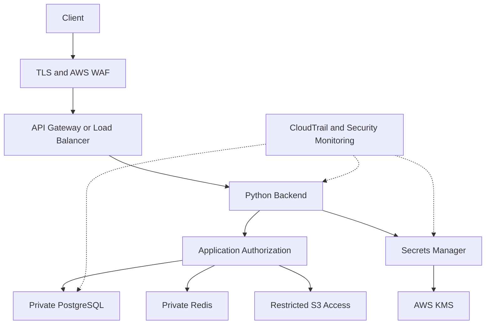
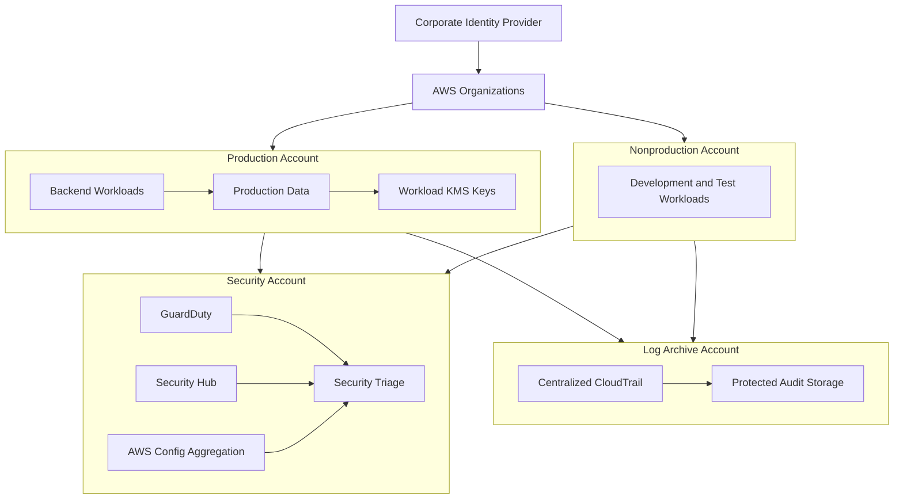
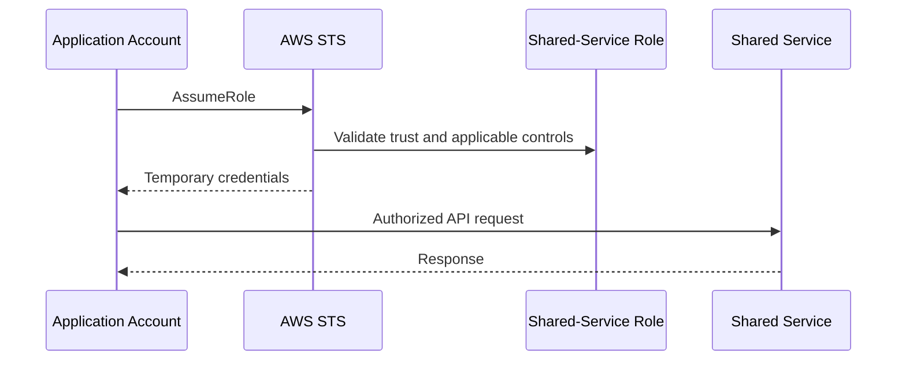
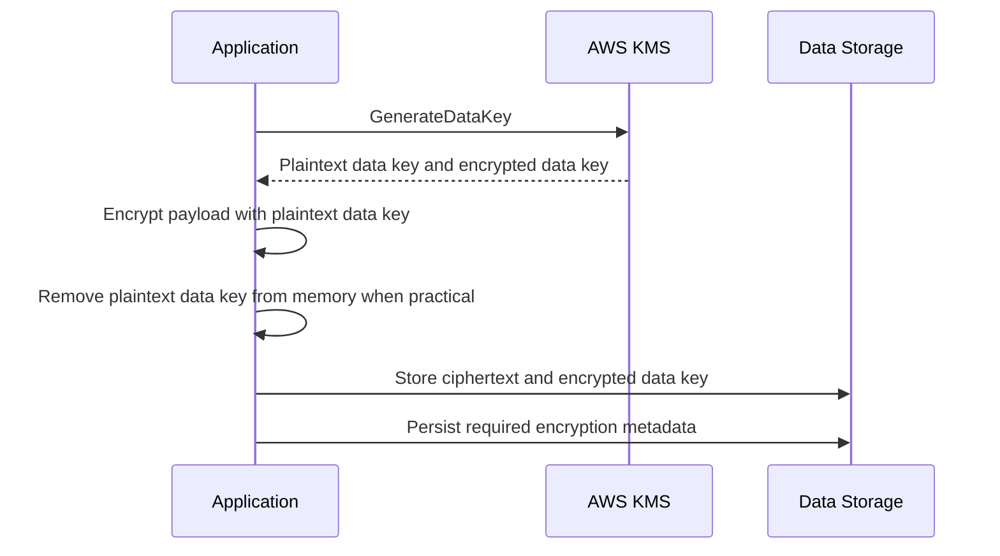
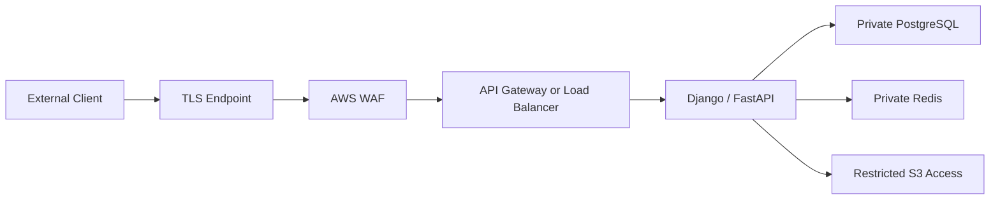
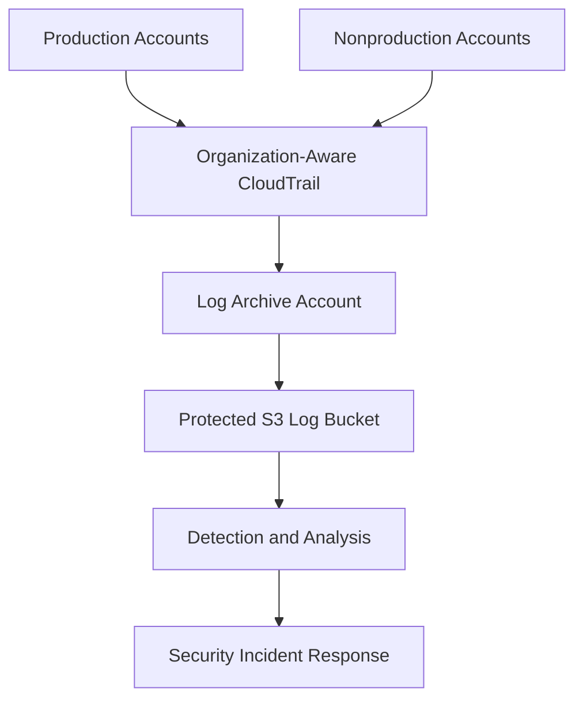

# 08- AWS Security Architecture Questions

## Overview

AWS security architecture interviews assess the ability to design secure, scalable, and operationally maintainable cloud environments. Senior backend engineers must demonstrate how identity, networking, encryption, application authorization, centralized monitoring, and incident response work together across AWS accounts and workloads.

A strong architecture separates security responsibilities into explicit boundaries, applies least privilege at each boundary, and assumes that individual controls can fail. Security decisions must also account for deployment complexity, availability, recovery, operational ownership, and cost.

This document focuses on architecture-level interview questions, design trade-offs, production scenarios, and implementation reasoning.

## Core Security Architecture Principles

### How would you design a defense-in-depth security architecture on AWS?

**Question:** A company runs Python microservices on AWS with PostgreSQL, Redis, S3, and asynchronous workers. How would you protect the platform against compromised credentials, exposed endpoints, unauthorized data access, and malicious API requests?

**Expected answer:**

Defense in depth uses multiple independent controls so that the failure of one control does not automatically compromise the entire system.

| Layer | Security controls | Primary purpose |
|---|---|---|
| Organization | AWS Organizations, SCPs, account separation | Establish account-level guardrails |
| Identity | IAM roles, federation, MFA, temporary credentials | Control who or what can access resources |
| Network | VPCs, security groups, private subnets, VPC endpoints | Restrict network reachability |
| Edge | TLS, AWS WAF, AWS Shield | Protect public-facing endpoints |
| Application | Authentication, authorization, input validation | Enforce business-level access rules |
| Data | KMS, encryption, database permissions | Protect stored information |
| Secrets | Secrets Manager, Parameter Store | Control access to sensitive configuration |
| Detection | CloudTrail, GuardDuty, Security Hub, AWS Config | Detect suspicious activity and configuration drift |
| Response | Credential revocation, isolation, recovery procedures | Contain and recover from incidents |

The request path might look like this:



**Important design decisions:**

- Give each workload a dedicated IAM role.
- Keep databases and caches private unless a documented requirement dictates otherwise.
- Restrict access to specific resources and operations.
- Separate production and nonproduction environments.
- Encrypt sensitive data and control access to encryption keys.
- Centralize security evidence and protect it from workload administrators.
- Monitor security-relevant events and test incident-response procedures.

**Trade-off:** Additional controls introduce operational complexity, latency, and cost. The architecture should minimize risk without creating so many independent policies and dependencies that teams cannot reliably operate the platform.

### How does the AWS Shared Responsibility Model affect architecture decisions?

**Question:** Which security controls are AWS's responsibility, and which belong to the customer?

**Expected answer:**

AWS secures the underlying cloud infrastructure, while customers remain responsible for security choices involving their identities, data, applications, configurations, and workloads. The precise division depends on the service.

| Area | AWS responsibility | Customer responsibility |
|---|---|---|
| EC2 | Physical infrastructure and underlying virtualization | Guest OS, installed software, IAM, application security, network configuration |
| Lambda | Managed runtime infrastructure | Function code, execution-role permissions, dependencies, data handling |
| RDS | Managed database infrastructure and supported platform maintenance | Database access, data classification, network configuration, applicable encryption and retention choices |
| S3 | Storage service infrastructure | Bucket policies, access permissions, data classification, retention, and appropriate encryption configuration |
| IAM | IAM service infrastructure | Identity lifecycle, trust relationships, policies, privileged access |
| KMS | KMS service infrastructure | Key authorization, key lifecycle decisions, permitted usage, and recovery planning |

For example, using Lambda reduces the customer's responsibility for operating the underlying servers, but it does not automatically secure the function's dependencies, execution role, secret retrieval, or application authorization.

**Senior-level consideration:** Managed services reduce infrastructure-management responsibilities; they do not eliminate security engineering.

### How would you apply zero-trust principles to AWS workloads?

**Question:** Several services communicate over private VPC networking. Can they trust one another because they are inside the same VPC?

**Expected answer:**

No. Private network location is not sufficient proof of identity or authorization.

A zero-trust approach evaluates identity, authorization, and context for each access path rather than assuming that internal traffic is inherently trustworthy.

Apply the principle through:

- Dedicated workload identities.
- Explicit permissions for required operations.
- TLS and appropriate peer verification.
- Narrow network connectivity.
- Application-level authorization.
- Short-lived credentials where supported.
- Auditable access decisions.
- Continuous evaluation of security posture.

For example, a Celery worker should not inherit every permission available to a Django API service simply because both run in the same VPC. The worker should receive only the permissions needed to process its assigned jobs.

**Trade-off:** Fine-grained identity and authorization increase policy and testing requirements. Reusable policy modules, automated validation, and centralized identity governance help control this complexity.

## Multi-Account Security Architecture

### How would you design a secure multi-account AWS environment?

**Question:** An organization operates production, staging, development, security, and audit workloads. Design its account structure and security controls.

**Expected answer:**

Use separate AWS accounts as security and operational boundaries, with centralized governance through AWS Organizations.

A representative design is:



The exact organization structure depends on regulatory requirements, workload isolation, operational ownership, and scale.

**Recommended controls:**

- Separate production from development and testing.
- Use centralized workforce identity and controlled cross-account access.
- Apply SCPs to enforce organization-wide guardrails.
- Aggregate security findings into a security account.
- Deliver audit logs to a separately controlled log archive.
- Define account owners and incident escalation paths.
- Standardize account provisioning and baseline controls.
- Monitor organization-level configuration changes.

**Why separate the log archive account?**

If a workload administrator can modify or delete the evidence generated by that workload, incident investigation becomes less reliable. A separately controlled archive reduces the risk that a compromised workload identity can alter audit evidence.

**Trade-off:** More accounts improve isolation but increase governance, networking, policy-management, and operational overhead.

### What is the difference between an SCP and an IAM policy?

**Question:** A developer says that an SCP granting `s3:GetObject` should allow a workload to read S3 objects. Is this correct?

**Expected answer:**

No. An SCP defines the maximum permissions available to affected principals in member accounts; it does not grant permissions.

An IAM identity policy or applicable resource-based policy must still authorize the requested operation. Other applicable controls can also restrict it.

| Control | Purpose |
|---|---|
| Identity-based policy | Grants or denies permissions to an identity |
| Resource-based policy | Controls access to a supported resource |
| SCP | Limits the maximum permissions available within affected accounts |
| Permissions boundary | Limits permissions that identity-based policies can grant to a principal |
| Session policy | Restricts permissions for a supported assumed-role or federated session |
| Trust policy | Determines which principals may assume a role |

A matching explicit deny takes precedence over an allow.

**Architecture recommendation:** Use SCPs for broad governance guardrails, such as restricting prohibited services or protecting selected administrative controls. Use identity and resource policies for workload-specific access.

### How would you design cross-account access for a shared platform?

**Question:** A central platform account provides shared services to multiple application accounts. How should applications access those services securely?

**Expected answer:**

Choose the access mechanism based on the service, trust boundary, and required operations.

Common patterns include:

- Resource policies that authorize selected principals from other accounts.
- Dedicated roles in the target account that trusted callers can assume.
- PrivateLink for supported private service connectivity.
- Service-specific cross-account integrations where available.

For role assumption, both the caller's permission to invoke `sts:AssumeRole` and the target role's trust relationship must permit the operation. The resulting role session must also have the required permissions.



**Security considerations:**

- Restrict trusted principals and role ARNs.
- Avoid broad trust relationships without a documented requirement.
- Use external IDs for applicable third-party role-assumption scenarios.
- Record role assumptions and relevant service activity.
- Separate deployment, runtime, and administrative roles.
- Review cross-account relationships periodically.

**Common mistake:** Trusting an entire account when only one application role needs access, without understanding which principals in that account could obtain permission to assume the role.

## Identity and Workload Security Architecture

### How would you secure a Python backend running on EC2, ECS, EKS, or Lambda?

**Question:** Multiple Python services need access to S3, SQS, and Secrets Manager. How should AWS credentials be managed?

**Expected answer:**

Use the supported workload identity mechanism for the compute platform rather than embedding long-lived credentials in source code or configuration files.

| Compute platform | Typical identity approach |
|---|---|
| EC2 | IAM instance profile |
| ECS | Task role |
| Lambda | Execution role |
| EKS | EKS-supported workload identity integration, such as EKS Pod Identity or IRSA where appropriate |
| GitHub Actions | OIDC federation with a narrowly scoped deployment role |

Use separate roles for different trust and permission boundaries. For example, a service that only downloads documents should not also have permission to delete objects, manage IAM policies, or modify production infrastructure.

Python applications should use SDK credential providers:

```python
import boto3

session = boto3.Session(region_name="<REGION>")

s3 = session.client("s3")
sqs = session.client("sqs")

identity = session.client("sts").get_caller_identity()

print({
    "account": identity["Account"],
    "principal": identity["Arn"],
})
```

This example prints identity metadata, not credential values. In production, avoid logging principal metadata unnecessarily if it exposes sensitive infrastructure details.

**Production considerations:**

- Use the correct role for each workload.
- Keep permissions scoped to required resources and actions.
- Ensure temporary credentials refresh correctly through the SDK provider.
- Remove unused static access keys.
- Monitor unexpected role assumptions and API operations.
- Include IAM changes in infrastructure review and automated policy testing.

### How would you secure a CI/CD pipeline that deploys to production?

**Question:** A GitHub Actions workflow builds Docker images and deploys them to AWS. What is the recommended identity architecture?

**Expected answer:**

Prefer OIDC federation with AWS STS when supported by the CI/CD platform. This allows the workflow to obtain temporary credentials instead of depending on a long-lived IAM user access key.

The trust policy should constrain the OIDC provider, audience, and relevant repository, branch, or environment claims supported by the integration.

Separate roles for build, test, and deployment stages when they require different privileges.

**Recommended controls:**

- Restrict production deployment to trusted workflows.
- Prevent untrusted pull-request code from obtaining production credentials.
- Grant deployment permissions only to the required resources.
- Protect deployment environments with appropriate approval requirements.
- Scan dependencies and container images.
- Validate infrastructure and IAM policy changes before deployment.
- Audit deployment activity through CloudTrail and CI/CD logs.
- Protect artifacts and prevent secret leakage into build logs.

**Trade-off:** More narrowly scoped pipeline identities increase setup and maintenance work, but they reduce the blast radius of a compromised workflow.

### How would you prevent privilege escalation through IAM permissions?

**Question:** A developer can create and modify IAM policies. What risks does this introduce?

**Expected answer:**

A principal that can create policies, attach policies, modify role trust, or pass privileged roles may be able to escalate its effective permissions.

Review permissions such as:

- `iam:CreatePolicy`
- `iam:CreatePolicyVersion`
- `iam:SetDefaultPolicyVersion`
- `iam:AttachRolePolicy`
- `iam:PutRolePolicy`
- `iam:UpdateAssumeRolePolicy`
- `iam:PassRole`

The actual risk depends on the target principal, resource scope, policy conditions, and other applicable controls.

**Mitigation:**

- Separate infrastructure administration from application deployment.
- Restrict role trust-policy modification.
- Scope `iam:PassRole` to approved roles and relevant services.
- Restrict who can attach or modify privileged policies.
- Use permissions boundaries where appropriate.
- Apply organization guardrails.
- Review CloudTrail for unexpected IAM changes.
- Test privilege-escalation paths during security assessments.

**Senior-level consideration:** An identity with no direct administrator policy may still have an escalation path through permission-management operations or the ability to pass a powerful role to a service.

## Encryption and Data Protection Architecture

### How would you design encryption for S3, EBS, RDS, and application secrets?

**Question:** A backend platform stores customer documents, database records, backups, and credentials. How should encryption be implemented?

**Expected answer:**

Start with data classification, access requirements, recovery objectives, and regulatory obligations. Apply encryption at rest and in transit, and control the principals allowed to use the relevant keys.

| Data type | Typical protection |
|---|---|
| S3 objects | Server-side encryption with an appropriate S3 encryption configuration |
| EBS volumes | EBS encryption using KMS-backed key management as configured |
| RDS databases | RDS encryption at rest using an appropriate KMS key |
| Secrets | Secrets Manager or another appropriate secret store, with KMS integration |
| Application traffic | TLS with appropriate certificate validation |
| Logs | Service-supported encryption and restricted access |

AWS-managed keys reduce key-administration effort. Customer-managed KMS keys provide additional control over key policies, grants, access auditing, and lifecycle management.

**Important distinctions:**

- Encryption at rest does not replace authorization.
- TLS does not prevent an authorized application from disclosing sensitive data.
- Key access is separate from permission to access the underlying object or service.
- Key deletion or loss of authorization can affect availability.
- Encryption does not replace backup, retention, or disaster recovery planning.

### How would you design KMS key governance across multiple accounts?

**Question:** Production workloads require encryption, but the security team wants centralized key governance.

**Expected answer:**

Define key ownership and usage boundaries, then choose the appropriate account and key structure.

Consider:

- Separate keys for different workloads or data classifications where justified.
- Key policies that authorize intended principals.
- IAM policies that permit only required cryptographic operations.
- Grants for supported delegated service access.
- Rotation and key lifecycle procedures.
- CloudTrail monitoring for key-management activity.
- Backup and recovery requirements.
- Restrictions on disabling or scheduling deletion of critical keys.

A centralized security team can define governance standards without requiring every workload to share one key.

**Trade-off:** More granular keys improve isolation and authorization clarity but increase policy, lifecycle, and operational complexity.

**Common mistake:** Granting broad KMS permissions to solve an application failure without identifying the actual key, operation, and principal.

### What is envelope encryption, and why is it useful?

**Question:** A service stores large encrypted files and needs to minimize direct use of a KMS key for every byte of data.

**Expected answer:**

Envelope encryption uses a data key to encrypt the payload while KMS protects the data key.

A typical flow is:



To decrypt, the application retrieves the encrypted data key, requests decryption through KMS, and uses the resulting plaintext data key to decrypt the payload.

The application must protect plaintext keys in memory and avoid logging them. It should also use authenticated encryption where appropriate and preserve required metadata.

**Production considerations:**

- Prefer established SDKs and cryptographic libraries.
- Define data-key lifecycle and recovery requirements.
- Consider encryption context where supported.
- Avoid using one data key indefinitely across unrelated data without a justified design.
- Handle KMS throttling, failures, and regional dependencies.
- Monitor key usage and authorization changes.

### How would you respond if a production KMS key became unavailable?

**Question:** A key used by an application is disabled, and requests begin failing.

**Expected answer:**

Determine whether the key was disabled intentionally, accidentally, or as part of an incident response action.

Inspect the key state and CloudTrail events. Identify all dependent resources and workloads, and determine whether the outage affects data access, new writes, or both.

If the change was accidental and re-enabling is authorized, an authorized administrator can restore the key:

```bash
aws kms enable-key \
  --key-id <KEY_ID> \
  --region <REGION>
```

This is a modifying operation and must be performed only after confirming the key identity and incident context.

**Verification:**

- Confirm the key is enabled.
- Retry the affected operation.
- Verify data integrity and application health.
- Confirm the expected principals can use the key.
- Review the original change and improve controls around key-state transitions.

**Senior-level consideration:** Disabling a key and scheduling it for deletion have different consequences. Key deletion can cause irreversible loss of access to protected data. Key lifecycle and recovery must be included in disaster recovery planning.

## Secrets Management Architecture

### How would you manage secrets for Django and FastAPI services?

**Question:** Multiple services need database passwords, API tokens, and third-party integration credentials.

**Expected answer:**

Store secrets in a managed secret store, use workload identities to retrieve them, and define an explicit rotation and caching strategy.

A Python service can retrieve a secret through Boto3:

```python
import json
import os

import boto3
from botocore.exceptions import BotoCoreError, ClientError


def get_database_config() -> dict[str, str]:
    secret_arn = os.environ["DATABASE_SECRET_ARN"]
    region = os.environ["AWS_REGION"]

    client = boto3.client("secretsmanager", region_name=region)

    try:
        result = client.get_secret_value(SecretId=secret_arn)
        value = result.get("SecretString")

        if value is None:
            raise RuntimeError("Database secret is not available as a string")

        config = json.loads(value)

        required = {"username", "password", "host", "dbname"}
        if not required.issubset(config):
            raise RuntimeError("Database secret is missing required fields")

        return config

    except (BotoCoreError, ClientError):
        raise RuntimeError("Unable to retrieve database configuration") from None
```

The workload role should have permission to retrieve only the required secret. If a customer-managed KMS key is used, configure the necessary KMS authorization.

The example intentionally avoids logging the secret or exposing detailed SDK exception contents to the caller. Production observability should record sanitized error categories and correlation identifiers.

**Caching strategy:**

- Avoid fetching a secret for every HTTP request.
- Use a bounded cache or supported caching component.
- Define how applications refresh credentials after rotation.
- Recycle database connections when required by the authentication model.
- Alert on persistent retrieval failures.

**Trade-off:** Longer cache lifetimes reduce latency and API calls but can delay rotation adoption. Shorter lifetimes improve freshness but increase request volume and dependency on the secret service.

### How would you design zero-downtime secret rotation?

**Question:** A production database password must rotate without interrupting traffic.

**Expected answer:**

Treat rotation as a coordinated state transition involving the credential source, secret store, application caches, and database connections.

A safe workflow depends on whether the database supports overlapping credentials or an equivalent staged rotation mechanism.

1. Establish the supported rotation strategy for the credential type.
2. Update or provision the new credential according to the rotation workflow.
3. Publish the new secret version at the correct stage.
4. Ensure applications can refresh credentials safely.
5. Validate new connections with the rotated credential.
6. Recycle stale connection pools when required.
7. Retire the old credential after confirming that it is no longer needed.
8. Monitor authentication failures and rollback conditions.

**Failure modes:**

- The secret changes but the database does not.
- The database credential changes but the secret store is not updated.
- Application caches retain stale values.
- Existing connections hide the problem until reconnection.
- The rotation function fails partway through its workflow.

**Production recommendation:** Test rotation failure and recovery in a nonproduction environment. Rotation automation must be observable, retry-safe where possible, and designed to prevent both credentials from being unintentionally invalid.

## Network and Public API Architecture

### How would you expose a public API securely?

**Question:** A Python REST API must serve external customers while its database and cache remain private.

**Expected answer:**

Expose only the required application entry point. Keep databases and caches on private network paths and restrict access to trusted workloads.

A representative request flow is:



Depending on the service, WAF can associate with supported resources such as API Gateway REST APIs and Application Load Balancers. The architecture must use a supported integration rather than assuming every endpoint type supports the same association.

**Controls:**

- TLS with valid certificates.
- WAF rules and rate-based protections where appropriate.
- Application authentication and authorization.
- Request validation and safe error handling.
- Private database and cache connectivity.
- Narrow IAM workload permissions.
- Centralized security logging.
- Rate limits and capacity protections.
- Secret management and encryption.

**Important:** WAF and network controls do not enforce application ownership rules. A valid authenticated user must still be prevented from accessing another user's resources.

### What is the difference between security groups and network ACLs?

**Question:** Both control network traffic. Why would an architecture use both?

**Expected answer:**

Security groups are stateful controls associated with network interfaces or supported resources. Network ACLs are stateless controls applied at the subnet boundary.

| Property | Security group | Network ACL |
|---|---|---|
| Scope | Resource or network interface | Subnet |
| State | Stateful | Stateless |
| Rule behavior | Allow rules | Allow and deny rules |
| Return traffic | Automatically tracked for allowed connections | Must satisfy applicable rules in both directions |
| Typical use | Workload-level connectivity restrictions | Additional subnet-level traffic filtering |

For example, an application security group can allow PostgreSQL traffic to a database security group. A network ACL can provide an additional subnet-level restriction.

**Common mistake:** Assuming that a security group rule alone proves that the service is reachable. Routing, DNS, network ACLs, application listeners, and other controls also affect connectivity.

### When should a service use VPC endpoints or AWS PrivateLink?

**Question:** An application in a private subnet needs access to AWS APIs or an internal service hosted in another VPC or account.

**Expected answer:**

Choose the mechanism based on the target service and connectivity requirement.

| Mechanism | Typical purpose |
|---|---|
| S3 gateway endpoint | Private routing to S3 from supported VPC routing configurations |
| DynamoDB gateway endpoint | Private routing to DynamoDB |
| Interface VPC endpoint | Private connectivity to supported AWS services through endpoint network interfaces |
| AWS PrivateLink | Private service connectivity using supported endpoint-service patterns |
| VPC peering or Transit Gateway | VPC-to-VPC network connectivity, subject to routing and architecture requirements |

VPC endpoints can reduce dependence on public egress and provide additional control over network paths. Endpoint policies can further restrict supported requests, but they do not replace identity or resource authorization.

**Operational considerations:**

- DNS resolution and private DNS configuration.
- Route tables and endpoint placement.
- Security-group rules for interface endpoints.
- Endpoint policy scope.
- Availability across required Availability Zones.
- Cost and data-transfer implications.

**Senior-level consideration:** Private connectivity does not automatically make an application endpoint trustworthy or eliminate the need for authentication and authorization.

### How would you protect a public API against DDoS and application-layer attacks?

**Question:** An API experiences high request volume, abusive clients, and suspicious HTTP traffic.

**Expected answer:**

Use layered protections based on the type of traffic and the architecture.

- AWS Shield provides DDoS protection according to the service and protection level.
- AWS WAF supports web request filtering and rate-based rules for supported resources.
- API Gateway or load-balancer controls can provide additional traffic-management capabilities.
- Application-level rate limits protect expensive business operations.
- Authentication and authorization prevent unauthorized business actions.
- Autoscaling and backpressure help preserve service availability.
- Monitoring and alerting identify unusual traffic patterns.

**Trade-offs:**

- Strict rate limits can block legitimate users behind shared NAT addresses.
- Aggressive filtering can cause false positives.
- Scaling protects capacity but can increase cost during an attack.
- Application-level controls require careful handling of identity, tenant boundaries, and distributed rate-limit state.

**Production recommendation:** Load-test the complete ingress path, define capacity and escalation thresholds, and test WAF rule changes before broad enforcement where practical.

## Centralized Monitoring and Audit Architecture

### How would you design centralized audit logging for multiple AWS accounts?

**Question:** Security teams need reliable evidence of administrative activity and access to sensitive resources.

**Expected answer:**

Use organization-aware CloudTrail configuration, centralized destinations, appropriate data-event coverage, and restrictive audit-storage permissions.



**Key decisions:**

- Determine which management events must be recorded.
- Enable relevant data events for sensitive operations such as S3 object access.
- Include required regions and accounts.
- Configure retention and access policies.
- Consider CloudTrail log-file validation where appropriate.
- Monitor trail configuration changes and delivery errors.
- Restrict who can modify or delete logs.
- Define query, investigation, and evidence-preservation procedures.

CloudTrail Event History is useful for recent management-event investigations, but it is not a replacement for the required organization-wide logging and retention architecture.

**Trade-off:** Broader event collection improves forensic visibility but can increase storage, ingestion, and analysis costs. Choose event coverage based on risk and evidence requirements.

### How do CloudTrail, GuardDuty, Security Hub, AWS Config, and CloudWatch differ?

**Question:** Which AWS services should be used for security monitoring, and what does each contribute?

**Expected answer:**

| Service | Main purpose | Example use |
|---|---|---|
| CloudTrail | Record AWS API activity | Investigate unexpected IAM changes |
| GuardDuty | Detect suspicious activity and threats using supported telemetry | Investigate suspicious workload behavior |
| Security Hub | Aggregate security findings and assess security posture | Centralize findings and compliance-related controls |
| AWS Config | Record resource configuration and evaluate configuration compliance | Detect prohibited security-group configurations |
| CloudWatch | Collect supported metrics, logs, and alarms | Alert on application failures or security-relevant operational signals |

These services complement one another rather than replacing one another.

For example, CloudTrail can provide evidence of an API call, GuardDuty can produce a threat finding, Security Hub can aggregate findings, AWS Config can identify a configuration deviation, and CloudWatch can alert on related operational symptoms.

**Common mistake:** Treating Security Hub as a replacement for CloudTrail or assuming that AWS Config alone detects every security incident.

### How would you build an actionable security alerting system?

**Question:** A company has centralized security findings but frequently misses high-risk events.

**Expected answer:**

Build an end-to-end process from detection to verified remediation.

1. Collect findings from supported security services.
2. Normalize account, region, resource, severity, and ownership metadata.
3. Deduplicate recurring findings where appropriate.
4. Route findings to the responsible team.
5. Define response deadlines based on severity and impact.
6. Track acknowledgment, investigation, remediation, and verification.
7. Escalate overdue high-risk findings.
8. Review recurring causes and improve preventive controls.

**Useful operational metrics:**

- Time to detect.
- Time to acknowledge.
- Time to contain.
- Time to remediate.
- Number of unresolved high-severity findings.
- Recurrence rate.
- False-positive rate.
- Percentage of findings with a clear owner.

**Senior-level consideration:** Alert generation is not the end of a security control. An alert that has no owner, no response procedure, or no verification step is unlikely to provide reliable risk reduction.

## Incident Response Architecture

### How would you respond to a compromised IAM credential?

**Question:** CloudTrail indicates suspicious API calls from an IAM access key.

**Expected answer:**

Treat the credential as compromised until evidence establishes otherwise.

**Containment:**

- Identify the principal and the scope of its permissions.
- Disable or revoke the exposed credential through an approved process.
- Investigate role assumptions and other access paths.
- Apply suitable restrictions to suspicious sessions where supported.
- Preserve CloudTrail and related evidence.
- Determine which resources were accessed or modified.

**Eradication and recovery:**

- Rotate affected credentials.
- Remove unauthorized changes.
- Restore resources from trusted configurations if necessary.
- Validate application health and data integrity.
- Confirm that the attacker cannot regain access through another identity path.

**Follow-up:**

- Identify how the credential was exposed.
- Add preventive controls for source control, CI/CD, and secret management.
- Review privilege escalation paths.
- Add alerts for similar activity.
- Document evidence, decisions, and recovery results.

**Important:** Disabling one IAM access key does not necessarily invalidate every previously issued temporary session or eliminate independent access paths.

### How would you contain a compromised EC2 instance without losing evidence?

**Question:** GuardDuty reports suspicious behavior involving a production instance.

**Expected answer:**

Coordinate containment with the incident-response owner and preserve evidence before destructive remediation where practical.

Possible actions include:

- Restricting network access with approved security-group or routing changes.
- Restricting compromised role permissions where appropriate.
- Preserving relevant logs and investigation artifacts.
- Reviewing the instance's IAM role and attached permissions.
- Identifying secrets and other resources the instance could access.
- Rebuilding from a trusted image if compromise is confirmed.
- Validating that replacement workloads do not reuse compromised credentials.

The exact containment method depends on the threat, service availability requirements, and evidence-preservation procedure.

**Trade-off:** Immediate isolation can reduce attacker activity but may interrupt production traffic or alter evidence. Define and rehearse containment procedures before an incident occurs.

### How would you design incident-response permissions?

**Question:** Security responders need to investigate and contain incidents, but should not have unrestricted permanent access to every production resource.

**Expected answer:**

Use a dedicated incident-response access model.

- Provide read-only investigation permissions for common evidence sources.
- Use controlled escalation for containment actions.
- Separate investigation, approval, and destructive recovery where practical.
- Record privileged role assumptions and actions.
- Apply MFA or appropriate strong authentication for privileged access.
- Restrict access to sensitive audit evidence.
- Define emergency access procedures and periodic review.

**Senior-level consideration:** Incident-response roles need sufficient authority to contain threats, but unrestricted permanent administrator access increases the impact of compromised responder credentials.

## Secure Architecture Trade-Offs

### How would you choose between one shared application role and separate roles per microservice?

**Question:** Multiple microservices use the same AWS account and currently share a role with permissions to S3, SQS, and Secrets Manager.

**Expected answer:**

Separate roles when services have materially different trust boundaries, data access, or operational responsibilities.

| Consideration | Shared role | Separate workload roles |
|---|---|---|
| Initial setup | Simpler | More configuration |
| Blast radius | Larger | Smaller |
| Least privilege | Harder to maintain | Easier to scope by service |
| Audit attribution | Harder to distinguish workloads by role | Clearer workload identity |
| Policy management | Fewer role resources | More roles and policies to govern |

A shared role may be reasonable for tightly coupled components with identical permissions and a documented ownership model. It should not be the default merely to reduce configuration.

### How would you balance security and availability?

**Question:** A restrictive policy or network control improves security but occasionally blocks production traffic.

**Expected answer:**

Start with the risk being mitigated and the failure mode introduced by the control.

- Identify the security requirement and the affected traffic.
- Measure the control's failure impact.
- Use staged rollout and representative testing.
- Provide monitored rollback or break-glass procedures where justified.
- Keep exceptions narrow, time-bound, and reviewed.
- Verify both successful legitimate access and denial of unauthorized access.

For example, a WAF rule should be tested against representative legitimate and malicious traffic. A restrictive SCP should be validated against deployment and recovery workflows before broad organization-wide rollout.

**Senior-level consideration:** Security and availability are not independent. A control that frequently causes outages may be bypassed by operators, reducing long-term security.

### How would you decide whether to use AWS-managed or customer-managed KMS keys?

**Question:** A service team requests customer-managed keys for every resource, while the platform team prefers AWS-managed keys for operational simplicity.

**Expected answer:**

Base the decision on required control, auditability, separation of duties, and lifecycle requirements.

| Requirement | AWS-managed key | Customer-managed key |
|---|---|---|
| Reduced key administration | Often suitable | Requires additional governance |
| Custom key policy control | Limited compared with customer-managed keys | Supported |
| Detailed customer control over key lifecycle | Limited | Supported |
| Workload-specific separation | Depends on service and key model | Can be designed explicitly |
| Operational overhead | Lower | Higher |
| Specialized compliance requirements | Depends on the requirement | May provide needed controls |

Customer-managed keys are not automatically more secure in every situation. Poor key policies, unsafe deletion procedures, or overly broad permissions can undermine their benefits.

## Architecture Review Checklist

Before approving an AWS security architecture, verify the following:

### Identity and Access

- [ ] Every workload has an appropriate identity.
- [ ] Credentials are short-lived where supported.
- [ ] Trust policies identify intended principals.
- [ ] Policies grant only required actions and resources.
- [ ] SCPs and permissions boundaries are used for their intended purposes.
- [ ] Privileged access is controlled and audited.
- [ ] Cross-account access paths are documented.

### Network and Application

- [ ] Public exposure is limited to required endpoints.
- [ ] Databases and caches use appropriate private connectivity.
- [ ] Security groups and network ACLs match intended traffic flows.
- [ ] Authentication and application authorization are enforced independently.
- [ ] WAF and DDoS controls match the exposed service architecture.
- [ ] Service-to-service communication uses appropriate identity and transport protections.

### Data and Secrets

- [ ] Sensitive data is classified and encrypted appropriately.
- [ ] KMS key ownership and lifecycle procedures are documented.
- [ ] Secret rotation and application refresh are tested.
- [ ] Credentials are excluded from source code and logs.
- [ ] Backup and recovery plans account for key availability.

### Monitoring and Recovery

- [ ] Required CloudTrail event coverage is enabled.
- [ ] Security findings have clear owners and escalation paths.
- [ ] Centralized audit evidence is protected.
- [ ] Configuration compliance is monitored.
- [ ] Credential compromise and workload isolation procedures are documented.
- [ ] Recovery procedures are tested.
- [ ] Security changes are reviewed and verified after deployment.

## Key Takeaways

- Design AWS security around explicit identity, network, application, and data boundaries; no single control replaces the others.
- Use multi-account isolation, centralized governance, workload-specific roles, and narrowly scoped cross-account trust to reduce blast radius.
- Treat encryption, KMS authorization, secret rotation, and credential delivery as operational dependencies that require lifecycle and recovery planning.
- Combine CloudTrail, GuardDuty, Security Hub, AWS Config, and CloudWatch according to their distinct roles in auditing, threat detection, compliance, and operations.
- Senior-level architecture decisions must balance least privilege, availability, recoverability, operational complexity, and cost while preserving verifiable security controls.
```