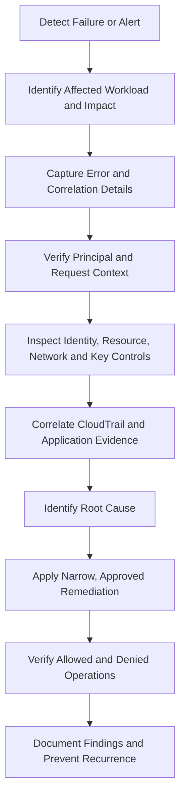
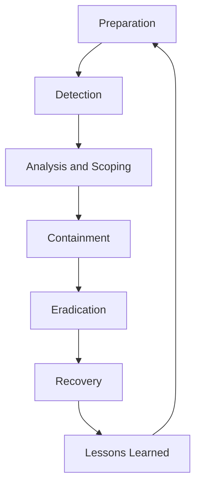

# 09- Troubleshooting and Incident Response Questions

## Overview

AWS security troubleshooting requires engineers to distinguish identity failures, authorization failures, cryptographic failures, network connectivity problems, configuration drift, and active security incidents. Similar application symptoms can originate from very different control layers, so production diagnosis should begin with evidence rather than broad permission changes or emergency configuration changes.

Incident response extends troubleshooting beyond restoring service. Engineers must establish scope, contain unauthorized activity, preserve evidence, recover safely, and prevent recurrence.

This document covers production-oriented troubleshooting workflows and senior-level interview questions involving:

- IAM authorization, role assumption, and temporary credentials.
- AWS Signature Version 4 authentication failures.
- KMS authorization, encryption, and secret retrieval.
- Network security, DNS, and AWS WAF.
- CloudTrail evidence gaps and security findings.
- Credential compromise, suspicious API activity, and workload isolation.
- Incident containment, recovery, and post-incident improvements.

## Security Troubleshooting Methodology

### How do you investigate an AWS security failure in production?

**Question:** An application suddenly starts receiving authorization errors after a deployment. How do you investigate without making the incident worse?

**Expected answer:**

Use a consistent investigation process that preserves evidence and isolates the failing security boundary.



#### Investigation procedure

1. **Establish scope:** Identify affected accounts, regions, resources, services, users, and workloads.
2. **Capture evidence:** Record timestamps, request IDs, error codes, deployment versions, and relevant correlation IDs.
3. **Verify identity:** Determine which principal made the request.
4. **Identify the failing operation:** Distinguish authentication, authorization, signing, networking, and application failures.
5. **Inspect applicable controls:** Review IAM policies, trust policies, resource policies, SCPs, permissions boundaries, session policies, security groups, endpoint policies, and KMS permissions as relevant.
6. **Correlate events:** Use CloudTrail, service logs, application telemetry, and security findings.
7. **Remediate narrowly:** Correct the specific failure without introducing unrelated permissions or weakening security controls.
8. **Verify the fix:** Confirm the intended operation succeeds and unauthorized operations remain blocked.
9. **Prevent recurrence:** Add tests, alerts, policy validation, or deployment safeguards.

### Which AWS commands are useful during security investigations?

The following commands provide read-only inspection of identity, policy, encryption, network, and audit configuration unless otherwise noted.

| Investigation | Command | Purpose |
|---|---|---|
| Caller identity | `aws sts get-caller-identity` | Identify the active AWS principal |
| Role configuration | `aws iam get-role` | Inspect role metadata and trust policy |
| Attached policies | `aws iam list-attached-role-policies` | Identify managed policies attached to a role |
| Inline policies | `aws iam list-role-policies` | Identify inline role policies |
| Policy version | `aws iam get-policy-version` | Inspect a managed policy version |
| KMS key | `aws kms describe-key` | Inspect key state and metadata |
| Secret metadata | `aws secretsmanager describe-secret` | Inspect secret configuration without retrieving its value |
| Security groups | `aws ec2 describe-security-groups` | Inspect network rules |
| CloudTrail events | `aws cloudtrail lookup-events` | Investigate recent management events |
| GuardDuty findings | `aws guardduty get-findings` | Retrieve threat finding details |
| Security Hub findings | `aws securityhub get-findings` | Retrieve security findings |

Use the appropriate account, region, resource ARN, and time range. A diagnostic identity may not have permission to inspect every resource, and the absence of accessible evidence does not prove that no relevant event occurred.

## IAM Authorization Failures

### Scenario: A Backend Receives AccessDenied From S3

**Question:** A Django application can access S3 in development but receives `AccessDenied` in production. What should you investigate?

**Expected answer:**

Start by identifying the production principal and exact S3 operation. Do not assume that the missing permission is `s3:GetObject`.

#### Step-by-step diagnosis

**Verify the effective identity.**

```bash
aws sts get-caller-identity
```

Run the command with the same credential provider configuration as the application when possible. Confirm that the principal belongs to the expected account and uses the intended workload role.

**Inspect the role.**

```bash
aws iam get-role \
  --role-name <ROLE_NAME>

aws iam list-attached-role-policies \
  --role-name <ROLE_NAME>

aws iam list-role-policies \
  --role-name <ROLE_NAME>
```

These commands identify the role's trust relationship and attached policy sources. Inspect relevant policy documents to determine whether the exact operation and resource are authorized.

**Inspect the bucket policy.**

```bash
aws s3api get-bucket-policy \
  --bucket <BUCKET_NAME>
```

Check for explicit denies and conditions involving source IP addresses, VPC endpoints, organization membership, TLS, or principal ARNs.

**Check the operation-specific resource.**

For example, listing a bucket and reading an object require different permissions:

- `s3:ListBucket` applies to the bucket ARN.
- `s3:GetObject` applies to the relevant object ARN.

If the object uses a customer-managed KMS key, inspect KMS authorization as well.

#### Common root causes

| Cause | Evidence | Remediation |
|---|---|---|
| Wrong role | Unexpected caller ARN | Correct the workload identity configuration |
| Missing action | One API operation fails while another succeeds | Add the specific required action |
| Resource mismatch | Policy resource does not match the bucket or object ARN | Correct the resource scope |
| Explicit deny | Applicable policy contains a matching deny | Correct the policy or underlying condition |
| SCP restriction | Organization-level guardrail blocks the action | Review the SCP with the organization administrator |
| Endpoint policy | Requests through a particular endpoint fail | Correct the endpoint policy if the request should be permitted |
| KMS authorization | Encrypted objects fail while other objects work | Correct the required KMS authorization |

**Verification:** Test the exact production operation with the intended workload role. Confirm that unrelated buckets, object prefixes, and operations remain inaccessible.

**Interview trap:** Granting `s3:*` or administrator access can hide the actual problem while expanding the security blast radius.

### Scenario: AssumeRole Fails With AccessDenied

**Question:** A workload cannot assume a target role in another AWS account.

**Expected answer:**

Role assumption requires the caller to be authorized to invoke `sts:AssumeRole` and the target role's trust policy to permit the caller. Applicable organization controls, conditions, and explicit denies can also affect the request.

Inspect the target role:

```bash
aws iam get-role \
  --role-name <TARGET_ROLE_NAME>
```

Review the `AssumeRolePolicyDocument`. Confirm that the expected principal and any conditions match the actual caller.

Inspect the caller identity and relevant policies:

```bash
aws sts get-caller-identity

aws iam list-attached-role-policies \
  --role-name <CALLER_ROLE_NAME>
```

A policy simulator can help evaluate supported policy logic:

```bash
aws iam simulate-principal-policy \
  --policy-source-arn <CALLER_ROLE_ARN> \
  --action-names sts:AssumeRole \
  --resource-arns <TARGET_ROLE_ARN>
```

The simulator is supporting evidence, not a complete substitute for examining the live request and all applicable policy layers.

**Likely causes:**

- Caller lacks `sts:AssumeRole`.
- Target role does not trust the caller.
- The target ARN or account is incorrect.
- A trust-policy condition does not match.
- An SCP, permissions boundary, or session policy restricts access.
- A third-party role-assumption workflow is missing a required external ID.

**Corrective action:** Fix the exact trust or permission requirement. Do not trust an entire account when a specific principal is sufficient.

**Verification:** Assume the role and confirm the resulting identity using `aws sts get-caller-identity`.

### Scenario: An Application Receives ExpiredToken

**Question:** An ECS or EC2 workload intermittently fails with `ExpiredToken`, especially after running for several hours.

**Expected answer:**

Determine whether the application is using refreshable temporary credentials or manually supplied credentials that have expired.

Investigate:

- ECS task-role or EC2 instance-profile configuration.
- Environment variables overriding the expected credential provider.
- Manually cached STS credentials.
- SDK credential-provider behavior.
- Network access to the workload credential endpoint or STS, where applicable.
- Credential refresh errors.
- Incorrect session-token handling.

Use the SDK's supported credential provider rather than copying temporary credentials into application configuration.

For example:

```python
import boto3

session = boto3.Session(region_name="<REGION>")
sts = session.client("sts")

identity = sts.get_caller_identity()

print({
    "account": identity["Account"],
    "principal": identity["Arn"],
})
```

This confirms the identity available to the SDK without printing credentials.

**Corrective action:** Correct the workload role or credential-provider configuration. Remove unnecessary static credentials and avoid implementing a custom credential cache unless the design explicitly supports refresh and failure handling.

**Verification:** Test the application beyond the normal credential refresh interval and confirm that requests continue succeeding.

### Scenario: A Policy Simulator Says Allow, but Production Still Fails

**Question:** IAM simulation reports that an action is allowed, but the live request receives `AccessDenied`.

**Expected answer:**

The simulator does not necessarily reproduce every condition and authorization interaction of a real service request.

Investigate:

- Resource-based policies.
- SCPs and applicable organization controls.
- Permissions boundaries.
- Session policies.
- VPC endpoint policies.
- Service-specific conditions.
- The actual request principal and resource ARN.
- Explicit denies.
- KMS or other downstream service permissions.

For an encrypted S3 object, the S3 operation may be permitted while KMS authorization fails.

**Corrective action:** Correlate the live error with service and CloudTrail evidence. Identify the actual denied operation before changing policies.

**Prevention:** Add integration tests for important authorization paths and review policy changes through infrastructure-as-code workflows.

## SigV4 and Request Authentication Failures

### Scenario: A Signed AWS Request Returns SignatureDoesNotMatch

**Question:** A Python service signs an AWS request but receives `SignatureDoesNotMatch`.

**Expected answer:**

AWS Signature Version 4 signs a canonical representation of the request. The signature depends on the HTTP method, URI, query string, selected headers, payload hash or supported payload-signing mode, timestamp, credential scope, and derived signing key.

Check the following:

- HTTP method and canonical URI.
- URI and query parameter encoding.
- Header normalization and signed-header list.
- Host header and endpoint.
- Payload hash.
- Credential scope, service name, and region.
- Timestamp and system clock.
- Session token for temporary credentials.
- Whether a proxy or middleware changes the request after signing.

**Recommended approach:** Use the AWS SDK or an established signing library instead of maintaining a custom SigV4 implementation.

#### Diagnostic workflow

1. Capture the HTTP method, target endpoint, and relevant nonsecret headers.
2. Confirm the service and region.
3. Check system clock synchronization.
4. Verify the request body and signed headers remain unchanged after signing.
5. Confirm temporary credentials include the session token.
6. Review SDK or signing-library versions.
7. Compare the implementation against the target service's SigV4 requirements.

**Important distinction:** A valid signature does not grant permission to access a resource. `SignatureDoesNotMatch` is a signing or request-integrity failure; `AccessDenied` is an authorization failure.

### Scenario: A Request Works Locally but Fails in Production

**Question:** A request succeeds on a developer's laptop but fails from a Docker container or Kubernetes workload.

**Expected answer:**

Compare the actual execution environments.

Potential causes include:

- Different credentials or assumed roles.
- Missing session token.
- Different region or service endpoint.
- Incorrect container time.
- Proxy or service-mesh changes to signed headers.
- URL encoding differences.
- Payload mutation after signing.
- Different SDK versions.
- DNS resolving to an unexpected endpoint.

**Corrective action:** Align the credential provider, endpoint, region, and signing implementation. Remove unnecessary custom request transformations.

**Verification:** Generate a fresh request from the production runtime and confirm that the intended operation succeeds.

### Scenario: An AWS Request Fails With RequestExpired

**Question:** Signed requests are rejected because their timestamps are outside the permitted window.

**Expected answer:**

Check host time synchronization, signing timestamp generation, and request lifetime.

A request that is signed and then held in a queue may expire before transmission. Reusing a previously signed request can also cause failures.

**Corrective action:** Synchronize the host clock and sign requests close to transmission time. Avoid reusing signed requests outside their supported validity window.

**Verification:** Send a newly signed request and monitor subsequent failures.

## KMS and Encryption Failures

### Scenario: An Encrypted S3 Object Cannot Be Decrypted

**Question:** The application can identify an S3 object but cannot read its contents after an IAM change.

**Expected answer:**

Separate object authorization from decryption authorization.

Inspect the relevant key:

```bash
aws kms describe-key \
  --key-id <KEY_ID> \
  --region <REGION>

aws kms get-key-policy \
  --key-id <KEY_ID> \
  --policy-name default \
  --region <REGION>
```

Review the S3 permissions, the caller's KMS permissions, the key policy, grants, encryption context, and CloudTrail evidence.

**Common causes:**

- Missing `kms:Decrypt`.
- Key policy does not authorize the required principal.
- Incorrect key or region.
- Key disabled or pending deletion.
- Changed grant or policy condition.
- Explicit deny from an applicable policy.

**Corrective action:** Restore the required permission at the appropriate policy layer. Do not replace the encryption configuration simply to bypass authorization.

**Verification:** Read the intended object through the application role and confirm that unrelated principals remain restricted.

### Scenario: A Secret Cannot Be Retrieved From Secrets Manager

**Question:** A Python backend fails to load its database configuration during startup.

**Expected answer:**

First distinguish identifier, authorization, decryption, and connectivity failures.

Inspect metadata without retrieving the secret value:

```bash
aws secretsmanager describe-secret \
  --secret-id <SECRET_ARN> \
  --region <REGION>
```

Verify the workload identity:

```bash
aws sts get-caller-identity
```

Check:

- Secret ARN and region.
- Workload role permissions.
- Secret resource policy, if configured.
- KMS permissions for customer-managed keys.
- Secret version stages.
- Network access and DNS resolution.
- SDK credential refresh behavior.

**Corrective action:** Fix the precise authorization or configuration problem. Never print the secret value as a diagnostic shortcut.

**Verification:** Test retrieval through the actual workload identity and confirm that the application can authenticate to the downstream service.

### Scenario: Secret Rotation Breaks Database Connections

**Question:** A secret rotates successfully, but a Django application begins returning database authentication failures.

**Expected answer:**

Rotation involves several components: the database credential, secret version, application cache, and active connection pool.

Investigate:

1. Whether the rotation workflow completed all required steps.
2. Whether the current secret version matches the database credential.
3. Whether the application cache refreshed.
4. Whether existing database connections remain open.
5. Whether new connections use the rotated credential.
6. Whether rollback or recovery procedures are available.

**Corrective action:** Restore a consistent credential state using the approved rotation procedure, refresh stale application configuration, and recycle connections where required.

**Prevention:** Test rotation failure modes in nonproduction. Monitor rotation status and authentication errors, and define explicit cache refresh and connection-recycling behavior.

### Scenario: A KMS Key Was Disabled Unexpectedly

**Question:** Several services suddenly fail to decrypt data because a KMS key is disabled.

**Expected answer:**

Treat the event as both an availability incident and a potential security event.

Inspect the key state and review CloudTrail for key-management operations. Identify the actor, timestamp, affected resources, and reason for the change.

If the key was disabled accidentally and re-enabling is authorized, use the approved recovery process:

```bash
aws kms enable-key \
  --key-id <KEY_ID> \
  --region <REGION>
```

This modifies a security control and should not be executed automatically without validating the incident context.

**Verification:**

- Confirm the key is enabled.
- Retry the affected operations.
- Validate application health and data access.
- Review the original change.
- Improve protection for key-state changes.

**Important:** Re-enabling a key is not an appropriate response if it was intentionally disabled to contain a security incident. Key deletion has different and potentially irreversible consequences.

## Network and WAF Troubleshooting

### Scenario: An Application Cannot Reach an AWS API From a Private Subnet

**Question:** A workload has the correct IAM permissions but cannot reach S3 or Secrets Manager.

**Expected answer:**

Separate network connectivity from authorization.

Inspect VPC endpoints:

```bash
aws ec2 describe-vpc-endpoints \
  --filters Name=vpc-id,Values=<VPC_ID> \
  --region <REGION>
```

Inspect route tables:

```bash
aws ec2 describe-route-tables \
  --filters Name=vpc-id,Values=<VPC_ID> \
  --region <REGION>
```

Inspect security groups:

```bash
aws ec2 describe-security-groups \
  --filters Name=vpc-id,Values=<VPC_ID> \
  --region <REGION>
```

Investigate:

- Missing NAT or endpoint connectivity.
- Endpoint policy restrictions.
- Security-group egress restrictions.
- Network ACL rules.
- Incorrect DNS resolution.
- Private DNS configuration.
- Incorrect service endpoint or region.

**Corrective action:** Restore the intended network path and endpoint configuration. Preserve the least-privilege IAM policy rather than weakening it to solve a network failure.

**Verification:** Confirm that the workload can reach the intended endpoint and cannot reach unauthorized destinations.

### Scenario: A Database Is Accidentally Publicly Accessible

**Question:** A production RDS database is configured with public accessibility, and its security group contains a broad inbound rule.

**Expected answer:**

Assess the actual exposure, restrict access, and investigate possible unauthorized connections.

```bash
aws rds describe-db-instances \
  --db-instance-identifier <DB_INSTANCE_ID> \
  --region <REGION>
```

```bash
aws ec2 describe-security-groups \
  --group-ids <SECURITY_GROUP_ID> \
  --region <REGION>
```

Review the public accessibility setting, subnet routing, security-group rules, network ACLs, database authentication, and relevant logs.

**Corrective action:**

- Restrict inbound access to the intended application sources.
- Remove unnecessary public exposure.
- Review suspicious connections and database activity.
- Rotate credentials if exposure warrants it.
- Verify the application still connects through the intended private path.

**Prevention:** Use infrastructure-as-code validation, configuration monitoring, and deployment policies that prevent unintended public database exposure.

### Scenario: AWS WAF Blocks Legitimate Traffic

**Question:** An API starts returning HTTP 403 responses after a WAF rule change.

**Expected answer:**

Identify the terminating rule before changing the web ACL.

Investigate:

- WAF logs and sampled requests, where available.
- The affected rule and its match conditions.
- Recent rule changes.
- Rate-based rules.
- Request headers, body size, URI, and source characteristics.
- Proxy and client-IP handling.

Inspect the web ACL:

```bash
aws wafv2 get-web-acl \
  --name <WEB_ACL_NAME> \
  --scope REGIONAL \
  --id <WEB_ACL_ID> \
  --region <REGION>
```

For CloudFront-scoped WAF configurations, use the appropriate scope and region requirements.

**Corrective action:** Adjust the specific rule or introduce a narrowly scoped exception. Test the change against legitimate and malicious traffic.

**Verification:** Confirm that valid requests succeed while relevant attack patterns remain blocked.

**Common mistake:** Disabling the entire web ACL to resolve one false positive.

## Audit Evidence and Security Monitoring Failures

### Scenario: A CloudTrail Event Is Missing

**Question:** An engineer reports an administrative API operation, but the event cannot be found in CloudTrail.

**Expected answer:**

A missing event in one query does not prove the operation did not occur.

Investigate:

- AWS account and region.
- Event timestamp and Event History coverage.
- Whether the operation is a management or data event.
- Whether the relevant trail or event data store was configured.
- Whether the event selector covered the operation.
- Log delivery delays or errors.
- Permissions and query filters.

Inspect the trail configuration:

```bash
aws cloudtrail describe-trails \
  --include-shadow-trails \
  --region <REGION>
```

Inspect delivery status:

```bash
aws cloudtrail get-trail-status \
  --name <TRAIL_ARN> \
  --region <REGION>
```

Review `IsLogging`, recent delivery errors, and destination configuration.

**Corrective action:** Restore the intended logging configuration and verify coverage across required accounts, regions, and event categories.

**Prevention:** Monitor trail configuration changes, log delivery failures, and audit coverage. Document periods in which required evidence was unavailable.

### Scenario: GuardDuty Reports Suspicious Activity

**Question:** GuardDuty identifies suspicious activity involving an EC2 instance or workload identity.

**Expected answer:**

Treat the finding as an investigation trigger. Validate its details, assess the potential blast radius, and coordinate containment with the incident-response owner.

Retrieve finding identifiers:

```bash
aws guardduty list-findings \
  --detector-id <DETECTOR_ID> \
  --region <REGION>
```

Retrieve finding details:

```bash
aws guardduty get-findings \
  --detector-id <DETECTOR_ID> \
  --finding-ids <FINDING_ID> \
  --region <REGION>
```

Investigate:

- Finding type, severity, and timestamps.
- Affected resource and account.
- Associated IAM role and permissions.
- CloudTrail API activity.
- VPC Flow Logs and workload logs, where available.
- Accessible secrets and data.
- Related security findings.

**Corrective action:** Apply proportionate containment, preserve evidence, rotate potentially compromised credentials, and rebuild compromised workloads from trusted sources when necessary.

**Verification:** Confirm suspicious activity has stopped, affected identities are controlled, and replacement workloads operate securely.

### Scenario: Security Hub Findings Have No Owner

**Question:** Security Hub identifies a critical configuration problem, but no team owns the resource.

**Expected answer:**

Treat the missing ownership as a governance failure.

1. Identify the finding and affected resource.
2. Map the resource to its account, deployment stack, and application.
3. Assign an accountable team.
4. Assess exploitability and business impact.
5. Create a remediation task with a deadline.
6. Verify the resource's state after remediation.
7. Correct the ownership metadata or routing process.

**Prevention:** Require ownership metadata for production resources and route findings automatically based on account, resource, or application ownership.

### Scenario: AWS Config Reports a Noncompliant Resource

**Question:** AWS Config reports that a security group violates a security baseline.

**Expected answer:**

Determine whether the finding represents actual exposure, an incorrect rule, or an approved exception.

Inspect rules:

```bash
aws configservice describe-config-rules \
  --region <REGION>
```

Inspect compliance:

```bash
aws configservice describe-compliance-by-config-rule \
  --config-rule-names <RULE_NAME> \
  --region <REGION>
```

Review the rule scope, evaluation status, resource configuration, and intended baseline.

**Corrective action:** Remediate the resource or correct the rule through the approved governance process. Exceptions should have an owner, justification, review date, and expiration.

**Verification:** Confirm that the resource is reevaluated and the compliance state reflects the actual configuration.

## Incident Response Scenarios

### Scenario: An AWS Access Key Is Exposed in a Public Repository

**Question:** A production access key is accidentally committed to a public repository. The commit is deleted shortly afterward.

**Expected answer:**

Treat the key as compromised. Removing the commit does not invalidate copies that may already exist.

#### Containment

1. Identify the affected principal and key.
2. Disable or revoke the exposed credential through an approved process.
3. Review CloudTrail for suspicious activity.
4. Determine which resources and accounts the principal could access.
5. Investigate role-assumption paths and other credentials.
6. Preserve evidence before deleting relevant logs or resources.
7. Rotate related credentials where warranted.

For an IAM user's access key, the following command modifies the key's state:

```bash
aws iam update-access-key \
  --user-name <USER_NAME> \
  --access-key-id <ACCESS_KEY_ID> \
  --status Inactive
```

Use this command only after verifying the affected user and key. It is not a universal mechanism for invalidating all temporary sessions or independent access paths.

#### Recovery and prevention

- Remove unauthorized changes.
- Validate application health and data integrity.
- Search for leaked credentials in repositories, CI logs, images, and artifacts.
- Rotate affected secrets.
- Add secret scanning and secure deployment identities.
- Confirm the attacker cannot regain access through another identity path.

**Senior-level consideration:** Credential containment is incomplete until derived sessions, cross-account trust, and alternative credentials have been considered.

### Scenario: A Production IAM Role Was Granted AdministratorAccess

**Question:** A deployment accidentally attaches `AdministratorAccess` to a backend role. What should happen?

**Expected answer:**

Treat the change as a potential privilege escalation event.

1. Identify the role, affected resources, deployment, and time window.
2. Determine whether the change is active in production.
3. Review CloudTrail for unexpected operations by the role.
4. Remove the excessive permission through an approved change.
5. Restore the intended least-privilege policy.
6. Verify critical application workflows.
7. Investigate the cause of the deployment error.
8. Add automated policy checks and approval controls.

**Do not assume:** Removing the policy fully reverses actions performed while it was attached. Investigate changes to data, resources, credentials, and trust relationships during the exposure window.

### Scenario: A Workload Is Suspected of Being Compromised

**Question:** A production EC2 instance or container is suspected of running malicious code.

**Expected answer:**

Contain the workload, preserve evidence, and assess its reachable resources and identity permissions.

**Containment options:**

- Restrict network access through approved controls.
- Restrict or replace compromised workload credentials.
- Isolate affected instances or tasks where supported.
- Block known malicious destinations through appropriate controls.
- Prevent compromised deployment credentials from creating replacement workloads.

**Investigation:**

- Review CloudTrail and security findings.
- Examine workload logs and network telemetry.
- Identify secrets and data reachable by the workload.
- Check whether other workloads share its role or credentials.
- Establish the initial access vector and timeline.

**Recovery:**

- Rebuild from a trusted image or artifact when integrity is uncertain.
- Rotate exposed credentials.
- Restore trusted configuration.
- Validate data integrity and application health.
- Monitor for recurring suspicious behavior.

**Trade-off:** Isolation can interrupt service, but leaving a compromised workload connected can permit continued exfiltration or lateral movement. Define response thresholds before an incident.

### Scenario: A Security Incident Requires Emergency Access

**Question:** A responder needs to contain an incident, but their normal role lacks the required permissions.

**Expected answer:**

Use a documented emergency-access process rather than granting permanent administrator access without review.

A controlled process should include:

- Strong authentication and identity verification.
- A narrowly scoped incident-response role.
- Approval or escalation appropriate to the severity.
- Logging of privileged actions.
- Time-bounded access where supported.
- Separation of investigation and destructive remediation when practical.
- Post-incident review and removal of temporary access.

**Senior-level consideration:** Emergency access must be usable under pressure but should not become an undocumented permanent privilege path.

### Scenario: Logs May Have Been Tampered With

**Question:** A compromised administrator may have attempted to delete or modify audit evidence.

**Expected answer:**

Preserve remaining evidence and determine whether the logging architecture provided independent copies.

Investigate:

- CloudTrail configuration changes.
- S3 access and deletion events where recorded.
- Bucket policies, versioning, retention, and integrity controls.
- Cross-account log delivery.
- Access to the log archive account.
- Relevant copies in other monitoring systems.

**Corrective action:** Protect remaining evidence, restore the intended logging architecture, and assess the impact of any evidence gap.

**Prevention:** Separate log administration from workload administration, restrict deletion permissions, and test recovery of audit evidence.

## Incident Response Lifecycle

### How should a production AWS security incident be managed end to end?

**Question:** A security alert indicates unauthorized access to production data. What is the complete response workflow?

**Expected answer:**

Use a documented incident-response process that covers preparation, detection, analysis, containment, eradication, recovery, and lessons learned.



### Preparation

- Define incident roles and escalation paths.
- Maintain emergency access procedures.
- Ensure required audit evidence is collected.
- Test credential revocation and workload isolation.
- Document recovery and communication procedures.

### Detection and analysis

- Validate the alert and establish the timeline.
- Identify affected identities, resources, and accounts.
- Determine whether unauthorized access succeeded.
- Assess possible data exposure or modification.
- Correlate CloudTrail, GuardDuty, Security Hub, application logs, and network evidence.

### Containment

- Revoke or restrict compromised credentials.
- Restrict network paths where appropriate.
- Disable or isolate affected workloads when justified.
- Preserve relevant evidence.
- Prevent the attacker from obtaining replacement credentials or accessing additional accounts.

### Eradication and recovery

- Remove unauthorized access paths and changes.
- Rebuild workloads from trusted artifacts when necessary.
- Rotate affected credentials.
- Restore data and configuration from trusted sources.
- Validate application functionality and security controls.

### Lessons learned

- Identify the root cause and contributing conditions.
- Review control effectiveness.
- Improve monitoring, identity permissions, and deployment safeguards.
- Track corrective actions to completion.
- Rehearse updated procedures.

**Production consideration:** Recovery should not be declared complete solely because the application responds successfully. Confirm that unauthorized access paths are closed and that the restored environment is trustworthy.

## Incident Response Decision Matrix

| Situation | Immediate priority | Evidence to preserve | Typical follow-up |
|---|---|---|---|
| Leaked access key | Revoke or disable the credential | CloudTrail, repository and CI evidence | Rotate related credentials and improve secret scanning |
| Suspicious role assumption | Restrict unauthorized access | STS and related API events | Correct trust policy and review derived sessions |
| Public database exposure | Restrict network access | Security-group history and database logs | Validate exposure and rotate credentials if warranted |
| KMS key disabled | Determine whether intentional | Key-management CloudTrail events | Restore access if authorized and review key governance |
| WAF false positive | Identify the specific rule | WAF logs and request samples | Test a narrow rule correction |
| Missing audit evidence | Preserve remaining records | Trail status, delivery errors, alternate logs | Restore logging and document the evidence gap |
| Compromised workload | Contain the workload and its identity | Host, network, application, and cloud audit evidence | Rebuild from trusted artifacts and rotate exposed credentials |

## Practical Troubleshooting Exercises

### Exercise: Diagnose an IAM Authorization Failure

**Objective:** Identify the smallest permission change required to fix a controlled failure.

**Prerequisites:**

- A nonproduction AWS account.
- A test workload role and isolated test resource.
- Permission to inspect IAM policies and execute the test operation.

**Steps:**

1. Configure a test role without one required permission.
2. Attempt the operation.
3. Record the caller identity and error.
4. Inspect identity and resource policies.
5. Add the minimum required permission.
6. Verify the operation succeeds.
7. Confirm unrelated operations remain denied.

**Expected outcome:** The intended operation succeeds without granting broad privileges.

**Cleanup:** Remove test policies and resources according to the test environment's lifecycle process.

### Exercise: Investigate a CloudTrail Event

**Objective:** Identify the principal responsible for an approved management operation.

**Prerequisites:**

- CloudTrail enabled in a test environment.
- Permission to query the relevant event history.
- An approved, harmless management operation.

**Steps:**

1. Execute the test operation.
2. Record its approximate time and region.
3. Query CloudTrail by event name or time range.
4. Inspect the principal, source IP, event source, and result.
5. Correlate the event with the initiating workflow.
6. Confirm that the evidence is available through the intended audit process.

**Expected outcome:** The operation can be traced to a principal and time window.

**Cleanup:** Remove temporary test resources and retain evidence according to the environment's retention policy.

### Exercise: Test a KMS Authorization Boundary

**Objective:** Confirm that one principal can perform a permitted operation while another is denied.

**Prerequisites:**

- A nonproduction customer-managed KMS key.
- Two test principals with distinct permissions.
- Authorization to perform controlled cryptographic operations.

**Steps:**

1. Configure the first principal with the required permission.
2. Keep the second principal unauthorized.
3. Test the operation with the first principal.
4. Test the same operation with the second principal.
5. Inspect the key policy, IAM policies, grants, and CloudTrail events.
6. Confirm that the key remains in the intended lifecycle state.

**Expected outcome:** The permitted operation succeeds, and the unauthorized operation remains blocked.

**Cleanup and cost:** Remove temporary grants and permissions. KMS keys and API usage may incur charges. Follow the approved key lifecycle process when disposing of test keys.

### Exercise: Simulate Credential Exposure

**Objective:** Validate the incident-response workflow without exposing real credentials.

**Prerequisites:**

- A disposable nonproduction identity.
- An approved incident-response procedure.
- Access to relevant CloudTrail evidence.

**Steps:**

1. Create a simulated credential-exposure alert without publishing a real credential.
2. Identify the associated principal and potential permissions.
3. Execute the documented containment procedure against the disposable identity.
4. Review relevant audit evidence.
5. Confirm that the affected identity can no longer use the disabled credential.
6. Check for alternative access paths.
7. Document response time and procedural gaps.

**Expected outcome:** The team demonstrates that it can identify, contain, investigate, and document a credential incident.

**Cleanup:** Remove temporary test identities and permissions.

## Senior-Level Troubleshooting Interview Questions

### Why should you not fix every AccessDenied error by granting AdministratorAccess?

Administrator access can hide the actual cause and create a much larger blast radius. The correct approach is to identify the principal, operation, resource, and applicable policy controls, then apply the narrowest appropriate remediation.

### How do you distinguish an authentication failure from an authorization failure?

Authentication establishes the identity or validates the signed request. Authorization determines whether that identity can perform the requested operation on the resource. SigV4 errors, expired credentials, and role-assumption failures require different investigations from resource-level `AccessDenied` errors.

### What is the difference between disabling a credential and revoking a role session?

Disabling an IAM access key prevents further use of that key but does not automatically invalidate every credential or session that may already have been issued through another access path. Session-restriction and revocation behavior depends on the credential type and applicable AWS controls. Incident response must investigate both original credentials and derived sessions.

### Why is a missing CloudTrail event not proof that an API call never happened?

The event may be outside the queried time window, in another region or account, or excluded by the configured event selectors. Data events are not automatically covered by every management-event configuration. Delivery delays, retention, and access permissions can also affect visibility.

### How should a team decide whether to isolate or terminate a compromised instance?

Consider the threat, ongoing access, business impact, evidence requirements, and available containment controls. Isolation can reduce attacker activity while preserving the instance for investigation. Termination or rebuilding may be appropriate when the risk warrants it, but destructive actions should follow the incident-response procedure and evidence requirements.

### What makes an incident-response process effective?

It must be actionable under pressure, have clear ownership, preserve required evidence, support timely containment, provide a trustworthy recovery path, and produce measurable preventive improvements. Documentation alone is insufficient; teams must rehearse the procedures.

## Operational Readiness Checklist

### Detection and Investigation

- [ ] CloudTrail coverage includes required accounts, regions, and event categories.
- [ ] Security findings have clear owners and escalation paths.
- [ ] Investigators can identify the effective workload principal.
- [ ] Logs and security evidence are protected from unauthorized modification.
- [ ] Diagnostic access is sufficient without granting unrestricted privileges.

### Containment and Recovery

- [ ] Credential revocation procedures are documented and tested.
- [ ] Role-assumption and cross-account access paths can be identified.
- [ ] Workload isolation procedures account for availability and evidence preservation.
- [ ] Key and secret recovery procedures are documented.
- [ ] Trusted rebuild and data recovery procedures are tested.
- [ ] Emergency access is controlled and auditable.

### Prevention and Governance

- [ ] IAM and trust-policy changes undergo review.
- [ ] Secret scanning and credential-leak prevention are enabled where appropriate.
- [ ] Network exposure is monitored.
- [ ] KMS key lifecycle changes are controlled.
- [ ] Security configuration drift is detected.
- [ ] Incident response is exercised periodically.
- [ ] Corrective actions are tracked through verification and closure.

## Key Takeaways

- Diagnose AWS security failures by establishing the principal, operation, resource, and failing control layer before making changes.
- Correct IAM, SigV4, KMS, secret-management, and network failures independently; do not use broad permissions to mask root causes.
- During incidents, prioritize proportionate containment, evidence preservation, blast-radius assessment, and verified recovery.
- Centralized audit logging and actionable security findings are essential for investigating unauthorized activity and proving that remediation succeeded.
- Effective incident response requires tested procedures, controlled emergency access, clear ownership, and preventive actions that address the root cause.