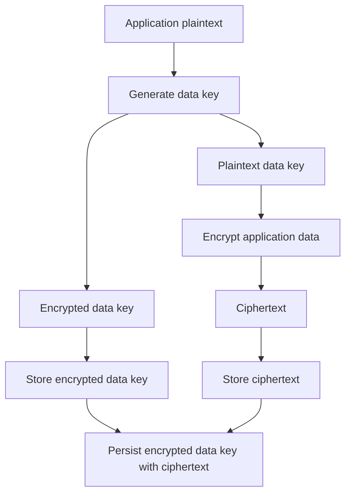
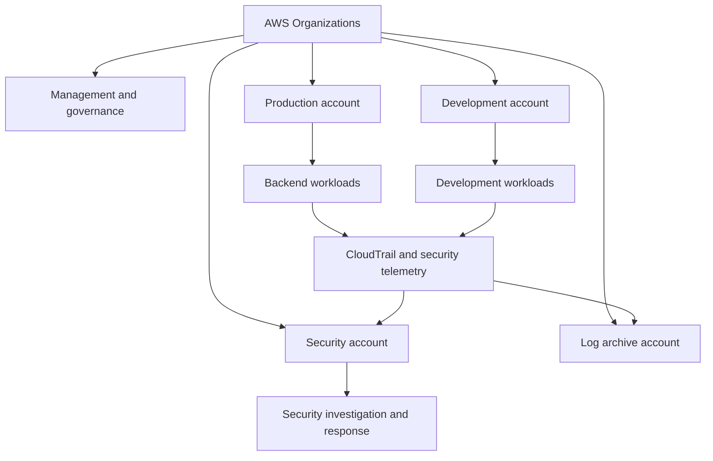

# 10- AWS Security Service Comparison Questions

## Overview

AWS provides security services across identity and access management, encryption, secrets management, network protection, threat detection, audit logging, configuration compliance, and incident response. Senior backend engineers must understand not only what each service does, but also how services overlap, where their responsibilities differ, and how to combine them into an effective security architecture.

Service selection should be based on the security control required, the threat being addressed, operational complexity, integration requirements, and cost.

This document compares the major AWS security services through interview questions, architecture decisions, practical backend scenarios, troubleshooting guidance, and production-oriented recommendations.

## Security Control Categories

AWS security controls can be classified into three operational categories.

| Control category | Purpose | Representative services and capabilities |
|---|---|---|
| Preventive | Prevent unauthorized access or unsafe configurations | IAM, AWS Organizations SCPs, KMS key policies, security groups, network ACLs, AWS WAF |
| Detective | Identify suspicious activity, policy violations, or configuration drift | CloudTrail, GuardDuty, Security Hub, AWS Config |
| Responsive | Contain incidents, investigate activity, and support recovery | EventBridge, Lambda-based response automation, Systems Manager Automation, IAM credential revocation, Security Hub workflows |

A single service may contribute to multiple workflows. For example, AWS Config detects configuration noncompliance, while automation triggered by a compliance event may remediate the issue.

The distinction matters because preventive controls cannot identify every successful attack, and detective controls do not automatically prevent an event unless a response mechanism is configured.

## Identity and Access Management Service Comparisons

### IAM vs AWS STS

**Question: What is the difference between AWS IAM and AWS Security Token Service (STS)?**

| Dimension | IAM | AWS STS |
|---|---|---|
| Primary purpose | Defines identities, permissions, and access relationships | Issues temporary security credentials |
| Main objects | Users, groups, roles, policies | Temporary credentials and role sessions |
| Credential lifecycle | Supports long-term IAM user credentials and role definitions | Provides time-limited credentials |
| Typical backend use | Defines what an application role may access | Supplies temporary credentials after role assumption |
| Security objective | Authorization and identity configuration | Temporary access and federation |

IAM defines the role and its permissions. STS can issue temporary credentials for an authorized role session.

For example, a Python application running on EC2 should generally obtain credentials through its attached IAM role rather than storing access keys in environment variables.

A role assumption flow can be inspected with:

```bash
aws sts get-caller-identity
```

This returns the caller's account, ARN, and user identifier. It does not reveal the caller's secret access key.

To assume another role:

```bash
aws sts assume-role \
  --role-arn arn:aws:iam::<TARGET_ACCOUNT_ID>:role/<ROLE_NAME> \
  --role-session-name backend-audit-session
```

The caller must be permitted to assume the role, and the target role's trust policy must authorize the caller. The resulting session is also constrained by applicable permissions, session policies, and organizational controls.

**Production considerations**

- Prefer temporary role credentials over long-lived access keys.
- Use workload identity mechanisms such as EC2 instance profiles, Lambda execution roles, or supported federation integrations.
- Restrict role trust policies to the required principals and conditions.
- Never print STS credentials into logs, CI output, or exception messages.
- Choose session durations based on operational needs and the maximum session duration supported by the role and calling mechanism.

### IAM roles vs IAM users

**Question: Why are IAM roles generally preferred for backend workloads?**

| Dimension | IAM user | IAM role |
|---|---|---|
| Identity model | Persistent IAM identity | Assumed identity with a session |
| Credentials | May have long-term access keys | Uses temporary credentials when assumed |
| Typical use | Limited legacy or specialized human access | Applications, services, federation, and cross-account access |
| Rotation burden | Long-term access keys require lifecycle management | Temporary credentials are refreshed through supported credential providers |
| Auditability | Actions are associated with the user and relevant credentials | Role sessions can include session names and session context |

IAM users are not universally forbidden, but long-term IAM user access keys are usually a poor choice for application workloads.

For a Django or FastAPI service deployed on AWS, attach an execution role or use the platform's supported workload identity mechanism. Let the AWS SDK resolve and refresh credentials through its default credential provider chain.

### Identity-based policies vs resource-based policies

**Question: How do identity-based and resource-based policies differ?**

| Dimension | Identity-based policy | Resource-based policy |
|---|---|---|
| Attachment | IAM user, group, or role | Supported resource, such as an S3 bucket or KMS key |
| Main question | What may this identity do? | Who may access this resource, and under what conditions? |
| Principal specification | Usually implicit through the attached identity | Explicit `Principal` field in the policy |
| Cross-account access | May grant the caller permission to request access | Can authorize principals from another account where supported |
| Example | Role policy permitting `s3:GetObject` | Bucket policy allowing a specific external role to read objects |

Cross-account access commonly requires authorization on both sides: the caller must have the relevant identity-based permission, and the target resource or role must authorize the external principal through its applicable resource policy or trust policy.

The exact evaluation model depends on the service and resource type. KMS key policies, for example, have service-specific authorization behavior and should not be treated as interchangeable with S3 bucket policies.

### Permission boundaries vs service control policies vs session policies

**Question: How do these policy types differ?**

| Policy type | Scope | Primary purpose | Important limitation |
|---|---|---|---|
| Identity-based policy | Identity | Grants permissions | Does not override applicable explicit denies or maximum-permission controls |
| Permission boundary | IAM user or role | Limits the permissions identity-based policies can grant | Does not independently grant permissions |
| Service control policy (SCP) | AWS Organizations account or organizational unit | Defines the maximum permissions available to affected principals | Does not grant permissions and does not apply uniformly to every principal or service-linked role |
| Session policy | Individual role or federated session | Further restricts the resulting session's permissions | Cannot grant permissions beyond the role's effective permissions |
| Resource-based policy | Supported resource | Authorizes principals to access a resource | Service-specific evaluation rules apply |
| VPC endpoint policy | VPC endpoint | Restricts requests made through that endpoint | Does not replace identity or resource authorization |

**Interview trap:** A permission boundary is not a permission grant. An SCP is not a substitute for IAM role policies. A session policy is not a way to increase a role's privileges.

### IAM policy evaluation vs the policy simulator

**Question: Why can an IAM policy simulator result differ from a real AWS request?**

The IAM policy simulator is useful for testing supported policy combinations, but it is not a complete reproduction of every live authorization path.

A real request may also depend on:

- Resource-based policies.
- SCPs and applicable organizational controls.
- Permission boundaries and session policies.
- KMS key policies and grants.
- VPC endpoint policies.
- Service-specific authorization rules.
- Resource ownership and cross-account relationships.
- Request context, including tags, source IP, organization ID, and encryption context.

When a real request returns `AccessDenied`, identify the caller, action, resource, request context, and relevant policy layers before changing permissions.

Useful read-only commands include:

```bash
aws sts get-caller-identity

aws iam get-role \
  --role-name <ROLE_NAME>

aws iam list-attached-role-policies \
  --role-name <ROLE_NAME>

aws iam list-role-policies \
  --role-name <ROLE_NAME>
```

These commands inspect identity information and role policy attachments. Inline policy documents can then be retrieved with `aws iam get-role-policy`.

Do not resolve an authorization failure by attaching `AdministratorAccess` without establishing the root cause.

## Encryption and Key Management Comparisons

### AWS KMS vs AWS Secrets Manager

**Question: What is the difference between AWS KMS and AWS Secrets Manager?**

| Dimension | AWS KMS | AWS Secrets Manager |
|---|---|---|
| Primary purpose | Manage cryptographic keys and perform supported cryptographic operations | Store, retrieve, and manage secrets |
| Typical data | Encryption keys and cryptographic operations | Database passwords, API tokens, credentials |
| Rotation | Supports key rotation for eligible key types and configurations | Supports secret rotation workflows and versions |
| Access control | IAM policies, key policies, grants, and applicable service rules | IAM permissions and KMS permissions where applicable |
| Application integration | Encrypt/decrypt or generate data keys | Retrieve current secret values through an SDK |
| Main operational concern | Key policy, key state, grants, and cryptographic lifecycle | Secret versioning, caching, rotation, and consumer coordination |

Secrets Manager can use AWS-managed or customer-managed KMS keys to encrypt secret values at rest. KMS manages the cryptographic key; Secrets Manager manages the secret's lifecycle and retrieval interface.

A customer-managed KMS key provides additional control over key policies, grants, and lifecycle operations, but introduces governance and availability responsibilities.

**When to use each**

- Use Secrets Manager when an application needs managed secret storage, secret versioning, and rotation workflows.
- Use KMS directly when an application or AWS service needs cryptographic operations or envelope-encryption capabilities.
- Use both when secret storage requires a customer-managed encryption key or when the architecture requires explicit key governance.

### AWS-managed keys vs customer-managed KMS keys

**Question: When should a team use a customer-managed KMS key?**

| Consideration | AWS-managed KMS key | Customer-managed KMS key |
|---|---|---|
| Administration | Managed by AWS for an integrated service | Customer controls key policies and lifecycle settings |
| Key policy customization | Limited customer control | Greater control over key policy and grants |
| Rotation configuration | Service and key-type dependent | Supports configurable rotation for eligible key types |
| Cross-account sharing | Generally less flexible | Can support cross-account access when correctly configured |
| Audit and governance | Integrated service behavior | More granular key governance and administration |
| Operational burden | Lower | Higher |
| Cost | Depends on service and key type; AWS-managed keys generally avoid the customer-managed key monthly charge | Customer-managed keys may incur key-storage and request charges |

Use customer-managed keys when requirements justify additional control, such as independently managed access boundaries, explicit key lifecycle governance, or supported cross-account key usage.

Do not create a separate customer-managed key for every resource by default. Key proliferation increases policy complexity, operational overhead, and the risk of accidental key disablement or deletion.

### KMS key policies vs IAM policies

**Question: Why might `kms:Decrypt` be allowed by an IAM policy but still fail?**

KMS authorization involves the KMS key policy and may involve grants, IAM permissions, and applicable organizational restrictions.

A key policy must permit the required access path. In common IAM-delegation configurations, the key policy enables the account to use IAM policies to control access. Other key-policy configurations can authorize principals directly.

Inspect the key:

```bash
aws kms describe-key \
  --key-id <KEY_ID_OR_ARN>
```

Inspect the key policy:

```bash
aws kms get-key-policy \
  --key-id <KEY_ID_OR_ARN> \
  --policy-name default
```

Inspect grants:

```bash
aws kms list-grants \
  --key-id <KEY_ID_OR_ARN>
```

Check the key state, region, account, key policy, grants, calling principal, and encryption context before changing permissions.

### Server-side encryption vs client-side encryption

**Question: When should a backend application encrypt data before sending it to AWS?**

| Dimension | Server-side encryption | Client-side encryption |
|---|---|---|
| Encryption boundary | Service encrypts data before persistent storage | Application encrypts data before transmission to the storage service |
| Key custody | Depends on service and selected key-management mode | Application architecture controls how plaintext and encryption keys are handled |
| Operational complexity | Usually lower | Higher |
| Service functionality | AWS service can process data according to its features and authorization model | Service generally cannot inspect application-encrypted payloads |
| Common use | S3, EBS, RDS, and supported managed-service storage | Sensitive fields or payloads requiring encryption before entering the storage service |

Server-side encryption is appropriate for most ordinary storage requirements. Client-side encryption is useful when the application must keep plaintext outside the storage service's trust boundary.

Client-side encryption does not eliminate the need for TLS, secure key management, authorization, backups, and recovery planning.

### Envelope encryption

**Question: Why is envelope encryption used in production systems?**

Envelope encryption encrypts application data with a data key and protects that data key with a longer-lived key managed by a key-management system.



The application stores the encrypted data key alongside the ciphertext. During decryption, an authorized component asks KMS to decrypt the data key and then uses the plaintext data key to decrypt the payload.

The application must protect the plaintext data key in memory, avoid logging it, and minimize its lifetime.

Use the AWS Encryption SDK or an appropriate AWS SDK integration when its supported envelope-encryption model fits the application. Avoid designing a custom cryptographic protocol.

## Secrets Management Comparisons

### Secrets Manager vs Systems Manager Parameter Store

**Question: Which should a backend application use for secrets and configuration?**

| Dimension | Secrets Manager | Systems Manager Parameter Store |
|---|---|---|
| Primary use | Managed secrets and credential lifecycle | Hierarchical application configuration and parameter storage |
| Secret rotation | Built-in rotation workflows for supported integrations and custom workflows | Usually requires a separately implemented rotation or update workflow |
| Versioning | Supports secret versions and staging labels | Supports parameter versions |
| Encryption | Uses KMS for secret encryption at rest | `SecureString` parameters use KMS encryption |
| Configuration hierarchy | Secret naming and versioning | Explicit hierarchical parameter names |
| Caching | Client-side caching can reduce API calls | Client-side caching can reduce API calls |
| Operational trade-off | Higher cost for many secrets, but richer secret lifecycle capabilities | Useful for configuration and eligible secret-storage use cases; tier limits and feature differences matter |

Use Secrets Manager for credentials that require managed rotation or a dedicated secrets lifecycle. Parameter Store is useful for application settings, feature configuration, and appropriately governed encrypted parameters.

The correct choice depends on rotation requirements, service quotas, access patterns, cost, and integration needs. Neither service makes a secret safe if the application logs it or grants retrieval permissions too broadly.

### Environment variables vs managed secret retrieval

**Question: Are environment variables inherently insecure for secrets?**

Environment variables are not inherently exposed to every process, but they can be leaked through process inspection, crash diagnostics, debug output, deployment tooling, or accidental logging.

| Approach | Benefits | Risks and considerations |
|---|---|---|
| Environment variable | Simple deployment integration | Can be exposed through diagnostics, process inspection, or misconfigured tooling |
| Secrets Manager retrieval | Centralized lifecycle and access control | Requires IAM permissions, network access, API availability, and caching decisions |
| Parameter Store retrieval | Centralized configuration and access control | Rotation workflows may require additional implementation |
| Mounted secret file | Keeps values out of command-line arguments in many deployments | File permissions, lifecycle, rotation, and container orchestration behavior still matter |

For a backend service, prefer a managed secret store and a supported identity mechanism. Retrieve secrets at startup or through a controlled refresh strategy, and never log their values.

### Secure Python secret retrieval

A Python service can retrieve a secret through Boto3 using the AWS SDK credential provider chain.

```python
import json
import logging
import os

import boto3
from botocore.exceptions import BotoCoreError, ClientError

logger = logging.getLogger(__name__)


def load_database_credentials() -> dict[str, str]:
    secret_name = os.environ["DATABASE_SECRET_ID"]
    region_name = os.environ["AWS_REGION"]

    client = boto3.client(
        "secretsmanager",
        region_name=region_name,
    )

    try:
        response = client.get_secret_value(SecretId=secret_name)
        secret_string = response.get("SecretString")

        if not secret_string:
            raise ValueError("Expected a JSON SecretString")

        secret = json.loads(secret_string)

        username = secret.get("username")
        password = secret.get("password")

        if not isinstance(username, str) or not username:
            raise ValueError("Secret is missing a valid username")

        if not isinstance(password, str) or not password:
            raise ValueError("Secret is missing a valid password")

        return {
            "username": username,
            "password": password,
        }

    except (ClientError, BotoCoreError):
        logger.exception("Unable to retrieve database credentials")
        raise
```

The `DATABASE_SECRET_ID` and `AWS_REGION` environment variables contain configuration, not the secret value. The application obtains AWS credentials from its execution environment rather than embedding access keys in the source.

The example logs the exception for operational diagnosis. Review logging policies and SDK error details to ensure sensitive request context is not exposed. Never log the returned secret or the full response object.

**Production considerations**

- Grant only `secretsmanager:GetSecretValue` for the required secret.
- Grant the required KMS access when the secret uses a customer-managed key.
- Use a connection pool and a bounded secret cache when appropriate.
- Refresh credentials in coordination with secret rotation.
- Ensure database connection pools can replace expired or rotated credentials without restarting every instance.
- Configure SDK retries and timeouts according to the service's latency and availability requirements.
- Treat malformed secret content as a configuration failure rather than silently falling back to hardcoded credentials.

## Network Security Service Comparisons

### Security groups vs network ACLs

**Question: How do security groups and network ACLs differ?**

| Dimension | Security groups | Network ACLs |
|---|---|---|
| Scope | Attached to supported network interfaces or resources | Associated with subnets |
| State | Stateful | Stateless |
| Rules | Allow rules | Allow and deny rules |
| Return traffic | Automatically permitted for tracked connections | Must be permitted explicitly in the relevant direction |
| Typical use | Workload-level network access control | Additional subnet-level traffic filtering |
| Operational risk | Overly broad inbound or outbound rules | Incorrect ephemeral-port or return-traffic rules can break connectivity |

Security groups are usually the primary control for workload connectivity. Network ACLs provide an additional subnet-level boundary where explicit allow and deny behavior is required.

Neither mechanism provides application-level authorization. A security group allowing HTTPS traffic does not establish that a request is authenticated or authorized to access a specific API operation.

### Security groups vs IAM

**Question: Can IAM replace network security controls?**

No. IAM and network controls enforce different security boundaries.

- IAM controls whether an identity can perform an AWS API action.
- Security groups and network ACLs control network traffic.
- Application authentication and authorization control access to application resources.
- TLS protects data in transit and authenticates endpoints according to the configured certificate-validation process.

A backend application may need all four layers. For example, a service role might be authorized to retrieve a secret, the security group must allow the required network path, TLS protects the connection, and the application must authorize the authenticated user.

### VPC endpoints vs AWS PrivateLink

**Question: What is the difference between VPC endpoints and AWS PrivateLink?**

| Dimension | VPC endpoints | AWS PrivateLink |
|---|---|---|
| Purpose | Enable private connectivity to supported services without requiring the same public internet path | Provide private connectivity to supported services and endpoint services |
| Main forms | Gateway endpoints and interface endpoints | Primarily associated with interface endpoints and endpoint services |
| Common use | Private S3 or DynamoDB access through gateway endpoints; private access to supported AWS APIs through interface endpoints | Private service-to-service connectivity, including supported endpoint services |
| Authorization | Endpoint policies may restrict supported requests | Network reachability and endpoint-service configuration are combined with applicable authorization |
| Important distinction | A VPC endpoint does not grant application permissions | PrivateLink connectivity does not automatically authorize requests |

Gateway endpoints are commonly used for S3 and DynamoDB. Interface endpoints use endpoint network interfaces and support private connectivity to many AWS services.

An endpoint policy is an additional control, not a replacement for IAM or resource policies.

### AWS WAF vs AWS Shield

**Question: How do AWS WAF and AWS Shield differ?**

| Dimension | AWS WAF | AWS Shield |
|---|---|---|
| Main purpose | Filter HTTP(S) requests using web ACL rules | Protect supported resources against DDoS attacks |
| Protection layer | Application-layer request inspection | DDoS protection across supported network and application attack scenarios |
| Controls | Managed rule groups, custom rules, rate-based rules | Standard protection and additional Advanced capabilities |
| Typical use | Block or limit suspicious web requests | Mitigate distributed denial-of-service attacks |
| Operational requirement | Rule tuning, testing, and false-positive monitoring | Resource eligibility, architecture design, and incident readiness |

WAF can reduce exposure to common web exploits, malicious request patterns, and excessive request rates. Rate-based rules help control traffic patterns but are not a substitute for application-level quotas, authentication, or distributed abuse detection.

AWS Shield Standard provides automatic protection for supported AWS services. AWS Shield Advanced provides additional protection and response capabilities for eligible resources and configurations.

Neither service replaces secure application code, IAM, or backend authorization.

### WAF vs API Gateway throttling

**Question: When should API Gateway throttling be used instead of WAF rate-based rules?**

| Requirement | API Gateway throttling | AWS WAF rate-based rules |
|---|---|---|
| API request-rate control | Appropriate for configured API throttling and quotas | Useful for filtering traffic based on request aggregation rules |
| Application client quotas | API keys and usage plans may be relevant for supported API types | Not a replacement for business-level client quotas |
| Request inspection | Limited to API Gateway's supported controls | Supports web ACL rules and managed rule groups |
| DDoS protection | Not a complete DDoS solution by itself | Complements other DDoS and infrastructure controls |
| Authentication | Configured authorizers or other supported mechanisms | Does not replace application identity verification |

Choose controls based on the attack model. API Gateway throttling can constrain request volume, WAF can filter suspicious web traffic, and application-level controls enforce tenant-specific quotas and business authorization.

## Detection, Audit, and Compliance Service Comparisons

### CloudTrail vs CloudWatch vs AWS Config

**Question: How do CloudTrail, CloudWatch, and AWS Config differ?**

| Dimension | AWS CloudTrail | Amazon CloudWatch | AWS Config |
|---|---|---|---|
| Primary purpose | Record AWS API activity and relevant events | Collect metrics, logs, and alarms | Record resource configuration history and evaluate compliance |
| Main question | Who performed which API action, when, and against which resource? | What is happening operationally, and when should an alarm trigger? | What was the resource configuration, and does it satisfy a rule? |
| Typical data | Management events, configured data events, supported activity records | Application logs, service logs, metrics, alarms | Configuration items, relationships, compliance evaluations |
| Security use | Investigation and audit trails | Operational and security alerting | Detecting configuration drift and policy violations |
| Limitation | Not every event category is enabled in every trail | Does not independently provide complete AWS API auditing | Compliance evaluation does not by itself contain an active attack |

**Example:** If an S3 bucket becomes publicly accessible, AWS Config may detect a configuration violation. CloudTrail can help identify the API action that changed the bucket policy. CloudWatch can trigger alerts based on configured log metrics or alarms.

CloudTrail and CloudWatch Logs are often integrated, but they are not interchangeable. CloudTrail is the API audit source; CloudWatch provides log storage, querying, metrics, and alarms for supported integrations.

### CloudTrail management events vs data events

**Question: Why might an S3 object read be missing from a CloudTrail investigation?**

CloudTrail event categories have different coverage and configuration requirements.

- **Management events** record control-plane operations such as creating a role, changing a bucket policy, or modifying a security group.
- **Data events** record selected data-plane activity, such as supported S3 object-level operations and Lambda invocation activity.
- **Network activity events** cover supported network-related API activity where configured and available.

Data events generally require explicit selection and may incur additional charges. A trail that records management events only should not be assumed to contain every object read or application-level request.

Before concluding that an action did not occur, inspect the trail configuration, event selectors, event source, time range, region, and relevant event store.

### GuardDuty vs Security Hub

**Question: How do Amazon GuardDuty and AWS Security Hub differ?**

| Dimension | Amazon GuardDuty | AWS Security Hub |
|---|---|---|
| Primary role | Threat detection | Security posture visibility and findings aggregation |
| Detection input | Supported AWS telemetry and threat intelligence | Findings from integrated services and supported security checks |
| Main output | Threat findings | Aggregated and normalized security findings and posture information |
| Typical use | Detect suspicious or potentially malicious activity | Centralize findings and prioritize security remediation |
| Limitation | Findings require triage and response | Aggregation does not mean every finding is automatically remediated |

GuardDuty can identify suspicious activity such as unusual API behavior or potentially compromised workloads. Security Hub can aggregate GuardDuty findings and findings from other supported integrations.

Use EventBridge and carefully controlled automation to route relevant findings to incident response workflows. Do not assume that enabling Security Hub automatically configures every desired detector, account integration, alert, or remediation action.

### GuardDuty vs CloudTrail

**Question: Can CloudTrail replace GuardDuty?**

No.

CloudTrail provides records of supported API activity. GuardDuty analyzes supported telemetry to identify suspicious behavior and produce threat findings.

An investigator might use GuardDuty to discover a suspicious activity pattern and CloudTrail to examine relevant API events, identities, and request context.

A production investigation may also require VPC Flow Logs, application logs, identity-provider records, DNS telemetry, and host-level evidence. No single source should be assumed to contain the complete attack timeline.

### AWS Config vs Security Hub

**Question: When should a team use AWS Config rather than Security Hub?**

Use AWS Config when configuration history, resource relationships, configuration rules, and compliance evaluations are required. Use Security Hub for a consolidated security posture and findings view across supported sources.

These services complement one another. A Config rule can identify a noncompliant resource, while Security Hub may surface related security findings or posture checks depending on the configured integrations and capabilities.

### Security Hub vs a SIEM

**Question: Does Security Hub replace a SIEM?**

Not necessarily. Security Hub is an AWS security posture and findings service. A security information and event management (SIEM) platform may aggregate logs and security events across AWS, other cloud providers, endpoints, identity systems, and enterprise applications.

| Requirement | AWS Security Hub | SIEM |
|---|---|---|
| AWS security findings aggregation | Core capability | Depends on integration |
| Cross-platform log correlation | Limited to configured findings and integrations | Common use case |
| Long-term enterprise log analytics | Depends on configured AWS services and retention | Depends on platform and architecture |
| Incident workflow integration | Supported through AWS integrations and automation | Depends on platform capabilities |
| Detection engineering | Provides AWS security capabilities and findings | Often supports custom correlation and detection logic |

A common architecture sends AWS findings and selected logs into a central security platform while retaining CloudTrail and other evidence in controlled AWS storage.

## Backend Security Service Decision Matrix

The following table maps common backend engineering requirements to appropriate AWS controls.

| Requirement | Primary AWS service or control | Supporting controls |
|---|---|---|
| Allow a FastAPI service to access S3 | IAM role or workload identity | S3 bucket policy, KMS permissions if required |
| Store a database password | Secrets Manager or Parameter Store `SecureString` | IAM least privilege, KMS key policy where applicable |
| Encrypt application data with controlled keys | AWS KMS | Envelope encryption, application authorization, TLS |
| Record administrative API activity | CloudTrail | Centralized log storage, CloudWatch alerts |
| Detect suspicious AWS activity | GuardDuty | CloudTrail investigation, EventBridge response |
| Aggregate security findings | Security Hub | Config, GuardDuty, supported integrations |
| Detect insecure resource configuration | AWS Config | Security Hub, remediation workflows |
| Restrict API request patterns | AWS WAF and API Gateway controls | Application rate limits, authentication, authorization |
| Restrict workload network traffic | Security groups | Network ACLs, VPC endpoints, routing controls |
| Privately access AWS service APIs | VPC endpoints | Endpoint policies, IAM, DNS and routing validation |
| Protect supported resources against DDoS | AWS Shield | WAF, resilient architecture, capacity planning |
| Investigate leaked credentials | IAM and STS operations | CloudTrail, GuardDuty, incident response automation |

The table identifies starting points, not complete solutions. Production implementations must account for service-specific authorization, logging coverage, regional availability, cost, and failure behavior.

## Architecture Comparison: Single Account vs Multi-Account Security

**Question: When should a backend platform use a multi-account AWS architecture?**

A single account may be sufficient for a small, isolated workload with limited operational requirements. Multi-account architecture becomes valuable when environments, teams, data sensitivity, regulatory requirements, or security responsibilities require stronger isolation.

| Dimension | Single-account model | Multi-account model |
|---|---|---|
| Isolation | Relies heavily on IAM, network, and resource boundaries within one account | Provides additional account-level boundaries |
| Environment separation | Uses separate resources, VPCs, or naming conventions | Can isolate development, staging, production, and security functions |
| Centralized controls | Configured within the account | Can use AWS Organizations and delegated administration where supported |
| Cross-environment access | Requires careful identity and resource policies | Requires explicit cross-account role and resource design |
| Operational complexity | Lower initially | Higher due to account provisioning, logging, and access governance |
| Blast radius | A compromised privileged identity may affect more resources in the account | Properly designed account boundaries can reduce the scope of compromise |

A multi-account architecture should include centralized audit logging, controlled security administration, production workload isolation, and tightly scoped cross-account roles.



The management account should not become a general-purpose workload account. Centralized security and log archive accounts should have restricted access, durable retention, and explicit administrative boundaries.

## Troubleshooting by Service Category

### IAM or STS authorization failures

**Symptoms**

- `AccessDenied`
- `AccessDeniedException`
- `User is not authorized to perform sts:AssumeRole`
- An application unexpectedly uses the wrong AWS identity.

**Investigation**

```bash
aws sts get-caller-identity

aws iam get-role \
  --role-name <ROLE_NAME>

aws iam list-attached-role-policies \
  --role-name <ROLE_NAME>

aws iam list-role-policies \
  --role-name <ROLE_NAME>
```

Inspect the caller's effective identity, the role's trust policy, attached and inline policies, permission boundaries, session policies, and organizational controls.

For cross-account access, verify both the caller's permission to assume the role and the target role's trust policy.

**Corrective actions**

- Add only the missing permission to the appropriate policy.
- Correct the trust relationship if the intended caller is not authorized.
- Remove conflicting explicit denies only after validating the security requirement.
- Re-test using the same role, resource, and request context as the failing workload.

### KMS authorization or decryption failures

**Symptoms**

- `AccessDeniedException`
- `KMSAccessDeniedException`
- An application cannot decrypt an object or retrieve an encrypted secret.

**Investigation**

```bash
aws kms describe-key \
  --key-id <KEY_ID_OR_ARN>

aws kms get-key-policy \
  --key-id <KEY_ID_OR_ARN> \
  --policy-name default

aws kms list-grants \
  --key-id <KEY_ID_OR_ARN>
```

Check the key's account, region, state, key policy, grants, caller permissions, and encryption context. Confirm that the ciphertext was created under the expected key and that the application is using the correct environment.

**Corrective actions**

- Restore the intended key-policy or grant authorization.
- Correct the key identifier or region when misconfigured.
- Validate encryption-context requirements.
- Do not disable encryption or broaden key access as a diagnostic shortcut.

### Secrets retrieval failures

**Symptoms**

- `ResourceNotFoundException`
- `AccessDeniedException`
- Secret retrieval succeeds but database authentication fails after rotation.

**Investigation**

```bash
aws secretsmanager describe-secret \
  --secret-id <SECRET_ID_OR_ARN>
```

This command inspects secret metadata without returning the secret value. Confirm the secret identifier, region, IAM permissions, KMS authorization where applicable, version staging labels, rotation state, and application cache behavior.

**Corrective actions**

- Correct the secret identifier or region.
- Grant the required retrieval permission to the workload role.
- Coordinate rotation with connection-pool refresh and application caching.
- Avoid printing secret values or complete SDK responses during debugging.

### CloudTrail or audit-evidence gaps

**Symptoms**

- An expected API event cannot be found.
- Events appear in one region but not another.
- An object operation is missing from the audit trail.

**Investigation**

```bash
aws cloudtrail describe-trails \
  --include-shadow-trails

aws cloudtrail get-trail-status \
  --name <TRAIL_NAME>

aws cloudtrail get-event-selectors \
  --trail-name <TRAIL_NAME>
```

For event-history investigation:

```bash
aws cloudtrail lookup-events \
  --lookup-attributes AttributeKey=EventName,AttributeValue=PutBucketPolicy \
  --start-time <START_TIME> \
  --end-time <END_TIME>
```

`lookup-events` searches supported management-event history within its applicable scope and retention limits. Do not assume it searches all data events or every event stored in an organization trail.

**Corrective actions**

- Verify the trail's region, account, status, and event selectors.
- Enable required data-event logging for supported resources.
- Validate centralized delivery, destination policies, and retention.
- Preserve existing evidence before modifying logging configuration.

### Network connectivity failures

**Symptoms**

- Connection timeouts.
- DNS resolution failures.
- `Connection refused`.
- An application cannot access a private AWS service endpoint.

**Investigation**

Review security groups, network ACLs, route tables, DNS configuration, endpoint policies, endpoint security groups, and the destination service's availability.

For a security group:

```bash
aws ec2 describe-security-groups \
  --group-ids <SECURITY_GROUP_ID>
```

For VPC endpoints:

```bash
aws ec2 describe-vpc-endpoints \
  --filters Name=vpc-id,Values=<VPC_ID>
```

A successful DNS lookup does not prove that the network path or application authorization is correct. Test connectivity from the workload's actual execution environment.

**Corrective actions**

- Allow only the required source, destination, protocol, and port.
- Validate return traffic when network ACLs are involved.
- Correct endpoint policies and routing where necessary.
- Avoid broad CIDR ranges as a permanent troubleshooting workaround.

## AWS CLI Security Inspection Reference

The following commands are intended primarily for read-only investigation. They do not grant permissions or modify the inspected controls.

| Operational responsibility | Command | Purpose and interpretation |
|---|---|---|
| Verify caller identity | `aws sts get-caller-identity` | Confirms the effective account and ARN |
| Inspect role configuration | `aws iam get-role --role-name <ROLE_NAME>` | Retrieves role metadata and trust policy |
| Inspect attached policies | `aws iam list-attached-role-policies --role-name <ROLE_NAME>` | Lists managed policies attached to the role |
| Inspect inline policies | `aws iam list-role-policies --role-name <ROLE_NAME>` | Lists inline policies on the role |
| Inspect KMS key state | `aws kms describe-key --key-id <KEY_ID_OR_ARN>` | Returns key metadata and state |
| Inspect secret metadata | `aws secretsmanager describe-secret --secret-id <SECRET_ID_OR_ARN>` | Retrieves metadata without returning the secret value |
| Inspect security groups | `aws ec2 describe-security-groups --group-ids <SECURITY_GROUP_ID>` | Reviews ingress and egress rules |
| Inspect VPC endpoints | `aws ec2 describe-vpc-endpoints --filters Name=vpc-id,Values=<VPC_ID>` | Lists endpoints for the specified VPC |
| Inspect GuardDuty findings | `aws guardduty list-findings --detector-id <DETECTOR_ID>` | Lists finding identifiers for a detector |
| Inspect CloudTrail configuration | `aws cloudtrail describe-trails` | Reviews configured trails |
| Inspect AWS Config compliance | `aws configservice describe-compliance-by-config-rule` | Reviews rule compliance results |
| Inspect Security Hub findings | `aws securityhub get-findings` | Retrieves findings matching supported filters |

For GuardDuty, retrieve details for selected finding identifiers with `aws guardduty get-findings`. For Security Hub, use filters to constrain findings to the relevant account, resource, severity, workflow status, or time range.

Commands that alter security controls require separate change review and authorization. Examples include attaching IAM policies, modifying trust relationships, changing security-group rules, disabling KMS keys, changing trail selectors, or updating secret values.

## Senior-Level Interview Questions

### Service selection and architecture

**Question: A production FastAPI service needs S3 access, a database password, and audit logging. Which AWS services would you use?**

A reasonable design uses:

- An IAM role or supported workload identity for AWS access.
- S3 permissions scoped to the required bucket and object paths.
- Secrets Manager or Parameter Store for database credentials, depending on rotation and lifecycle requirements.
- KMS where encryption and key governance require it.
- CloudTrail for AWS API auditing.
- CloudWatch for application logs, metrics, and alarms.
- GuardDuty and Security Hub for threat detection and centralized findings, where enabled and configured.

The design should also include private connectivity where appropriate, TLS, application-level authorization, secure deployment identity, and controlled log retention.

**Question: Why not use Security Hub as the only security monitoring service?**

Security Hub centralizes findings and posture information, but it does not replace all telemetry collection, application monitoring, event correlation, or incident response. CloudTrail, GuardDuty, CloudWatch, AWS Config, and other data sources serve distinct purposes.

### IAM and cross-account access

**Question: A Lambda function in Account A needs to read objects in an S3 bucket in Account B. What must be configured?**

The solution depends on the selected cross-account access pattern. For direct role-based access, verify:

- The Lambda execution role's identity-based permissions.
- The target bucket policy's authorization for the intended principal.
- KMS permissions and key policy if the objects use a customer-managed key.
- Applicable SCPs, explicit denies, and endpoint policies.
- The exact object ARN and required S3 actions.

An alternative is for Lambda to assume a role in Account B. That design requires a suitable trust policy and caller permission for `sts:AssumeRole`, followed by the target role's S3 permissions.

Choose one clear access pattern rather than combining unnecessary cross-account mechanisms.

### Encryption and secrets

**Question: A database password rotates successfully, but the application continues to fail authentication. What would you investigate?**

Check the secret's version staging labels, the application's cache, the database's accepted credentials, connection-pool behavior, and whether all application instances refreshed the secret. Verify that rotation updates both the secret and the database credential atomically or through a supported rotation workflow.

Do not assume that updating a secret automatically replaces credentials in already-open database connections.

**Question: Why might KMS decryption fail even when the caller has `kms:Decrypt` in an IAM policy?**

Potential causes include a restrictive key policy, a missing grant, an explicit deny, an incorrect region or key, an unavailable key state, a required encryption context, or an organizational restriction. KMS authorization must be investigated using the effective request context and key configuration.

### Detection and incident response

**Question: GuardDuty reports suspicious API activity. How would you investigate it?**

1. Validate the finding, affected account, resource, region, and timestamp.
2. Review the relevant CloudTrail events and caller identity.
3. Correlate with workload, network, and application logs.
4. Determine whether the activity is expected, unauthorized, or inconclusive.
5. Contain confirmed compromise by revoking or restricting access through appropriate mechanisms.
6. Preserve evidence and document the incident timeline.
7. Restore normal operation only after verifying remediation.
8. Add preventive controls and detection coverage to reduce recurrence.

The response should follow the organization's incident severity and escalation procedures. Avoid destructive changes that could eliminate evidence unless immediate containment requires them.

### Service limitations and trade-offs

**Question: What are the risks of enabling every security service without defining an operating model?**

Security services produce findings, alerts, configuration changes, and ongoing costs. Without ownership, triage procedures, exception management, and response automation, organizations can accumulate unreviewed findings and alert fatigue.

A production rollout should define:

- Which accounts and regions are in scope.
- Who owns each finding category.
- Severity-based response targets.
- Exception approval and expiration.
- Evidence retention and access restrictions.
- Cost and service-quota monitoring.
- Automated remediation boundaries and rollback behavior.

## Common Misconceptions

| Misconception | Correct interpretation |
|---|---|
| IAM permission means a request must succeed | Other policy layers, resource policies, service-specific rules, and request context may deny it |
| A private endpoint makes a service request authorized | Private connectivity does not replace IAM or resource authorization |
| Security groups can enforce application-user permissions | Security groups control network traffic, not application identities |
| KMS encrypts all application data automatically | Encryption depends on service integration or explicit application cryptographic operations |
| Secrets Manager rotation updates every application connection immediately | Consumers must refresh credentials and handle existing sessions correctly |
| CloudTrail records every possible activity by default | Coverage depends on event category, selectors, configuration, and supported services |
| GuardDuty automatically blocks all detected threats | GuardDuty generates findings; containment requires separate response mechanisms |
| Security Hub is a complete SIEM replacement | Its core role is security posture and findings aggregation |
| SCPs grant permissions | SCPs constrain maximum permissions within their applicable scope |
| A successful policy simulation proves production access will work | Live service authorization and request context can differ from simulation conditions |

## Production Security Review Checklist

### Identity and access

- [ ] Use short-lived credentials for workloads.
- [ ] Scope permissions to required actions and resources.
- [ ] Review role trust policies and cross-account relationships.
- [ ] Use MFA and appropriate privileged-access controls for human administration.
- [ ] Evaluate permission boundaries, SCPs, session policies, and explicit denies.
- [ ] Review unused credentials and excessive permissions periodically.

### Encryption and secrets

- [ ] Define which resources require customer-managed KMS keys.
- [ ] Review key policies, grants, rotation, recovery, and deletion safeguards.
- [ ] Store application credentials in an appropriate managed secret store.
- [ ] Coordinate secret rotation with consumers and connection pools.
- [ ] Avoid logging credentials, plaintext data keys, and sensitive payloads.
- [ ] Validate TLS and certificate verification for service connections.

### Network and API protection

- [ ] Minimize public exposure.
- [ ] Restrict security groups and subnet-level traffic rules.
- [ ] Validate VPC endpoint policies and private DNS configuration.
- [ ] Use WAF and DDoS protections according to the threat model.
- [ ] Apply application authentication, authorization, and tenant-level rate limits.

### Detection and response

- [ ] Configure required CloudTrail event coverage.
- [ ] Protect centralized audit logs against unauthorized modification and deletion.
- [ ] Enable appropriate GuardDuty and Security Hub coverage.
- [ ] Use AWS Config rules or equivalent controls to detect configuration drift.
- [ ] Route security findings to owned response workflows.
- [ ] Test incident containment, evidence preservation, credential revocation, and recovery procedures.
- [ ] Review service costs, quotas, alert quality, and remediation effectiveness.

## Key Takeaways

- IAM, STS, KMS, Secrets Manager, network controls, and security monitoring services solve different problems; secure architectures combine them according to explicit trust boundaries.
- Authorization failures must be diagnosed across the applicable policy layers and request context rather than fixed by granting broad permissions.
- CloudTrail, GuardDuty, Security Hub, CloudWatch, and AWS Config provide complementary audit, detection, operational monitoring, and compliance capabilities.
- Production security depends on short-lived credentials, controlled secret rotation, least privilege, restricted network exposure, durable audit evidence, and tested incident response.
- Senior engineers should evaluate service selection through security requirements, operational ownership, failure modes, scalability, cost, and the consequences of compromise.