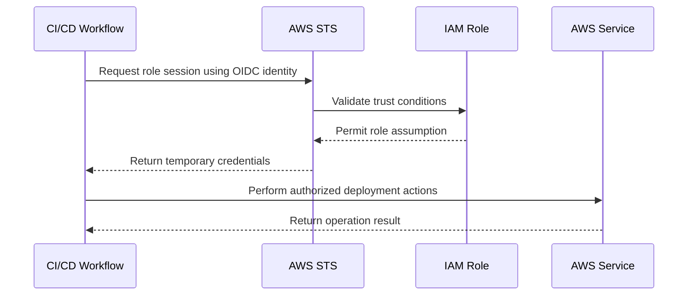

# 11- Common Interview Traps

## Overview

AWS Security interviews often test whether an engineer can distinguish between concepts that appear similar but behave differently in production. Knowing individual AWS services is not sufficient; senior engineers must understand identity boundaries, policy evaluation, credential lifecycles, encryption permissions, network exposure, and security incident response.

Common interview traps arise when engineers:

- Confuse authentication with authorization.
- Assume that allowing an action in one IAM policy guarantees access.
- Treat encryption as a substitute for access control.
- Assume private networking eliminates identity and application security requirements.
- Grant broad permissions to resolve an `AccessDenied` error.
- Confuse security monitoring with preventive enforcement.
- Rotate credentials without investigating how they were exposed.

The following scenarios focus on these distinctions and the reasoning expected from intermediate-to-senior backend engineers.

## Shared Responsibility and Security Fundamentals

### Trap: Assuming AWS manages all security

**Question:** If an application runs on AWS, which security responsibilities belong to AWS and which belong to the customer?

**Correct answer:** AWS secures the underlying cloud infrastructure, while customers remain responsible for security controls that depend on their services, configurations, identities, applications, and data.

Responsibilities vary by service.

| Area | AWS responsibility | Customer responsibility |
|---|---|---|
| Physical infrastructure | Data centers, physical access, hardware | None of the underlying physical operations |
| Managed services | Infrastructure and service components managed by AWS | Service configuration, access policies, data protection |
| EC2 | Physical infrastructure and virtualization layer | Guest OS patching, application security, instance permissions, security groups |
| Lambda | Managed execution infrastructure | Function code, execution role, dependencies, event permissions |
| S3 | Storage infrastructure | Bucket policies, data classification, access controls, retention settings |
| IAM | IAM service infrastructure | Principals, policies, trust relationships, credential protection |

**Common mistake:** Assuming that using a managed service automatically makes the workload secure.

**Senior-level reasoning:** Managed services reduce operational responsibility but do not eliminate customer responsibility for authorization, data exposure, secure configuration, or application vulnerabilities.

### Trap: Treating security as a single control

**Question:** Is a private subnet sufficient to secure a backend service?

**Correct answer:** No. Security requires multiple complementary controls.

A private subnet reduces direct network exposure, but the service may still be vulnerable to excessive IAM permissions, compromised application credentials, insecure dependencies, or unauthorized requests from permitted network paths.

A defense-in-depth design can combine:

- Private subnets and restricted security groups.
- IAM roles with least-privilege permissions.
- TLS for data in transit.
- Encryption at rest using appropriate key policies.
- Application-level authentication and authorization.
- Centralized audit logging and threat detection.
- Secure deployment pipelines and dependency scanning.

**Interview trap:** Network isolation does not imply authorization, and encryption does not imply that only authorized users can access decrypted data.

## IAM and Policy Evaluation

### Trap: Assuming an `Allow` policy guarantees access

**Question:** An IAM identity policy allows `s3:GetObject`, but the request returns `AccessDenied`. What should you investigate?

**Correct answer:** Identify the complete authorization path rather than immediately adding more permissions.

Potential causes include:

- An explicit deny in an applicable policy.
- A missing permission in the effective policy set.
- An S3 bucket policy that denies the request or does not grant the required cross-account access.
- A permissions boundary restricting the principal.
- An AWS Organizations service control policy (SCP) restricting the action.
- A session policy restricting the assumed-role session.
- Missing KMS permissions for an encrypted object.
- Incorrect resource ARNs or conditions.
- An expired session or invalid credentials.

The exact authorization requirements depend on the service, principal type, account relationship, and operation.

**Diagnostic approach:**

1. Confirm the caller's identity using `aws sts get-caller-identity`.
2. Confirm the requested action, resource ARN, region, and account.
3. Inspect the identity policy and applicable resource policy.
4. Inspect permissions boundaries, session policies, and organizational restrictions where applicable.
5. Check service-specific dependencies, such as KMS key authorization.
6. Use CloudTrail and applicable policy simulation tools to gather evidence.

**Common mistake:** Attaching `AdministratorAccess` to make the error disappear.

**Senior-level reasoning:** A successful request after broadening permissions does not establish which control caused the failure. Diagnose the authorization path and make the smallest justified change.

### Trap: Misunderstanding explicit deny and implicit deny

**Question:** Which takes precedence: an explicit `Deny` or an `Allow`?

**Correct answer:** An applicable explicit deny overrides an allow.

| Policy outcome | Meaning |
|---|---|
| Explicit `Deny` | The applicable request is denied |
| Applicable `Allow`, with no overriding restriction | The request may be authorized |
| No applicable `Allow` | The request is implicitly denied |

A policy statement that does not match the action, resource, principal, or conditions does not determine the outcome.

For example, this identity policy explicitly denies deleting objects:

```json
{
  "Version": "2012-10-17",
  "Statement": [
    {
      "Effect": "Deny",
      "Action": "s3:DeleteObject",
      "Resource": "arn:aws:s3:::example-data/*"
    }
  ]
}
```

Adding an identity policy that allows `s3:DeleteObject` does not override this applicable explicit deny.

**Common mistake:** Treating IAM policies as a simple additive list of permissions.

**Senior-level reasoning:** Effective authorization depends on policy evaluation, applicable restrictions, resource policies, and service-specific rules. An allow in one policy does not neutralize an explicit deny elsewhere.

### Trap: Confusing identity-based and resource-based policies

**Question:** What is the difference between an identity-based policy and a resource-based policy?

**Correct answer:** Identity-based policies specify what an identity may do. Resource-based policies specify which principals may access a resource and under what conditions.

| Aspect | Identity-based policy | Resource-based policy |
|---|---|---|
| Attached to | User, group, or role | A supported resource, such as an S3 bucket |
| Main purpose | Define permissions for an identity | Define access to a resource |
| Common example | A role can read objects in a bucket | A bucket grants access to a specific external role |
| Cross-account use | Depends on the applicable authorization model | Often used to grant access to external principals |

Cross-account access commonly requires cooperation between the relevant accounts. For example, the target account may need a resource policy or a role trust policy, while the calling identity must be allowed to perform the required action.

Do not assume that every service evaluates these policy types identically. Some services and principal types have special authorization behavior.

### Trap: Confusing a role trust policy with a permissions policy

**Question:** A Lambda function cannot assume an IAM role. Should you add S3 permissions to the role?

**Correct answer:** Not unless S3 authorization is the actual problem.

An IAM role has two distinct concerns:

- **Trust policy:** Defines which principals are permitted to assume the role.
- **Permissions policy:** Defines what the role's authorized sessions can do.

A Lambda execution role commonly trusts the Lambda service principal:

```json
{
  "Version": "2012-10-17",
  "Statement": [
    {
      "Effect": "Allow",
      "Principal": {
        "Service": "lambda.amazonaws.com"
      },
      "Action": "sts:AssumeRole"
    }
  ]
}
```

The role's separate permissions policies grant access to resources required by the function.

**Common mistake:** Changing permissions policies when the role assumption itself is failing.

**Senior-level reasoning:** First identify whether the failure occurs during role assumption or after the role has been assumed. These are different authorization stages.

### Trap: Assuming a permissions boundary grants permissions

**Question:** If a permissions boundary allows `s3:GetObject`, does the identity automatically receive that permission?

**Correct answer:** No. A permissions boundary limits the permissions an identity-based policy can grant; it does not independently grant permissions.

For applicable identity-based permissions, the effective permission set is constrained by both the identity's grants and the boundary. Other applicable controls and service-specific rules still matter.

Similarly, an SCP establishes organization-level permission guardrails but does not itself grant permissions to identities.

**Common mistake:** Treating boundaries and SCPs as additional permission grants.

### Trap: Assuming IAM permissions apply identically to every principal

IAM evaluation can vary by principal type and access path. For example, role sessions, resource-based grants to role-session principals, service principals, and cross-account access can have different interactions with applicable policy restrictions.

A senior engineer should avoid oversimplified statements such as "all policies are always intersected in exactly the same way."

Instead:

1. Identify the actual principal and session.
2. Identify the policy types applicable to the request.
3. Check the relevant service's authorization model.
4. Inspect explicit denies and conditional restrictions.
5. Validate the result with evidence.

## Temporary Credentials and Role Assumption

### Trap: Assuming temporary credentials are automatically safe

**Question:** If an application uses temporary AWS credentials, can the credentials be leaked without consequence?

**Correct answer:** No. Temporary credentials reduce the useful lifetime of compromised credentials but remain sensitive until they expire or are otherwise invalidated.

Temporary credentials commonly consist of:

- An access key ID.
- A secret access key.
- A session token.

They are obtained through AWS STS or a supported credential provider and must be protected like other credentials.

Production recommendations:

- Prefer workload roles over long-lived access keys.
- Use supported credential providers and automatic refresh.
- Limit session duration according to the workload's needs.
- Restrict the permissions of the assumed role.
- Prevent credentials from entering logs, traces, exception messages, or artifacts.
- Investigate and contain suspected credential compromise promptly.

**Common mistake:** Assuming expiration alone is an adequate incident response strategy.

### Trap: Confusing `sts:AssumeRole` with the permissions of the assumed role

**Question:** A developer can assume a role. Does that mean the developer can perform every action allowed by that role?

**Correct answer:** The ability to assume a role and the permissions available to the resulting session are separate concerns.

The caller must be authorized to assume the role, and the role's trust policy must permit the relevant principal. Once the role is assumed, the resulting session is governed by the role's permissions and applicable session restrictions.

```bash
aws sts get-caller-identity
```

This command identifies the credentials currently being used by the AWS CLI. Run it before and after role assumption to verify the effective identity.

**Common mistake:** Debugging resource access without confirming which credentials the application actually uses.

### Trap: Treating IAM role sessions as instantly revocable

**Question:** If an access key is compromised, can deleting the original IAM user immediately invalidate every credential already issued?

**Correct answer:** Do not assume that every existing session is instantly invalidated by changing or deleting its source identity.

Incident response must distinguish long-lived credentials from issued temporary sessions and consider the specific revocation mechanisms supported by the identity and service.

Depending on the situation, response measures may include:

- Disabling or deleting compromised long-lived access keys.
- Restricting the affected principal's permissions.
- Applying supported session-revocation controls.
- Updating relevant trust or resource policies.
- Isolating affected workloads.
- Reviewing CloudTrail events to determine what the credentials accessed.

**Senior-level reasoning:** Credential containment must account for both future authentication attempts and already-issued sessions. Verify the effectiveness of the chosen controls rather than assuming revocation is instantaneous everywhere.

## Authentication, Authorization, SigV4, and TLS

### Trap: Treating authentication, authorization, signing, and encryption as interchangeable

These mechanisms solve different problems.

| Mechanism | Purpose | Example |
|---|---|---|
| Authentication | Establish the caller's identity | Validating an identity or credential |
| Authorization | Determine whether an operation is permitted | Evaluating IAM policies |
| SigV4 | Authenticate and protect the integrity of a supported AWS API request using a signature | Signing an AWS API request |
| TLS | Protect data in transit and authenticate the server through certificates | HTTPS communication |

A correctly signed request can still be denied because the caller lacks permission. A request sent over HTTPS does not automatically have the correct AWS signature.

### Trap: Assuming a valid SigV4 signature guarantees access

**Question:** An AWS API request is correctly signed but returns `AccessDenied`. Is the signature necessarily the problem?

**Correct answer:** No. A valid signature establishes request authenticity and integrity for the applicable signing process; it does not grant authorization.

A SigV4 request generally involves:

1. Constructing a canonical request from the HTTP method, URI, query parameters, headers, and payload hash.
2. Creating the string to sign using the algorithm, timestamp, credential scope, and canonical request hash.
3. Deriving a signing key from the secret access key and the required date, region, service, and signing scope.
4. Computing the signature.
5. Sending the signature and required authentication information.

For temporary credentials, the session token must also be supplied as required by the signing method.

**Common failure causes:**

- Incorrect region or service signing scope.
- Clock skew or malformed timestamps.
- Canonical URI, query, or header mismatches.
- Missing or incorrect session token.
- Expired or invalid credentials.
- Incorrect payload hash.
- A valid signature associated with a principal that lacks authorization.

**Senior-level reasoning:** Separate signing failures from authorization failures. Verify the caller identity and signing parameters before changing IAM permissions.

### Trap: Assuming clock skew is the only cause of signature errors

Clock skew is one possible cause of SigV4 failures, but it is not the only one.

A systematic investigation should verify:

- The request timestamp and system clock.
- The AWS region and service used in the credential scope.
- The canonical URI and query-string encoding.
- The headers included in the signature.
- The payload hash and body consistency.
- Credential expiration and session-token presence.

Avoid logging secret access keys, session tokens, or complete sensitive authorization headers during debugging.

## Encryption and AWS KMS

### Trap: Assuming encryption at rest removes the need for access control

**Question:** If an S3 object is encrypted with SSE-KMS, can any principal with `s3:GetObject` read it?

**Correct answer:** Not necessarily. The request must satisfy the relevant S3 authorization requirements and, for SSE-KMS encrypted objects, the applicable KMS authorization requirements.

Depending on the operation and configuration, the caller may require permission to use the KMS key, such as `kms:Decrypt`. The KMS key policy, grants, IAM policies, and applicable restrictions influence whether the cryptographic operation is permitted.

**Common mistake:** Investigating only the S3 bucket policy when an encrypted object cannot be retrieved.

**Diagnostic approach:**

1. Verify the active AWS identity.
2. Confirm that the object exists and determine its encryption configuration.
3. Inspect the bucket policy and identity permissions.
4. Inspect the KMS key ARN, key policy, and applicable grants.
5. Review CloudTrail evidence for the failed S3 or KMS operation.
6. Grant only the missing, justified permissions.

### Trap: Confusing AWS-managed keys and customer-managed keys

| Consideration | AWS-managed KMS key | Customer-managed KMS key |
|---|---|---|
| Key administration | Primarily managed by AWS | Customer controls key policies and lifecycle configuration |
| Custom key policy | More limited customer control | More granular control |
| Key rotation configuration | Service-dependent managed behavior | Customer can configure supported rotation options |
| Access governance | Less direct control over key policy | More control over grants, policies, and administration |
| Operational complexity | Generally lower | Generally higher |

The correct choice depends on security requirements, service support, auditability, and the need for granular key governance.

**Common mistake:** Choosing customer-managed keys without planning administration, recovery, access reviews, and lifecycle responsibilities.

### Trap: Assuming key rotation repairs a compromised key

Key rotation and compromise response are different activities.

Rotation changes the cryptographic key material used for supported operations over time. It does not automatically:

- Revoke every previously issued credential.
- Remove unauthorized access from IAM policies.
- Remediate a compromised application.
- Eliminate all risks associated with previously exposed plaintext.
- Guarantee that historical data has been re-encrypted under a new key.

If a KMS key or its access path is suspected of compromise, investigate the relevant permissions and audit events, restrict access as appropriate, and follow the service's supported incident-response and recovery procedures.

**Senior-level reasoning:** Evaluate the exposure, key usage, data sensitivity, and recovery requirements before selecting a rotation or replacement strategy.

## Secrets Management and Backend Applications

### Trap: Assuming environment variables are always secure

Environment variables are often convenient for configuration, but they are not a complete secrets-management strategy.

Depending on the runtime and operational setup, secrets may be exposed through process inspection, diagnostic output, crash dumps, deployment configuration, or accidental logging.

For production workloads:

- Store secrets in AWS Secrets Manager or Systems Manager Parameter Store as appropriate.
- Use workload IAM roles to authorize retrieval.
- Restrict secret access to the required resources.
- Avoid embedding secrets in source code, container images, or deployment artifacts.
- Redact credentials from application logs and error reporting.
- Plan secret rotation and application refresh behavior.

### Trap: Assuming secret rotation automatically updates running applications

**Question:** A database password was rotated in Secrets Manager. Why might the backend still fail to connect?

**Correct answer:** The application may be using cached credentials, an existing connection pool, or configuration that has not been refreshed.

A rotation workflow must account for:

- The secret store's current version.
- The application's cache lifetime.
- Database credential validity.
- Existing database connections.
- Retry and reconnection behavior.
- Coordination between the rotation process and application rollout.

**Common mistake:** Rotating a secret without validating the application credential-refresh path.

**Senior-level reasoning:** Secret rotation is an end-to-end operational workflow, not merely an update to a stored value.

### Trap: Logging a secret to diagnose retrieval failures

Never print a secret value to confirm that retrieval succeeded.

A backend can verify successful retrieval by checking whether the expected response fields exist and by performing an authorized operation without exposing the credential.

For example, a Python service can retrieve a secret using its workload role:

```python
import json
import boto3


def load_database_credentials(secret_arn: str) -> dict[str, str]:
    client = boto3.client("secretsmanager")

    response = client.get_secret_value(SecretId=secret_arn)
    secret_string = response.get("SecretString")

    if not secret_string:
        raise ValueError("Database secret is missing its string payload")

    credentials = json.loads(secret_string)

    required_fields = {"username", "password"}
    if not required_fields.issubset(credentials):
        raise ValueError("Database secret is missing required fields")

    return {
        "username": credentials["username"],
        "password": credentials["password"],
    }
```

The function relies on the AWS SDK credential provider chain. In production, configure the workload's IAM role with the minimum required `secretsmanager:GetSecretValue` permission and any necessary KMS permissions.

Operational considerations:

- Avoid logging the returned dictionary.
- Handle service failures, timeouts, and invalid secret formats.
- Use an appropriate cache policy to balance latency, cost, and rotation responsiveness.
- Ensure that secret values are not included in exception messages.
- Test rotation behavior against the application's database connection lifecycle.

## Network Security and Public API Exposure

### Trap: Confusing security groups and network ACLs

Security groups and network ACLs are different network controls.

| Feature | Security groups | Network ACLs |
|---|---|---|
| Scope | Network interfaces and supported resources | Subnets |
| Stateful behavior | Stateful | Stateless |
| Rules | Allow rules | Allow and deny rules |
| Return traffic | Automatically tracked for permitted connections | Must be handled by applicable rules |
| Typical use | Workload-level network access | Additional subnet-level traffic filtering |

**Common mistake:** Assuming a subnet network ACL and a security group are interchangeable.

A request must satisfy the applicable network controls along its path. Debugging should consider the source, destination, protocol, port, route, and return traffic.

### Trap: Assuming private connectivity removes authorization requirements

VPC endpoints and AWS PrivateLink can reduce public network exposure for supported service access patterns. They do not automatically grant IAM permissions or guarantee that every request is authorized.

For example, a workload using an S3 VPC endpoint may still be blocked by identity policies, bucket policies, endpoint policies, or other applicable restrictions.

**Senior-level reasoning:** Network reachability and service authorization must be evaluated separately.

### Trap: Treating AWS WAF as an authorization system

AWS WAF helps inspect and filter supported web requests using configured rules. It can reduce exposure to common web attacks and apply rate-based controls, but it does not replace application authentication, authorization, or business-rule validation.

Similarly, AWS Shield provides DDoS protection capabilities, but it does not repair vulnerable application code or overly permissive IAM policies.

Use layered controls:

- AWS WAF for supported request filtering and rate-based protections.
- AWS Shield for supported DDoS protection.
- API Gateway or an application gateway for supported entry-point controls.
- Application authorization for user and tenant permissions.
- IAM for AWS resource access.
- Logging and alerting for visibility and investigation.

**Common mistake:** Assuming that placing an API behind a WAF makes every endpoint safe.

## Security Monitoring and Incident Response

### Trap: Confusing CloudTrail, CloudWatch, GuardDuty, and Security Hub

These services serve different purposes and are not interchangeable.

| Service | Primary purpose | Common use |
|---|---|---|
| AWS CloudTrail | Records supported AWS API activity and related events | Investigate who performed an API operation |
| Amazon CloudWatch | Metrics, logs, alarms, and operational observability | Alert on application or infrastructure signals |
| Amazon GuardDuty | Detects potential threats using supported data sources and analysis | Investigate suspicious activity findings |
| AWS Security Hub | Centralizes and evaluates security findings and posture signals from supported integrations | Prioritize and review security issues |
| AWS Config | Records resource configuration and evaluates supported configuration rules | Identify configuration drift and compliance violations |

**Common mistake:** Assuming that enabling one service automatically provides complete security visibility.

A production monitoring strategy must configure relevant data sources, retention, integrations, alert delivery, access permissions, and response procedures.

### Trap: Assuming an absence of alerts proves the environment is secure

No alert may mean that no relevant event occurred, but it can also mean:

- The required logging or detection source is not enabled.
- The relevant account or region is not covered.
- The integration or alert routing is misconfigured.
- The detection rule does not cover the behavior.
- The event has not yet been delivered or processed.
- The event is outside the configured retention period.

**Senior-level reasoning:** Validate monitoring coverage with controlled tests, configuration reviews, and evidence that expected events reach the investigation workflow.

### Trap: Rotating leaked credentials without investigating the exposure

**Question:** An AWS access key was accidentally committed to a public repository. What should happen first?

**Correct answer:** Contain the credential exposure immediately while preserving the evidence needed for investigation.

A practical response sequence is:

1. Identify the affected credential, principal, and permissions.
2. Disable or revoke the compromised long-lived credential as appropriate.
3. Investigate CloudTrail activity for suspicious API calls and affected resources.
4. Review the principal's permissions and any roles or resources accessible through it.
5. Check for data access, resource modification, persistence, and privilege escalation.
6. Remove the exposed secret from the source and deployment workflow.
7. Replace the credential with a workload identity or another supported short-lived credential mechanism.
8. Verify that the old credential cannot be used as expected and that the replacement works.
9. Document the incident and implement preventive controls.

Removing a key from the latest source revision is not sufficient if it remains in repository history, build artifacts, logs, or other copies.

**Common mistake:** Treating credential rotation as the entire incident response.

### Trap: Disabling logging during an investigation

Security investigations depend on reliable evidence. Deleting logs or disabling audit collection can destroy evidence and reduce the ability to determine impact.

Prefer to:

- Preserve relevant audit events and timestamps.
- Restrict access to investigation data.
- Record containment actions.
- Centralize logs where appropriate.
- Verify retention and integrity controls.
- Follow the organization's incident-response and escalation procedures.

Containment actions should be coordinated with the incident-response team when required, without unnecessarily delaying urgent credential revocation or isolation.

## Secure Architecture and CI/CD

### Trap: Using one AWS account for every environment

A single account may be workable for limited experiments, but production systems often benefit from multi-account isolation.

Separate accounts can help establish stronger boundaries between production, development, security tooling, and centralized logging. They also allow account-level controls and delegated administration to be managed more independently.

A secure multi-account design should consider:

- Centralized identity and cross-account access.
- Organization-level guardrails.
- Dedicated logging and security accounts where appropriate.
- Separate production and non-production workloads.
- Restricted administrative access.
- Centralized security findings and incident escalation.

**Common mistake:** Assuming that separate VPCs in one account provide the same isolation as separate AWS accounts in every respect.

### Trap: Storing permanent AWS keys in CI/CD secrets

**Question:** Should a GitHub Actions workflow use a permanent IAM access key to deploy to AWS?

**Correct answer:** Prefer OpenID Connect (OIDC) federation with AWS IAM roles when supported by the CI/CD platform and deployment design.

A typical flow is:



The role trust policy should restrict the trusted OIDC provider and relevant token claims, such as the intended repository, branch, environment, or audience where supported.

The role's permissions should be limited to the deployment operations required.

**Common mistake:** Using OIDC but allowing an overly broad set of repositories or workflow identities to assume the role.

**Senior-level reasoning:** Federation reduces dependence on long-lived secrets, but the trust policy and deployment permissions still determine the security boundary.

### Trap: Treating deployment permissions as harmless

CI/CD identities can be highly privileged because they modify infrastructure, application code, or production resources.

Apply controls such as:

- Separate deployment roles by environment.
- Restrict production deployment trust conditions.
- Require appropriate review or approval for privileged releases.
- Avoid granting broad IAM administration to ordinary deployment workflows.
- Audit role assumptions and resource changes.
- Protect build artifacts, pipeline configuration, and secret-handling steps.

A compromised pipeline can become a path to production compromise even when application runtime permissions are narrow.

## Scenario-Based Interview Questions

### Scenario: A Lambda function cannot read an encrypted S3 object

**Question:** The function has `s3:GetObject`, but reading an SSE-KMS encrypted object fails. What do you check?

**Expected answer:**

- Verify the function's execution role using the active identity or CloudTrail evidence.
- Confirm the bucket, object ARN, region, and encryption configuration.
- Inspect identity and bucket policies.
- Check applicable KMS permissions, key policy, and grants.
- Examine the actual failure and related CloudTrail events.
- Make a targeted permission or configuration change.
- Retest object retrieval without granting broad administrative access.

### Scenario: A cross-account workload cannot assume a role

**Question:** The source account has an allow for `sts:AssumeRole`, but role assumption fails. What are the likely causes?

**Expected answer:**

- The target role's trust policy does not permit the caller.
- The source identity lacks the required `sts:AssumeRole` permission.
- A trust-policy condition is not satisfied.
- The wrong role ARN or partition is being used.
- The source is using an unexpected identity or expired credentials.
- Applicable organizational restrictions or other authorization controls prevent the operation.

Inspect both sides of the trust relationship and verify the actual calling identity before modifying policies.

### Scenario: A backend receives intermittent AWS authorization failures

**Question:** Some requests succeed, while others return `AccessDenied` after deployment. What could explain this?

**Expected answer:**

Investigate credential-provider behavior, session expiration, multiple workload identities, regional configuration, policy changes, and resource-specific authorization conditions.

Also examine whether the application caches credentials incorrectly or whether different instances run under different roles.

Use correlated application logs and CloudTrail evidence while ensuring sensitive credentials are not logged.

### Scenario: Security Hub reports a public resource

**Question:** Should the engineer immediately disable every public endpoint?

**Expected answer:**

First establish the affected resource, exposure, business purpose, and severity. Determine whether the exposure is intended, whether access is appropriately restricted, and whether sensitive data or privileged operations are reachable.

If the exposure is unauthorized or presents an active risk, contain it promptly. Then verify the remediation and add preventive controls to reduce recurrence.

Not every public endpoint is inherently misconfigured, but every public exposure should be justified and protected.

### Scenario: A KMS operation fails after a policy change

**Question:** How should the failure be investigated?

**Expected answer:**

Verify the caller identity, requested KMS action, key ARN, key state, key policy, grants, identity policies, and applicable conditions. Review the corresponding CloudTrail event for the denied operation.

Do not automatically broaden the key policy. Restore only the permissions necessary for the intended workload and validate the change with a targeted test.

## Misleading Statements to Avoid in Interviews

| Misleading statement | Technically sound correction |
|---|---|
| "AWS secures everything once I deploy to AWS." | AWS and the customer have responsibilities that vary by service and configuration. |
| "An IAM allow always grants access." | Applicable explicit denies and other authorization restrictions can prevent access. |
| "An SCP grants permissions to every account identity." | An SCP defines organization-level permission guardrails; it does not grant identity permissions. |
| "A permissions boundary grants the permissions it lists." | A boundary limits applicable identity-based permissions; it is not itself a permission grant. |
| "A valid SigV4 signature means the API request will succeed." | Signing validity and authorization are separate. |
| "Encryption means unauthorized users cannot read the data." | Encryption must be combined with correct access controls and key permissions. |
| "Temporary credentials cannot be compromised." | Temporary credentials remain sensitive until they expire or are otherwise invalidated. |
| "Private subnets eliminate security risks." | Private networking reduces exposure but does not replace identity and application security. |
| "GuardDuty prevents all attacks." | GuardDuty detects potential threats; prevention and response require complementary controls. |
| "Deleting a leaked key from Git fixes the incident." | The credential must be contained, its use investigated, and all relevant copies and exposure paths addressed. |
| "The easiest fix for `AccessDenied` is administrator access." | Identify the failed authorization requirement and apply a narrowly scoped correction. |
| "Key rotation automatically fixes compromise." | Rotation is only one part of key lifecycle management and incident response. |

## A Senior-Level Framework for Answering AWS Security Questions

For unfamiliar security scenarios, structure the answer around the following sequence.

### Identify the security boundary

Determine the principal, account, workload, resource, network path, and data classification involved.

### Separate the failure categories

Establish whether the problem concerns:

- Authentication or credential validity.
- Authorization or policy evaluation.
- Request signing or regional configuration.
- Network reachability.
- Encryption or KMS permissions.
- Service configuration or resource state.
- Monitoring, evidence collection, or detection coverage.

### Gather evidence before changing controls

Use the appropriate AWS CLI inspection commands, CloudTrail events, service logs, and configuration records. Confirm the active identity and avoid exposing secrets during debugging.

### Apply the smallest justified remediation

Prefer a targeted policy correction, trust-policy update, credential replacement, network rule adjustment, or service configuration change. Avoid broad permission grants and unrelated configuration changes.

### Verify the outcome and prevent recurrence

Retest the original operation, confirm that the intended security boundary remains intact, review related activity, and add automated tests, monitoring, configuration validation, or access reviews where appropriate.

## Key Takeaways

- AWS security requires defense in depth: identity, network, application, encryption, monitoring, and operational controls must work together.
- IAM authorization depends on the actual principal, applicable policies, explicit denies, and service-specific rules; diagnose access failures before changing permissions.
- SigV4, authentication, authorization, TLS, and encryption solve different problems and must not be treated as interchangeable.
- Credential compromise requires containment, investigation, verification, and prevention—not merely deleting a secret or rotating a key.
- Senior engineers should make evidence-driven, least-privilege changes and verify both the fix and its security impact.