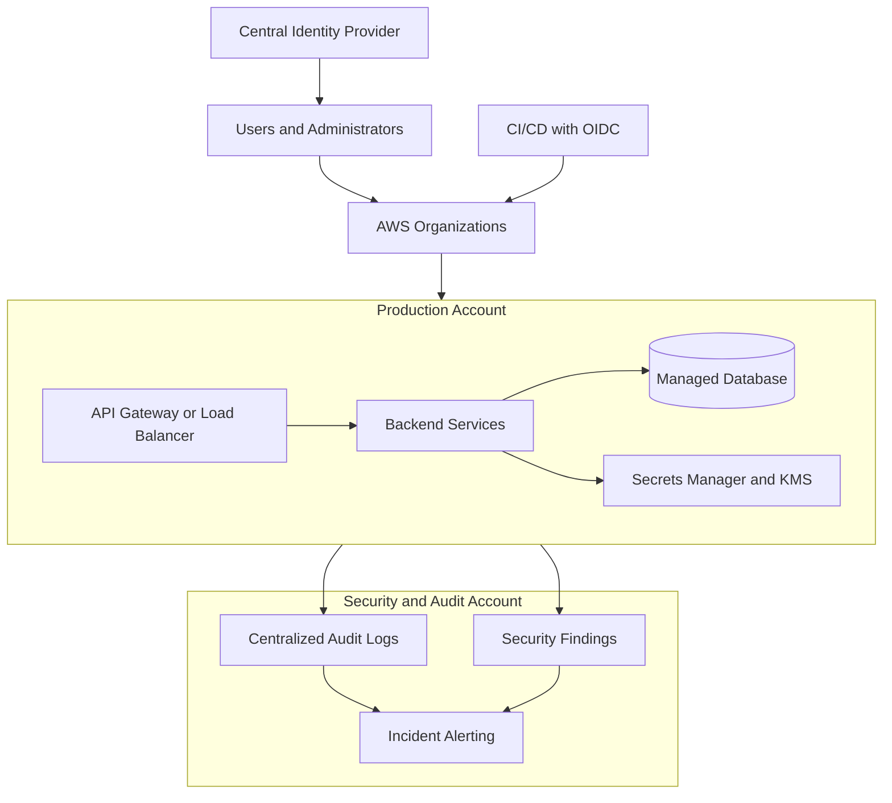
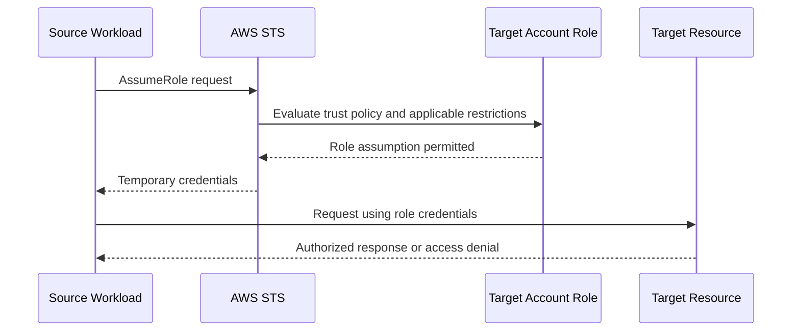

# 12- Senior Level Questions

## Overview

Senior-level AWS Security interviews evaluate how an engineer designs security boundaries, diagnoses authorization failures, manages credentials, protects sensitive data, and responds to incidents under production constraints.

At this level, answers should go beyond naming AWS services. They should explain the underlying authorization model, identify relevant failure modes, compare architectural alternatives, and justify decisions based on risk, reliability, operational complexity, and cost.

The questions below focus on practical engineering judgment across IAM, workload identity, cryptography, network security, backend applications, centralized monitoring, incident response, and secure delivery pipelines.

## Core Security Architecture

### Question: How would you design a secure AWS environment for a production microservices platform?

**Expected answer:**

Start by defining security boundaries around accounts, workloads, identities, networks, data, and deployment processes. Avoid relying on any single security mechanism.

A production architecture should include:

- **Account isolation:** Separate production, non-production, security tooling, and centralized audit logging where appropriate.
- **Identity federation:** Use a centralized identity provider and short-lived credentials rather than permanent IAM user access keys.
- **Workload identities:** Assign dedicated IAM roles to EC2 instances, Lambda functions, and other supported workloads.
- **Network isolation:** Place internal services in private subnets and restrict ingress and egress according to actual dependencies.
- **Data protection:** Encrypt sensitive data at rest and in transit, with controlled access to encryption keys.
- **Application authorization:** Enforce authentication, tenant isolation, and business-level authorization independently of AWS infrastructure permissions.
- **Centralized visibility:** Collect CloudTrail events and relevant security findings centrally.
- **Secure delivery:** Use federated CI/CD identities, artifact controls, dependency scanning, and deployment approvals appropriate to the environment.

A representative architecture is:



**Trade-offs:**

- More accounts improve isolation but increase governance and operational complexity.
- Customer-managed KMS keys provide greater control but require lifecycle and access management.
- Private networking reduces exposure but does not eliminate the need for identity and application authorization.
- Centralized logging improves investigations but requires careful cross-account permissions, retention policies, and protection against unauthorized deletion.

A senior engineer should explain how the architecture will be tested, monitored, recovered, and maintained—not merely how it is deployed.

### Question: How do you apply zero-trust principles to AWS workloads?

**Expected answer:**

Zero trust means that access decisions are based on verified identity, context, and policy rather than assuming that a network location is inherently trusted.

In AWS, this typically involves:

- Using short-lived credentials and workload identities.
- Requiring explicit authorization for sensitive operations.
- Restricting role assumption through trust policies and conditions.
- Separating administrative and application identities.
- Enforcing service-to-service authentication and authorization.
- Limiting network connectivity to required paths.
- Recording privileged operations and reviewing unusual activity.
- Continuously validating access and configuration.

For example, two microservices in the same VPC should not automatically trust each other. Network reachability, workload identity, transport security, and application-level authorization remain separate concerns.

**Senior-level consideration:** Zero trust is an architectural approach, not a single AWS service or configuration toggle.

### Question: How would you perform threat modeling for a new AWS backend service?

**Expected answer:**

Start with the assets and trust boundaries, then enumerate threats against each boundary.

A practical process is:

1. Identify sensitive assets: customer data, credentials, encryption keys, and administrative APIs.
2. Map entry points: public APIs, event sources, deployment pipelines, and administrative interfaces.
3. Identify identities and trust relationships.
4. Trace data flows between services and storage systems.
5. Evaluate threats such as unauthorized access, privilege escalation, credential theft, data exfiltration, and denial of service.
6. Map each threat to preventive, detective, and responsive controls.
7. Define verification tests and operational owners.

For a Python API that reads customer records from S3, for example, evaluate whether a compromised application can access other tenants' data, whether its role permits bucket-wide access, and whether application logs could expose retrieved records.

Threat modeling should be revisited when permissions, data flows, public exposure, or service dependencies change.

## IAM and Advanced Authorization

### Question: Explain how AWS determines whether an API request is authorized.

**Expected answer:**

Authorization depends on the request's principal, action, resource, applicable policies, conditions, and the service's authorization model.

Investigate the following:

- Identity-based policies.
- Applicable resource-based policies.
- Permissions boundaries.
- AWS Organizations SCPs.
- Session policies.
- Explicit denies.
- Resource-specific conditions and service control mechanisms.

Not every policy type applies identically to every request, so avoid describing all authorization as a simple intersection of every policy in the account.

An explicit deny that applies to the request overrides an allow. In the absence of a sufficient applicable allow, access is generally denied.

For cross-account access, determine the precise access mechanism. A common pattern requires the source identity to be permitted to assume a target role and the target role's trust policy to accept that identity. The resulting session must then have the necessary permissions to access the target resource.

**Diagnostic commands:**

```bash
aws sts get-caller-identity

aws iam get-role \
  --role-name example-backend-role

aws iam list-attached-role-policies \
  --role-name example-backend-role

aws iam list-role-policies \
  --role-name example-backend-role
```

These are read-only inspection commands. They help establish the active identity and inspect role configuration, but they do not independently calculate every effective permission.

### Question: A production service receives `AccessDenied` despite having an allow policy. How would you investigate it?

**Expected answer:**

Use a hypothesis-driven process rather than immediately adding permissions.

**Step 1: Establish the caller identity.**

```bash
aws sts get-caller-identity
```

Confirm that the application is using the expected account and role. In containerized systems, check the credential provider chain and workload configuration.

**Step 2: Verify the operation and resource.**

Confirm the exact API action, resource ARN, region, and relevant request parameters. Some operations require permissions on multiple resources.

**Step 3: Inspect the applicable policies.**

Review identity policies, resource policies, boundaries, session restrictions, SCPs, and conditions relevant to the request.

**Step 4: Inspect dependent services.**

An S3 object encrypted with SSE-KMS can require both S3 authorization and KMS authorization. Similar service-specific dependencies may apply elsewhere.

**Step 5: Collect evidence.**

Use CloudTrail events, service logs, and IAM policy simulation where applicable. Check whether the failure occurred during role assumption, request signing, or resource access.

**Step 6: Correct and verify.**

Change only the policy or configuration shown to be responsible. Retest the original operation and confirm that unrelated permissions have not been broadened.

**Senior-level insight:** An `AccessDenied` error is an observation, not a root cause. Correct diagnosis requires identifying the failed authorization stage and the relevant policy evaluation.

### Question: What is the difference between an SCP, a permissions boundary, and a session policy?

**Expected answer:**

| Mechanism | Primary purpose | Important limitation |
|---|---|---|
| Service control policy | Establish organization-level permission guardrails for affected accounts | Does not independently grant permissions |
| Permissions boundary | Limit permissions that applicable identity-based policies can grant to an identity | Does not independently grant permissions |
| Session policy | Restrict permissions available to a supported assumed-role or federated session | Cannot be treated as an additional permission grant |

These mechanisms operate at different levels and are not interchangeable.

For example, a developer's identity policy might allow an S3 operation, but a permissions boundary may prevent that permission from being effective. An organization-level restriction can impose another limit.

**Senior-level consideration:** Evaluate the principal type, access path, applicable policies, and service-specific authorization behavior before concluding which restriction caused the denial.

### Question: How would you prevent privilege escalation through IAM?

**Expected answer:**

Privilege escalation can occur when a principal can modify policies, pass powerful roles to services, assume privileged roles, or change workloads that execute with elevated permissions.

Review permissions such as:

- `iam:CreatePolicyVersion`
- `iam:SetDefaultPolicyVersion`
- `iam:AttachRolePolicy`
- `iam:PutRolePolicy`
- `iam:PassRole`
- `sts:AssumeRole`

These actions are examples, not an exhaustive list of escalation paths. Risk depends on the target resource, conditions, role trust, and other permissions.

For `iam:PassRole`, restrict the roles that can be passed and the services for which they can be used where supported.

For example, a deployment role that can create or update Lambda functions should not automatically be able to pass every administrator role to those functions.

**Production controls:**

- Separate role administration from application deployment.
- Restrict policy modification permissions.
- Use narrowly scoped resource ARNs and conditions.
- Review role trust relationships.
- Monitor sensitive IAM changes through CloudTrail.
- Test deployment permissions using representative workflows.

### Question: How do you securely design cross-account access?

**Expected answer:**

A common design uses a dedicated role in the target account.

1. The source workload receives credentials through its own identity.
2. Its identity policy allows assumption of a specific target role.
3. The target role's trust policy permits the source principal under controlled conditions.
4. AWS STS issues temporary credentials for the role session.
5. The target role's permissions determine the operations available to that session, subject to applicable restrictions.



Prefer specific role ARNs over broad principal access. Use external IDs where appropriate for third-party cross-account access, and do not treat an external ID as a replacement for proper trust-policy restrictions.

Monitor role assumptions and periodically review unused or excessively privileged cross-account relationships.

## Workload Identity and Credential Security

### Question: Why should backend applications prefer IAM roles over long-lived access keys?

**Expected answer:**

Long-lived access keys require storage, distribution, rotation, and incident-response procedures. If copied into source code, container images, logs, or deployment artifacts, they can remain usable until disabled or otherwise invalidated.

Supported workload identity mechanisms allow AWS SDKs to obtain credentials through the environment's credential provider chain.

Examples include:

- EC2 instance profiles.
- Lambda execution roles.
- ECS task roles.
- EKS workload identity integrations.
- OIDC federation for supported CI/CD systems.

Use a distinct role for each workload or trust boundary where practical. Avoid sharing a powerful role across unrelated applications.

**Important consideration:** Workload identity does not eliminate the need for least privilege, credential-leak prevention, or monitoring.

### Question: How would you handle a suspected compromise of temporary credentials?

**Expected answer:**

Treat temporary credentials as sensitive. Their limited lifetime reduces exposure duration but does not eliminate the risk of unauthorized activity.

A response should include:

1. Identify the source role, session, workload, and credential issuance context.
2. Restrict the compromised identity or session using supported controls.
3. Investigate relevant CloudTrail events and affected resources.
4. Review role permissions, trust relationships, and possible persistence mechanisms.
5. Isolate the affected workload if necessary.
6. Verify whether the old session can still perform sensitive operations.
7. Restore service with a trusted identity and remediate the exposure path.

Do not assume that deleting the original access key or modifying a role automatically invalidates every already-issued session in every situation. The required containment measures depend on the credential type and supported revocation mechanisms.

### Question: How do you secure AWS credentials in a Python service running in Docker?

**Expected answer:**

Do not bake AWS access keys into the Docker image or commit them to source control. Prefer a supported workload identity and let the AWS SDK obtain credentials from the runtime environment.

For example:

```python
import boto3


def create_s3_client():
    return boto3.client("s3", region_name="ap-south-1")
```

The code intentionally does not provide an access key or secret access key. The SDK uses its configured credential provider chain.

Production considerations:

- Assign the container or workload a dedicated IAM role.
- Restrict access to required resources.
- Prevent untrusted code from accessing workload credentials.
- Avoid exposing credential-provider responses in logs.
- Keep secrets out of image layers and build arguments.
- Use TLS for service communication.
- Rotate application-specific secrets through a supported secret-management workflow.

A container's filesystem isolation does not automatically prevent code inside the container from accessing credentials available to that workload.

## Cryptography and AWS KMS

### Question: Explain envelope encryption and why AWS KMS uses it.

**Expected answer:**

Envelope encryption uses a data key to encrypt application data and a separate key-encryption mechanism to protect the data key.

A typical flow is:

1. The application requests a data key using an authorized KMS operation.
2. KMS returns plaintext data-key material and an encrypted copy of that key.
3. The application uses the plaintext data key to encrypt the data.
4. The application stores the encrypted data key alongside the ciphertext.
5. The application discards plaintext key material when it is no longer needed.
6. During decryption, the application obtains authorized plaintext data-key material through KMS and decrypts the data.

This reduces the need to perform a KMS operation for every data-encryption operation.

The application must still protect plaintext data keys, manage their memory lifecycle, and prevent sensitive values from entering logs or diagnostics.

### Question: What is the difference between a KMS key policy and an IAM policy?

**Expected answer:**

A KMS key policy is the primary resource policy governing access to a KMS key. IAM policies can also grant relevant permissions when the key policy and authorization configuration permit IAM-based access.

The effective result depends on the key policy, grants, identity permissions, conditions, and the applicable KMS authorization rules.

When a KMS operation fails, inspect:

- The caller's identity.
- The requested KMS operation.
- The key ARN and state.
- The key policy.
- Applicable grants and identity policies.
- Encryption context conditions, where used.
- Relevant CloudTrail events.

Do not assume that adding an IAM allow is sufficient when the key policy does not permit the required authorization path.

### Question: When would you choose a customer-managed KMS key over an AWS-managed key?

**Expected answer:**

A customer-managed key is appropriate when the organization requires more direct control over key policies, grants, administrative permissions, lifecycle, or auditability.

An AWS-managed key generally reduces key-administration overhead, but customer control over its policy and lifecycle is more limited.

Evaluate:

- Data sensitivity and regulatory requirements.
- Required key-access separation.
- Cross-account access requirements.
- Rotation and lifecycle requirements.
- Operational ownership and recovery procedures.
- Service support and cost.

**Senior-level consideration:** Customer-managed keys create additional responsibilities. A design must prevent accidental key disablement or deletion and account for the consequences of losing access to encrypted data.

### Question: What is encryption context, and how can it improve security?

**Expected answer:**

Encryption context is additional authenticated data supplied to supported KMS cryptographic operations. It is not secret, and it can be recorded in plaintext in relevant audit events.

It can bind cryptographic operations to application-specific metadata, such as a tenant identifier or data classification.

For example, a system might require a specific encryption-context value in its key policy or application authorization flow. A mismatch can cause the cryptographic operation to fail.

Use stable, non-sensitive context values. Never put passwords, tokens, or confidential payloads into encryption context.

Encryption context can strengthen policy enforcement, but it does not replace application authorization or tenant-isolation checks.

### Question: A service can read an S3 object but cannot decrypt it. How would you debug the failure?

**Expected answer:**

1. Verify the active workload identity.
2. Confirm the object's encryption mode and KMS key ARN.
3. Verify S3 permissions for the requested object operation.
4. Inspect KMS key policies, grants, and applicable IAM permissions.
5. Check any encryption-context requirements or conditions.
6. Review CloudTrail evidence for the failed operation.
7. Correct the missing permission or configuration and retest.

Do not change the bucket's encryption configuration or grant broad KMS access before establishing the cause.

## Secrets Management and Backend Reliability

### Question: How do you choose between Secrets Manager and Systems Manager Parameter Store?

**Expected answer:**

| Requirement | Secrets Manager | Systems Manager Parameter Store |
|---|---|---|
| Application secrets | Strong fit | Supported through appropriate parameter types |
| Managed secret rotation | Supported integrations and rotation workflows | Rotation generally requires a separate workflow |
| General configuration | Supported, but may be more than needed | Strong fit |
| Hierarchical parameter organization | Not its primary organizational model | Supports hierarchical parameter names |
| Operational cost | Evaluate per-secret and API usage costs | Evaluate parameter tier and API usage costs |
| KMS integration | Supported | Supported for relevant parameter types |

Choose based on rotation needs, access patterns, integration requirements, scale, and cost. Neither service eliminates the need for least-privilege IAM permissions or secure application behavior.

### Question: How do you implement secret retrieval in a Python backend without leaking credentials?

**Expected answer:**

Use the AWS SDK with workload identity and retrieve the secret at the appropriate point in the application's lifecycle.

```python
import json
import boto3


def load_service_secret(secret_arn: str) -> dict[str, str]:
    client = boto3.client("secretsmanager")
    response = client.get_secret_value(SecretId=secret_arn)

    secret_string = response.get("SecretString")
    if not secret_string:
        raise ValueError("Expected a string-valued secret")

    secret = json.loads(secret_string)

    if "username" not in secret or "password" not in secret:
        raise ValueError("Secret is missing required fields")

    return secret
```

This example demonstrates retrieval and validation; a production implementation should also handle service failures, timeouts, secret schema validation, and controlled retries.

Required controls include:

- Granting only the required `secretsmanager:GetSecretValue` access.
- Granting necessary KMS permissions when applicable.
- Never logging the returned secret dictionary.
- Using bounded caching where appropriate.
- Avoiding unnecessary secret retrieval on every request.
- Ensuring rotated credentials are picked up within the required time.
- Preventing credentials from appearing in traces, exception messages, or telemetry.

**Senior-level consideration:** Cache lifetime affects both latency and rotation responsiveness. Define an explicit freshness requirement rather than selecting a cache duration arbitrarily.

### Question: What happens if a database password rotates while a connection pool is active?

**Expected answer:**

Existing database connections may continue working while new connections fail, depending on the database and credential-revocation behavior. An application that caches the old password may also fail when reconnecting.

A robust design should:

- Define the secret-refresh policy.
- Coordinate rotation with the database's credential lifecycle.
- Handle connection-pool recycling.
- Retry transient failures with bounded backoff.
- Avoid repeatedly retrying permanently invalid credentials.
- Monitor authentication failures after rotation.
- Verify that the application converges on the new credential.

Rotation must be tested as an end-to-end workflow, not merely as a successful update to Secrets Manager.

## Network Security and API Protection

### Question: How do security groups, network ACLs, IAM, and application authorization complement one another?

**Expected answer:**

They operate at different layers.

| Control | Responsibility |
|---|---|
| Security groups | Stateful network traffic filtering for supported network interfaces and resources |
| Network ACLs | Stateless subnet-level traffic filtering |
| IAM | Authorization for AWS API operations and resource access |
| Application authorization | User, tenant, and business-operation permissions |
| TLS | Protection of data in transit and server authentication through certificates |
| AWS WAF | Filtering supported web requests using configured rules |
| AWS Shield | DDoS protection capabilities |

A request may be allowed by network controls and still be rejected by IAM or the application. Conversely, an application permission does not make a blocked network path reachable.

### Question: How would you securely expose a public REST API?

**Expected answer:**

A secure public API needs controls at the edge, transport, identity, application, and infrastructure layers.

Consider:

- TLS and appropriate certificate management.
- Authentication and application-level authorization.
- Request validation and payload-size limits.
- Rate limiting and abuse protection.
- AWS WAF rules where appropriate.
- AWS Shield capabilities appropriate to the threat model.
- Private connectivity for internal dependencies where supported.
- Restricted workload IAM permissions.
- Secrets management and encryption.
- Centralized logging, alerting, and incident-response procedures.

A WAF cannot replace application authorization. Rate limiting cannot prevent every distributed denial-of-service attack. Private connectivity does not establish that a caller is authorized to access a resource.

### Question: How would you investigate an unexpected AWS WAF block?

**Expected answer:**

First identify the affected request, timestamp, Web ACL, and rule that terminated evaluation or otherwise caused the block.

Then:

1. Inspect the relevant WAF logs and rule configuration.
2. Determine whether the request matched a custom rule, managed rule, or rate-based rule.
3. Compare the request with legitimate traffic and the intended rule behavior.
4. Validate whether a rule exception or scope adjustment is justified.
5. Test the change with representative traffic.
6. Monitor the result for false negatives and false positives.

Avoid disabling an entire managed rule group to resolve one false positive without evaluating the broader security impact.

## Monitoring, Detection, and Auditability

### Question: Design centralized security monitoring for a multi-account AWS environment.

**Expected answer:**

A centralized design should collect audit events and security findings from relevant accounts and regions, preserve evidence, and route actionable alerts to the appropriate response teams.

Core components can include:

- AWS CloudTrail for API activity.
- Amazon GuardDuty for supported threat detections.
- AWS Security Hub for centralized findings and security posture visibility.
- AWS Config for supported configuration recording and compliance evaluation.
- Amazon CloudWatch for operational metrics, logs, and alarms.
- A dedicated account or protected destination for centralized audit storage.

A monitoring design must also specify event coverage, retention, access control, alert routing, ownership, and investigation procedures.

**Key distinction:** CloudTrail records supported activity; GuardDuty detects potential threats; Security Hub centralizes findings; CloudWatch provides observability and alerting. Their functions overlap in integrations but are not interchangeable.

### Question: How do you investigate suspicious IAM API activity?

**Expected answer:**

Identify the principal, event name, event time, source context, target resource, and result. Then determine whether the action was expected and whether it enabled additional access.

Example read-only CloudTrail lookup:

```bash
aws cloudtrail lookup-events \
  --lookup-attributes AttributeKey=EventName,AttributeValue=AssumeRole \
  --start-time 2026-10-12T00:00:00Z \
  --end-time 2026-10-13T00:00:00Z \
  --max-results 50
```

The time range is illustrative and should be replaced with the incident window. `lookup-events` searches available event history for supported lookup attributes; broader investigations may require querying a configured trail or event data store.

Investigate related role assumptions, policy changes, access-key activity, and resource operations. Preserve relevant evidence before changing or deleting affected resources when doing so is safe and operationally appropriate.

### Question: How would you respond if CloudTrail events were missing?

**Expected answer:**

Do not immediately conclude that no suspicious activity occurred.

Check:

- Whether the relevant account and region are covered.
- Whether the expected event type is recorded.
- Trail configuration and delivery status.
- Event history limitations and retention.
- Centralized destination permissions and storage configuration.
- Whether the investigation is querying the correct identity, time range, and event source.

If evidence collection was misconfigured, restore coverage, document the gap, and investigate any period for which evidence is unavailable.

CloudTrail event history and a configured trail have different capabilities and retention characteristics. A senior engineer should state which source is being used and what evidence it can provide.

## Incident Response and Recovery

### Question: An AWS access key was exposed publicly. Describe your response.

**Expected answer:**

Treat the event as a potential compromise, even if there is no immediate evidence of misuse.

1. Identify the affected credential, principal, and permissions.
2. Disable or revoke the exposed long-lived credential as appropriate.
3. Investigate CloudTrail activity and relevant service logs.
4. Identify resources accessed or modified by the principal.
5. Check for privilege escalation, persistence, and additional credential exposure.
6. Contain affected workloads and revoke or restrict other compromised credentials as required.
7. Remove the secret from source, build artifacts, and operational systems where feasible.
8. Replace the access pattern with a supported workload identity or short-lived credentials.
9. Verify containment and application recovery.
10. Document the incident and add preventive controls.

Potential preventive controls include repository secret scanning, restricted CI/CD permissions, workload identity federation, and alerts for sensitive IAM changes.

### Question: What would you do if a KMS key were accidentally disabled in production?

**Expected answer:**

First determine the key's state, the affected workloads, and whether the key is required for active encryption or decryption operations.

Then:

- Confirm the key ARN and region.
- Identify the disabling action and responsible principal using available audit evidence.
- Determine which services and datasets depend on the key.
- Assess whether re-enabling the key is appropriate and authorized.
- Verify the key's policy, grants, and dependent service behavior.
- Restore the affected workload and validate access to the required data.
- Review the incident and introduce preventive controls.

Do not delete or replace the key as an initial troubleshooting step. Key lifecycle operations can have serious data-availability consequences, and key deletion may make encrypted data unrecoverable.

### Question: How do you balance incident containment and evidence preservation?

**Expected answer:**

Prioritize preventing ongoing harm while preserving the evidence needed to determine impact and support recovery.

For example, disabling a compromised access key may be urgent, while deleting an affected instance or destroying a resource may eliminate useful evidence.

A mature response process defines:

- Emergency containment authority.
- Evidence collection and preservation procedures.
- Escalation paths.
- Criteria for isolating workloads.
- Credential and session-restriction procedures.
- Recovery validation.
- Post-incident review and control improvements.

Evidence preservation should not unnecessarily delay critical containment actions during an active compromise.

## Secure CI/CD and Deployment Architecture

### Question: How would you secure GitHub Actions deployments to AWS?

**Expected answer:**

Prefer OIDC federation with AWS IAM roles over long-lived AWS access keys where supported.

A secure workflow should:

- Restrict the OIDC trust relationship to the intended identity provider and token claims.
- Limit role permissions to the required deployment operations.
- Separate development and production deployment roles.
- Protect production environments and deployment approvals.
- Pin third-party actions to trusted immutable references where appropriate.
- Prevent secrets from appearing in logs and build artifacts.
- Restrict who can modify workflow files.
- Audit deployment role assumptions and infrastructure changes.

OIDC reduces the need to store permanent AWS credentials, but it does not make an overly permissive trust policy or deployment role safe.

### Question: How should production deployment permissions differ from application runtime permissions?

**Expected answer:**

Deployment identities and runtime identities have different responsibilities.

| Identity | Typical permissions |
|---|---|
| CI/CD deployment role | Update specific application resources and deploy approved artifacts |
| Lambda execution role | Access runtime dependencies such as a specific secret, queue, or object prefix |
| EC2 workload role | Access resources needed by the instance's application |
| Database administration role | Perform authorized database administration tasks |
| Security audit role | Read relevant audit and security information |

Avoid using one powerful role for deployment, runtime access, and security administration. Separating responsibilities limits the impact of a compromised application or pipeline.

## Troubleshooting and Diagnostic Reasoning

### Question: What is your troubleshooting sequence for an AWS authorization failure?

**Expected answer:**

Use the following sequence to narrow the failure category before changing configuration.

| Step | Investigation | Evidence |
|---|---|---|
| Identity | Verify the active caller | STS identity output |
| Request | Confirm action, resource, region, and parameters | Application logs and request metadata |
| Authentication | Check credential validity and expiration | SDK or service error details |
| Signing | Verify SigV4 scope, timestamp, and signed headers | Sanitized request diagnostics |
| Authorization | Inspect relevant policies and conditions | IAM configuration and policy evaluation |
| Dependencies | Check KMS, resource policies, and related services | Service-specific logs and CloudTrail |
| Network | Validate routes, ports, security groups, and endpoint policies | VPC configuration and connectivity tests |
| Verification | Repeat the intended operation | Successful request and relevant audit evidence |

Do not expose authorization headers, access tokens, session tokens, or secret values while collecting diagnostics.

### Question: How would you distinguish a SigV4 failure from an IAM authorization failure?

**Expected answer:**

A signing failure indicates that the request could not pass the applicable authentication or signature-validation process. An authorization failure indicates that the request was not permitted, assuming the request reached the authorization stage.

For SigV4, check:

- Credential validity.
- Timestamp and clock synchronization.
- Correct region and service signing scope.
- Canonical URI and query encoding.
- Required signed headers.
- Payload hash.
- Session-token inclusion for temporary credentials.

For authorization, check the caller identity, action, resource, applicable policies, and service-specific dependencies.

The exact error response varies by service and request path, so use sanitized error details and CloudTrail evidence rather than relying solely on the HTTP status code.

### Question: Which AWS CLI commands are useful during an initial security investigation?

**Expected answer:**

| Command | Purpose | Notes |
|---|---|---|
| `aws sts get-caller-identity` | Identify the current caller | Read-only |
| `aws iam get-role --role-name ROLE` | Inspect a role and trust policy | Read-only |
| `aws iam list-attached-role-policies --role-name ROLE` | Inspect attached managed policies | Read-only |
| `aws iam list-role-policies --role-name ROLE` | List inline role policies | Read-only |
| `aws cloudtrail lookup-events ...` | Search available event history | Read-only |
| `aws kms describe-key --key-id KEY_ARN` | Inspect KMS key metadata and state | Read-only |
| `aws secretsmanager describe-secret --secret-id SECRET_ARN` | Inspect secret metadata | Avoid retrieving secret values unnecessarily |
| `aws ec2 describe-security-groups --group-ids GROUP_ID` | Inspect security-group rules | Read-only |
| `aws securityhub get-findings ...` | Retrieve available Security Hub findings | Read-only |

Use placeholders for account IDs, ARNs, and resource identifiers. CLI output can contain sensitive operational metadata, so handle it according to the organization's logging and evidence-handling requirements.

## Senior-Level Trade-Off Questions

### Question: When should you use private subnets, VPC endpoints, or AWS PrivateLink?

**Expected answer:**

These controls solve related but different connectivity problems.

- **Private subnets** reduce direct inbound exposure and support controlled routing.
- **VPC endpoints** provide supported private connectivity to AWS services without requiring the same public network path.
- **AWS PrivateLink** supports private access to services through endpoint-based connectivity, including supported service-provider patterns.

The choice depends on service support, traffic direction, DNS behavior, access policies, network architecture, availability requirements, and cost.

Private connectivity does not automatically authorize API requests. IAM policies, endpoint policies where applicable, resource policies, and application authorization remain relevant.

### Question: How do you decide whether to centralize or distribute security controls?

**Expected answer:**

Centralization improves consistency and visibility, while workload-level controls preserve local enforcement and reduce dependence on a single control plane.

A strong design commonly centralizes:

- Identity governance and account-level guardrails.
- Audit collection and security findings.
- Security standards and policy templates.
- Incident coordination and reporting.

It distributes enforcement where appropriate:

- Workload IAM roles.
- Service-specific resource policies.
- Network segmentation.
- Application authorization.
- Local runtime protections.

The objective is consistent governance without creating unnecessary shared privileges or a single operational bottleneck.

### Question: How would you prioritize security improvements with limited engineering capacity?

**Expected answer:**

Prioritize according to exposure, impact, exploitability, blast radius, and the time required to reduce risk.

A practical order is often:

1. Contain active compromise or unauthorized public exposure.
2. Remove exposed credentials and excessive privileged access.
3. Protect sensitive data and critical encryption keys.
4. Close high-risk network and authorization gaps.
5. Improve audit coverage, detection, and incident response.
6. Automate recurring access reviews and configuration validation.

This is a risk-based ordering, not a universal sequence. An organization's threat model, regulatory requirements, and current incident conditions may change priorities.

### Question: How do you prove that an AWS security control works?

**Expected answer:**

Do not rely solely on the existence of a policy or service configuration. Define an observable security property and test it.

Examples include:

- A workload can read its required S3 prefix but cannot read unrelated data.
- An untrusted principal cannot assume a privileged role.
- A revoked credential cannot perform the prohibited operation.
- A secret rotation reaches the application within the required interval.
- A KMS key policy prevents unauthorized decryption.
- A CloudTrail event reaches the central investigation workflow.
- A deployment workflow cannot modify unrelated production resources.

Use automated negative tests, configuration validation, controlled security exercises, and audit evidence. Retest after material changes to policies, roles, networks, and deployment workflows.

## Key Takeaways

- Senior AWS Security engineering requires understanding trust boundaries, effective authorization, and the distinction between identity, network, application, and cryptographic controls.
- Diagnose authorization and signing failures using evidence from the active identity, policies, service logs, and CloudTrail before changing permissions.
- Use workload identities, least privilege, controlled cross-account trust, and secure secret lifecycle management to reduce credential exposure.
- Design security monitoring and incident response together so that preventive controls, audit evidence, containment, and recovery form a verifiable process.
- Evaluate security decisions through explicit trade-offs involving blast radius, availability, operational complexity, cost, and measurable risk reduction.