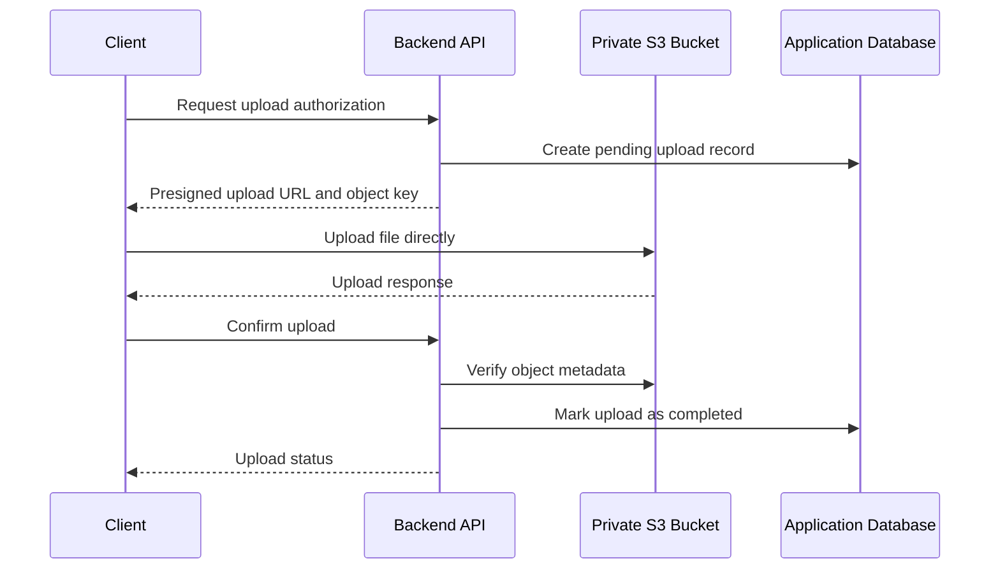
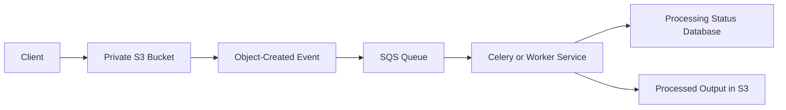

# 01- Core Amazon S3 Interview Questions

## Overview

Amazon Simple Storage Service (Amazon S3) is an object storage service used to store and retrieve application files, backups, logs, media assets, analytical datasets, and other unstructured data. It provides durable storage, strong object-level consistency, configurable access controls, multiple storage classes, and integration with the broader AWS ecosystem.

Core S3 interviews typically assess more than terminology. A strong candidate should explain how objects are addressed, what consistency guarantees S3 provides, how uploads scale, how permissions are evaluated, and which trade-offs matter when S3 becomes part of a production backend.

These questions progress from foundational concepts to implementation decisions and production scenarios.

## Core Object Storage Concepts

### What is Amazon S3, and why is it different from block and file storage?

Amazon S3 is an object storage service. Data is stored as objects inside buckets, and each object is addressed using its key and, when versioning is enabled, its version ID.

Unlike block or file storage, S3 does not expose a conventional disk or shared filesystem to an application. Applications access objects through APIs, SDKs, or compatible tools.

| Characteristic | Object Storage: S3 | Block Storage: EBS | File Storage: EFS |
|---|---|---|---|
| Data model | Objects identified by keys | Addressable storage blocks | Files and directories |
| Access method | HTTP APIs and SDKs | Attached block device | File protocols such as NFS |
| Typical workloads | Media, documents, backups, data lakes | Databases, boot volumes, filesystems | Shared application files, shared directories |
| Application interface | `GET`, `PUT`, `DELETE`, listing APIs | Filesystem or raw block operations | Filesystem operations |
| Capacity management | Service-managed object storage | Volume provisioning and resizing | Managed filesystem capacity |
| Concurrent access | Object-level operations; no general filesystem locking | Depends on filesystem and application coordination | Filesystem semantics and locking support |

**When to use S3:** store uploaded documents, images, exports, backups, application logs, static website assets, and analytical data.

**When not to use S3 directly:** applications requiring a POSIX filesystem, block-level random writes, or database-style transactional updates to individual records. Use an appropriate database or filesystem service instead.

For example, a Django application can store document binaries in S3 while keeping ownership, access permissions, processing state, and business metadata in PostgreSQL.

### What are a bucket, an object, a key, and a version ID?

A bucket is a container for objects. An object consists principally of its content, key, metadata, and associated attributes. If versioning is enabled, each stored version has a version ID.

Consider:

```text
Bucket: production-documents
Key: tenants/tenant-42/invoices/invoice-1001.pdf
Version ID: 3HL4kqtJlcpXroDTDmJ+rmSpXd3dIbrhy
```

The bucket identifies the storage container. The key identifies the object within that bucket. The version ID distinguishes a particular stored version of the key.

The bucket and key identify the current address of an object in ordinary operations; the bucket, key, and version ID identify a particular version.

This distinction matters when applications overwrite files, restore historical versions, or investigate accidental deletions.

### Are S3 folders real directories?

No. In general-purpose S3 buckets, the object namespace is flat. A key may contain slash characters, but those characters are part of the key rather than filesystem directory boundaries.

For example:

```text
reports/2026/october/revenue.csv
reports/2026/october/expenses.csv
reports/2026/november/revenue.csv
```

Applications and the S3 console interpret common prefixes as a directory-like hierarchy. This is a logical organization convention, not a conventional directory structure.

An object with a key such as `reports/2026/` can also be created to represent a folder marker, but it is still an object.

**Production implication:** design keys around stable application identifiers, tenant boundaries, data categories, or processing stages. Do not depend on filesystem rename semantics; moving an object typically requires copying it to a new key and deleting the old object.

### What is the maximum length of an S3 object key, and how should keys be designed?

S3 object keys can be up to 1,024 bytes in UTF-8 encoding. The limit is measured in bytes, not simply the number of visible characters.

A good key design should provide predictable organization without embedding unnecessary sensitive information.

Example:

```text
tenant-42/documents/2026/10/01JBC4Q6F7XK2M8A/document.pdf
```

Useful design principles include:

- Use application-generated identifiers rather than raw user-supplied paths.
- Avoid personal information, access tokens, or secrets in object keys.
- Keep identifiers stable when downstream services depend on them.
- Use prefixes to support listing, policy conditions, lifecycle rules, and operational organization.
- Avoid treating keys as a substitute for authorization checks in the application.

S3 has long supported high request rates across prefixes. Randomly distributing key prefixes is generally not required merely to achieve modern S3 request performance.

### Does S3 support unlimited objects?

S3 supports storing an extremely large number of objects without requiring applications to provision a filesystem or individual storage volumes. For practical system design, however, object count alone does not determine operational scalability.

Consider these factors:

- The cost of requests, retrieval, storage, and data transfer.
- Listing and inventory requirements.
- The number of small objects and resulting request overhead.
- Lifecycle, replication, event-processing, and metadata-management workloads.
- Application-level indexing and authorization requirements.

For example, storing millions of small JSON records as separate S3 objects may be suitable for some archival or event workloads, but PostgreSQL, DynamoDB, or a columnar data format may be more appropriate when frequent queries or individual record updates dominate.

## Consistency, Durability, and Availability

### What consistency guarantees does S3 provide?

Amazon S3 provides strong read-after-write consistency for object PUT and DELETE operations, including overwrites of existing keys. Subsequent GET and LIST operations initiated after a successful write or delete reflect the completed change.

For example:

1. A backend uploads `reports/monthly.csv`.
2. S3 confirms that the PUT request succeeded.
3. The backend immediately reads the same key.
4. The GET request returns the newly written object.

There is no need to introduce an arbitrary delay merely to wait for object visibility.

S3 also provides strong consistency for relevant object metadata and tag operations.

However, concurrent writes to the same key are a separate concern. If two writers update the same key concurrently, S3 does not provide a general application-level lock or multi-object transaction. The final stored value depends on the writes that S3 processes.

Bucket configuration changes also have different propagation characteristics from object reads and writes. Do not assume every configuration change behaves like a strongly consistent object PUT.

Reference: [Amazon S3 data consistency model](https://docs.aws.amazon.com/AmazonS3/latest/userguide/Welcome.html).

### What is the difference between durability and availability?

Durability describes the likelihood that stored data remains intact and is not lost. Availability describes whether the service is accessible and can successfully serve requests.

Amazon S3 Standard is designed for very high durability, using redundant storage across multiple Availability Zones within a Region. That durability is not the same as a guarantee that every application request will always succeed.

| Concern | Meaning | Engineering response |
|---|---|---|
| Durability | Protecting stored data against loss | Use S3's durability properties, validate data integrity, and apply appropriate recovery controls |
| Availability | Ability to access the service | Handle transient failures, configure retries, and design application fallbacks where justified |
| Regional recovery | Ability to recover after a regional disruption | Consider cross-Region replication, backups, and application failover |
| Logical deletion | Data removed or hidden by an authorized operation | Use versioning, retention controls, or independent backups as required |

**Interview trap:** saying that high durability automatically makes S3 a complete disaster recovery solution is incorrect. Regional application dependencies, permissions, encryption keys, databases, DNS, and deployment configuration may also be required for recovery.

### Does strong consistency eliminate race conditions?

No. Strong consistency ensures that completed operations are observable according to S3's consistency guarantees. It does not coordinate concurrent writers or make a group of independent object operations transactional.

Suppose two Celery workers update the same object key:

```text
Worker A: PUT key=exports/latest.csv
Worker B: PUT key=exports/latest.csv
```

Both operations may succeed, but the application cannot assume which payload will be the final value.

Possible solutions include:

- Generate a unique key for every export and maintain the current export pointer in a database.
- Use a database transaction or conditional-update mechanism to coordinate business state.
- Use conditional S3 writes where supported and appropriate.
- Enable versioning if historical object recovery is required.

The right approach depends on whether the application needs immutable artifacts, a single mutable object, or coordinated business-level state.

## Uploads, Downloads, and Object Integrity

### What are the S3 object size and upload limits?

The maximum S3 object size is 50 TB, approximately 48.8 TiB. Upload API limits determine how that object must be transferred.

| Operation | Limit or guidance |
|---|---|
| Single PUT upload | Up to 5 GB |
| Multipart upload | Up to 50 TB |
| Maximum multipart parts | 10,000 |
| Multipart part size | 5 MiB to 5 GiB, except the final part may be smaller |
| Maximum key length | 1,024 UTF-8 bytes |
| Multipart upload recommendation | Consider multipart uploads for objects around 100 MB and larger |

The values and operation-specific constraints are documented in [S3 multipart upload limits](https://docs.aws.amazon.com/AmazonS3/latest/userguide/qfacts.html).

A single GET request is limited to 5 TB. Downloading objects larger than that requires concurrent ranged GET requests or another supported multipart-aware download approach. See [Downloading objects](https://docs.aws.amazon.com/AmazonS3/latest/userguide/download-objects.html).

### What is multipart upload, and when should it be used?

Multipart upload divides a large object into parts. The application uploads parts independently, and S3 assembles them when the multipart upload is completed.

Typical workflow:

1. Initiate a multipart upload and receive an upload ID.
2. Upload numbered parts, potentially in parallel.
3. Retry individual failed parts when necessary.
4. Complete the multipart upload with the required part numbers and ETags.
5. Abort abandoned uploads that will not be completed.

Advantages include parallel throughput, better recovery from network failures, and support for objects larger than the single-PUT limit.

Production considerations:

- Choose part sizes and concurrency based on network throughput, memory, and request costs.
- Do not treat a partially uploaded multipart upload as a completed object.
- Configure cleanup for abandoned multipart uploads.
- Ensure retries cannot accidentally finalize the wrong upload.
- Use transfer managers where appropriate instead of implementing multipart orchestration unnecessarily.

For backend applications, the AWS SDK transfer utilities can handle many multipart details. For direct browser uploads, the backend can issue constrained presigned requests and manage completion through a controlled API workflow.

### What is the difference between an ETag and an object checksum?

An ETag is an identifier returned for an S3 object operation. It is useful for conditional operations and multipart workflows, but it is not universally equivalent to the MD5 hash of the complete object.

For example, multipart uploads can produce ETags that do not equal a simple MD5 digest of the object's complete content. Encryption and the upload method can also affect whether that assumption is valid.

For reliable integrity verification:

- Use supported S3 checksum algorithms when appropriate.
- Preserve or independently calculate the expected checksum when the application requires end-to-end validation.
- Validate the checksum after data transfer where the workflow requires it.
- Do not use a multipart ETag as a universal integrity proof.

S3 supports checksum mechanisms including CRC-based checksums and SHA-based checksums. Refer to [Checking object integrity](https://docs.aws.amazon.com/AmazonS3/latest/userguide/checking-object-integrity-upload.html).

### How should a backend handle large file uploads?

The backend should decide whether to proxy the file through the application or let the client upload directly to S3.

A proxied upload is reasonable for smaller files or when the application must inspect every byte synchronously. However, it consumes application bandwidth and worker resources.

For larger files, direct presigned uploads often provide better scalability:



The backend should validate ownership, expected size, content type, and the generated object key. It must verify the resulting object rather than trusting the client's claim that the upload completed successfully.

## Storage Classes and Lifecycle

### What are S3 storage classes, and how do you choose one?

Storage classes balance access frequency, availability requirements, retrieval latency, and cost. Selecting the cheapest storage rate without considering retrieval and minimum-duration constraints can increase total cost.

| Storage class | Suitable workload | Main consideration |
|---|---|---|
| S3 Standard | Frequently accessed active data | General-purpose, low-latency object access |
| S3 Intelligent-Tiering | Data with changing or unknown access patterns | Monitoring and tier-specific charges may apply |
| S3 Standard-IA | Infrequently accessed data needing rapid retrieval | Retrieval charges and minimum storage duration |
| S3 One Zone-IA | Re-creatable or appropriately recoverable infrequent data | Data stored in one Availability Zone |
| S3 Glacier Instant Retrieval | Archive data requiring millisecond retrieval | Archive-oriented pricing and retrieval charges |
| S3 Glacier Flexible Retrieval | Archive data where retrieval can take longer | Retrieval options and restore workflow |
| S3 Glacier Deep Archive | Long-term archival data with infrequent retrieval | Longer restore times and low storage cost |
| S3 Express One Zone | Latency-sensitive workloads requiring very high request performance | Specialized storage behavior, availability scope, and pricing |

The appropriate choice depends on actual access patterns, recovery objectives, retention requirements, and lifecycle transition costs.

### What is the difference between a storage class and a lifecycle policy?

A storage class describes how an object is stored and the related access and pricing characteristics. A lifecycle policy automates actions on objects based on rules, filters, and age or version-related conditions.

For example, an application might keep recent documents in S3 Standard and transition older documents to an archival class.

Lifecycle policies can also expire objects or manage noncurrent versions, but lifecycle operations do not replace application retention requirements or a properly designed backup strategy.

Common mistakes include:

- Transitioning objects before considering minimum storage duration.
- Ignoring retrieval charges and restore requirements.
- Forgetting about noncurrent versions in versioning-enabled buckets.
- Assuming a lifecycle transition happens at an exact business deadline.
- Treating an archive storage class as immediately available for every access pattern.

Lifecycle behavior should be verified against the selected storage class and the exact rule configuration.

### What is S3 Versioning, and what does a delete marker do?

Versioning preserves multiple versions of an object key. When a new version is uploaded to a versioning-enabled bucket, S3 creates another version rather than permanently overwriting the previous version.

A normal DELETE operation without a specified version ID generally creates a delete marker. The delete marker becomes the current version, so ordinary GET requests behave as though the object is deleted, even though earlier versions may still exist.

Versioning is valuable for recovering from accidental overwrites and deletions. It also increases storage consumption because historical versions continue to occupy storage until removed or managed by lifecycle policies.

**Interview trap:** deleting an object key in a versioning-enabled bucket does not necessarily erase all its stored versions.

Versioning helps with recovery, but it does not replace independent backups or protect against every privileged destructive action.

## Security and Access Control

### How does S3 access control work?

S3 access control combines identity-based permissions, resource-based permissions, organization-level guardrails, and other applicable controls.

Important mechanisms include:

- **IAM identity policies:** permissions assigned to users, roles, or other IAM principals.
- **Bucket policies:** resource-based policies that define access to a bucket and its objects.
- **S3 Block Public Access:** controls that restrict public exposure through applicable policies and ACLs.
- **Object Ownership:** determines ownership and can disable ACL-based access control when bucket-owner-enforced settings are used.
- **Access points:** named access endpoints with their own policies for managing access patterns.
- **AWS KMS key policies and grants:** control use of customer-managed encryption keys.

A request succeeds only when the relevant authorization requirements are satisfied and no applicable explicit deny blocks it.

Production access should normally use IAM roles and short-lived credentials rather than hardcoded IAM user access keys.

### What is the difference between an IAM policy and a bucket policy?

An IAM policy is attached to an identity, such as a role. A bucket policy is attached to the S3 bucket and specifies which principals can perform which operations on the resource.

For example, a backend role may have an identity policy granting permission to upload objects to a defined prefix. The bucket policy may also restrict writes to approved roles or deny insecure transport.

These policies do not simply override one another. An explicit deny in an applicable policy prevents access even when another policy grants the action.

For cross-account access, both sides of the authorization relationship may require configuration. A bucket policy granting access does not automatically solve a KMS authorization failure for an encrypted object.

### What is the difference between SSE-S3 and SSE-KMS?

Both are server-side encryption mechanisms.

| Characteristic | SSE-S3 | SSE-KMS |
|---|---|---|
| Key management | S3-managed encryption keys | AWS KMS key infrastructure |
| Operational complexity | Lower | Higher |
| Key-level access controls | No customer-managed KMS key policy | Supported through applicable KMS policies and permissions |
| Audit and key-control requirements | Suitable for standard server-side encryption needs | Useful when customer-managed key controls and auditing are required |
| Additional considerations | Default encryption behavior | KMS authorization, quotas, request costs, and key availability |

S3 automatically encrypts new object uploads with SSE-S3 by default unless another supported encryption configuration is selected.

With SSE-KMS, a user or service must be authorized at both the S3 access layer and the relevant KMS key layer. A successful S3 authorization check does not imply that KMS will permit decryption or encryption.

### What is a presigned URL, and is it safe to share one?

A presigned URL grants time-limited access to a specific S3 operation using a URL signed with AWS credentials. It allows a client to upload or download an object without receiving the backend's AWS credentials.

For example, a backend can create a presigned GET URL for a private document after checking the requesting user's application-level permissions.

Security considerations:

- Generate URLs only after authenticating and authorizing the requester.
- Use short expiration periods appropriate for the workflow.
- Use server-generated object keys rather than arbitrary client-selected paths.
- Avoid logging full presigned URLs because they contain temporary authorization material.
- Validate uploaded content independently of the declared MIME type.
- Apply size restrictions and supported content constraints where the chosen upload mechanism allows them.
- Remember that anyone possessing a valid presigned URL can generally use it within the granted scope until it expires or access is otherwise invalidated.

Presigned URLs are bearer capabilities, not a replacement for application authorization.

## Object Events and Replication

### How does S3 integrate with event-driven processing?

S3 can publish object-related events to supported destinations such as Lambda, SQS, SNS, and EventBridge, depending on the selected notification mechanism and configuration.

A common architecture processes uploaded documents asynchronously:



The upload request should not need to wait for expensive image conversion, document extraction, or virus scanning to finish.

Production consumers must handle duplicate notifications, retries, and failures safely. S3 event notifications are designed for at-least-once delivery, and events can arrive out of order. A consumer should therefore use idempotent processing and track the source object version or other suitable processing identity.

Do not assume that receiving an event proves the downstream work completed successfully.

### What is the difference between S3 replication and a backup?

S3 Replication asynchronously copies eligible objects between configured source and destination buckets. Cross-Region Replication places replicas in another Region; Same-Region Replication places them in the same Region.

Replication is useful for geographic separation, data distribution, or cross-account storage patterns.

However, replication is not automatically an independent backup. Depending on the configuration, destructive changes or unwanted content can also be propagated. Replication is asynchronous, and a replication rule does not automatically backfill every object that existed before the rule was configured.

For recovery-sensitive workloads, define the required recovery point objective (RPO) and recovery time objective (RTO). Combine replication with versioning, retention controls, independent backup mechanisms, and tested restoration procedures when those controls are needed.

### How would you troubleshoot an object that is not replicating?

Use a layered diagnostic approach rather than immediately changing permissions.

1. Inspect the source object's replication status.
2. Verify that the intended replication rule is enabled and matches the object's key and applicable filters.
3. Confirm versioning is enabled on both source and destination buckets.
4. Check the replication role's trust policy and required source permissions.
5. Verify destination bucket permissions, ownership settings, and cross-account access.
6. For SSE-KMS objects, validate the relevant KMS key policies and permissions independently.
7. Inspect replication metrics, failure events, and the precise failure reason.
8. Correct the root cause and use the appropriate recovery method.

For existing objects, investigate S3 Batch Replication when eligible object versions need to be replicated after the issue is corrected. Do not assume live replication will automatically retry every previously failed object.

## Architecture and Production Scenarios

### How would you design file storage for a Django or FastAPI application?

Separate application metadata from file content.

The application stores ownership, tenant identity, logical filename, content type, processing state, and business metadata in PostgreSQL. S3 stores the actual binary content.

A typical design uses:

- A private S3 bucket with appropriate encryption.
- IAM roles for backend access.
- Application-generated object keys.
- Presigned URLs for direct client uploads or downloads when appropriate.
- S3 events or a controlled completion API for processing workflows.
- Database records for authorization and lifecycle state.
- Monitoring and recovery procedures for incomplete uploads and asynchronous failures.

The API should authorize every relevant operation. Knowing an object key must not grant access to another tenant's data.

### When would you upload through the backend instead of using a presigned URL?

Use backend-proxied uploads when the service must synchronously inspect or transform all incoming bytes, when request size is manageable, or when application-specific streaming logic requires it.

Use direct-to-S3 uploads for large files or high upload concurrency when the backend can validate the upload request and verify completion separately.

| Decision factor | Backend-proxied upload | Direct presigned upload |
|---|---|---|
| Application bandwidth | Consumed by the backend | Client communicates directly with S3 |
| Backend worker usage | Higher for large files | Lower during transfer |
| Synchronous content inspection | Easier to perform in the request path | Usually requires a separate validation stage |
| Client complexity | Lower | Requires URL handling and upload completion logic |
| Authorization design | Enforced by the backend request | Backend authorizes URL issuance; the URL grants temporary access |
| Large-file scalability | Requires careful streaming and capacity planning | Often better suited to high-volume direct uploads |

Regardless of the approach, enforce upload limits, validate resulting objects, and implement a cleanup strategy for abandoned uploads.

### How would you serve static website assets using S3?

S3 can store static website files such as HTML, JavaScript, CSS, and images.

For a production website requiring HTTPS and a private storage origin, a common architecture is:

1. Store the website assets in a private S3 bucket.
2. Configure CloudFront with the bucket as its origin.
3. Use Origin Access Control (OAC) so CloudFront can access the private origin.
4. Configure an appropriate CloudFront cache policy and HTTPS behavior.
5. Publish a domain through Route 53 or another DNS provider.
6. Invalidate or version assets during releases as required.

S3's website endpoint and a private S3 origin accessed through CloudFront are different architectures. S3 static website hosting uses a website endpoint and does not itself provide the same private-origin model as CloudFront with OAC.

### How would you design S3 for a data lake?

Use S3 as the storage layer for datasets and organize data according to ingestion, ownership, retention, and analytical access requirements.

A common layout is:

```text
s3://analytics-data/
    raw/
        source=orders/
            year=2026/month=10/day=15/
    curated/
        orders/
            year=2026/month=10/day=15/
    results/
        query-workgroups/
```

Raw data is preserved according to the ingestion contract; curated data is transformed into formats suited for analytical processing. AWS Glue can catalog datasets, and Amazon Athena can query compatible data in S3.

Important design decisions include partition strategy, file sizes, columnar formats such as Parquet, schema evolution, data retention, encryption, and access boundaries. Excessively small files and overly granular partitions can reduce query efficiency and increase request overhead.

### How do you make S3 workloads resilient to transient failures?

Retries should be bounded and designed around the type of operation.

For retryable errors such as throttling or transient server failures, use exponential backoff with jitter and respect the AWS SDK's retry behavior. Avoid unlimited retries that turn a temporary outage into an application resource-exhaustion problem.

Also consider:

- Connection and request timeouts.
- Multipart transfer retries at part level.
- Idempotency for application operations.
- Dead-letter or failure-recovery paths for asynchronous consumers.
- Metrics for request failures, latency, and processing backlog.
- Explicit reconciliation for operations where a timeout leaves the client uncertain whether S3 completed the request.

A timed-out request does not always mean the operation failed on the service side. For example, if an upload request times out after transmission, verify the resulting object or upload state before blindly repeating a non-idempotent business workflow.

## Common Misconceptions and Interview Traps

| Misconception | Correct understanding |
|---|---|
| S3 is a filesystem with real directories | General-purpose S3 buckets have a flat object namespace; prefixes provide logical organization |
| S3 reads are eventually consistent | S3 provides strong read-after-write consistency for object PUT and DELETE operations |
| Strong consistency prevents concurrent-write conflicts | Consistency does not provide application-level locks or transactions across objects |
| An ETag is always an MD5 checksum | Multipart ETags and other workflows may not represent the MD5 of the entire object |
| A delete marker permanently erases every version | Earlier versions can remain stored and may be recoverable |
| Versioning is equivalent to a separate backup | Versioning provides history, but it does not protect against every destructive or privileged operation |
| Replication is synchronous | Replication is asynchronous and may experience delays or failures |
| A presigned URL is tied to the client's identity | A presigned URL is a time-limited bearer capability |
| An S3 permission grant guarantees access to an encrypted object | KMS authorization may separately deny access |
| The cheapest storage class always minimizes cost | Retrieval, minimum-duration, request, restore, and transition costs must also be considered |
| A successful upload response proves downstream processing succeeded | Storage completion and asynchronous application processing are separate states |

## Key Takeaways

- S3 is object storage, and bucket, key, and version semantics determine how objects are addressed, overwritten, deleted, and recovered.
- Strong read-after-write consistency does not replace application-level coordination for concurrent writers or transactions spanning multiple objects.
- Choose upload methods, storage classes, and key layouts based on object size, access patterns, integrity requirements, and total operating cost.
- Secure production access requires least-privilege authorization, appropriate encryption permissions, private storage, and carefully scoped presigned URLs.
- Replication and event-driven workflows are asynchronous; production systems need idempotency, monitoring, bounded retries, and tested recovery procedures.