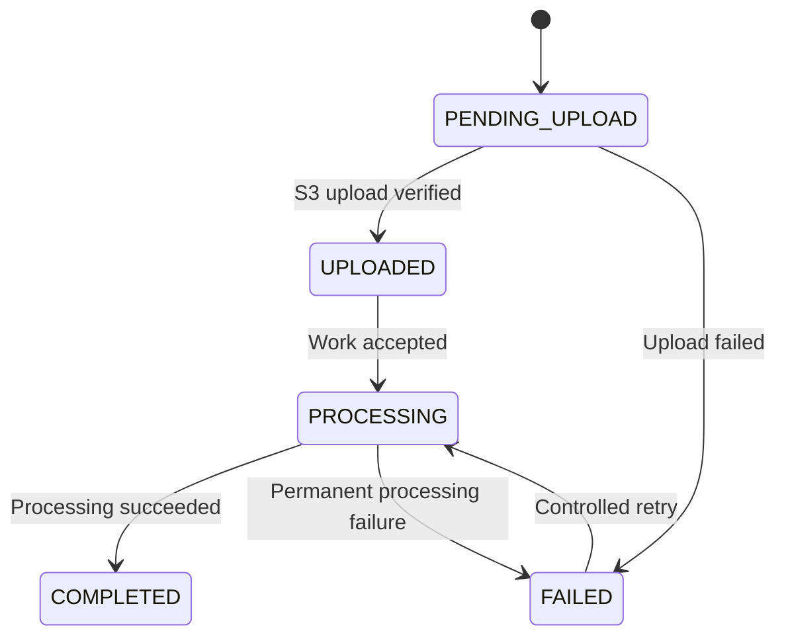

# 02- Buckets and Object Storage Questions

## Overview

This document focuses on Amazon S3 bucket design, object storage semantics, object identity, namespace organization, metadata, consistency, request behavior, and practical data-access patterns.

These subjects frequently appear in backend engineering interviews because seemingly simple storage decisions can affect security, scalability, recovery, and application correctness. A strong answer distinguishes S3's native behavior from assumptions inherited from filesystems, relational databases, and distributed processing systems.

The questions progress from bucket fundamentals to object-level behavior, operational constraints, and architecture scenarios.

## Bucket Architecture and Resource Boundaries

### What happens when an S3 bucket is created?

Creating a bucket establishes an S3 resource in a selected AWS Region and namespace. The bucket belongs to the AWS account that creates it, and its name, owner, and Region cannot be changed after creation.

A bucket can have configuration for features such as:

- Versioning and lifecycle management.
- Default encryption and access controls.
- Replication and event notifications.
- Logging, metrics, and other monitoring features.
- Object Ownership and public-access restrictions.

A production application should provision buckets through controlled infrastructure management rather than creating arbitrary buckets during ordinary API requests.

For example, a document service may have a dedicated bucket for production documents, while test environments use separate buckets. This reduces accidental cross-environment access and simplifies configuration management.

### What is the relationship between a bucket, an AWS account, and an AWS Region?

The AWS account owns the bucket, while the selected Region determines the bucket's regional location and endpoint behavior.

For general purpose buckets, the shared global namespace requires names to be unique across AWS accounts and Regions within the same AWS partition. An account regional namespace is also available in supported Regions; names in that namespace are reserved for the owning account.

A typical request targets a regional endpoint, for example:

```text
https://company-documents.s3.ap-south-1.amazonaws.com/invoices/2026/001.pdf
```

The hostname identifies the bucket endpoint, and the path identifies the object key. The actual request must still satisfy authentication and authorization requirements.

Important implications:

- A bucket name is not changed by moving application infrastructure to another Region.
- Moving data between Regions requires an explicit migration or replication strategy.
- Regional placement affects latency, data transfer costs, regional resilience, and applicable compliance requirements.
- Cross-account access does not transfer bucket ownership automatically.

References: [Creating general purpose buckets](https://docs.aws.amazon.com/AmazonS3/latest/userguide/create-bucket-overview.html) and [Bucket naming rules](https://docs.aws.amazon.com/AmazonS3/latest/userguide/bucketnamingrules.html).

### Why should a production system avoid deleting and recreating a globally named bucket?

A deleted bucket in the shared global namespace may become available for another account to create. The original owner is not guaranteed to be able to reuse the name.

This creates a potential risk if an application, integration, or deployment script continues sending requests to the deleted bucket name. Another account could recreate the name and receive requests intended for the former bucket.

For an important bucket, prefer controlled retirement over deleting it simply to save resources. Where appropriate, empty the bucket, restrict access, remove obsolete references, and retain ownership of the bucket name.

Also consider the account regional namespace, which prevents another account from creating the same account-reserved bucket name.

### How do you choose bucket boundaries for a multi-tenant application?

Bucket boundaries should reflect security, configuration, ownership, and operating requirements rather than tenant count alone.

Consider a document management platform serving thousands of customers.

**Shared-bucket design:**

```text
company-prod-documents/
    tenants/tenant-100/documents/...
    tenants/tenant-200/documents/...
```

This centralizes resource management and can simplify common lifecycle and monitoring settings.

**Separate-bucket design:**

```text
company-tenant-100-documents/
company-tenant-200-documents/
```

This can be useful when customers require distinct administrative controls, retention settings, ownership, or isolation.

| Decision factor | Shared bucket | Separate buckets |
|---|---|---|
| Resource management | Centralized | More resources to manage |
| Common configuration | Easier to standardize | Configuration must be maintained across buckets |
| Tenant isolation | Depends on application and AWS access controls | Stronger resource-level separation |
| Independent retention requirements | May require careful rule design | Easier to separate by bucket |
| Large tenant count | Often operationally simpler | Requires planning for bucket quotas and automation |
| Cross-account administration | Can be centralized | Can be tailored to individual resources |

The design must not treat a tenant identifier in an object key as proof of authorization. Application authorization and AWS permissions must enforce the intended boundary.

### Are all S3 bucket types interchangeable?

No. General purpose buckets are appropriate for most object storage workloads, but S3 also provides specialized bucket types.

| Bucket type | Primary purpose |
|---|---|
| General purpose bucket | General object storage, backups, media, documents, and data lakes |
| Directory bucket | High-performance workloads associated with S3 Express One Zone |
| Table bucket | Managed Apache Iceberg-compatible table storage through S3 Tables |
| Vector bucket | Vector storage and similarity-search workloads through S3 Vectors |

Specialized bucket types have different API behavior, endpoint requirements, feature support, and performance characteristics. A design that uses a general purpose bucket cannot assume that its operations will work identically with a directory, table, or vector bucket.

Choose the bucket type according to the actual workload and verify its supported features before committing to the architecture.

## Object Identity and Namespace Design

### What identifies an S3 object?

The bucket and object key identify the object location. When versioning is enabled, the version ID identifies a particular stored version.

```text
Bucket: company-prod-documents
Key: tenants/tenant-100/invoices/invoice-001.pdf
Version ID: example-version-id
```

Conceptually:

```text
Bucket + Key
    -> Current object state

Bucket + Key + Version ID
    -> Specific stored version
```

The version ID is generated by S3. In a versioning-enabled bucket, it lets applications address historical content rather than relying only on the current version.

This distinction is important for document restoration, audit records, asynchronous processing, and workflows where the contents of an object may change over time.

### Why is an S3 object key not equivalent to a filesystem path?

A key is a name in a flat object namespace. Characters such as `/` are ordinary characters in that name, although S3 listing APIs use delimiters to present a folder-like hierarchy.

For example:

```text
reports/2026/october/revenue.csv
reports/2026/october/expenses.csv
reports/2026/november/revenue.csv
```

These are independent objects. Their common prefixes help organize them, but S3 does not provide conventional directories with filesystem rename behavior.

Consequences for application design:

- Deleting a key does not recursively delete a filesystem directory; a prefix may match many independent objects.
- Moving an object normally requires copying it to a new key and deleting the original.
- A prefix should not be treated as an automatic security boundary.
- Key comparisons must preserve case and the exact intended characters.

### What key naming strategy works well for backend applications?

Use server-generated identifiers, stable business references where appropriate, and logical prefixes for organization.

For example:

```text
tenants/tenant-100/documents/2026/10/01JBC4Q6F7XK2M8A/document.pdf
```

This structure allows an application to group objects by tenant, resource type, and date while using a generated identifier to avoid naming collisions.

Keep the original filename in application metadata when it must be shown to the user. Do not rely on that filename as the sole identifier or allow an untrusted client to decide the full storage path.

A robust design separates:

- **Physical storage identity:** bucket, key, and optional version ID.
- **Business identity:** database record ID, owner, tenant, and domain-specific attributes.
- **User-facing filename:** the display name or original upload filename.

This separation allows storage conventions to evolve without forcing every business record to change.

### Do prefixes improve S3 scalability?

Prefixes help narrow listings and define useful organizational boundaries. They are not required to emulate filesystem directories, and they should not be added solely because an application expects S3 to have filesystem limitations.

S3 scales to high request rates. AWS documents reference performance levels of at least 3,500 write-class requests and 5,500 GET/HEAD requests per second per partitioned prefix, while scaling to a new request pattern can be gradual.

A well-designed prefix strategy should first make application access predictable. If monitoring shows throttling or hot-key patterns, investigate request concurrency, retry behavior, and workload distribution before redesigning every key.

Reference: [Optimizing Amazon S3 performance](https://docs.aws.amazon.com/AmazonS3/latest/userguide/optimizing-performance.html).

### What are the object key length and case-sensitivity rules?

General purpose S3 object keys can be up to 1,024 bytes in UTF-8 encoding. Keys are case-sensitive.

For example, the following are different keys:

```text
Reports/October.csv
reports/October.csv
reports/october.csv
```

UTF-8 byte length matters because some characters occupy multiple bytes. Validate the encoded key length when accepting arbitrary Unicode filenames or constructing long hierarchical keys.

Other practical rules:

- Treat keys as exact identifiers, not paths to normalize casually.
- Avoid secrets and sensitive personal data in keys because they may appear in URLs, logs, or event payloads.
- Encode keys correctly when using HTTP URLs.
- Keep object keys within application-controlled conventions.

## Object Metadata and Tags

### What information does an S3 object contain?

An S3 object contains object data and associated information such as its key, metadata, and other object attributes. Depending on the bucket and operation, versioning and access-control settings also affect how the object is addressed or accessed.

A backend document record might look like this:

```text
Application database:
    document_id = 12345
    tenant_id = tenant-100
    filename = invoice.pdf
    s3_bucket = company-prod-documents
    s3_key = tenants/tenant-100/documents/12345/invoice.pdf
    processing_status = COMPLETED
```

The database owns business relationships and processing state. S3 stores the file content. The application should not depend on retrieving and parsing a large object merely to answer a common business query.

### How do object metadata and tags differ?

Metadata describes object properties, while tags classify objects for supported management and policy workflows.

| Property | Metadata | Tags |
|---|---|---|
| Common purpose | Content description and HTTP behavior | Classification and management rules |
| Example | `Content-Type: application/pdf` | `data-classification=confidential` |
| Mutation | Replacing metadata commonly requires copying the object | Tags can be updated using tagging APIs |
| Typical use | Download behavior, content type, cache control | Lifecycle filtering and supported policy conditions |
| Limitations | Subject to object and request metadata constraints | An object can have at most 10 tags |

Both can be useful, but neither should replace the application's authorization model. For instance, setting a tag to `tenant=tenant-100` does not independently verify that a requester is authorized to access that tenant's document.

### Can you change object metadata without uploading a new file?

S3 does not provide a general in-place metadata patch operation. A common approach is to copy an object to the same key while replacing its metadata.

```bash
aws s3api copy-object \
  --bucket company-prod-documents \
  --key "reports/monthly.csv" \
  --copy-source "company-prod-documents/reports/monthly.csv" \
  --metadata-directive REPLACE \
  --metadata "source=finance-service" \
  --content-type "text/csv"
```

This operation copies the object and replaces the specified metadata. When replacement is requested, supply all metadata values that must remain; do not assume that previous values will automatically be retained.

For production use, account for the following:

- The operation requires appropriate S3 permissions.
- Copying can create a new version when versioning is enabled.
- Large-object copies may require multipart copy.
- Required cache headers, content-disposition values, and custom metadata must be preserved deliberately.
- Tags are managed separately and should be checked if they must remain unchanged.

### Is an ETag the same as an MD5 hash?

Not universally. An ETag is an identifier returned by S3 for an object operation. It can be useful for conditional operations, but multipart upload ETags are not generally the MD5 hash of the complete object.

When an application requires data-integrity validation, use a supported checksum algorithm and verify the expected checksum according to the transfer workflow.

Do not build an integrity contract around the assumption that every ETag is a content-wide MD5 digest.

Reference: [Checking object integrity](https://docs.aws.amazon.com/AmazonS3/latest/userguide/checking-object-integrity-upload.html).

## Object Size and Listing Behavior

### How large can an S3 object be?

S3 supports objects up to 50 TB in its documented object-size terminology, with the exact maximum derived from multipart upload constraints. The multipart API supports up to 10,000 parts, with each part between 5 MiB and 5 GiB except that the final part can be smaller.

| Constraint | Documented limit |
|---|---|
| Maximum object size | 50 TB, approximately 48.8 TiB |
| Maximum parts per multipart upload | 10,000 |
| Multipart part size | 5 MiB to 5 GiB, except the final part |
| Single PUT upload using the API/SDK/CLI | Up to 5 GB |
| Results in one `ListObjectsV2` response | Up to 1,000 keys |
| Maximum general purpose object-key length | 1,024 UTF-8 bytes |

Multipart upload allows parts to be transferred independently and in parallel. It is particularly useful for large objects and unreliable network paths.

Reference: [S3 multipart upload limits](https://docs.aws.amazon.com/AmazonS3/latest/userguide/qfacts.html).

### What happens when a bucket contains millions of objects?

S3 can store very large numbers of objects, but application access patterns still determine operational efficiency.

A `ListObjectsV2` request returns at most 1,000 keys per response. Larger result sets require pagination.

Use the following approach based on the workload:

- Use prefix filtering for targeted listings.
- Use a paginator to process every page of a large result set.
- Process each page incrementally rather than accumulating millions of keys in application memory.
- Use S3 Inventory for scheduled large-scale object inventory.
- Maintain database indexes when application queries depend on business attributes such as tenant, owner, or processing status.

S3 is not a substitute for a relational query engine or an application's business index.

Reference: [Listing object keys programmatically](https://docs.aws.amazon.com/AmazonS3/latest/userguide/ListingKeysUsingAPIs.html).

### How would you list objects without loading the entire bucket into memory?

Use Boto3's paginator and process each page as it arrives.

```python
import boto3


def process_objects(bucket: str, prefix: str) -> None:
    s3 = boto3.client("s3")
    paginator = s3.get_paginator("list_objects_v2")

    for page in paginator.paginate(Bucket=bucket, Prefix=prefix):
        for item in page.get("Contents", []):
            key = item["Key"]
            size = item["Size"]

            process_object_reference(key=key, size=size)


def process_object_reference(*, key: str, size: int) -> None:
    # Replace this with a bounded downstream operation.
    print(f"{key}: {size} bytes")
```

The function shown demonstrates incremental listing; in a production worker, replace the placeholder processing function with bounded, observable work.

Do not launch unbounded concurrent tasks for every key returned by the paginator. Apply backpressure and retry handling to prevent a large listing from overwhelming the database, worker pool, or downstream API.

## Consistency and Data Correctness

### What happens immediately after a successful S3 PUT?

S3 provides strong read-after-write consistency for object PUT and DELETE operations, including overwrites of existing objects. A GET or LIST operation initiated after a successful PUT response reflects the completed update.

For example:

```text
1. API uploads reports/daily.csv.
2. S3 returns a successful response.
3. API reads reports/daily.csv.
4. The read observes the completed object.
```

Applications do not need to introduce arbitrary sleep intervals merely to wait for a newly written object to become visible.

However, consistency of object operations does not automatically make a multi-step business workflow transactional.

Reference: [Amazon S3 data consistency model](https://docs.aws.amazon.com/AmazonS3/latest/userguide/Welcome.html).

### Does S3 provide transactions across multiple objects?

No. S3 does not provide a general transaction spanning multiple object keys, nor does it offer a distributed transaction that atomically updates an S3 object and a PostgreSQL row.

Suppose a backend stores a file and then creates a database record. If the object upload succeeds but the database write fails, the file can remain without a corresponding business record.

A reliable workflow should make partial states explicit:



The application can use database transactions for its own state transitions, idempotency keys for retry-safe requests, and reconciliation jobs to find orphaned objects or incomplete records.

### What happens when two clients overwrite the same key at the same time?

S3 provides atomic updates to an individual key. A concurrent reader does not receive a partially written object as the result of an ordinary completed replacement.

However, S3 does not decide which competing business update should be considered correct. If multiple writers PUT different payloads to the same key, the application must not rely on an assumed ordering that it has not established.

For example, two Celery workers may concurrently publish an object called `exports/latest.csv`. Even if each upload succeeds, the final current object might not be the report that the business workflow intended to publish.

Safer designs include:

- Generate a unique key for each immutable export.
- Store the current export reference in a transactional database.
- Use conditional requests where supported and appropriate.
- Enable versioning when historical content is important.
- Coordinate business-level state transitions through a database or another suitable control mechanism.

Versioning retains history but does not provide a distributed lock.

### Can S3 be the source of truth for application metadata?

S3 should generally be the source of truth for object content, while a database or dedicated data store owns frequently queried business metadata and relationships.

For a document application, PostgreSQL can store:

- Document ownership and tenant identity.
- Human-readable filenames.
- Processing state and timestamps.
- Searchable business attributes.
- The S3 bucket, key, and optional version ID.

S3 stores the actual binary data. This separation reduces unnecessary object reads and makes business queries more efficient.

If an application chooses to derive state from S3 events, it still needs to handle duplicate events, out-of-order notifications, failed processing, and reconciliation.

## Production Design Scenarios

### Scenario: A document upload succeeds, but the subsequent download returns an error. How would you investigate?

Begin with the exact resource identity used during upload and download.

Validate the following:

1. Bucket name and AWS account.
2. Region and endpoint configuration.
3. Exact object key, including case and special characters.
4. Versioning and delete-marker behavior, if enabled.
5. Permissions for the downloading principal.
6. KMS permissions if the object uses SSE-KMS.
7. Whether the application stored the same key that the upload actually used.

For a targeted object check:

```bash
aws s3api head-object \
  --bucket company-prod-documents \
  --key "tenants/tenant-100/documents/12345/invoice.pdf" \
  --region ap-south-1
```

Do not assume every failed read means the object is absent. Authorization controls can prevent a caller from determining whether an object exists.

### Scenario: A data-processing job scans the entire bucket every hour. How would you redesign it?

First determine whether the job needs a complete inventory or only newly arrived objects.

If it only needs recent uploads, consider:

- Organizing ingestion keys by an appropriate date or source prefix.
- Listing only the relevant prefix.
- Processing S3 object events through a queue.
- Recording processed object identities in a database.
- Using S3 Inventory for periodic reconciliation and full inventory requirements.

Event-driven processing reduces repeated scans, but events are not a replacement for state tracking. The job must handle duplicate events and safely recover from processing failures.

### Scenario: A business wants to change its object-key layout. What is the migration strategy?

A key-layout migration is a data migration, not a directory rename.

A controlled process should:

1. Define the target key scheme and mapping.
2. Copy objects to their destination keys.
3. Preserve required metadata, tags, encryption, and version-related information.
4. Verify object existence and content integrity.
5. Update database references and downstream consumers.
6. Retain the old objects until the rollback and retention requirements are satisfied.
7. Delete old objects only through a controlled cleanup process.

For large-scale migrations, record per-object progress and make retries idempotent. Re-running a migration should not create uncontrolled duplicates or overwrite unrelated destination objects.

### Scenario: A backend uses client-supplied filenames as complete object keys. What can go wrong?

User-supplied filenames can contain unexpected characters, create naming collisions, produce ambiguous paths, or expose sensitive information through keys and logs.

The backend should generate the storage key from trusted identifiers and treat the uploaded filename as display metadata.

For example:

```text
Generated key:
tenants/tenant-100/uploads/01JBC4Q6F7XK2M8A

Display filename:
quarterly-report.pdf
```

The application must also validate the authenticated tenant and resource permissions. Sanitizing a filename alone does not solve object authorization.

### Scenario: One object is updated, but downstream processing uses an older version. What should be checked?

Inspect how the processing workflow identifies its input.

Potential causes include:

- A queued job stores a key but not the expected version ID.
- An event-driven worker processes a delayed notification after another upload has changed the current version.
- The application re-reads the current key instead of the specific source version.
- Processing status records do not distinguish separate upload attempts.

If each job must process the exact uploaded content, track the source key and version ID when available. Make the processing record identify that specific source rather than only the mutable logical name.

This prevents a worker from accidentally processing a newer object than the one that triggered the job.

## Common Interview Misconceptions

| Misconception | Correct interpretation |
|---|---|
| S3 folders are real directories | General purpose buckets use a flat object namespace with logical prefixes |
| Bucket names and Regions can be changed in place | A bucket's name, owner, and Region are fixed after creation |
| A prefix provides automatic authorization | Prefixes organize keys; authorization must be enforced separately |
| All S3 bucket types expose identical APIs | General purpose, directory, table, and vector buckets have distinct capabilities |
| Object keys are case-insensitive | Object keys are case-sensitive |
| A single listing returns every object in a large bucket | `ListObjectsV2` returns up to 1,000 keys per response |
| A successful PUT requires a visibility delay | S3 provides strong read-after-write consistency for object operations |
| Strong consistency eliminates concurrent-write conflicts | S3 does not coordinate business-level updates across writers |
| An ETag is always an MD5 checksum | Multipart upload ETags are not generally the full object's MD5 hash |
| Copying an object to another key is an atomic rename | Copy and delete are separate operations with their own failure modes |
| Object metadata and tags are interchangeable | They support different purposes and mutation workflows |
| S3 is a transactional database | S3 stores objects but does not provide general multi-object or cross-service transactions |

## Authoritative References

- [Amazon S3 object overview](https://docs.aws.amazon.com/AmazonS3/latest/userguide/UsingObjects.html)
- [General purpose bucket creation and settings](https://docs.aws.amazon.com/AmazonS3/latest/userguide/create-bucket-overview.html)
- [General purpose bucket naming rules](https://docs.aws.amazon.com/AmazonS3/latest/userguide/bucketnamingrules.html)
- [Amazon S3 bucket namespaces](https://docs.aws.amazon.com/AmazonS3/latest/userguide/gpbucketnamespaces.html)
- [Object key naming and prefixes](https://docs.aws.amazon.com/AmazonS3/latest/userguide/using-prefixes.html)
- [Multipart upload limits](https://docs.aws.amazon.com/AmazonS3/latest/userguide/qfacts.html)
- [Listing objects using the S3 API](https://docs.aws.amazon.com/AmazonS3/latest/userguide/ListingKeysUsingAPIs.html)
- [Amazon S3 data consistency](https://docs.aws.amazon.com/AmazonS3/latest/userguide/Welcome.html)

## Key Takeaways

- Choose bucket boundaries based on isolation, ownership, Region, and configuration requirements rather than tenant count alone.
- Treat object keys as case-sensitive identifiers in a flat namespace, and keep storage identity separate from user-facing filenames and business metadata.
- Use metadata and tags for their distinct purposes, and validate object size and listing constraints when designing transfer and inventory workflows.
- Strong consistency guarantees completed object updates are observable, but it does not provide transactions across objects or coordinate competing business operations.
- Design migrations, event processing, and large-bucket operations to support bounded work, idempotent retries, validation, and explicit recovery.