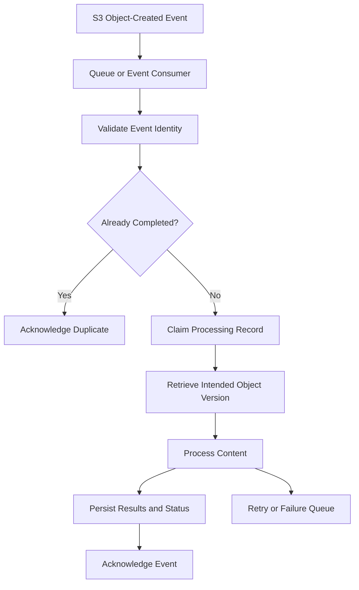

# 03- Object Keys, Metadata and Consistency Questions

## Overview

Object keys, metadata, and consistency are fundamental to Amazon S3 application design. They determine how objects are identified, how clients interpret stored content, how concurrent updates behave, and how asynchronous processing systems maintain correct application state.

For backend engineers, the important distinction is between **S3's object-level guarantees** and **the business-level guarantees an application must implement**. Strong consistency does not provide transactions across S3 and PostgreSQL, metadata does not replace a searchable database, and an object key does not automatically enforce tenant isolation.

This document covers interview questions from foundational semantics to conditional writes, version-aware processing, metadata migrations, and production failure scenarios.

## Object Keys and Naming Strategies

### What is an S3 object key?

An object key is the name used to identify an object within a bucket. General purpose buckets use a flat object namespace, so a key containing `/` is still one object name rather than a filesystem path.

For example:

```text
Bucket: company-prod-documents
Key: tenants/tenant-100/invoices/2026/invoice-001.pdf
Version ID: example-version-id
```

The bucket and key identify the object location. When versioning is enabled, the version ID identifies a particular stored version of that key.

General purpose S3 object keys can contain up to 1,024 bytes in UTF-8 encoding. This is a byte limit, not necessarily a character limit.

Reference: [Naming Amazon S3 objects](https://docs.aws.amazon.com/AmazonS3/latest/userguide/object-keys.html).

### Are S3 object keys equivalent to filesystem paths?

No. S3 does not provide conventional directory semantics for general purpose buckets. Applications commonly organize keys with prefixes, and the console presents these prefixes as folders.

For example:

```text
reports/2026/october/revenue.csv
reports/2026/october/expenses.csv
reports/2026/november/revenue.csv
```

These are separate objects. An application can list a particular prefix or use a delimiter to navigate the logical hierarchy, but S3 does not provide an atomic filesystem-style directory rename.

Moving an object generally involves copying it to another key and deleting the original. Since those operations are separate, a failure can leave both objects or leave the migration incomplete.

**Interview trap:** deleting an object whose key ends with `/` does not automatically delete every object beneath that prefix. A recursive deletion operation must identify and delete the matching objects explicitly.

### How should an object key be designed for a multi-tenant backend?

Use a predictable prefix for operational organization and server-generated identifiers for uniqueness. Keep the business identity and user-facing filename separate from the storage key.

Example:

```text
tenants/{tenant_id}/documents/{document_id}/{object_id}
```

A resulting key might be:

```text
tenants/tenant-100/documents/doc-9831/01JBC4Q6F7XK2M8A
```

| Component | Responsibility |
|---|---|
| Tenant ID | Organizes objects by tenant |
| Document ID | Associates an object with a business record |
| Object ID | Distinguishes upload attempts or immutable artifacts |
| Display filename | Preserves the original filename in application metadata |
| Database record | Stores ownership, processing status, relationships, and searchable fields |

The application should generate the storage key instead of accepting a complete key from an untrusted client. It should also validate the authenticated tenant against the business record.

A `tenant-100` prefix is not proof that the caller belongs to tenant 100. Authorization must be enforced independently.

### How should an application handle special characters in object keys?

Object keys can contain characters that have special meaning to URLs, HTTP requests, shells, and client libraries. Examples include spaces, `%`, `?`, `#`, and Unicode characters.

Consider these two different keys:

```text
documents/invoice 100.pdf
documents/invoice%20100.pdf
```

The first contains a space. The second contains the literal characters `%20100` as part of the key's filename segment. They are not interchangeable.

Common failure modes include incorrect URL encoding, manual URL concatenation, filesystem-style path normalization, and differences between the key stored in a database and the exact key sent to S3.

Recommended practices:

- Use an AWS SDK instead of manually constructing signed S3 requests.
- Preserve the exact key returned or generated during upload.
- Avoid normalizing key paths with filesystem utilities.
- Validate key length using UTF-8 bytes when accepting arbitrary Unicode input.
- Avoid embedding secrets or sensitive personal information in keys because keys can appear in logs, URLs, events, and monitoring data.

### Should object keys contain timestamps, filenames, or random identifiers?

Choose each component according to its purpose rather than trying to make the key carry every business attribute.

| Component | Benefit | Limitation |
|---|---|---|
| Tenant ID | Supports tenant-oriented grouping | Does not enforce authorization |
| Timestamp | Supports time-oriented organization | Requires a defined time and precision convention |
| UUID or ULID | Provides a stable identifier with a low collision risk | Does not encode business permissions |
| Original filename | Makes objects easier to recognize | Can be duplicated, untrusted, or sensitive |
| Content hash | Can support content-addressed storage and deduplication | Requires explicit integrity and deduplication rules |

For immutable uploads, a generated object ID is generally more reliable than the client filename as the full key.

A Django application can store the original filename in PostgreSQL and use a generated object key in S3. Two files named `invoice.pdf` can then coexist without overwriting each other.

### Do prefixes improve S3 performance?

Prefixes are useful for listing, policy scoping, and operational organization. They do not need to be randomized by default just to make S3 scalable.

S3 supports high request rates across prefixes. AWS documents reference performance levels of at least 3,500 write-class requests and 5,500 GET/HEAD requests per second per partitioned prefix, although scaling to a new request pattern can be gradual.

Start with a key structure that matches real application access patterns. If metrics reveal throttling or a hotspot, investigate request concurrency, retries, and key distribution before redesigning the namespace.

Reference: [Optimizing Amazon S3 performance](https://docs.aws.amazon.com/AmazonS3/latest/userguide/optimizing-performance.html).

## Metadata, Tags, and Object Attributes

### What is S3 object metadata?

Object metadata describes an object beyond its content. It includes system metadata managed by S3, configurable system metadata, and user-defined metadata.

Examples include:

```text
Content-Type: application/pdf
Content-Disposition: attachment; filename="invoice.pdf"
Cache-Control: private, max-age=300
x-amz-meta-source-system: billing-service
```

Metadata can influence HTTP response behavior, describe the source of an object, or carry small application-defined attributes.

It should not be treated as a substitute for a database when the application needs rich queries or frequent transactional updates.

Reference: [Working with S3 object metadata](https://docs.aws.amazon.com/AmazonS3/latest/userguide/UsingMetadata.html).

### What is the difference between system metadata and user-defined metadata?

Some system metadata is controlled by S3, while other system metadata can be configured through supported object operations. User-defined metadata contains application-specific values.

| Category | Examples | Typical behavior |
|---|---|---|
| System-controlled metadata | Content length, last-modified time | Maintained by S3 |
| Configurable system metadata | Content type, cache control, content disposition | Specified through supported upload or copy operations |
| User-defined metadata | Source system, document identifier | Supplied as user metadata, usually returned with object metadata |

Example using Boto3:

```python
import boto3

s3 = boto3.client("s3")


def upload_document(
    *,
    bucket: str,
    key: str,
    file_path: str,
    document_id: str,
) -> None:
    with open(file_path, "rb") as file_obj:
        s3.upload_fileobj(
            file_obj,
            bucket,
            key,
            ExtraArgs={
                "ContentType": "application/pdf",
                "Metadata": {
                    "document-id": document_id,
                    "source-system": "billing-service",
                },
            },
        )
```

The example uses the SDK's managed transfer interface. Production code should use an IAM role or another supported credential provider, validate the actual content type, and handle transfer errors at the service boundary.

User-defined metadata is subject to request and metadata constraints. Keep it small and avoid using it to store large JSON payloads or frequently changing application state.

### Can object metadata be modified in place?

S3 does not offer a general in-place metadata patch operation. A common approach is to copy the object to the same key while replacing its metadata.

```bash
aws s3api copy-object \
  --bucket company-prod-documents \
  --key "reports/monthly.csv" \
  --copy-source "company-prod-documents/reports/monthly.csv" \
  --metadata-directive REPLACE \
  --metadata "source=finance-service" \
  --content-type "text/csv"
```

When `REPLACE` is specified, provide all relevant user-configurable metadata values that must remain. Do not assume that values omitted from the replacement request will be preserved automatically.

Production considerations include:

- Copy operations require appropriate S3 permissions.
- Copying an object can create a new version when versioning is enabled.
- Large objects may require multipart copy.
- Content disposition, cache control, content encoding, and other required values must be preserved deliberately.
- Object tags are separate from metadata and should be verified if they must remain unchanged.
- The copied object receives updated system-controlled attributes such as its last-modified time.

Test the exact metadata replacement behavior on representative objects before running a bulk migration.

Reference: [Editing object metadata](https://docs.aws.amazon.com/AmazonS3/latest/userguide/add-object-metadata.html).

### What is the difference between metadata and object tags?

Metadata describes object properties; tags classify objects for supported management and authorization workflows.

| Characteristic | Metadata | Object tags |
|---|---|---|
| Example | `Content-Type: application/pdf` | `data-classification=confidential` |
| Main purpose | Describe content and HTTP behavior | Classification and management |
| Mutation | Usually requires copying the object to replace metadata | Can be updated through tagging APIs |
| Lifecycle filtering | Not the standard tag-based filter mechanism | Supported lifecycle rules can filter by tags |
| General purpose S3 limit | Subject to object metadata constraints | Up to 10 tags per object |

Neither tags nor metadata automatically proves that a requester is authorized to access the object. For instance, a `tenant=tenant-100` tag is a classification value, not a complete tenant authorization mechanism.

### Should business state be stored in object metadata?

Usually not when that state must be queried efficiently, changed frequently, or updated transactionally.

Suppose a service must find all documents for which `processing_status = FAILED`. S3 does not provide a general-purpose metadata-filtered object query API for this requirement.

A better design is:

- S3 stores the file content.
- PostgreSQL stores ownership, processing status, timestamps, and relationships.
- S3 metadata stores small descriptive attributes useful during object retrieval.
- S3 events or application workflows trigger asynchronous processing.

This division makes business queries efficient and gives the application an explicit model for state transitions.

## ETags, Checksums, and Integrity

### What is an ETag?

An ETag is a value returned by S3 that identifies an object's representation for supported operations. It can be used for conditional operations, but it is not universally the MD5 checksum of the entire object.

Multipart uploads commonly produce ETags that differ from the MD5 digest of the complete object. Encryption and the particular upload workflow also affect whether an ETag can be interpreted as a simple MD5 digest.

Use an ETag for its documented behavior rather than assuming that ETag equality is always a cryptographic integrity guarantee.

### How do you validate object integrity after an upload?

Choose an explicit checksum strategy based on the application's integrity requirements.

A workflow might:

- Calculate an expected checksum during ingestion.
- Supply a supported checksum as part of the upload request.
- Let S3 validate the checksum where supported.
- Persist the expected checksum or relevant checksum information in application metadata.
- Verify the object or downloaded content when end-to-end verification is required.

S3 supports multiple checksum algorithms. The selected algorithm and validation path should match the exact upload and retrieval workflow.

Do not use ETag equality as a universal substitute for a checksum.

Reference: [Checking object integrity](https://docs.aws.amazon.com/AmazonS3/latest/userguide/checking-object-integrity-upload.html).

### What is the difference between an ETag and a version ID?

A version ID identifies a specific stored version in a versioning-enabled bucket. An ETag identifies an object representation for supported S3 operations.

| Requirement | Appropriate mechanism |
|---|---|
| Prevent creating an object if a current object already exists | Conditional write with `If-None-Match: *` |
| Update an object only when its current ETag matches an expected value | Conditional write with `If-Match` |
| Retrieve a specific historical object version | Version ID |
| Validate content integrity | Supported checksum mechanism |
| Coordinate business state transitions | Database transaction or another application-level mechanism |

A version ID does not act as a distributed lock. An ETag does not implement a database transaction.

## Strong Consistency and Conditional Writes

### What consistency guarantees does S3 provide?

S3 provides strong read-after-write consistency for object PUT and DELETE operations, including overwrites of existing objects. GET and LIST requests initiated after a successful write or delete reflect the completed change.

Relevant object metadata and tag reads are also strongly consistent.

For example:

```text
1. The backend uploads documents/invoice.pdf.
2. S3 confirms that the PUT succeeded.
3. The backend immediately requests the object.
4. The GET request observes the completed upload.
```

An application does not need to introduce arbitrary delays merely to wait for newly written objects to become visible.

However, strong consistency does not make several object operations into a transaction or coordinate an S3 operation with a PostgreSQL update.

Reference: [Amazon S3 consistency model](https://docs.aws.amazon.com/AmazonS3/latest/userguide/Welcome.html).

### Does strong consistency eliminate race conditions?

No. Strong consistency guarantees that completed operations are observable according to S3's consistency model. It does not provide general locking, multi-object transactions, or application-specific ordering for competing writers.

Consider two workers that write different report contents to the same key:

```text
Worker A: PUT exports/latest.csv
Worker B: PUT exports/latest.csv
```

Both PUT operations may succeed. The application must not assume that the final current object will correspond to the business operation it considers authoritative.

Common approaches include:

- Store each artifact under a unique key.
- Maintain the current artifact reference in a database.
- Use conditional writes where supported.
- Enable versioning when historical recovery is required.
- Coordinate updates through an application-level mechanism when business serialization is necessary.

Strong consistency ensures prompt visibility of completed updates; it does not determine which update is correct for the business.

### How do conditional writes prevent accidental overwrites?

Conditional writes let a client specify a precondition on a supported write operation.

Two commonly used headers are:

- `If-None-Match: *` — create the object only if no current object matches the key.
- `If-Match: "<etag>"` — perform the write only if the current object's ETag matches the provided value.

For example:

```bash
aws s3api put-object \
  --bucket company-prod-documents \
  --key "immutable/exports/export-9831.csv" \
  --body export.csv \
  --if-none-match "*"
```

This prevents the upload from silently replacing an existing current object. If the precondition fails because an object already exists, S3 returns `412 Precondition Failed`.

Conditional writes are useful for immutable artifacts and optimistic concurrency checks, but the exact API operation and concurrency behavior must be understood. Under certain concurrent delete/write races, S3 can return `409 Conflict` or other documented errors.

Conditional writes require AWS Signature Version 4. They are available for supported operations including `PutObject`, `CopyObject`, and `CompleteMultipartUpload`.

Reference: [Conditional writes in Amazon S3](https://docs.aws.amazon.com/AmazonS3/latest/userguide/conditional-writes.html).

### Are conditional writes equivalent to database transactions?

No. Conditional writes protect supported S3 operations against certain conflicting changes. They do not atomically update a PostgreSQL record, publish an SQS message, or modify several objects as a single transaction.

For example, an application might write an object, update its database record, and publish a completion event. A failure between these steps can leave partial state even if the object write was strongly consistent.

Use explicit application states, idempotency records, database transactions for database changes, and reconciliation procedures for cross-service workflows.

### Does versioning prevent concurrent-write conflicts?

No. Versioning preserves multiple versions of a key, but it does not provide a lock or decide which business update should become authoritative.

For immutable content, use unique keys and optionally conditional creation. For a mutable pointer such as `exports/latest.csv`, use conditional operations or store the authoritative pointer in a transactional database.

Versioning is valuable for audit and recovery, but it does not replace concurrency control.

### Does the strong consistency model apply identically to all S3 configuration changes?

Do not assume that every S3 control-plane operation has the same behavior as object PUT, GET, DELETE, and LIST operations.

Object consistency has a documented model. Bucket configuration changes and administrative operations can have different propagation characteristics and constraints.

When automating configuration changes, consult the relevant API documentation and build verification or retry behavior around the documented service semantics rather than assuming all changes become effective exactly like an object write.

## Event Notifications and Version-Aware Processing

### Can S3 event notifications arrive more than once or out of order?

Yes. S3 event notifications are designed for at-least-once delivery, and notifications can be duplicated or arrive out of order.

Consumers must not assume that each event is delivered exactly once or in the same order as the underlying object modifications.

When processing an object version, a useful processing identity is:

```text
bucket + key + version ID + processing operation
```

When versioning is disabled, use an application-generated upload ID or another suitable identity if the workflow must distinguish upload attempts for the same key.

Reference: [S3 Event Notifications](https://docs.aws.amazon.com/AmazonS3/latest/userguide/EventNotifications.html).

### How should a Celery worker process an S3 event safely?

The worker should use explicit processing state and idempotent operations.



A typical processing workflow should:

1. Validate the event and object identity.
2. Atomically claim the processing operation, usually using a database uniqueness constraint or transaction.
3. Acknowledge or exit safely if the same operation has already completed.
4. Retrieve the intended object version when exact-version processing is required.
5. Make downstream effects idempotent.
6. Record success or a terminal failure.
7. Use bounded retries and a recoverable failure path.

Redis can reduce duplicate work, but a cache alone should not be the sole correctness mechanism if expiration or data loss could allow an already completed operation to run again.

### Why should a processing job store the object version ID?

A job that records only a mutable key may retrieve different content from the content that triggered the job.

Consider the following sequence:

1. A client uploads version A of `uploads/report.pdf`.
2. S3 emits an event for version A.
3. The client uploads version B to the same key.
4. A delayed worker processes the first event and retrieves the current key.

Without version-aware retrieval, the worker might process version B while recording the result as though it processed version A.

When versioning is enabled and the workflow requires exact source content, preserve the event's version ID and retrieve that version explicitly. The worker must have the permissions needed to access the requested version.

This is especially important for image processing, document extraction, malware scanning, and other asynchronous systems where downstream results must correspond to a specific upload.

### How can an application distinguish old and new events for the same key?

S3 event records for relevant object-created and object-deleted operations include a `sequencer` value. For events affecting the same object key, sequencer values can be compared to determine the relative order of those events.

The sequencer must be interpreted according to the documented comparison rules; it should not be treated as a globally ordered identifier across unrelated keys.

If an event consumer maintains a database index or current-state projection, it can persist the latest processed sequencer per key and reject a stale event when appropriate.

Version IDs and sequencers serve different purposes: a version ID identifies object content, while a sequencer can help determine the order of relevant events for a given key.

Reference: [S3 event message structure](https://docs.aws.amazon.com/AmazonS3/latest/userguide/notification-content-structure.html).

## Production Scenarios

### Scenario: Two Celery workers generate the same report key concurrently. How do you avoid publishing the wrong output?

First decide whether the report should be immutable or represent a mutable current artifact.

For immutable reports, generate a unique key for each output and store the chosen artifact reference in the database. A conditional write can reject an attempt to create an existing current key where the supported operation allows it.

For a mutable current report, use explicit coordination to decide which artifact becomes authoritative. A database transaction can update the current artifact reference after the upload succeeds. If the object itself must be conditionally updated, use an appropriate conditional write and handle precondition errors deliberately.

Do not use completion order alone as the business rule.

### Scenario: An object GET returns the newly uploaded content, but the API reports an old processing status. Is S3 inconsistent?

Not necessarily. S3 and PostgreSQL have independent consistency and transaction boundaries.

If the status is stored in PostgreSQL, its value depends on when the database update commits and whether an asynchronous worker has completed the processing transition. A strongly consistent object read does not make that database update happen automatically.

Model storage completion and downstream processing as separate states. For example, the object can be present while the application record remains `PROCESSING`.

### Scenario: The same file is processed twice because S3 delivered duplicate notifications. How should the system be corrected?

Treat duplicate delivery as an expected input condition.

Create an idempotency record for the processing identity and enforce uniqueness at the database level. For versioned objects, include the source version ID when the workflow operates on exact versions. Ensure any external side effect is also idempotent, not just the object read.

Log the event identity, processing attempt, and state transitions so the team can distinguish normal duplicate delivery from repeated failure to commit a completed state.

### Scenario: A large-object metadata migration becomes expensive. Why might this happen?

Changing metadata commonly requires copying the object. Large objects may require multipart copy, which adds request overhead and recovery complexity.

The copy can create a new version in a versioning-enabled bucket, and cross-Region copying can incur data transfer costs.

Treat a bulk metadata update as a migration:

- Inventory the affected objects.
- Preserve required content headers, metadata, tags, and applicable encryption settings.
- Use multipart copy where required.
- Record progress per object and retry failed objects safely.
- Verify the resulting metadata and content.
- Include storage and request costs in the change plan.

### Scenario: A client changes a document's filename, and the application can no longer locate it. What design flaw does this reveal?

The application is probably conflating the user-facing filename with the physical storage key.

Store a generated object key independently of the display filename. The database can map a stable document ID to the actual bucket, key, and optional version ID. Renaming the display filename then becomes a database update rather than an object migration.

If a physical key migration is required, copy and verify the object, update all dependent references, and delete the original only after the recovery requirements have been satisfied.

### Scenario: An old object-created event causes a worker to process newer file content. How do you fix it?

Inspect the event identity and the worker's retrieval logic.

If the worker receives an event for version A but retrieves the current value of a mutable key, it may accidentally process version B. Preserve and use the version ID whenever exact source content is required.

For consumers maintaining a current-state index, use the event sequencer where applicable to prevent stale notifications from replacing newer state. This sequencing logic applies to the same object key, not as a global ordering mechanism.

## Common Interview Traps

| Incorrect assumption | Correct interpretation |
|---|---|
| An S3 key is a filesystem path | It is an identifier in a flat object namespace |
| A prefix automatically isolates tenants | Authorization must be enforced separately |
| Metadata can be patched in place | Changing metadata generally requires copying the object |
| Tags and metadata are interchangeable | They have different interfaces, constraints, and management uses |
| Every ETag is the full-object MD5 | Multipart ETags are not universally the MD5 of all object bytes |
| Strong consistency prevents competing writes | It does not implement business-level locking or transactions |
| S3 events are delivered exactly once and in order | Consumers must tolerate duplicates and out-of-order delivery |
| Reading a key retrieves the exact version that triggered a job | A mutable key may refer to newer content; preserve a version ID when required |
| A conditional write creates a transaction across S3 and PostgreSQL | It protects a supported S3 operation but does not provide a cross-service transaction |
| A successful PUT means downstream processing completed | Upload and processing are separate workflow states |

## Authoritative References

- [S3 object key naming](https://docs.aws.amazon.com/AmazonS3/latest/userguide/object-keys.html)
- [S3 object metadata](https://docs.aws.amazon.com/AmazonS3/latest/userguide/UsingMetadata.html)
- [Editing object metadata](https://docs.aws.amazon.com/AmazonS3/latest/userguide/add-object-metadata.html)
- [S3 conditional writes](https://docs.aws.amazon.com/AmazonS3/latest/userguide/conditional-writes.html)
- [S3 data consistency](https://docs.aws.amazon.com/AmazonS3/latest/userguide/Welcome.html)
- [S3 Event Notifications](https://docs.aws.amazon.com/AmazonS3/latest/userguide/EventNotifications.html)
- [S3 event message structure](https://docs.aws.amazon.com/AmazonS3/latest/userguide/notification-content-structure.html)
- [Checking object integrity](https://docs.aws.amazon.com/AmazonS3/latest/userguide/checking-object-integrity-upload.html)

## Key Takeaways

- Treat keys as exact, case-sensitive identifiers and separate physical storage identity from filenames and business metadata.
- Use metadata for descriptive object properties, tags for supported classification workflows, and a database for searchable business state.
- Strong consistency guarantees visibility of completed object operations but does not coordinate concurrent writers or provide cross-service transactions.
- Use conditional writes to prevent supported overwrite conflicts and version IDs when asynchronous jobs must process exact object content.
- Design event-driven consumers for duplicate delivery, out-of-order events, partial failures, bounded retries, and idempotent side effects.