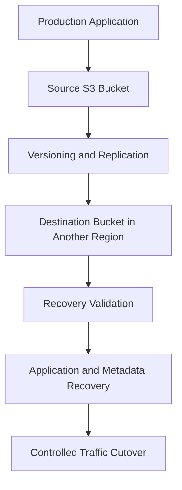

# 06- Versioning and Data Recovery Questions

## Overview

Amazon S3 versioning and recovery capabilities help protect application data against accidental deletion, incorrect overwrites, application defects, and certain security incidents. They are important for document management, audit trails, backups, compliance, and disaster recovery.

However, versioning alone does not guarantee recoverability. Historical versions can be permanently deleted, delete markers can hide existing content, lifecycle policies can remove versions, and replication can propagate or fail to protect against specific destructive operations.

A strong interview answer should distinguish object version history, logical deletion, permanent deletion, immutability, replication, and independent backup. These mechanisms solve related but different problems.

## S3 Versioning Fundamentals

### What is S3 Versioning, and why is it useful?

S3 Versioning retains multiple versions of an object under the same bucket and key. When an object is overwritten in a versioning-enabled bucket, S3 creates a new version while retaining the previous version.

For example:

```text
Bucket: company-prod-documents
Key: reports/monthly.csv

Version A: Original report
Version B: Corrected report
Version C: Latest report
```

An ordinary GET retrieves the current version. A request that specifies a version ID can retrieve a particular historical version.

Versioning is useful for:

- Recovering from accidental overwrites.
- Restoring objects after ordinary DELETE operations.
- Preserving document history.
- Investigating operational incidents.
- Supporting rollback and recovery workflows.
- Maintaining historical versions for business or audit purposes.

It does not prevent authorized principals from permanently deleting versions, and it does not replace an independent backup strategy.

### What are the three S3 Versioning states?

A general purpose bucket can have one of three versioning states.

| State | Behavior |
|---|---|
| Never enabled | Objects do not have normal version history |
| Enabled | New writes receive version IDs, and overwrites preserve earlier versions |
| Suspended | Existing non-null versions remain, but writes can replace the null version |

Versioning is disabled by default. Once enabled, it can be suspended but cannot be returned to the bucket's original never-enabled state.

Suspending versioning does not remove previously retained non-null versions. However, writes to a suspended bucket can replace the existing null version, reducing the protection provided by version history.

### How do you enable and verify versioning?

Enable versioning:

```bash
aws s3api put-bucket-versioning \
  --bucket company-prod-documents \
  --versioning-configuration Status=Enabled
```

Verify the setting:

```bash
aws s3api get-bucket-versioning \
  --bucket company-prod-documents
```

The response reports the versioning status when applicable and may also include the MFA Delete status.

Enabling versioning protects subsequent changes. It does not reconstruct historical versions that were permanently deleted before versioning or another recovery mechanism was available.

### Does S3 Versioning prevent overwrites?

It preserves the previous version when an object is overwritten in a versioning-enabled bucket, but it does not prevent the overwrite itself.

Suppose a Django application uploads a daily report to the same key. If a deployment bug generates incorrect content, the earlier version can remain available for restoration.

However, every retained version can contribute to storage costs. Frequently overwritten objects can accumulate large version histories.

If an artifact should be immutable, use a unique key and, where appropriate, a conditional write. Use versioning when the application also needs historical recovery.

### Does versioning protect against permanent deletion?

Not by itself.

An ordinary DELETE request without a version ID generally creates a delete marker in a versioning-enabled bucket. A DELETE request specifying a version ID permanently deletes that version if applicable permissions and retention controls allow it.

A principal with sufficient `s3:DeleteObjectVersion` permission can therefore remove historical versions unless additional controls prevent the operation.

For critical data, consider:

- Least-privilege version-deletion permissions.
- S3 Object Lock where appropriate.
- MFA Delete when its operational constraints are acceptable.
- Independent recovery copies.
- Separate administrative access boundaries.
- Monitoring of destructive API operations.

Reference: [Retaining multiple versions of objects with S3 Versioning](https://docs.aws.amazon.com/AmazonS3/latest/userguide/Versioning.html).

## Delete Markers and Object Recovery

### What is a delete marker?

A delete marker is a special version indicating that the current logical state of an object is deleted.

For example:

```text
Key: documents/invoice.pdf

Version A: Original content
Version B: Corrected content
Delete marker: Latest version
```

The delete marker becomes the current version, so an ordinary GET behaves as though the object does not exist. The earlier object versions can still be stored and recoverable.

A delete marker contains no object content. It represents a deletion state in the versioned namespace.

### How do you identify delete markers and historical versions?

Use the S3 API:

```bash
aws s3api list-object-versions \
  --bucket company-prod-documents \
  --prefix "documents/invoice.pdf"
```

Inspect the `Versions` and `DeleteMarkers` entries.

| Observation | Interpretation |
|---|---|
| A current object version is listed as latest | The key may have a current object available |
| A delete marker is the latest entry | Ordinary GET requests generally behave as though the key is deleted |
| Older object versions remain | The content may be recoverable |
| No matching versions or markers appear | Verify the exact key, bucket, account, Region, permissions, and listing pagination |

The `--prefix` option can return other keys sharing that prefix. Always verify the exact key and version ID before performing recovery operations.

### How do you recover an object hidden by a delete marker?

First inspect the key's version history and identify the unwanted current delete marker.

If the intention is to make the previous surviving version current again, delete the specific marker:

```bash
aws s3api delete-object \
  --bucket company-prod-documents \
  --key "documents/invoice.pdf" \
  --version-id "DELETE_MARKER_VERSION_ID"
```

Removing that marker makes the previous surviving version current, assuming no other later version or marker changes the result.

This is a targeted recovery operation. Do not delete a marker until you have verified that it belongs to the intended key and that restoring visibility is appropriate.

### How do you recover content that was overwritten?

Identify the historical version containing the expected content. Retrieve that version or copy it to the current key.

For example, retrieve a particular historical version:

```bash
aws s3api get-object \
  --bucket company-prod-documents \
  --key "documents/invoice.pdf" \
  --version-id "SOURCE_VERSION_ID" \
  ./invoice-recovered.pdf
```

This downloads the specified version locally; it does not change the current S3 object.

Alternatively, copy the historical version to the current key using Boto3:

```python
import boto3


def restore_object_version(
    *,
    bucket: str,
    key: str,
    version_id: str,
) -> dict:
    s3 = boto3.client("s3")

    return s3.copy_object(
        Bucket=bucket,
        Key=key,
        CopySource={
            "Bucket": bucket,
            "Key": key,
            "VersionId": version_id,
        },
    )
```

The copy creates a new current version when versioning is enabled and the operation succeeds. This retains the incorrect version in the history instead of erasing it.

The operation requires appropriate read and write permissions. If the object uses SSE-KMS, the relevant KMS permissions must also be satisfied.

### What if the object version was permanently deleted?

Versioning cannot recreate a version that no longer exists.

Investigate other recovery sources, such as:

- An independent backup.
- A replica that still contains the object version.
- A retained export or snapshot.
- Another system of record.
- A separate archival copy.

A replica or backup should not be assumed to contain the requested data until the exact object version and its readability have been verified.

## Version-Specific Deletion and Suspended Versioning

### What is the difference between deleting an object and deleting an object version?

In a versioning-enabled bucket, the behavior depends on whether the request includes a version ID.

| Request | Typical result |
|---|---|
| DELETE without version ID | Adds a delete marker |
| DELETE with a version ID identifying an object version | Permanently removes that version if permitted |
| DELETE with a version ID identifying a delete marker | Removes that specific marker if permitted |

Example of version-specific deletion:

```bash
aws s3api delete-object \
  --bucket company-prod-documents \
  --key "documents/invoice.pdf" \
  --version-id "VERSION_ID_TO_DELETE"
```

This is a destructive operation. Verify the key, version ID, retention requirements, and recovery implications before executing it.

### What happens when versioning is suspended?

Suspended versioning introduces null-version behavior.

Existing non-null versions remain in the version history. New writes use the null version ID, and an existing null version can be replaced.

A normal DELETE in a suspended bucket can remove an existing null version and create a delete marker. It does not automatically delete all non-null versions.

Suspending versioning should therefore be treated as a deliberate administrative change, not as an equivalent to disabling version history or cleaning up retained data.

Reference: [Deleting objects from versioning-suspended buckets](https://docs.aws.amazon.com/AmazonS3/latest/userguide/DeletingObjectsfromVersioningSuspendedBuckets.html).

### How would you permanently delete all versions of an object?

First list the object's versions and delete markers. Then identify every version that is authorized and eligible for permanent deletion.

A version-specific deletion must include the version ID. A broad cleanup should use a carefully validated manifest or script that records exactly which entries are to be removed.

Before permanently deleting versions, check:

- Retention and legal hold requirements.
- Object Lock configuration.
- Replication and backup requirements.
- Recovery obligations.
- Whether the operation affects a single key or many objects.
- Whether a deletion can be recovered from any remaining copy.

Do not assume that deleting a current key removes its history. Conversely, do not assume that versioning guarantees a recoverable copy after every version has been permanently deleted.

## Object Lock and MFA Delete

### What is S3 Object Lock?

S3 Object Lock provides write-once-read-many (WORM) protection for object versions. It can prevent a protected version from being permanently deleted or overwritten during retention, or indefinitely while a legal hold remains active.

Object Lock is useful for compliance-sensitive records, regulated archives, and data that requires stronger protection against destructive actions.

It supports:

- Governance-mode retention.
- Compliance-mode retention.
- Legal holds.

Object Lock requires versioning. Once Object Lock is enabled on a bucket, it cannot be disabled, and versioning cannot be suspended on that bucket.

Reference: [Locking objects with Object Lock](https://docs.aws.amazon.com/AmazonS3/latest/userguide/object-lock.html).

### What is the difference between Governance mode and Compliance mode?

| Characteristic | Governance mode | Compliance mode |
|---|---|---|
| Protection | Prevents ordinary deletion or modification during retention | Enforces stronger retention protection |
| Administrative exception | Authorized principals can bypass governance retention when the operation explicitly requests a bypass and the required permission is present | Retention cannot be shortened or bypassed by ordinary users, including the account root user |
| Suitable use | Retention with controlled administrative exceptions | Requirements that prohibit early deletion |
| Operational risk | Excessive bypass permissions weaken protection | Incorrect retention settings can make data undeletable for the configured period |

Governance mode requires strict control over `s3:BypassGovernanceRetention`. Compliance mode should be selected only after validating the retention requirement and its consequences.

### What is a legal hold?

A legal hold prevents a protected object version from being permanently deleted until an authorized principal removes the hold.

Unlike a fixed retention period, a legal hold has no automatic expiration date. It can remain active after a fixed retention period ends.

A legal hold and a retention period can coexist. If retention expires while the legal hold remains active, the hold continues to protect the object version.

Legal holds are useful for investigations, disputes, and compliance matters where the required preservation period is not known in advance.

### Can a DELETE request succeed when an object is protected by Object Lock?

An ordinary DELETE request without a version ID can add a delete marker even when an underlying object version is protected by Object Lock.

The key can appear deleted through ordinary reads while the protected content remains stored.

A request that attempts to permanently delete a protected version can be denied while its retention period or legal hold remains active.

This distinction matters during recovery tests: logical absence is not proof that protected content has been permanently removed.

### What is MFA Delete?

MFA Delete adds an additional authentication requirement for certain destructive versioning operations.

When enabled, permanent version deletions and changes to the bucket's versioning state require the required MFA authentication. Enabling or disabling MFA Delete is administratively constrained and requires the bucket owner's root-user credentials with MFA.

It can provide additional protection against accidental or malicious version deletion, but it is not a replacement for least-privilege IAM permissions, Object Lock, or independent backups.

Reference: [Configuring MFA Delete](https://docs.aws.amazon.com/AmazonS3/latest/userguide/MultiFactorAuthenticationDelete.html).

## Replication and Recovery Copies

### Is S3 Versioning the same as backup?

No. Versioning preserves object history within the bucket, but the versions generally share the same administrative environment and bucket-level controls.

An attacker with sufficient permissions could permanently delete historical versions. A configuration mistake or destructive operation can also affect the bucket's recovery state.

Versioning is a valuable recovery mechanism, but a resilient backup design may also require independent copies, separate access boundaries, retention controls, and tested restoration procedures.

### What is the difference between versioning, replication, and backup?

| Property | Versioning | Replication | Independent backup |
|---|---|---|---|
| Preserves historical versions | Yes, while retained | Depends on replication scope and destination retention | Depends on backup policy |
| Separate failure domain | Usually remains in the same bucket | Can use another bucket and Region | Can use a separate account or protection boundary |
| Synchronous | Version history is updated with object operations | No, replication is asynchronous | Depends on the backup mechanism |
| Automatically protects against every privileged deletion | No | No | Depends on independence, retention, and access controls |
| Needs recovery testing | Yes | Yes | Yes |

Replication can provide geographic separation and assist recovery. It should not be treated as an independent backup unless its administration, deletion behavior, retention, and recovery properties satisfy that requirement.

### Does S3 replication copy delete markers?

Delete marker replication is disabled by default for current replication configurations. It can be enabled for supported non-tag-based replication rules.

When enabled, eligible delete markers can be copied to the destination, causing the destination object to appear deleted as well.

Deleting a specific source version is different: a version-specific deletion is not replicated as a normal delete of the corresponding destination version. This behavior can help protect destination recovery data from destructive source operations.

Also note that delete markers generated by Lifecycle expiration are not replicated as ordinary user-created delete markers.

Validate deletion semantics when designing a destination as a recovery copy. Do not assume that every source deletion will be propagated or that every destructive operation is isolated.

References: [Replicating delete markers](https://docs.aws.amazon.com/AmazonS3/latest/userguide/delete-marker-replication.html) and [How replication handles object changes](https://docs.aws.amazon.com/AmazonS3/latest/userguide/replication-what-is-isnot-replicated.html).

### Does enabling replication backfill existing objects?

No. Live replication applies to eligible new and updated objects written after replication is configured. Objects that existed before the rule was created are not automatically replicated retroactively.

S3 Batch Replication can replicate eligible existing objects, previously failed objects, and other supported replication targets on demand.

A batch job uses a manifest and can produce a completion report with results for individual objects. The report is important for identifying failures rather than assuming that job completion means every object was successfully replicated.

Reference: [S3 Batch Replication for existing objects](https://docs.aws.amazon.com/AmazonS3/latest/userguide/s3-batch-replication-existing-config.html).

### How do you investigate a missing object in a replication destination?

Check the source object's replication status and the replication rule before treating the destination as an authoritative recovery copy.

Verify:

- Whether the object matched the replication rule.
- Whether it existed before replication was configured.
- Whether source and destination versioning are enabled.
- The replication role's source and destination permissions.
- KMS permissions and encryption compatibility, where applicable.
- Whether the object's storage class is eligible for replication.
- Replication metrics and failure details.
- Whether a batch replication job is needed.

After correcting the root cause, use Batch Replication for eligible existing or failed objects. Validate destination object content, metadata, encryption, and version history before relying on it for recovery.

## Disaster Recovery and Recovery Objectives

### How would you design a cross-Region recovery strategy?

Start by defining the acceptable recovery point objective (RPO) and recovery time objective (RTO).

A cross-Region design might use versioning-enabled source and destination buckets, replication, controlled recovery permissions, and an application failover procedure.



The architecture should address:

- Replication lag and failure detection.
- Destination access controls and administrative independence.
- Encryption keys and KMS permissions.
- Application metadata and databases that reference stored objects.
- Required compute, networking, and DNS configuration.
- Validation before traffic cutover.
- Rollback and post-recovery reconciliation.

Replication is asynchronous, so an object written shortly before an incident may not yet exist at the destination. A replicated bucket alone does not guarantee that the complete application can recover.

### What is the difference between RPO and RTO?

| Objective | Meaning | S3 recovery example |
|---|---|---|
| Recovery Point Objective (RPO) | Maximum acceptable amount of data loss measured in time | How far behind the recovery copy may lag |
| Recovery Time Objective (RTO) | Target time to restore the service | How long the application may take to regain usable data access |

The required RPO influences the replication, backup, and reconciliation strategy. The RTO also depends on restore throughput, IAM and KMS access, database recovery, deployment readiness, and application verification.

Do not promise a low RTO merely because the destination bucket exists. Demonstrate the recovery procedure under realistic conditions.

### How do you restore data from an independent backup?

Use a controlled restoration workflow rather than overwriting production immediately.

1. Define the incident's recovery point and target object set.
2. Locate the backup manifest, inventory, or retained versions.
3. Verify bucket access and encryption-key availability.
4. Restore into a controlled destination or recovery namespace.
5. Validate object counts, checksums, metadata, and application consistency.
6. Reconcile database references and application state.
7. Cut over traffic only after validation.
8. Record recovery actions, elapsed time, exceptions, and remaining gaps.

For large datasets, use a manifest-driven process with bounded concurrency, progress tracking, and resumable execution.

### How should an organization test recovery procedures?

A recovery exercise must verify the actual ability to retrieve and use the intended data, not merely confirm that versioning or replication is enabled.

Test:

- Restoration of historical versions.
- Removal of an unwanted delete marker.
- Recovery from permanent source-version deletion where an independent copy exists.
- Access to encrypted objects and required KMS keys.
- Replication completeness and recovery permissions.
- Metadata and application database consistency.
- Large-scale restoration timing.
- Partial failure and resumability.
- Retention and Object Lock behavior.
- Compliance with the required RTO and RPO.

Run tests in a recovery environment or use controlled test objects so the exercise does not accidentally alter production data.

## Production Monitoring and Operational Controls

### What should be monitored for versioning and recovery risks?

Monitor bucket configuration, data growth, replication behavior, and actual recovery readiness.

| Signal | Why it matters |
|---|---|
| Versioning status | Confirms historical-version protection is enabled where required |
| Noncurrent-version growth | Identifies storage accumulation and lifecycle gaps |
| Delete-marker accumulation | Can indicate unexpected deletions or cleanup issues |
| Replication failures and lag | Reveals incomplete or delayed destination copies |
| Object Lock retention and legal holds | Confirms whether protected versions are subject to retention |
| Archive restoration duration | Helps evaluate actual recovery performance |
| Recovery drill results | Demonstrates whether the process meets RTO/RPO |
| Destructive API events | Helps identify unauthorized or unexpected changes |

S3 Inventory, Storage Lens, CloudWatch metrics, CloudTrail, replication events, and application logs provide complementary visibility. None of them alone proves that a recovery plan is complete.

### What controls help prevent accidental or malicious version deletion?

Use layered controls:

- Restrict `s3:DeleteObjectVersion` to explicitly authorized principals.
- Use Object Lock for data requiring immutable retention.
- Limit and audit Governance-mode bypass permissions.
- Use MFA Delete where operationally suitable.
- Separate production administration from ordinary application roles.
- Monitor destructive operations and configuration changes.
- Retain an independent recovery copy where required.
- Test restoration rather than trusting configuration alone.

These controls address different threats. For example, Object Lock can protect an individual version while a separate account or recovery process protects against broader administrative mistakes.

## Production Interview Scenarios

### Scenario: A document disappears immediately after a DELETE request. How would you investigate?

List the object's versions and delete markers using `list-object-versions`.

If the latest entry is a delete marker and the required content still exists in an older version, restore it by removing the intended marker or copying the chosen historical version to the current key.

If the content version was permanently deleted, determine whether an independent backup or replica contains it. Versioning cannot recreate a version that no longer exists.

Record the exact key, version IDs, principal, relevant CloudTrail events, and recovery actions for the incident review.

### Scenario: A deployment overwrote a critical configuration file with invalid content. How would you roll it back?

Identify the historical version containing the expected configuration. Verify its contents before restoring it.

Copy the historical version to the current key to create a new version. This restores the desired content while preserving the incorrect deployment's version history.

Afterward, validate the configuration, verify dependent application behavior, and investigate the deployment process that introduced the invalid content.

### Scenario: A compromised principal can permanently delete versions. Is versioning enough?

No. If the principal has sufficient permissions to delete historical versions, versioning alone may not retain a recoverable copy.

Restrict version deletion, consider Object Lock for protected data, retain independent backups, and ensure the recovery copy has appropriate administrative separation.

Test recovery under a scenario where ordinary source-bucket credentials are compromised. Do not assume that a replica is independent if the same administrative permissions can destroy both source and destination.

### Scenario: A destination bucket is missing objects after a regional incident. What do you check?

Inspect source-object eligibility, rule filters, replication status, role permissions, destination permissions, encryption configuration, and the history of the replication rule.

Remember that live replication does not automatically backfill pre-existing objects. Once the cause is corrected, consider Batch Replication for eligible objects and inspect the completion report.

Before switching production traffic, verify that the destination contains the required object versions and that application dependencies can operate in the recovery Region.

### Scenario: Lifecycle rules removed versions required for recovery. What can the team do?

Determine whether the content survives in another bucket, backup, replica, or retained export.

If every copy of the version has been permanently deleted, it cannot be reconstructed by enabling versioning afterward. Record the data-loss scope, identify any remaining recovery options, and investigate the lifecycle configuration and approval process.

Prevent recurrence by testing destructive rules against representative data, validating retention requirements, and protecting critical versions where required.

### Scenario: An Object Lock-protected document still appears in the object's version history after a DELETE request reports success. Why?

An ordinary DELETE without a version ID can insert a delete marker even when an underlying version is protected.

The key can appear deleted through ordinary GET requests while the locked version remains stored. Permanent deletion of the protected version can be denied while its retention period or legal hold is active.

Inspect version history, delete markers, and Object Lock state to distinguish logical deletion from permanent removal.

## Common Interview Traps

| Incorrect assumption | Correct understanding |
|---|---|
| Versioning reconstructs history that was already lost | It preserves versions created while enabled; it cannot recreate permanently lost content |
| A normal DELETE removes all versions | It generally creates a delete marker in a versioning-enabled bucket |
| Versioning prevents every permanent deletion | Authorized version-specific deletions can permanently remove data unless additional controls block them |
| Suspended versioning provides the same protection as enabled versioning | Writes can replace the null version |
| Replication is synchronous | Replication is asynchronous and can lag or fail |
| Enabling replication backfills all historical objects | Existing eligible objects require an appropriate Batch Replication workflow |
| All source deletions are replicated identically | Delete-marker replication and version-specific deletions have different behavior |
| A delete marker contains the original content | It is a special version that changes the current logical state |
| Object Lock prevents every DELETE request from succeeding | A normal DELETE can insert a marker while the locked version remains protected |
| A replica is automatically an independent backup | Independence depends on retention, deletion controls, administrative boundaries, and tested recovery |

## Authoritative References

- [S3 Versioning](https://docs.aws.amazon.com/AmazonS3/latest/userguide/Versioning.html)
- [Troubleshooting S3 Versioning](https://docs.aws.amazon.com/AmazonS3/latest/userguide/troubleshooting-versioning.html)
- [Managing delete markers](https://docs.aws.amazon.com/AmazonS3/latest/userguide/ManagingDelMarkers.html)
- [Deleting objects from versioning-suspended buckets](https://docs.aws.amazon.com/AmazonS3/latest/userguide/DeletingObjectsfromVersioningSuspendedBuckets.html)
- [S3 Object Lock](https://docs.aws.amazon.com/AmazonS3/latest/userguide/object-lock.html)
- [Configuring Object Lock](https://docs.aws.amazon.com/AmazonS3/latest/userguide/object-lock-configure.html)
- [MFA Delete](https://docs.aws.amazon.com/AmazonS3/latest/userguide/MultiFactorAuthenticationDelete.html)
- [Replicating delete markers](https://docs.aws.amazon.com/AmazonS3/latest/userguide/delete-marker-replication.html)
- [S3 Batch Replication for existing objects](https://docs.aws.amazon.com/AmazonS3/latest/userguide/s3-batch-replication-existing-config.html)

## Key Takeaways

- Versioning preserves historical versions, but permanent version deletion remains possible unless additional safeguards are configured.
- Delete markers hide the current object without necessarily removing historical content; inspect version history before declaring data lost.
- Object Lock, MFA Delete, least-privilege permissions, and independent backups offer complementary recovery protections.
- Replication is asynchronous and does not automatically backfill existing objects or guarantee an independently protected recovery copy.
- Test recovery procedures—including object restoration, permissions, encryption, metadata validation, and application cutover—against explicit RTO and RPO requirements.