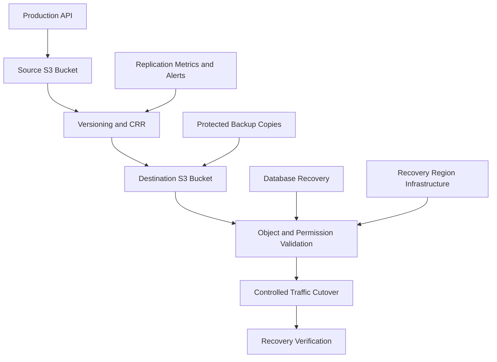

# 07- Replication and Disaster Recovery Questions

## Overview

Amazon S3 replication and disaster recovery protect object data against regional outages, accidental deletion, application defects, and security incidents. For senior backend engineers, the challenge is designing a recoverable system with measurable recovery objectives rather than simply enabling Cross-Region Replication (CRR).

Replication asynchronously copies eligible object versions between buckets. Disaster recovery (DR) combines these copies with database recovery, application infrastructure, IAM permissions, encryption keys, monitoring, and tested failover procedures.

A critical distinction is that **replicated data does not automatically make an application recoverable**. Recent writes may not have replicated, database records may reference missing objects, encryption keys may be unavailable, and the recovery environment may not be ready to accept traffic.

## Replication Fundamentals

### What is Amazon S3 Replication, and when should it be used?

S3 Replication automatically copies eligible objects from a source bucket to one or more destination buckets according to configured rules.

Typical use cases include regional disaster recovery, cross-account protection, centralized data collection, compliance requirements, and regional data distribution.

Replication requires versioning to be enabled on both the source and destination general purpose buckets. Amazon S3 assumes an authorized IAM role to perform the replication operations.

**Advantages:**
- Maintains eligible object copies in separate buckets.
- Supports cross-account and cross-Region protection.
- Reduces the need for application-managed object-copy workflows.
- Integrates with replication metrics, event notifications, and Batch Replication.

**Limitations:**
- Replication is asynchronous.
- Existing objects are not automatically backfilled by ordinary live replication.
- Bucket policies, KMS keys, databases, and application infrastructure must be managed separately.
- Replication alone does not protect against every destructive operation or guarantee a consistent application recovery point.

### How do Same-Region Replication and Cross-Region Replication differ?

| Dimension | Same-Region Replication (SRR) | Cross-Region Replication (CRR) |
|---|---|---|
| Destination | Bucket in the same AWS Region | Bucket in another AWS Region |
| Cross-account protection | Supported | Supported |
| Regional isolation | No additional Region boundary | Protects against some failures affecting the source Region |
| Common use cases | Account separation, data distribution, analytics | Regional recovery, geographic distribution |
| Transfer costs | No inter-Region replication transfer charge | Inter-Region data transfer charges can apply |
| Important limitation | Does not isolate all regional failures | Does not guarantee zero data loss or complete application recovery |

The appropriate choice depends on the failure domain. SRR can provide administrative separation, while CRR is appropriate when regional isolation is a requirement.

### What prerequisites must be satisfied before enabling replication?

Verify the following conditions:

- Versioning is enabled on both buckets.
- The replication rule is enabled and matches the intended objects.
- The S3 replication role has the required source and destination permissions.
- The destination bucket policy authorizes the replication role when required.
- Encryption settings and KMS permissions are compatible.
- The source and destination Regions are enabled for the relevant AWS accounts.
- Monitoring is configured to detect failures and unacceptable replication delays.

If versioning is suspended on a destination bucket, replication can fail. Suspending versioning on a source bucket that has an active replication configuration is also restricted.

Reference: [S3 Replication requirements and considerations](https://docs.aws.amazon.com/AmazonS3/latest/userguide/replication-requirements.html).

### Does enabling replication copy existing objects?

No. Live replication applies to eligible object changes made after the replication configuration becomes effective.

Use **S3 Batch Replication** when existing objects, previously failed replication operations, or other eligible historical objects need to be replicated.

For a populated production bucket, the migration plan should therefore include two activities:

1. Configure and validate live replication for ongoing writes.
2. Backfill the historical dataset that must be present in the destination.

Inspect the Batch Replication completion report to identify individual failures. A completed batch job does not necessarily mean every object was successfully replicated.

Reference: [S3 Batch Replication for existing objects](https://docs.aws.amazon.com/AmazonS3/latest/userguide/s3-batch-replication-existing-config.html).

### Which resources are replicated automatically?

S3 Replication is an object-level capability, not a complete infrastructure-replication mechanism.

| Resource or operation | Behavior |
|---|---|
| Eligible object versions | Replicated according to rule scope and permissions |
| Object metadata and tags | Replicated according to supported behavior and configuration |
| Existing objects | Require Batch Replication when they need to be backfilled |
| Delete markers | Not replicated by default under current filtered replication configurations |
| Permanent deletion of a specified source version | Not replicated as an ordinary version-specific delete |
| Bucket policies and public-access settings | Managed independently |
| Versioning and lifecycle configurations | Configured and reviewed separately |
| KMS keys and key policies | Provisioned and managed independently |
| IAM roles and application infrastructure | Require separate deployment and recovery |
| Database records and object references | Require a separate consistency and recovery strategy |

These distinctions are important when a replicated bucket is used as a recovery destination. Object availability does not prove that the entire application can be restored.

## Replication Configuration and Permissions

### How would you configure a basic replication rule?

Assume the following environment:

| Property | Value |
|---|---|
| Source bucket | `company-prod-documents` |
| Destination bucket | `company-dr-documents` |
| Source Region | `ap-south-1` |
| Destination Region | `ap-southeast-1` |
| Replication scope | Keys beginning with `documents/` |

Enable versioning on both buckets:

```bash
aws s3api put-bucket-versioning \
  --bucket company-prod-documents \
  --versioning-configuration Status=Enabled \
  --region ap-south-1

aws s3api put-bucket-versioning \
  --bucket company-dr-documents \
  --versioning-configuration Status=Enabled \
  --region ap-southeast-1
```

Create `replication.json`:

```json
{
  "Role": "arn:aws:iam::111122223333:role/s3-replication-role",
  "Rules": [
    {
      "ID": "replicate-production-documents",
      "Status": "Enabled",
      "Priority": 10,
      "Filter": {
        "Prefix": "documents/"
      },
      "DeleteMarkerReplication": {
        "Status": "Disabled"
      },
      "Destination": {
        "Bucket": "arn:aws:s3:::company-dr-documents",
        "StorageClass": "STANDARD"
      }
    }
  ]
}
```

Apply the configuration to the source bucket:

```bash
aws s3api put-bucket-replication \
  --bucket company-prod-documents \
  --replication-configuration file://replication.json \
  --region ap-south-1
```

Inspect the result:

```bash
aws s3api get-bucket-replication \
  --bucket company-prod-documents \
  --region ap-south-1
```

This example demonstrates the rule structure, not a complete production deployment. The replication role, trust policy, destination access, encryption settings, and monitoring must also be configured.

### Which IAM permissions does the replication role require?

Amazon S3 assumes the configured role to read source versions and create destination replicas.

Common permissions include:

| Permission | Purpose |
|---|---|
| `s3:GetReplicationConfiguration` | Read the source replication configuration |
| `s3:ListBucket` | List the source bucket where required |
| `s3:GetObjectVersionForReplication` | Read eligible source object versions |
| `s3:GetObjectVersionAcl` | Read version ACLs where required by the configuration |
| `s3:GetObjectVersionTagging` | Read object-version tags when applicable |
| `s3:ReplicateObject` | Write replicas to the destination |
| `s3:ReplicateDelete` | Replicate eligible delete markers when configured |
| `s3:ReplicateTags` | Replicate tags when applicable |

The exact permissions depend on the replication features and ownership configuration. The role's trust policy must permit the S3 service to assume it.

For cross-account replication, the destination bucket policy must also authorize the role. Restrict resource ARNs to the intended source and destination rather than granting broad `s3:*` access.

### How do you verify replication status?

Inspect a source object's status:

```bash
aws s3api head-object \
  --bucket company-prod-documents \
  --key "documents/report.pdf" \
  --region ap-south-1 \
  --query ReplicationStatus
```

| Status | Interpretation |
|---|---|
| `PENDING` | Replication has not completed |
| `COMPLETED` | Replication completed successfully |
| `FAILED` | Replication failed |
| `REPLICA` | Indicates a replica object's status where reported |
| No status | The object may not be covered by replication or may not have an applicable status |

A missing status does not necessarily imply a failure. The object may predate the replication rule or fall outside its filters.

For end-to-end verification, confirm the destination key, content, version, metadata, encryption, and readability. Identical key names alone are insufficient evidence of integrity.

## Encryption and Cross-Account Replication

### Can SSE-KMS-encrypted objects be replicated?

Yes, when encryption-specific replication settings and permissions are configured correctly.

By default, S3 replication does not replicate objects encrypted with SSE-KMS or DSSE-KMS. The replication rule must explicitly include the relevant encrypted objects and specify the appropriate destination encryption configuration.

Typical permissions include:

- `kms:Decrypt` on the source KMS key.
- `kms:Encrypt` on the destination KMS key.
- `kms:GenerateDataKey` for applicable destination-encryption operations.
- Authorization through the relevant IAM policies and KMS key policies.

The exact requirements depend on the encryption configuration, account boundaries, and replication options. Cross-account use generally requires a customer-managed KMS key in the destination account because an AWS-managed KMS key cannot be shared for this purpose.

### How do you distinguish an S3 authorization failure from a KMS authorization failure?

Treat S3 permissions and KMS permissions as separate authorization layers.

| Evidence | Investigation |
|---|---|
| Unencrypted objects replicate, but encrypted objects fail | Check the encryption opt-in and KMS authorization |
| All matching objects fail | Inspect the replication role, trust relationship, rule, bucket policies, and destination configuration |
| Replicas exist, but the destination application cannot read them | Check destination S3 permissions and destination KMS access |
| Replication stopped after a KMS key change | Verify the new key's policy and the replication role's permissions |

If S3 permits an object write but KMS denies encryption, granting additional S3 permissions does not resolve the cryptographic authorization failure.

For S3 Bucket Keys, verify encryption-context conditions. When a Bucket Key is used, the encryption context can reference the bucket ARN rather than the individual object ARN.

Reference: [Replicating encrypted objects](https://docs.aws.amazon.com/AmazonS3/latest/userguide/replication-config-for-kms-objects.html).

### How does replication behave when an object is deleted?

Behavior depends on the deletion operation and replication configuration.

| Source operation | Typical destination behavior |
|---|---|
| DELETE without version ID | Creates a delete marker in a versioning-enabled source bucket |
| Delete-marker replication disabled | The corresponding marker is not replicated, so an existing destination object may remain visible |
| Delete-marker replication enabled | Eligible delete markers can be replicated |
| DELETE with a specific version ID | Permanently deletes that source version if authorized; this is not replicated as a normal version-specific deletion |

Delete-marker replication is disabled by default for current filtered replication configurations. It is not supported for tag-based replication rules, and lifecycle-created delete markers are not replicated as ordinary user-created markers.

This behavior can be useful when the destination is intended to preserve recovery copies. The desired deletion semantics should be documented and tested rather than assumed.

Reference: [Replicating delete markers](https://docs.aws.amazon.com/AmazonS3/latest/userguide/delete-marker-replication.html).

## Replication Monitoring and Time Control

### Which metrics should be monitored?

Combine object-level checks with aggregate replication metrics.

| Metric or signal | Purpose |
|---|---|
| `BytesPendingReplication` | Measures data awaiting replication |
| `OperationsPendingReplication` | Measures operations awaiting replication |
| `ReplicationLatency` | Measures replication delay |
| `OperationsFailedReplication` | Tracks failed replication operations |
| Source object replication status | Helps isolate an individual object's outcome |
| Destination validation | Confirms the copy is available and usable |

Replication metrics must be enabled and scoped appropriately. Use CloudWatch alarms and S3 event notifications to detect sustained backlog, failed operations, or replication delays that threaten the workload's recovery objectives.

A growing backlog may indicate higher write volume or processing delays. Repeated failures affecting certain objects can indicate rule-filter, permissions, encryption, or destination-configuration problems.

Set alert thresholds according to the required recovery point objective and expected workload rather than treating every pending operation as an incident.

### What is S3 Replication Time Control?

S3 Replication Time Control (RTC) is an optional feature designed to provide predictable replication timing. AWS publishes an SLA for replicating **99.9% of eligible new objects within 15 minutes**.

RTC does not make replication synchronous or guarantee that every individual object is replicated within 15 minutes. It also does not backfill historical objects.

RTC is appropriate when a workload's business requirements justify the additional cost and the published latency commitment. Replication metrics and recovery testing remain necessary.

Reference: [S3 Replication Time Control](https://docs.aws.amazon.com/AmazonS3/latest/userguide/replication-time-control.html).

## Disaster Recovery Architecture

### How would you design S3 disaster recovery for a production backend?

Begin with explicit recovery objectives and map the dependencies required to restore application functionality.

A typical design uses versioning-enabled source and destination buckets, CRR, regional application infrastructure, and a controlled failover procedure.



The destination bucket is only one component. A complete architecture must also recover database records, IAM permissions, KMS keys, application configuration, networking, secrets, and background-processing infrastructure.

### What are RPO and RTO?

**Recovery Point Objective (RPO)** is the maximum acceptable data loss, measured in time.

**Recovery Time Objective (RTO)** is the target time to restore service after an incident.

| Requirement | Design implication |
|---|---|
| Low RPO | Requires effective replication or backup protection, lag monitoring, and a plan for writes that have not arrived |
| Low RTO | Requires prepared infrastructure, valid credentials, available encryption keys, and tested automation |
| Large-scale recovery | Requires realistic testing of retrieval throughput and restoration time |
| Regional failure tolerance | Requires dependencies and recovery access outside the affected Region |
| Strong retention requirements | Require deliberate retention and deletion controls |

Because replication is asynchronous, some recent source writes may not exist at the destination during a failure. An enabled replication rule alone does not prove that an RPO is met.

Likewise, the presence of a destination bucket does not establish that the application can meet its RTO.

### Is CRR sufficient for complete disaster recovery?

No. CRR protects eligible object data against some source-Region failures, but the application has other recovery dependencies.

A complete DR plan should address:

- Database replication, restoration, and reconciliation.
- Application deployment and configuration in the recovery Region.
- IAM roles, trust policies, and bucket policies.
- KMS keys and encryption permissions.
- Network routing, secrets, and external service dependencies.
- DNS or application endpoint routing.
- Background workers and event-processing infrastructure.
- Object-reference consistency and integrity validation.
- Incident communication, recovery responsibilities, and rollback.

The plan must distinguish between a regional outage, accidental deletion, and compromised credentials. These incidents can require different recovery sources and controls.

### When should you choose active-passive instead of active-active?

| Consideration | Active-passive | Active-active |
|---|---|---|
| Traffic | One primary Region serves requests | Multiple Regions serve requests |
| Write ownership | Easier to establish one authoritative writer | Requires a concurrency and conflict strategy |
| Infrastructure cost | Can reduce standby compute capacity | May require continuously running capacity in multiple Regions |
| Operational complexity | Usually lower | Usually higher |
| Common use case | Controlled disaster recovery | Global access and regional availability |

For many document and media platforms, active-passive recovery is easier to manage because only one Region is authoritative for writes at a time.

Active-active designs require explicit handling of concurrent writes, delayed replication, duplicate processing, stale reads, and reconciliation. S3 replication does not provide general application-level conflict resolution.

## Multi-Region Access Points

### What is an S3 Multi-Region Access Point?

An S3 Multi-Region Access Point (MRAP) provides a global endpoint for accessing buckets in multiple Regions. It can route requests to regional buckets and supports controlled failover operations.

MRAP is an access and routing feature, not an object synchronization mechanism. CRR or another data-distribution strategy is required when objects need to be present across participating buckets.

A request routed to a Region before a recent object has replicated there can return 404, even when the object exists in another bucket.

### Does MRAP guarantee that every object is available during failover?

No. Routing can succeed while destination data or application dependencies remain incomplete.

Validate object availability, replication lag, S3 and KMS permissions, database state, application configuration, and regional dependencies before switching traffic.

For active-active architectures, define how conflicting writes are resolved. For active-passive architectures, define when the recovery Region may accept writes and how conflicting writers are prevented.

When MRAP is used for active-active access, two-way replication and replica modification synchronization may be needed to keep object changes and metadata synchronized. The precise configuration depends on the access pattern and consistency requirements.

### How would you execute a regional failover?

Use a controlled runbook:

1. Confirm the incident and determine the recovery scope.
2. Decide whether the primary Region can still accept writes.
3. Inspect replication health and estimate the data gap.
4. Verify destination access, KMS keys, application configuration, and database readiness.
5. Activate the recovery application stack.
6. Validate representative read and write workflows.
7. Switch traffic through the designated routing or MRAP failover mechanism.
8. Monitor application errors, performance, data consistency, and background processing.
9. Record missing or divergent data and reconcile it where appropriate.

If concurrent writes are unsupported, prevent conflicting writers during the transition.

Reference: [Using S3 Multi-Region Access Point failover controls](https://docs.aws.amazon.com/AmazonS3/latest/userguide/UsingFailover.html).

### How would you fail back to the primary Region?

Failback requires data reconciliation, not merely reversing the routing change.

Before returning traffic:

- Identify the authoritative write history.
- Reconcile changes created during failover.
- Verify object versions, metadata, and encryption.
- Check database records and object references.
- Confirm replication direction and configuration.
- Validate regional application dependencies and permissions.
- Define a safe transition between write owners.

The runbook should describe whether writes must be temporarily paused, how divergent updates are handled, and how recovery readiness is verified.

## Backup Independence and Recovery Testing

### How do versioning, replication, and backup complement one another?

| Mechanism | Primary strength | Important limitation |
|---|---|---|
| Versioning | Preserves object history and helps recover from overwrites and logical deletion | Does not prevent every permanent version deletion |
| CRR | Stores eligible copies outside the source Region | Is asynchronous and does not guarantee complete application recovery |
| Object Lock | Protects versions under configured retention or legal hold | Does not restore missing application dependencies |
| Independent backup | Provides a separately managed recovery point | Requires suitable retention, permissions, and restoration tests |
| Application-level export | Can capture business state and selected metadata | Must be validated against the required recovery scope |

An independent backup should be evaluated for administrative separation, retention, deletion controls, and tested restoration behavior—not merely its physical location.

### How would you protect a recovery copy from source-account compromise?

Apply independent controls:

- Restrict permanent version-deletion permissions on the destination.
- Separate production and recovery administration where feasible.
- Use Object Lock for data requiring immutable retention.
- Protect replication and lifecycle configuration from unauthorized modification.
- Audit destructive operations and bucket-policy changes.
- Test recovery with an identity that does not depend on source-side administrative privileges.

If the same principal can permanently delete every source and destination version, geographic replication alone does not provide sufficient protection.

### How should a team test its DR strategy?

A meaningful DR exercise verifies end-to-end recovery rather than simply checking whether replication is enabled.

Test representative object sizes, encryption configurations, database references, and application workflows. Measure recovery duration, missing data, application readiness, permission failures, and restoration behavior.

The exercise should verify:

- Destination object availability and integrity.
- Access to required KMS keys.
- Application startup and critical operations.
- Database-to-object consistency.
- Failover routing and operational procedures.
- Ability to recover without source-Region administration.
- Recovery time and data loss against the declared RTO and RPO.

Perform the exercise in a controlled environment or with explicitly scoped test data. Record gaps, assign remediation, and repeat the exercise after significant changes.

## Troubleshooting Replication and Recovery

### Scenario: New source objects do not appear at the destination

**Symptoms:** Uploads to the source succeed, but destination reads return 404.

**Possible causes:** Replication is pending, the key is excluded by filters, the rule is disabled, the role lacks permissions, or encryption and destination policies are incompatible.

Inspect the configuration and object status:

```bash
aws s3api get-bucket-replication \
  --bucket company-prod-documents \
  --region ap-south-1

aws s3api head-object \
  --bucket company-prod-documents \
  --key "documents/report.pdf" \
  --region ap-south-1 \
  --query ReplicationStatus
```

Check versioning:

```bash
aws s3api get-bucket-versioning \
  --bucket company-prod-documents \
  --region ap-south-1

aws s3api get-bucket-versioning \
  --bucket company-dr-documents \
  --region ap-southeast-1
```

**Root-cause isolation:**

- If only older objects are missing, investigate whether replication was enabled after they were created.
- If only specific prefixes fail, inspect the rule filters.
- If encrypted objects fail but unencrypted objects succeed, investigate the KMS path.
- If all objects fail, check the trust relationship, role permissions, destination policy, versioning, and rule status.

**Corrective action:** Fix the specific configuration or authorization problem. Use Batch Replication for eligible existing objects and inspect its completion report.

### Scenario: Replication backlog continues to increase

**Symptoms:** Pending operations or bytes grow over time, and replication latency exceeds the workload's tolerance.

**Possible causes:** Increased write volume, large objects, replication failures, encryption permissions, or destination configuration issues.

**Diagnostic workflow:**

1. Inspect replication status on affected source objects.
2. Review `OperationsPendingReplication`, `BytesPendingReplication`, `ReplicationLatency`, and `OperationsFailedReplication` where configured.
3. Compare the backlog with incoming write volume and object sizes.
4. Examine replication events and failure details.
5. Validate the replication role, destination bucket, rule filters, and KMS configuration.

A growing backlog without failures can indicate processing delays or workload growth. Repeatable failures on particular objects point more strongly to eligibility or configuration problems.

**Corrective action:** Resolve identified errors, monitor backlog recovery, and reassess whether RTC is justified. Do not assume that enabling RTC will fix a misconfigured replication rule.

### Scenario: Only SSE-KMS objects fail replication

**Symptoms:** Unencrypted objects replicate successfully, but SSE-KMS objects remain pending or fail.

**Possible causes:** Encrypted-object replication is not enabled, source decryption is denied, or the destination KMS key does not authorize encryption.

**Diagnostic workflow:**

1. Inspect the replication rule's encryption settings.
2. Identify the source and destination KMS keys.
3. Review the replication role's IAM permissions.
4. Review both relevant KMS key policies.
5. Inspect encryption-context and other policy conditions.

**Corrective action:** Enable replication for the relevant encrypted objects and authorize the required key-specific operations. Verify with a controlled encrypted test object before treating the recovery path as ready.

### Scenario: Deleted source objects remain visible at the destination

**Symptoms:** The source key returns 404, but a destination copy remains accessible.

**Possible causes:** Delete-marker replication is disabled, or the source operation permanently deleted a particular version instead of propagating a logical deletion.

List the version history in both buckets:

```bash
aws s3api list-object-versions \
  --bucket company-prod-documents \
  --prefix "documents/report.pdf" \
  --region ap-south-1

aws s3api list-object-versions \
  --bucket company-dr-documents \
  --prefix "documents/report.pdf" \
  --region ap-southeast-1
```

**Root-cause isolation:** Compare the source and destination object versions and delete markers. Establish whether the source operation was a normal DELETE or a version-specific deletion.

**Corrective action:** Decide whether the destination is supposed to preserve deleted source data or mirror logical deletions. Configure supported delete-marker behavior accordingly, and test it before modifying retained destination versions.

### Scenario: Failover succeeds, but application requests fail

**Symptoms:** Traffic reaches the recovery Region, but some documents or media return 404 or access errors.

**Possible causes:** Recent writes have not replicated, historical objects were never backfilled, filters exclude keys, database references are stale, or the application uses incorrect regional configuration.

**Diagnostic workflow:**

1. Identify the exact failing key and request.
2. Inspect its replication status when the source is accessible.
3. Determine whether the object predates the replication rule.
4. Inspect the destination's version history, metadata, and encryption.
5. Verify the application's bucket configuration, database references, and permissions.

**Corrective action:** Restore eligible missing objects, backfill required historical data, correct application mappings, and add representative object checks to the failover readiness process.

## Advanced Design and Senior-Level Scenarios

### How would you design recovery for a document platform using PostgreSQL and S3?

Define the RPO and RTO, then design storage and database recovery together.

A robust design includes versioning and CRR for objects, a separate PostgreSQL replication or restoration strategy, regional application infrastructure, usable KMS keys, and validation that database records reference available objects.

The system must handle partial workflows:

- A database record commits but the object upload fails.
- An object upload succeeds but the database transaction fails.
- An object exists in the destination but its database reference has not replicated.
- The database contains a record whose referenced object version is unavailable.

Use explicit upload and processing states, idempotent operations, reconciliation jobs, and recovery validation. Declaring the bucket available does not prove that every document is usable by the application.

### Does S3 replication guarantee exactly-once processing?

No. Replication is a data-copying mechanism, not a universal exactly-once processing guarantee.

Event-driven systems can encounter delayed copies, duplicate event delivery, retries, and downstream failures. Consumers should be idempotent and track durable processing state.

Use stable identifiers such as object keys and version IDs to identify the precise object being processed. Validate replication completion separately from business-level processing completion.

### How would you reduce disaster recovery costs?

Evaluate which datasets require immediate access and which can tolerate slower retrieval. Consider destination storage classes, noncurrent-version retention, lifecycle policies, replication requests, inter-Region transfer, monitoring, and DR testing costs.

Test recovery latency before selecting a storage class with different retrieval characteristics. Ensure lifecycle policies do not remove the object versions needed to satisfy retention or recovery requirements.

Cost optimization is appropriate only when the resulting recovery capabilities still satisfy the workload's requirements.

### What role does S3 Inventory play in recovery?

S3 Inventory provides scheduled listings of objects and selected attributes. It can help identify datasets, determine recovery scope, and prepare manifests for large-scale operations.

Inventory is not a real-time replication status feed. Use it to select objects for investigation or recovery, then verify actual destination objects, versions, permissions, and content.

For critical recovery, combine inventory-based selection with direct object checks and appropriate integrity validation.

## Common Interview Traps

| Incorrect assumption | Correct understanding |
|---|---|
| Replication automatically copies historical objects | Historical objects require Batch Replication when they must be backfilled |
| Replication is synchronous | Replication is asynchronous and may lag |
| A destination bucket proves DR readiness | Databases, infrastructure, identity, encryption, and routing must also be recovered |
| Replication copies bucket policies and KMS keys | Bucket configuration and encryption infrastructure must be managed independently |
| Versioning prevents permanent deletion | Historical versions can still be permanently deleted unless additional controls block it |
| Every source deletion is replicated | Delete-marker replication and permanent version deletion have different behavior |
| MRAP synchronizes regional buckets | MRAP provides routing and access; data distribution must be designed separately |
| Bidirectional replication resolves concurrent-write conflicts | Application-level conflict and consistency rules are still needed |
| RTC makes replication synchronous | RTC provides a latency commitment for eligible new objects, not synchronous consistency |
| A successful failover-routing change proves recovery | Data integrity, permissions, database state, and application behavior must be validated |
| CRR automatically creates an independent backup | Retention, deletion controls, administrative separation, and tested restoration determine independence |

## Authoritative References

- [S3 Replication requirements and considerations](https://docs.aws.amazon.com/AmazonS3/latest/userguide/replication-requirements.html)
- [Setting up live replication](https://docs.aws.amazon.com/AmazonS3/latest/userguide/replication-how-setup.html)
- [S3 Batch Replication for existing objects](https://docs.aws.amazon.com/AmazonS3/latest/userguide/s3-batch-replication-existing-config.html)
- [Replicating encrypted objects](https://docs.aws.amazon.com/AmazonS3/latest/userguide/replication-config-for-kms-objects.html)
- [Replicating delete markers](https://docs.aws.amazon.com/AmazonS3/latest/userguide/delete-marker-replication.html)
- [S3 Replication Time Control](https://docs.aws.amazon.com/AmazonS3/latest/userguide/replication-time-control.html)
- [S3 Multi-Region Access Points](https://docs.aws.amazon.com/AmazonS3/latest/userguide/MultiRegionAccessPoints.html)
- [Using S3 Multi-Region Access Point failover controls](https://docs.aws.amazon.com/AmazonS3/latest/userguide/UsingFailover.html)
- [S3 Versioning](https://docs.aws.amazon.com/AmazonS3/latest/userguide/Versioning.html)
- [S3 Object Lock](https://docs.aws.amazon.com/AmazonS3/latest/userguide/object-lock.html)

## Key Takeaways

- S3 replication is asynchronous and depends on versioning, rule scope, IAM permissions, destination configuration, and encryption authorization.
- Live replication does not backfill historical objects or reproduce the complete application environment.
- Delete markers, permanent version deletion, lifecycle policies, and KMS permissions directly affect recoverability.
- Disaster recovery must coordinate S3 with databases, application infrastructure, identity, encryption keys, routing, and explicit RPO/RTO requirements.
- Recovery readiness must be demonstrated through end-to-end tests of data integrity, application access, failover, failback, and recovery timing.