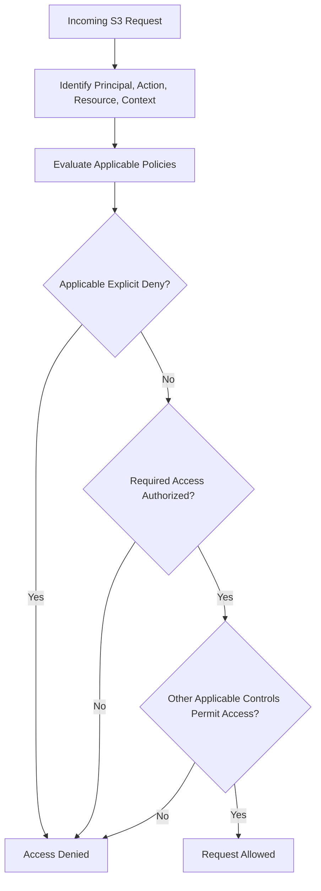

# 08- IAM and Bucket Policy Questions

## Overview

Amazon S3 authorization determines which identities can access buckets, objects, and related resources. Incorrect policies can expose confidential data, interrupt production workloads, or give compromised applications excessive control over stored objects.

For backend engineers, S3 security requires understanding IAM roles, identity-based policies, bucket policies, policy evaluation, cross-account access, Block Public Access, Object Ownership, access points, and encryption permissions.

This document organizes interview questions around practical authorization problems, policy design, failure diagnosis, and production security decisions. The emphasis is on understanding why access is allowed or denied, not simply writing JSON policies.

## IAM Fundamentals

### What is an IAM role, and why should backend applications use one?

An IAM role is an identity with permissions that can be assumed to obtain temporary security credentials.

Backend workloads should generally use workload identity rather than hardcoded AWS access keys.

Common examples include:

| Workload | Recommended credential mechanism |
|---|---|
| Application running on EC2 | EC2 instance profile |
| Container running on ECS | ECS task role |
| Application running on EKS | EKS Pod Identity or IAM Roles for Service Accounts |
| AWS Lambda function | Lambda execution role |
| GitHub Actions deployment | IAM role assumed through OIDC federation |
| Local development | AWS CLI profile or another supported development identity |

Boto3 can obtain credentials through its configured credential provider chain without embedding access keys in application code.

**Advantages:** Temporary credentials reduce long-lived secret exposure, support credential rotation, and allow permissions to be scoped to individual workloads.

**Production considerations:** A workload role must have the minimum permissions required by the application, and its trust policy must permit only the intended identity or AWS service to assume it.

### What is the difference between a role's trust policy and its permissions policy?

These policies answer different questions.

| Policy | Question answered |
|---|---|
| Trust policy | Who or what is allowed to assume this role? |
| Permissions policy | What actions can the role perform after it is assumed? |

For example, a Lambda execution role's trust policy permits the Lambda service to assume the role. Its permissions policy may grant `s3:GetObject` on a particular bucket prefix.

A valid trust relationship does not automatically grant S3 permissions. Likewise, an S3 permissions policy does not automatically allow an untrusted identity to assume the role.

### What is least-privilege access in S3?

Least privilege grants only the actions, resources, and conditions required by a workload.

Suppose a document-processing service must read objects from `incoming/` and write results to `processed/`. It should not receive unrestricted access to every bucket in the AWS account.

A suitable design grants:

- `s3:GetObject` on `incoming/*`.
- `s3:PutObject` on `processed/*`.
- `s3:ListBucket` only when listing is needed, with a suitable prefix condition.
- No deletion permissions unless deletion is part of the service's responsibilities.

Separate IAM roles for independent services where practical. For example, an ingestion API should not automatically receive the same destructive permissions as a lifecycle cleanup worker.

### What is the difference between an identity-based policy and a resource-based policy?

An identity-based policy is attached to an IAM user, group, or role. A resource-based policy is attached to a resource, such as an S3 bucket or access point.

| Characteristic | Identity-based policy | Resource-based policy |
|---|---|---|
| Attached to | IAM user, group, or role | Bucket or access point |
| Defines | Permissions granted to an identity | Access to a resource and its principals |
| Common use | Give a workload read/write access | Allow a trusted external account to use a bucket |
| Supports explicit deny | Yes | Yes |
| Cross-account role | Normally part of the caller-side authorization | Normally part of the resource-owner authorization |

For same-account requests, a matching identity-based or resource-based grant can authorize access, subject to the complete AWS authorization evaluation.

For cross-account requests, the caller's account and resource owner's account normally both need to authorize the operation. Organization policies, permissions boundaries, session policies, and other applicable controls can further restrict access.

A bucket policy that names an IAM role does not automatically grant that role every S3 permission. Only actions, resources, and conditions covered by the applicable policies are authorized.

Reference: [Access control in Amazon S3](https://docs.aws.amazon.com/AmazonS3/latest/userguide/access-management.html).

## S3 Policy Structure and Resource ARNs

### What are the main elements of an IAM policy statement?

| Element | Purpose |
|---|---|
| `Effect` | Specifies `Allow` or `Deny` |
| `Action` | Identifies the API actions affected |
| `Resource` | Identifies the applicable resource ARNs |
| `Principal` | Identifies who is allowed or denied in a resource-based policy |
| `Condition` | Restricts the circumstances under which the statement applies |
| `Sid` | Optional statement identifier |

The `Principal` element is generally used in resource-based policies, such as S3 bucket policies. Identity-based policies are attached to the identity to which they apply.

### Why must bucket ARNs and object ARNs be treated differently?

S3 bucket operations and object operations use different resource ARNs.

| Resource | ARN pattern | Typical actions |
|---|---|---|
| Bucket | `arn:aws:s3:::company-prod-documents` | `s3:ListBucket`, `s3:GetBucketLocation` |
| Objects | `arn:aws:s3:::company-prod-documents/*` | `s3:GetObject`, `s3:PutObject`, `s3:DeleteObject` |

For example, granting `s3:GetObject` only on the bucket ARN does not authorize downloading its objects. Conversely, `s3:ListBucket` applies to the bucket resource rather than an object ARN.

This distinction is a common cause of `AccessDenied` errors.

Reference: [S3 actions, resources, and condition keys](https://docs.aws.amazon.com/service-authorization/latest/reference/list_amazons3.html).

### How would you create a least-privilege policy for a file-processing service?

Assume the service must list and download incoming files, then upload processed files.

```json
{
  "Version": "2012-10-17",
  "Statement": [
    {
      "Sid": "ListIncomingObjects",
      "Effect": "Allow",
      "Action": "s3:ListBucket",
      "Resource": "arn:aws:s3:::company-prod-documents",
      "Condition": {
        "StringLike": {
          "s3:prefix": [
            "incoming",
            "incoming/*"
          ]
        }
      }
    },
    {
      "Sid": "ReadIncomingObjects",
      "Effect": "Allow",
      "Action": "s3:GetObject",
      "Resource": "arn:aws:s3:::company-prod-documents/incoming/*"
    },
    {
      "Sid": "WriteProcessedObjects",
      "Effect": "Allow",
      "Action": "s3:PutObject",
      "Resource": "arn:aws:s3:::company-prod-documents/processed/*"
    }
  ]
}
```

The policy separates bucket-level listing from object-level read and write permissions.

The service cannot use these statements to read arbitrary objects outside `incoming/*` or write objects outside `processed/*`. It receives no explicit deletion permission.

If the service relies entirely on event notifications and does not need to list objects, remove the `s3:ListBucket` statement. Additional permissions for KMS or multipart workflows should be added only when required.

### What is the difference between an IAM policy and a bucket policy?

An IAM policy is attached to an identity and describes what that identity is allowed to do. A bucket policy is attached to an S3 bucket and describes which principals can perform specified operations on the bucket and its objects.

For a same-account application, the role's IAM policy can grant access while the bucket policy may impose additional restrictions.

For a cross-account application, the resource owner's bucket policy normally needs to authorize the external principal, while the caller's identity policy must also permit the requested operation.

An applicable explicit deny overrides an allow, regardless of which of these policy types contains it.

## IAM Authorization Evaluation

### How does AWS evaluate an S3 request?

AWS evaluates the request using the principal, requested action, resource, request context, and applicable policies.

The practical rules are:

- Access is denied by default unless an applicable authorization grants the request.
- An applicable explicit deny overrides an allow.
- Permissions boundaries, session policies, SCPs, RCPs, and other applicable controls can restrict permissions.
- Cross-account requests normally require authorization on both sides.
- S3 object permissions and KMS permissions are separate authorization checks.



This is a conceptual overview rather than a complete representation of every AWS policy-evaluation rule. Resource-based policies that grant permissions directly to role sessions can interact differently with implicit denies and certain identity restrictions.

Reference: [IAM policy evaluation logic](https://docs.aws.amazon.com/IAM/latest/UserGuide/reference_policies_evaluation-logic.html).

### What is the difference between implicit deny and explicit deny?

An **implicit deny** occurs when the applicable policies do not grant the requested permission.

An **explicit deny** occurs when an applicable policy contains a matching `Deny` statement.

For example, a role might allow `s3:GetObject`, while the bucket policy denies requests that do not use HTTPS. An insecure request is denied despite the identity-based allow.

Explicit denies are useful for security guardrails, but a poorly scoped deny can block legitimate workloads or administrative recovery.

### What are permissions boundaries, session policies, SCPs, and RCPs?

These mechanisms constrain permissions at different levels.

| Mechanism | Role in authorization |
|---|---|
| Permissions boundary | Limits the permissions that identity-based policies can grant to a user or role |
| Session policy | Further restricts permissions available to a role session |
| Service control policy (SCP) | Sets permission guardrails for principals in affected AWS Organization accounts |
| Resource control policy (RCP) | Sets permission guardrails for supported resources in affected AWS Organization accounts |

These policies generally restrict permissions rather than independently grant them.

When diagnosing an access failure, inspect these controls instead of assuming that the identity policy and bucket policy are the only relevant documents.

### What is the difference between an allowed policy action and an effective permission?

A matching `Allow` does not guarantee that the final request is authorized.

For example:

- The role's policy allows `s3:GetObject`.
- The bucket policy explicitly denies the request.
- A permissions boundary excludes the action.
- An SCP restricts the principal's account.
- The KMS key policy does not permit decryption.

The effective decision depends on all applicable policy types and the request context.

## Bucket Policy Design

### How would you enforce HTTPS-only access to an S3 bucket?

Use a bucket policy that denies insecure transport.

```json
{
  "Version": "2012-10-17",
  "Statement": [
    {
      "Sid": "DenyInsecureTransport",
      "Effect": "Deny",
      "Principal": "*",
      "Action": "s3:*",
      "Resource": [
        "arn:aws:s3:::company-prod-documents",
        "arn:aws:s3:::company-prod-documents/*"
      ],
      "Condition": {
        "Bool": {
          "aws:SecureTransport": "false"
        }
      }
    }
  ]
}
```

The policy denies matching requests that do not use secure transport, even if another policy allows the requested operation.

This is a useful production baseline. Validate legitimate access paths, including service integrations and administrative operations, before introducing broad deny policies.

### How would you allow a specific application role to read documents?

A bucket policy can grant read access to a trusted IAM role.

```json
{
  "Version": "2012-10-17",
  "Statement": [
    {
      "Sid": "AllowDocumentReader",
      "Effect": "Allow",
      "Principal": {
        "AWS": "arn:aws:iam::111122223333:role/document-reader"
      },
      "Action": "s3:GetObject",
      "Resource": "arn:aws:s3:::company-prod-documents/documents/*"
    }
  ]
}
```

The role can read matching objects if the request satisfies all applicable authorization requirements.

The statement does not grant bucket listing, object writes, or access to other prefixes. If enumeration is required, add a properly scoped `s3:ListBucket` permission and a prefix condition.

### How would you grant another AWS account access to a bucket?

Assume the bucket belongs to account `111122223333` and the application role belongs to account `444455556666`.

The bucket owner can add this resource-based policy:

```json
{
  "Version": "2012-10-17",
  "Statement": [
    {
      "Sid": "AllowTrustedExternalReader",
      "Effect": "Allow",
      "Principal": {
        "AWS": "arn:aws:iam::444455556666:role/external-document-reader"
      },
      "Action": "s3:GetObject",
      "Resource": "arn:aws:s3:::company-prod-documents/documents/*"
    }
  ]
}
```

The external role must also have an identity-based policy allowing the required S3 operation. The bucket owner's policy and applicable organization controls must permit the request.

If the objects use SSE-KMS, the relevant key policy and KMS permissions must also authorize decryption.

For external integrations, trust a specific role where possible rather than granting broad account-wide access. Review the trust relationship periodically.

### How would you enforce tenant-level isolation in a shared bucket?

Suppose a multi-tenant application stores objects under these prefixes:

```text
tenants/tenant-123/documents/
tenants/tenant-456/documents/
```

A workload's permissions can be scoped to its authorized prefix. Bucket-level listing can be restricted through the `s3:prefix` condition, and object operations can be restricted using the corresponding object ARNs.

However, the backend must not treat a client-provided tenant ID as proof of authorization. It must derive the allowed tenant from the authenticated identity and trusted application state.

For large systems with many independently controlled datasets, consider separate IAM roles, S3 Access Points, or S3 Access Grants where appropriate. Avoid expanding a shared role's access merely because multiple tenants use the same bucket.

## Public Access and Object Ownership

### What is S3 Block Public Access?

S3 Block Public Access provides controls at the account, bucket, and supported access-point levels to prevent or restrict public access.

| Setting | Purpose |
|---|---|
| `BlockPublicAcls` | Rejects attempts to create new public ACLs |
| `IgnorePublicAcls` | Ignores public ACLs when evaluating access |
| `BlockPublicPolicy` | Rejects bucket or access-point policies that grant public access |
| `RestrictPublicBuckets` | Restricts access to buckets with public policies, subject to documented behavior and exceptions |

These controls override conflicting public permissions where applicable. New general purpose buckets have Block Public Access enabled by default.

For a private production bucket, enabling all four settings at appropriate account and bucket levels is a strong baseline.

Block Public Access does not replace least-privilege authorization. A bucket can be private to the public and still grant excessive permissions to internal or cross-account principals.

### How would you enable Block Public Access using AWS CLI?

```bash
aws s3api put-public-access-block \
  --bucket company-prod-documents \
  --public-access-block-configuration \
  BlockPublicAcls=true,IgnorePublicAcls=true,BlockPublicPolicy=true,RestrictPublicBuckets=true
```

Verify the bucket configuration:

```bash
aws s3api get-public-access-block \
  --bucket company-prod-documents
```

Account-level settings can also affect effective access. Inspect them when diagnosing public-access behavior.

### Should a production application expose its S3 bucket publicly?

Usually not.

For private document or media delivery, the backend can authenticate the user and generate a short-lived presigned URL. For a public website, CloudFront with Origin Access Control (OAC) can serve content from a private S3 origin.

This separates public content delivery from direct access to the storage bucket. The bucket policy should grant CloudFront only the access required by the intended distribution.

Direct S3 website hosting has different access requirements. If the architecture requires a private origin and HTTPS through CloudFront, do not make the origin bucket public simply to make delivery work.

### What is S3 Object Ownership, and why is Bucket owner enforced useful?

S3 Object Ownership controls object ownership and ACL behavior.

With **Bucket owner enforced**:

- The bucket owner owns objects uploaded to the bucket.
- ACLs are disabled.
- Access is controlled through IAM and resource-based policies.
- Requests specifying unsupported ACLs can fail.

This is a useful default for new centralized storage systems and cross-account uploads because it avoids unnecessary ACL management and ownership surprises.

Applications should not assume they can set `public-read` or other ACLs when ACLs are disabled.

References: [S3 Block Public Access](https://docs.aws.amazon.com/AmazonS3/latest/userguide/access-control-block-public-access.html) and [S3 Object Ownership](https://docs.aws.amazon.com/AmazonS3/latest/userguide/about-object-ownership.html).

## Access Points and Centralized Access

### What is an S3 Access Point?

An S3 Access Point provides a named endpoint attached to a bucket with its own access-point policy and, where supported, network controls.

Access points are useful when different applications need different permissions over a shared dataset.

For example, an analytics service might have read-only access to `analytics/`, while an ingestion service can write to `incoming/`.

An access point does not automatically eliminate direct bucket access. Its restrictions apply to requests made through that access point. If all application access must follow access-point policies, the underlying bucket policy must also be configured to prevent unintended direct access.

### What is the difference between a bucket policy and an access-point policy?

| Concern | Bucket policy | Access-point policy |
|---|---|---|
| Scope | Bucket and applicable object requests | Requests through a particular access point |
| Main use | Define bucket-level authorization | Define a dedicated access boundary for a consumer or workload |
| Direct bucket access | Applies to requests using the bucket | Not automatically restricted by access-point policy |
| Multiple consumers | Shared bucket-level policy | Different access points can have different policies |
| Authorization | Evaluated with all applicable policies | Access-point policy and underlying bucket authorization both matter |

Access points improve policy organization, but do not eliminate the need to evaluate the complete request path.

Reference: [Managing access to shared datasets with access points](https://docs.aws.amazon.com/AmazonS3/latest/userguide/access-points.html).

### When should you consider S3 Access Grants?

S3 Access Grants can help manage access to S3 data at scale, including access associated with users, groups, and prefixes.

It is useful when a centralized data platform requires many granular grants that would become difficult to manage through bucket policies alone.

The architecture needs appropriate identity integration, grant configuration, and operational controls. Evaluate whether Access Grants fits the access model before introducing the additional complexity.

Reference: [S3 Access Grants](https://docs.aws.amazon.com/AmazonS3/latest/userguide/access-grants.html).

## S3 Authorization and AWS KMS

### Why can a role with S3 read access fail to download an encrypted object?

S3 authorization and KMS authorization are separate.

For an SSE-KMS-encrypted object, a caller generally needs:

- `s3:GetObject` for the target object.
- Appropriate KMS authorization to decrypt the object's data key.
- A KMS key policy that permits the operation.
- All applicable IAM and organization policies to allow the request.

A role might pass the S3 authorization check but fail at the KMS layer. Granting more S3 permissions will not resolve a KMS denial.

### What permissions are needed to upload SSE-KMS-encrypted objects?

The exact permissions depend on the upload operation and encryption configuration.

Common requirements include:

- `s3:PutObject` on the destination object.
- `kms:GenerateDataKey` on the key used for encryption.
- Appropriate authorization in the KMS key policy.
- Additional KMS operations where the specific workflow requires them, such as multipart uploads.

Use the applicable AWS service-authorization documentation and encryption configuration to determine the exact action set. Do not grant broad KMS permissions across the account when only one key is required.

### How would you troubleshoot `AccessDenied` when accessing an SSE-KMS object?

Use a layered diagnostic process:

1. Identify the principal that actually made the request.
2. Verify the required S3 action and target resource ARN.
3. Inspect the identity policy, bucket policy, and applicable organization restrictions.
4. Confirm the exact KMS key ARN and key state.
5. Inspect the key policy and required IAM permissions.
6. Review encryption-context and cross-account restrictions.
7. Correlate relevant CloudTrail events and error details.

Determine whether the failure occurred at the S3 authorization layer or during the KMS operation before changing permissions.

Reference: [Troubleshooting S3 access denied errors](https://docs.aws.amazon.com/AmazonS3/latest/userguide/troubleshoot-403-errors.html).

## Presigned URLs and Delegated Access

### How do presigned URLs relate to IAM permissions?

A presigned URL contains a signature generated by an authorized signer for a specific S3 request. The signer must be authorized for the intended operation, and the resulting request remains subject to applicable S3 authorization controls.

A backend can generate a presigned GET URL after authenticating a user and checking the user's access to a document. For uploads, it can generate a presigned PUT URL for a controlled object key.

This allows clients to transfer file data directly to S3 without proxying the entire payload through the application server.

### Are presigned URLs public access?

A presigned URL is a bearer-style delegated credential. Anyone who obtains the valid URL may be able to use it for the signed operation while it remains valid and the request satisfies applicable conditions.

Production controls should include:

- Short expiration periods appropriate to the workflow.
- Authorization checks before issuing the URL.
- Object keys derived from trusted application state.
- Appropriate upload-size and content-type validation.
- Avoiding signed URLs in logs, analytics, and error messages.
- Validation of uploaded objects before processing untrusted content.

The effective lifetime can be shorter than the configured expiration if the signing credentials expire or become invalid, or if policy changes prevent the request.

### Can bucket policies restrict presigned URL usage?

Yes. Presigned requests are evaluated as S3 requests and remain subject to applicable bucket policies and conditions.

A policy can restrict access using secure transport, network-related conditions where supported, and other appropriate request attributes.

However, network restrictions must match the real request path. Requiring a particular VPC endpoint, for example, can prevent clients using presigned URLs from accessing S3 directly over the public internet.

Test the actual client path before enforcing network-specific conditions.

## Common Authorization Failures

### Why does `AccessDenied` occur even though the IAM policy allows the action?

A matching identity-based allow is only one part of the authorization decision.

Possible causes include:

- An explicit deny in the bucket policy.
- An unexpected AWS identity or assumed role.
- A permissions boundary or session policy that restricts access.
- An SCP or RCP restriction.
- Incorrect bucket or object ARNs.
- Incomplete cross-account authorization.
- A VPC endpoint policy that blocks the request.
- Missing KMS authorization for an encrypted object.

Start by identifying the caller, operation, and exact resource. Then inspect the policies that apply to that request.

Do not respond to every access failure by granting `s3:*`.

### Why does `s3:ListBucket` work for one prefix but fail for another?

The policy may contain a condition on `s3:prefix` that limits which keys can be listed.

For example, a policy might allow listing `incoming/` but not `processed/`.

Distinguish listing permission from object retrieval:

- `s3:ListBucket` applies to the bucket ARN.
- `s3:GetObject` applies to object ARNs.

Inspect the exact prefix passed by the client and verify that the policy condition matches the request context.

### Why does cross-account access fail even though the bucket policy looks correct?

Investigate both accounts and the actual caller identity.

Check whether:

- The external role's identity policy permits the action.
- The bucket policy trusts the correct external role.
- The role was assumed successfully.
- Organization policies permit the request.
- Object ownership and ACL settings match the design.
- KMS permissions allow decryption or encryption when applicable.
- The request uses the intended bucket, Region, and access path.

Bucket owner enforced Object Ownership simplifies cross-account object ownership, but does not independently authorize access.

### How can you safely test a policy change?

Use a controlled development environment and test both allowed and denied actions.

For a read-only role, verify that it can read intended objects but cannot upload, delete, list unauthorized prefixes, or access another tenant's data.

Useful verification commands include:

```bash
aws sts get-caller-identity
```

```bash
aws s3api get-bucket-policy \
  --bucket company-prod-documents
```

```bash
aws s3api get-public-access-block \
  --bucket company-prod-documents
```

```bash
aws s3api get-bucket-ownership-controls \
  --bucket company-prod-documents
```

Run object-level operations with the same role and Region used by the application. Remember that `HeadObject` can return a 403 rather than a 404 when the caller lacks the permissions needed to distinguish a missing object.

IAM Access Analyzer and the IAM policy simulator are useful diagnostic tools, but they do not replace testing the real S3 access path, resource policies, and KMS permissions.

## Auditing and Production Security

### How do CloudTrail and S3 access logging help investigate failures?

CloudTrail records AWS API activity. S3 object-level operations such as `GetObject`, `PutObject`, and `DeleteObject` are data events and generally require explicit data-event configuration.

CloudTrail can help identify the principal, API operation, time, request context, and available error details.

S3 server access logging records request information to a designated logging destination. Its delivery behavior differs from CloudTrail, and it should not be treated as an immediate, complete event stream.

For an investigation, correlate timestamps, caller identity, API operation, bucket, object key, Region, request ID, and relevant S3 or KMS errors.

### What should be included in a production S3 security review?

A practical review should cover:

- Account-level and bucket-level Block Public Access.
- Bucket policies with broad principals, risky actions, or explicit denies.
- Least-privilege IAM roles for every workload.
- Object Ownership and ACL configuration.
- Cross-account trust and access-point policies.
- Network restrictions and VPC endpoint policies.
- KMS key policies and encryption permissions.
- Presigned URL lifetime and authorization workflows.
- Audit coverage for sensitive S3 data events.
- Monitoring for unexpected policy changes and destructive operations.

Repeat the review when the application role, bucket policy, encryption key, access path, or infrastructure changes.

## Scenario-Based Interview Questions

### Scenario: One application role can read one bucket but receives `AccessDenied` from another bucket in the same account. What would you investigate?

First, use `sts get-caller-identity` to confirm the effective principal. Compare the bucket policies, object ARNs, ownership settings, access points, and encryption configuration.

If the role has the necessary identity permissions but only one bucket fails, investigate the failing bucket's resource policy and any applicable explicit denies. If the buckets use different KMS keys, compare the key-policy authorization too.

Identify the failing authorization layer before expanding the role's permissions.

### Scenario: A public-access scan reports a bucket as public, but the application is intended to use CloudFront. What is the secure design?

Use a private S3 bucket as the CloudFront origin, configure Origin Access Control, and allow only the intended distribution to access the required objects through a narrowly scoped bucket policy.

Enable Block Public Access and remove unnecessary public grants. Then verify that CloudFront can retrieve the intended content and direct anonymous access to the S3 bucket fails.

Do not make the bucket public to resolve an origin-access configuration problem.

### Scenario: Multiple microservices share one bucket, but each service should access a different prefix. How would you design permissions?

Create separate IAM roles for the services and restrict each role's object actions to the required prefix. Grant `s3:ListBucket` only where listing is needed, with a corresponding prefix condition.

For a more complex shared-data platform, consider access points or S3 Access Grants where appropriate.

Ensure that the backend derives the authorized tenant or prefix from authenticated application state rather than trusting client-supplied identifiers.

### Scenario: An external partner needs to upload files but must not read or delete existing documents. How would you configure access?

Use a dedicated external role or narrowly scoped cross-account bucket-policy grant for the upload prefix. Do not grant `s3:GetObject` or `s3:DeleteObject` unless the integration explicitly requires those operations.

Use Bucket owner enforced Object Ownership where appropriate, avoiding unnecessary ACL management. Validate that the partner can upload to the designated prefix but cannot read existing files, list unauthorized data, or delete objects.

### Scenario: A bucket policy permits access, and the IAM role has `s3:GetObject`, but a specific download fails. What is your diagnostic sequence?

Verify the effective identity, bucket, Region, key, and version ID if applicable. Check whether the object exists through an appropriately authorized diagnostic path.

Then inspect the identity policy, resource policy, explicit denies, permissions boundaries, organization restrictions, endpoint policies, and KMS authorization.

The goal is to distinguish a missing object from an S3 authorization failure or an encryption-related failure before changing permissions.

### Scenario: The organization requires HTTPS-only access and restricts production data to approved network paths. How would you implement this without blocking valid traffic?

Use a TLS-deny bucket policy and appropriate network-related controls. Inventory the actual access paths first, including application workloads, administration, CloudFront, replication, and presigned URL clients.

Test allowed and denied requests before deployment. Network conditions must match the real request path; otherwise, a restrictive policy can block legitimate consumers and recovery procedures.

## Authoritative References

- [Access control in Amazon S3](https://docs.aws.amazon.com/AmazonS3/latest/userguide/access-management.html)
- [Bucket policies for Amazon S3](https://docs.aws.amazon.com/AmazonS3/latest/userguide/bucket-policies.html)
- [IAM policy evaluation logic](https://docs.aws.amazon.com/IAM/latest/UserGuide/reference_policies_evaluation-logic.html)
- [IAM policy evaluation and explicit denies](https://docs.aws.amazon.com/IAM/latest/UserGuide/reference_policies_evaluation-logic_policy-eval-denyallow.html)
- [S3 actions, resources, and condition keys](https://docs.aws.amazon.com/service-authorization/latest/reference/list_amazons3.html)
- [S3 Block Public Access](https://docs.aws.amazon.com/AmazonS3/latest/userguide/access-control-block-public-access.html)
- [S3 Object Ownership](https://docs.aws.amazon.com/AmazonS3/latest/userguide/about-object-ownership.html)
- [S3 Access Points](https://docs.aws.amazon.com/AmazonS3/latest/userguide/access-points.html)
- [S3 Access Grants](https://docs.aws.amazon.com/AmazonS3/latest/userguide/access-grants.html)
- [S3 CloudTrail logging](https://docs.aws.amazon.com/AmazonS3/latest/userguide/cloudtrail-logging.html)
- [Troubleshooting S3 access denied errors](https://docs.aws.amazon.com/AmazonS3/latest/userguide/troubleshoot-403-errors.html)

## Key Takeaways

- S3 authorization combines identity policies, resource policies, request conditions, and applicable organization controls; an applicable explicit deny overrides an allow.
- Bucket and object operations require the correct resource ARNs, and cross-account access normally requires authorization on both sides.
- Block Public Access, Bucket owner enforced Object Ownership, and least-privilege IAM roles are strong defaults for private production buckets.
- S3 authorization and KMS encryption permissions are separate layers; identify the failing layer before changing policies.
- Validate security using real workload identities, test both allowed and denied operations, and audit sensitive S3 data access.