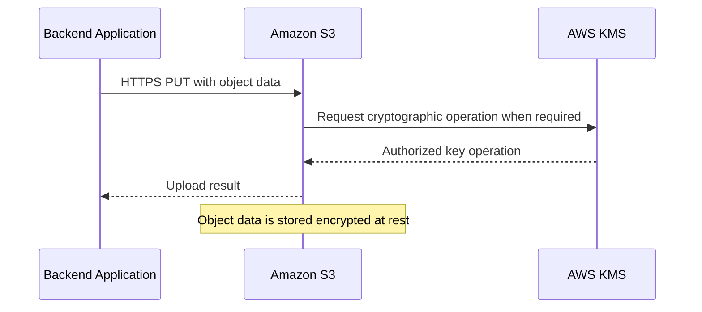

# 09- Encryption and AWS KMS Questions

## Overview

Amazon S3 encryption protects stored object data, while AWS Key Management Service (AWS KMS) provides cryptographic key management, access control, and auditing for workloads that require greater control over encryption keys.

For backend engineers, encryption is not simply a bucket configuration. It affects authorization, upload and download workflows, cross-account access, replication, performance, cost, compliance, and disaster recovery.

A production design must distinguish between encryption at rest, encryption in transit, server-side encryption, client-side encryption, and authorization to use a cryptographic key. A successful S3 permission check does not necessarily mean that the caller can decrypt an SSE-KMS-encrypted object.

## Encryption Fundamentals

### What is server-side encryption in Amazon S3?

Server-side encryption (SSE) encrypts object data on the S3 side before storing it on the underlying storage infrastructure. S3 handles the encryption and decryption operations transparently during supported upload and download requests.

S3 automatically encrypts new object uploads at rest using SSE-S3 by default. Applications can select SSE-KMS or DSSE-KMS when they require additional key-management or compliance capabilities.

Server-side encryption provides protection for stored object data, but it does not replace HTTPS, IAM authorization, secure application design, or retention controls.

### What encryption methods does S3 support?

| Method | Key management | Main use case | Important limitation |
|---|---|---|---|
| SSE-S3 | Amazon S3 manages encryption keys | Default encryption for general workloads | Does not provide the same customer-managed key controls as SSE-KMS |
| SSE-KMS | AWS KMS manages the selected key | Centralized key policies, auditing, and controlled key usage | KMS permissions, request quotas, and additional costs must be considered |
| DSSE-KMS | AWS KMS and S3 provide two independent encryption layers | Requirements for dual-layer server-side encryption | Higher cost and processing overhead; S3 Bucket Keys are unsupported |
| SSE-C | Customer supplies the encryption key with supported requests | Specialized workloads requiring customer-supplied key material | The customer must securely retain and supply the key for future access |
| Client-side encryption | Application or encryption library encrypts data before uploading it | Requirements that plaintext must remain encrypted outside the client-side trust boundary | Applications must manage encryption, decryption, and key recovery |

Choose the method according to the data classification, regulatory requirements, key-management needs, access model, and operational cost.

### Is every S3 object encrypted at rest by default?

New objects uploaded to S3 are automatically encrypted at rest using SSE-S3 unless a different supported encryption configuration applies.

This is the default behavior for Amazon S3 general purpose buckets. It does not mean every historical object has automatically been rewritten or re-encrypted under a newly selected customer-managed KMS key.

Changing the bucket's default encryption affects new writes. To change the encryption of existing objects, use an appropriate copy or rewrite workflow and validate the results.

Reference: [Configuring default bucket encryption](https://docs.aws.amazon.com/AmazonS3/latest/userguide/default-bucket-encryption.html).

### Does encryption at rest protect data in transit?

No. Encryption at rest protects stored object data, while encryption in transit protects data exchanged between the client and S3.

Use HTTPS for S3 API requests and enforce secure transport where appropriate through bucket policies or organization-level controls.

A typical upload flow is:



The diagram illustrates the logical flow for an SSE-KMS upload. The precise KMS interactions depend on the operation and whether S3 Bucket Keys are enabled.

Encryption in transit does not prevent unauthorized users from accessing a resource after authentication. It must be combined with correct IAM permissions, bucket policies, and application authorization.

Reference: [Protecting data in transit](https://docs.aws.amazon.com/AmazonS3/latest/userguide/UsingEncryptionInTransit.html).

## SSE-S3, SSE-KMS, and DSSE-KMS

### What is SSE-S3?

SSE-S3 is Amazon S3's default server-side encryption mechanism. S3 manages the encryption keys and automatically encrypts new uploaded objects.

Use SSE-S3 when the application needs standard encryption at rest but does not need customer-controlled KMS key policies or direct management of a customer-managed key.

**Advantages:**
- Enabled by default for new uploads.
- No additional KMS API request costs.
- No application-managed encryption or decryption workflow.
- Minimal operational configuration.

**Limitations:**
- Provides less direct control over key policies and customer-managed key lifecycle.
- Does not offer the same customer-managed key usage controls and audit capabilities as SSE-KMS.

SSE-S3 is not equivalent to unencrypted storage. It provides encryption at rest without requiring the application to provide a key.

### What is SSE-KMS, and why would a production application use it?

SSE-KMS integrates S3 with AWS KMS for managing encryption keys.

S3 uses envelope encryption: object data is encrypted using a data encryption key, while AWS KMS protects the data key. The application does not need to implement the encryption algorithm or directly encrypt every byte with the KMS key.

SSE-KMS is useful when an organization requires:

- Customer-managed encryption keys.
- Key usage auditing through CloudTrail.
- Explicit control over who can use a key.
- Cross-account key access.
- Separation of data access and cryptographic authorization.
- Centralized key lifecycle and policy management.

SSE-KMS introduces operational dependencies on KMS permissions, key availability, service quotas, and cost.

### What is the difference between an AWS-managed KMS key and a customer-managed KMS key?

| Characteristic | AWS-managed key | Customer-managed key |
|---|---|---|
| Creation and management | Managed by AWS for the service | Created and managed by the customer |
| Key policy customization | Limited customer control | Customer can configure the key policy |
| Key lifecycle | Managed according to AWS service behavior | Customer controls key administration, enablement, and deletion scheduling |
| Usage visibility | Less control over key-specific configuration | Greater control over key usage auditing and permissions |
| Common S3 example | `aws/s3` | A customer-created key dedicated to sensitive documents |

The AWS-managed `aws/s3` key is convenient for SSE-KMS when customer-managed key policies are unnecessary. A customer-managed key is more suitable when the workload requires custom authorization, explicit administrative controls, or a dedicated cryptographic boundary.

Customer-managed keys also introduce additional operational responsibility. Disabling or scheduling the deletion of a required key can make encrypted objects inaccessible.

### What is DSSE-KMS?

DSSE-KMS applies two independent layers of server-side encryption to an object. One layer uses a KMS-generated data encryption key, and another layer uses a separate S3-managed encryption key.

It is intended for workloads that require dual-layer encryption, including certain compliance scenarios.

Compared with SSE-KMS, DSSE-KMS adds encryption processing and cost. It does not support S3 Bucket Keys.

Use DSSE-KMS when the requirement explicitly calls for its additional encryption layer rather than assuming that two layers are always necessary for every sensitive workload.

Reference: [Using DSSE-KMS](https://docs.aws.amazon.com/AmazonS3/latest/userguide/UsingDSSEncryption.html).

### What is SSE-C, and why is it operationally different?

SSE-C allows a customer to provide encryption key material with supported S3 requests. S3 performs server-side encryption using the supplied key and does not retain the original key.

To retrieve an object encrypted with SSE-C, the caller must supply the correct key again. Losing the key can make the object permanently inaccessible.

SSE-C differs from SSE-KMS because KMS is not responsible for managing the object encryption key or authorizing its use.

**Current operational consideration:** As of April 2026, SSE-C is disabled by default for new general purpose buckets and for applicable existing buckets without SSE-C-encrypted objects. A bucket must be explicitly configured to permit SSE-C writes. SSE-C also requires the relevant encryption headers on supported requests.

Most modern workloads should evaluate SSE-S3 or SSE-KMS first because SSE-C complicates key distribution, request signing, recovery, and integration with other AWS services.

Reference: [Using SSE-C](https://docs.aws.amazon.com/AmazonS3/latest/userguide/specifying-s3-c-encryption.html).

## AWS KMS Architecture and Permissions

### How does envelope encryption work with SSE-KMS?

Envelope encryption avoids using a central KMS key directly to encrypt every byte of a large object.

Conceptually, the workflow is:

1. S3 obtains a data encryption key through AWS KMS.
2. The data encryption key protects the object data.
3. The protected data key is stored with the encrypted object data.
4. During retrieval, S3 obtains authorization to decrypt the data key.
5. S3 decrypts the data and returns it over the authorized request path.

The application delegates the cryptographic operations to S3 and KMS rather than implementing encryption itself.

This provides separation between object-data storage and key authorization. A principal can be allowed to locate or otherwise interact with an object while still lacking the required permission to decrypt its contents.

### Which permissions are required to upload and download SSE-KMS objects?

Common requirements are:

| Operation | Typical S3 permission | Typical KMS permission |
|---|---|---|
| Upload an SSE-KMS object | `s3:PutObject` | `kms:GenerateDataKey` |
| Download an SSE-KMS object | `s3:GetObject` | `kms:Decrypt` |
| Multipart upload with SSE-KMS | Multipart-related S3 permissions | Commonly `kms:GenerateDataKey` and `kms:Decrypt` |
| Copy an encrypted object | Appropriate source-read and destination-write permissions | Depends on source and destination encryption operations |

The exact permissions depend on the operation, encryption configuration, key policy, and account boundaries. KMS grants or other supported authorization mechanisms can also influence the effective access.

A successful S3 permission check does not guarantee that the KMS operation will succeed.

Reference: [SSE-KMS permissions and configuration](https://docs.aws.amazon.com/AmazonS3/latest/userguide/UsingKMSEncryption.html).

### Why can an application read an unencrypted object but fail to read an SSE-KMS object?

The application may have the necessary S3 permission but lack KMS authorization.

For example, a role may have `s3:GetObject` on a bucket but lack `kms:Decrypt` for the specific key. The S3 request can then fail when the KMS operation is required.

Investigate the two authorization layers separately:

- S3 identity and bucket policies.
- KMS key policy, IAM permissions, and applicable grants.
- Organization policies and permissions boundaries.
- Encryption context and other policy conditions.
- Key state and correct key ARN.

Do not fix a KMS failure by granting broader S3 permissions.

### What is a KMS key policy?

A KMS key policy is the primary resource-based policy controlling access to a KMS key. It defines which principals can administer or use the key, subject to applicable IAM permissions and other authorization controls.

KMS access often requires coordination between the key policy and identity-based IAM policies. A role's IAM policy granting `kms:Decrypt` does not necessarily authorize that operation if the key policy does not permit the applicable access model.

For production keys, separate key administration from routine key usage where practical. The role that administers a key should not automatically be granted unrestricted access to every encrypted dataset.

### What is the difference between a KMS key policy and a KMS grant?

A key policy defines access to a KMS key at the resource-policy level. A KMS grant is a mechanism that delegates specific KMS operations to a grantee, subject to the grant's constraints and lifecycle.

Grants are useful when a supported AWS service or application needs narrowly scoped cryptographic access without continually modifying the key policy.

When debugging access, inspect both the key policy and relevant grants where applicable. Do not assume the key policy is the only source of KMS authorization.

### How do encryption contexts affect KMS authorization?

An encryption context is additional authenticated information associated with a cryptographic operation. It is not encrypted and must match when the corresponding decryption operation requires the same context.

By default, S3 uses the object's ARN as the encryption context for SSE-KMS objects without S3 Bucket Keys. When S3 Bucket Keys are enabled, the encryption context uses the bucket ARN instead.

This matters when KMS policies restrict access using encryption-context conditions. A policy that expects an individual object ARN may stop working as intended when Bucket Keys are enabled.

Do not place sensitive values in encryption-context fields because the context is not secret.

## S3 Bucket Keys and Cost Optimization

### What is an S3 Bucket Key?

An S3 Bucket Key reduces the number of requests between S3 and AWS KMS for SSE-KMS workloads.

Without a Bucket Key, high-volume access to large numbers of objects can generate substantial KMS request volume. A Bucket Key reduces repeated calls by allowing S3 to use a bucket-level key for a limited period when generating per-object data keys.

AWS documents that Bucket Keys can reduce SSE-KMS request costs by up to 99% in suitable workloads. The actual savings depend on the access pattern and KMS usage.

### When should S3 Bucket Keys be enabled?

Bucket Keys are worth evaluating when a workload uses SSE-KMS at high scale, particularly when many objects generate frequent KMS requests.

Consider:

- Expected object count and request volume.
- KMS request costs and quotas.
- Encryption-context conditions in existing IAM and key policies.
- Audit and access-control requirements.
- Whether DSSE-KMS is required.

Bucket Keys are not supported for DSSE-KMS. They also change the encryption context from the object ARN to the bucket ARN, so KMS policies using object-specific encryption-context conditions must be reviewed before enabling them.

Reference: [Reducing SSE-KMS costs with S3 Bucket Keys](https://docs.aws.amazon.com/AmazonS3/latest/userguide/bucket-key.html).

### Can SSE-KMS cause performance or throttling problems?

Yes. A high volume of encrypted object operations can increase KMS request traffic and encounter applicable KMS quotas or throttling.

The effect depends on the workload, request pattern, encryption settings, Bucket Key usage, and Region. Do not assume that every S3 object request produces a separate KMS API request; the precise interactions depend on the encryption path.

Monitor KMS throttling and error signals alongside S3 request failures and application latency. Where appropriate, enable Bucket Keys, review request patterns, and confirm the relevant quotas and service limits.

Avoid solving a throughput problem by removing required encryption controls without security approval.

## Default Encryption and AWS CLI

### How would you configure a bucket to use SSE-KMS by default?

Create an `encryption.json` file:

```json
{
  "Rules": [
    {
      "ApplyServerSideEncryptionByDefault": {
        "SSEAlgorithm": "aws:kms",
        "KMSMasterKeyID": "arn:aws:kms:ap-south-1:111122223333:key/YOUR-KMS-KEY-ID"
      },
      "BucketKeyEnabled": true
    }
  ]
}
```

Apply the configuration:

```bash
aws s3api put-bucket-encryption \
  --bucket company-prod-documents \
  --server-side-encryption-configuration file://encryption.json \
  --region ap-south-1
```

Verify the default:

```bash
aws s3api get-bucket-encryption \
  --bucket company-prod-documents \
  --region ap-south-1
```

The KMS key must be in the same Region as the bucket. For cross-account encryption, verify that the key policy and relevant IAM policies permit access to the selected key.

Configuring default encryption affects new objects that use the default. It does not retroactively rewrite existing objects.

### How do you upload an object with an explicitly selected SSE-KMS key?

```bash
aws s3 cp ./report.pdf \
  s3://company-prod-documents/documents/report.pdf \
  --sse aws:kms \
  --sse-kms-key-id arn:aws:kms:ap-south-1:111122223333:key/YOUR-KMS-KEY-ID \
  --region ap-south-1
```

This request explicitly selects the encryption method and key.

Use this approach when clients should specify the encryption key. If the bucket's default encryption already provides the required SSE-KMS configuration, clients can often omit encryption headers and allow S3 to apply the default.

Be consistent about the intended policy model. A bucket policy that requires explicit SSE-KMS headers can reject uploads that would otherwise rely on the bucket's default encryption.

### How do you inspect the encryption of an existing object?

Use `head-object`:

```bash
aws s3api head-object \
  --bucket company-prod-documents \
  --key "documents/report.pdf" \
  --region ap-south-1 \
  --query '{
    Encryption:ServerSideEncryption,
    KMSKey:SSEKMSKeyId,
    BucketKeyEnabled:BucketKeyEnabled
  }'
```

The result helps identify the encryption method reported for the object and, where applicable, the KMS key and Bucket Key status.

For bucket-level configuration, use `get-bucket-encryption`. For an inventory-wide audit, consider S3 Inventory with the relevant encryption fields rather than issuing a separate metadata request for every object.

### How would you require uploads to use a specific SSE-KMS key?

First configure the bucket's default encryption to the required key. If the organization must also prevent clients from choosing another encryption method or key, enforce the required conditions through a carefully tested bucket policy.

For example, a policy statement can deny `s3:PutObject` requests that do not explicitly specify the expected encryption algorithm:

```json
{
  "Version": "2012-10-17",
  "Statement": [
    {
      "Sid": "RequireExplicitSSEKMS",
      "Effect": "Deny",
      "Principal": "*",
      "Action": "s3:PutObject",
      "Resource": "arn:aws:s3:::company-prod-documents/*",
      "Condition": {
        "StringNotEquals": {
          "s3:x-amz-server-side-encryption": "aws:kms"
        }
      }
    }
  ]
}
```

This example enforces the `aws:kms` algorithm but does not enforce a particular KMS key ARN. A separate condition is required when the selected key must be restricted to a particular key.

**Operational warning:** This policy denies requests that omit the encryption header, even though S3 default encryption may otherwise encrypt their objects. Use explicit-header enforcement only when all intended upload clients are designed to provide the required header. Test multipart uploads, presigned URLs, service integrations, and production SDKs before deployment.

## Client-Side Encryption

### What is client-side encryption, and when should it be used?

Client-side encryption encrypts the object in the application or an approved cryptographic library before the data is sent to S3.

It can be appropriate when the system requires plaintext to remain outside the storage service's trust boundary or when the application must control encryption and decryption independently of S3's server-side encryption.

With client-side encryption:

- The client encrypts the object before uploading it.
- S3 stores the ciphertext, potentially protected by additional server-side encryption.
- A client with the required decryption capability retrieves and decrypts the object.

The trade-off is operational complexity: the application must manage encrypted formats, key access, decryption failures, and recovery procedures.

Prefer a well-supported solution such as the AWS Encryption SDK where appropriate rather than inventing a custom encryption format.

Reference: [Understanding S3 client-side encryption options](https://aws.amazon.com/blogs/storage/understanding-amazon-s3-client-side-encryption-options/).

### What is envelope encryption in client-side systems?

Envelope encryption uses a data encryption key to encrypt the payload and a separate wrapping key to protect the data key.

The encrypted payload and encrypted data key are stored together in an appropriate format. A client retrieves the encrypted data key, obtains authorization to unwrap it, and decrypts the payload.

The benefit is that large files do not need to be encrypted directly with a centralized key-management operation for every byte. It also supports separation between encrypted data storage and access to the wrapping key.

However, losing the required key material or permanently losing access to the key can make the data unrecoverable.

### Does server-side encryption encrypt S3 object metadata?

Server-side encryption protects object data, but it does not make every associated identifier or metadata field secret.

Object keys, bucket names, tags, and other metadata can remain visible to principals with the relevant permissions or through supported listing and metadata APIs.

Avoid putting sensitive personal information, secrets, or confidential business details in object keys and metadata. Encryption does not remove the need for careful naming and access-control design.

## Key Rotation, Disablement, and Recovery

### What is KMS automatic key rotation?

Automatic rotation changes the cryptographic material used by a supported KMS key while retaining the KMS key's identity and policies.

For supported symmetric customer-managed KMS keys, automatic rotation can be enabled and configured with an appropriate rotation period. AWS-managed KMS keys are rotated by AWS according to its managed-key behavior.

Rotation is useful for security and compliance requirements, but it should not be confused with changing an object's encryption key to a completely different KMS key.

Reference: [Rotating AWS KMS keys](https://docs.aws.amazon.com/kms/latest/developerguide/rotate-keys.html).

### Does KMS key rotation require re-encrypting every S3 object?

Not necessarily.

Automatic rotation of the material associated with the same KMS key preserves the ability to decrypt data protected using older key material, assuming the key remains usable and required historical material remains available through AWS KMS.

Changing to a different KMS key is a separate migration. Objects encrypted using an older key can continue to depend on that key for decryption.

Before disabling, scheduling deletion of, or replacing a KMS key, identify the objects and applications that depend on it. Re-encryption or object-copy workflows may be needed when changing to a different key.

### What happens if a required KMS key is disabled or scheduled for deletion?

Operations that require the key can fail, making affected S3 objects inaccessible until the issue is resolved.

Disabling a key is not equivalent to deleting stored objects, but it can effectively interrupt access to encrypted data. If a key is scheduled for deletion, the deletion waiting period and recovery procedures become critical operational considerations.

A production key-management process should include:

- Key ownership and administrative responsibilities.
- Monitoring for key-state changes.
- Protection against unauthorized disablement or deletion.
- Documented recovery and cancellation procedures where supported.
- Verification that backups and replicas remain decryptable.
- A dependency inventory before key migration or retirement.

Never schedule deletion of a key simply because new objects use a different key. Existing objects, backups, archived data, and replicas may still depend on it.

### How would you migrate existing objects from SSE-S3 to SSE-KMS?

Changing the bucket's default encryption affects new writes; it does not rewrite objects already stored.

A controlled migration can use S3 Batch Operations, an appropriate copy workflow, or another supported bulk-processing method to rewrite existing objects under the selected KMS key.

The migration should:

1. Define the exact object set and required destination encryption.
2. Confirm permissions to read source objects and write destination objects.
3. Grant the necessary KMS operations.
4. Execute a small test migration.
5. Validate object contents, metadata, versioning behavior, and encryption.
6. Process the remaining objects with progress tracking and error reporting.
7. Monitor cost and verify coverage before declaring completion.

For versioned buckets, copying an object can create a new version rather than replacing the full version history. Decide whether historical versions also require migration.

## Encryption in Replication and Disaster Recovery

### How does KMS affect Cross-Region Replication?

SSE-KMS replication requires an appropriate replication configuration and permission to use both the source and destination keys.

KMS keys used for S3 object encryption must be in the same Region as their respective buckets. A cross-Region replication setup therefore generally requires a compatible key in the destination Region when customer-managed encryption is used there.

The replication role may need permission to decrypt source data keys and authorize destination encryption operations. The destination key policy must also permit the relevant use.

A replication rule that works for SSE-S3 objects can still fail for KMS-encrypted objects if encryption-specific settings or permissions are missing.

### How would you diagnose a replication failure involving encryption?

Separate the S3 and KMS authorization paths.

1. Inspect the replication rule and confirm that it includes the encrypted objects.
2. Verify that source and destination buckets have versioning enabled.
3. Inspect the replication role's trust and permissions.
4. Verify the source KMS key permissions.
5. Verify the destination key's Region, state, policy, and permissions.
6. Check relevant CloudTrail events, replication status, and configured metrics.
7. Test replication using a controlled encrypted object.

If unencrypted objects replicate but encrypted objects fail, investigate encryption-specific configuration first. If all objects fail, inspect the general replication configuration and S3 permissions.

### Can a recovery copy be inaccessible even when replication succeeded?

Yes. Replication success does not guarantee that the destination application can decrypt the object.

For example, the destination bucket may contain an SSE-KMS-encrypted replica, but the recovery application's role might lack permission to use the destination KMS key.

A DR exercise should verify both object availability and decryption using the actual recovery identity. It should also verify that the required key remains enabled and that its policies survive the intended failure scenario.

## Troubleshooting Encryption Failures

### Scenario: `AccessDenied` occurs when uploading an SSE-KMS object

**Symptoms:** An upload fails even though the role appears to have S3 write access.

**Possible causes:**
- Missing `s3:PutObject`.
- Missing `kms:GenerateDataKey`.
- Incompatible KMS key policy.
- Incorrect key ARN or Region.
- A bucket policy enforcing a different encryption algorithm or key.
- An organization policy or permissions boundary blocking the operation.

**Diagnostic steps:**

```bash
aws sts get-caller-identity
```

```bash
aws s3api get-bucket-encryption \
  --bucket company-prod-documents \
  --region ap-south-1
```

```bash
aws kms describe-key \
  --key-id arn:aws:kms:ap-south-1:111122223333:key/YOUR-KMS-KEY-ID \
  --region ap-south-1
```

Review the role's IAM policy, key policy, and bucket policy. Identify whether the request is denied by S3 or KMS before granting additional permissions.

### Scenario: Downloads work for some objects but fail for others

**Symptoms:** Objects in a bucket do not all behave the same way under the same role.

**Possible causes:**
- Different objects use different encryption methods or KMS keys.
- The role has permission to use one key but not another.
- An object is encrypted with SSE-C and the correct customer key is unavailable.
- A referenced KMS key is disabled or pending deletion.
- Historical objects use a key that has since been retired.

**Diagnostic steps:** Inspect the affected objects with `head-object`, compare the reported encryption details, and verify each relevant KMS key's permissions and state.

**Corrective action:** Restore the required key authorization, key availability, or customer-managed key access. If a key has been permanently deleted or required SSE-C key material has been lost, recovery may not be possible.

### Scenario: SSE-KMS request volume or cost becomes unexpectedly high

**Symptoms:** KMS request volume increases, throttling occurs, or encryption-related costs rise.

**Possible causes:**
- High object request volume.
- Large numbers of objects encrypted with SSE-KMS.
- Multipart upload or copy workloads.
- S3 Bucket Keys are not enabled where appropriate.
- A changed request pattern increases KMS operations.

**Diagnostic steps:** Compare KMS usage metrics, CloudTrail events, S3 workload volume, encryption settings, and application request patterns.

**Corrective action:** Evaluate S3 Bucket Keys for SSE-KMS workloads, review unnecessary repeated requests, and verify the relevant KMS quotas. Do not assume Bucket Keys can be used for DSSE-KMS.

### Scenario: A presigned download URL works for SSE-S3 but fails for SSE-KMS

**Symptoms:** The same application can generate presigned URLs, but a KMS-encrypted object cannot be downloaded.

**Possible causes:**
- The signing identity is not authorized to read the object.
- The signing identity lacks the required KMS decryption permission.
- The object uses a different KMS key from the expected key.
- A key policy, bucket policy, or request condition blocks the operation.
- The URL has expired or the signing credentials are no longer valid.

**Diagnostic steps:** Confirm the signer's identity and S3 permissions, inspect the object's encryption metadata, check the relevant KMS key policy, and correlate the failed request with available logs.

**Corrective action:** Grant only the necessary authorization to the signing identity and relevant key, or correct the object/key configuration. Continue to treat presigned URLs as sensitive bearer credentials.

## Common Interview Traps

| Incorrect assumption | Correct understanding |
|---|---|
| All new S3 objects need explicit encryption headers | SSE-S3 is applied by default unless another supported encryption configuration is selected |
| Changing bucket encryption automatically re-encrypts old objects | Existing objects require a rewrite or migration workflow |
| S3 read permission guarantees that an encrypted object can be downloaded | SSE-KMS can require additional KMS decryption authorization |
| SSE-S3 and SSE-KMS provide identical key-management control | SSE-KMS supports customer-controlled key policies and additional key-usage auditing |
| KMS automatic rotation means every stored object is rewritten | Rotation changes key material; object migration to a different KMS key is a separate operation |
| Deleting a KMS key only affects new uploads | Existing encrypted objects may depend on the key for future reads |
| Bucket Keys work with all SSE-KMS variants | S3 Bucket Keys are unsupported for DSSE-KMS |
| SSE-C keys are stored by S3 for later retrieval | The customer must provide and retain the key material |
| Client-side encryption makes application recovery simpler automatically | The application must manage ciphertext formats, decryption, and key recovery |
| Encryption eliminates the need for authorization | Encryption and resource-access authorization are separate controls |

## Authoritative References

- [Protecting data with server-side encryption](https://docs.aws.amazon.com/AmazonS3/latest/userguide/serv-side-encryption.html)
- [Configuring default bucket encryption](https://docs.aws.amazon.com/AmazonS3/latest/userguide/default-bucket-encryption.html)
- [Using SSE-KMS](https://docs.aws.amazon.com/AmazonS3/latest/userguide/UsingKMSEncryption.html)
- [Specifying SSE-KMS](https://docs.aws.amazon.com/AmazonS3/latest/userguide/specifying-kms-encryption.html)
- [Using DSSE-KMS](https://docs.aws.amazon.com/AmazonS3/latest/userguide/UsingDSSEncryption.html)
- [Specifying DSSE-KMS](https://docs.aws.amazon.com/AmazonS3/latest/userguide/specifying-dsse-encryption.html)
- [Using SSE-C](https://docs.aws.amazon.com/AmazonS3/latest/userguide/specifying-s3-c-encryption.html)
- [S3 Bucket Keys](https://docs.aws.amazon.com/AmazonS3/latest/userguide/bucket-key.html)
- [AWS KMS key rotation](https://docs.aws.amazon.com/kms/latest/developerguide/rotate-keys.html)
- [Protecting data in transit](https://docs.aws.amazon.com/AmazonS3/latest/userguide/UsingEncryptionInTransit.html)
- [Troubleshooting S3 access denied errors](https://docs.aws.amazon.com/AmazonS3/latest/userguide/troubleshoot-403-errors.html)

## Key Takeaways

- SSE-S3 encrypts new S3 uploads by default; SSE-KMS adds customer-controlled key authorization, while DSSE-KMS provides two independent encryption layers.
- S3 object access and KMS cryptographic access are separate authorization checks, so both must be valid for SSE-KMS operations.
- S3 Bucket Keys can reduce SSE-KMS request costs, but change the encryption context and are not supported for DSSE-KMS.
- Key rotation, changing a bucket's default encryption, re-encrypting historical objects, and deleting a KMS key are different operations with different recovery consequences.
- Production encryption requires tested key access, secure transport, least-privilege permissions, cost monitoring, and verified disaster recovery.