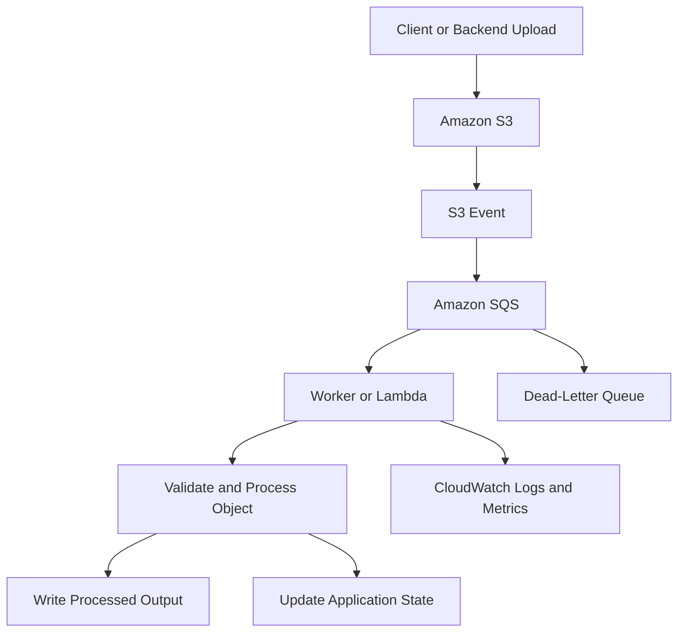
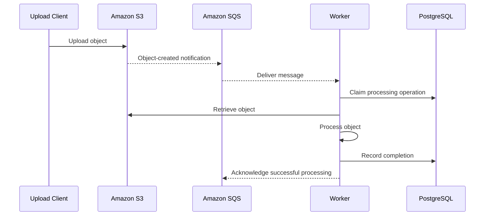
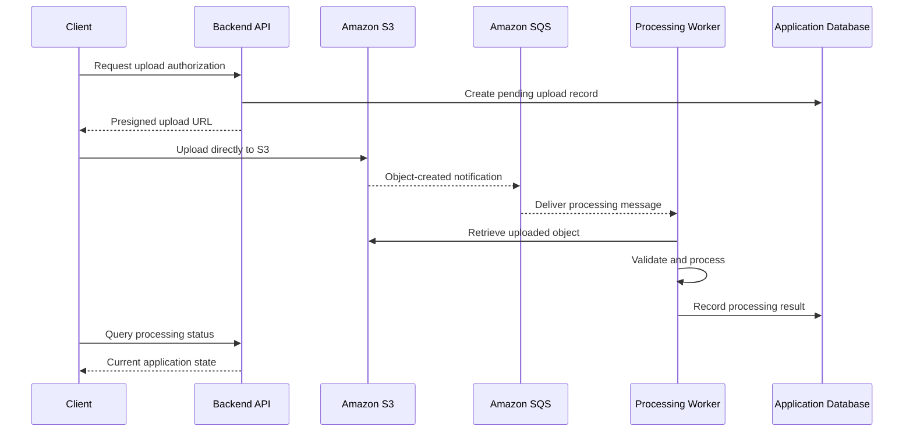

# 10- Event-Driven Integration Questions

## Overview

Amazon S3 event-driven integrations allow backend systems to react to object creation, deletion, restoration, replication, and other supported storage events without continuously polling buckets.

S3 integrates with AWS Lambda, Amazon SQS, Amazon SNS, and Amazon EventBridge to support document processing, image transformation, malware scanning, asynchronous ingestion, data lake pipelines, and distributed application workflows.

For senior backend engineers, the key engineering challenges are event delivery semantics, duplicate processing, ordering, retries, idempotency, backpressure, authorization, observability, and recovery from partial failures.

**An S3 event indicates that a storage operation occurred; it does not guarantee that the downstream business workflow completed successfully.**

## S3 Event Notification Fundamentals

### What are S3 Event Notifications, and when should they be used?

S3 Event Notifications publish messages when configured events occur on a bucket. A backend can use these events to initiate processing without repeatedly listing objects or polling for changes.

Common event categories include:

- Object creation through PUT, POST, COPY, and completed multipart uploads.
- Object removal and delete-marker operations.
- Object restoration events for supported archival workflows.
- Replication-related events.
- Lifecycle transition and expiration events.
- Object tagging and other supported resource changes.

For example, an image-processing pipeline can receive an object-created event, retrieve the uploaded image, generate thumbnails, and store the results in a separate prefix.

**Advantages**
- Decouples storage from downstream processing.
- Scales independently of upload traffic.
- Reduces unnecessary polling and API requests.
- Integrates with managed messaging and compute services.

**Limitations**
- Duplicate notifications are possible.
- Event delivery is asynchronous.
- Event order is not generally guaranteed.
- Consumers must implement retry handling, idempotency, and failure recovery.

Reference: [Amazon S3 Event Notifications](https://docs.aws.amazon.com/AmazonS3/latest/userguide/EventNotifications.html).

### How does an S3 event-driven architecture work?

A typical workflow consists of an object operation, event delivery, a processing component, and a durable application result.



The separation between S3 and processing is intentional. S3 can accept an upload independently of whether the worker is available at that moment. A queue buffers work while consumers recover or scale.

A complete implementation must define how failures are retried, how duplicate processing is prevented, and how incomplete workflows are reconciled.

### What is the difference between an S3 upload response and processing completion?

A successful S3 PUT response confirms the outcome of the storage operation. It does not confirm that a downstream Lambda function, SQS consumer, or document-processing workflow has finished.

For example, an API may accept an upload while asynchronous malware scanning is still pending.

Represent upload state and business-processing state separately:

```text
UPLOAD_ACCEPTED
    -> PROCESSING_PENDING
    -> PROCESSING
    -> COMPLETED
    -> FAILED
```

Persist the processing status in an appropriate store, such as PostgreSQL or DynamoDB, when clients need to query the workflow.

The application should define exactly when `COMPLETED` becomes durable. Writing an output object may be insufficient if the system must also update a database record or notify another service.

### Are S3 notifications delivered exactly once and in order?

No. Native S3 Event Notifications are designed for at-least-once delivery. Duplicate notifications can occur, and events are not guaranteed to arrive in the order in which the underlying operations occurred.

Consumers must tolerate:

- Multiple deliveries of the same notification.
- A newer object event being processed before an older event.
- Retries after partial completion.
- Worker failures after an external side effect succeeds.
- Delayed events referring to older object versions.

Use durable idempotency records, deterministic output keys, conditional updates, and version-aware processing where necessary.

Reference: [S3 notification event types and destinations](https://docs.aws.amazon.com/AmazonS3/latest/userguide/notification-how-to-event-types-and-destinations.html).

## Choosing an Event Destination

### What is the difference between Lambda, SQS, SNS, and EventBridge?

| Destination | Best suited for | Main advantage | Important consideration |
|---|---|---|---|
| AWS Lambda | Short, event-driven processing tasks | Direct invocation and managed scaling | Retries, concurrency, execution limits, and failure handling |
| Amazon SQS | Asynchronous work queues | Buffering, backpressure, and controlled consumption | Visibility timeout, redrive policy, and duplicate processing |
| Amazon SNS | Fan-out to multiple subscribers | One publication can reach independent consumers | Each subscription has its own delivery and failure behavior |
| Amazon EventBridge | Complex event routing and filtering | Centralized rules and integration with many targets | Target permissions, retries, and dead-letter configuration |

The choice depends on the business workflow.

For a small image transformation, direct Lambda invocation may be sufficient. For long-running document processing, SQS often provides better control over buffering, retries, and throughput.

For multiple independent consumers, SNS or EventBridge can route the same event to several workflows.

### When should you use direct S3-to-Lambda integration?

Use direct integration when an object event should initiate processing and the task fits Lambda's execution model.

Examples include metadata extraction, small image transformations, document validation, and workflow initiation.

The function is invoked asynchronously, so its code must not assume that each event is delivered only once or in write order.

Direct integration is less suitable when the workload needs explicit queue-depth management, strong backpressure controls, independent buffering during processing outages, or work that exceeds the chosen compute service's execution limits.

If buffering and consumer-controlled throughput are important, place SQS between the event and the worker.

### When should you place SQS between S3 and a worker?

Use SQS when asynchronous processing needs a durable buffer, independent scaling, or controlled retry behavior.



SQS allows upload traffic and processing capacity to scale independently. If processing slows down, messages can accumulate without requiring upload requests to wait for the worker.

For an SQS consumer, acknowledge or delete a message only after the required work has reached its durable commit point. For an SQS-triggered Lambda, the event source mapping normally deletes successfully processed messages.

### When should you use SNS or EventBridge instead of direct SQS?

Use SNS when simple fan-out to multiple subscribers is the primary requirement. Use EventBridge when event-pattern filtering, centralized routing, multiple targets, or integration with other AWS services is important.

For example, an uploaded document might trigger independent security scanning, metadata extraction, and application notification workflows.

Each consumer should have a defined retry policy and failure-handling mechanism. A successful delivery to one subscriber does not prove that every other subscriber completed its work.

### Can S3 send native event notifications directly to an SQS FIFO queue?

No. Native S3 Event Notifications do not support SQS FIFO queues as direct destinations.

To send S3 events to an SQS FIFO queue, enable S3 event delivery through EventBridge and route matching events to the FIFO queue.

FIFO provides ordering within its queue semantics and message groups; it does not reconstruct the original chronological order of S3 operations automatically. The producer and consumer must still define how duplicate events and object updates are handled.

Reference: [S3 event notification destinations](https://docs.aws.amazon.com/AmazonS3/latest/userguide/notification-how-to-event-types-and-destinations.html).

## Event Payloads and Object Identification

### What information does a native S3 event contain?

A native S3 notification record commonly contains:

- The event name and event version.
- The event timestamp and AWS Region.
- The bucket name.
- The object key.
- The object version ID, when applicable.
- The sequencer for applicable object events.
- Request and identity information where provided.

Not every field is present for every event type. Consumers should validate required fields and tolerate supported schema evolution.

S3 events delivered through EventBridge have a different envelope and detail structure from native notification records. A parser expecting a native `Records` array should not be reused for EventBridge events without adaptation.

Reference: [S3 EventBridge event message structure](https://docs.aws.amazon.com/AmazonS3/latest/userguide/ev-events.html).

### Why must native S3 notification object keys be URL-decoded?

Object keys in native notification records are URL-encoded using `application/x-www-form-urlencoded` conventions. Spaces can appear as `+`, while other characters use percent encoding.

A consumer that passes the encoded key directly to `GetObject` may request the wrong object.

Use `urllib.parse.unquote_plus` in Python:

```python
from urllib.parse import unquote_plus

encoded_key = "incoming/customer+invoice%20final.pdf"
decoded_key = unquote_plus(encoded_key)

assert decoded_key == "incoming/customer invoice final.pdf"
```

Do not decode keys through ad hoc string replacements. Decode once using the correct rules, and do not apply this native-notification decoding logic blindly to an EventBridge payload, whose key representation must be handled according to that schema.

### How should a Lambda function parse native S3 notifications?

Separate event parsing from business processing. This makes parsing independently testable and reduces errors involving encoded keys, missing version IDs, and unsupported event types.

```python
from urllib.parse import unquote_plus


def parse_s3_notification(event: dict) -> list[dict]:
    work_items = []

    for record in event.get("Records", []):
        if record.get("eventSource") != "aws:s3":
            continue

        event_name = record.get("eventName", "")
        if not event_name.startswith("ObjectCreated:"):
            continue

        s3_record = record["s3"]
        object_info = s3_record["object"]

        item = {
            "event_name": event_name,
            "bucket": s3_record["bucket"]["name"],
            "key": unquote_plus(object_info["key"]),
            "version_id": object_info.get("versionId"),
            "sequencer": object_info.get("sequencer"),
        }

        work_items.append(item)

    return work_items
```

This parser handles a common native S3 object-created notification format. A production consumer should also validate the expected schema, reject or record malformed records, and handle other event types through explicitly defined paths.

For versioned objects, use the event's version ID when retrieving the exact object version associated with the event. Otherwise, a delayed notification can cause the worker to retrieve newer content from the same key.

### How should object retrieval work for event-driven processing?

The consumer should use the bucket and decoded key from the validated event. If the event includes a version ID and the application needs to process that specific version, include the version ID in the `GetObject` request.

For large objects, stream the response or use a suitable temporary-storage strategy rather than reading the entire payload into memory without a size limit.

The worker should validate the object's actual content before processing it. An event's filename, reported content type, or user-provided metadata is not a trustworthy security assertion about the file's contents.

## Idempotency, Deduplication, and Ordering

### Why are duplicate notifications possible?

Native S3 notifications are delivered at least once. Duplicate events can cause the same Lambda function or worker to process one object multiple times.

This becomes a business problem when processing creates external side effects, such as charging a customer, sending a notification, or creating duplicate database records.

Treat an event as a request to perform an idempotent operation rather than as proof that the operation has never run.

### How would you implement idempotency for an S3 processing pipeline?

Create a durable processing record using an identifier that represents the logical operation.

For a versioned bucket, a useful identity can include:

```text
bucket + decoded key + versionId + operation type
```

When a version ID is absent, the system needs another stable event or application-level identifier appropriate to the workflow. The event sequencer can help with ordering for the same key, but it should not be treated as a globally unique identifier.

A database uniqueness constraint or DynamoDB conditional write can atomically claim a processing operation. This prevents independent workers from both claiming the same operation under normal concurrency.

A practical state machine is:

```text
PENDING -> PROCESSING -> COMPLETED
                    \-> FAILED
```

Production requirements include:

- An atomic claim or conditional state transition.
- A strategy to recover abandoned `PROCESSING` records.
- Idempotent or conditionally applied external side effects.
- A retry policy for transient failures.
- A documented policy for permanent failures and manual replays.

Do not mark a job completed before its required business side effects are durable.

### Why is an in-memory set insufficient for deduplication?

An in-memory set protects only one process instance and is lost when that process restarts. It does not coordinate multiple Lambda execution environments, containers, or horizontally scaled workers.

Use durable coordination such as a database uniqueness constraint, a DynamoDB conditional write, or another appropriate idempotency mechanism.

Give idempotency records a deliberate retention policy. Keeping every event record forever can increase costs, while expiring records too quickly can allow old events or manual replays to repeat side effects.

### How should out-of-order events be handled?

The strategy depends on whether the application needs to process every object version or maintain only the latest state.

**Process every version:** Enable versioning where appropriate, retrieve the version ID contained in each event, and track each version's processing result independently.

**Maintain only the latest state:** Store the latest observed sequencer for each key and reject stale events when they arrive.

S3 sequencers can be compared as hexadecimal values for events relating to the same object key. Because representations can have different lengths, normalize their lengths or compare their numeric values. Sequencers are not comparable across different keys.

A version ID identifies an object version but does not establish a global chronological order. Use the mechanism that matches the workflow's consistency requirements.

### What happens if an object is overwritten while an event is being processed?

Suppose upload A generates event A and a later upload B generates event B for the same key. The worker may receive A after B has already occurred.

If the worker retrieves the object only by key, it can read B while believing it is processing A.

For versioned buckets, retrieving the event-specific version avoids this mismatch. If the application maintains only the latest state, it can compare sequencing state and reject stale updates.

Processing every historical version and maintaining only the latest state are different requirements. The design must choose deliberately between them.

## Retries, Dead-Letter Queues, and Failure Handling

### How should event-processing failures be retried?

Retry behavior depends on the integration path.

| Integration | Failure behavior and controls |
|---|---|
| S3 to Lambda | Lambda asynchronous invocation uses configured retry and failure-handling behavior |
| S3 to SQS | Messages remain available for consumers; visibility timeout and redrive policy govern repeated attempts |
| S3 to SNS | Delivery behavior and retry configuration depend on the subscription destination |
| S3 to EventBridge | EventBridge applies target retry policies and supports a target dead-letter queue |
| SQS to Lambda | Lambda polls the queue; unsuccessful messages can reappear after visibility timeout, and partial batch responses can isolate failures |

Retries are not equivalent to exactly-once processing. Consumers must remain safe when the same logical operation runs multiple times.

### What is a dead-letter queue, and when should it be used?

A dead-letter queue (DLQ) preserves messages that cannot be processed successfully after the configured retry policy.

It is useful when failed work must remain available for investigation, remediation, and controlled replay.

For an SQS consumer, a redrive policy can send repeatedly received messages to a DLQ after a configured maximum receive count. For EventBridge, configure a target DLQ for events that cannot be delivered successfully to that target.

A production DLQ requires:
- Access controls and an appropriate retention policy.
- Monitoring for new messages and growing backlog.
- A documented investigation process.
- A safe replay or redrive procedure.
- Protection against repeatedly replaying permanently invalid messages.

A DLQ preserves failed work; it does not repair the underlying problem or guarantee that the business operation eventually completes.

### What is the difference between event-delivery failure and processing failure?

A delivery failure occurs when an event cannot reach its target. A processing failure occurs after the consumer receives the event but cannot finish the business operation.

| Failure category | Example | Investigation focus |
|---|---|---|
| Delivery failure | EventBridge cannot invoke a target because permission is missing | Target permissions, retries, DLQ |
| Consumer failure | Lambda crashes while parsing the event | Function code, schema validation, logs |
| Transient dependency failure | Worker cannot reach PostgreSQL | Dependency health, retries, backoff |
| Invalid input | Unsupported or malicious file | Validation, quarantine, permanent-failure handling |
| Partial completion | Output written, database update failed | Idempotency, durable state, reconciliation |

These categories require different remedies. Increasing retries does not fix a permanent permission error or invalid input.

### How do SQS visibility timeout and Lambda timeout interact?

When Lambda consumes SQS messages through an event source mapping, the queue's visibility timeout must allow enough time for processing and retries.

AWS recommends setting the visibility timeout to at least six times the Lambda function timeout, plus the maximum batching window when one is configured.

If visibility expires while a message is still processing, another worker can receive the message. This can cause concurrent duplicate execution.

Correct timeout configuration reduces avoidable redelivery but does not eliminate the need for idempotency.

Reference: [Creating and configuring an SQS event source mapping](https://docs.aws.amazon.com/lambda/latest/dg/services-sqs-configure.html).

### How should an SQS-triggered Lambda handle partial batch failures?

By default, if processing fails for a batch, messages that already succeeded can also be retried.

Enable partial batch response support through the event source mapping's `ReportBatchItemFailures` configuration. The function then identifies which message IDs failed so only those messages need to be retried.

The handler must report the correct failed message identifiers. For FIFO queues, it should preserve ordering by stopping after the first failure and returning the failed and unprocessed messages as required.

Partial batch response reduces unnecessary reprocessing; it does not replace idempotent processing.

Reference: [Handling errors for an SQS event source](https://docs.aws.amazon.com/lambda/latest/dg/services-sqs-errorhandling.html).

## Event Filters and Notification Configuration

### How do prefix and suffix filters work?

Prefix and suffix filters limit notifications to object keys that match configured patterns.

For example, an image-processing service can receive only events for keys beginning with `incoming/images/` and ending in `.jpg` or another supported suffix.

Filtering reduces unnecessary invocations and separates workloads that share a bucket.

However, notification rules for the same event types have restrictions around overlapping prefixes and suffixes. Validate the complete bucket notification configuration before deployment, especially when several applications own different rules.

### How would you prevent a Lambda function from recursively triggering itself?

Suppose a function processes uploaded images and writes thumbnails to the same bucket. If every object-created event invokes the function, writing a thumbnail can trigger another invocation, potentially creating an execution loop.

Use separate buckets or prefixes:

```text
s3://company-media/incoming/
s3://company-media/processed/
```

Configure the notification to match only `incoming/`, and write results to `processed/`.

A separate output bucket can provide an even clearer security, lifecycle, and ownership boundary.

### Should a processor trust the file extension or client-provided Content-Type?

No. Both can be incorrect or maliciously supplied.

Treat uploads as untrusted input. Validate actual content where appropriate, enforce size and format limits, and use defensive parsers.

For documents and media, production workflows may also require malware scanning, quarantine, or sandboxed processing before content becomes accessible to other users.

Asynchronous execution changes when validation happens; it does not remove the requirement.

## Integrating S3 with AWS Services

### How does SQS improve high-volume S3 processing?

SQS decouples upload traffic from processing capacity.

If uploads arrive faster than workers can process them, messages accumulate in the queue. Consumers can scale independently and process messages at a controlled rate.

Useful operational indicators include:

- Approximate number of visible messages.
- Approximate number of messages in flight.
- Age of the oldest message.
- DLQ message count.
- Processing duration and failure rate.

Queue depth alone does not establish system health. An increasing oldest-message age can indicate that work is falling behind even when consumers continue processing.

### How does SNS support event fan-out?

SNS publishes a message to multiple subscribers so that independent systems can react to the same event.

For example, an upload might initiate metadata extraction, security scanning, and user notification.

Each subscriber has its own authorization, delivery, and failure behavior. A queue subscriber can provide buffering independent of the other subscribers.

SNS fan-out does not provide exactly-once processing or guarantee that every downstream business workflow completes successfully.

### When should you use EventBridge with S3?

EventBridge is useful when events require structured filtering, centralized routing, or delivery to multiple targets.

It can route supported S3 events to services such as Lambda, SQS, Step Functions, and other supported targets.

To integrate S3 with EventBridge, enable EventBridge delivery in the bucket's notification settings and create matching event rules.

EventBridge also provides a supported route from S3 events to SQS FIFO queues. Native S3 notifications cannot target FIFO queues directly.

Monitor target delivery failures and configure appropriate retries and DLQs. A rule that exists but matches no events is not a functioning workflow.

Reference: [Using EventBridge with Amazon S3](https://docs.aws.amazon.com/AmazonS3/latest/userguide/EventBridge.html).

### How does AWS Lambda integrate with S3 notifications?

S3 invokes Lambda asynchronously for configured native notification events.

Two authorization relationships matter:

- The Lambda execution role needs permissions required for processing, such as `s3:GetObject` on the input prefix and `s3:PutObject` on the output prefix.
- Lambda's resource-based policy must authorize S3 to invoke the function.

The production design should filter notifications to intended events, validate payloads, handle duplicate delivery, avoid recursive writes, and monitor errors, throttles, duration, and concurrency.

If the workload requires durable buffering and controlled throughput, use SQS between the notification and the worker.

### How does Step Functions fit into S3 event processing?

Step Functions can orchestrate multi-step workflows such as validation, malware scanning, metadata extraction, database updates, and notifications.

A common design routes S3 events through EventBridge or SQS to a workflow-starting component. The workflow coordinates stages, branching, retries, and failure handling.

Use durable application state when a business process requires status tracking, manual review, or resumable stages. The workflow execution record should not replace the authoritative business state unless that is an explicit architecture decision.

The workflow must still tolerate duplicate events that start more than one execution.

### How would you integrate event processing with PostgreSQL?

Store processing state using a stable identifier for the object operation and enforce uniqueness where appropriate.

A table might contain:

```text
document_id
bucket
object_key
version_id
status
attempt_count
last_error
processed_at
```

A unique constraint can prevent the same logical object version from creating multiple processing records.

Because PostgreSQL and S3 do not share a distributed transaction, a workflow can partially complete. For example, the output object may be written successfully while the database update fails.

Use idempotent processing and reconciliation jobs to detect these states and safely finish or repair them.

## Event-Driven Integration with Backend Applications

### Should the API server process uploaded files synchronously?

Not for every workload.

Large uploads, document parsing, antivirus scanning, image transformation, and expensive data extraction are usually better handled asynchronously.

A backend API can authenticate the user, authorize the upload, create a processing record, and return an upload URL. S3 stores the object, and a configured event starts downstream processing.

The API can expose a status endpoint for clients instead of keeping an HTTP request open until processing completes.

### How does a presigned upload fit into an event-driven pipeline?

A common architecture uses a FastAPI, Django REST Framework, or Flask service to authorize an upload and issue a short-lived presigned URL.



The backend remains responsible for authorization and metadata tracking, while the client transfers file content directly to S3.

Do not treat generation of a presigned URL as proof that the upload succeeded. The application should verify the resulting object and use an idempotent state transition when the event arrives.

### Why should processing state be separated from the S3 event itself?

Events are transient messages, while application status is a durable business concept.

A document might pass through upload verification, scanning, extraction, human review, and indexing. Not all these stages correspond to an S3 storage event.

Use PostgreSQL, DynamoDB, or another appropriate state store to track the business workflow. Associate each job with the relevant bucket, key, version ID, and application identifier.

A state model allows clients to query status and operators to investigate stuck jobs independently of the messaging infrastructure.

## Observability and Operational Readiness

### What should be monitored in an S3 event-driven system?

Monitor event delivery, processing execution, and business outcomes separately.

| Area | Useful indicators |
|---|---|
| S3 event delivery | Event volume, unexpected gaps, configured destinations |
| EventBridge | Failed target delivery, retries, DLQ arrivals |
| SQS | Queue depth, oldest-message age, in-flight messages, DLQ count |
| Lambda | Errors, throttles, duration, concurrent executions |
| Processing application | Success rate, failure categories, retries, idempotency conflicts |
| Business workflow | Completion time, stuck processing states, reconciliation gaps |

CloudWatch logs help diagnose individual failures, while metrics and alarms identify systemic problems. Correlate events with object keys, version IDs, request IDs, and application job identifiers where practical.

Avoid logging presigned URLs or sensitive object contents.

### How would you detect a workflow that has silently stopped processing objects?

Monitor both infrastructure health and business-level completion.

A healthy-looking queue or Lambda function does not prove that every uploaded object reached the expected state. Track the number and age of pending jobs and compare incoming object activity with completed processing.

For predictable workloads, an unexpected absence of events can be an alarm. For sporadic workloads, use scheduled reconciliation to compare eligible objects with application processing records.

Reconciliation must distinguish genuinely unprocessed objects from intentionally excluded, deleted, or quarantined objects.

### How should S3 event-driven integrations be tested?

Use layered testing:

- Unit tests for event parsing, key decoding, validation, and business logic.
- Tests for duplicate and out-of-order events.
- Integration tests for S3, SQS, Lambda, or EventBridge permissions and configuration.
- Failure-injection tests for dependency outages, timeouts, and partial completion.
- DLQ replay and stuck-state recovery tests.
- End-to-end tests that upload an object and verify the expected output and application status.

Local AWS emulators are useful for development, but may not reproduce every AWS delivery semantic, IAM authorization rule, retry behavior, or integration dependency.

Use a controlled AWS test environment to validate service-level behavior that is important to the production design.

## Scenario-Based Interview Questions

### Scenario: An image is processed twice, creating duplicate thumbnails. How would you fix it?

First determine whether S3 delivered duplicate notifications or the worker retried after a partial failure.

Create a durable idempotency record keyed by the source operation or object version. Use deterministic output keys and make writes and state transitions safely repeatable.

If every object version must be processed, include the version ID in the operation identity. If only the latest state matters, use sequencing or another authoritative state check to prevent stale events from overwriting newer results.

### Scenario: Uploads succeed, but the SQS backlog grows continuously. What would you investigate?

Inspect the oldest-message age, visible and in-flight message counts, consumer errors, processing duration, concurrency limits, and downstream dependency health.

If consumers are healthy but capacity is insufficient, scale processing within resource and downstream-service limits. If messages repeatedly fail, investigate the root cause before increasing worker capacity.

Confirm that visibility timeout and retry settings are appropriate, then inspect the DLQ before replaying messages.

### Scenario: A Lambda function writes its output and then fails. What happens on retry?

The function may run again even though the initial output write succeeded.

Use deterministic output keys, conditional writes where appropriate, and durable processing state to detect or safely reproduce the existing result. Do not assume that writing an object and updating the database are atomic.

### Scenario: Two updates to the same key arrive out of order. How do you prevent stale results?

If every version must be processed, use version IDs to retrieve exact content and maintain separate processing results.

If the application only maintains the latest state, compare sequencers for the same key and make state updates atomic. Do not compare sequencers across different keys.

The choice depends on whether the business requirement is version history or current-state synchronization.

### Scenario: A new notification configuration causes an existing workflow to stop receiving events. What do you inspect?

Inspect the bucket's complete notification configuration, including event types, filters, destinations, and permissions.

Check whether an infrastructure deployment replaced or altered existing notification entries. Validate notification filter compatibility and test every expected destination after deployment.

Treat notification configuration as shared bucket infrastructure when multiple applications use the same bucket.

### Scenario: A downstream dependency is intermittently unavailable. Should all failed events immediately go to a DLQ?

Not necessarily.

Use bounded retries and suitable backoff for transient failures. Route work to a DLQ after the applicable retry policy is exhausted or when delivery cannot succeed under the configured policy.

During a long outage, uncontrolled immediate retries can increase load and make recovery harder. Preserve failed work, alert operators, and define when messages can safely be redriven.

### Scenario: Processing reports success, but users cannot download the resulting document. How would you investigate?

Trace the workflow from the original event through processing state, output creation, and the final application response.

Verify the output key, object version, and actual object availability. Confirm that application metadata references the correct object, then check user authorization, S3 permissions, KMS access, and presigned URL expiration.

A successful processing record is meaningful only if it represents a clearly defined durable completion point.

## Common Interview Traps

| Incorrect assumption | Correct understanding |
|---|---|
| S3 notifications are delivered exactly once | Duplicate notifications can occur |
| Notifications always arrive in write order | Event ordering is not generally guaranteed |
| Upload success means downstream processing succeeded | Upload and business processing have separate completion states |
| A key-only GET always retrieves the version associated with an event | A newer object write can replace the key; use the event version ID when required |
| SQS automatically makes processing idempotent | Consumers must tolerate duplicate delivery and partial failures |
| FIFO restores the original chronological order of S3 operations | FIFO guarantees only its own queue-level ordering semantics |
| A DLQ automatically repairs failed work | Failed messages need investigation and a controlled recovery procedure |
| EventBridge rules guarantee that matching events reach a consumer | Misconfigured patterns, permissions, or targets can prevent delivery |
| Lambda retries remove the need for error handling | Retries can repeat partial side effects |
| Writing the output object completes the entire workflow | Database updates and downstream business effects may remain incomplete |
| Monitoring Lambda errors alone proves workflow health | Pending jobs, queue age, and business-level completion must also be monitored |

## Authoritative References

- [Amazon S3 Event Notifications](https://docs.aws.amazon.com/AmazonS3/latest/userguide/EventNotifications.html)
- [S3 event notification types and destinations](https://docs.aws.amazon.com/AmazonS3/latest/userguide/notification-how-to-event-types-and-destinations.html)
- [Granting destination permissions for S3 notifications](https://docs.aws.amazon.com/AmazonS3/latest/userguide/grant-destinations-permissions-to-s3.html)
- [Configuring S3 Event Notifications](https://docs.aws.amazon.com/AmazonS3/latest/userguide/enable-event-notifications.html)
- [Using EventBridge with Amazon S3](https://docs.aws.amazon.com/AmazonS3/latest/userguide/EventBridge.html)
- [S3 EventBridge event message structure](https://docs.aws.amazon.com/AmazonS3/latest/userguide/ev-events.html)
- [Manage S3 event ordering and duplicate events](https://aws.amazon.com/blogs/storage/manage-event-ordering-and-duplicate-events-with-amazon-s3-event-notifications/)
- [Using Lambda with Amazon S3](https://docs.aws.amazon.com/lambda/latest/dg/with-s3.html)
- [Using Lambda with Amazon SQS](https://docs.aws.amazon.com/lambda/latest/dg/with-sqs.html)
- [Creating and configuring an SQS event source mapping](https://docs.aws.amazon.com/lambda/latest/dg/services-sqs-configure.html)
- [Handling errors for SQS event sources](https://docs.aws.amazon.com/lambda/latest/dg/services-sqs-errorhandling.html)
- [EventBridge retry policies and dead-letter queues](https://docs.aws.amazon.com/eventbridge/latest/userguide/eb-rule-retry-policy.html)

## Key Takeaways

- S3 Event Notifications are asynchronous and at-least-once, so consumers must tolerate duplicate delivery and out-of-order events.
- Use Lambda for suitable short tasks, SQS for buffering and controlled consumption, SNS for fan-out, and EventBridge for flexible routing.
- Implement durable idempotency, retrieve the correct object version when required, and prevent stale events from overwriting newer application state.
- Configure appropriate retries, dead-letter handling, monitoring, and reconciliation for failures and partial completion.
- Validate event delivery, permissions, processing results, and recovery behavior through end-to-end tests rather than relying only on successful uploads.