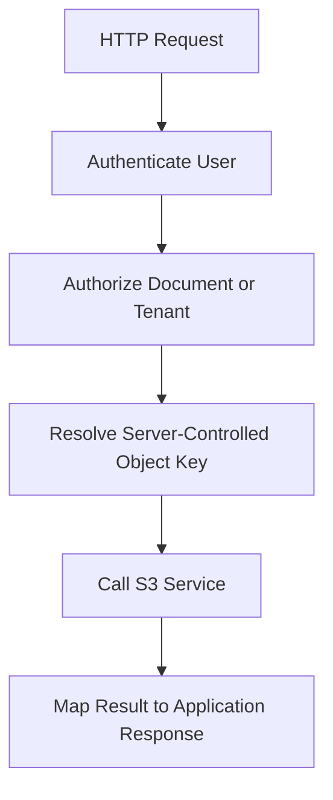

# 11- SDK and Backend Integration Questions

## Overview

Amazon S3 SDK and backend integrations allow applications to upload, download, retrieve metadata, and manage objects without implementing the S3 REST API and AWS Signature Version 4 request signing directly.

For Python backend engineers, Boto3 is the primary AWS SDK for S3 operations. It integrates with Django, Django REST Framework (DRF), FastAPI, Flask, Celery, and distributed processing systems.

A production-ready integration requires more than calling `upload_file()`. Engineers must understand credential resolution, connection reuse, multipart transfers, streaming, presigned URLs, retries, authorization, concurrency, and consistency between S3 and application databases.

The central design principle is to **keep storage operations in a reusable service layer, keep HTTP endpoints focused on application behavior, and move expensive processing into asynchronous workers when appropriate**.

## Boto3 Client Configuration

### What is Boto3, and why should backend applications use it?

Boto3 is the AWS SDK for Python. It provides clients and resources for interacting with AWS services.

For production S3 integrations, the low-level client is usually a good default because it exposes service operations explicitly and makes request parameters, responses, and exceptions easier to reason about.

| Operation | Boto3 API |
|---|---|
| Upload a local file | `upload_file()` |
| Upload a file-like object | `upload_fileobj()` |
| Download to a local file | `download_file()` |
| Retrieve object content | `get_object()` |
| Inspect object metadata | `head_object()` |
| Delete an object | `delete_object()` |
| List object versions | `list_object_versions()` |
| Generate a presigned URL | `generate_presigned_url()` |

Managed transfer methods are especially useful for normal file uploads and downloads because they can handle multipart transfers and concurrent part operations.

Reference: [Boto3 S3 examples and file transfers](https://docs.aws.amazon.com/boto3/latest/guide/s3.html).

### What is the difference between a Boto3 client and a resource?

A client exposes operations closely corresponding to AWS service APIs. A resource provides a higher-level, object-oriented abstraction.

```python
import boto3

client = boto3.client("s3")
resource = boto3.resource("s3")

metadata = client.head_object(
    Bucket="company-prod-documents",
    Key="documents/report.pdf",
)

document = resource.Object(
    "company-prod-documents",
    "documents/report.pdf",
)

print(metadata["ContentLength"])
print(document.content_type)
```

The client is generally preferable in reusable service layers because request parameters and error handling are explicit. Resources can be convenient for scripts or code that benefits from an object-oriented interface.

Boto3 clients are generally thread-safe when used according to the SDK's documented constraints, but sessions and resources have different concurrency considerations. Do not share clients indiscriminately across processes, and avoid custom client event hooks that introduce unsafe shared state.

### How should an application configure a reusable S3 client?

Initialize a client once per application process or dependency container instead of constructing one for every HTTP request.

```python
import os

import boto3
from botocore.config import Config


def create_s3_client():
    return boto3.client(
        "s3",
        region_name=os.environ["AWS_REGION"],
        config=Config(
            signature_version="s3v4",
            retries={
                "mode": "standard",
                "max_attempts": 4,
            },
            connect_timeout=3,
            read_timeout=60,
            max_pool_connections=50,
        ),
    )
```

These values are illustrative starting points. Tune retries, timeouts, and connection-pool size according to the workload, downstream latency, container resources, and request concurrency.

A reusable client allows connection reuse and consistent configuration. In Lambda, module-level client initialization is commonly used so warm execution environments can reuse the client.

Do not cache temporary credentials separately from Boto3. Let a supported credential provider refresh credentials as needed.

### How should Boto3 credentials be configured?

Prefer the SDK's credential provider chain rather than embedding access keys in application code.

| Environment | Preferred approach |
|---|---|
| Local development | AWS CLI profile or another approved credential provider |
| EC2 | Instance profile |
| ECS | Task role |
| EKS | EKS Pod Identity or IAM Roles for Service Accounts |
| Lambda | Execution role |
| GitHub Actions | OIDC federation to an IAM role |
| Other hosted workloads | An approved federation or temporary-credential mechanism |

The effective identity is important when debugging an access failure. Local development credentials may have permissions that the production workload role does not.

Use `sts get-caller-identity` to verify the identity actually used by a deployment or workload.

```bash
aws sts get-caller-identity
```

Never commit permanent access keys to source control, `.env` files shared with others, Docker images, test fixtures, or CI/CD logs.

### How should retries be configured in Boto3?

Botocore supports retry strategies, including standard retry mode. SDK retries help with supported transient failures such as certain throttling responses, service errors, and connection problems.

Retries do not fix invalid credentials, explicit authorization denials, incorrect bucket names, or malformed requests.

Use layered retry policies deliberately:

- SDK retries handle supported transient API failures.
- Application retries handle workflow-level failures.
- Queue retries handle asynchronous delivery and processing failures.

Avoid multiplying retries across every layer without limits. Four SDK attempts inside five worker retries can create substantially more requests than intended.

Also consider the operation's semantics. Repeating an upload to a deterministic key may be acceptable, whereas repeating a payment or another external side effect may not be.

Reference: [Boto3 retry behavior](https://docs.aws.amazon.com/boto3/latest/guide/retries.html).

## Designing a Reusable S3 Service Layer

### Why should S3 operations be separated from API routes?

A service layer centralizes storage behavior and allows the same implementation to be reused by different frameworks and background workers.

Without one, Django views, DRF endpoints, FastAPI routes, Flask handlers, and Celery tasks may each implement different upload, metadata, error-handling, and authorization behavior.

The storage layer should handle S3 operations and map storage failures into application-level exceptions. Authentication, tenant authorization, request validation, and HTTP responses belong to the relevant application layer.

### How would you implement a reusable S3 service in Python?

```python
from typing import BinaryIO

import boto3
from boto3.s3.transfer import TransferConfig
from botocore.config import Config
from botocore.exceptions import ClientError


class ObjectStorageError(Exception):
    """Raised when an S3 operation fails."""


class ObjectNotFoundError(ObjectStorageError):
    """Raised when the requested object is unavailable."""


class S3ObjectStore:
    def __init__(
        self,
        bucket: str,
        region: str,
        client=None,
    ) -> None:
        self.bucket = bucket
        self.client = client or boto3.client(
            "s3",
            region_name=region,
            config=Config(
                signature_version="s3v4",
                retries={
                    "mode": "standard",
                    "max_attempts": 4,
                },
                connect_timeout=3,
                read_timeout=60,
                max_pool_connections=50,
            ),
        )
        self.transfer_config = TransferConfig(
            multipart_threshold=64 * 1024 * 1024,
            multipart_chunksize=16 * 1024 * 1024,
            max_concurrency=8,
        )

    def upload(
        self,
        fileobj: BinaryIO,
        key: str,
        content_type: str,
        metadata: dict[str, str] | None = None,
    ) -> None:
        extra_args = {
            "ContentType": content_type,
        }

        if metadata:
            extra_args["Metadata"] = metadata

        try:
            fileobj.seek(0)

            self.client.upload_fileobj(
                fileobj,
                self.bucket,
                key,
                ExtraArgs=extra_args,
                Config=self.transfer_config,
            )
        except ClientError as exc:
            raise ObjectStorageError(
                "S3 upload failed"
            ) from exc

    def get_metadata(self, key: str) -> dict:
        try:
            response = self.client.head_object(
                Bucket=self.bucket,
                Key=key,
            )
        except ClientError as exc:
            code = exc.response.get(
                "Error", {}
            ).get("Code")

            if code in {"NoSuchKey", "NotFound", "404"}:
                raise ObjectNotFoundError(
                    "The requested object was not found"
                ) from exc

            raise ObjectStorageError(
                "S3 metadata lookup failed"
            ) from exc

        return {
            "content_length": response["ContentLength"],
            "content_type": response.get("ContentType"),
            "etag": response.get("ETag"),
            "last_modified": response.get("LastModified"),
            "version_id": response.get("VersionId"),
        }

    def create_download_url(
        self,
        key: str,
        expires_in: int = 300,
    ) -> str:
        try:
            return self.client.generate_presigned_url(
                "get_object",
                Params={
                    "Bucket": self.bucket,
                    "Key": key,
                },
                ExpiresIn=expires_in,
            )
        except ClientError as exc:
            raise ObjectStorageError(
                "Could not generate download URL"
            ) from exc
```

The constructor accepts an injected client, making the service easier to test with a mock or Botocore `Stubber`.

This example deliberately exposes generic storage exceptions. Production code should log the underlying AWS error securely, distinguish expected failure categories, and avoid exposing internal bucket names or raw AWS error messages to API clients.

It also assumes that the caller has already authorized the object key. A reusable storage service does not replace application-level access control.

### How should object keys be generated?

Generate object keys on the server instead of treating an untrusted client filename as the complete S3 key.

A common convention is:

```text
tenants/{tenant_id}/documents/{document_id}/original
```

Store the original filename separately as application metadata.

Server-generated keys reduce collisions and path confusion and make tenant-specific authorization easier. S3 keys are object identifiers, not filesystem paths; filesystem path normalization alone is not an authorization boundary.

For multi-tenant systems, derive the permitted tenant prefix from authenticated application state. Do not accept an arbitrary tenant ID, bucket, or unrestricted key from a client and pass it to a broadly privileged S3 client.

### Should the S3 service layer perform application authorization?

The service can enforce storage invariants, such as writing only to configured buckets or a known prefix. The application must still validate whether the authenticated user may access the requested document.

A safe request path is:



Do not treat knowledge of an object key as proof of authorization. A private S3 bucket and a random object key do not replace application-level access checks.

## Uploading Files with Boto3

### What is the difference between `put_object()`, `upload_file()`, and `upload_fileobj()`?

| Method | Input | Typical use |
|---|---|---|
| `put_object()` | Bytes or a supported request body | Direct API operation with explicit parameters |
| `upload_file()` | Local filename | Managed upload from disk |
| `upload_fileobj()` | Readable binary file-like object | Managed upload from an HTTP upload or another stream |

For ordinary files, managed transfer methods are often preferable because Boto3 can handle multipart upload, retries, and concurrent part transfers.

For a small payload generated in memory, `put_object()` may be convenient. Avoid loading a multi-gigabyte upload entirely into memory just to use it with `put_object()`.

Reference: [Uploading files with Boto3](https://docs.aws.amazon.com/boto3/latest/guide/s3-uploading-files.html).

### How would you upload an object with metadata?

```python
from io import BytesIO

import boto3


s3 = boto3.client("s3")

payload = BytesIO(b"document contents")
payload.seek(0)

s3.upload_fileobj(
    payload,
    "company-prod-documents",
    "documents/report.txt",
    ExtraArgs={
        "ContentType": "text/plain",
        "Metadata": {
            "document-id": "doc-123",
        },
    },
)
```

`upload_fileobj()` expects a readable binary file-like object. The `ExtraArgs` dictionary supplies supported upload parameters such as content type and user-defined metadata.

Use S3 metadata for storage-related attributes, not as a replacement for a database. Frequently queried business attributes, ownership relationships, processing state, and authorization data usually belong in an application store.

### How can Django or FastAPI upload a file without copying it entirely into memory?

Pass the uploaded file's binary stream to `upload_fileobj()` where appropriate. Framework upload objects may already spool file data to temporary storage instead of holding the entire upload in memory.

Avoid calling `.read()` on large upload objects unless the file size is bounded and buffering is intentional.

For large or untrusted files, enforce upload limits at the reverse proxy, API, and application layers. Consider direct client-to-S3 upload to avoid making the backend server a bandwidth bottleneck.

### How should large uploads be handled?

Boto3's managed transfer methods can automatically use multipart upload according to the transfer configuration.

Multipart upload is useful because it can:
- Upload parts concurrently.
- Retry individual parts.
- Support objects larger than the limits of a single PUT operation.
- Improve throughput for suitable workloads.

Concurrency consumes connections, memory, and network bandwidth. Tune multipart thresholds, part sizes, and transfer concurrency based on the workload and container resources.

Incomplete multipart uploads can incur storage charges until the parts are removed or the upload is aborted. Configure lifecycle cleanup for abandoned multipart uploads or implement an operational cleanup process.

Reference: [Boto3 managed transfer configuration](https://docs.aws.amazon.com/boto3/latest/guide/s3.html).

### Should every upload specify encryption headers and a storage class?

No. Start with the bucket's encryption and storage configuration.

S3 automatically encrypts new uploads at rest using SSE-S3 by default. If the bucket's default encryption satisfies the requirement, the application may not need explicit encryption headers.

Choose storage classes according to access patterns and retention requirements. Explicitly setting a storage class is useful when a workload has a deliberate placement requirement, but it should not be copied into every upload call without considering the consequences.

If the organization requires a specific encryption key or storage class, enforce that behavior through well-designed configuration and policies rather than relying only on client-side conventions.

## Downloading and Streaming Objects

### How should a backend download an S3 object?

For a local file, use a managed download:

```python
import boto3


s3 = boto3.client("s3")

s3.download_file(
    "company-prod-documents",
    "documents/report.pdf",
    "/tmp/report.pdf",
)
```

For a response that must be streamed to an HTTP client, use `get_object()` and forward its response body in bounded chunks.

Avoid downloading a very large object entirely into application memory. Stream it or use a presigned download URL when the application's authorization requirements permit.

### How would you stream an S3 object through FastAPI?

```python
from collections.abc import Iterator

import boto3
from botocore.exceptions import ClientError
from fastapi import FastAPI, HTTPException
from fastapi.responses import StreamingResponse


app = FastAPI()
s3 = boto3.client("s3")
BUCKET = "company-prod-documents"


@app.get("/documents/{document_id}/content")
def download_document(document_id: str):
    key = resolve_authorized_document_key(document_id)

    try:
        response = s3.get_object(
            Bucket=BUCKET,
            Key=key,
        )
    except ClientError as exc:
        code = exc.response.get(
            "Error", {}
        ).get("Code")

        if code in {"NoSuchKey", "NotFound", "404"}:
            raise HTTPException(
                status_code=404,
                detail="Document not found",
            ) from exc

        raise HTTPException(
            status_code=502,
            detail="Storage operation failed",
        ) from exc

    body = response["Body"]

    def chunks() -> Iterator[bytes]:
        try:
            for chunk in body.iter_chunks(
                chunk_size=1024 * 1024
            ):
                if chunk:
                    yield chunk
        finally:
            body.close()

    return StreamingResponse(
        chunks(),
        media_type=response.get(
            "ContentType",
            "application/octet-stream",
        ),
        headers={
            "Content-Length": str(
                response["ContentLength"]
            ),
            "Content-Disposition": (
                'attachment; filename="document"'
            ),
        },
    )


def resolve_authorized_document_key(
    document_id: str,
) -> str:
    # Replace with an authenticated database lookup.
    return f"documents/{document_id}/original"
```

The key-resolution function represents application-specific logic. A production endpoint must verify that the authenticated user can access the document before retrieving it.

Streaming reduces memory pressure but occupies an application connection for the duration of the transfer. Configure server and proxy timeouts appropriately. For very large files, a presigned URL may be more efficient.

This example uses a synchronous endpoint with blocking Boto3 calls. In an asynchronous endpoint, blocking SDK calls should be offloaded appropriately or replaced with a suitable asynchronous strategy.

### How should ETag be used for integrity checks or caching?

ETag can be useful as an object validator, but it should not universally be treated as the MD5 hash of the complete object. Multipart uploads and some encryption or copy workflows can produce ETags that do not represent the whole object's MD5.

Use supported S3 checksum mechanisms when integrity validation requires them.

For caching, use suitable HTTP cache headers and object identity. When versioning is enabled, the version ID can help distinguish specific stored versions.

## Presigned URLs

### What is a presigned URL, and when should it be used?

A presigned URL grants temporary access to a specific S3 operation using the permissions of the identity that generated it.

Use presigned URLs when clients need to upload or download large files without routing all file data through the backend application.

Common use cases include browser uploads, mobile clients, document downloads, and temporary access to private reports.

**Advantages:**
- Reduces backend bandwidth and processing pressure.
- Supports direct transfers between clients and S3.
- Delegates narrowly scoped, time-limited request access.
- Keeps bucket contents private when policies are configured appropriately.

**Limitations:**
- A valid URL behaves like a bearer credential.
- Its effective lifetime can be shorter than the configured expiration.
- URL expiration does not replace authorization and upload validation.
- Browser uploads require appropriate S3 CORS configuration.

Reference: [Boto3 presigned URLs](https://docs.aws.amazon.com/boto3/latest/guide/s3-presigned-urls.html).

### How would you generate a presigned upload URL?

```python
def create_upload_url(
    s3_client,
    bucket: str,
    key: str,
    content_type: str,
    expires_in: int = 300,
) -> str:
    return s3_client.generate_presigned_url(
        "put_object",
        Params={
            "Bucket": bucket,
            "Key": key,
            "ContentType": content_type,
        },
        ExpiresIn=expires_in,
    )
```

The client must send the `Content-Type` header included in the signed request.

In production, generate `key` from a server-side upload record rather than accepting an unrestricted client-selected key. Authenticate and authorize the user before issuing the URL.

A presigned PUT URL does not automatically enforce every intended upload-size or file-content constraint. For an upload flow requiring a policy-enforced content-length range, evaluate presigned POST policies. For very large uploads, use a controlled multipart upload workflow.

### How would you generate a presigned download URL?

```python
def create_download_url(
    s3_client,
    bucket: str,
    key: str,
    expires_in: int = 300,
) -> str:
    return s3_client.generate_presigned_url(
        "get_object",
        Params={
            "Bucket": bucket,
            "Key": key,
        },
        ExpiresIn=expires_in,
    )
```

Resolve the key from trusted application state and authorize the request before generating the URL.

Do not sign arbitrary buckets and keys provided by clients. Avoid logging full URLs, and choose a short expiration appropriate to the use case.

A presigned URL can stop working before its configured expiration if the signing credentials expire or become invalid, or if applicable access policies change.

### What is the difference between a presigned PUT URL and a presigned POST?

| Concern | Presigned PUT | Presigned POST |
|---|---|---|
| HTTP operation | PUT | POST with multipart form fields |
| Typical use | Upload one object to a specific key | Browser upload using a signed policy |
| Content type | Can be signed and must match the request | Can be constrained through policy conditions and form fields |
| Content-size limits | Do not assume arbitrary size constraints are enforced by the PUT signature | Supports a `content-length-range` policy condition |
| Multipart transfer | Requires a separate S3 multipart upload workflow | Not equivalent to S3 multipart upload for very large objects |

Choose according to the client, upload constraints, and authorization model. For both methods, validate the resulting object before processing untrusted content.

### How should the application confirm that a presigned upload succeeded?

Generating a URL does not prove that a client uploaded an object.

A robust flow can create a pending upload record, issue the URL, and verify the object after a client completion callback or an S3 event.

Verification can include:
- Checking object existence and size.
- Inspecting the expected content type.
- Capturing the resulting version ID when versioning is enabled.
- Validating the actual file content.
- Performing an idempotent state transition in the application database.

S3 events can be duplicated, so status transitions must tolerate repeated execution.

### What CORS configuration is needed for browser uploads?

CORS controls whether browsers allow cross-origin JavaScript to perform configured cross-origin requests and access their responses. It is not an authorization policy and does not make a private bucket public.

Configure only the required origins, methods, and headers. A direct upload may require the browser origin and PUT method, as well as the headers used by the signed request.

Test browser preflight and upload behavior using the real frontend origin.

## Django and Django REST Framework

### How should Django integrate with S3?

Django applications can use a dedicated storage service or `django-storages` with its S3 backend.

`django-storages` implements Django's file-storage API, which is useful when model `FileField` and `ImageField` instances should use S3.

For Django versions supporting the `STORAGES` setting, a configuration can look like this:

```python
import os


STORAGES = {
    "default": {
        "BACKEND": "storages.backends.s3.S3Storage",
        "OPTIONS": {
            "bucket_name": os.environ[
                "AWS_STORAGE_BUCKET_NAME"
            ],
            "region_name": os.environ["AWS_REGION"],
            "default_acl": None,
            "file_overwrite": False,
            "querystring_auth": True,
            "object_parameters": {
                "CacheControl": "private, max-age=300",
            },
        },
    },
}
```

Install the S3 extra for `django-storages` and configure credentials using an appropriate AWS credential provider. Do not add static AWS access keys directly to Django settings.

For specialized workflows, such as server-controlled object keys, presigned uploads, tenant authorization, or asynchronous processing, a dedicated service layer may still be necessary. A storage backend does not automatically provide those business controls.

Reference: [django-storages Amazon S3 backend](https://django-storages.readthedocs.io/en/stable/backends/amazon-S3.html).

### Should private user uploads and public static assets share one storage configuration?

Usually not.

Private uploads and public static assets often have different access, caching, lifecycle, and delivery requirements.

A production Django application may use separate storage configurations for private media and static assets. Static assets can be served through CloudFront, while private documents use authenticated downloads or short-lived presigned URLs.

Do not make user-uploaded documents public merely because static assets are public.

### How should DRF handle file uploads?

Keep request validation in serializers and application validation services, with S3 operations delegated to the storage service.

A DRF workflow should:
- Authenticate the user.
- Authorize access to the document or tenant.
- Enforce file-size and content-type rules.
- Generate a server-controlled object key.
- Upload the file or issue a presigned URL.
- Persist document metadata and processing status.
- Return an appropriate API response.

For large files, direct-to-S3 upload can avoid routing the entire payload through Django workers. When files are proxied through the API, configure request-body limits and timeouts at the web server, proxy, and application layers.

## FastAPI and Flask

### How should FastAPI integrate with S3?

Use an application-scoped storage service and dependency injection so S3 operations can be replaced in tests.

FastAPI's `UploadFile` uses a spooled temporary file and is usually preferable to loading the complete upload into memory. A simplified endpoint can delegate the storage operation:

```python
from fastapi import (
    Depends,
    FastAPI,
    File,
    HTTPException,
    UploadFile,
)


app = FastAPI()


def get_object_store():
    return app.state.object_store


@app.post("/documents")
def upload_document(
    file: UploadFile = File(...),
    store=Depends(get_object_store),
):
    allowed_types = {
        "application/pdf",
        "image/jpeg",
        "image/png",
    }

    if file.content_type not in allowed_types:
        raise HTTPException(
            status_code=415,
            detail="Unsupported content type",
        )

    key = generate_server_side_key()

    try:
        store.upload(
            file.file,
            key,
            file.content_type,
        )
    except ObjectStorageError as exc:
        raise HTTPException(
            status_code=502,
            detail="Storage operation failed",
        ) from exc

    return {
        "object_key": key,
        "status": "uploaded",
    }


def generate_server_side_key() -> str:
    # Replace with a tenant-aware unique identifier.
    return "incoming/documents/generated-id"
```

The key generator is application-specific. A production endpoint must also enforce size limits, authorize the caller, validate file content where required, persist metadata, and define how upload completion is reconciled with the database.

The example uses a synchronous endpoint because Boto3 is blocking. In an asynchronous endpoint, blocking SDK calls should be offloaded to a worker thread or replaced with an appropriate asynchronous strategy.

Reference: [FastAPI file uploads](https://fastapi.tiangolo.com/tutorial/request-files/).

### Should Flask or Django run Boto3 operations inside every request handler?

Small, bounded storage operations can be performed synchronously when latency and application-server capacity allow it.

Long-running transformations, parsing, malware scanning, and other expensive processing should generally be moved to Celery or a managed event-driven service.

Avoid holding an HTTP request open while a file passes through several expensive downstream steps unless synchronous completion is an explicit product requirement.

### Should the backend return file bytes or a presigned URL?

The decision depends on authorization and delivery requirements.

| Pattern | Appropriate when | Trade-off |
|---|---|---|
| Proxy through the backend | The application must inspect, transform, or tightly control the stream | Consumes application bandwidth and worker capacity |
| Presigned download URL | Direct client access is acceptable for a limited period | URL becomes a sensitive bearer credential |
| CloudFront delivery | High-volume media or static content benefits from caching | Requires distribution and origin access configuration |
| Streaming response | The backend must control each response while limiting memory use | Long transfers occupy application connections |

Large file downloads do not necessarily need to pass through the application server. Presigned URLs or CloudFront can reduce backend load when the access model permits.

## Celery and Asynchronous Processing

### How should Celery workers process S3 objects?

Pass object references and identifiers through Celery messages rather than serializing large file contents into the broker.

A task payload can include:
- Bucket and object key.
- Object version ID when required.
- Application document ID.
- Processing operation or idempotency identifier.

The worker retrieves the object, performs the work, writes its outputs, and updates application state.

This avoids large Redis or RabbitMQ messages and keeps the broker focused on task coordination.

### How would you make a Celery task idempotent?

Use durable application state and deterministic storage keys.

A worker can fail after writing an output object but before updating the database or acknowledging the task. Retrying the task must safely detect the existing output or reproduce it without duplicating business side effects.

Use database constraints, conditional state transitions, or another durable idempotency mechanism. Celery task IDs are useful for correlation but are not automatically sufficient as business-level idempotency keys.

### Should an S3-triggered workload use Lambda or Celery?

| Consideration | Lambda | Celery |
|---|---|---|
| Infrastructure | AWS-managed execution environment | Worker infrastructure and broker required |
| Scaling | Managed concurrency with service limits | Worker capacity controlled by the application team |
| Execution duration | Subject to Lambda execution limits | Depends on worker runtime and platform configuration |
| Existing backend architecture | Suitable for managed event-driven pipelines | Fits applications already using Celery |
| Operational responsibility | Less worker infrastructure to operate | More control, with more operational responsibility |

Choose according to execution duration, retry needs, existing architecture, dependency requirements, and team operations.

Both approaches require idempotency, failure visibility, and recovery procedures.

## Large Objects and Multipart Uploads

### When should multipart upload be used?

Multipart upload divides an object into parts, uploads those parts independently, and combines them when the upload completes.

As documented in current S3 multipart upload limits, the maximum object size is 48.8 TiB, with up to 10,000 parts per upload. Parts are generally between 5 MiB and 5 GiB, except that the final part can be smaller.

Consider multipart upload for large objects, unreliable networks, and workloads that benefit from concurrent transfers. Boto3 managed transfer methods can select multipart behavior automatically.

Reference: [Amazon S3 multipart upload limits](https://docs.aws.amazon.com/AmazonS3/latest/userguide/qfacts.html).

### How would you implement browser-based multipart uploads?

A controlled workflow generally follows these steps:

1. The backend authenticates the user and creates an upload record.
2. An authorized component initiates the multipart upload.
3. The backend generates presigned URLs for the permitted part uploads.
4. The client uploads parts and records part numbers and ETags.
5. The backend validates the upload state and completes the multipart upload.
6. The application verifies the resulting object and updates its processing state.
7. An operational cleanup process aborts abandoned multipart uploads.

The backend must not let clients complete arbitrary uploads or choose unrestricted keys. Validate the upload ID, bucket, key, owner, and expected part metadata.

Configure a lifecycle rule to abort incomplete multipart uploads after a suitable period. This is important for interrupted clients and abandoned browser sessions.

### What is the difference between managed and manually controlled multipart upload?

Managed transfers hide much of the multipart implementation and are convenient for ordinary backend file transfers.

Manual multipart operations give an application fine-grained control over part generation, presigned part URLs, completion, and interruption recovery. This is useful when a browser or mobile client uploads directly to S3.

Manual multipart handling introduces more state and error paths. The application must handle part-level retries, expired URLs, failed completion, and safe abortion of abandoned uploads.

## Error Handling and Failure Recovery

### How should Boto3 exceptions be handled?

Boto3 commonly raises `botocore.exceptions.ClientError` for service responses indicating failure. The error response includes a code and message; connection, credential, endpoint, and request-signing failures can also raise other exceptions.

| Failure category | Appropriate handling |
|---|---|
| Object missing | Return an application-level not-found response when absence is established |
| Access denied | Treat as an authorization or configuration issue |
| Invalid request | Correct the request or return an appropriate client error |
| Throttling or transient service failure | Use SDK retries and bounded workflow retries where safe |
| Invalid or expired credentials | Repair the credential provider or workload identity |
| KMS denial | Investigate cryptographic authorization separately from S3 permissions |
| Network timeout | Retry when safe, then report an appropriate transient failure |

Do not convert every AWS error into a successful-looking empty result. Log enough context to diagnose failures while redacting credentials, signed URLs, and sensitive data.

### How should missing objects be distinguished from access-denied errors?

The result depends on the API, permissions, and request context.

A `NoSuchKey` response indicates that the requested key was not found. A `403 AccessDenied` can indicate missing permissions or another authorization restriction. In some cases, a caller without suitable listing permissions may receive a response that does not disclose whether the key exists.

Do not tell users that an object is definitely missing when the storage layer has not established that fact. Use an appropriately authorized diagnostic path while preserving the application's security boundaries.

### How should retries be coordinated across the SDK and application layers?

Use bounded retries with suitable delays and avoid repeating non-idempotent side effects blindly.

- SDK retries handle supported transient API failures.
- Worker retries handle temporary application or dependency failures.
- Dead-letter queues preserve messages that exhaust a retry policy.
- Reconciliation jobs identify business operations left incomplete by partial failures.

If an upload succeeds but the database update fails, retrying the whole workflow must not create inconsistent metadata or duplicate external side effects.

## Testing SDK and Framework Integrations

### How should Boto3 service-layer code be tested?

Inject the client into the service so tests can replace it without contacting AWS.

| Tool or strategy | Best use |
|---|---|
| `unittest.mock` | Verify expected client calls and exception handling |
| Botocore `Stubber` | Validate request parameters and simulate AWS responses |
| Moto | Simulate common AWS behavior in unit and integration tests |
| LocalStack | Exercise broader local integrations where supported |
| Dedicated AWS test account | Validate real IAM, KMS, event delivery, and service behavior |

Emulators do not perfectly reproduce every AWS authorization rule, service integration, or delivery guarantee. Validate critical AWS-specific behavior in a controlled test account.

### What should be covered by S3 integration tests?

A production-oriented suite should cover:

- Successful upload, retrieval, metadata inspection, and deletion.
- Keys containing spaces, Unicode, and encoded characters.
- Empty files and objects near configured size limits.
- Missing objects and access-denied failures.
- Multipart completion, interruption, and abortion.
- Presigned URL behavior and expiration.
- Encryption and KMS permissions.
- Duplicate and out-of-order event delivery.
- Database failure after an object write.
- Retry and idempotency behavior.
- Tenant-level access boundaries.

Test both successful and denied operations. A role that can upload a document may still have excessive read or delete permissions.

### How should test and production credentials be managed?

Use separate roles, accounts, buckets, and keys where practical. Local unit tests should not accidentally write to production S3.

Do not commit real credentials to source control, test fixtures, Docker images, or CI logs. Production workloads should use temporary credentials, and CI/CD should prefer federated access instead of long-lived access keys.

Cleanup routines must remove only resources created by the test and must not assume that a shared test bucket is empty.

## Senior-Level Interview Scenarios

### Scenario: A FastAPI endpoint becomes slow when users upload large documents. How would you redesign it?

Determine whether time is spent receiving the request body, transferring it to S3, validating the content, or waiting for downstream processing.

If backend transfer is the bottleneck, authenticate and authorize the user, create a pending upload record, and issue a short-lived presigned upload URL. Let the client transfer file bytes directly to S3, then verify the resulting object and initiate asynchronous processing.

Keep document state in a database. Return a status endpoint rather than holding an HTTP request open while the application scans, parses, transforms, and indexes a document.

### Scenario: A Celery worker writes an output object but crashes before updating PostgreSQL. How would you recover?

Use deterministic output keys and durable state tracking.

On retry, the worker should determine whether the output already exists and whether it corresponds to the intended input version. It can then complete the missing database transition without generating an inconsistent result.

Add a reconciliation job for records that remain in an intermediate state beyond the expected processing duration.

### Scenario: A presigned upload succeeds, but the file is never processed. What would you investigate?

Trace the workflow through separate stages:

1. Confirm that the expected object exists at the correct bucket and key.
2. Inspect the S3 notification or EventBridge rule.
3. Check filters, destination permissions, and delivery failures.
4. Inspect queue backlog, Lambda errors, or worker logs.
5. Confirm that the application upload record can transition to processing.
6. Determine whether the event was rejected, retried, or treated as already processed.
7. Run reconciliation to identify eligible objects that have not been processed.

A successful upload establishes only that S3 accepted the object operation. It does not prove that event delivery or downstream processing succeeded.

### Scenario: KMS-encrypted uploads work locally but fail in ECS. Why?

Compare the effective identities and configuration.

Check `sts get-caller-identity`, the ECS task role, S3 permissions, KMS key policy, required key permissions, Region configuration, and applicable bucket-policy conditions.

Local credentials may have access that the ECS task role lacks. Identify the authorization difference and grant only the required permissions to the workload role.

### Scenario: A service works for small files but fails for large files. How would you diagnose it?

Inspect the transfer method, multipart threshold, part size, maximum part count, request timeouts, memory consumption, disk space, proxy limits, and connection-pool capacity.

Identify whether the failure occurs while receiving the upload, transferring it to S3, completing multipart upload, or performing downstream processing.

For large transfers, evaluate managed multipart upload or direct client-to-S3 multipart upload. Add retry-safe completion, cleanup of abandoned uploads, and realistic load tests.

### Scenario: Several frameworks need the same S3 integration. How would you keep their behavior consistent?

Define one reusable storage service with a clear interface for upload, metadata retrieval, presigning, streaming, and expected errors.

Inject the service into Django views, DRF endpoints, FastAPI dependencies, Flask handlers, and Celery tasks. Keep authentication and application authorization in the appropriate layer while centralizing storage invariants.

Test the service independently and keep framework adapters thin. This reduces duplicated error handling and inconsistent storage behavior.

## Common Integration Mistakes

| Mistake | Consequence | Better approach |
|---|---|---|
| Creating a client for every request | Unnecessary setup and reduced connection reuse | Reuse a configured client appropriately |
| Calling `.read()` on large uploads | Excessive memory consumption | Stream or use managed transfers |
| Sending file bytes through Celery messages | Large broker messages and unnecessary memory use | Send object references and identifiers |
| Trusting client-supplied object keys | Cross-tenant access or unintended overwrites | Generate keys server-side and validate authorization |
| Treating a presigned URL as harmless | Temporary access can be abused by anyone possessing it | Use short expirations and avoid logging URLs |
| Retrying every error | Repeated failures and unnecessary load | Distinguish transient, permanent, and authorization failures |
| Assuming S3 and database writes are atomic | Inconsistent application state after partial failure | Use idempotency and reconciliation |
| Ignoring multipart cleanup | Incomplete parts can incur storage costs | Configure cleanup and monitor abandoned uploads |
| Trusting Content-Type or file extensions | Malicious or invalid files can reach processors | Validate content and enforce size and format limits |
| Returning raw AWS errors to clients | Exposes implementation details | Map errors to stable application-level responses |
| Testing only successful uploads | Misses security and recovery defects | Test denied access, retries, timeouts, and partial failures |

## Authoritative References

- [Boto3 S3 examples and file transfers](https://docs.aws.amazon.com/boto3/latest/guide/s3.html)
- [Uploading files with Boto3](https://docs.aws.amazon.com/boto3/latest/guide/s3-uploading-files.html)
- [Boto3 presigned URLs](https://docs.aws.amazon.com/boto3/latest/guide/s3-presigned-urls.html)
- [Boto3 retry behavior](https://docs.aws.amazon.com/boto3/latest/guide/retries.html)
- [Amazon S3 multipart upload limits](https://docs.aws.amazon.com/AmazonS3/latest/userguide/qfacts.html)
- [Boto3 S3 client reference](https://docs.aws.amazon.com/boto3/latest/reference/services/s3.html)
- [django-storages Amazon S3 backend](https://django-storages.readthedocs.io/en/stable/backends/amazon-S3.html)
- [FastAPI file uploads](https://fastapi.tiangolo.com/tutorial/request-files/)
- [Amazon S3 Event Notifications](https://docs.aws.amazon.com/AmazonS3/latest/userguide/EventNotifications.html)
- [Amazon S3 troubleshooting](https://docs.aws.amazon.com/AmazonS3/latest/userguide/troubleshooting.html)

## Key Takeaways

- Reuse configured Boto3 clients and managed transfer methods, and tune retries, connections, and multipart settings for the workload.
- Keep S3 operations in a reusable service layer while framework handlers handle authentication, authorization, validation, and HTTP behavior.
- Use presigned URLs for suitable direct transfers, but treat them as sensitive temporary credentials and verify uploads before processing.
- Build asynchronous workflows around durable state, idempotency, retry-safe side effects, and reconciliation after partial failures.
- Test real authorization, encryption, multipart, and event-driven behavior rather than only successful small-file uploads.