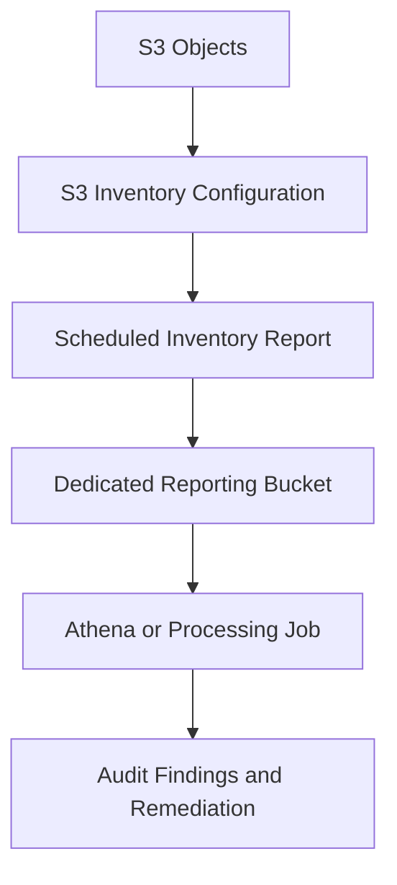
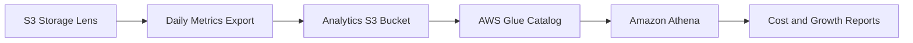
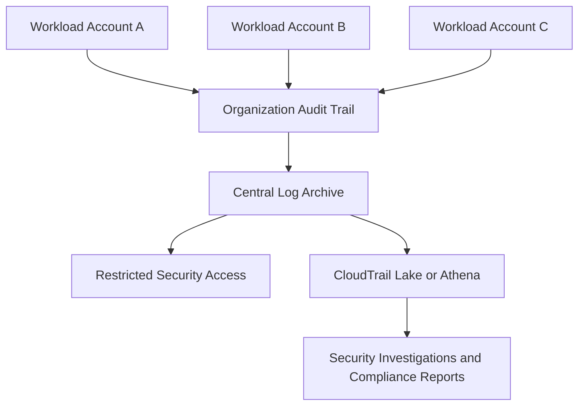
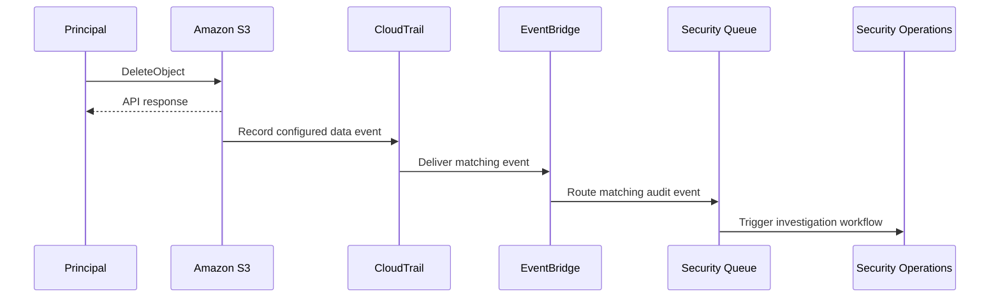

# 13- Monitoring and Auditing Questions

## Overview

Amazon S3 monitoring and auditing serve different but complementary purposes. Monitoring identifies operational problems, performance degradation, unexpected usage, and cost anomalies. Auditing establishes who performed an action, which resource was affected, and when the activity occurred.

A production S3 environment needs both capabilities. A CloudWatch dashboard may reveal an increase in failed requests, while CloudTrail provides evidence of API activity that can help explain the failure. S3 Inventory can identify stored objects and their properties, while S3 Storage Lens reveals broader storage usage and activity trends.

This document focuses on interview questions, production scenarios, implementation decisions, and troubleshooting related to Amazon S3 observability and auditability.

## Monitoring and Auditing Fundamentals

### What is the difference between monitoring, logging, auditing, and inventory?

These capabilities answer different operational questions and should not be treated as interchangeable.

| Capability | Primary purpose | Typical question | AWS service or feature |
|---|---|---|---|
| Metrics monitoring | Measure operational behavior over time | Are S3 requests failing or becoming slower? | Amazon CloudWatch |
| Event logging | Record API activity and relevant context | Which principal called `DeleteObject`? | AWS CloudTrail |
| Request access logging | Capture detailed information about requests made to a bucket | Which requests accessed this bucket, including certain authentication failures? | S3 server access logging |
| Storage analytics | Analyze storage footprint, growth, and usage patterns | Which buckets or prefixes are growing rapidly? | S3 Storage Lens |
| Object inventory | Produce reports describing objects and selected metadata | Which objects have a particular storage class or encryption status? | S3 Inventory |
| Resource configuration auditing | Detect configuration changes and compliance drift | Was a bucket policy or lifecycle configuration changed? | CloudTrail, AWS Config where supported |
| Sensitive-data discovery | Identify potentially sensitive information stored in objects | Which objects may contain regulated data? | Amazon Macie |
| Threat detection | Identify suspicious or risky activity | Is there unusual access behavior or a potential compromise? | Amazon GuardDuty and other security services |

The correct approach depends on the question being answered. A metric is not a complete audit record, and an audit log is not necessarily a real-time operational alert.

### Why is S3 observability different from ordinary application monitoring?

S3 is a managed service. AWS operates the underlying storage infrastructure, so application teams generally focus on request behavior, configuration, access patterns, stored data, dependencies, and business workflows.

Important differences include:

- Storage metrics and request metrics have different reporting intervals.
- Object-level CloudTrail data events are not enabled by default.
- Server access logs are delivered asynchronously.
- Inventory and Storage Lens provide periodic reports rather than complete real-time request histories.
- S3 can successfully store an object even when downstream processing fails.
- Monitoring coverage can span multiple accounts, Regions, buckets, and AWS services.

A complete monitoring design combines service-level metrics with application metrics, audit records, and periodic data validation.

### What is the difference between control-plane and data-plane activity?

Control-plane operations manage S3 resources and their configuration. Data-plane operations act on objects.

| Activity | Plane | Examples |
|---|---|---|
| Create or delete a bucket | Control plane | `CreateBucket`, `DeleteBucket` |
| Modify a bucket policy | Control plane | `PutBucketPolicy`, `DeleteBucketPolicy` |
| Configure lifecycle rules | Control plane | `PutBucketLifecycleConfiguration` |
| Upload an object | Data plane | `PutObject` |
| Retrieve an object | Data plane | `GetObject` |
| Delete an object | Data plane | `DeleteObject` |

CloudTrail records S3 management events, while object-level data events must be explicitly configured when they are required.

This distinction is important in audits. Seeing bucket-policy changes in CloudTrail does not mean that every object download, upload, or deletion is being recorded.

Reference: [Logging Amazon S3 API calls using CloudTrail](https://docs.aws.amazon.com/AmazonS3/latest/userguide/cloudtrail-logging.html).

## Amazon CloudWatch Monitoring

### Which S3 metrics should be monitored in production?

Select metrics according to the workload and its service-level objectives rather than collecting every available metric indiscriminately.

| Metric category | Example indicators | Engineering purpose |
|---|---|---|
| Storage utilization | `BucketSizeBytes`, `NumberOfObjects` | Detect growth and capacity-related cost changes |
| Request volume | `AllRequests`, `GetRequests`, `PutRequests` | Understand traffic patterns |
| Request errors | `4xxErrors`, `5xxErrors` | Detect authorization, request, and service failures |
| Latency | `FirstByteLatency`, `TotalRequestLatency` | Investigate slow requests |
| Replication | Bytes pending, operations pending, replication latency | Detect lag and failed replication |
| Application workflow | Upload duration, processing failures, queue age | Measure end-to-end business behavior |
| Cost and usage | Request charges, data transfer, retrieval charges | Identify financial anomalies |

S3's daily storage metrics are available without an additional CloudWatch metric charge. Optional request metrics are available at one-minute intervals after processing delay and incur applicable CloudWatch charges.

CloudWatch metrics are not a complete request ledger. Their delivery is best-effort, so they should not be treated as the authoritative record for every API request.

References:

- [Monitoring S3 with CloudWatch](https://docs.aws.amazon.com/AmazonS3/latest/userguide/cloudwatch-monitoring.html)
- [S3 metrics and dimensions](https://docs.aws.amazon.com/AmazonS3/latest/userguide/metrics-dimensions.html)

### What is the difference between S3 storage metrics and request metrics?

Storage metrics describe what is stored. Request metrics describe API activity.

Storage metrics include bucket size and object count, and they are generally reported daily. They are useful for capacity trends and cost analysis but are not suitable for minute-by-minute request-failure alerts.

Request metrics help identify traffic changes, request errors, and latency problems. They must be enabled through an appropriate metrics configuration and may be filtered to a particular prefix, access point, or object tag where supported.

Do not use daily storage metrics to investigate an upload outage that began ten minutes ago. Use request metrics and application telemetry for the immediate incident.

### How would you configure S3 request metrics for a production bucket?

A metrics configuration can track requests against a bucket, with optional filters for a subset of objects.

For example, a filtered configuration can focus on a busy application prefix:

```json
{
  "Id": "critical-document-traffic",
  "Filter": {
    "Prefix": "tenants/"
  }
}
```

Save the configuration as `request-metrics.json`, then apply it:

```bash
aws s3api put-bucket-metrics-configuration \
  --bucket company-prod-documents \
  --id critical-document-traffic \
  --metrics-configuration file://request-metrics.json
```

This configuration is illustrative. Production configuration should reflect the supported filter structure and the actual workload requirements.

Verify that the configuration exists:

```bash
aws s3api get-bucket-metrics-configuration \
  --bucket company-prod-documents \
  --id critical-document-traffic
```

Then inspect the applicable request metrics in CloudWatch.

Consider the cost of the chosen metric configuration and any high-cardinality monitoring design. Enable detailed request metrics where they materially improve operational visibility.

### How should CloudWatch alarms be designed for S3?

An effective alarm identifies a meaningful service or application failure rather than reacting to every deviation from normal traffic.

For example, an alarm could detect a sustained increase in S3 server errors, while an application-level alarm detects document uploads that remain pending beyond their expected completion time.

A production alarm should define:

- The metric and dimensions being evaluated.
- The threshold or anomaly condition.
- The evaluation period and number of breaching periods.
- Missing-data behavior.
- Notification destinations.
- The corresponding runbook or diagnostic procedure.

A fixed error-count threshold may be unsuitable for a low-volume bucket. Consider error rates, minimum request volumes, anomaly detection, or application-level failure indicators where appropriate.

**Interview trap:** A successful S3 request does not prove the entire workflow succeeded. A `PutObject` operation may complete successfully while a later Lambda, Celery task, database write, or notification fails.

### How would you troubleshoot a sudden increase in S3 `5xxErrors`?

Use a repeatable diagnostic flow.

**Symptoms and evidence:** Request metrics show increased server errors or application logs show retry exhaustion.

**Investigate:**

1. Confirm the time window and affected bucket or prefix.
2. Compare request volume, `5xxErrors`, application latency, and retry counts.
3. Identify whether the errors affect all operations or a particular client or workload.
4. Check for sudden traffic increases, deployment changes, and dependency errors.
5. Examine request-level logs or CloudTrail records where the required information is available.

Example query:

```bash
aws cloudwatch get-metric-statistics \
  --namespace AWS/S3 \
  --metric-name 5xxErrors \
  --dimensions \
    Name=BucketName,Value=company-prod-documents \
    Name=FilterId,Value=critical-document-traffic \
  --start-time 2026-10-15T10:00:00Z \
  --end-time 2026-10-15T11:00:00Z \
  --period 60 \
  --statistics Sum
```

The metric name and dimensions must match the enabled configuration. Use a UTC time window corresponding to the actual incident.

**Root-cause determination:** Establish whether the errors correlate with traffic scaling, retries, network problems, or another dependency. Do not assume every error is caused by a bucket-level request limit.

**Corrective action:** Apply bounded retries, reduce uncontrolled bursts, correct client configuration, or address the confirmed dependency failure.

**Prevention:** Add a suitable alarm, preserve diagnostic logs, and run load tests representative of the real workload.

### How would you monitor replication health?

For replication-enabled buckets, monitor replication metrics and inspect object replication status.

Important signals include:
- Number of operations pending replication.
- Bytes pending replication.
- Maximum replication latency.
- Operations that failed replication.

S3 Replication Time Control (RTC), when configured for a supported rule, also provides monitoring and a defined replication-time objective for eligible objects.

Useful CLI inspection:

```bash
aws s3api get-bucket-replication \
  --bucket company-prod-source

aws s3api head-object \
  --bucket company-prod-source \
  --key reports/report-001.parquet
```

For an object, inspect the replication status returned by the applicable S3 API response, such as `PENDING`, `COMPLETED`, `FAILED`, or the status appropriate to the replication configuration.

A replication rule's existence does not prove that every object has replicated. Investigate rule filters, role permissions, encryption compatibility, destination configuration, and the status of affected objects.

Reference: [Monitoring S3 replication](https://docs.aws.amazon.com/AmazonS3/latest/userguide/replication-metrics.html).

## AWS CloudTrail Auditing

### What does CloudTrail record for S3?

CloudTrail captures S3 API activity and includes identity and request context useful for investigations.

Depending on the event type and available fields, records can help establish:

- Which principal or AWS service made the request.
- Which API operation was called.
- When the event occurred.
- Which resources were involved.
- The source IP address and user-agent context where available.
- Whether the request succeeded or failed.
- The associated error information.

CloudTrail distinguishes management events from data events. Management events cover resource configuration and administrative operations, whereas data events capture object-level activity.

CloudTrail Event history provides management-event history for a recent period, commonly 90 days. It is not a substitute for configuring a trail or event data store for the object-level activity and retention period required by the organization.

Reference: [Amazon S3 CloudTrail events](https://docs.aws.amazon.com/AmazonS3/latest/userguide/cloudtrail-logging-s3-info.html).

### Why are S3 object-level data events not appearing in CloudTrail?

CloudTrail does not log S3 object-level data events by default.

A trail must be configured to include the required data events. The configuration can cover selected buckets or object resources and can use advanced event selectors to restrict the captured activity.

For example, a team may want to audit reads and deletes from a sensitive-document prefix without paying to capture every object operation across every bucket.

Use advanced selectors carefully: overly broad selectors can generate substantial event volume and costs, while overly narrow selectors can leave audit gaps.

Reference: [Logging data events with CloudTrail](https://docs.aws.amazon.com/awscloudtrail/latest/userguide/logging-data-events-with-cloudtrail.html).

### How would you configure CloudTrail to audit object-level operations on a sensitive prefix?

A typical advanced event selector can target object-level data events for a particular bucket or prefix.

An illustrative selector is:

```json
[
  {
    "Name": "SensitiveDocumentObjectEvents",
    "FieldSelectors": [
      {
        "Field": "eventCategory",
        "Equals": ["Data"]
      },
      {
        "Field": "resources.type",
        "Equals": ["AWS::S3::Object"]
      },
      {
        "Field": "resources.ARN",
        "StartsWith": [
          "arn:aws:s3:::company-prod-sensitive/tenants/"
        ]
      }
    ]
  }
]
```

Apply it to the existing trail after validating the target trail and its other selectors:

```bash
aws cloudtrail put-event-selectors \
  --trail-name organization-audit-trail \
  --advanced-event-selectors \
  file://s3-data-event-selectors.json
```

**Operational caution:** Updating event selectors replaces the trail's selector configuration. Before applying a change, inspect and preserve the existing selectors so unrelated audit coverage is not accidentally removed.

Example inspection:

```bash
aws cloudtrail get-event-selectors \
  --trail-name organization-audit-trail
```

Validate the selector syntax, trail configuration, resource ARN matching, destination permissions, and delivery behavior in a controlled environment before relying on the configuration for compliance.

### What is the difference between CloudTrail and S3 server access logging?

Both record aspects of S3 request activity, but they serve different purposes.

| Characteristic | CloudTrail | S3 server access logging |
|---|---|---|
| Primary focus | AWS API activity and identity context | Detailed records of bucket requests |
| Object-level tracking | Available when data events are enabled | Available through access logs |
| Bucket configuration changes | Captures S3 management events | Not the primary purpose |
| Delivery | Asynchronous trail or event-store delivery | Asynchronous delivery |
| Format | Structured event records, commonly JSON | Space-delimited records for S3 delivery, or structured logs through the supported CloudWatch Logs path |
| Cost considerations | Data-event and optional event-store charges | Storage and applicable destination-delivery costs |
| Typical use | Security investigation, API auditing, change history | Request analysis, access audits, and usage investigation |

AWS recommends CloudTrail for logging bucket-level and object-level S3 actions. Server access logging can complement CloudTrail when detailed request records are needed.

Neither should be assumed to be a complete, instantaneous, failure-proof stream of every attempted request. CloudTrail does not record requests that fail authentication with invalid credentials in the same way as authenticated API calls, and access-log delivery is asynchronous.

Reference: [Logging options for Amazon S3](https://docs.aws.amazon.com/AmazonS3/latest/userguide/logging-with-S3.html).

### How would you investigate an unexpected object deletion?

Begin by identifying the affected object, approximate deletion time, and bucket.

Then:
1. Search CloudTrail data events for relevant `DeleteObject` or `DeleteObjects` activity.
2. Identify the principal, source context, event time, and request outcome.
3. Correlate the event with application logs, deployment activity, and automated jobs.
4. Inspect versioning and delete-marker behavior to determine whether the object was permanently removed or only hidden by a delete marker.
5. Inspect the effective permissions and relevant policy changes if the deletion was unauthorized.
6. Recover the appropriate version where recovery is supported and authorized.

For sensitive data, ensure the audit trail has been retained in a protected destination independent of the workload that is being investigated.

**Interview trap:** Object deletion does not always mean permanent erasure. In a versioned bucket, a delete marker may hide the current object while older versions remain stored.

### How would you detect a bucket-policy change that exposes data?

Use CloudTrail management events to identify policy changes, then validate the resulting configuration.

Relevant events include `PutBucketPolicy`, `DeleteBucketPolicy`, and changes to public-access or ownership settings.

A useful investigation sequence is:

```bash
aws cloudtrail lookup-events \
  --lookup-attributes \
    AttributeKey=EventName,AttributeValue=PutBucketPolicy \
  --max-results 50
```

This command queries management-event history for the selected Region and time range available through the chosen interface. For a complete organization-wide investigation, use the configured multi-Region trail, centralized log archive, or applicable event-store queries.

Next, inspect the effective bucket policy and public-access settings, determine whether a public-access path exists, and correlate the change with its principal and deployment pipeline.

Do not infer that a bucket is publicly accessible merely because a policy changed. Validate the effective configuration, Block Public Access settings, access path, and applicable permissions.

## S3 Storage Lens and Storage Inventory

### What is S3 Storage Lens, and when should it be used?

S3 Storage Lens provides storage-usage and activity insights across configured scopes such as accounts, Regions, buckets, and supported prefix groupings.

It can help answer questions such as:
- Which buckets are growing fastest?
- Which storage classes dominate the storage footprint?
- Where are large numbers of objects accumulating?
- Are storage-protection and access-management recommendations being followed?
- Which prefixes warrant further cost analysis?

Storage Lens produces aggregated metrics and trends rather than a request-by-request audit history. Its metrics are generally daily, so it is useful for ongoing management and trend analysis rather than immediate request-failure detection.

Some advanced metrics, expanded prefix metrics, and publishing options have additional configuration and pricing considerations.

References:

- [Understanding S3 Storage Lens](https://docs.aws.amazon.com/AmazonS3/latest/userguide/storage_lens_basics_metrics_recommendations.html)
- [Viewing S3 Storage Lens metrics](https://docs.aws.amazon.com/AmazonS3/latest/userguide/storage_lens_view_metrics.html)

### What is the difference between S3 Storage Lens and S3 Inventory?

Storage Lens emphasizes aggregated storage analytics, whereas Inventory provides object-level reports.

| Requirement | Storage Lens | S3 Inventory |
|---|---|---|
| Understand storage growth | Strong fit | Possible through report analysis |
| Compare storage usage across buckets | Strong fit | Requires processing object reports |
| Identify individual object versions | Not its main role | Supported through appropriate Inventory configuration |
| Audit selected object properties at scale | Aggregate insights only | Strong fit |
| Obtain a complete real-time request history | Not supported | Not supported |
| Analyze encryption and storage-class distribution | Aggregate insights | Object-level report fields where configured |
| Find abandoned or unexpected object populations | Useful for broad trends | Useful for detailed object analysis |

S3 Inventory produces scheduled reports, typically daily or weekly, depending on configuration. It should not be used as a real-time source of truth for request activity or immediate object existence.

### How can S3 Inventory support an audit?

An auditor may need to determine which objects are stored, what storage classes they use, whether encryption metadata meets a requirement, or which versions exist.

Configure Inventory to include the required fields and version scope. Deliver reports to an appropriately protected destination bucket, then analyze the resulting data using Athena, Glue, or another suitable processing system.

A useful workflow is:



Inventory has delivery and processing delays. If an audit requires evidence from a specific point in time, retain the reports and their generation metadata rather than assuming the newest report reflects the exact current bucket state.

### How can Storage Lens metrics be integrated with Athena?

Storage Lens metrics exports can be delivered to a general-purpose S3 bucket in supported CSV or Parquet formats. They can then be cataloged and queried with suitable analytics services.

A typical design is:



Configure the correct destination permissions, encryption, retention, and data-catalog schema. Treat the exported metrics as periodic aggregates, not as live operational telemetry.

For exports delivered to a general-purpose bucket, use the export manifest where applicable to identify the files and report metadata belonging to a given delivery.

Reference: [Viewing S3 Storage Lens metrics using a data export](https://docs.aws.amazon.com/AmazonS3/latest/userguide/storage_lens_view_metrics_export.html).

## Security Auditing and Compliance

### How would you design a centralized S3 audit architecture for multiple AWS accounts?

A multi-account organization should avoid relying solely on logs stored in the same account and environment as the resources being audited.

A common design uses an organization-level or multi-Region CloudTrail trail and centralizes audit records into a dedicated logging account.



The organization should define:
- Which management and data events are required.
- Which accounts, Regions, buckets, and prefixes are in scope.
- How log files are protected from alteration or deletion.
- Who can access, query, export, and administer the audit data.
- How long audit records must be retained.
- How delivery failures, configuration changes, and unexpected gaps are detected.

CloudTrail log-file validation can help verify the integrity of delivered log files. A protected log archive, restrictive IAM policies, and where appropriate S3 Object Lock provide additional defenses against tampering.

A centralized archive is valuable only if its access controls and retention policy are independent enough to remain trustworthy during a workload-account compromise.

### What is the role of S3 Object Lock in audit-log protection?

S3 Object Lock supports write-once-read-many retention controls for eligible object versions. It can protect records from deletion or alteration during a configured retention period or legal hold, depending on the selected mode.

It is useful for audit records that must remain immutable for a specified period.

However:
- Retention must match legal and organizational requirements.
- Compliance mode has stronger deletion protections than governance mode.
- Retention can affect cleanup and storage-cost assumptions.
- Object Lock does not replace authorization controls, integrity verification, or monitoring of audit delivery.
- Administrators must carefully validate the bucket configuration before deployment.

Use Object Lock only as part of an explicit retention design, and test recovery and lifecycle behavior against that design.

Reference: [Locking objects with S3 Object Lock](https://docs.aws.amazon.com/AmazonS3/latest/userguide/object-lock.html).

### How can IAM Access Analyzer and Amazon Macie help with S3 security auditing?

These services complement CloudTrail and CloudWatch but answer different questions.

**IAM Access Analyzer for S3** helps identify resource policies that allow access from outside the intended trust boundary, including applicable public and cross-account access paths.

**Amazon Macie** helps discover and classify potentially sensitive data in S3, which is useful for data-governance and investigation workflows.

Neither service replaces event auditing. Access Analyzer evaluates access exposure, while Macie helps identify sensitive-data risks. CloudTrail records API activity, and CloudWatch provides operational signals.

A comprehensive security program may combine all these capabilities with policy validation, periodic configuration reviews, and a documented remediation process.

### How would you monitor public-access configuration changes?

Monitor the configuration changes that can alter the bucket's exposure, including bucket-policy changes, Block Public Access settings, and Object Ownership or ACL-related changes where applicable.

Use CloudTrail management events for the configuration-change history. Where appropriate, use AWS Config rules or custom compliance checks to evaluate the resulting resource configuration.

When an alert fires:
1. Identify the principal and change event.
2. Inspect the current effective resource configuration.
3. Determine whether public access is possible under the resulting settings.
4. Compare the change with approved infrastructure code and deployment records.
5. Revert or correct an unauthorized change through the controlled remediation process.
6. Validate that the intended access path still functions.

Do not automatically roll back every policy change without understanding its dependencies; a corrective action can break legitimate application access.

## Event-Driven Monitoring and Alerting

### How can S3 events support auditing and operational alerts?

S3 Event Notifications and EventBridge can support event-driven workflows for object creation, deletion, replication, and other supported events.

The destination may be Lambda, SQS, SNS, or EventBridge, depending on the architecture.

A monitoring workflow might notify a security system when an unexpected object appears in a protected prefix or trigger a reconciliation process after an object is created.

However, S3 object notifications and CloudTrail data events serve different purposes. An S3 object-created notification is not a complete audit stream for every API request. If the requirement is to determine which principal performed an object-level API operation, configure CloudTrail data events.

Event-driven consumers must tolerate duplicate delivery and retry behavior. Record a durable event identifier or another appropriate idempotency key and make downstream processing safe to repeat.

### How would you alert when an object is deleted from a sensitive bucket?

Choose the event source according to the required evidence and latency.

If the primary requirement is to audit who invoked the deletion API, configure CloudTrail data events and use an appropriate EventBridge rule or another supported processing path.

If the requirement is to react to supported object-deletion events, S3 Event Notifications may be suitable.

A production flow could be:



The sequence represents the conceptual flow, not a timing guarantee. Configure the required CloudTrail data-event coverage before relying on EventBridge to receive those audit events.

An alert should include enough context to triage the incident without exposing credentials, presigned URLs, or sensitive object contents.

### What should be monitored for S3-triggered Lambda processing?

S3 object creation can initiate downstream processing, but an upload succeeding does not guarantee that processing will complete.

Monitor:
- Lambda invocation errors and duration.
- Throttling and concurrency saturation.
- Queue backlog or oldest-message age for SQS-based designs.
- Dead-letter queue depth where configured.
- Processing attempts and duplicate-event handling.
- Application state transitions from pending to completed or failed.
- Objects that remain unprocessed beyond an expected deadline.

When investigating a gap, verify the input object's existence, event filter configuration, destination permissions, Lambda or queue health, and worker logs.

Use a reconciliation workflow for long-lived pending records. This is more reliable than depending exclusively on a single notification path.

## Cost and Retention of Monitoring Data

### How would you prevent monitoring and audit costs from growing unexpectedly?

Monitoring costs arise from the collection, delivery, storage, querying, and retention of telemetry.

Important cost drivers include CloudTrail data events, CloudTrail Lake ingestion and retention, optional S3 request metrics, S3 Inventory reports, advanced Storage Lens metrics, CloudWatch Logs ingestion, and Athena queries.

Use these controls:
- Limit CloudTrail data-event selectors to the required resources and operations.
- Review whether duplicate trails deliver the same events to multiple destinations.
- Enable detailed request metrics only where they support concrete operational decisions.
- Select Inventory fields and report frequency based on the audit requirement.
- Use S3 lifecycle and retention policies for telemetry, subject to compliance requirements.
- Partition and filter analytical queries to avoid unnecessary data scans.
- Alert on unexpected telemetry volume and cost changes.

Do not weaken a mandatory audit requirement solely to reduce costs. Instead, establish required coverage first and then optimize the collection and retention design.

Reference: [Managing CloudTrail trail costs](https://docs.aws.amazon.com/awscloudtrail/latest/userguide/cloudtrail-trail-manage-costs.html).

### How should audit-log retention be determined?

Retention should be based on regulatory obligations, contractual commitments, incident-investigation needs, and the cost of maintaining retrievable evidence.

Separate at least three concerns:
- **Operational logs:** Used for immediate debugging and short-term alert investigation.
- **Security audit records:** Retained for investigations and access-history requirements.
- **Long-term compliance records:** Retained according to formal organizational or legal requirements.

Use restricted storage locations, lifecycle rules where appropriate, and immutable retention controls when required.

A retention configuration is not enough by itself. Verify that logs are delivered correctly, can be queried during the retention period, and are protected against unauthorized access or deletion.

## Practical Audit Verification Commands

### How do you inspect CloudTrail configuration and event selectors?

```bash
aws cloudtrail describe-trails \
  --include-shadow-trails

aws cloudtrail get-trail-status \
  --name organization-audit-trail

aws cloudtrail get-event-selectors \
  --trail-name organization-audit-trail
```

Use the returned configuration to verify:
- The trail's account and Region scope.
- Whether the destination is configured as expected.
- Whether logging is active.
- Whether data-event selectors cover the required S3 resources.
- Whether multi-Region or organization-wide coverage is appropriate.

A trail reporting that logging is active does not prove that every desired object operation is covered. Validate the selectors and test with a controlled object operation.

### How do you inspect S3 request-metric configuration?

```bash
aws s3api list-bucket-metrics-configurations \
  --bucket company-prod-documents
```

Use this output to determine whether the intended request-metric configuration exists. Then verify that the corresponding CloudWatch metrics are arriving and that the dashboard's dimensions match the configured bucket and filter.

Do not confuse the existence of a metrics configuration with complete or instantaneous metric delivery.

### How would you investigate an unexpected configuration change?

Start with the relevant management event and correlate it with infrastructure and deployment records.

Useful commands include:

```bash
aws cloudtrail lookup-events \
  --lookup-attributes \
    AttributeKey=EventSource,AttributeValue=s3.amazonaws.com \
  --max-results 50
```

This example returns recent matching events available through the selected Region's event history. It is useful for an initial investigation, but it is not a substitute for querying the configured trail or event data store for the full incident window.

Inspect the event name, identity, timestamp, resource details, and error information. Then compare the current bucket configuration against the approved Terraform, CloudFormation, or CDK definitions.

### How should monitoring configurations be tested before production?

Test the complete detection path, not only the resource configuration.

A practical validation sequence is:

1. Create a controlled test bucket or use an approved non-production bucket.
2. Generate a known object-level or management event.
3. Confirm that the intended telemetry source records the activity.
4. Verify delivery to the expected destination.
5. Confirm that the alert or query can identify the event.
6. Test the notification and incident-routing path.
7. Verify that retention and access controls are applied correctly.
8. Document expected delays, known gaps, and cleanup procedures.

Record the expected outcome for each test. Do not report successful monitoring validation simply because a trail, alarm, or inventory configuration exists.

## Senior-Level Interview Scenarios

### Scenario: An auditor asks who downloaded a sensitive document three days ago. How would you investigate?

First establish whether CloudTrail data events or S3 server access logging covered the bucket and object at the relevant time.

Search the appropriate retained records for the object-level request. Correlate the event timestamp, identity, source context, object resource, and request outcome with application authentication logs.

If the required logging was not enabled, determine what evidence is available from other sources. Do not claim that CloudTrail Event history contains historical object reads that were never logged.

Document the coverage gap and implement appropriate audit-event selectors and retention controls for future investigations.

### Scenario: Storage capacity appears stable, but AWS storage costs have increased. What would you inspect?

Storage size alone does not explain the complete S3 bill.

Inspect request volume, data transfer, retrieval operations, storage-class transitions, incomplete multipart uploads, retained noncurrent object versions, and monitoring or analytics costs.

Use Storage Lens for broad usage trends, Inventory for object-level analysis, and billing reports for the financial breakdown. Correlate the change with deployments, batch processing, and workload traffic.

Avoid concluding that storage-class optimization is the only solution before identifying the charge that actually increased.

### Scenario: CloudWatch reports healthy request metrics, but users report failed downloads. What could explain the discrepancy?

CloudWatch metrics are aggregated and best-effort, and they may not capture every request with perfect completeness or immediacy.

The user-visible failure may also occur outside S3. For example, the application may reject an authenticated request, a presigned URL may have expired, CloudFront may deny access, or the backend may fail after retrieving the object.

Trace the request across the frontend, delivery layer, backend, and S3. Compare application errors with the available S3 metrics and request-level records.

Treat aggregate metrics as evidence rather than proof that every individual request succeeded.

### Scenario: A security alert reports a policy change, but the application still functions. Is the change safe?

Not necessarily. A policy change can broaden external access without breaking application functionality.

Inspect the principal responsible for the change, the resulting effective policy, Block Public Access, any access-point policy, cross-account permissions, and applicable identity policies.

Compare the configuration with the approved deployment. If the change was unauthorized, preserve investigation evidence and follow the controlled remediation process.

Application health is not proof that the storage configuration remains secure.

### Scenario: Logs are missing for a period during a suspected incident. How would you respond?

Determine which source is missing records: CloudTrail, server access logs, CloudWatch metrics, Inventory, or application logs. Each source has different coverage and delivery semantics.

Check trail status, event selectors, destination permissions, delivery errors, retention policies, query filters, and the time window. Verify that the required event type was actually enabled before the incident.

Preserve the available evidence from independent sources and document the uncertainty. A missing record is not proof that an operation did not occur.

Then correct the telemetry gap and test the delivery path with controlled events.

## Common Monitoring and Auditing Mistakes

| Mistake | Consequence | Better practice |
|---|---|---|
| Assuming CloudTrail logs every object operation by default | Object-level audit gaps | Enable and verify the necessary data-event selectors |
| Treating CloudWatch metrics as a complete audit history | Missing request-level evidence | Combine metrics with the appropriate request logs and audit events |
| Using Inventory for immediate object-state checks | Decisions based on stale reports | Use direct API checks for current state |
| Treating successful upload as successful processing | Hidden downstream failures | Monitor the complete workflow and reconcile pending states |
| Enabling all data events without a cost assessment | Unnecessary event volume and cost | Scope selectors to the required resources and operations |
| Storing audit logs only with the workload they audit | A compromised workload may affect its evidence | Use an appropriately protected central archive |
| Alerting on every metric change | Alert fatigue | Use meaningful thresholds, minimum traffic conditions, and runbooks |
| Assuming a trail being active proves full coverage | Selectors may omit required events | Test the complete audit path |
| Ignoring log-delivery delays | False incident conclusions | Document delivery characteristics and corroborate with other sources |
| Retaining logs without testing retrieval | Evidence may be difficult to find during an incident | Run periodic audit and recovery exercises |

## Authoritative References

- [Logging options for Amazon S3](https://docs.aws.amazon.com/AmazonS3/latest/userguide/logging-with-S3.html)
- [Amazon S3 CloudTrail events](https://docs.aws.amazon.com/AmazonS3/latest/userguide/cloudtrail-logging-s3-info.html)
- [Logging data events with CloudTrail](https://docs.aws.amazon.com/awscloudtrail/latest/userguide/logging-data-events-with-cloudtrail.html)
- [Monitoring S3 with CloudWatch](https://docs.aws.amazon.com/AmazonS3/latest/userguide/cloudwatch-monitoring.html)
- [S3 metrics and dimensions](https://docs.aws.amazon.com/AmazonS3/latest/userguide/metrics-dimensions.html)
- [Monitoring S3 replication](https://docs.aws.amazon.com/AmazonS3/latest/userguide/replication-metrics.html)
- [Understanding S3 Storage Lens](https://docs.aws.amazon.com/AmazonS3/latest/userguide/storage_lens_basics_metrics_recommendations.html)
- [S3 Inventory](https://docs.aws.amazon.com/AmazonS3/latest/userguide/storage-inventory.html)
- [Managing CloudTrail trail costs](https://docs.aws.amazon.com/awscloudtrail/latest/userguide/cloudtrail-trail-manage-costs.html)
- [S3 Object Lock](https://docs.aws.amazon.com/AmazonS3/latest/userguide/object-lock.html)

## Key Takeaways

- Use CloudWatch for operational metrics, CloudTrail for API auditing, server access logging for detailed request records, Storage Lens for aggregate usage insights, and Inventory for scheduled object-level reports.
- Enable and validate S3 data-event selectors when object-level audit evidence is required; management-event coverage alone is insufficient.
- Design alerts around meaningful failure indicators and trace the entire workflow instead of assuming that successful S3 requests guarantee business-level success.
- Centralize and protect audit records, define retention requirements explicitly, and test log delivery, search, and recovery procedures.
- Balance telemetry coverage with cost by scoping event selectors, choosing metrics deliberately, and periodically reviewing retention and monitoring effectiveness.