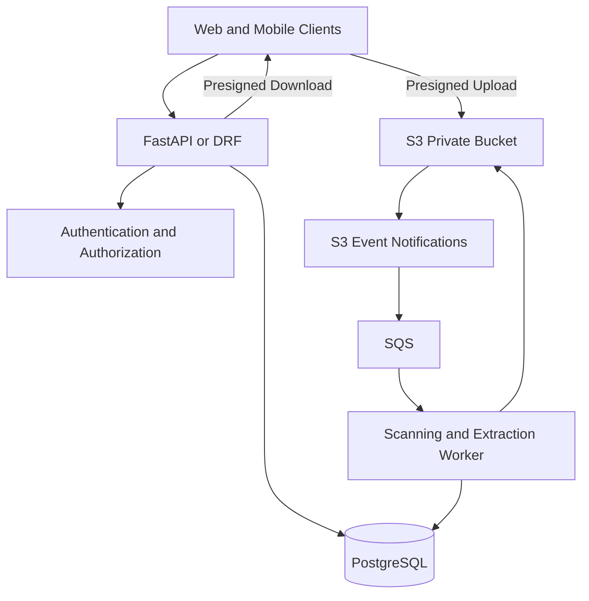
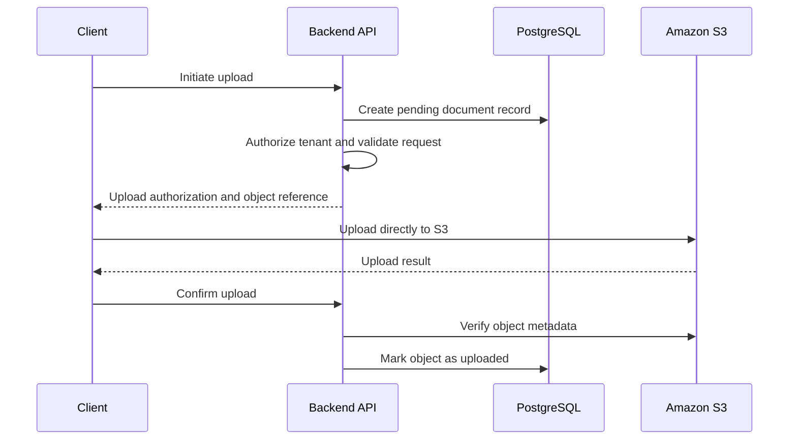
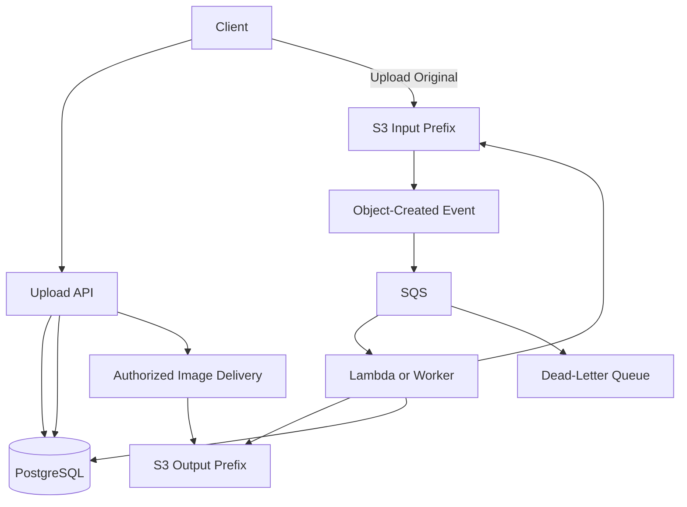
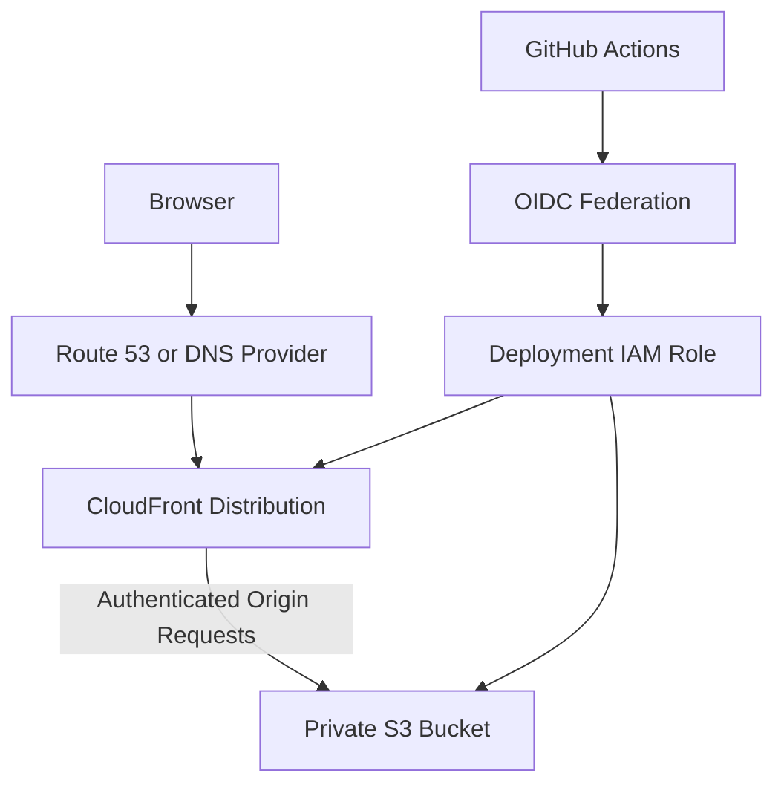
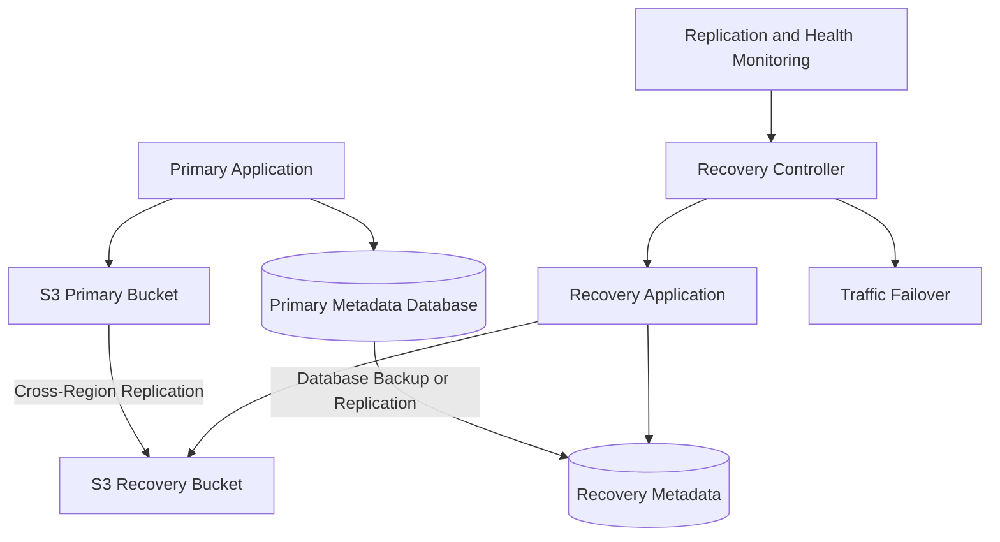
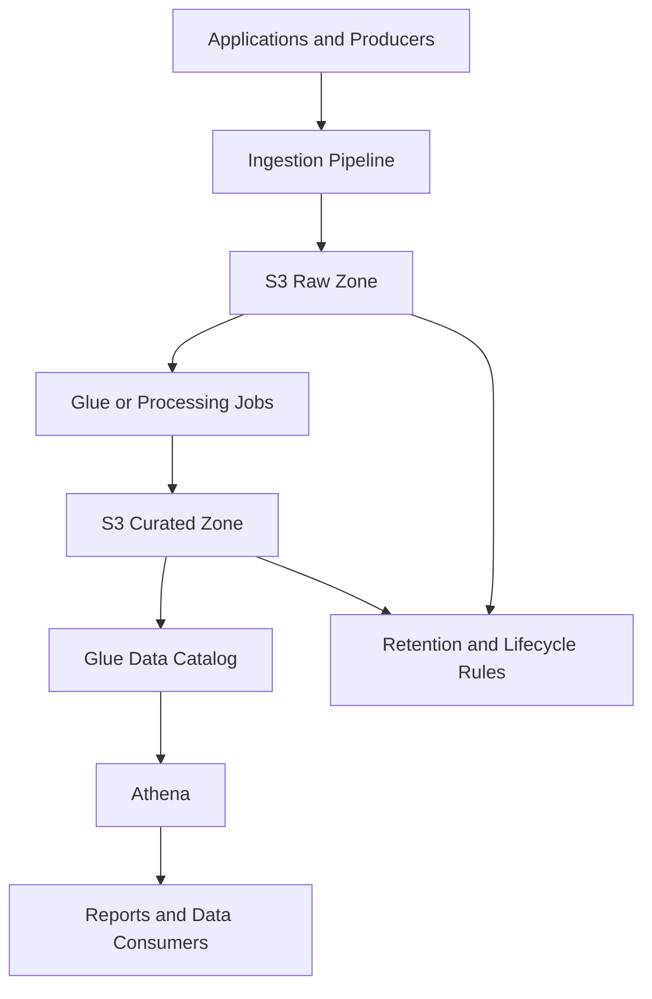
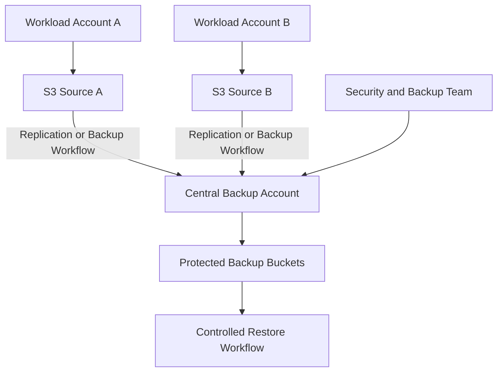
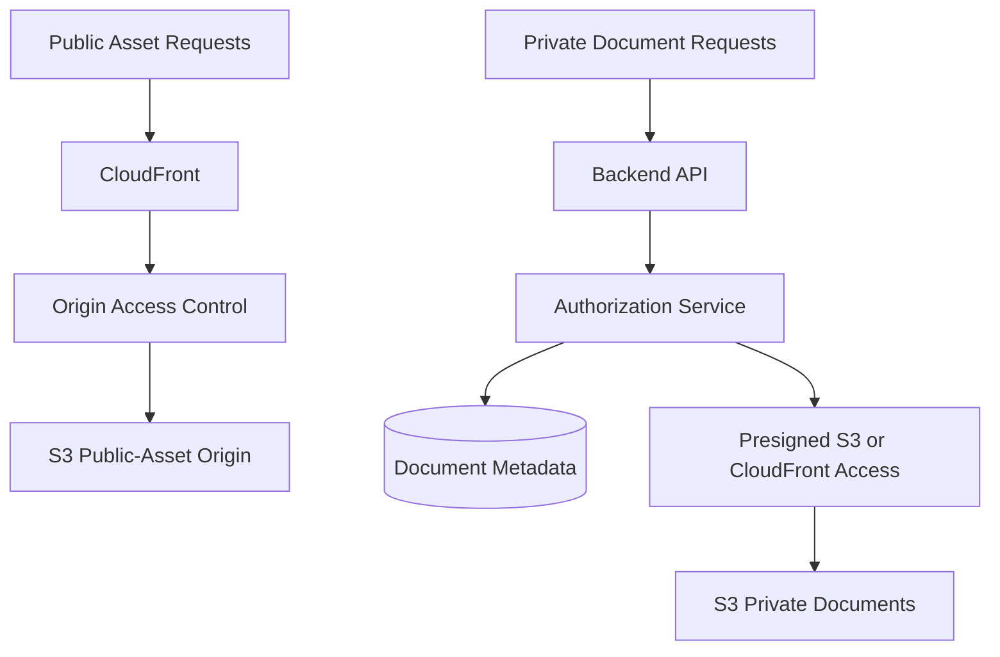
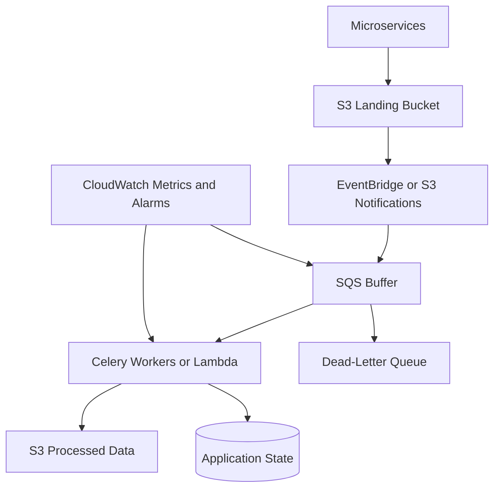

# 14- Architecture Design Scenarios

## Overview

Amazon S3 architecture design involves more than selecting a bucket and uploading objects. A production design must establish how data enters the system, who can access it, how downstream components process it, how failures are recovered, and how operational cost is controlled.

Senior backend engineering interviews typically test these decisions through open-ended scenarios. The strongest answers connect functional requirements to architecture, explain alternatives, identify failure boundaries, and distinguish AWS-managed capabilities from application responsibilities.

This document covers practical system design scenarios involving S3, Python backends, databases, messaging, content delivery, analytics, security, and disaster recovery.

## A Framework for Solving S3 Design Problems

### What requirements should be clarified first?

Before drawing an architecture, identify the constraints that influence the design.

| Category | Questions |
|---|---|
| Workload | What data is stored, and which services produce or consume it? |
| Scale | How many objects, requests, concurrent uploads, and daily data transfers are expected? |
| Object characteristics | What are the typical and maximum file sizes? |
| Access patterns | Is access frequent, intermittent, public, private, or tenant-specific? |
| Response time | Must an operation complete during an HTTP request, or can it run asynchronously? |
| Security | What are the authentication, authorization, encryption, and retention requirements? |
| Consistency | When must newly uploaded data become visible to the application? |
| Resilience | Which failures must be tolerated, and what are the RPO and RTO? |
| Operations | How are errors detected, retried, investigated, and reconciled? |
| Cost | What are the expected storage, request, processing, retrieval, and transfer costs? |

When the interviewer has not supplied numerical requirements, state reasonable assumptions and explain which decisions depend on them. Avoid presenting an assumed traffic volume or availability target as a requirement.

### How should the solution be presented?

A useful design answer covers the following elements in order:

1. Requirements and constraints.
2. Component responsibilities and trust boundaries.
3. Request flow and data flow.
4. Storage organization and metadata ownership.
5. Authorization and failure handling.
6. Scaling, observability, and cost.
7. Alternatives, limitations, and operational recovery.

A diagram is useful only when it makes these relationships clear. Explain the role of every major component rather than listing AWS service names.

## Scenario: Design a Multi-Tenant Document Storage Service

### Interview question

Design a service that allows businesses to upload, retrieve, share, and delete documents. Files can be several gigabytes, and one tenant must never access another tenant's documents.

### Proposed architecture



### How should the system be organized?

Use S3 for document bytes and PostgreSQL for application metadata, ownership, sharing rules, and processing status.

A document record could contain:

| Field | Purpose |
|---|---|
| `document_id` | Stable application identifier |
| `tenant_id` | Owning tenant |
| `object_key` | Server-generated S3 key |
| `object_version_id` | Optional reference to a specific S3 version |
| `status` | Upload and processing lifecycle |
| `content_length` | Verified object size |
| `content_type` | Validated content type |
| `created_at` | Application creation time |

For example, keys might follow this convention:

```text
tenants/{tenant_id}/documents/{document_id}/original
```

The key is an object identifier, not an authorization mechanism. An API must authorize every document operation against trusted application state.

### How should large uploads work?

Use a two-phase upload protocol.



For very large files, use multipart upload through Boto3 managed transfers or a controlled presigned-part workflow.

Do not assume the confirmation call proves the upload succeeded. Verify the expected bucket, key, size, and relevant version ID before transitioning the document state.

### Should the application stream all uploads through FastAPI?

Not necessarily.

| Approach | Advantages | Limitations |
|---|---|---|
| Backend-proxied upload | Centralized inspection and control of the data stream | Uses application bandwidth and worker capacity |
| Presigned direct upload | Offloads data transfer to S3 | Requires post-upload verification and careful URL handling |
| Controlled multipart upload | Supports resilient transfer of large objects | Requires tracking parts and completing or aborting uploads |

Direct upload is a strong default for large client-originated files. Proxying remains reasonable when synchronous inspection or transformation is required.

### How should cross-tenant access be prevented?

The API must verify document ownership or an explicit sharing grant before returning metadata, creating a download URL, or deleting an object.

Additional safeguards include private buckets, least-privilege roles, server-generated keys, and prefix-scoped policies where suitable.

If tenants have materially different retention, encryption, or administrative requirements, consider separate buckets or accounts instead of relying exclusively on a shared-bucket prefix convention.

### What happens when S3 succeeds but PostgreSQL fails?

S3 and PostgreSQL do not share an atomic transaction. An object can exist while its application record remains incomplete.

Use explicit upload states, idempotent completion handling, and a reconciliation job. The reconciler should identify stale pending records and determine whether the expected object exists before repairing or expiring the record.

Deletion requires similar care: a failed database update after a successful object deletion must not leave the application believing that the file remains available.

**Senior-level trade-off:** The system optimizes transfer scalability through direct uploads, but must introduce more explicit state management to handle partial failures.

## Scenario: Build an Event-Driven Image Transformation Service

### Interview question

Users upload product images. The system generates thumbnails and optimized variants, handles traffic spikes, and exposes processing status through an API.

### Proposed architecture



### Why introduce asynchronous processing?

Image transformation can require substantial CPU, memory, and execution time. Running it inside an HTTP request increases latency and consumes web-worker capacity.

An asynchronous design lets the API acknowledge a validated upload and return a processing status while a queue buffers work for independent consumers.

Separate the source and output prefixes or buckets. Otherwise, an object-created event can trigger processing of the processor's own output.

### How should event delivery and retries be handled?

Amazon S3 Event Notifications are designed for at-least-once delivery. Notifications can be duplicated and may arrive out of order. They are not a globally ordered, exactly-once processing mechanism.

Each message should resolve to a specific source object and transformation version. If the bucket is versioned, use the event's version information when the processing result must correspond to an exact source revision.

Use deterministic output keys, conditional application-state updates, bounded retries, and a failure-recovery queue where justified.

### What if the worker crashes after writing an image?

The output may already exist even though the database does not show the operation as complete.

On retry, the worker should verify whether the output corresponds to the correct source version and transformation version. It can reuse or regenerate the output and then complete the application-state transition.

Do not assume that checking whether an output key exists is sufficient when the source can change or when multiple transformation versions are supported.

### What should be monitored?

Measure processing duration, failure rate, retry count, queue depth, oldest-message age, and documents stuck in intermediate states.

For Lambda, monitor invocation errors, throttling, duration, and concurrency. For Celery, monitor worker health, task age, retries, and broker backlog.

A reconciliation job should locate uploaded images that remain unprocessed beyond the expected deadline.

Reference: [Amazon S3 Event Notifications](https://docs.aws.amazon.com/AmazonS3/latest/userguide/EventNotifications.html).

## Scenario: Design a Global Static Website

### Interview question

A company hosts a static frontend for customers around the world. It requires HTTPS, efficient caching, controlled releases, and a private S3 origin.

### Proposed architecture



### Why use CloudFront with Origin Access Control?

CloudFront can serve cached content from edge locations while Origin Access Control (OAC) allows the distribution to access a private S3 origin.

The bucket policy should permit the intended CloudFront distribution rather than granting unrestricted public object access. Bucket owner enforced Object Ownership is a suitable default for this architecture.

Use an S3 REST origin when OAC is required. An S3 website endpoint is configured as a custom origin and does not support OAC in the same way.

Reference: [Restrict access to an S3 origin](https://docs.aws.amazon.com/AmazonCloudFront/latest/DeveloperGuide/private-content-restricting-access-to-s3.html).

### How should frontend releases be deployed?

A CI/CD workflow should:

1. Validate the source and build the frontend.
2. Authenticate to AWS using short-lived OIDC credentials.
3. Upload the new release assets.
4. Invalidate or update the necessary CloudFront paths.
5. Execute HTTPS smoke tests.
6. Record the release identifier and preserve a rollback target.

Use content-hashed asset filenames to support long caching periods. HTML entry points usually need shorter cache lifetimes or controlled invalidation because they reference the current release.

### How should rollback work?

Retain the previous known-good build and the assets referenced by it.

If a release fails, restore the previous entry point or deployment version, perform any necessary invalidation, and verify that the restored HTML references assets that remain available.

Avoid deleting old assets immediately after deployment. A cached page may still reference them.

### What are the trade-offs?

CloudFront adds configuration, cache behavior, and a deployment dependency, but reduces repeated origin requests and improves global delivery. OAC makes origin access more controlled, but incorrect bucket or KMS policies can cause origin failures.

A public S3 bucket is not an acceptable shortcut when the requirement is a private origin.

## Scenario: Design a Regional Disaster Recovery System

### Interview question

A document platform stores critical data in one AWS Region. The business requires recovery after a regional disruption and has defined RPO and RTO targets.

### Proposed architecture



### What must be replicated or recoverable?

Replicating S3 objects alone is not enough. The recovery environment also needs a consistent metadata store, permissions, encryption-key access, application configuration, event-processing resources, and network or DNS configuration.

Replication is asynchronous. A successful source upload does not guarantee that its replica is immediately available in the recovery Region.

### How should the recovery process work?

The runbook should establish a controlled sequence:

1. Detect and declare the incident.
2. Assess the health of the primary Region.
3. Measure replication lag and determine which objects are available in the destination.
4. Recover or promote the metadata store according to the database recovery design.
5. Verify IAM and KMS permissions in the destination Region.
6. Activate the recovery application and its processing dependencies.
7. Route traffic to the recovery environment.
8. Validate document reads, writes, and downstream workflows.
9. Record measured RPO, RTO, and any data reconciliation required.

Do not automatically allow both Regions to become independent writers without an explicit conflict-resolution and ownership strategy.

### What role can S3 Multi-Region Access Points play?

Multi-Region Access Points provide a global endpoint for requests to S3 buckets in multiple Regions. They can route data requests to active buckets and support failover controls.

They do not automatically guarantee that every requested object exists in whichever bucket receives the request. Cross-Region Replication is needed when objects must be available across the selected Regions.

They also do not solve database consistency or application-state recovery by themselves.

Reference: [Configuring replication for Multi-Region Access Points](https://docs.aws.amazon.com/AmazonS3/latest/userguide/MultiRegionAccessPointBucketReplication.html).

### How should DR be validated?

Exercise the complete recovery procedure under controlled conditions. Verify object availability, database recovery, encryption permissions, API health, event processing, and traffic routing.

A configured replication rule is not evidence that the full application can recover. Document the procedures actually tested, their observed recovery times, and any untested assumptions.

## Scenario: Design an Analytics Data Lake

### Interview question

Several services produce large datasets. Analysts need historical SQL queries, data retention, and curated datasets without putting analytical query load on operational databases.

### Proposed architecture



### How should datasets be organized?

Separate raw input from validated and curated output. Use predictable prefixes that align with ownership, retention, and data-processing boundaries.

For example:

```text
raw/events/year=2026/month=10/day=15/
curated/events/year=2026/month=10/day=15/
curated/customers/region=ap-south-1/
```

Choose partition keys according to actual query predicates. A partition scheme that is convenient for ingestion can be inefficient for the queries analysts run most often.

### Why use Parquet and a catalog?

Columnar formats such as Parquet can reduce query cost by allowing suitable engines to read selected columns rather than whole row-oriented files.

AWS Glue Data Catalog provides metadata used by query and processing services. Athena can run SQL over supported S3 datasets without requiring an operational relational database for the full dataset.

Avoid creating excessive numbers of tiny files or overly granular partitions. Compaction and partition design should be guided by ingestion rates and query patterns.

### How should data quality and reproducibility be handled?

Record dataset identity, ingestion time, processing version, validation outcome, and output location.

A failed ETL run should not silently replace a valid published dataset. Publish curated outputs using a controlled process that distinguishes incomplete work from validated data.

Monitor bytes scanned, query duration, failed jobs, source-to-output record counts, and data freshness. Retention and storage-class decisions must consider the time and cost required to restore or query historical data.

## Scenario: Centralize Backups Across AWS Accounts

### Interview question

Multiple workload accounts store critical documents. A central security account must preserve backups even if a workload account is compromised.

### Proposed architecture



### Why separate backup storage from production storage?

Account separation creates an additional administrative boundary. Workload administrators can be denied routine authority to destroy retained recovery copies.

The central destination requires its own bucket policies, encryption access, retention configuration, monitoring, and recovery permissions. Replication roles must grant the necessary source and destination operations without granting unrelated administration.

### Is replication the same as backup?

No. Replication asynchronously copies objects and may propagate changes or deletions according to the configured behavior. It is valuable for availability and regional recovery, but it is not automatically an independent historical recovery system.

A backup architecture should preserve the required historical state and protect it from the same destructive permissions that affect production.

Use versioning, protected retained copies, Object Lock where appropriate, or an approved backup workflow according to the recovery requirements.

### How should restore operations be controlled?

Separate routine backup creation from destructive and recovery administration where practical. Restore workflows should identify the intended object version, destination, and application metadata.

Require verification of restored data before re-enabling users' access. Retain audit evidence for backup and restore operations and periodically test the entire recovery procedure.

## Scenario: Design Private Media Delivery at Scale

### Interview question

A media platform serves millions of product images and private customer documents. Public assets need caching, while private documents require authentication.

### Recommended architecture



Public and private content should have clearly separated access and caching rules. They may use separate buckets or carefully defined prefixes and policies depending on the isolation requirements.

For public immutable assets, content-hashed filenames enable long-lived caching. For private content, authorize every sharing or download request and choose the appropriate delivery mechanism.

### How should revocation work?

A presigned URL already issued to a client can remain usable until its effective expiration unless the underlying access or policy changes invalidate it.

If immediate revocation is a business requirement, do not assume a long-lived presigned URL provides it. Use short expirations and consider a controlled delivery layer with explicit authorization and cache behavior.

Cached private responses must be configured so that one user's authorized response cannot be reused for another user without a valid access mechanism.

### What should be monitored?

Observe CloudFront cache hit ratio, origin request volume, delivery latency, response errors, and invalidation behavior. Correlate delivery failures with API authorization failures and S3 origin access failures.

A high cache hit ratio is useful only when cache freshness and access isolation remain correct.

## Scenario: Design an S3-Based Event Ingestion Platform

### Interview question

Several microservices upload events and files at high volume. Downstream consumers transform the data, update metadata, and send notifications. Bursts must not overwhelm processing capacity.

### Recommended architecture



### Why separate ingestion from processing?

S3 accepts object uploads independently of downstream worker capacity. A queue buffers the work and lets consumers scale according to backlog and processing demand.

A successful upload does not guarantee that a queue message will be processed successfully, so monitor the full path and make pending work discoverable.

Use deterministic processing identifiers, bounded retries, and a dead-letter or replay strategy. Consumers must tolerate duplicate events and safe repetition.

### How should event delivery be designed?

Choose S3 Event Notifications or EventBridge based on routing, filtering, integration, and operational requirements. Configure destination permissions and supported event filters as part of infrastructure deployment.

An event should carry or resolve to an object reference, not the entire object content. Consumers should fetch the object when needed and persist the processing outcome in a durable state store.

If the message is lost, permanently rejected, or misrouted, a reconciliation process should identify eligible S3 objects that have no corresponding completed workflow.

### What failure conditions matter most?

| Failure | Mitigation |
|---|---|
| Duplicate notification | Idempotent processing |
| Worker crash | Bounded retries and replay |
| Poison message | Failure queue and operator-visible remediation |
| Queue backlog | Monitor age and scale consumers appropriately |
| Database update fails after object write | Reconciliation and conditional state transitions |
| Event filters are incorrect | Deployment validation and synthetic test events |
| Output triggers the same workflow | Separate input and output prefixes or buckets |

## Comparing Architecture Choices

| Requirement | Strong starting point | Alternative to consider when |
|---|---|---|
| Large user uploads | Presigned direct-to-S3 uploads | Inline inspection or server-mediated streaming is mandatory |
| Image and document processing | S3 events, SQS, and workers | A workflow requires more elaborate orchestration or long-running compute |
| Global static content | CloudFront with private S3 origin and OAC | Content is private and does not benefit from caching |
| Tenant-specific documents | Private S3 plus application-level authorization | Tenants require distinct retention, encryption, or administrative boundaries |
| Regional recovery | Replication, recoverable metadata, and tested failover | The required RPO is tighter than the design can demonstrate |
| Centralized backups | Separate backup account with protected copies | Regulatory or application constraints require a different recovery model |
| Large analytical datasets | S3, suitable file formats, catalog, and query engine | Frequent transactional updates or low-latency row-level access dominate |
| High-volume ingestion | S3 with a queue and idempotent consumers | A managed streaming or orchestration service better matches the workload |
| Private media delivery | Authorization service plus signed or presigned delivery | Every request requires dynamic content transformation or immediate authorization checks |

## Cross-Cutting Reliability and Security Decisions

### How should S3 and a relational database be kept consistent?

Treat S3 and the database as separate durable systems. Do not assume a transaction spans both.

For workflows that need reliable state changes, use explicit states, idempotent operations, and reconciliation. An application can record intent in PostgreSQL, perform the S3 operation, and then commit the corresponding state transition. Failed intermediate states remain discoverable for recovery.

Do not interpret object existence as proof that all business processing has completed.

### How should authorization be separated across layers?

Use IAM and resource policies to define which AWS principals may access storage resources. Use application authorization to determine which authenticated users may access particular business records.

For CloudFront-delivered content, the origin policy should permit only the intended distribution. For cross-account storage, both the applicable identity and resource policies must allow the operation, and KMS access may require separate authorization.

A presigned URL is temporary bearer access, not a replacement for the application's authorization decision before issuing it.

### How should availability and recovery be measured?

Define explicit objectives for the whole service, not only the S3 bucket.

For example, the system may track:
- Successful upload rate and duration.
- Time from upload to completed processing.
- Age of pending work.
- Object and metadata reconciliation failures.
- Replication lag and destination availability.
- Time to restore a known-good application state.

Test recovery procedures regularly. Document which failure scenarios were exercised and distinguish observed results from unverified assumptions.

### How should cost influence architecture?

Evaluate the total cost of storage and the surrounding workflow.

Include API requests, transfers, retrieval charges, CloudFront requests, processing compute, queue operations, observability, replication, and retained versions.

Do not choose the cheapest storage class without considering retrieval latency, restore procedures, and minimum storage duration. Likewise, do not deploy multi-Region infrastructure when the availability requirement does not justify the complexity and cost.

## Common Architecture Mistakes

| Mistake | Consequence | Better decision |
|---|---|---|
| Using S3 as a metadata database | Inefficient ownership queries and weak transactional behavior | Keep business metadata in a database or suitable index |
| Treating object keys as access control | Cross-tenant exposure when a key is guessed, leaked, or supplied improperly | Authorize every application operation |
| Assuming events are exactly once | Duplicate processing and inconsistent results | Design consumers to be idempotent |
| Running transformations synchronously in API routes | Slow requests and exhausted worker capacity | Use bounded asynchronous processing |
| Treating S3 replication as complete DR | Missing metadata, delayed objects, and untested recovery | Exercise application-wide failover |
| Making the bucket public for easy delivery | Direct-origin access and unintended exposure | Use private origins and narrowly scoped policies |
| Ignoring partial failures across S3 and databases | Orphaned objects and inconsistent states | Add recovery states and reconciliation |
| Assuming a CloudFront cache hit is always safe | Stale or cross-user content | Design cache keys, TTLs, and authorization carefully |
| Keeping backup copies under production delete permissions | A single incident can affect primary and backup data | Separate administrative boundaries and protect recovery copies |
| Adding multi-Region complexity without an RPO/RTO requirement | Higher cost and operational burden | Design around measurable recovery objectives |

## Architecture Review Checklist

Before approving an S3-backed system, verify that:

- [ ] Functional requirements, load assumptions, and recovery objectives are explicit.
- [ ] Each service has a clear responsibility and documented trust boundary.
- [ ] Bucket access is private unless public access is explicitly required.
- [ ] Application authorization is independent of object-key knowledge.
- [ ] Large uploads and downloads have a bounded resource strategy.
- [ ] Object storage and metadata updates tolerate partial failures.
- [ ] Event processing handles duplicates, delayed messages, and retries.
- [ ] Idempotency, reconciliation, and failure replay are defined.
- [ ] Monitoring covers end-to-end outcomes, not just S3 API success.
- [ ] Retention, encryption, replication, and recovery behavior match the requirements.
- [ ] Costs include requests, transfers, processing, logging, and retained copies.
- [ ] Infrastructure changes and recovery procedures are tested.
- [ ] The team can explain the limitations of the design and its alternatives.

## Authoritative References

- [Amazon S3 Event Notifications](https://docs.aws.amazon.com/AmazonS3/latest/userguide/EventNotifications.html)
- [Restrict access to an S3 origin with CloudFront](https://docs.aws.amazon.com/AmazonCloudFront/latest/DeveloperGuide/private-content-restricting-access-to-s3.html)
- [Replicating objects within and across Regions](https://docs.aws.amazon.com/AmazonS3/latest/userguide/replication.html)
- [S3 Multi-Region Access Points](https://docs.aws.amazon.com/AmazonS3/latest/userguide/MultiRegionAccessPoints.html)
- [Amazon S3 performance guidelines](https://docs.aws.amazon.com/AmazonS3/latest/userguide/optimizing-performance-guidelines.html)
- [Logging Amazon S3 API calls using CloudTrail](https://docs.aws.amazon.com/AmazonS3/latest/userguide/cloudtrail-logging.html)
- [S3 Object Lock](https://docs.aws.amazon.com/AmazonS3/latest/userguide/object-lock.html)
- [Amazon S3 storage classes](https://docs.aws.amazon.com/AmazonS3/latest/userguide/storage-class-intro.html)

## Key Takeaways

- Start with workload requirements, data ownership, trust boundaries, and recovery objectives before selecting AWS services.
- Use S3 for object storage, a database for business metadata, and queues or workers for processing that should not block HTTP requests.
- Design around partial failures, duplicate events, retries, idempotency, and reconciliation rather than assuming distributed operations are atomic.
- Treat private access, tenant authorization, encryption, caching, replication, and backup as separate design concerns that must work together.
- Validate architectures through load tests, security checks, failure injection, cost analysis, and actual recovery exercises.