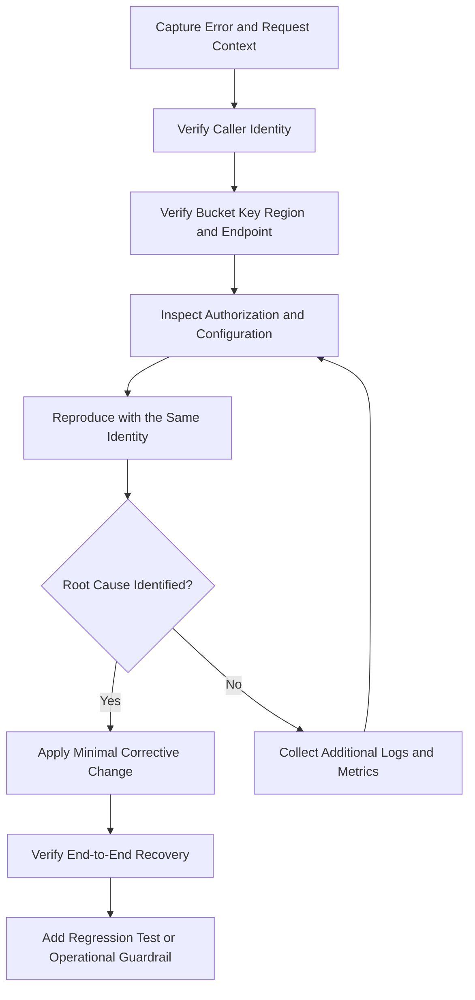

# 16- Troubleshooting Scenario Questions

## Overview

Amazon S3 failures can originate from several independent layers: AWS credentials, IAM policies, bucket configuration, request signing, KMS encryption, networking, SDK behavior, event delivery, or application state. Similar symptoms can therefore have very different root causes.

A senior backend engineer should diagnose these failures systematically rather than repeatedly changing permissions or retrying requests. The objective is to establish where the operation failed, identify the evidence supporting the diagnosis, apply the smallest corrective change, and verify that the complete application workflow has recovered.

This document organizes S3 troubleshooting around realistic interview scenarios, with diagnostic commands, root-cause analysis, remediation, and preventive testing.

## A Systematic Troubleshooting Framework

### What information should be collected before changing anything?

Capture the failing operation and its context before making a configuration change.

| Evidence | Why it matters |
|---|---|
| AWS error code and HTTP status | Distinguishes authorization, signing, missing-resource, and service failures |
| Bucket, key, and Region | Detects incorrect resource identifiers and endpoint configuration |
| Effective AWS principal | Reveals which role or credential provider is actually being used |
| Request timestamp | Correlates the failure with AWS and application logs |
| AWS request ID | Helps correlate requests with AWS diagnostic evidence |
| Application correlation ID | Connects the S3 operation to an HTTP request or background task |
| Retry count and duration | Reveals retry amplification and timeout patterns |
| Deployment or configuration changes | Helps isolate the first change associated with the failure |
| Object version and encryption metadata | Supports recovery and encryption-related investigations |

Do not log AWS secret keys, session tokens, or complete presigned URLs. Redact sensitive query parameters and avoid logging document contents.

### What diagnostic sequence should be followed?



A command that succeeds from a developer's terminal does not prove that production is configured correctly. The caller may have different permissions, credentials, environment variables, or network access.

## Scenario: AccessDenied in Production but Not Development

### Interview question

A FastAPI application uploads documents successfully on a developer's machine but receives `403 AccessDenied` when deployed to ECS. How would you troubleshoot it?

### Symptoms and likely causes

The failure occurs only in a deployed environment, suggesting that the effective identity, policy evaluation, request configuration, or network path differs.

Common causes include:

- The container assumes a different role than expected.
- The role lacks `s3:PutObject` on the requested object ARN.
- The bucket policy explicitly denies the request.
- An SCP, permissions boundary, session policy, or VPC endpoint policy restricts access.
- A resource-policy condition does not match the request context.
- The application accesses a different account, bucket, or Region.
- An SSE-KMS operation fails because of key authorization.

### Isolation and verification

First, inspect the identity from the same workload environment as the failing request.

```bash
aws sts get-caller-identity
```

Inspect relevant bucket settings:

```bash
aws s3api get-bucket-location \
  --bucket company-prod-documents

aws s3api get-bucket-policy \
  --bucket company-prod-documents
```

The second command requires permission to retrieve the policy. If it fails, use an appropriately authorized diagnostic identity rather than assuming the policy is empty.

Check the exact operation and resource scope. For example, `s3:PutObject` applies to object resources, while `s3:ListBucket` applies to the bucket resource. A role can upload an object successfully while failing to list the bucket.

Also distinguish an explicit deny from an absent allow. In AWS policy evaluation, an applicable explicit deny overrides an allow.

### Root-cause determination

Compare the production caller with the expected task role, the exact S3 operation, and all applicable authorization boundaries.

If the request uses SSE-KMS, examine KMS authorization independently. If the request uses a VPC endpoint, include its endpoint policy in the investigation.

### Corrective action

Fix the specific role assignment, resource ARN, policy condition, or permission boundary responsible for the failure. Avoid granting `s3:*` across all buckets as a diagnostic shortcut.

### Prevention and regression testing

Test the upload operation using the deployed workload identity. Also test the required read, list, delete, and recovery operations independently.

Reference: [Troubleshooting S3 identity and access](https://docs.aws.amazon.com/AmazonS3/latest/userguide/security_iam_troubleshoot.html).

## Scenario: NoSuchBucket or NoSuchKey

### Interview question

The console shows an object, but a backend request returns `NoSuchBucket` or `NoSuchKey`. How would you determine whether the object is actually missing?

### Symptoms and likely causes

The application receives a missing-resource response even though the expected data appears to exist elsewhere.

Potential causes include:

- Incorrect bucket name or environment suffix.
- Wrong account or Region.
- Incorrect object key, capitalization, or prefix.
- Spaces or Unicode characters handled differently by the client.
- The application uses a filename as an S3 key when the stored key is different.
- A delete marker hides the current object in a versioned bucket.
- The application references an object that was moved, deleted, or stored in another bucket.

### Isolation and verification

Verify the caller and target bucket:

```bash
aws sts get-caller-identity

aws s3api get-bucket-location \
  --bucket company-prod-documents
```

Check the exact key:

```bash
aws s3api head-object \
  --bucket company-prod-documents \
  --key 'tenants/tenant-123/reports/annual report.pdf'
```

Inspect the expected prefix if listing permission is available:

```bash
aws s3api list-objects-v2 \
  --bucket company-prod-documents \
  --prefix 'tenants/tenant-123/reports/' \
  --max-keys 50
```

If versioning is enabled, inspect the relevant versions:

```bash
aws s3api list-object-versions \
  --bucket company-prod-documents \
  --prefix 'tenants/tenant-123/reports/annual report.pdf'
```

### Root-cause determination

Compare the precise key, bucket, Region, caller, and database record with the resource that actually exists.

Be careful when interpreting a `403` or missing-resource response. Depending on the operation and permissions, the caller may not be able to establish whether a resource exists.

### Corrective action

Correct the application's key resolution, restore the intended version if appropriate, or repair stale database metadata.

### Prevention and regression testing

Generate object keys server-side and persist them as stable references. Test keys containing spaces, Unicode, mixed case, and nested prefixes. Avoid deriving storage paths directly from untrusted filenames.

## Scenario: Incorrect Region or Endpoint

### Interview question

S3 requests suddenly fail after an application deployment changes the AWS Region. Some operations return redirects or signature errors. What would you investigate?

### Symptoms and likely causes

The client sends requests to an endpoint that does not match the target resource or uses an incorrect signing Region.

Possible causes include:

- `AWS_REGION` points to the compute Region instead of the bucket Region.
- A custom S3 endpoint is configured incorrectly.
- The application uses an unintended endpoint override.
- A presigned URL was generated for a different endpoint.
- A configuration change selected the wrong bucket for the environment.

### Isolation and verification

Check the target bucket's location:

```bash
aws s3api get-bucket-location \
  --bucket company-prod-documents
```

Compare the result with the SDK configuration, endpoint URL, and signing Region.

For Boto3, prefer an explicitly configured client Region for predictable behavior:

```python
import boto3

s3 = boto3.client(
    "s3",
    region_name="ap-south-1",
)
```

Use the Region that corresponds to the intended bucket. The example is illustrative, not a recommendation to move every workload to that Region.

### Root-cause determination

Establish whether the failure occurs before authorization because the request uses the wrong endpoint or signing scope. A Region mismatch should not be treated as an IAM problem without evidence.

### Corrective action

Correct the client Region or endpoint override and generate new presigned URLs using the intended configuration.

### Prevention and regression testing

Validate bucket and Region settings during deployment. Include upload, download, and presigned-URL smoke tests after configuration changes.

## Scenario: SignatureDoesNotMatch

### Interview question

A presigned URL works in one client but fails in a browser or mobile application with `SignatureDoesNotMatch`. What could be wrong?

### Symptoms and likely causes

The request reaches S3 but its signature cannot be validated.

Common causes include:

- The client sends a different HTTP method from the signed method.
- A required signed header is absent or has a different value.
- Query parameters or URL encoding have changed.
- The URL uses an incorrect Region or endpoint.
- The system clock is inaccurate.
- A proxy or redirect modifies the request.
- Temporary credentials or their session token were not handled correctly.

### Isolation and verification

Compare the exact operation that was signed with the operation sent by the client.

For a presigned PUT URL, check any signed `Content-Type`, checksum, or other required header. Ensure that the client does not append parameters or transform the URL in a way that changes the canonical request.

Inspect the URL's endpoint and signing Region without placing the complete signed URL in logs.

### Root-cause determination

If valid credentials are being used but the canonical request differs from the signed request, the issue is request construction rather than missing S3 permissions.

### Corrective action

Correct the HTTP method, header values, endpoint, clock synchronization, or URL handling. Generate a new URL after correcting the source configuration.

### Prevention and regression testing

Use the AWS SDK instead of implementing Signature Version 4 manually. Test presigned requests using the same browser or HTTP client employed in production.

Reference: [Using S3 presigned URLs](https://docs.aws.amazon.com/AmazonS3/latest/userguide/using-presigned-url.html).

## Scenario: ExpiredToken or Invalid Credentials

### Interview question

A containerized application works for several hours and then starts failing with `ExpiredToken`. Restarting the task temporarily resolves the problem. What is the likely issue?

### Symptoms and likely causes

The failure pattern points to credential expiration or refresh behavior.

Possible causes include:

- The workload uses temporary credentials that are not being refreshed.
- Static credentials were copied into the environment.
- The credential provider is unable to retrieve updated credentials.
- Custom code caches credentials separately from the SDK.
- The workload role or federation configuration has changed.
- The application uses the wrong identity provider.

### Isolation and verification

Check the effective identity and the workload's credential-provider configuration.

```bash
aws sts get-caller-identity
```

In ECS, distinguish the task role, which grants the application permissions, from the task execution role, which supports operations such as pulling images and writing supported logs.

Inspect application logs for credential-provider failures without printing secret keys, session tokens, or complete credential responses.

### Root-cause determination

Determine whether credentials are missing, expired, unable to refresh, or valid but unauthorized for the operation.

An expired session and an `AccessDenied` response require different remediation.

### Corrective action

Restore the supported credential provider and workload-role configuration. Allow the SDK to manage supported credential refresh rather than caching short-lived credentials in application code.

### Prevention and regression testing

Use workload roles, approved profiles, or federation. Avoid permanent access keys and ensure the deployed workload uses the expected role.

## Scenario: SSE-KMS Objects Return AccessDenied

### Interview question

An application can access ordinary objects but fails on objects encrypted using SSE-KMS. How do you distinguish the cause from a general S3 authorization failure?

### Symptoms and likely causes

The failure occurs only when a particular encryption key is involved or after a bucket begins using a different default encryption configuration.

Potential causes include:

- Missing S3 permissions.
- Missing KMS key-use permissions.
- Incorrect KMS key policy or grant.
- Incomplete cross-account key authorization.
- Disabled or otherwise unusable key.
- Wrong Region or key ARN.
- Missing required permissions in a multipart workflow.

### Isolation and verification

Inspect the bucket's encryption configuration:

```bash
aws s3api get-bucket-encryption \
  --bucket company-prod-documents
```

Inspect the object's metadata when authorized:

```bash
aws s3api head-object \
  --bucket company-prod-documents \
  --key 'tenants/tenant-123/documents/doc-001/original'
```

Compare the requested operation with the effective role policy and the KMS key policy. Inspect CloudTrail events for both S3 and KMS operations where available.

For SSE-KMS workflows, uploads can require `kms:GenerateDataKey`, while downloads generally require `kms:Decrypt`. Multipart operations may require additional KMS permissions; validate the actual API path.

### Root-cause determination

Determine whether the S3 operation itself is denied or whether the operation cannot complete because the encryption key is unavailable to the principal.

An S3 `Allow` statement does not override a KMS authorization failure.

### Corrective action

Grant the minimum required key permissions through the appropriate authorization configuration. Verify that the key is enabled and that the workload uses the correct Region and key ARN.

### Prevention and regression testing

Test uploads, downloads, multipart uploads, and cross-account access when applicable. Never disable encryption simply to make a failing request succeed.

Reference: [Specifying SSE-KMS encryption](https://docs.aws.amazon.com/AmazonS3/latest/userguide/specifying-kms-encryption.html).

## Scenario: Presigned URLs Work Initially but Fail Later

### Interview question

A download URL works immediately after generation but returns `403` or `ExpiredToken` when a user opens it later. How would you investigate?

### Symptoms and likely causes

The request may be failing because:

- The configured URL expiration has passed.
- The signing credentials expired earlier than the URL's configured expiration.
- A policy or credential change invalidated the access path.
- The object's permission changed.
- A proxy or browser altered signed parameters or headers.
- The URL references the wrong Region or resource.

### Isolation and verification

Verify the URL's configured expiration, signing identity, endpoint, target object, and required request headers.

Do not assume that increasing `ExpiresIn` will extend the lifetime of temporary credentials. A URL's effective lifetime may be shorter than its configured expiration.

### Root-cause determination

Separate expiration and credential-validity failures from signature mismatch and authorization failures.

### Corrective action

Generate a new URL only after revalidating the caller's authorization. Correct the endpoint or request headers if the signature is invalid.

If access must be revoked urgently, evaluate the underlying credentials and policy path rather than assuming that deleting a URL from a database revokes a copy already held by a user.

### Prevention and regression testing

Use short, business-appropriate expirations, redact URLs from logs, and test the actual client integration. Treat presigned URLs as sensitive bearer credentials.

## Scenario: Multipart Uploads Fail for Large Files

### Interview question

Small files upload successfully, but large transfers fail intermittently or leave incomplete multipart uploads. How would you distinguish client resource exhaustion from S3 configuration or permission problems?

### Symptoms and likely causes

Uploads may time out, stall on individual parts, or fail during completion. The client might run out of memory, disk space, or network capacity.

Other causes include:
- Invalid multipart configuration.
- Excessive concurrency.
- Missing multipart operation permissions.
- Network interruptions and aggressive timeouts.
- Failure to complete or abort interrupted uploads.
- Part sizes that result in too many parts.

### Isolation and verification

Identify the failing phase: initiation, part transfer, completion, or subsequent application-state update.

If the upload ID is available, inspect its parts:

```bash
aws s3api list-parts \
  --bucket company-prod-documents \
  --key 'exports/large-dataset.parquet' \
  --upload-id '<upload-id>'
```

Inspect outstanding uploads:

```bash
aws s3api list-multipart-uploads \
  --bucket company-prod-documents \
  --max-uploads 100
```

Check object size, part size, transfer concurrency, memory usage, file descriptors, network errors, and retry counts.

S3 multipart uploads support up to 10,000 parts. Part size and concurrency should therefore be selected based on expected object sizes and client resources.

### Root-cause determination

A timeout during an individual part transfer differs from an authorization error at completion. Correlate the failure with the exact operation and the last successful stage.

### Corrective action

Tune multipart part size and concurrency, correct timeouts or permissions, and implement safe retry and completion behavior. Configure lifecycle cleanup for abandoned multipart uploads.

### Prevention and regression testing

Load-test representative object sizes and concurrency. Monitor duration, error rate, retries, and incomplete uploads. Confirm that retries cannot leave application metadata in an inconsistent state.

Reference: [Multipart upload overview](https://docs.aws.amazon.com/AmazonS3/latest/userguide/mpuoverview.html).

## Scenario: An Object Is Missing from a Versioned Bucket

### Interview question

A user reports that a document disappeared after an application deployment. Versioning is enabled, and a direct read no longer returns the expected content. How do you investigate?

### Symptoms and likely causes

The application might be encountering a delete marker, a newer version, a different object key, or a genuinely removed version.

### Isolation and verification

List versions for the specific key:

```bash
aws s3api list-object-versions \
  --bucket company-prod-documents \
  --prefix 'tenants/tenant-123/documents/doc-001/original'
```

Inspect version IDs, delete markers, and which version is current. Correlate the timeline with CloudTrail data events and application deployment logs.

A simple delete in a versioned bucket can create a delete marker, hiding the current object without removing earlier versions. Explicitly deleting a version is a different operation.

### Root-cause determination

Establish whether the object has been hidden by a delete marker, superseded by another version, referenced through incorrect metadata, or permanently deleted.

### Corrective action

Restore the correct object version or remove an unintended delete marker through an approved recovery workflow. Verify that application metadata references the recovered object correctly.

### Prevention and regression testing

Test recovery against actual versioned objects and restrict destructive operations. Use version-aware document references when the application requires reproducible access to specific object contents.

Reference: [Deleting object versions and delete markers](https://docs.aws.amazon.com/AmazonS3/latest/userguide/DeletingObjectVersions.html).

## Scenario: Lifecycle Rules Do Not Apply

### Interview question

Objects should transition to a lower-cost storage class, but they remain unchanged. Another set of objects that should have expired is still present. How would you troubleshoot both cases?

### Symptoms and likely causes

Potential explanations include:
- Incorrect prefix or tag filters.
- A lifecycle age threshold that has not elapsed.
- A rule that targets current versions when the intended objects are noncurrent.
- Minimum storage-duration implications.
- A transition or expiration that is eligible but has not yet been processed.
- Object Lock retention or legal-hold constraints.
- Incorrect assumptions about delete-marker handling.

### Isolation and verification

Inspect the active lifecycle rules:

```bash
aws s3api get-bucket-lifecycle-configuration \
  --bucket company-prod-documents
```

Inspect representative object metadata:

```bash
aws s3api head-object \
  --bucket company-prod-documents \
  --key 'archives/report-001.parquet'
```

Compare the object's age, key prefix, tags, version state, storage class, and the rule's filters.

### Root-cause determination

Determine whether the object is eligible for the specific action. Lifecycle processing is asynchronous; a scheduled eligibility date does not imply a transition at an exact minute.

### Corrective action

Correct the filter or rule when necessary. If retention controls apply, verify whether they prevent the intended deletion before changing the policy.

### Prevention and regression testing

Test lifecycle behavior against representative keys, tags, and versions. Review storage-class distribution and object counts after the changes take effect.

Reference: [Managing the S3 storage lifecycle](https://docs.aws.amazon.com/AmazonS3/latest/userguide/object-lifecycle-mgmt.html).

## Scenario: Replication Is Stuck or Failing

### Interview question

A replication rule exists, but new objects are missing from the destination bucket in another Region. How would you determine whether the cause is rule filtering, IAM, KMS, or replication delay?

### Symptoms and likely causes

The destination may be missing only selected objects, or replication may be delayed across a broader set.

Potential causes include:
- The object does not match the rule's filters.
- Source or destination versioning is not enabled.
- S3 cannot assume the replication role.
- The role lacks destination permissions.
- The source and destination encryption configuration is incompatible with the required replication flow.
- The KMS key policy does not authorize the replication workflow.
- Existing objects predate replication configuration and require a separate supported replication workflow.

### Isolation and verification

Inspect the replication configuration:

```bash
aws s3api get-bucket-replication \
  --bucket company-prod-source
```

Inspect the source object:

```bash
aws s3api head-object \
  --bucket company-prod-source \
  --key 'datasets/2026/10/15/data.parquet'
```

Check the replication status in the object metadata. For a source object, common status values include `PENDING`, `COMPLETED`, and `FAILED`; a replica can report `REPLICA`.

Verify versioning on both buckets, the replication-role trust relationship, destination permissions, filters, and required encryption permissions.

### Root-cause determination

A `PENDING` status shows that replication has not completed, but does not identify why. A `FAILED` status requires investigation of the rule, IAM, encryption, and any reported failure reason.

Objects that existed before replication was configured do not necessarily replicate retroactively through the normal live-replication rule.

### Corrective action

Correct the affected rule, role, destination configuration, or key permissions. Where appropriate, use a supported existing-object replication workflow for eligible objects.

### Prevention and regression testing

Enable replication metrics and suitable failure notifications. Monitor pending operations, pending bytes, and latency where configured. Test destination readability as part of recovery validation.

References:
- [Troubleshooting S3 replication](https://docs.aws.amazon.com/AmazonS3/latest/userguide/replication-troubleshoot.html)
- [S3 replication metrics](https://docs.aws.amazon.com/AmazonS3/latest/userguide/replication-metrics.html)

## Scenario: An S3 Event Never Reaches Lambda or SQS

### Interview question

The upload API reports success, but the processing job never starts. How would you determine whether the S3 notification was never emitted, delivery failed, or the consumer failed?

### Symptoms and likely causes

The object exists, but the processing record remains pending. There may be no Lambda invocation, no queue message, or messages waiting in the queue.

Potential causes include:
- A prefix, suffix, or event-type filter does not match.
- The notification configuration points to the wrong destination.
- The destination resource policy prevents delivery.
- The function or queue is misconfigured.
- A downstream consumer fails while processing a valid event.
- A recursive notification triggers unwanted repeated processing.
- The event parser mishandles the encoded object key.

### Isolation and verification

Inspect the bucket notification configuration:

```bash
aws s3api get-bucket-notification-configuration \
  --bucket company-prod-documents
```

Then inspect Lambda invocation metrics, SQS queue depth and message age, destination resource policies, and worker logs.

If the consumer receives an event, verify that it correctly extracts the bucket, key, and version information. S3 event object keys use URL-encoded representations, which must be decoded according to the event format.

### Root-cause determination

Identify the first failing stage:

1. The notification configuration does not match the upload.
2. Delivery to the destination fails.
3. The event reaches the destination but cannot be processed.
4. The consumer fails during the S3 or database operation.
5. The work succeeds but the application state is not updated.

### Corrective action

Correct filters, destination permissions, resource identifiers, or event parsing. Use bounded retries and a failure-recovery strategy for asynchronous processing.

### Prevention and regression testing

Test controlled uploads through the same upload paths used in production. Use separate input and output prefixes where processing writes new objects, make consumers idempotent, and reconcile long-lived pending records.

References:
- [S3 Event Notifications](https://docs.aws.amazon.com/AmazonS3/latest/userguide/EventNotifications.html)
- [S3 event message structure](https://docs.aws.amazon.com/AmazonS3/latest/userguide/notification-content-structure.html)

## Scenario: A Terraform Deployment Conflicts with an Existing Bucket

### Interview question

Terraform reports that a bucket already exists, or its state does not match the live AWS resource. How would you resolve the conflict without risking production data?

### Symptoms and likely causes

The plan or apply operation fails due to an existing resource, drift, incorrect state, or a replacement operation that cannot safely proceed.

Possible causes include:
- The bucket name is already allocated.
- A manually created bucket is not in Terraform state.
- The active workspace or backend points to the wrong environment.
- Another stack manages the same resource.
- Live configuration has drifted.
- The planned operation would replace or destroy a data-bearing resource.

### Isolation and verification

Inspect state and the proposed changes:

```bash
terraform state list

terraform plan
```

Confirm the AWS account, bucket owner, environment, and existing object data. Review whether another Terraform state or CloudFormation stack already manages the resource.

If the bucket should be managed by the current configuration, consider importing it only after verifying ownership and state.

### Root-cause determination

Distinguish a global naming collision from a resource ownership conflict, incorrect state, or configuration drift. Each requires a different correction.

### Corrective action

Select an appropriate unique name, correct the backend or workspace, import an intentionally existing resource, or reconcile the configuration with the approved infrastructure design.

Do not delete an existing bucket merely to make the deployment succeed. Check retained versions, application dependencies, backup status, and data ownership first.

### Prevention and regression testing

Use environment-specific naming, protected remote state, reviewed plans, and explicit safeguards around destructive changes. Validate the infrastructure configuration before applying it in production.

Reference: [Terraform S3 bucket resource](https://registry.terraform.io/providers/hashicorp/aws/latest/docs/resources/s3_bucket).

## Scenario: CloudFormation Stack Rollback Fails

### Interview question

A CloudFormation deployment fails while configuring a bucket policy or event notification, and the stack cannot complete rollback. How would you recover safely?

### Symptoms and likely causes

A resource fails to create or update and the stack enters a rollback-related state. Some resources may have succeeded while others have not.

Potential causes include:
- Invalid template properties.
- Bucket-name conflicts.
- Incorrect resource ARNs or principals.
- Missing notification destination permissions.
- Invalid resource dependencies.
- A failed replacement or deletion involving protected storage.
- A second failure during rollback.

### Isolation and verification

Inspect stack events and find the earliest resource failure.

```bash
aws cloudformation describe-stack-events \
  --stack-name s3-production-stack
```

Then inspect the resource's actual AWS configuration, required dependencies, and permissions. For an event notification, confirm that the target exists and that S3 can deliver to it.

Do not assume the final rollback event identifies the original cause. Later events may describe consequences of the first failure.

### Root-cause determination

Identify the earliest failed resource and underlying error. Separate the initial update failure from any rollback failure.

### Corrective action

Correct the template or dependency configuration and use the appropriate CloudFormation recovery procedure for the stack's current state. Avoid manually deleting resources that remain managed by the stack unless the recovery plan explicitly accounts for state reconciliation.

### Prevention and regression testing

Validate templates, inspect change sets, and test notification permissions before production changes. Verify encryption, versioning, notification configuration, and access policies after deployment.

## Scenario: CloudFront Returns 403 for a Private S3 Origin

### Interview question

A CloudFront distribution points to a private S3 bucket, but users receive `403 AccessDenied`. How would you distinguish an origin-access problem from a missing object or KMS denial?

### Symptoms and likely causes

The distribution responds, but the expected content is inaccessible. Possible causes include:
- Incorrect Origin Access Control configuration.
- A bucket policy that does not permit the intended distribution.
- Wrong origin type or distribution origin.
- Incorrect object path or missing object.
- SSE-KMS key authorization problems.
- Incorrect default-root-object or cache configuration.
- Deployment changes that have not propagated as expected.

### Isolation and verification

Inspect the distribution's origin and OAC settings, the bucket policy, and the exact requested key.

Confirm that the intended architecture uses an S3 REST origin with OAC rather than assuming that an S3 website endpoint supports the same origin-access mechanism.

Check the available CloudFront logs and S3 request evidence to identify where the denial originates. For SSE-KMS objects, inspect KMS authorization separately.

### Root-cause determination

Determine whether the request reaches the intended origin and whether the origin policy permits the distribution to retrieve the object. Verify that the requested object exists before changing permissions.

### Corrective action

Correct the OAC association, bucket policy, key path, or required KMS permissions. Do not make the bucket public as a shortcut.

### Prevention and regression testing

Run HTTPS smoke tests after deployments and verify that direct public access to the bucket remains blocked.

Reference: [Restricting access to an S3 origin with CloudFront](https://docs.aws.amazon.com/AmazonCloudFront/latest/DeveloperGuide/private-content-restricting-access-to-s3.html).

## Scenario: S3 Requests Become Slow or Return 503 SlowDown

### Interview question

An upload service experiences rising latency and intermittent `503 SlowDown` errors after a traffic spike. How would you determine whether the issue is S3 scaling behavior, client concurrency, networking, or another dependency?

### Symptoms and likely causes

The application shows higher latency, more SDK retries, and slower end-to-end processing.

Potential causes include:
- Sudden request bursts.
- Excessive concurrency or retry amplification.
- Client connection-pool limitations.
- Network instability.
- CPU, memory, or disk bottlenecks.
- An SSE-KMS dependency with throttling.
- Worker saturation downstream of S3.

### Isolation and verification

Compare request volume, error rate, latency, SDK retry count, client resource consumption, and the timing of traffic changes.

Separate time spent receiving the request, transferring to S3, and updating the database. End-to-end API latency alone does not establish that S3 is the bottleneck.

### Root-cause determination

Look for correlation between the incident and workload bursts, connection-pool waits, client saturation, or dependency throttling. Do not assume a permanent per-prefix limit is responsible without supporting evidence.

### Corrective action

Use bounded retries with appropriate backoff and jitter, reduce uncontrolled bursts, and tune concurrency based on measurements. Correct client or dependency bottlenecks where identified.

### Prevention and regression testing

Load-test representative file sizes and concurrency. Monitor latency percentiles, request errors, retry counts, and downstream capacity. Avoid retry loops that amplify the original incident.

Reference: [S3 performance guidelines](https://docs.aws.amazon.com/AmazonS3/latest/userguide/optimizing-performance-guidelines.html).

## Scenario: CloudTrail Does Not Show an Object Download

### Interview question

An audit investigation needs to establish who downloaded a document, but no matching event appears in CloudTrail Event history. How would you determine whether the activity was absent or simply not recorded?

### Symptoms and likely causes

The available management events do not include the expected object-read operation.

Possible causes include:
- S3 data events were not enabled for the relevant object resources.
- Event selectors do not cover the bucket, prefix, or API operation.
- The investigation uses the wrong account, Region, or time range.
- Events are stored in another configured destination.
- The relevant retention window has elapsed.

### Isolation and verification

Inspect the trail configuration and selectors:

```bash
aws cloudtrail describe-trails \
  --include-shadow-trails

aws cloudtrail get-event-selectors \
  --trail-name organization-audit-trail

aws cloudtrail get-trail-status \
  --name organization-audit-trail
```

Check the data-event selectors, logging status, destination, and retention configuration. CloudTrail management-event history should not be treated as a complete record of object-level reads and writes.

### Root-cause determination

Establish whether the operation was within the configured coverage and the event should have been captured. If data events were not enabled, the missing record may represent an audit-coverage gap.

### Corrective action

Configure the required data-event coverage and preserve any alternative evidence available for the incident. Document uncertainty instead of claiming the download did not occur.

### Prevention and regression testing

Test the audit pipeline with controlled object operations and verify that expected events arrive at the configured destination. Review selector and retention changes through controlled deployments.

Reference: [Logging S3 API calls with CloudTrail](https://docs.aws.amazon.com/AmazonS3/latest/userguide/cloudtrail-logging.html).

## Scenario: Lifecycle, Replication, and Processing All Appear Broken

### Interview question

After a deployment, some objects fail to transition to the expected storage class, replicas are missing, and newly uploaded documents remain pending. How would you avoid applying unrelated fixes to all three workflows?

### Symptoms and likely causes

Several operational indicators changed around the same time, but the workflows may have independent root causes.

| Workflow | First evidence to inspect | Competing explanations |
|---|---|---|
| Lifecycle | Live lifecycle rules and object eligibility | Wrong filters, elapsed time assumptions, retention constraints |
| Replication | Replication configuration and object status | Rule mismatch, IAM failure, KMS access, replication delay |
| Event processing | Notification configuration and queue/worker metrics | Filter mismatch, delivery permissions, consumer failure |

### Isolation and verification

Compare the deployment changes with the live configuration of each subsystem. Determine whether the same resource configuration was altered by more than one deployment mechanism.

Validate the earliest failing stage in each workflow. For example, an absent event is different from a valid event processed by a worker that later fails to update PostgreSQL.

### Root-cause determination

Establish separate evidence for each failure. One deployment can introduce several unrelated defects, and correcting one does not prove that the other workflows have recovered.

### Corrective action

Restore the required lifecycle, replication, or notification configuration independently. Preserve other integrations managed by the same bucket configuration.

### Prevention and regression testing

Treat each workflow as independently observable and testable. Add post-deployment checks for lifecycle configuration, replication status, and event-driven processing outcomes.

## General Diagnostic Commands

Use these commands as starting points for investigations. The identity must be authorized to inspect the relevant resources.

| Diagnostic objective | Command |
|---|---|
| Identify the effective caller | `aws sts get-caller-identity` |
| Check bucket location | `aws s3api get-bucket-location --bucket BUCKET` |
| Inspect object metadata | `aws s3api head-object --bucket BUCKET --key KEY` |
| List objects under a prefix | `aws s3api list-objects-v2 --bucket BUCKET --prefix PREFIX` |
| Inspect versions and delete markers | `aws s3api list-object-versions --bucket BUCKET --prefix PREFIX` |
| Inspect encryption configuration | `aws s3api get-bucket-encryption --bucket BUCKET` |
| Inspect lifecycle rules | `aws s3api get-bucket-lifecycle-configuration --bucket BUCKET` |
| Inspect replication configuration | `aws s3api get-bucket-replication --bucket BUCKET` |
| Inspect event notifications | `aws s3api get-bucket-notification-configuration --bucket BUCKET` |
| Inspect public-access settings | `aws s3api get-public-access-block --bucket BUCKET` |
| Inspect CloudTrail selectors | `aws cloudtrail get-event-selectors --trail-name TRAIL_NAME` |

These are read-oriented diagnostic operations, but they can still disclose sensitive configuration. Run them from an approved identity and store the results securely.

Before executing a destructive remediation, verify the AWS account, Region, bucket, object key, version ID, and impact on dependent services.

## Common Troubleshooting Mistakes

| Mistake | Why it fails | Better approach |
|---|---|---|
| Granting broad permissions immediately | Expands risk without establishing the cause | Identify the caller, action, resource, and applicable policies |
| Treating all 403 errors as the same failure | Signing, S3, KMS, and endpoint issues need different fixes | Preserve error codes and isolate the failing layer |
| Assuming missing keys were permanently deleted | Delete markers, key mismatches, and authorization restrictions can look similar | Inspect exact keys, versions, and application metadata |
| Assuming successful upload means processing completed | Notification delivery or background processing can fail later | Trace the complete workflow |
| Disabling encryption to bypass authorization | Weakens security and conceals the underlying problem | Diagnose KMS authorization independently |
| Retrying every error indefinitely | Causes retry amplification and additional load | Use bounded retries and distinguish permanent errors |
| Replacing a bucket's entire notification configuration casually | Can remove unrelated application integrations | Compare complete before-and-after configuration |
| Assuming the console proves production access works | The console may use a different principal and request path | Reproduce under the actual workload identity |
| Treating missing logs as proof that no action occurred | Audit coverage may have been incomplete | Verify selectors, retention, and alternative evidence |
| Deleting or recreating resources to fix state conflicts | Can cause permanent data loss and configuration drift | Establish ownership and reconcile infrastructure state safely |

## Troubleshooting Readiness Checklist

Before closing an S3 incident, confirm that:

- [ ] The operation, target resource, timestamp, and error code are known.
- [ ] The effective AWS identity and credential source have been verified.
- [ ] The bucket, key, Region, endpoint, and request parameters are correct.
- [ ] Relevant identity and resource policies have been evaluated.
- [ ] KMS authorization has been checked separately when applicable.
- [ ] Live service configuration and recent deployment changes have been inspected.
- [ ] Relevant logs and request identifiers have been preserved.
- [ ] The root cause is supported by evidence rather than assumption.
- [ ] The corrective action is narrowly scoped and reviewed.
- [ ] The original operation and dependent application workflow succeed after remediation.
- [ ] Object metadata and application state are consistent.
- [ ] A regression test, alert, runbook, or configuration guardrail has been added where appropriate.

## Authoritative References

- [Troubleshooting S3 identity and access](https://docs.aws.amazon.com/AmazonS3/latest/userguide/security_iam_troubleshoot.html)
- [S3 access control overview](https://docs.aws.amazon.com/AmazonS3/latest/userguide/access-control-overview.html)
- [Using presigned URLs](https://docs.aws.amazon.com/AmazonS3/latest/userguide/using-presigned-url.html)
- [Multipart upload overview](https://docs.aws.amazon.com/AmazonS3/latest/userguide/mpuoverview.html)
- [S3 Versioning](https://docs.aws.amazon.com/AmazonS3/latest/userguide/Versioning.html)
- [S3 lifecycle management](https://docs.aws.amazon.com/AmazonS3/latest/userguide/object-lifecycle-mgmt.html)
- [Troubleshooting S3 replication](https://docs.aws.amazon.com/AmazonS3/latest/userguide/replication-troubleshoot.html)
- [S3 Event Notifications](https://docs.aws.amazon.com/AmazonS3/latest/userguide/EventNotifications.html)
- [Logging S3 API calls with CloudTrail](https://docs.aws.amazon.com/AmazonS3/latest/userguide/cloudtrail-logging.html)
- [S3 performance guidelines](https://docs.aws.amazon.com/AmazonS3/latest/userguide/optimizing-performance-guidelines.html)
- [Terraform S3 bucket resource](https://registry.terraform.io/providers/hashicorp/aws/latest/docs/resources/s3_bucket)

## Key Takeaways

- Diagnose the failing operation with evidence: verify the effective identity, target resource, Region, request details, and applicable policies before changing configuration.
- Distinguish S3 authorization, KMS access, request-signing, credential, and endpoint failures instead of treating them as one generic permission problem.
- Troubleshoot multipart transfers, event delivery, lifecycle processing, replication, and infrastructure deployment as separate workflows with distinct recovery paths.
- Protect data and audit evidence during incidents, and inspect versions and configuration before destructive remediation.
- Verify end-to-end recovery and add regression tests, monitoring, and infrastructure guardrails to prevent recurrence.