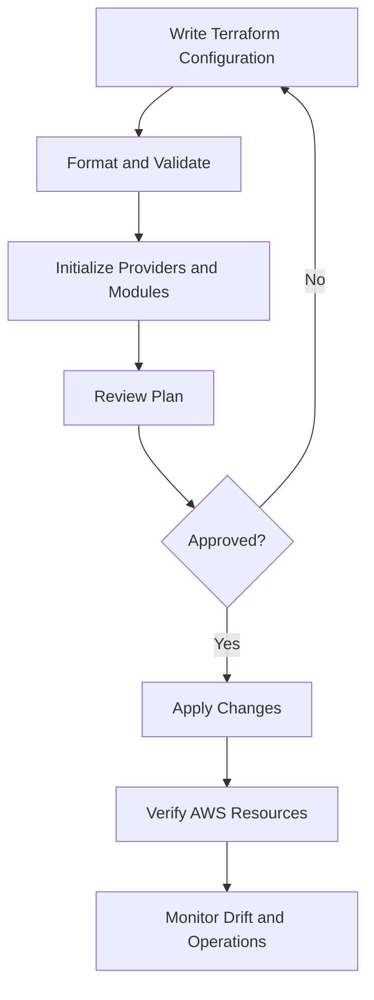
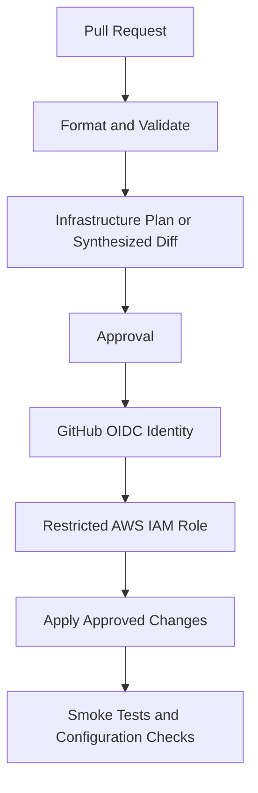

# 17- AWS CLI and Infrastructure as Code Questions

## Overview

Amazon S3 infrastructure must be provisioned, configured, secured, and operated consistently across development, staging, and production. AWS CLI commands support direct inspection and operational workflows, while Infrastructure as Code (IaC) tools make resource configuration repeatable, reviewable, and auditable.

Senior engineering interviews often focus on how these tools behave when resources already exist, configurations drift, deployments fail halfway through, or a supposedly harmless change could destroy production data.

This document covers practical AWS CLI operations, Terraform, CloudFormation, AWS CDK, CI/CD integration, infrastructure drift, resource imports, and production deployment scenarios.

## AWS CLI Fundamentals for S3

### Why use `s3api` instead of high-level `aws s3` commands?

AWS CLI offers two complementary S3 interfaces.

| Interface | Purpose | Example |
|---|---|---|
| `aws s3` | High-level file transfer and synchronization | `aws s3 cp`, `aws s3 sync` |
| `aws s3api` | Low-level access to individual S3 API operations | `aws s3api put-bucket-versioning` |

Use high-level commands for common uploads, downloads, and directory synchronization. Use `s3api` when you need exact control over bucket configuration, versioning, lifecycle rules, encryption, replication, or object versions.

For example, `aws s3 cp` is convenient for copying a local file into a bucket, but inspecting delete markers requires the lower-level `list-object-versions` API.

### How would you inspect the active AWS identity before making changes?

Verify the identity and account before running production commands.

```bash
aws sts get-caller-identity
aws configure list
```

For named profiles:

```bash
aws sts get-caller-identity --profile production
aws s3api list-buckets --profile production
```

The profile name is not proof of the identity being used. Environment credentials, workload roles, and other credential providers can affect which credentials the CLI resolves.

**Interview expectation:** Explain how you verify the account, principal, Region, and target resource before performing a destructive operation.

### How would you create an S3 bucket in a specific Region?

For a Region other than `us-east-1`, specify the Region and its location constraint.

```bash
aws s3api create-bucket \
  --bucket company-prod-documents-unique \
  --region ap-south-1 \
  --create-bucket-configuration LocationConstraint=ap-south-1
```

For `us-east-1`, omit `--create-bucket-configuration`:

```bash
aws s3api create-bucket \
  --bucket company-prod-documents-unique \
  --region us-east-1
```

Bucket names in the general-purpose bucket namespace must satisfy S3's naming rules and uniqueness requirements. A name used in an example must be replaced with a valid name available for the intended account and environment.

After creation, verify the result:

```bash
aws s3api get-bucket-location \
  --bucket company-prod-documents-unique
```

### How would you configure a bucket with secure defaults?

For a private production bucket, configure public-access restrictions, versioning where recovery requirements justify it, and approved encryption settings.

Apply Block Public Access:

```bash
aws s3api put-public-access-block \
  --bucket company-prod-documents-unique \
  --public-access-block-configuration \
  BlockPublicAcls=true,IgnorePublicAcls=true,BlockPublicPolicy=true,RestrictPublicBuckets=true
```

Enable versioning:

```bash
aws s3api put-bucket-versioning \
  --bucket company-prod-documents-unique \
  --versioning-configuration Status=Enabled
```

Inspect default encryption:

```bash
aws s3api get-bucket-encryption \
  --bucket company-prod-documents-unique
```

S3 automatically encrypts new object uploads at rest by default using SSE-S3. If the organization requires SSE-KMS with a particular customer-managed key, configure that requirement explicitly.

Do not treat these commands as a complete security configuration. Bucket policies, IAM, KMS permissions, retention, logging, and cross-account access must be designed for the actual workload.

## Everyday S3 CLI Operations

### How would you upload, download, and inspect objects?

```bash
aws s3 cp ./report.pdf \
  s3://company-prod-documents-unique/reports/report.pdf

aws s3 cp \
  s3://company-prod-documents-unique/reports/report.pdf \
  ./downloaded-report.pdf

aws s3api head-object \
  --bucket company-prod-documents-unique \
  --key reports/report.pdf
```

The `head-object` response can include content length, content type, last-modified time, ETag, version ID, and encryption metadata when applicable.

Do not assume that an ETag is always the MD5 hash of the complete object. Multipart uploads and certain encryption or copy workflows can produce ETags that do not represent the object's full-content MD5.

### How would you synchronize a local directory with S3?

```bash
aws s3 sync ./static/ \
  s3://company-prod-static-assets-unique/ \
  --exclude "*.map"
```

The synchronization command copies files according to its comparison rules. Adding `--delete` changes the operation significantly because destination objects absent from the source may be deleted.

For example:

```bash
aws s3 sync ./static/ \
  s3://company-prod-static-assets-unique/ \
  --delete \
  --dryrun
```

Review the dry-run output before removing `--dryrun`. A production synchronization should have an explicit source, destination, scope, and deletion policy.

### How would you copy an object within S3?

```bash
aws s3api copy-object \
  --bucket company-prod-documents-unique \
  --key archive/report.pdf \
  --copy-source company-prod-documents-unique/reports/report.pdf
```

For keys containing special characters, use the correct encoding for the `CopySource` value. For objects larger than the supported single-copy operation, use an appropriate multipart copy workflow or a high-level command that handles it.

A copy does not automatically mean the source should be deleted. Treat a move as a copy followed by a separate delete, with explicit verification and recovery planning.

### How would you delete an object safely?

A simple deletion command is:

```bash
aws s3api delete-object \
  --bucket company-prod-documents-unique \
  --key reports/obsolete.pdf
```

In a versioned bucket, deleting an object without specifying a version ID commonly creates a delete marker. To permanently delete a particular version, the request must target that version explicitly and the caller must have the necessary permissions.

Inspect versions and delete markers before attempting recovery or permanent deletion.

```bash
aws s3api list-object-versions \
  --bucket company-prod-documents-unique \
  --prefix reports/obsolete.pdf
```

Never assume that `delete-object` means the same thing for versioned and unversioned buckets.

## Querying, Filtering, and Pagination

### How do you filter objects using JMESPath?

The AWS CLI supports `--query` for filtering and transforming responses.

```bash
aws s3api list-objects-v2 \
  --bucket company-prod-documents-unique \
  --prefix reports/ \
  --query 'Contents[].{Key:Key,Size:Size,Modified:LastModified}' \
  --output table
```

This returns selected fields from the response. It does not change the data stored in S3.

For production scripts, prefer machine-readable output such as JSON when the result feeds another program. Avoid depending on table-format spacing or human-readable formatting.

### How should large object listings be handled?

Use the CLI's supported pagination behavior for commands that return paginated results. For an API-level object listing, `--max-keys` limits the number of keys returned in one response; it does not guarantee that the entire matching object set has been retrieved.

```bash
aws s3api list-objects-v2 \
  --bucket company-prod-documents-unique \
  --prefix reports/ \
  --max-keys 1000
```

When automating a complete listing, use the CLI paginator's normal behavior or explicitly handle continuation tokens when calling the API directly.

Do not assume that a single response contains every object under a prefix.

For scheduled object-level analysis at large scale, consider S3 Inventory and analytical tools instead of repeatedly scanning huge prefixes from application code.

## Versioning, Lifecycle, and Replication Commands

### How would you inspect versioning and lifecycle configuration?

```bash
aws s3api get-bucket-versioning \
  --bucket company-prod-documents-unique

aws s3api get-bucket-lifecycle-configuration \
  --bucket company-prod-documents-unique
```

Versioning affects deletion and recovery behavior. Lifecycle configuration determines when eligible objects or versions transition or expire.

Before changing either configuration, evaluate retained versions, business recovery requirements, minimum storage durations, Object Lock, and application references.

### How would you inspect replication?

```bash
aws s3api get-bucket-replication \
  --bucket company-prod-documents-unique
```

A replication rule is not proof that every object has replicated. Verify the rule's filters, source and destination versioning, role permissions, destination configuration, and KMS requirements.

For a particular source object:

```bash
aws s3api head-object \
  --bucket company-prod-documents-unique \
  --key reports/report.pdf
```

Inspect the replication status where available.

### How should destructive commands be handled?

Use this checklist before production deletion, synchronization, or infrastructure removal:

- Confirm the AWS account, profile, and Region.
- Resolve and verify the complete bucket and prefix.
- Review versioning, retention, and Object Lock behavior.
- Run `--dryrun` where the command supports it.
- Preserve required backups or recovery copies.
- Check the scope of any recursive operation.
- Obtain the required approval for production changes.
- Verify the result and maintain an audit trail.

A command that is syntactically valid can still cause a large and irreversible operational incident.

## Terraform for Amazon S3

### Why use Terraform rather than managing all configuration through CLI commands?

Terraform defines desired infrastructure as code and calculates a plan to reconcile that declaration with its state and the provider's view of AWS resources.

| Capability | CLI-driven changes | Terraform |
|---|---|---|
| One-time inspection | Excellent | Supported, but generally not its main purpose |
| Repeatable configuration | Requires scripts and conventions | Declared resource configuration |
| Change review | Depends on the workflow | `terraform plan` |
| Environment consistency | Must be engineered separately | Reusable modules and environment-specific inputs |
| Existing-resource adoption | Requires manual management | Resource import supported |
| State and drift tracking | Externalized across scripts and operators | Managed through Terraform state and refresh/plan behavior |
| Risk | Repeated manual changes may drift | Incorrect plans or state can still cause destructive changes |

Terraform does not eliminate risk. A reviewed plan, state management, provider constraints, and appropriate protection for production resources remain essential.

### What is the lifecycle of a Terraform deployment?

A typical deployment workflow is:



The main commands have distinct purposes.

| Command | Purpose |
|---|---|
| `terraform fmt` | Format configuration |
| `terraform init` | Initialize backend, providers, and modules |
| `terraform validate` | Validate configuration structure |
| `terraform plan` | Preview proposed changes |
| `terraform apply` | Apply planned changes |
| `terraform show` | Inspect plans or state details |
| `terraform state list` | List resources tracked in state |
| `terraform import` | Associate an existing resource with a Terraform resource address |
| `terraform destroy` | Destroy resources managed by the selected configuration and state |

`terraform validate` does not prove that AWS permissions, API calls, quotas, or runtime behavior will work. It is one stage of infrastructure validation.

### How would you create a reusable S3 bucket configuration in Terraform?

A basic configuration should define the bucket, versioning, public-access restrictions, encryption, and selected lifecycle protections separately.

The following example uses a general-purpose S3 bucket and intentionally includes `prevent_destroy` to reduce the risk of accidental deletion.

```hcl
terraform {
  required_version = ">= 1.5.0"

  required_providers {
    aws = {
      source  = "hashicorp/aws"
      version = "~> 5.0"
    }
  }
}

provider "aws" {
  region = var.aws_region
}

variable "aws_region" {
  description = "AWS Region containing the bucket."
  type        = string
  default     = "ap-south-1"
}

variable "bucket_name" {
  description = "Globally unique S3 bucket name."
  type        = string
}

resource "aws_s3_bucket" "documents" {
  bucket = var.bucket_name

  lifecycle {
    prevent_destroy = true
  }

  tags = {
    Application = "document-service"
    Environment = "production"
    ManagedBy   = "terraform"
  }
}

resource "aws_s3_bucket_versioning" "documents" {
  bucket = aws_s3_bucket.documents.id

  versioning_configuration {
    status = "Enabled"
  }
}

resource "aws_s3_bucket_server_side_encryption_configuration" "documents" {
  bucket = aws_s3_bucket.documents.id

  rule {
    apply_server_side_encryption_by_default {
      sse_algorithm = "AES256"
    }
  }
}

resource "aws_s3_bucket_public_access_block" "documents" {
  bucket = aws_s3_bucket.documents.id

  block_public_acls       = true
  ignore_public_acls      = true
  block_public_policy     = true
  restrict_public_buckets = true
}

resource "aws_s3_bucket_lifecycle_configuration" "documents" {
  bucket = aws_s3_bucket.documents.id

  rule {
    id     = "abort-incomplete-multipart-uploads"
    status = "Enabled"

    filter {}

    abort_incomplete_multipart_upload {
      days_after_initiation = 7
    }
  }
}

output "bucket_name" {
  value = aws_s3_bucket.documents.bucket
}
```

The AWS provider version is deliberately constrained; a real project should select and test a provider version supported by its toolchain and dependency policy. Version constraints and a committed lock file should be managed consistently across environments.

This example uses SSE-S3 (`AES256`) and public-access restrictions as defaults. If the security requirement mandates SSE-KMS, define the KMS key and the required permissions separately.

`prevent_destroy` is a guardrail, not a backup. It prevents a Terraform-managed resource from being destroyed while that lifecycle rule remains in effect, but it does not prevent deletion through other identities or every possible resource-level operation.

### How should this configuration be deployed?

Save the configuration in an environment-specific Terraform directory and provide a bucket name that is valid and available.

For example, `production.tfvars` could contain:

```hcl
aws_region = "ap-south-1"
bucket_name = "company-prod-documents-unique"
```

Run the deployment sequence:

```bash
terraform fmt -recursive
terraform init
terraform validate
terraform plan -var-file=production.tfvars
terraform apply -var-file=production.tfvars
```

Review the plan and use the approved deployment process before applying changes to production.

After deployment, verify important settings through the CLI:

```bash
aws s3api get-bucket-versioning \
  --bucket company-prod-documents-unique

aws s3api get-bucket-encryption \
  --bucket company-prod-documents-unique

aws s3api get-public-access-block \
  --bucket company-prod-documents-unique
```

### How should Terraform state be managed?

Terraform state maps configuration addresses to real resources and records information used to plan subsequent changes.

For production, use an approved remote backend with appropriate access control, encryption, versioning or recovery capabilities where supported, and a locking strategy suitable for the Terraform version and backend configuration.

Do not store state files in source control. State may contain sensitive configuration values even when application secrets are not intentionally declared in the repository.

Be careful when changing backends or manipulating state. A missing state mapping does not mean that the corresponding AWS resource no longer exists.

### How would you import an existing S3 bucket into Terraform?

First, confirm that the bucket belongs to the intended environment and is not already managed by another Terraform state.

Define a matching resource in the configuration, then import the existing bucket:

```bash
terraform import \
  aws_s3_bucket.documents \
  company-prod-documents-unique
```

An import associates the resource with the configured Terraform address and state. It does not automatically produce a complete, accurate configuration for every existing bucket setting.

After import, inspect the live configuration and run a plan. Correct the declared configuration until the plan reflects the intended state without unexpected replacement or destructive changes.

For resources managed separately by Terraform, import the relevant resource types using the import mechanism supported by the provider. Do not assume that importing the bucket alone imports versioning, encryption, lifecycle, or policy resources.

### How would you detect and remediate configuration drift?

Drift occurs when the live resource configuration differs from the declared infrastructure configuration.

Run a plan and investigate any unexpected differences:

```bash
terraform plan -var-file=production.tfvars
```

For deeper inspection, use supported refresh and state-inspection workflows appropriate to the Terraform version.

If a difference is legitimate, update the declared configuration through code review. If the change was unauthorized, restore the approved configuration and investigate the event.

Avoid blindly applying a plan that changes bucket policies, retention, versioning, or resource lifecycle. Those changes can alter access and recovery behavior even when the plan contains no obvious application-level code changes.

### How should production bucket deletion be handled?

Deleting an S3 bucket can be difficult or unsafe if it contains objects, versions, delete markers, retained data, or dependent infrastructure.

Terraform's `prevent_destroy` helps catch accidental deletion while it is configured. A deliberate decommissioning process should require approval, verify data ownership and retention, preserve required recovery copies, coordinate dependent services, and remove the protection only through an approved change.

Do not use `terraform destroy` as a routine cleanup mechanism for shared production infrastructure.

## AWS CloudFormation for Amazon S3

### When would you select CloudFormation over Terraform?

CloudFormation is AWS-native and integrates with stack operations, change sets, rollback mechanisms, drift detection, and resource management.

Terraform offers a provider-based model and reusable modules across many infrastructure providers. The decision depends on the team's existing tooling, dependency management, state-management practices, compliance requirements, and operational preferences.

Avoid maintaining independent Terraform and CloudFormation definitions for the same resource unless a clear ownership boundary exists. Multiple IaC tools attempting to control the same bucket configuration can create drift and deployment conflicts.

### How would you define a secure S3 bucket in CloudFormation?

The following YAML template creates a private bucket with versioning, encryption, and public-access restrictions.

```yaml
AWSTemplateFormatVersion: "2010-09-09"
Description: Private document bucket with versioning and encryption

Parameters:
  BucketName:
    Type: String
    Description: Globally unique S3 bucket name

Resources:
  DocumentsBucket:
    Type: AWS::S3::Bucket
    DeletionPolicy: Retain
    UpdateReplacePolicy: Retain
    Properties:
      BucketName: !Ref BucketName

      VersioningConfiguration:
        Status: Enabled

      BucketEncryption:
        ServerSideEncryptionConfiguration:
          - ServerSideEncryptionByDefault:
              SSEAlgorithm: AES256

      PublicAccessBlockConfiguration:
        BlockPublicAcls: true
        IgnorePublicAcls: true
        BlockPublicPolicy: true
        RestrictPublicBuckets: true

      Tags:
        - Key: Application
          Value: document-service
        - Key: ManagedBy
          Value: cloudformation

Outputs:
  DocumentsBucketName:
    Description: Name of the created S3 bucket
    Value: !Ref DocumentsBucket

  DocumentsBucketArn:
    Description: ARN of the created S3 bucket
    Value: !GetAtt DocumentsBucket.Arn
```

This template uses `DeletionPolicy: Retain` and `UpdateReplacePolicy: Retain` to preserve the bucket if it is removed from the stack or replacement is required. These settings do not replace backup policies or access controls.

Validate the template before deployment:

```bash
aws cloudformation validate-template \
  --template-body file://s3-bucket.yaml
```

Then create a stack:

```bash
aws cloudformation create-stack \
  --stack-name company-prod-documents \
  --template-body file://s3-bucket.yaml \
  --parameters ParameterKey=BucketName,ParameterValue=company-prod-documents-unique \
  --capabilities CAPABILITY_IAM
```

The example does not create IAM resources, so `CAPABILITY_IAM` is not required for this template. A production command should include only capabilities actually required by the template. For an existing stack, use change sets and the appropriate update command.

### What are change sets, and why are they important?

A change set lets the team inspect proposed stack changes before applying them. This is especially valuable for storage resources because a replacement or configuration update may affect retained objects, policies, notifications, or encryption.

Review:
- Resource additions, replacements, and deletions.
- Changes to bucket policies and Block Public Access.
- Versioning and encryption updates.
- Dependencies such as Lambda, SQS, and KMS.
- Deletion and retention behavior.

A change set does not prove that every operation will succeed, nor does it eliminate runtime testing.

### How would you recover from a failed stack deployment?

Inspect the stack status and event history:

```bash
aws cloudformation describe-stacks \
  --stack-name company-prod-documents

aws cloudformation describe-stack-events \
  --stack-name company-prod-documents
```

Find the earliest failing resource and distinguish it from later rollback failures. Correct the template, parameters, or dependency configuration and follow the recovery procedure appropriate to the stack state.

Do not delete and recreate a production bucket merely to recover a failed stack update. Retained resources and data ownership must be reconciled with the stack's state.

### How should CloudFormation drift be managed?

Use CloudFormation drift detection for supported resources and properties. The process compares actual configuration with the expected stack configuration for the supported scope.

Investigate the drift, determine whether the change is authorized, and update either the infrastructure definition or the actual resource as appropriate.

Not every property or resource supports drift detection. A stack reporting no drift is not proof that every aspect of the environment matches every organizational requirement.

Reference: [CloudFormation drift detection](https://docs.aws.amazon.com/AWSCloudFormation/latest/UserGuide/using-cfn-stack-drift.html).

## AWS CDK for Amazon S3

### What problem does AWS CDK solve?

AWS CDK lets engineers define infrastructure in supported programming languages, including Python, using reusable constructs and abstractions. CDK synthesizes those definitions into CloudFormation templates.

This supports reusable components, programming-language abstractions, and automated infrastructure tests. However, application-language code still needs disciplined configuration, dependency management, and review of the synthesized template.

### What is a minimal secure S3 construct in CDK?

A Python CDK example:

```python
from aws_cdk import (
    Stack,
    RemovalPolicy,
    aws_s3 as s3,
)
from constructs import Construct


class DocumentsStack(Stack):
    def __init__(
        self,
        scope: Construct,
        construct_id: str,
        *,
        bucket_name: str,
        **kwargs,
    ) -> None:
        super().__init__(scope, construct_id, **kwargs)

        s3.Bucket(
            self,
            "DocumentsBucket",
            bucket_name=bucket_name,
            versioned=True,
            encryption=s3.BucketEncryption.S3_MANAGED,
            block_public_access=(
                s3.BlockPublicAccess.BLOCK_ALL
            ),
            enforce_ssl=True,
            removal_policy=RemovalPolicy.RETAIN,
        )
```

This example enables versioning, server-side encryption, public-access restrictions, HTTPS enforcement, and a retention-oriented removal policy.

The construct is a starting point. Production designs should additionally define any required lifecycle rules, policies, logging, access points, KMS configuration, replication, and monitoring.

### How should CDK deployments be validated?

Use the following conceptual workflow:

```text
Install dependencies
    -> cdk synth
    -> Inspect synthesized CloudFormation
    -> cdk diff
    -> Review
    -> cdk deploy
    -> Verify AWS resources
```

Common commands include:

```bash
cdk synth
cdk diff
cdk deploy
```

For stack removal:

```bash
cdk destroy
```

Do not run `cdk destroy` against a production data-bearing stack without a deliberate decommissioning and retention process.

CDK synthesizes CloudFormation. The same change-review and resource-protection principles applicable to CloudFormation remain relevant.

### How should CDK tests be used?

Use unit tests to verify synthesized resources and security properties. For example, tests can assert that:
- Bucket versioning is enabled.
- Public access is blocked.
- Encryption is configured.
- SSL enforcement is present.
- The removal policy is intentional.
- Required lifecycle or replication settings exist.

Also inspect the synthesized template in CI. A unit test verifies only the assertions it contains; it does not prove that AWS deployment, IAM authorization, or runtime integration will succeed.

Reference: [AWS CDK developer guide](https://docs.aws.amazon.com/cdk/v2/guide/home.html).

## CI/CD and Short-Lived AWS Credentials

### How should GitHub Actions deploy S3 infrastructure securely?

Prefer GitHub Actions OIDC federation to an AWS IAM role rather than storing permanent AWS access keys in repository secrets.

A secure deployment flow is:



The IAM role trust policy should restrict which repository, branch, tag, or protected environment can assume the role. The deployment role should have only the permissions required for the relevant resources.

An illustrative workflow fragment for Terraform is:

```yaml
name: Terraform S3 Deployment

on:
  pull_request:
    paths:
      - "infrastructure/**"
  push:
    branches:
      - main
    paths:
      - "infrastructure/**"

permissions:
  contents: read
  id-token: write

jobs:
  validate:
    runs-on: ubuntu-latest
    defaults:
      run:
        working-directory: infrastructure

    steps:
      - uses: actions/checkout@v4

      - uses: hashicorp/setup-terraform@v3

      - name: Terraform format check
        run: terraform fmt -check -recursive

      - name: Initialize
        run: terraform init -backend=false

      - name: Validate
        run: terraform validate
```

This fragment validates configuration; it does not deploy infrastructure. A complete production workflow should add controlled authentication, backend initialization, plan generation, appropriate review gates, and a restricted apply stage.

Use reviewed and pinned action versions according to the organization's CI/CD supply-chain policy. Never pass AWS secret access keys in workflow files.

### How should development, staging, and production be separated?

Use distinct environment configuration and an intentional deployment boundary.

Depending on the account strategy, this may mean separate AWS accounts, separate Terraform state and workspaces, different CloudFormation stacks, or environment-specific CDK stacks.

The important requirement is that a development deployment cannot accidentally modify production resources because of an ambiguous workspace, profile, backend, or parameter file.

Production apply operations should use the explicitly approved account and Region. Environment selection should be visible in the plan, review output, and deployment logs.

### How should CI/CD verify the deployed S3 configuration?

After deployment, perform read-oriented checks against the intended resources.

For example:

```bash
aws s3api get-bucket-versioning \
  --bucket company-prod-documents-unique

aws s3api get-bucket-encryption \
  --bucket company-prod-documents-unique

aws s3api get-public-access-block \
  --bucket company-prod-documents-unique
```

Also validate any required bucket policies, lifecycle rules, replication, event notifications, and KMS configuration.

Smoke tests should use a controlled test object and a restricted test identity. They should verify the expected operation and clean up only resources created by the test.

## Senior-Level Interview Scenarios

### Scenario: Terraform wants to replace a production bucket. What do you do?

Do not apply the plan automatically.

Inspect the specific replacement reason, resource identifiers, state, provider version, and configuration changes. Establish whether the change is expected, whether the resource contains data, and whether replacement would affect application access or recovery.

Correct the declaration or migrate the resource deliberately where possible. For critical resources, use explicit destruction safeguards and an approved migration plan.

### Scenario: A bucket was created manually and Terraform now needs to manage it. What is the safe process?

Verify ownership, configuration, and state. Write a matching resource definition, import the existing bucket, and inspect the resulting plan.

Importing the bucket does not automatically import all independent configurations. Ensure that versioning, encryption, lifecycle, policies, and other settings are managed consistently without unexpectedly replacing or removing existing configuration.

### Scenario: A CLI command succeeds, but Terraform later reverts the change. Why?

Terraform treats its declared configuration as the desired state. A manual change can therefore create drift, and a subsequent plan or apply may attempt to restore the declared values.

The permanent fix should normally be made through the infrastructure repository and reviewed deployment process. Emergency console or CLI modifications should be documented and reconciled afterward.

### Scenario: A CloudFormation deployment removes an unrelated notification. What went wrong?

The deployment may have replaced the bucket's complete notification configuration rather than preserving all required destinations. Another possibility is that different stacks or tools assumed ownership of the same notification configuration.

Inspect the live configuration and the before-and-after templates. Restore the complete required configuration and define one clear ownership model for the shared resource.

### Scenario: An OIDC-based GitHub Actions deployment receives AccessDenied. What should be checked?

Check the identity token trust conditions, repository and environment claims, IAM role permissions, AWS account, and the resources being modified.

Separate failures to assume the role from failures occurring after role assumption. The trust policy controls who can assume the role, while its permissions policy controls what that role can do.

Do not solve a trust-policy mismatch by granting broader resource permissions.

### Scenario: `terraform destroy` fails because `prevent_destroy` is enabled. Is removing the guard immediately appropriate?

No. First confirm that the bucket is intended for decommissioning, that retained data is addressed, and that all dependencies and approvals have been considered.

The guard is working as designed. Remove it only through the approved infrastructure change after recovery, ownership, and retention requirements are satisfied.

### Scenario: The infrastructure plan is correct, but the application cannot upload to S3 after deployment. Why?

A successful infrastructure plan confirms only the planned infrastructure changes, not the entire application access path.

Check the deployed workload identity, bucket policy, KMS permissions, Region, endpoint, and any applicable network restrictions. Test the upload under the actual application role, then verify that the resulting object and application state are correct.

## Common AWS CLI and IaC Mistakes

| Mistake | Consequence | Better practice |
|---|---|---|
| Running destructive CLI operations without verifying the target account | Data loss or cross-environment changes | Verify identity, Region, bucket, and scope |
| Assuming one `list-objects-v2` call returns every object | Incomplete reports or cleanup | Handle pagination correctly |
| Treating a dry run as proof of runtime success | Authorization and configuration failures remain undetected | Run post-deployment verification |
| Storing Terraform state in source control | Sensitive data exposure and unsafe concurrent changes | Use a protected remote backend |
| Importing a bucket without matching its live configuration | Unexpected changes or replacement plans | Reconcile resources after import |
| Managing the same bucket from multiple IaC systems | Configuration drift and deployment conflicts | Assign explicit resource ownership |
| Applying plans without reviewing bucket replacement | Potential loss of data access or infrastructure | Review destructive actions and protections |
| Using permanent credentials in CI/CD | Long-lived credential exposure | Prefer OIDC and short-lived roles |
| Assuming `prevent_destroy` prevents all deletion | Non-Terraform or other AWS operations remain possible | Use layered permissions, retention controls, and independent recovery |
| Treating successful synthesis as successful deployment | Runtime permissions and service dependencies remain untested | Validate, deploy safely, and run smoke tests |

## Production Readiness Checklist

Before applying S3 infrastructure changes in production, verify that:

- [ ] The AWS account, Region, and deployment identity are correct.
- [ ] Resource names, dependencies, variables, and provider versions are reviewed.
- [ ] The plan or change set has been inspected and approved.
- [ ] Bucket policies, public-access settings, and encryption requirements remain correct.
- [ ] Versioning, lifecycle, retention, and replication behavior are understood.
- [ ] Existing resources are imported or reconciled safely rather than duplicated.
- [ ] Terraform state or CloudFormation stack ownership is clear.
- [ ] Production data has appropriate recovery protections.
- [ ] CI/CD uses short-lived credentials and least-privilege permissions.
- [ ] Post-deployment tests verify the actual AWS configuration.
- [ ] Rollback and decommissioning procedures are documented and tested.
- [ ] Destructive operations have explicit scope, approval, and recovery consideration.

## Authoritative References

- [AWS CLI Command Reference](https://docs.aws.amazon.com/cli/latest/)
- [Amazon S3 API Reference](https://docs.aws.amazon.com/AmazonS3/latest/API/Welcome.html)
- [Terraform S3 bucket resource](https://registry.terraform.io/providers/hashicorp/aws/latest/docs/resources/s3_bucket)
- [Terraform CLI commands](https://developer.hashicorp.com/terraform/cli/commands)
- [Terraform state](https://developer.hashicorp.com/terraform/language/state)
- [Import existing resources into Terraform](https://developer.hashicorp.com/terraform/cli/import)
- [AWS CloudFormation User Guide](https://docs.aws.amazon.com/AWSCloudFormation/latest/UserGuide/Welcome.html)
- [CloudFormation drift detection](https://docs.aws.amazon.com/AWSCloudFormation/latest/UserGuide/using-cfn-stack-drift.html)
- [AWS CDK v2 Developer Guide](https://docs.aws.amazon.com/cdk/v2/guide/home.html)
- [GitHub Actions: Configuring OIDC in AWS](https://docs.github.com/en/actions/how-tos/secure-your-work/security-harden-deployments/oidc-in-aws)

## Key Takeaways

- Use the AWS CLI for direct inspection and controlled operational tasks, and use IaC for repeatable, reviewable infrastructure changes.
- Terraform, CloudFormation, and CDK all require state or stack ownership discipline, careful plan review, and verification of the resulting AWS resources.
- Import and drift remediation must reconcile declared configuration with live resources without unintentionally replacing or deleting production data.
- Protect deployments with short-lived credentials, least-privilege roles, environment isolation, reviewed changes, and post-deployment smoke tests.
- Treat bucket deletion, versioning, lifecycle, encryption, and notification changes as operationally significant changes with explicit recovery and regression plans.