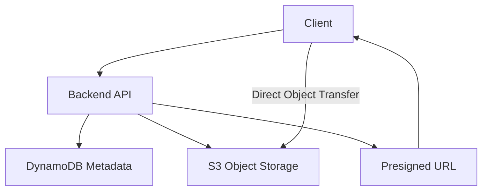
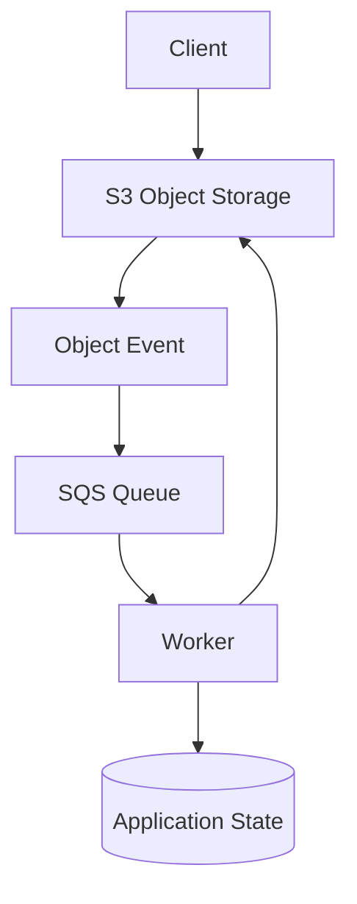

# 18- Amazon S3 Service Comparison Questions

## Overview

Amazon S3 is an object storage service designed for durable storage and large-scale data access. However, not every storage or data-management problem should be solved with S3.

Senior backend engineers must know when to select S3 over block storage, shared file systems, databases, archival services, content-delivery networks, and backup solutions. The right choice depends on the access model, latency requirements, data structure, concurrency, durability, recovery needs, and total cost.

This document covers interview-oriented service comparisons, architecture trade-offs, practical scenarios, and common misconceptions involving Amazon S3 and related AWS services.

## S3 vs Block Storage vs File Storage

### What is the difference between object, block, and file storage?

| Characteristic | Amazon S3 | Amazon EBS | Amazon EFS |
|---|---|---|---|
| Storage model | Objects identified by keys | Addressable storage blocks | Shared file system with directories and files |
| Access interface | S3 API and HTTP-based requests | Block device attached to compute | Network file-system protocol |
| Typical use | Documents, media, backups, data lakes | Boot volumes, databases, application disks | Shared application files and file-based workloads |
| Compute attachment | Accessed through APIs or compatible integrations | Attached to supported compute instances | Mounted by supported clients |
| Access by multiple compute instances | Through supported API access patterns | Depends on volume type and attachment configuration | Designed for shared concurrent file access |
| Partial modification | Object operations generally replace or create object versions rather than modify arbitrary byte ranges in place | Block-level reads and writes | File-level reads and writes |
| Directory semantics | Prefixes are logical key groupings | Filesystem semantics come from the filesystem built on the volume | Native file and directory semantics |
| Scaling | Managed object storage scales without managing a filesystem volume | Capacity and performance depend on volume configuration and type | Managed shared file-system capacity and performance |
| Operational responsibility | Bucket, policy, lifecycle, and object management | Volume and filesystem administration | Filesystem, access, and performance configuration |

Choose the storage model that matches how the application reads and writes data. S3 is not a drop-in replacement for a mounted filesystem or database volume.

### When should S3 be chosen over EBS?

Choose S3 for independently addressable objects that are accessed through APIs, such as customer documents, images, generated reports, and backups.

Choose EBS when an operating system or application requires a block device—for example, a database data directory, boot volume, or filesystem that depends on block-level writes.

**Interview scenario:** A Django application running on EC2 stores user uploads on an EBS-mounted directory. The application is scaled to multiple instances.

A shared EBS volume is not automatically the right solution. Consider moving uploads to S3 so instances can access objects through a common storage service without coordinating a shared local filesystem.

Keep EBS for the operating system and workloads that require block storage.

### When should EFS be chosen over S3?

EFS is appropriate when applications need shared filesystem semantics, such as:
- Multiple compute instances accessing the same directory tree.
- Applications that depend on POSIX-style file operations.
- Workloads that expect mounted files and directory traversal.
- Tools that read and write files through filesystem APIs.

S3 is a better fit when data can be represented as objects accessed through APIs and does not require arbitrary filesystem mutation.

**Important distinction:** An application can download an S3 object to a temporary file and process it locally, but that does not make S3 a shared POSIX filesystem.

### When should Amazon FSx be considered?

Amazon FSx provides managed file-system offerings for specialized requirements, including Windows file shares and high-performance parallel file systems.

| Requirement | Candidate |
|---|---|
| Durable object storage and API-based access | S3 |
| Block storage for a server or database | EBS |
| General-purpose shared NFS filesystem | EFS |
| Windows-native shared file access | FSx for Windows File Server |
| High-performance parallel filesystem workloads | FSx for Lustre |
| Specialized enterprise or application filesystem requirements | Appropriate FSx offering based on compatibility and workload |

The choice depends on the required file-system protocol, semantics, throughput, latency, compute integration, and operational model.

## S3 vs Relational and NoSQL Databases

### Why should S3 not be used as a replacement for PostgreSQL?

S3 stores objects and exposes APIs for retrieving them. PostgreSQL provides relational tables, transactions, constraints, indexing, and SQL queries.

| Requirement | S3 | PostgreSQL |
|---|---|---|
| Store large binary files | Strong fit | Usually better to store the file externally and keep a reference |
| Relational joins | Not a transactional object-storage operation | Native SQL capability |
| Uniqueness constraints | Must generally be enforced by application or another system | Database constraints |
| Multi-row transactions | Not provided as a relational transaction | Supported through database transactions |
| Search by business attributes | Requires an index, database, or analytical engine | Supported through indexes and SQL |
| Durable application metadata | Possible as objects, but awkward for relational queries | Strong fit for structured application state |
| Schema enforcement | Primarily an application responsibility for object content | Database schema and constraints |
| Object versioning | Supported through S3 versioning | Requires an application/database-specific design |

For a document platform, store the document bytes in S3 and maintain ownership, tenant IDs, processing status, and searchable attributes in PostgreSQL.

A common record contains a stable document ID and its S3 object key, rather than copying the entire object into a database column.

### Can S3 provide strongly consistent reads after writes?

Amazon S3 provides strong read-after-write consistency for object PUTs and DELETEs and for object metadata reads and listings.

This means a successful object write can be followed by a read or listing that reflects the completed operation, subject to the operation and resource being queried.

However, **S3 consistency does not create a transaction between S3 and PostgreSQL**. If the application uploads an object successfully and its database update fails, the object may exist without a completed application record.

Use explicit processing states, idempotent operations, and reconciliation to recover from partial failures.

Reference: [Amazon S3 data consistency model](https://docs.aws.amazon.com/AmazonS3/latest/userguide/Welcome.html).

### When should DynamoDB be used alongside S3?

DynamoDB is useful for low-latency key-value or document access, high-scale application metadata, and workloads where access patterns are well defined.

A typical architecture stores the object in S3 and its lookup metadata in DynamoDB.

DynamoDB can provide fast lookup by document ID or tenant key, while S3 stores the content.

The application must still handle consistency across the two services. DynamoDB does not make S3 uploads and database updates atomic.

### When should metadata be stored in S3 object metadata instead of a database?

S3 object metadata is suitable for attributes attached directly to the object, such as content type or a stable external reference.

Use a database when metadata supports:
- Searching by multiple business attributes.
- Tenant-aware listing and filtering.
- Relational joins.
- Transactional state changes.
- Fine-grained authorization based on ownership.
- Querying or sorting across many documents.

Object tags can support certain classification, access-control, and lifecycle use cases. They are not a substitute for a general-purpose business query engine.

## S3 Standard vs Other S3 Storage Classes

### How should storage classes be compared?

Storage classes trade storage price against access characteristics, retrieval requirements, resilience characteristics, minimum storage duration, and other constraints.

| Storage class | Typical workload | Main considerations |
|---|---|---|
| S3 Standard | Frequently accessed data | General-purpose storage for frequent access |
| S3 Intelligent-Tiering | Data with changing or uncertain access patterns | Automatically moves eligible objects among supported tiers; monitoring and tier-specific charges apply |
| S3 Standard-IA | Infrequently accessed data that still needs rapid access | Retrieval charges and minimum storage duration can matter |
| S3 One Zone-IA | Infrequently accessed, re-creatable data where single-AZ resilience is acceptable | Data is stored in one Availability Zone |
| S3 Glacier Instant Retrieval | Archive data requiring millisecond retrieval | Retrieval charges and minimum storage duration |
| S3 Glacier Flexible Retrieval | Archival workloads that can tolerate restore delays | Retrieval mode, restore time, and retrieval costs matter |
| S3 Glacier Deep Archive | Long-term archival data with infrequent access | Lowest-cost archival tier among these options, with longer restore expectations |

Storage-class names and features should be checked against the workload's current requirements and AWS documentation before deployment.

### When should S3 Intelligent-Tiering be selected?

Intelligent-Tiering is useful when access patterns are unpredictable or change over time and eligible objects may benefit from automatic movement between supported access tiers.

It reduces the need to predict every object's future access pattern, but it is not automatically the cheapest choice.

Consider monitoring charges, object-size eligibility, supported tiers, retrieval behavior, and any optional archive configurations. Frequently accessed data may remain in a frequent-access tier rather than producing savings.

### When should Standard-IA be used instead?

Standard-IA suits data that is expected to be accessed infrequently but must remain available with rapid access when needed.

Evaluate retrieval charges and minimum storage duration. Frequently retrieving a large amount of data can undermine the expected savings.

Do not use storage price alone as the selection criterion. Estimate access frequency, retrieved bytes, request charges, object sizes, retention duration, and the consequences of a slower restore.

### When should Glacier Flexible Retrieval or Deep Archive be used?

Use archival classes when the business explicitly accepts the corresponding retrieval and restoration model.

Examples include:
- Long-term compliance archives.
- Historical records that are rarely retrieved.
- Retained backup copies.
- Data that must remain available for restoration but is not used in interactive application requests.

Do not place a latency-sensitive API dependency in an archival class without designing for the restore process. The application may need an explicit workflow that initiates restoration and reports when the object becomes accessible.

### Is moving to a cheaper storage class always more cost-effective?

No. Consider the total cost across storage, transitions, retrievals, requests, minimum storage duration, and operational complexity.

For a dataset that is frequently read, an archival class may increase retrieval expense and latency even if its stored-byte price is lower.

Model the expected lifecycle and actual access pattern before changing storage classes.

Reference: [Amazon S3 storage classes](https://docs.aws.amazon.com/AmazonS3/latest/userguide/storage-class-intro.html).

## S3 vs CloudFront

### What is the difference between S3 and CloudFront?

S3 stores objects. CloudFront is a content-delivery network that caches and delivers content through edge locations.

They often work together rather than replace each other.

| Concern | S3 | CloudFront |
|---|---|---|
| Primary role | Durable object storage | Content delivery and caching |
| Origin data | Stores the original objects | Retrieves content from configured origins |
| Cache behavior | Does not act as a global CDN cache | Supports configurable caching and invalidation |
| Global delivery | Requests access the selected S3 endpoint or access path | Edge caching can reduce latency for distributed clients |
| Access control | IAM, bucket policies, access points, and other S3 controls | Distribution access controls and signed delivery mechanisms |
| Typical application | Original documents, media, datasets | Static website assets, cached APIs, and media delivery |

### When should CloudFront be placed in front of S3?

Consider CloudFront when:
- Objects are frequently requested by geographically distributed users.
- Cacheable assets can be served repeatedly.
- The application requires a global HTTPS delivery layer.
- Origin request volume can be reduced by caching.
- Public or private content needs an appropriate controlled delivery model.

For a private S3 REST origin, use Origin Access Control (OAC) and a bucket policy restricted to the intended distribution. Do not make the origin public merely to enable delivery.

### Does CloudFront eliminate the need to design S3 authorization?

No. The origin must allow the intended CloudFront access path, and the application must continue to authorize private content according to its business rules.

For private media, the architecture may use application authorization followed by a presigned URL or an appropriate CloudFront signed access mechanism. The choice depends on caching, revocation, and access requirements.

### What is the difference between CloudFront caching and Redis caching?

CloudFront primarily caches HTTP responses and objects for delivery to clients. Redis commonly caches application metadata, lookup results, or computed values for backend services.

Use CloudFront for repeat content delivery and Redis for application-level data caching when their semantics match. Neither is a replacement for the durable source of truth.

Reference: [Using CloudFront with an S3 origin](https://docs.aws.amazon.com/AmazonCloudFront/latest/DeveloperGuide/DownloadDistS3AndCustomOrigins.html).

## S3 Standard vs S3 Express One Zone

### When should S3 Express One Zone be considered?

S3 Express One Zone is designed for latency-sensitive workloads requiring very low-latency object access and high request rates, with data stored in a single Availability Zone.

Potential workloads include performance-intensive analytics, machine learning data access, and applications that repeatedly access large volumes of objects.

| Consideration | S3 Standard | S3 Express One Zone |
|---|---|---|
| General-purpose use | Broad default for many object workloads | Specialized low-latency workloads |
| Resilience model | Designed for multi-Availability Zone resilience | Single-Availability Zone storage |
| Performance objective | High request rates and scalable object access | Optimized for very low latency and high request rates |
| Failure tolerance | Better suited when single-AZ loss must be tolerated by the storage design | Requires explicit consideration of single-AZ loss |
| Operational decision | Broad baseline option | Requires workload-specific justification |

### What should be validated before selecting S3 Express One Zone?

Benchmark the actual workload, verify API and Region requirements, compare total cost, and decide how data will be recovered if the selected Availability Zone becomes unavailable.

Do not select it solely because a benchmark reports lower latency. The availability and recovery model must remain compatible with the business requirement.

Reference: [S3 Express One Zone](https://docs.aws.amazon.com/AmazonS3/latest/userguide/s3-express-one-zone.html).

## S3 vs S3 Glacier Storage Classes

### Is Amazon S3 Glacier a separate service from S3?

S3 Glacier storage classes are part of Amazon S3 storage. They use the S3 object model but have archival access characteristics that differ from frequently accessed classes.

This distinction matters because engineers sometimes treat archival storage as a separate application database or assume that every archived object can be retrieved immediately.

Use S3 lifecycle policies to transition eligible data into appropriate storage classes when the expected access and retention requirements justify it.

### How would you design a document archive?

A typical design keeps recent documents in an access-appropriate class and transitions eligible older documents to archival classes.

The retrieval API must know whether an object requires restoration. For classes requiring a restore operation, the application should initiate or track restoration rather than returning an ordinary download link as though the object were immediately retrievable.

Keep business retention metadata and authorization information accessible independently of the archived object where required.

### What are common mistakes with archival classes?

- Selecting them for objects that are still accessed frequently.
- Ignoring minimum storage duration and retrieval charges.
- Assuming a restore is instantaneous.
- Failing to communicate restore status to users.
- Deleting application metadata before confirming retention and recovery requirements.

## S3 vs AWS Backup

### When should AWS Backup be considered instead of relying only on S3 versioning?

S3 versioning preserves multiple versions of an object and supports certain recovery operations. AWS Backup provides a centralized framework for supported resource backup, retention, and restore workflows.

They address related but different recovery concerns.

| Requirement | S3 versioning | AWS Backup |
|---|---|---|
| Recover a prior object version | Strong fit | Depends on supported backup and restore workflow |
| Protect against some accidental overwrites | Yes | Can provide a separate recovery path |
| Centralized backup policy management | Not its primary role | Stronger fit for supported resources and policies |
| Retention across protected backup copies | Requires S3 retention design | Uses configured backup plans and retention capabilities |
| Recovery of application metadata and dependencies | Not by itself | Depends on which resources are backed up and how recovery is orchestrated |

AWS Backup capabilities for S3 depend on supported configurations and service features. Verify the current supported operations and limitations before relying on a particular protection mechanism.

### Is versioning equivalent to an independent backup?

No. Versioning is valuable for object-level recovery, but privileged actions, retention misconfiguration, key availability, and broader account compromise still matter.

A robust recovery design may combine versioning with independently protected backup copies, retention controls, replication, and tested restoration procedures.

Replication should also not be assumed to be a backup. Replicated changes and deletions can affect the destination according to the replication configuration.

Reference: [AWS Backup documentation](https://docs.aws.amazon.com/aws-backup/latest/devguide/whatisbackup.html).

## S3 vs Amazon EBS Snapshots

### When should EBS snapshots be preferred over copying files into S3?

EBS snapshots are appropriate for protecting EBS volumes and supporting volume-level recovery workflows.

S3 stores objects and supports its own versioning, lifecycle, and replication capabilities. Copying arbitrary files from a filesystem into S3 is not equivalent to capturing a consistent volume snapshot.

For database recovery, select the backup mechanism according to the database's consistency requirements. A raw volume snapshot may require coordination with the database or application to guarantee that the recovered data is usable.

### Can EBS snapshots be used as general-purpose S3 objects?

No. EBS snapshots are managed through the EBS snapshot APIs and lifecycle, not as ordinary application objects that should be accessed through arbitrary S3 bucket keys.

Use the service's supported snapshot operations and restore process.

## S3 vs AWS DataSync

### What is the difference between S3 and AWS DataSync?

S3 is a storage destination and access service. AWS DataSync is a data-movement service that can transfer data between supported storage systems and AWS storage destinations.

DataSync is useful when migrating existing file shares, synchronizing on-premises data, or moving data between supported storage services.

| Requirement | Appropriate choice |
|---|---|
| Store and retrieve application objects | S3 |
| Migrate large datasets from file storage to S3 | Evaluate DataSync |
| Maintain an application-specific object upload API | S3 SDK or presigned URLs |
| Move data between supported storage environments on a managed schedule | Evaluate DataSync |
| Query historical datasets | S3 plus an appropriate analytics engine |

DataSync does not replace the destination storage system's permissions, lifecycle configuration, or data validation. A successful transfer should still be verified according to the migration's integrity requirements.

Reference: [AWS DataSync User Guide](https://docs.aws.amazon.com/datasync/latest/userguide/what-is-datasync.html).

## S3 vs AWS Transfer Family

### When should AWS Transfer Family be used instead of a direct S3 API?

AWS Transfer Family supports managed file-transfer protocols and workflows, including SFTP and supported FTP-family use cases, with storage integrations such as S3.

It is useful when external partners or legacy systems require file-transfer protocols instead of application-specific HTTP APIs.

A modern web or mobile application can often use a backend API and presigned URLs. A partner integration that already expects SFTP may be better served through Transfer Family.

The choice depends on client compatibility, protocol requirements, identity integration, workflow automation, and operational ownership.

Do not introduce SFTP infrastructure for clients that can use a simpler and appropriately secured API-based upload workflow.

Reference: [AWS Transfer Family documentation](https://docs.aws.amazon.com/transfer/latest/userguide/what-is-aws-transfer-family.html).

## S3 vs Amazon EFS for Containers and Kubernetes

### Where should containerized application files be stored?

The answer depends on whether the files are application assets, persistent application data, or temporary working files.

| Container workload | Suitable starting point |
|---|---|
| Immutable images, reports, and document uploads | S3 |
| Shared POSIX files across supported container workloads | EFS |
| Container-local scratch files | Ephemeral container storage |
| Database data files | A database's supported persistent-storage architecture |
| Large analytical input datasets | S3 or a specialized high-performance storage service based on workload needs |

For Kubernetes workloads, S3 is often consumed through APIs rather than mounted as a traditional filesystem. Filesystem-like interfaces exist through specialized tools and integrations, but their semantics, caching behavior, and compatibility must be evaluated before treating them as a normal POSIX filesystem.

Avoid using object storage as a filesystem dependency if the application relies on locking, atomic rename, directory traversal, or in-place updates that the integration does not reliably provide.

## S3 vs Kafka and Amazon SQS

### Should S3 be used as a message queue?

No. S3 can store event payloads or large message bodies, but it does not replace a messaging system's delivery and consumption semantics.

Kafka is designed for ordered partitioned event streams and replay within its retention model. SQS provides managed queueing and decoupling between producers and consumers. S3 is an object store.

| Requirement | Typical service |
|---|---|
| Store large objects durably | S3 |
| Buffer work for independently scaling workers | SQS |
| Retain and consume partitioned event streams | Kafka or an appropriate managed Kafka service |
| Trigger processing after object creation | S3 Event Notifications or EventBridge, optionally routed through SQS |
| Retain source data for later reprocessing | S3, combined with an appropriate processing workflow |

### How should S3 and SQS work together?

A common pattern stores the file in S3 and places a compact object reference in a message or uses an S3 event notification to trigger work.

The worker retrieves the object by reference, processes it, and records the outcome.

S3 events can be duplicated and may arrive out of order. The consumer must therefore use idempotent processing, durable state transitions, and bounded retry behavior.

Do not send a multi-gigabyte file through a queue when the queue can carry an object reference instead.

Reference: [S3 Event Notifications](https://docs.aws.amazon.com/AmazonS3/latest/userguide/EventNotifications.html).

## S3 vs AWS Glue and Amazon Athena

### Does S3 execute SQL queries?

S3 stores objects; it does not itself provide a general-purpose SQL query engine over arbitrary object contents.

AWS Glue provides catalog and data-integration capabilities, while Amazon Athena can query supported datasets stored in S3 using SQL.

| Responsibility | Service |
|---|---|
| Durable storage for raw and curated datasets | S3 |
| Dataset catalog and schema metadata | AWS Glue Data Catalog |
| ETL and data transformations | AWS Glue or another suitable processing engine |
| SQL queries over supported S3 datasets | Amazon Athena |
| Interactive transactional application queries | PostgreSQL, DynamoDB, or another database suited to the access pattern |

### How should a data lake be organized?

Separate raw, transformed, and curated datasets. Choose partitioning according to common query filters and use an appropriate file format such as Parquet when it benefits the workload.

Athena query cost depends significantly on the volume of data scanned. Poor partitioning, oversized scans, and millions of tiny files can increase latency and cost.

Use Inventory and other scheduled metadata reports for object-level analysis where appropriate, rather than repeatedly listing enormous prefixes inside application request handlers.

References:
- [AWS Glue](https://docs.aws.amazon.com/glue/latest/dg/what-is-glue.html)
- [Amazon Athena](https://docs.aws.amazon.com/athena/latest/ug/what-is.html)

## Decision Scenarios for Senior Engineers

### Scenario: An application needs to store large customer documents and query them by tenant, status, and creation date. Which services would you select?

Use S3 for document contents and PostgreSQL or DynamoDB for business metadata.

Choose PostgreSQL if the access pattern requires relational queries, joins, and transactional state changes. Choose DynamoDB if the access patterns are well defined and key-based scale and latency requirements favor it.

Do not use S3 listing as the application's primary tenant-aware query engine. Store object references in the metadata system and authorize each document operation.

### Scenario: A service must serve millions of images globally. Should it use S3 alone or S3 with CloudFront?

Use S3 for durable original objects and evaluate CloudFront for global delivery and caching.

For immutable assets, content-hashed filenames permit longer cache lifetimes. For private assets, ensure that the authorization mechanism remains compatible with caching behavior and revocation requirements.

Benchmark and estimate origin traffic, cache hit ratio, and delivery cost rather than assuming a CDN is beneficial for every object.

### Scenario: The application requires very low-latency access to frequently reused objects. Which storage options would you evaluate?

First establish the latency target and workload characteristics.

Options may include S3 Standard with connection reuse and suitable concurrency, CloudFront for cacheable content, Redis for application-level cached values, or S3 Express One Zone for suitable object workloads requiring very low latency.

Each addresses a different part of the request path. Redis does not replace durable object storage, and a CDN does not solve every backend metadata lookup.

### Scenario: The business requires long-term retention but occasional fast retrieval. Which storage class should be selected?

Choose after estimating retention period, retrieval frequency, restore latency requirements, and total retrieval cost.

Glacier Instant Retrieval may suit eligible archival workloads requiring rapid access. Glacier Flexible Retrieval or Deep Archive may be appropriate when longer restoration times are acceptable.

Do not choose an archival class solely because its storage price is lower. Verify retrieval semantics and the application's ability to represent restore-in-progress states.

### Scenario: A company wants to migrate a shared filesystem to S3. Should the application code remain unchanged?

Not necessarily. A filesystem-to-object migration changes access semantics.

Applications that depend on file locks, in-place updates, POSIX permissions, or atomic filesystem operations may require refactoring. DataSync can help move supported data, but transfer completion does not guarantee application compatibility.

Inventory the filesystem operations used by the application before deciding between S3, EFS, FSx, or a hybrid design.

## Common Service Selection Mistakes

| Mistake | Why it is problematic | Better approach |
|---|---|---|
| Treating S3 as EBS or EFS | Their access models and write semantics differ | Choose storage according to object, block, or filesystem needs |
| Treating S3 as a transactional database | Cross-object and business transactions are not equivalent to relational transactions | Store searchable application state in an appropriate database |
| Treating versioning as independent backup | Privileged destructive actions and retention failures can still affect recovery | Use appropriate backup isolation and test restoration |
| Selecting a storage class by storage price alone | Retrieval and minimum-duration costs may offset savings | Model total lifecycle cost |
| Making an S3 bucket public to enable global delivery | Bypasses intended access boundaries | Use CloudFront OAC for a private origin where appropriate |
| Using Kafka or SQS to carry large file contents | Adds unnecessary message size and processing overhead | Store content in S3 and pass object references |
| Assuming CloudFront replaces S3 authorization | Origin and private-content authorization still matter | Configure origin access and application authorization correctly |
| Treating DataSync as a storage service | It moves data but does not replace the destination storage or application architecture | Choose both the storage destination and transfer mechanism |
| Choosing a specialized low-latency storage class without testing resilience requirements | Performance improvements can introduce different failure considerations | Benchmark and validate availability and recovery needs |

## Authoritative References

- [Amazon S3 storage classes](https://docs.aws.amazon.com/AmazonS3/latest/userguide/storage-class-intro.html)
- [Amazon S3 data consistency model](https://docs.aws.amazon.com/AmazonS3/latest/userguide/Welcome.html)
- [Amazon EBS documentation](https://docs.aws.amazon.com/ebs/latest/userguide/what-is-ebs.html)
- [Amazon EFS documentation](https://docs.aws.amazon.com/efs/latest/ug/whatisefs.html)
- [Amazon FSx documentation](https://docs.aws.amazon.com/fsx/latest/WindowsGuide/what-is.html)
- [Using CloudFront with an S3 origin](https://docs.aws.amazon.com/AmazonCloudFront/latest/DeveloperGuide/DownloadDistS3AndCustomOrigins.html)
- [S3 Express One Zone](https://docs.aws.amazon.com/AmazonS3/latest/userguide/s3-express-one-zone.html)
- [AWS Backup](https://docs.aws.amazon.com/aws-backup/latest/devguide/whatisbackup.html)
- [AWS DataSync](https://docs.aws.amazon.com/datasync/latest/userguide/what-is-datasync.html)
- [AWS Transfer Family](https://docs.aws.amazon.com/transfer/latest/userguide/what-is-aws-transfer-family.html)
- [Amazon SQS](https://docs.aws.amazon.com/AWSSimpleQueueService/latest/SQSDeveloperGuide/welcome.html)
- [AWS Glue](https://docs.aws.amazon.com/glue/latest/dg/what-is-glue.html)
- [Amazon Athena](https://docs.aws.amazon.com/athena/latest/ug/what-is.html)

## Key Takeaways

- Choose S3 for object storage, EBS for block storage, and EFS or an appropriate FSx offering when shared filesystem semantics are required.
- Use PostgreSQL or DynamoDB for searchable application metadata and transactional state rather than treating S3 as a general-purpose database.
- Select S3 storage classes according to access patterns, retrieval requirements, retention duration, resilience, and total cost.
- Combine S3 with CloudFront, SQS, Glue, Athena, DataSync, or AWS Backup when those services provide the specific delivery, processing, analytics, transfer, or recovery capability required.
- Evaluate service comparisons through workload requirements and tested failure behavior rather than choosing solely by price, latency, or popularity.