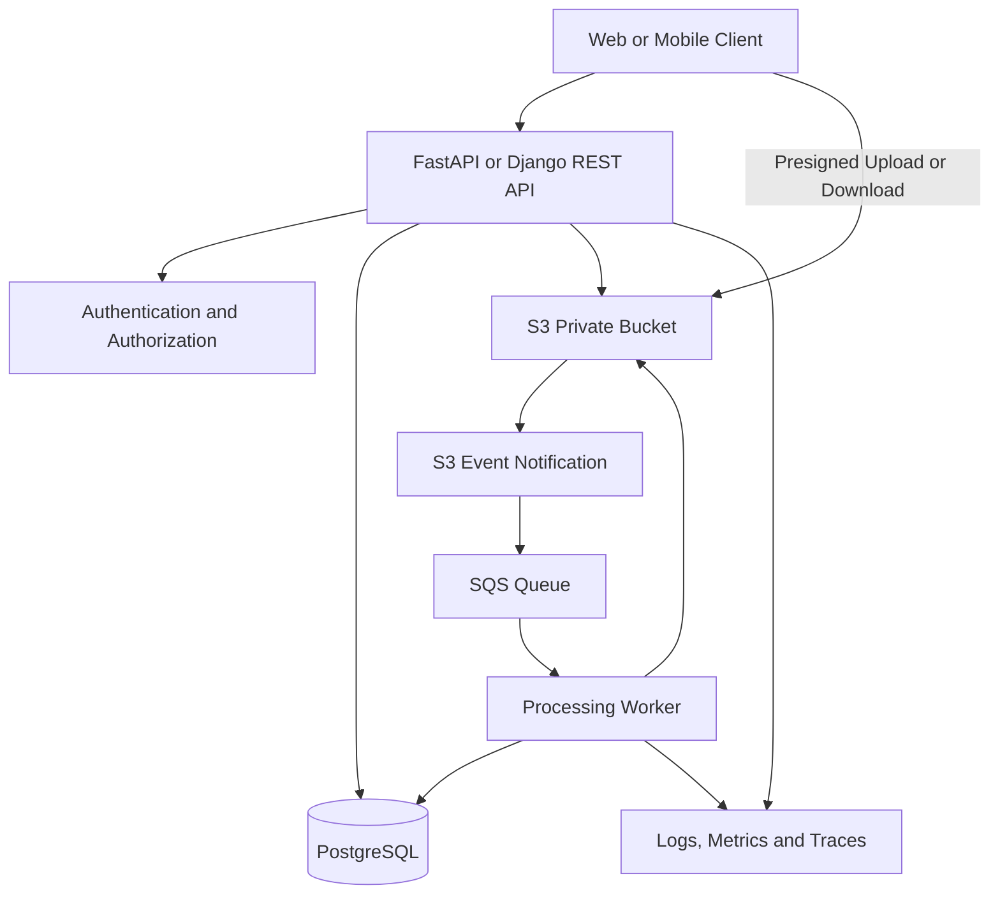
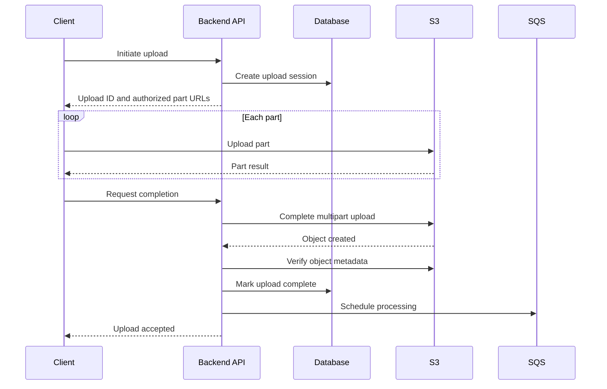

# 20- Senior Level Amazon S3 Questions

## Overview

Senior-level Amazon S3 interviews evaluate architectural judgment, failure handling, security boundaries, performance optimization, data recovery, and operational cost—not merely familiarity with S3 APIs.

A strong answer explains the design decision, identifies viable alternatives, describes what happens during failure, and establishes how the system will be monitored and recovered. The questions in this document emphasize realistic backend and cloud engineering scenarios, with model answers and follow-up considerations.

## Architecture and System Design

### How would you design a production-grade file storage service for millions of users?

**Scenario:** A multi-tenant SaaS platform allows customers to upload documents, retrieve them later, and run asynchronous processing workflows. Files range from small images to large archives.

**Model answer**

Use Amazon S3 for durable object storage, a backend API for authentication and authorization, a database for document metadata, and an asynchronous processing system for background work.



Component responsibilities:

| Component | Responsibility |
|---|---|
| Backend API | Authenticate users, authorize tenant access, validate requests, issue upload/download permissions |
| S3 | Store file contents and relevant object metadata |
| PostgreSQL | Store document ownership, object references, processing state, and application attributes |
| SQS | Buffer asynchronous processing work and isolate producers from consumers |
| Worker or Lambda | Validate, scan, transform, or extract content |
| CloudWatch | Expose application logs, operational metrics, and alarms |

Use server-mediated uploads for small files when the API must inspect the request synchronously. For large files, consider presigned multipart uploads so the client transfers data directly to S3.

Generate object keys on the server, for example:

```text
tenant/tenant-uuid/documents/document-uuid/original
```

Do not treat this naming scheme as authorization. Authorize every operation using the authenticated principal and application metadata.

**Production considerations**

- Enforce upload size and content-type limits.
- Validate actual file content rather than trusting the HTTP `Content-Type` header.
- Use private buckets, appropriate encryption, and least-privilege IAM.
- Make processing idempotent because event delivery can be duplicated.
- Track upload and processing states in durable application storage.
- Use lifecycle policies for temporary data and incomplete multipart uploads.
- Monitor failed jobs, upload errors, processing latency, and storage costs.
- Define retention, recovery, and deletion requirements before going live.

**Follow-up:** What happens if the S3 upload succeeds but the database transaction fails?

The system needs a reconciliation or compensation strategy. An uploaded object can exist without a corresponding completed metadata record. Track upload sessions, expire abandoned sessions, and periodically reconcile objects or database records where required.

### How would you design a 100 GB upload API without exhausting backend resources?

**Model answer**

Avoid routing the entire file through a conventional FastAPI or Django request handler unless there is a strong requirement for server-side streaming inspection.

A better approach is to separate upload authorization from the data-transfer path.

1. The client requests an upload session.
2. The backend authenticates the user, checks quotas, generates a unique object key, and creates an upload record.
3. The backend provides appropriate presigned multipart-upload operations.
4. The client uploads parts directly to S3.
5. The client requests completion, and the backend validates the upload state.
6. The system verifies the resulting object and schedules processing.



The exact completion protocol can vary. If the backend cannot atomically commit S3 state and database state, make the workflow recoverable through durable upload states, idempotency, and reconciliation.

**Important trade-offs**

- Multipart uploads support retries at the part level rather than requiring a complete restart.
- More concurrent parts can improve throughput until network, connection, memory, or request limits become the bottleneck.
- Abandoned multipart uploads retain uploaded parts until completion or abortion, so configure cleanup.
- Presigned URLs are bearer capabilities and must be scoped and protected appropriately.
- The backend still needs to validate the completed object and enforce application authorization.

Do not assume that the successful completion of an upload means the file has passed malware scanning or business validation.

### How would you provide consistent file metadata and object storage across S3 and PostgreSQL?

**Model answer**

S3 and PostgreSQL do not share a general-purpose atomic transaction. Design an explicit workflow instead of trying to simulate a distributed transaction with a single try/except block.

One possible state machine is:

```text
INITIATED
    |
    v
UPLOADING
    |
    v
UPLOADED
    |
    v
VALIDATING
    |
    +---- failure ----> FAILED
    |
    v
READY
```

The API creates a metadata record before issuing upload permissions. After upload completion, the service verifies the object and records the next state.

Where multiple systems must be coordinated, use durable state transitions, idempotent commands, and reconciliation jobs.

**Senior-level considerations**

- What happens after a worker crashes between uploading the object and updating the database?
- How are duplicate completion requests handled?
- Can two requests concurrently update the same document?
- How are orphaned objects discovered?
- Is deletion soft, logical, or physically permanent?
- Can the object be overwritten while a worker is processing it?

When the workflow requires an exact object version, persist the version ID and process that version rather than resolving the key again later.

### How would you make a dataset atomically visible when it contains thousands of S3 objects?

**Model answer**

Do not assume that multiple object uploads become visible together. Individual completed operations can be strongly consistent, but a collection of independent writes does not become a transaction.

Use a publication protocol:

1. Write a dataset under a unique run-specific prefix.
2. Validate the expected objects and their integrity.
3. Generate a manifest containing object keys, versions, sizes, checksums, and schema information.
4. Publish the manifest or update a database pointer only after validation succeeds.
5. Require consumers to read only published datasets.

Example:

```text
datasets/
    run-2026-10-15-001/
        part-0001.parquet
        part-0002.parquet
        part-0003.parquet
        manifest.json
```

The manifest or application-level publication record becomes the completion indicator.

This design is useful for data lakes, batch exports, analytics pipelines, and multi-object processing systems. Failed runs can remain isolated and be cleaned up without exposing partial datasets.

### How would you isolate tenants in a shared S3 bucket?

**Model answer**

Tenant isolation requires both a naming strategy and an authorization model.

Common options include:

| Isolation model | Advantages | Trade-offs |
|---|---|---|
| Shared bucket with tenant-specific prefixes | Lower resource-management overhead | Requires precise authorization and careful policy design |
| Separate buckets per tenant | Stronger resource-level separation and independent configuration | More resources and lifecycle/configuration management |
| S3 Access Points | Separate access policies and endpoints for different consumers or datasets | Additional configuration and resource-management complexity |
| Separate AWS accounts | Stronger administrative and security boundaries | More complex cross-account management and governance |

For a shared-bucket design, derive the tenant identity from authenticated server-side context. Never trust a client to select an arbitrary tenant prefix.

Also consider whether tenant isolation must extend to encryption keys, retention policies, audit boundaries, and administrative access. Prefix separation alone does not satisfy every regulatory requirement.

## Consistency, Concurrency, and Distributed Systems

### S3 provides strong consistency. Why do applications still experience stale data or inconsistent results?

**Model answer**

S3 provides strong read-after-write consistency for supported object PUT and DELETE operations and relevant object metadata and listing operations.

Staleness can still occur elsewhere in the architecture.

Examples include:

- CloudFront serving a cached response.
- Redis returning cached application metadata.
- A database record referring to an older object version.
- A worker processing an earlier event.
- An asynchronous replica not yet containing the source object.
- A client retaining a previously downloaded copy.

Diagnose the component that holds the stale state instead of attributing every inconsistency to S3.

**Follow-up:** Can two clients concurrently overwrite the same key?

Yes. The application must define which updates are valid. When concurrent writers are possible, use conditional operations where supported, versioning, application-level optimistic concurrency, or immutable object keys according to the required semantics.

### How would you make an S3-triggered image-processing pipeline idempotent?

**Model answer**

S3 Event Notifications provide at-least-once delivery and are not guaranteed to arrive in operation order. The worker must tolerate duplicate and out-of-order events.

A robust design should:

- Record processing state using a stable application job identifier.
- Associate work with the relevant object key and version where appropriate.
- Use conditional state transitions or database uniqueness constraints to avoid duplicate logical work.
- Use immutable output keys or overwrite-safe writes.
- Keep input and output prefixes separate to avoid recursive triggers.
- Retry transient failures with bounded backoff.
- Route repeated failures to an appropriate recovery workflow.

Example idempotency identity:

```text
document_id + source_version_id + processing_profile_version
```

The processing-profile version matters because the same input might legitimately need to be reprocessed after a transformation algorithm changes.

**A crucial distinction:** A database record saying "completed" does not prove that an output object still exists. A durable workflow should define how to recover from partial completion and how to reconcile state with storage.

### How would you prevent lost updates when multiple services write to the same object key?

**Model answer**

First, reconsider whether multiple services should write to a mutable key at all. Immutable object keys often simplify concurrency.

For example:

```text
documents/{document_id}/versions/{application_version}/content
```

Each writer creates a distinct object. A database record or manifest identifies the active version.

When a mutable key is required, define concurrency rules using supported conditional writes or an application-level compare-and-swap mechanism. Do not rely solely on upload timestamps or event arrival order.

Versioning can preserve earlier object versions, but it does not independently decide which application update should win.

**Follow-up:** Would S3 Versioning eliminate concurrency conflicts?

No. It may retain multiple versions, but the application still needs a business rule for selecting the authoritative version.

### How would you design retries for failed S3 operations and asynchronous work?

**Model answer**

Retries should depend on the error category and operation semantics.

| Failure category | Typical handling |
|---|---|
| Throttling or transient service/network errors | Bounded exponential backoff with jitter |
| Invalid parameters or malformed requests | Fail fast and correct the request |
| Permission or KMS authorization failure | Diagnose and correct authorization; avoid endless retries |
| Incomplete multipart upload | Resume valid parts or abort and restart according to policy |
| Worker timeout after output creation | Reconcile state before repeating side effects |
| Poison input that repeatedly fails validation | Mark terminal failure and preserve diagnostic evidence |

SDK retries can help with transient API failures, but they do not replace application-level recovery. A timeout can happen after an operation has succeeded, so retry logic must account for uncertain outcomes.

For long-running processing, use a queue with visibility-timeout settings and a dead-letter strategy where appropriate. Ensure that processing time, retry count, and recovery objectives are aligned.

## Performance and Large-Object Workloads

### How would you optimize S3 throughput for a high-volume upload service?

**Model answer**

Start with measurements rather than arbitrary concurrency increases.

Evaluate:

- Object-size distribution.
- Network throughput and latency.
- Multipart part size.
- Concurrent parts per object.
- Number of simultaneous objects.
- SDK connection reuse and connection-pool settings.
- Client CPU and memory consumption.
- Retry rates and throttling.
- Request and data-transfer costs.

Multipart uploads can parallelize large-object transfer and allow retries for individual parts. The chosen part size must fit within S3's multipart limits and the expected maximum object size.

AWS publishes S3 request-rate guidance, but actual results depend on workload and client architecture. Benchmark with production-like traffic rather than interpreting request-rate guidance as a guaranteed end-to-end throughput figure.

Reference: [S3 multipart upload limits](https://docs.aws.amazon.com/AmazonS3/latest/userguide/qfacts.html).

### When would you use S3 Transfer Acceleration?

Consider Transfer Acceleration when clients are geographically distant from the destination bucket and the accelerated path provides a measurable improvement.

It is not automatically beneficial for every workload.

Evaluate:
- Client geography and network path.
- Object sizes and upload frequency.
- Measured throughput with and without acceleration.
- Additional transfer costs.
- Compatibility with the selected bucket configuration and endpoints.

For many small requests, application round-trip latency and request overhead may dominate. For large uploads, network conditions and multipart configuration may be more significant.

### How would you detect and recover from incomplete multipart uploads?

**Model answer**

Multipart uploads consist of independently uploaded parts followed by a completion operation. If the workflow never completes or aborts, uploaded parts can continue consuming storage.

A production design should:

1. Track multipart upload IDs where practical.
2. Configure a lifecycle rule to abort incomplete multipart uploads after an appropriate period.
3. Monitor outstanding uploads and unexpected storage growth.
4. Diagnose abandoned uploads before performing destructive cleanup.
5. Verify completed objects through the intended application workflow.

Example inspection command:

```bash
aws s3api list-multipart-uploads \
  --bucket "$BUCKET"
```

For automated cleanup, use a lifecycle policy where suitable rather than relying exclusively on periodic manual scripts.

### A backend serves millions of images. Should it always place CloudFront in front of S3?

**Model answer**

CloudFront is a strong candidate when objects are cacheable and clients are distributed across geographic locations. However, the design should reflect access patterns.

For immutable public assets, use content-addressed or versioned keys and long-lived cache policies. For frequently changing objects, define cache invalidation or versioning strategies.

For private media, configure an appropriate origin access model and private-content authorization mechanism. Ensure that cache keys, authorization behavior, and response caching cannot expose one user's content to another.

Measure cache hit ratio, origin request volume, delivery latency, and cost. A CDN reduces repeated origin work only when the content and cache policy permit effective reuse.

## Security and Authorization Design

### How would you troubleshoot an `AccessDenied` error for an SSE-KMS encrypted object?

**Model answer**

Separate S3 authorization from KMS authorization.

The request needs permission to perform the relevant S3 operation. If the object uses SSE-KMS, the calling identity and key policy must also allow the relevant KMS operation, subject to the complete applicable authorization model.

Investigate the following layers:

1. Verify which AWS identity is issuing the request.
2. Confirm the bucket, key, Region, and requested operation.
3. Review identity policies and the bucket or access-point policy.
4. Check explicit denies, organization-level restrictions, permission boundaries, and session policies where applicable.
5. Inspect the KMS key policy and relevant IAM permissions or grants.
6. Review CloudTrail events and available service error details.
7. Repeat the request using the intended role and a minimal test object.

A successful S3 policy check does not guarantee successful decryption. Conversely, granting KMS permissions does not grant access to an object through S3.

Reference: [S3 server-side encryption](https://docs.aws.amazon.com/AmazonS3/latest/userguide/serv-side-encryption.html).

### How would you design secure presigned URL uploads for untrusted clients?

**Model answer**

A presigned URL grants temporary access to a specific signed operation, so the backend should treat it as a narrowly scoped capability rather than a public file link.

Design considerations include:

- Authenticate and authorize the caller before issuing the URL.
- Generate a unique object key on the server.
- Use a short, appropriate expiration.
- Restrict the permitted operation and relevant signed headers.
- Validate the resulting object's size, content type, and actual contents.
- Prevent unauthorized clients from selecting another tenant's object key.
- Avoid logging the full signed URL.
- Track upload sessions and reject repeated or expired completion requests.
- Consider whether a client can overwrite the object before validation or after processing begins.

A presigned URL does not automatically enforce all application-level file validation rules. The application must verify the completed upload and define when the object becomes usable.

### How would you protect sensitive documents against accidental or malicious deletion?

**Model answer**

The answer depends on the required recovery objectives and threat model.

Possible controls include:
- S3 Versioning for recovery from overwrites and certain deletions.
- S3 Object Lock where retention or legal-hold requirements apply.
- Restrictive IAM and bucket policies.
- Independent backup or recovery copies.
- Replication where geographic or account separation is required.
- CloudTrail auditing and appropriate alerts.
- Tested restoration procedures.

Separate ordinary application write permissions from administrative deletion privileges. Validate recovery using an actual restore exercise, including access to required KMS keys and application dependencies.

Do not claim that versioning alone guarantees immutable retention or protects against every privileged action.

### How would you design secure access for an external partner in another AWS account?

**Model answer**

Use cross-account role assumption, a suitable resource policy, or another supported cross-account access pattern depending on the partner's integration requirements.

The design should specify:

- Which partner principals can access which buckets, prefixes, or access points.
- Which operations are permitted.
- Whether the partner can list objects or only access known keys.
- How credentials are obtained and rotated.
- Whether SSE-KMS permissions are required in either account.
- How access is audited and revoked.
- Whether data retention or ownership constraints apply.

Prefer a narrowly scoped trust relationship over long-lived shared access keys. Test both allowed and denied operations before production use.

## Versioning, Replication, and Disaster Recovery

### Design a multi-Region recovery architecture for a document platform.

**Scenario:** The platform has an RPO of 15 minutes and an RTO of 60 minutes.

**Model answer**

Start by separating the recovery objectives:

- **RPO:** The maximum acceptable amount of data loss measured in time.
- **RTO:** The target time for restoring the service.

A possible design includes versioned source and destination buckets in separate Regions, replication metrics, suitable replication configuration, a recoverable application deployment, independent permission configuration, and a tested failover procedure.

S3 Replication Time Control can help with predictable replication objectives. It provides an SLA-backed commitment for 99.99% of new objects to be replicated within 15 minutes, subject to its service terms and applicability. This does not mean every object is guaranteed to arrive within 15 minutes, nor does it guarantee the application's RPO or RTO by itself.

Reference: [S3 Replication Time Control](https://docs.aws.amazon.com/AmazonS3/latest/userguide/replication-time-control.html).

**Recovery verification should include:**

1. Confirm destination data availability and replication status.
2. Verify destination IAM and KMS access.
3. Deploy or activate application components.
4. Restore or validate database state.
5. Route traffic to the recovery environment.
6. Run smoke tests and business-level integrity checks.
7. Record actual recovery time and data loss.
8. Define how writes are handled during failover and later reconciliation.

A replicated bucket alone is not a complete disaster recovery solution.

### What is the difference between replication and backup?

Replication copies eligible objects to another destination according to configured rules. Backup focuses on retaining recoverable copies that meet defined retention and restore objectives.

Replication may propagate updates or certain deletions depending on configuration. A separate backup mechanism or independently protected copy can provide a different recovery boundary.

Choose based on the threat model. A regional outage, accidental deletion, application bug, ransomware-like credential compromise, and compliance retention violation are distinct failure scenarios.

**Follow-up:** Why is a replicated destination not automatically a valid failover target?

Because the application may require replicated data, compatible IAM roles, usable KMS keys, database state, correct network routing, and an operational cutover process. The destination must be tested as an application environment, not merely inspected as a bucket.

### How should an engineer recover an object that appears deleted but still has older versions?

**Model answer**

Inspect the object's versions and delete markers.

In a versioning-enabled general purpose bucket, a normal DELETE commonly creates a delete marker. Earlier versions may remain stored.

The recovery process should identify the correct version, verify retention and authorization constraints, and either remove the relevant delete marker or restore the desired contents using a controlled operation.

Do not permanently delete object versions simply to make the current key appear available. Verify the target key, version ID, retention configuration, and application metadata first.

### How would you replicate objects encrypted with SSE-KMS across Regions?

**Model answer**

Check the source and destination encryption configuration, replication role, bucket policies, and KMS authorization.

The replication workflow must be allowed to read the source object, use the relevant source key permissions, and write the replica using the intended destination encryption configuration.

Important considerations include:
- KMS key availability in the required Region.
- Key-policy and IAM permissions.
- Explicit selection and configuration of encrypted-object replication where necessary.
- Destination-account ownership requirements.
- Replication status and failure monitoring.
- Recovery behavior when a required key is disabled or unavailable.

Do not diagnose every missing replica as a replication-rule problem; authorization and encryption configuration may be the cause.

## Storage Classes and Cost Optimization

### How would you reduce S3 costs for a bucket whose usage has grown unexpectedly?

**Model answer**

First determine where the cost originates instead of applying lifecycle rules blindly.

Examine:
- Stored bytes by storage class.
- Number and size distribution of objects.
- Noncurrent versions and delete markers.
- Incomplete multipart uploads.
- GET, PUT, COPY, LIST, and other request patterns.
- Data transfer and retrieval costs.
- Lifecycle transition behavior.
- Replication and destination storage.
- Analytics, inventory, monitoring, and logging charges.

Use AWS cost tools, Storage Lens, Inventory, and the appropriate billing data to establish which factors matter.

Next, choose a corrective action based on evidence. Examples include lifecycle transitions, cleaning up eligible obsolete versions, aborting stale multipart uploads, consolidating small data files for analytics, and reducing unnecessary transfers.

**Important:** A lower per-GB storage price can be offset by retrieval, transition, and minimum-duration charges. Model the complete workload cost before making a broad change.

### How would you choose between S3 Standard and S3 Intelligent-Tiering?

**Model answer**

Base the choice on access predictability, object eligibility, monitoring charges, and the expected mix of access tiers.

S3 Standard is a straightforward fit for frequently accessed data. Intelligent-Tiering can help where access patterns are uncertain or change over time and eligible objects may benefit from automatic movement between supported tiers.

Measure the actual access distribution. Intelligent-Tiering is not guaranteed to be cheaper for every dataset, and its optional archive tiers have their own retrieval considerations.

### A data lake contains billions of small JSON files. How would you improve query performance and reduce cost?

**Model answer**

First identify whether the bottleneck is S3 request overhead, file-format overhead, query planning, excessive scanned data, or poor partitioning.

For analytical workloads, consider transforming small JSON files into larger Parquet files and organizing partitions around common query predicates.

For example:

```text
analytics/
    events/
        year=2026/
            month=10/
                day=15/
                    part-0001.parquet
```

Use AWS Glue Data Catalog and Athena when their catalog and SQL capabilities fit the use case.

Do not partition on every possible attribute. Excessive or highly granular partitions can increase metadata overhead and complicate queries.

Measure bytes scanned, query duration, number of files opened, compaction cost, and the freshness requirements of the pipeline.

## Monitoring, Troubleshooting, and Operations

### What S3 metrics and logs would you use during a production incident?

**Model answer**

Select observability tools based on the incident type.

| Need | Useful evidence |
|---|---|
| Request volume and latency patterns | Relevant S3 CloudWatch request metrics where enabled |
| Application error details | Structured backend and worker logs |
| Who called an API and what happened | Applicable CloudTrail management and data events |
| Object-level storage inventory | S3 Inventory |
| Storage usage and organization-wide trends | S3 Storage Lens and billing data |
| Access-path diagnosis | Relevant S3 or CloudFront logs and request identifiers |
| Replication delay or failure | Replication status, replication metrics, and notifications |
| Failed asynchronous processing | SQS metrics, Lambda metrics, dead-letter queues, and application job records |

Do not assume every data event is automatically present in the default CloudTrail event history. Confirm the data-event configuration and log retention before relying on it for investigations.

Build alarms around business impact: sustained upload failures, processing backlog, replication lag, unusual data access, or cost anomalies.

### S3 returns intermittent `503 Slow Down` responses. What would you investigate?

**Model answer**

First determine the affected operations, object prefixes, concurrency, request pattern, and timing.

Investigate whether:
- The application has recently increased concurrency.
- Retries are amplifying traffic.
- Many workers are performing redundant requests.
- The application performs repeated LIST or HEAD operations instead of using known object references.
- A deployment changed SDK configuration or request behavior.

S3 can scale to high request rates, but clients must handle transient failures correctly.

Apply bounded exponential backoff with jitter, use current SDK guidance, and measure recovery. Do not blindly raise concurrency or retries; that can worsen overload and cost.

### A document exists in S3 but the application reports `NoSuchKey`. How would you investigate?

**Model answer**

Compare the exact bucket, key, Region, endpoint, and version assumptions used by the application with the actual stored object.

Potential causes include:
- The application constructed a different key.
- A leading slash, URL-encoding issue, or case difference changed the key.
- The application selected the wrong bucket or environment.
- A delete marker changed the behavior of a versioned key.
- The application expects a version that was not supplied.
- The object exists in another Region or destination bucket.

Use `head-object` for the exact key and inspect versions if versioning is enabled.

A successful listing of a similar-looking key does not prove that the application is requesting the same object identifier.

### How would you detect replication lag before it violates the recovery objective?

**Model answer**

Enable appropriate S3 replication metrics and alarms for pending operations, bytes pending, replication latency, and failed operations. For tighter replication objectives, evaluate S3 Replication Time Control and its threshold notifications.

Also monitor destination availability through controlled checks rather than assuming the configuration is healthy because it exists.

Define operational actions for breaches:
- Investigate permission and KMS failures.
- Identify affected prefixes or replication rules.
- Estimate the affected data and duration.
- Determine whether manual replay or Batch Replication is required.
- Escalate according to the recovery objectives.

Metrics should drive a documented response process, not merely populate a dashboard.

## Deployment and Infrastructure Engineering

### How would you deploy S3 infrastructure safely through Terraform?

**Model answer**

Keep storage configuration, application deployment, and environment-specific values organized in version-controlled infrastructure code.

A production workflow should:

1. Validate formatting and configuration.
2. Initialize providers and modules.
3. Run validation and relevant security checks.
4. Generate a reviewed plan.
5. Require appropriate approval for production changes.
6. Apply the approved change.
7. Verify encryption, versioning, access policies, lifecycle, and replication.
8. Detect drift and reconcile changes through controlled reviews.

Avoid hardcoded credentials. Use short-lived role credentials, such as GitHub Actions OIDC federation where suitable.

Use remote state with appropriate access controls, environment isolation, and state protection. `prevent_destroy` can guard against certain Terraform destruction plans, but it is not a complete data-protection mechanism.

### A Terraform plan proposes deleting a production bucket. What should a senior engineer do?

**Model answer**

Stop the deployment and determine why the plan includes deletion.

Check whether the bucket was renamed, the resource address changed, the wrong workspace or account was selected, configuration was removed, or an immutable resource replacement is being proposed.

Then inspect:
- Resource identifiers and account/Region context.
- State and configuration differences.
- Stored objects and versions.
- Backup and retention requirements.
- Dependencies and downstream consumers.
- Import or state-migration options if resource identity changed.

Do not approve the plan until the intended outcome and data-retention impact are understood.

Infrastructure automation should make destructive changes explicit and reviewable.

### How would you test an S3 integration without making every unit test depend on AWS?

**Model answer**

Use different test layers.

| Test layer | Purpose |
|---|---|
| Unit tests | Verify service logic, authorization decisions, key generation, state transitions, and error mapping with mocked S3 clients |
| Contract tests | Verify expected request parameters, metadata conventions, and SDK interactions |
| Local integration tests | Exercise applicable workflows using a compatible local S3 implementation, while recognizing that emulators may differ from AWS |
| AWS integration tests | Validate actual IAM, KMS, bucket policies, presigned URLs, events, and service behavior in a controlled account |
| Recovery tests | Validate restoration, replay, replication, and cleanup workflows |

A unit test that mocks `put_object` proves only that the mocked method was invoked as expected. It does not prove that the production IAM policy allows the operation or that KMS encryption works.

Use dedicated test resources with cleanup procedures and never share destructive test operations with production buckets.

## Senior Design Exercises

### Design an ingestion pipeline that must process each logical document exactly once.

**Expected answer**

Begin by challenging the phrase "exactly once." S3 notifications and distributed workers can retry or duplicate work. A system can usually provide effectively-once business outcomes through idempotency and durable state, rather than assuming exactly-once physical execution.

Use a stable document identity, a durable job record, conditional state transitions, and idempotent outputs. Preserve the relevant source version or immutable input key so retries process the same content.

If the processing algorithm is upgraded, include its version in the logical processing identity when a new result is required.

Explain how to recover from the worker crashing after writing output but before marking the job complete.

### Design a private media platform with global delivery and immediate revocation requirements.

**Expected answer**

S3 can provide durable origin storage, while CloudFront can improve global delivery. The difficult part is the revocation requirement.

The answer should distinguish:
- Origin access from viewer authorization.
- CDN cache freshness from source-object updates.
- Signed delivery capabilities from backend authorization.
- Cache invalidation from complete prevention of access to previously delivered data.

A presigned URL or signed CDN URL has a validity window and should not be described as instantly revocable in every situation. Previously downloaded data also cannot be recalled.

Choose an access mechanism based on the maximum acceptable exposure window and test the cache behavior before production.

### Design a document-retention architecture for regulated data.

**Expected answer**

Identify retention periods, legal holds, permitted deletion roles, audit requirements, encryption-key availability, and recovery objectives before choosing controls.

S3 Versioning can help preserve older versions. Object Lock can provide retention protection where the required configuration and mode are appropriate. Independent backup and replication can address other recovery needs.

The design should also specify how records are located, how retention is audited, who can change policies, and how authorized recovery is performed.

Never assume that a generic lifecycle rule or a replicated copy satisfies every regulatory obligation.

### Design a cost-effective storage platform for data with unpredictable access patterns.

**Expected answer**

Start with workload measurements and retention requirements. Consider S3 Standard for frequent access, Intelligent-Tiering for eligible workloads with uncertain access, and appropriate infrequent-access or archival classes for less frequently retrieved data.

Estimate total cost across stored bytes, requests, retrievals, transitions, data transfer, monitoring, and replication. Account for object sizes and retention duration.

Define guardrails such as lifecycle reviews, cost allocation tags, billing alerts, and periodic validation of storage-class choices.

### How would you explain the trade-off between S3 simplicity and a specialized storage service?

**Expected answer**

S3 offers managed object storage with API-based access and strong scalability characteristics. It may simplify durability and capacity management for object workloads.

However, workloads requiring block-level writes, shared POSIX semantics, transactional queries, or specialized low-latency access may require EBS, EFS, FSx, a database, or another service.

A senior answer maps access semantics and failure requirements to the service rather than selecting S3 merely because it is managed.

## Interview Answer Evaluation Framework

When answering an unfamiliar scenario, structure the response around these engineering dimensions:

| Dimension | Questions to address |
|---|---|
| Requirements | What are the throughput, latency, durability, RPO, RTO, retention, and access requirements? |
| Data model | What identifies an object, and where does searchable application metadata live? |
| Authorization | Who can upload, read, delete, replicate, and administer the data? |
| Consistency | What operations are atomic, and where can partial failure occur? |
| Reliability | How are retries, duplicate events, idempotency, and recovery handled? |
| Performance | What measurements determine part sizes, concurrency, caching, or storage-class selection? |
| Observability | Which metrics, logs, traces, and alerts establish system health? |
| Cost | Which storage, request, transfer, and operational costs dominate? |
| Recovery | How is the system restored and how is recovery verified? |
| Testing | Which behaviors are mocked, emulated, and validated against AWS? |

Avoid presenting one architecture as universally correct. State the assumptions, compare alternatives, explain failure modes, and describe what evidence would validate the decision.

## Authoritative References

- [Amazon S3 service overview and consistency model](https://docs.aws.amazon.com/AmazonS3/latest/userguide/Welcome.html)
- [S3 multipart upload limits](https://docs.aws.amazon.com/AmazonS3/latest/userguide/qfacts.html)
- [S3 event notifications](https://docs.aws.amazon.com/AmazonS3/latest/userguide/EventNotifications.html)
- [S3 Replication Time Control](https://docs.aws.amazon.com/AmazonS3/latest/userguide/replication-time-control.html)
- [S3 replication troubleshooting](https://docs.aws.amazon.com/AmazonS3/latest/userguide/replication-troubleshoot.html)
- [S3 server-side encryption](https://docs.aws.amazon.com/AmazonS3/latest/userguide/serv-side-encryption.html)
- [S3 presigned URLs](https://docs.aws.amazon.com/AmazonS3/latest/userguide/using-presigned-url.html)
- [S3 Object Lock](https://docs.aws.amazon.com/AmazonS3/latest/userguide/object-lock.html)
- [S3 monitoring and metrics](https://docs.aws.amazon.com/AmazonS3/latest/userguide/monitoring-overview.html)

## Key Takeaways

- Senior S3 engineering requires understanding consistency boundaries, application-level transactions, concurrency, and idempotent distributed workflows.
- Secure designs separate storage, metadata, authorization, encryption, and processing responsibilities instead of relying on object keys or presigned URLs alone.
- Performance and cost optimization must be driven by workload measurements, realistic access patterns, and total lifecycle cost.
- Versioning, replication, and retention controls support recovery but do not replace an independently tested disaster recovery strategy.
- Production-ready answers explain failure behavior, observability, verification, and recovery—not only how to configure the successful path.