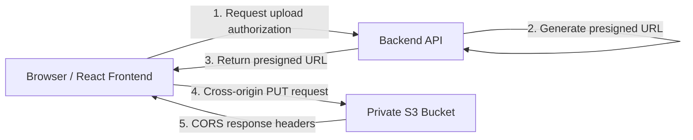
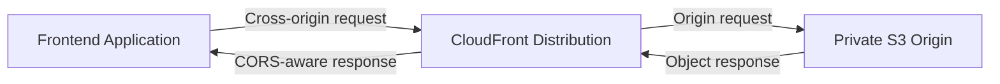

# 01- Cross-Origin Resource Sharing (CORS)

## Overview

Cross-Origin Resource Sharing (CORS) is a browser security mechanism that controls whether a web application loaded from one origin can access resources hosted on another origin.

In an Amazon S3 architecture, CORS is particularly important when a frontend hosted on a different domain needs to upload files directly to S3, download private documents using presigned URLs, display images, or access objects through an S3 endpoint.

For example, consider a React application hosted at `https://app.example.com` that uploads files to a private S3 bucket. The browser treats the frontend and the S3 endpoint as different origins and applies its cross-origin security rules.

S3 must have an appropriate CORS configuration for the browser to permit the frontend's cross-origin request. However, CORS does not grant IAM permissions, make private objects public, or replace application authorization.

This document explains how S3 CORS works, how to configure it, and how to troubleshoot cross-origin failures in production.

## What Is an Origin?

An origin consists of three components:

- Scheme, such as `https`.
- Hostname, such as `app.example.com`.
- Port, such as `443` for HTTPS.

Two URLs have the same origin only when these components match.

| Frontend origin | S3 or API origin | Cross-origin? |
|---|---|---|
| `https://app.example.com` | `https://app.example.com` | No |
| `https://app.example.com` | `https://api.example.com` | Yes |
| `https://app.example.com` | `https://bucket.s3.us-east-1.amazonaws.com` | Yes |
| `http://localhost:3000` | `https://bucket.s3.us-east-1.amazonaws.com` | Yes |
| `https://app.example.com` | `http://app.example.com` | Yes |
| `https://app.example.com` | `https://app.example.com:8443` | Yes |

CORS is relevant when browser JavaScript accesses resources across origins. Server-to-server requests made by Django, FastAPI, Celery, or a command-line client are not restricted by the browser's CORS enforcement.

## Why Amazon S3 Needs CORS

Consider this architecture:



The backend authorizes the upload and generates a presigned URL. The browser then uploads the file directly to S3.

This architecture avoids sending the entire file through the backend application server, reducing API-worker bandwidth consumption and making large uploads more scalable.

Because the browser and S3 have different origins, the bucket must permit the intended browser request through its CORS configuration.

Without an appropriate CORS response, the browser may block JavaScript from accessing the response even when the underlying storage operation would otherwise be authorized.

## How CORS Works

CORS involves the browser, the requesting frontend, and the resource server. For S3, the resource server evaluates its bucket CORS configuration and returns the applicable CORS response headers.

There are two main request patterns.

### Simple Cross-Origin Requests

Some cross-origin requests can be sent without a preflight request. The browser sends the actual request and evaluates the response's CORS headers before exposing the response to JavaScript.

For example, a browser might request an image using a cross-origin `GET` request.

Whether a request qualifies as a simple request depends on its HTTP method, headers, and content type under the browser's CORS rules.

### Preflight Requests

A browser typically sends a preflight request before a cross-origin request that does not qualify as simple, such as a `PUT` upload or a request using certain custom headers.

The browser sends an HTTP `OPTIONS` request containing headers such as:

```http
OPTIONS /uploads/document.pdf HTTP/1.1
Host: example-bucket.s3.us-east-1.amazonaws.com
Origin: https://app.example.com
Access-Control-Request-Method: PUT
Access-Control-Request-Headers: content-type,x-amz-checksum-sha256
```

S3 evaluates the request against the bucket's CORS rules.

A successful preflight response may contain:

```http
HTTP/1.1 200 OK
Access-Control-Allow-Origin: https://app.example.com
Access-Control-Allow-Methods: GET, PUT, HEAD
Access-Control-Allow-Headers: content-type, x-amz-checksum-sha256
Access-Control-Max-Age: 3600
```

The browser can then send the actual request, provided the preflight succeeds and all other request requirements are satisfied.

**Important:** `OPTIONS` is the method used for the browser's preflight request. It is not a value you add to S3's `AllowedMethods` list. Configure the actual method the browser intends to use, such as `PUT` or `GET`.

S3 evaluates CORS rules and uses the first rule that matches the incoming browser request. The requested origin, method, and headers must satisfy that rule.

See the [official Amazon S3 CORS documentation](https://docs.aws.amazon.com/AmazonS3/latest/userguide/cors.html).

## S3 CORS Configuration Structure

S3 stores CORS configuration at the bucket level. A configuration contains one or more rules defining allowed origins, methods, request headers, exposed response headers, and preflight caching duration.

A general JSON structure looks like this:

```json
{
  "CORSRules": [
    {
      "ID": "frontend-file-access",
      "AllowedOrigins": [
        "https://app.example.com"
      ],
      "AllowedMethods": [
        "GET",
        "PUT",
        "HEAD"
      ],
      "AllowedHeaders": [
        "content-type",
        "x-amz-*"
      ],
      "ExposeHeaders": [
        "ETag",
        "x-amz-version-id"
      ],
      "MaxAgeSeconds": 3600
    }
  ]
}
```

The S3 console expects JSON for bucket CORS configuration. General-purpose S3 buckets support up to 100 CORS rules.

### Configuration Properties

| Property | Purpose | Example |
|---|---|---|
| `ID` | Optional identifier for a rule | `frontend-file-access` |
| `AllowedOrigins` | Origins permitted to make cross-origin requests | `https://app.example.com` |
| `AllowedMethods` | Actual HTTP methods permitted by the rule | `GET`, `PUT`, `HEAD` |
| `AllowedHeaders` | Request headers permitted during preflight | `content-type`, `x-amz-*` |
| `ExposeHeaders` | Response headers accessible to frontend JavaScript | `ETag`, `x-amz-version-id` |
| `MaxAgeSeconds` | Time the browser can cache the preflight result, in seconds | `3600` |

`AllowedOrigins` and `AllowedMethods` are required for a rule. Other properties are optional.

See the [S3 CORS rule reference](https://docs.aws.amazon.com/AmazonS3/latest/userguide/ManageCorsUsing.html).

## Configuring Allowed Origins

An origin must match the browser's `Origin` header.

For example:

```json
{
  "AllowedOrigins": [
    "https://app.example.com",
    "https://admin.example.com"
  ]
}
```

This allows requests from the two specified HTTPS origins when the other CORS rule conditions are satisfied.

### Development and Production Origins

Development environments frequently use a local frontend server.

A development configuration might allow:

```json
{
  "AllowedOrigins": [
    "http://localhost:3000",
    "http://localhost:5173"
  ]
}
```

These origins should normally be restricted to a development bucket or development environment.

A production configuration should specify the actual production origins:

```json
{
  "AllowedOrigins": [
    "https://app.example.com"
  ]
}
```

Do not add `http://localhost:3000` to a production bucket simply because local development requires it. Separate environments make CORS policies easier to review and reduce accidental exposure.

### Wildcard Origins

A wildcard permits any origin:

```json
{
  "AllowedOrigins": [
    "*"
  ]
}
```

Wildcard origins can be appropriate for intentionally public resources, such as public fonts or assets, when unrestricted browser access is part of the design.

They are usually unnecessary for private file uploads and downloads.

S3 also supports a single wildcard character in an origin pattern, for example:

```json
{
  "AllowedOrigins": [
    "https://*.example.com"
  ]
}
```

Use narrowly scoped origins in production whenever the set of permitted frontends is known.

## Configuring Allowed Methods

S3 supports the following values in `AllowedMethods`:

| Method | Common use |
|---|---|
| `GET` | Download objects or retrieve content |
| `PUT` | Upload or replace objects |
| `POST` | Form-based uploads and supported POST operations |
| `DELETE` | Delete objects |
| `HEAD` | Retrieve object metadata without downloading the full object |

Allow only methods required by the application.

For a direct-upload architecture, `PUT` may be sufficient for uploads, while `GET` and `HEAD` may be needed for download and metadata workflows.

Do not add `DELETE` simply because the backend supports object deletion. If the browser never performs a cross-origin DELETE request, the method is unnecessary in that CORS rule.

CORS method permission does not authorize the underlying S3 operation. IAM policies, bucket policies, KMS permissions, and other applicable controls continue to govern access.

## Configuring Allowed Headers

Browser preflight requests include the headers the browser intends to send using `Access-Control-Request-Headers`.

S3 checks these headers against `AllowedHeaders`.

Common examples include:

| Header | Reason it may be needed |
|---|---|
| `content-type` | Declares the uploaded file's media type |
| `authorization` | Used by certain authenticated request patterns |
| `x-amz-*` | Covers matching S3-specific headers |
| `x-amz-checksum-sha256` | Used when an upload includes a checksum header |
| `x-amz-server-side-encryption` | Used when the request explicitly specifies supported encryption options |
| `if-match` | Used for certain conditional requests |

An application may need additional headers depending on the signing configuration and the request it sends.

For example, if a presigned upload is generated with a required `Content-Type`, the frontend must send the expected value and the CORS rule must permit that header.

A broader configuration might use:

```json
{
  "AllowedHeaders": [
    "content-type",
    "x-amz-*"
  ]
}
```

The wildcard pattern is useful for multiple S3-specific request headers. However, do not assume this covers every non-S3 custom header used by a frontend.

Using `"*"` in `AllowedHeaders` is possible, but explicitly listing required headers often makes production configurations easier to audit.

## Exposing Response Headers

Browsers do not expose every response header to frontend JavaScript by default.

If the frontend needs to read a response header from S3, configure it under `ExposeHeaders`.

For example:

```json
{
  "ExposeHeaders": [
    "ETag",
    "x-amz-version-id"
  ]
}
```

This can be useful for upload workflows in which the application needs the S3 response's ETag or object version ID.

Exposing a response header does not change the object or make it publicly accessible. It only allows browser JavaScript to read that response header when the CORS request otherwise succeeds.

An ETag should not universally be treated as a SHA-256 checksum. Its meaning depends on the upload and encryption circumstances.

## MaxAgeSeconds and Preflight Caching

`MaxAgeSeconds` specifies how long the browser can cache a successful preflight result.

For example:

```json
{
  "MaxAgeSeconds": 3600
}
```

This allows compatible browsers to cache the preflight result for up to one hour, subject to their own caching behavior.

Benefits include:

- Fewer repeated preflight requests.
- Reduced request overhead for applications that repeatedly access S3.
- Improved efficiency for frontend workloads involving frequent cross-origin uploads.

A longer cache duration may delay the effect of a changed CORS policy in browsers with an existing cached preflight result.

Choose a duration that balances efficiency and policy-change responsiveness. Do not treat the preflight cache as authorization or as a way to control the lifetime of a presigned URL.

## Production CORS Configuration for Direct Uploads

Consider a frontend at `https://app.example.com` that receives a presigned S3 upload URL from a FastAPI or Django backend.

The application uploads files using HTTP `PUT`. The browser sends `Content-Type` and may send an S3 checksum header.

A production-oriented bucket configuration could be:

```json
{
  "CORSRules": [
    {
      "ID": "production-web-upload",
      "AllowedOrigins": [
        "https://app.example.com"
      ],
      "AllowedMethods": [
        "PUT",
        "GET",
        "HEAD"
      ],
      "AllowedHeaders": [
        "content-type",
        "x-amz-checksum-*"
      ],
      "ExposeHeaders": [
        "ETag",
        "x-amz-version-id"
      ],
      "MaxAgeSeconds": 3600
    }
  ]
}
```

This is an example, not a universal policy. Adjust the origin, methods, and headers to match the actual browser request and the signed upload parameters.

If the frontend also downloads objects, ensure the rule supports the required download method. If it uses different request headers, add the necessary headers explicitly.

### Why This Configuration Is Narrow

The configuration:

- Permits only the production frontend origin.
- Enables only the methods used by the frontend.
- Allows expected content and checksum headers.
- Exposes only response headers needed by JavaScript.
- Caches successful preflight responses for a reasonable duration.

It does not grant anonymous S3 access, authorize every tenant, or bypass bucket policies.

## Applying CORS with the AWS CLI

Store the configuration in a file named `cors.json`.

### Apply the Configuration

```bash
aws s3api put-bucket-cors \
  --bucket company-file-storage-prod \
  --cors-configuration file://cors.json \
  --region us-east-1
```

This operation replaces the bucket's existing CORS configuration. Review existing rules before applying a replacement to avoid unintentionally removing required cross-origin access.

### Inspect the Current Configuration

```bash
aws s3api get-bucket-cors \
  --bucket company-file-storage-prod \
  --region us-east-1
```

Use this command to verify that the expected rules are present.

### Remove the CORS Configuration

```bash
aws s3api delete-bucket-cors \
  --bucket company-file-storage-prod \
  --region us-east-1
```

Removing the configuration disables bucket CORS behavior. Browser-based cross-origin requests that depend on it may stop working.

Treat this command as a configuration change requiring impact assessment in production.

### Required Permissions

The identity applying a CORS configuration needs `s3:PutBucketCORS`.

The identity inspecting the configuration needs `s3:GetBucketCORS`, and removing the configuration requires `s3:PutBucketCORS` authorization for the deletion operation.

Do not grant these permissions to ordinary application roles unless the application genuinely needs to manage bucket configuration. CORS changes are generally administrative infrastructure changes.

## Using S3 CORS with Presigned URLs

Presigned URLs let a backend authorize a specific S3 operation without giving the client AWS credentials.

A common upload lifecycle is:

1. The frontend requests upload authorization from the backend.
2. The backend authenticates the user and checks application-level permissions.
3. The backend generates a presigned PUT URL for a server-controlled S3 key.
4. The frontend sends a cross-origin request directly to S3.
5. S3 evaluates request signing, permissions, and other applicable controls.
6. S3 returns a response containing CORS headers when a matching rule permits the request.
7. The frontend processes the response if the browser's CORS checks succeed.

### Example Browser Upload

```javascript
async function uploadFile(file, uploadUrl) {
  const response = await fetch(uploadUrl, {
    method: "PUT",
    headers: {
      "Content-Type": file.type
    },
    body: file
  });

  if (!response.ok) {
    throw new Error(`S3 upload failed with status ${response.status}`);
  }

  return {
    etag: response.headers.get("ETag")
  };
}
```

This example assumes the URL was generated for a PUT request and that the signed headers match the headers sent by the client. The bucket's CORS rule must permit the frontend origin, `PUT`, and the `Content-Type` request header.

If the backend signed a checksum or other required header, the browser must include it as expected by the signing configuration.

### Presigned URLs Are Not CORS Permissions

A valid presigned URL grants temporary access to the signed operation, subject to applicable policies and conditions. CORS determines whether browser JavaScript can make the cross-origin request and access its response.

The two controls solve different problems:

| Concern | Presigned URL and AWS authorization | CORS |
|---|---|---|
| Authorizes the S3 operation | Yes, subject to applicable policies | No |
| Controls browser cross-origin response access | No | Yes |
| Makes private objects public | No | No |
| Controls the signed operation's validity | Yes | No |
| Restricts permitted browser origins | Not inherently | Yes |

A request can be authorized by S3 yet fail in a browser because its CORS response does not match the request. Conversely, a CORS rule can match while the actual S3 operation fails with `AccessDenied`.

See [Using presigned URLs with Amazon S3](https://docs.aws.amazon.com/AmazonS3/latest/userguide/using-presigned-url.html).

## CORS with CloudFront

If a frontend accesses content through CloudFront rather than the regional S3 endpoint, evaluate CORS across the complete delivery path.

For example:



The correct configuration depends on whether S3, CloudFront, or an application endpoint generates the relevant CORS response headers.

Important considerations include:

- The CORS policy configured on the S3 bucket.
- CloudFront cache behavior and cached response headers.
- Origin request policy and cache policy configuration.
- Whether CloudFront forwards the relevant `Origin` header.
- Whether preflight requests are supported by the distribution's cache behavior.
- Whether the frontend requires specific response headers to be exposed.

A cached response generated for one origin should not accidentally be reused for another origin when the response varies by origin. Configure cache behavior and origin handling consistently with the CORS policy.

When CloudFront serves a private S3 origin through Origin Access Control (OAC), keep the bucket private. OAC provides CloudFront-to-S3 origin access control; it does not by itself authorize frontend users to view private content.

Do not duplicate CORS configurations blindly across S3 and CloudFront. Determine which layer handles the request and response, then test the complete browser path.

## CORS and Authentication

CORS is sometimes confused with authentication and authorization because browser errors often occur while accessing protected resources.

However, CORS is not a substitute for authentication.

A typical architecture may use:

- An access token to authenticate the frontend user to the backend.
- Application authorization to determine which file the user may access.
- A presigned URL to grant temporary access to a specific S3 operation.
- CORS configuration to allow the permitted browser origin to issue the cross-origin request.

For direct S3 presigned-URL requests, the frontend normally does not need to send the backend's `Authorization` header to S3 unless the application has deliberately designed a request that requires it. The presigned URL already carries the signed request authorization information.

Do not enable every origin and header to resolve an authentication problem. A CORS policy should reflect the actual browser request, while authentication and resource authorization remain separate controls.

## Testing S3 CORS

Testing should distinguish CORS-rule behavior from ordinary S3 authorization.

### Inspect the Configuration

Retrieve the bucket's CORS configuration:

```bash
aws s3api get-bucket-cors \
  --bucket company-file-storage-prod
```

Verify the origin, method, and request headers against the frontend request.

### Test a Preflight Request

Use `curl` to send a representative OPTIONS request:

```bash
curl -i -X OPTIONS \
  "https://company-file-storage-prod.s3.us-east-1.amazonaws.com/uploads/test.pdf" \
  -H "Origin: https://app.example.com" \
  -H "Access-Control-Request-Method: PUT" \
  -H "Access-Control-Request-Headers: content-type,x-amz-checksum-sha256"
```

Replace the bucket endpoint, Region, object path, origin, method, and headers with values that reflect the actual request.

Inspect whether the response contains the expected `Access-Control-Allow-Origin`, `Access-Control-Allow-Methods`, and `Access-Control-Allow-Headers` values.

This request tests the preflight response. It does not verify that a subsequent upload is authorized or that its signature is valid.

### Test the Actual Browser Request

After the preflight succeeds, test the actual operation using a valid presigned URL or another authorized access method.

Verify:

- The request uses the expected HTTP method.
- Required signed headers match the request.
- The actual S3 operation succeeds.
- JavaScript can access any response headers the application needs.
- The browser console shows no CORS errors.

A successful `curl` request does not prove that browser access works. `curl` does not enforce the browser's CORS security model; it is useful for inspecting the server response but cannot reproduce the browser's enforcement behavior.

The final verification should use the actual frontend running at its intended origin.

## Troubleshooting CORS Failures

Diagnose CORS failures using the request and response rather than changing the bucket policy blindly.

### Browser Reports That the Request Was Blocked by CORS

**Symptoms**

- The browser console reports a missing or incorrect `Access-Control-Allow-Origin` header.
- JavaScript cannot read the response.
- The network request may show a response from S3, but the frontend reports a CORS error.

**Likely causes**

- The frontend origin is missing from `AllowedOrigins`.
- The scheme, hostname, or port does not match.
- The CORS rule does not permit the requested method.
- The response was generated through a different endpoint or delivery layer.
- CloudFront is serving an unsuitable cached response.

**Diagnosis**

1. Inspect the browser's `Origin` header.
2. Inspect the endpoint hostname.
3. Compare the origin, method, and required headers with the configured rule.
4. Inspect the response headers returned by S3 or CloudFront.
5. If CloudFront is involved, test the complete CloudFront URL and its origin behavior.

**Correction**

Update the matching CORS rule with the intended origin, method, or relevant header, then test again.

### Preflight Request Returns 403

**Symptoms**

- The browser sends `OPTIONS`.
- The preflight response is `403 Forbidden`.
- The actual `PUT` or other intended operation is never sent by the browser.

**Likely causes**

- No CORS configuration exists.
- The first matching rule does not permit the origin, requested method, or requested headers.
- The request reaches an unexpected endpoint.

**Diagnosis**

1. Inspect the bucket CORS configuration.
2. Reproduce the preflight with `curl`.
3. Compare `Access-Control-Request-Method` with `AllowedMethods`.
4. Compare `Access-Control-Request-Headers` with `AllowedHeaders`.
5. Confirm that the request reaches the intended bucket or CloudFront behavior.

**Correction**

Update the appropriate rule and verify that it matches the complete request. Remember that `OPTIONS` is the preflight mechanism; add the actual requested method, such as `PUT`, to `AllowedMethods`.

### S3 Returns AccessDenied

**Symptoms**

- The actual request fails with an S3 authorization error.
- The frontend may also display a CORS-related message if the error response lacks the expected CORS headers.

**Likely causes**

- The IAM principal that signed the request lacks the required permission.
- A bucket policy or other applicable control denies the operation.
- The presigned URL is invalid, expired, or inconsistent with the request.
- A required KMS permission is missing for customer-managed encryption.

**Diagnosis**

1. Inspect the HTTP status and S3 error response.
2. Verify the IAM principal that generated the presigned URL.
3. Confirm that the signed method, object key, and headers match the request.
4. Inspect bucket and IAM policies.
5. If SSE-KMS is involved, inspect the relevant key policy and permissions.

**Correction**

Resolve the underlying authorization or signing issue separately from CORS. Do not grant public access to the bucket as a workaround.

### Upload Works but JavaScript Cannot Read ETag

**Symptoms**

- The browser reports an upload response, but `response.headers.get("ETag")` returns `null`.
- The upload itself may have succeeded.

**Likely cause**

The response header is not listed in `ExposeHeaders`.

**Correction**

Add `ETag` to the rule's `ExposeHeaders`, apply the updated configuration, and test from the browser again.

### Changes Do Not Appear to Take Effect

**Possible causes**

- The wrong bucket or Region was updated.
- The CORS configuration was replaced with an incomplete configuration.
- The browser cached an earlier successful preflight result.
- A CloudFront layer is serving a cached response.
- The application is sending a different origin or set of headers than expected.

**Correction**

Retrieve the active S3 configuration, verify the endpoint, inspect browser network activity, and test preflight responses directly. Account for browser preflight caching and CloudFront caching where applicable.

For additional diagnostics, consult the [official S3 CORS troubleshooting guide](https://docs.aws.amazon.com/AmazonS3/latest/userguide/cors-troubleshooting.html).

## Security and Production Best Practices

Use the following principles when configuring CORS for production applications:

- Allow only the frontend origins that require access.
- Prefer HTTPS origins for production.
- Restrict methods to actual frontend operations.
- Specify the request headers the browser needs rather than allowing arbitrary headers by default.
- Expose response headers only when frontend JavaScript needs them.
- Keep S3 buckets private and preserve Block Public Access where appropriate.
- Treat CORS, IAM authorization, bucket policies, and KMS permissions as separate controls.
- Keep presigned URLs short-lived and avoid logging their full query strings.
- Use environment-specific CORS configurations for development, staging, and production.
- Validate CORS through the actual browser request, not only through successful command-line requests.
- Review the impact of CORS configuration changes because `PutBucketCors` replaces the existing configuration.
- Test CloudFront caching and response headers when CloudFront participates in the delivery path.

## Further Reading

- [Using Cross-Origin Resource Sharing (CORS)](https://docs.aws.amazon.com/AmazonS3/latest/userguide/cors.html)
- [Elements of an S3 CORS Configuration](https://docs.aws.amazon.com/AmazonS3/latest/userguide/ManageCorsUsing.html)
- [Configuring CORS for Amazon S3](https://docs.aws.amazon.com/AmazonS3/latest/userguide/enabling-cors-examples.html)
- [Testing Amazon S3 CORS](https://docs.aws.amazon.com/AmazonS3/latest/userguide/testing-cors.html)
- [Troubleshooting Amazon S3 CORS](https://docs.aws.amazon.com/AmazonS3/latest/userguide/cors-troubleshooting.html)
- [Presigned URLs for Amazon S3](https://docs.aws.amazon.com/AmazonS3/latest/userguide/using-presigned-url.html)

## Key Takeaways

- S3 CORS controls whether browser JavaScript can make permitted cross-origin requests and access their responses; it does not grant S3 permissions.
- Configure `AllowedOrigins`, `AllowedMethods`, and `AllowedHeaders` to match the actual browser request, including preflight behavior.
- Direct uploads using presigned URLs still require correct S3 authorization, matching signed headers, and an appropriate CORS rule.
- Use restrictive production origins, expose only necessary response headers, and keep buckets private.
- Troubleshoot CORS by inspecting the actual origin, method, request headers, response headers, and underlying S3 error rather than weakening authorization controls.