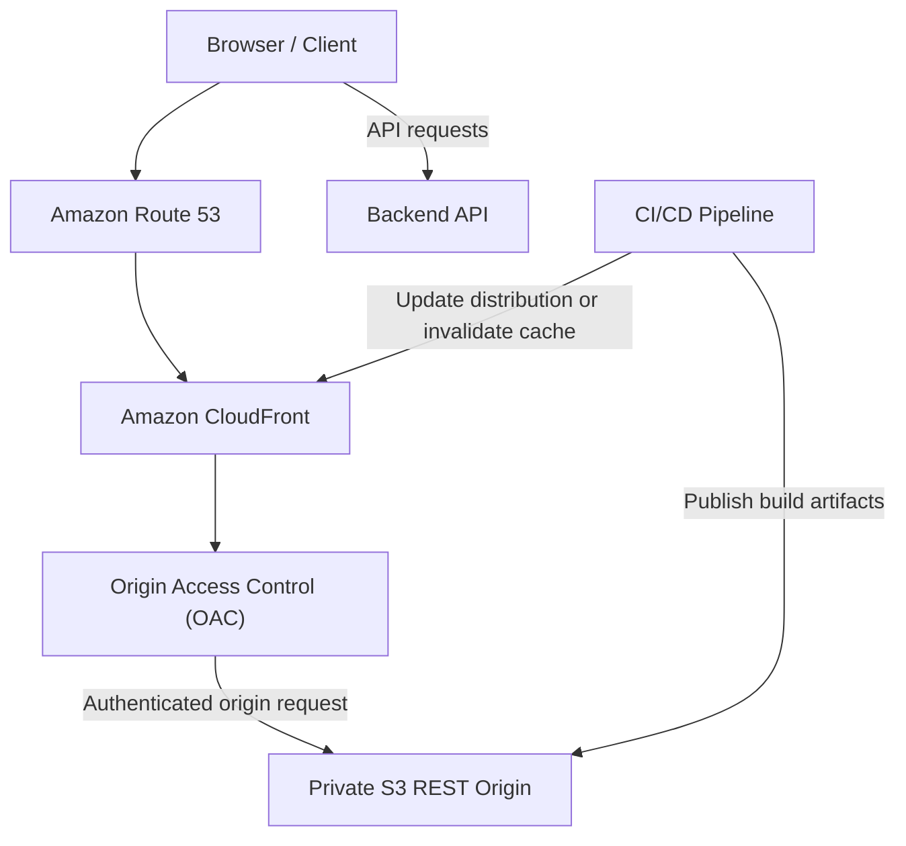
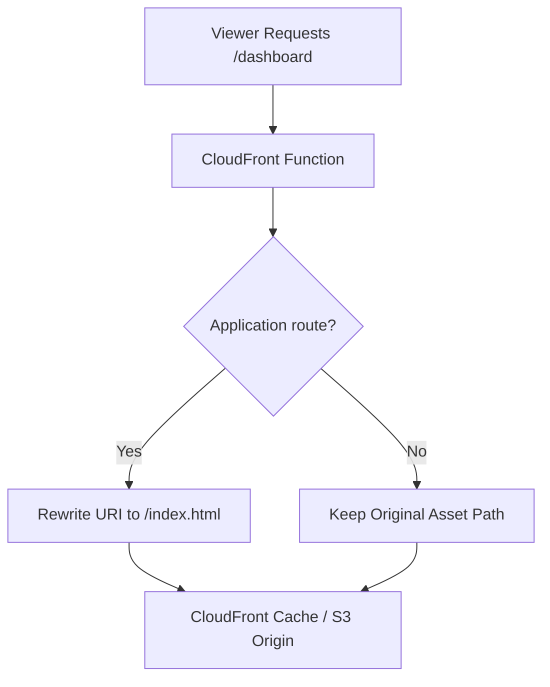
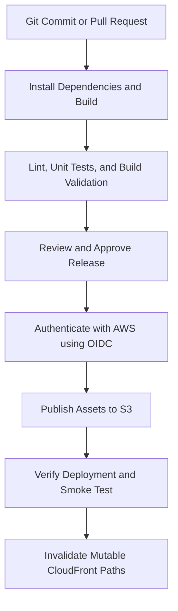

# 02- Static Website Hosting

## Overview

Amazon S3 can store static website assets such as HTML, CSS, JavaScript, images, fonts, and downloadable files. Combined with Amazon CloudFront, it provides a scalable architecture for delivering frontend applications without maintaining web servers solely to serve static content.

Typical use cases include:

- React, Vue, Angular, and other single-page applications (SPAs).
- Documentation sites and engineering portals.
- Marketing websites and landing pages.
- Static dashboards and frontend applications for backend APIs.
- Downloadable public assets and versioned frontend releases.

For production workloads, the recommended architecture is generally **a private S3 bucket behind Amazon CloudFront using Origin Access Control (OAC)**. CloudFront provides HTTPS, caching, edge delivery, custom-domain support, and controlled access to the S3 origin.

S3 also supports native static website hosting through a website endpoint. That approach has different security and networking characteristics and is not equivalent to using an S3 REST API endpoint as a CloudFront origin.

This document covers both approaches, explains their trade-offs, and provides practical configuration, deployment, verification, and troubleshooting guidance.

## Static Website Hosting Architecture

A static website separates asset storage from content delivery.

S3 stores the files, CloudFront caches and delivers them, and Amazon Route 53 optionally maps a custom domain to the CloudFront distribution. AWS Certificate Manager (ACM) provides the TLS certificate for HTTPS.

### Recommended Production Architecture



The frontend and backend can be deployed independently. CloudFront serves static assets, while API requests can be routed to an API Gateway, an Application Load Balancer, or another suitable backend endpoint.

### Request Flow

1. A user requests `https://app.example.com`.
2. Route 53 resolves the custom domain to the CloudFront distribution.
3. CloudFront checks its cache for the requested asset.
4. On a cache miss, CloudFront retrieves the object from the S3 REST origin using OAC.
5. S3 returns the object to CloudFront.
6. CloudFront caches the response according to the applicable cache policy and response headers.
7. The browser renders the website and requests additional JavaScript, CSS, and image assets.

The S3 bucket remains private. Users access the published website through CloudFront rather than directly accessing the origin.

## Choose the Correct S3 Endpoint

Amazon S3 exposes different endpoint types for different purposes. Choosing the wrong endpoint is a common source of hosting and permission problems.

### S3 REST Endpoint

An S3 REST endpoint accesses bucket and object APIs.

Example:

```text
https://company-web-prod.s3.us-east-1.amazonaws.com/index.html
```

When used with CloudFront OAC, CloudFront signs origin requests and the bucket policy restricts access to the intended distribution.

**Use this approach for new production websites where private-origin security is required.**

The bucket does not need S3 static website hosting enabled. It simply stores the website build artifacts.

### S3 Website Endpoint

An S3 website endpoint serves content using the S3 static website hosting feature.

Its hostname follows a website-endpoint format, such as:

```text
http://company-web-prod.s3-website-us-east-1.amazonaws.com
```

The precise endpoint format depends on the AWS Region.

Website endpoints support website-specific behavior such as index documents, error documents, and redirect rules. However, they support HTTP only and cannot be protected using CloudFront OAC or the legacy Origin Access Identity (OAI).

When CloudFront uses an S3 website endpoint, it treats that endpoint as a custom origin. This generally requires publicly accessible website content.

### Endpoint Comparison

| Capability | S3 REST origin with CloudFront OAC | S3 website endpoint |
|---|---|---|
| Public S3 access required | No | Usually yes for the website content |
| HTTPS at the viewer | Yes, through CloudFront | No, not directly at the S3 website endpoint |
| CloudFront OAC support | Yes | No |
| S3 website index-document behavior | Not automatically | Yes |
| S3 website error-document behavior | Not automatically | Yes |
| Website redirect rules | Must be implemented at the appropriate delivery layer | Supported by S3 website hosting |
| Recommended for private production origin | Yes | No |
| Typical use | Secure production website with CloudFront | Simple website endpoint or legacy compatibility |

**Important:** Native S3 static website hosting and private S3 hosting through CloudFront are different configurations. Do not configure a website endpoint as the origin when the architecture relies on OAC.

References:
- [S3 website hosting](https://docs.aws.amazon.com/AmazonS3/latest/userguide/WebsiteHosting.html)
- [CloudFront access to an S3 origin](https://docs.aws.amazon.com/AmazonCloudFront/latest/DeveloperGuide/private-content-restricting-access-to-s3.html)

## Configure a Private S3 Origin with CloudFront

### Create the S3 Bucket

Create a bucket in the intended Region.

```bash
aws s3api create-bucket \
  --bucket company-web-prod \
  --region us-east-1
```

For Regions other than `us-east-1`, supply the appropriate `--create-bucket-configuration LocationConstraint=...` option.

Keep S3 Block Public Access enabled. New general-purpose buckets normally have Block Public Access enabled by default, but production infrastructure should explicitly manage and verify the required settings.

Enable versioning when release recovery and object-history retention are useful:

```bash
aws s3api put-bucket-versioning \
  --bucket company-web-prod \
  --versioning-configuration Status=Enabled \
  --region us-east-1
```

Versioning is not mandatory for CloudFront OAC. It can, however, help recover previously published objects after an accidental overwrite.

### Upload the Website Assets

Assume the production build generates a directory named `dist/`.

```bash
aws s3 sync dist/ s3://company-web-prod/ \
  --region us-east-1
```

This copies the local build artifacts to S3.

The build directory might contain:

```text
dist/
    index.html
    assets/
        app.a81f3c.js
        app.1d920e.css
    images/
        logo.svg
    favicon.ico
```

The frontend build should reference the correct asset paths for the site's intended base URL.

Before deploying, inspect the generated `index.html` and confirm that its JavaScript, CSS, and image URLs match the configured hosting path.

### Create a CloudFront Origin Access Control

Configure an Origin Access Control with:

- Origin type: S3.
- Signing behavior: Always sign origin requests.
- Signing protocol: SigV4.

The OAC allows CloudFront to authenticate its requests to the private bucket.

With OAC and an S3 REST origin, communication between CloudFront and S3 can use authenticated origin requests without making the bucket public.

### Restrict S3 Access to CloudFront

After creating the CloudFront distribution, add a bucket policy that grants the CloudFront service principal read access only through the intended distribution.

Example policy:

```json
{
  "Version": "2012-10-17",
  "Statement": [
    {
      "Sid": "AllowCloudFrontReadOnly",
      "Effect": "Allow",
      "Principal": {
        "Service": "cloudfront.amazonaws.com"
      },
      "Action": "s3:GetObject",
      "Resource": "arn:aws:s3:::company-web-prod/*",
      "Condition": {
        "StringEquals": {
          "AWS:SourceArn": "arn:aws:cloudfront::123456789012:distribution/EXAMPLE123456"
        }
      }
    }
  ]
}
```

Replace the account ID, distribution ID, and bucket name with the actual resources.

This policy grants read access to objects for the specified distribution. It does not grant deployment permissions to the CI/CD pipeline, and it does not enable anonymous access.

The deployment role must have the appropriate S3 write permissions separately.

For production, manage the bucket policy through infrastructure as code so that the intended distribution boundary is reproducible and reviewable.

### Configure the CloudFront Distribution

The origin should use the S3 REST endpoint for the bucket, not the website endpoint.

Typical settings include:

| Setting | Recommended configuration |
|---|---|
| Origin domain | Regional S3 REST endpoint |
| Origin access | OAC with signed requests |
| Default root object | `index.html` |
| Viewer protocol policy | Redirect HTTP to HTTPS |
| Allowed methods for a static origin | `GET` and `HEAD`, unless other methods are genuinely required |
| Compress objects automatically | Enabled where appropriate |
| Default behavior | Cache static assets according to their cache policy |
| Custom error behavior | Configure only when the application routing requirements justify it |
| TLS certificate | ACM certificate covering the custom domain, when using a custom domain |

The CloudFront default root object handles requests for the distribution root. It does not automatically solve every single-page application route.

## Custom Domain and HTTPS

For a production website, a custom domain such as `app.example.com` is commonly used instead of the default CloudFront domain.

### Configure ACM

Request or import a TLS certificate through AWS Certificate Manager.

For a CloudFront viewer certificate, the ACM certificate must be in **US East (N. Virginia), `us-east-1`**, even if the S3 bucket and application operate in another Region.

The certificate must cover the configured CloudFront alternate domain name.

For example:

```text
app.example.com
```

After the certificate has been validated, associate it with the CloudFront distribution and configure the distribution's alternate domain name.

### Configure Route 53

If the domain is managed by Route 53:

1. Open the hosted zone for the domain.
2. Create an A record with Alias enabled.
3. Select the CloudFront distribution as the alias target.
4. Create an AAAA alias record when IPv6 is enabled and required.

The DNS record should resolve to CloudFront rather than the S3 bucket endpoint.

Route 53 is not mandatory. An external DNS provider can also direct the custom domain to the distribution.

### Viewer and Origin HTTPS

There are two distinct connections:

- **Viewer-to-CloudFront:** Use HTTPS for the public website.
- **CloudFront-to-S3:** Use authenticated OAC origin requests. With OAC configured to always sign requests, communication between CloudFront and an S3 REST origin uses HTTPS.

The two connections should be considered independently when diagnosing certificate errors or connectivity failures.

Reference: [Using custom domain names and HTTPS with CloudFront](https://docs.aws.amazon.com/AmazonCloudFront/latest/DeveloperGuide/using-https-alternate-domain-names.html).

## SPA Routing and Deep Links

Single-page applications often use client-side routes such as:

```text
/dashboard
/settings/profile
/reports/monthly
```

The browser loads the frontend application, and the JavaScript router renders the requested view.

If CloudFront requests an S3 object named `dashboard`, S3 may return `403` or `404` because no object exists at that key. The browser then fails to load the application route even though the corresponding frontend view exists.

### Default Root Object Limitation

Setting the CloudFront default root object to `index.html` handles a root request such as:

```text
https://app.example.com/
```

It does not rewrite every nested URL to `index.html`.

### Recommended Solution: Rewrite Application Routes

A CloudFront Function can rewrite eligible application routes to `/index.html` at the viewer-request stage.

Conceptual flow:



A simple illustrative JavaScript function is:

```javascript
function handler(event) {
    var request = event.request;
    var uri = request.uri;

    // Preserve requests for static files and assets.
    if (uri.includes(".")) {
        return request;
    }

    // Rewrite extensionless application routes.
    request.uri = "/index.html";
    return request;
}
```

This example assumes the application routes do not use extensionless static resources. Adapt it to the site's routing conventions, deployment prefix, and reserved paths.

A production implementation should explicitly handle application routes, static asset paths, reserved endpoints, and any base-path requirements.

### Alternative: Custom Error Responses

CloudFront custom error responses can map S3 origin errors to `/index.html`. This may be useful for simple SPAs, but blanket mappings of `403` or `404` responses can hide genuine missing assets or permission errors.

If a JavaScript file is missing and its `403` or `404` response is replaced with `index.html`, the browser may receive HTML where JavaScript was expected.

Use error-response mappings only when their behavior is understood and tested. A route-aware rewrite is often more precise for modern SPAs.

## Cache Strategy

Caching determines how quickly website changes reach users and how efficiently CloudFront serves requests.

A good design distinguishes between:

- HTML entry documents.
- Fingerprinted static assets.
- Stable public files.
- Objects whose content changes without changing their URLs.

### Recommended Cache Policy

| Asset type | Example | Typical cache strategy |
|---|---|---|
| HTML entry document | `index.html` | Short-lived caching or revalidation |
| Fingerprinted JavaScript | `app.a81f3c.js` | Long-lived immutable caching |
| Fingerprinted CSS | `app.1d920e.css` | Long-lived immutable caching |
| Versioned images | `logo.v3.svg` | Long-lived immutable caching |
| Mutable public file | `robots.txt` | Short TTL or revalidation |
| Source maps | `app.a81f3c.js.map` | Publish only when needed; restrict access where appropriate |

A common strategy is to publish versioned asset filenames and keep the HTML entry document short-lived.

Example cache headers:

```http
# HTML entry document
Cache-Control: no-cache, max-age=0, must-revalidate

# Fingerprinted assets
Cache-Control: public, max-age=31536000, immutable
```

`no-cache` permits storage but requires revalidation before reuse, whereas `no-store` instructs caches not to store the response. Choose the directive that matches the site's delivery and security requirements.

Set object metadata correctly during deployment, and configure CloudFront cache policies consistently with the intended behavior.

### Invalidation Versus Versioned Filenames

CloudFront supports invalidating cached paths, but invalidation is not always the best release mechanism.

**Versioned assets** change the URL whenever the content changes. This makes release behavior predictable and reduces dependence on invalidations for frequently changing files.

Invalidation is still useful for mutable paths such as `index.html` or when an immediate cache refresh is required.

Example:

```bash
aws cloudfront create-invalidation \
  --distribution-id EXAMPLE123456 \
  --paths "/index.html"
```

For a simple deployment, an invalidation of selected mutable paths is often preferable to invalidating every asset. Large invalidation requests and frequent invalidation workflows should be evaluated against the deployment and caching design.

See [Invalidating files in CloudFront](https://docs.aws.amazon.com/AmazonCloudFront/latest/DeveloperGuide/Invalidation.html).

## Security Headers and Browser Protection

CloudFront can attach a response headers policy to a cache behavior. This is useful for applying consistent browser security headers without modifying every file.

Depending on application requirements, consider:

- `Strict-Transport-Security` for HTTPS enforcement.
- `Content-Security-Policy` to restrict approved script, style, image, and connection sources.
- `X-Content-Type-Options: nosniff`.
- A suitable `Referrer-Policy`.
- An appropriate `Permissions-Policy`.

Avoid copying a restrictive Content Security Policy without testing the application. A policy that blocks required API endpoints, inline scripts, or frontend assets can break the site.

Also distinguish security headers from S3 access control. Browser security headers do not make a public bucket private, and OAC does not replace frontend authentication or application-level authorization.

For applications that call APIs on another origin, CORS should be configured on the API endpoint when required. Static website hosting and CloudFront do not automatically configure CORS for a separate backend API.

## Deployment Architecture

Static website deployment should be repeatable, version-controlled, and separated from ordinary application runtime permissions.

A typical CI/CD process is:



For stricter release control, upload each release to a unique prefix and switch the publication reference or distribution origin deliberately. An ordinary root-level `aws s3 sync` deployment can otherwise expose a mixture of old and new assets during a rollout.

### CI/CD Authentication

Prefer GitHub Actions OIDC federation with short-lived AWS credentials rather than static AWS access keys stored in workflow files.

The deployment role should have only the required permissions to:

- Publish frontend assets to the designated S3 bucket.
- Manage the required CloudFront invalidations.
- Read any deployment metadata it requires.

It should not automatically have permission to change bucket policies, public-access settings, KMS keys, or unrelated infrastructure.

Use a separate infrastructure deployment role to manage the bucket, CloudFront distribution, DNS, and ACM dependencies.

## Deployment Examples

### Upload with Appropriate Cache Headers

For a build containing fingerprinted assets, upload assets with a long-lived cache policy:

```bash
aws s3 sync dist/assets/ s3://company-web-prod/assets/ \
  --cache-control "public,max-age=31536000,immutable" \
  --region us-east-1
```

Upload the HTML entry document with a revalidation-friendly policy:

```bash
aws s3 cp dist/index.html s3://company-web-prod/index.html \
  --content-type "text/html; charset=utf-8" \
  --cache-control "no-cache,max-age=0,must-revalidate" \
  --region us-east-1
```

Make sure any remaining asset directories are deployed with their intended MIME types and caching behavior.

For a general deployment where HTML and fingerprinted assets need different headers, use separate commands or a build-aware deployment script. Avoid applying a long immutable cache policy indiscriminately to every file.

### Verify the Bucket Configuration

Inspect the bucket's public-access settings:

```bash
aws s3api get-public-access-block \
  --bucket company-web-prod \
  --region us-east-1
```

Inspect versioning:

```bash
aws s3api get-bucket-versioning \
  --bucket company-web-prod \
  --region us-east-1
```

Inspect the website configuration if the bucket is intended to use native S3 website hosting:

```bash
aws s3api get-bucket-website \
  --bucket company-web-prod \
  --region us-east-1
```

For the recommended private S3 REST-origin design, static website hosting need not be enabled. A failed `get-bucket-website` request in that architecture is not, by itself, a deployment problem.

### Verify the CloudFront Distribution

```bash
aws cloudfront get-distribution \
  --id EXAMPLE123456
```

Review the distribution's status, domain name, origin, alternate domain names, and default root object.

CloudFront deployments propagate asynchronously. A successful configuration update does not mean that every edge location has already received the new configuration.

### Test the Website

Check the published entry point:

```bash
curl -I https://app.example.com/
```

Check a fingerprinted asset:

```bash
curl -I https://app.example.com/assets/app.a81f3c.js
```

Validate:

- HTTPS works without certificate errors.
- The HTML response is correct.
- JavaScript and CSS assets load successfully.
- Browser routes work after direct navigation and page refresh.
- CloudFront does not expose unintended S3 error responses.
- Cache headers match the deployment policy.
- The S3 origin cannot be accessed anonymously outside the intended architecture.

## Troubleshooting

### CloudFront Returns 403 Access Denied

**Likely causes**

- The bucket policy does not authorize the intended CloudFront distribution.
- OAC is missing or configured incorrectly.
- The configured origin uses the wrong endpoint.
- The object does not exist and S3 does not allow the request.
- The distribution is serving a request that targets an unavailable object.

**Diagnostic steps**

1. Verify the S3 bucket name and Region.
2. Confirm that CloudFront uses the regional S3 REST endpoint when OAC is intended.
3. Inspect the OAC signing configuration.
4. Review the bucket policy's CloudFront service principal and distribution ARN condition.
5. Confirm that the requested object exists.
6. Verify that the distribution has finished deploying.

**Correction**

Repair the origin and authorization configuration, then retest through CloudFront. Do not make the bucket public to bypass a broken OAC configuration.

### Website Loads, but JavaScript or CSS Returns 403 or 404

**Likely causes**

- The build generated incorrect asset paths.
- The files were not uploaded.
- CloudFront is caching an outdated HTML document.
- Object names or capitalization differ from those referenced by HTML.
- The deployment published HTML before its referenced assets.

**Diagnostic steps**

1. Inspect the browser's Network tab.
2. Copy the failing asset URL and request it directly.
3. Confirm that the exact S3 key exists.
4. Inspect cache headers and the currently served HTML.
5. Verify the frontend build's public path or asset base URL.

**Correction**

Fix the build configuration or deploy the missing assets. Publish fingerprinted assets before HTML that references them, and invalidate mutable paths when necessary.

### React Route Refresh Returns 403 or 404

**Likely cause**

CloudFront forwards the browser route to S3 as an object key that does not exist.

**Correction**

Configure a route-aware rewrite or a suitable custom error response. Test direct navigation, refresh, and genuinely missing asset requests separately.

### Custom Domain Returns a Certificate Error

**Likely causes**

- The certificate does not cover the requested domain.
- The wrong certificate is associated with the distribution.
- The certificate is not available in `us-east-1`.
- The DNS record points to the wrong distribution.
- The distribution update is still propagating.

**Correction**

Verify the ACM certificate's domain names and Region, the CloudFront alternate domain name, and the DNS target. Wait for the distribution configuration to finish propagating before concluding that the update failed.

### Website Changes Are Not Visible

**Likely causes**

- CloudFront caches the old content.
- The browser or an intermediate proxy uses an earlier cached response.
- The deployment did not update the intended S3 object.
- The HTML references an unchanged asset URL.

**Correction**

Inspect the response headers, verify the latest origin content, use fingerprinted asset URLs, and invalidate the relevant mutable paths when required.

### CloudFront Distribution Cannot Access the S3 Origin

**Likely causes**

- The origin points to the S3 website endpoint while OAC is configured.
- The bucket policy references an incorrect distribution ARN.
- OAC is not attached to the intended origin.
- The bucket or object permissions are inconsistent with the deployment.

**Correction**

Use the S3 REST endpoint for OAC, correct the origin and bucket policy, and validate the distribution configuration after propagation.

## Cost, Performance, and Operational Considerations

A static website usually has low operational overhead, but its cost and performance depend on delivery volume and cache behavior.

| Factor | Impact | Recommendation |
|---|---|---|
| CloudFront cache hit ratio | Affects origin request volume and delivery efficiency | Use appropriate TTLs and versioned asset names |
| Large JavaScript bundles | Increases transfer size and frontend load time | Use code splitting, compression, and optimized production builds |
| Frequently invalidated files | Adds release complexity and may incur invalidation costs | Prefer fingerprinted filenames for immutable assets |
| Repeated origin misses | Increases S3 requests and may increase latency | Verify cache policies and request variation |
| Logging and monitoring | Improves diagnosis but introduces storage and analysis costs | Set useful retention and access controls |
| Duplicate deployments | Can increase stored object volume, particularly with versioning | Define release retention and cleanup procedures |
| Public S3 access | Expands exposure risk | Prefer a private origin protected by OAC |

### Availability and Recovery

CloudFront and S3 have independent service behavior and configuration dependencies. A highly available static website still needs recoverable deployment artifacts, valid DNS and certificate configuration, and a procedure for recovering from a bad release.

Retain known-good build artifacts and use versioned assets so that a failed release can be rolled back predictably. If the S3 bucket has versioning enabled, object history may also assist with recovery, but version history alone is not a complete release rollback mechanism.

For higher-assurance environments, manage the bucket, CloudFront distribution, DNS, certificate references, and CI/CD configuration through infrastructure as code.

## Production Readiness Checklist

### Storage and Delivery

- [ ] The architecture uses the intended S3 REST or website endpoint.
- [ ] Production S3 buckets remain private when CloudFront OAC is the intended design.
- [ ] OAC is attached to the correct S3 origin.
- [ ] The bucket policy limits origin access to the intended CloudFront distribution.
- [ ] Default root object and SPA routing behavior are tested.
- [ ] Asset paths and MIME types match the generated build.
- [ ] Cache policies distinguish HTML from fingerprinted assets.

### Security and Networking

- [ ] HTTPS is enforced for public website traffic.
- [ ] The ACM certificate covers the required domain and is in `us-east-1`.
- [ ] Route 53 or external DNS points the custom domain to CloudFront.
- [ ] Response headers are configured where appropriate.
- [ ] Backend API CORS and authentication requirements are handled independently of static content delivery.
- [ ] Deployment permissions are separate from ordinary application permissions.

### CI/CD and Operations

- [ ] Production builds are reproducible.
- [ ] CI/CD uses OIDC or another secure short-lived credential mechanism.
- [ ] Asset uploads and HTML publication follow a deliberate release order.
- [ ] Mutable files are invalidated when necessary.
- [ ] Smoke tests verify HTTPS, assets, routes, and cache behavior.
- [ ] A known-good release can be restored.
- [ ] Monitoring, rollback, and infrastructure cleanup procedures are documented.

## Further Reading

- [Enabling static website hosting on Amazon S3](https://docs.aws.amazon.com/AmazonS3/latest/userguide/EnableWebsiteHosting.html)
- [Tutorial: Configuring a static website on Amazon S3](https://docs.aws.amazon.com/AmazonS3/latest/userguide/HostingWebsiteOnS3Setup.html)
- [Restrict access to an Amazon S3 origin with CloudFront](https://docs.aws.amazon.com/AmazonCloudFront/latest/DeveloperGuide/private-content-restricting-access-to-s3.html)
- [Using alternate domain names and HTTPS with CloudFront](https://docs.aws.amazon.com/AmazonCloudFront/latest/DeveloperGuide/using-https-alternate-domain-names.html)
- [Invalidating files in CloudFront](https://docs.aws.amazon.com/AmazonCloudFront/latest/DeveloperGuide/Invalidation.html)
- [AWS Certificate Manager](https://docs.aws.amazon.com/acm/latest/userguide/acm-overview.html)

## Key Takeaways

- For most production static websites, use a private S3 REST origin behind CloudFront with Origin Access Control rather than exposing the bucket publicly.
- S3 website endpoints provide website-specific index and error behavior but support HTTP only and cannot use CloudFront OAC.
- Correct routing, TLS certificates, cache policies, and SPA deep-link handling are essential to a reliable frontend deployment.
- Use versioned assets, appropriate cache headers, and controlled invalidation to make releases faster and more predictable.
- Automate deployment, verify origin security and frontend behavior, and maintain a tested rollback procedure.